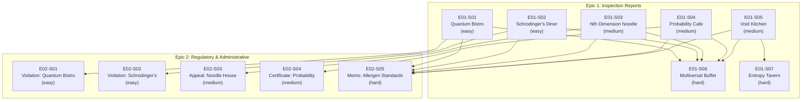

# Run 14 Design: Interdimensional Restaurant Health Inspections

> **Status:** Draft

## Overview

Fourteenth end-to-end test of the Agentic SDLC pipeline. Primary test objective: **validate the fix cycle path** (reviewer REQUEST_CHANGES, builder fix, re-review) and implement quick wins from the [workflow analysis](docs/1-discovery/2026-03-14-workflow-analysis.md). This is the first run to **deliberately plant bugs** in stories to trigger fix cycles -- the pipeline has had 28 consecutive first-pass approvals (Runs 9-13) and the fix machinery is untested in v2.

Content theme: "Interdimensional Restaurant Health Inspections" -- official health inspection reports, violation notices, appeal rulings, compliance certificates, and regulatory memos from the Multiversal Food Safety Authority (MFSA). Documents are written in the dry, exhaustively bureaucratic tone of a health inspector who has seen things no mortal should witness, across dimensions where the laws of physics (and cuisine) vary wildly.

## Goals

1. **Fix cycle validation** -- Deliberately plant 4 defects in easy/medium stories so the reviewer issues REQUEST_CHANGES verdicts. Tests orchestrator re-dispatch, builder fix, re-review, and multi-cycle telemetry.
2. **Workflow quick wins** -- Orchestrator implements fixes A-H from the workflow analysis before dispatching builders.
3. **Cross-epic merge** -- Two epics with cross-epic dependencies validate the merge path.
4. **Parallel dispatch with 4 stories** -- Wave 1 dispatches 4 independent easy stories in a single wave (pending `maxParallelBuilders` config, currently 3).
5. **Two-epic board management** -- Epic status sync across both epics.
6. **Difficulty distribution** -- 4 easy, 5 medium, 3 hard across 12 stories in 2 epics.

## Non-Goals

- Testing C# compilation, DI wiring, or unit tests (markdown content only)
- More than 2 epics (the backlog issue specifies exactly 2)
- Producing publication-quality creative writing (this is a workflow test)
- Testing infrastructure changes (quick wins A-H are pre-build orchestrator work)

---

## Voice and Tone Guidelines

- **Tone:** Dry, bureaucratic, deadpan. The MFSA takes its work with deadly seriousness. Inspectors document horrors beyond mortal comprehension with the same clinical detachment they would use for a dripping faucet. Think FDA inspection reports crossed with H.P. Lovecraft's field notes.
- **Register:** Official governmental language. "The establishment was found to be in violation of Regulation 7.4.2(b)(iii)" even when the violation involves a sentient soup attempting to consume patrons. The comedy arises from the collision between bureaucratic formality and interdimensional absurdity.
- **Perspective:** Written by career MFSA inspectors -- beings who have inspected restaurants across every known dimension and are now profoundly desensitized. Tentacles in the kitchen? Note it on the form. Temporal loops causing food to age in reverse? Citation issued. The soup is screaming? Check the noise ordinance compliance.
- **Consistent universe details:** All documents reference the MFSA's governing statute (the Multiversal Food Safety Act of Cycle 7,042), use the MFSA document numbering system, and reference the MFSA's headquarters on Dimension Prime. Inspector names and badge numbers should be consistent within a story but may vary across stories (multiple inspectors on staff).

## Document Numbering System

Every document must use the MFSA numbering convention:

| Document Type | Format | Example |
|---------------|--------|---------|
| Inspection Report | `MFSA-INS-[YYYY]-[NNN]` | MFSA-INS-2026-001 |
| Violation Notice | `MFSA-VIO-[YYYY]-[NNN]` | MFSA-VIO-2026-001 |
| Appeal Ruling | `MFSA-APL-[YYYY]-[NNN]` | MFSA-APL-2026-001 |
| Compliance Certificate | `MFSA-CRT-[YYYY]-[NNN]` | MFSA-CRT-2026-001 |
| Regulatory Memo | `MFSA-REG-[YYYY]-[NNN]` | MFSA-REG-2026-001 |

## Document Header Template

Every document must begin with this header:

```markdown
# [Document Title]

**Document No.:** [MFSA-XXX-YYYY-NNN]
**Document Type:** [Inspection Report / Violation Notice / Appeal Ruling / Compliance Certificate / Regulatory Memo]
**Issuing Authority:** Multiversal Food Safety Authority
**Inspector/Author:** [Name], Badge [Number]
**Dimension:** [Dimension designation, e.g., "Dimension 7-Gamma"]
**Establishment:** [Restaurant name]
**Date of Inspection/Issue:** [Date]
**Classification:** [ROUTINE / CRITICAL / EMERGENCY / ADMINISTRATIVE]

---
```

---

## Epic 1: Inspection Reports

The actual health inspection documents from various interdimensional restaurants. Each report documents a visit to a different establishment operating in a different dimension with its own unique physics, biology, and culinary traditions.

### E01-S01: "Routine Inspection: The Quantum Bistro" -- `difficulty/easy`

Create `test-output/interdimensional-health-inspections/inspection-quantum-bistro.md`

**Content requirements:**

- Document type: Inspection Report
- Document No.: MFSA-INS-2026-001
- Dimension: Dimension 4-Alpha (where probability is a suggestion rather than a law)
- Establishment: The Quantum Bistro
- Classification: ROUTINE
- Content: A routine health inspection of a restaurant where dishes exist in a superposition of states until observed by the diner. The inspector documents issues with food items that are simultaneously cooked and raw, a walk-in freezer that is also the kitchen (depending on the observer), and staff who may or may not exist during any given shift. The inspection should be structured as: General Observations, Kitchen Assessment, Food Storage Compliance, Staff Hygiene, and Overall Rating.
- Include an "Inspection Scorecard" table with categories rated on the MFSA's standard A-F scale.
- Include exactly 3 violations noted during the inspection.
- Word count: 150-250

**Why easy:** Single document, straightforward inspection report template, one establishment. The humor comes from applying mundane health codes to quantum physics absurdities.

**Acceptance criteria:**

- [ ] File exists at `test-output/interdimensional-health-inspections/inspection-quantum-bistro.md`
- [ ] Follows document header template
- [ ] Includes Inspection Scorecard table with A-F ratings
- [ ] Lists at least 5 violations found during inspection
- [ ] Bureaucratic tone maintained throughout
- [ ] Word count 150-250
- [ ] Document number is MFSA-INS-2026-001

### E01-S02: "Critical Violations: Schrodinger's Diner" -- `difficulty/easy`

Create `test-output/interdimensional-health-inspections/inspection-schrodingers-diner.md`

**Content requirements:**

- Document type: Inspection Report
- Document No.: MFSA-INS-2026-002
- Dimension: Dimension 4-Alpha (same dimension as The Quantum Bistro)
- Establishment: Schrodinger's Diner
- Classification: CRITICAL
- Content: A critical inspection report for a diner where opening the kitchen door changes the state of everything inside. The inspector discovered that health code compliance can only be verified when no one is looking, creating a fundamental enforcement paradox. The diner's signature dish -- "The Cat's Meow Casserole" -- was found to be both safe and unsafe for consumption until tasted. The report should note the philosophical implications for food safety regulation while maintaining strict bureaucratic objectivity.
- Include a "Violation Summary" section with violation codes and descriptions.
- Include an "Inspector's Recommendation" section.
- Word count: 150-250

**Why easy:** Same dimension as S01, simple report structure, single establishment. The quantum physics premise is established in S01 so the builder has a tonal reference (though no file dependency).

**Acceptance criteria:**

- [ ] File exists at `test-output/interdimensional-health-inspections/inspection-schrodingers-diner.md`
- [ ] Follows document header template
- [ ] Includes Violation Summary section with codes and descriptions
- [ ] Includes Inspector's Recommendation section
- [ ] Bureaucratic tone maintained throughout
- [ ] Word count 150-250
- [ ] Document number is MFSA-INS-2026-002

### E01-S03: "Follow-Up Inspection: The Nth Dimension Noodle House" -- `difficulty/medium`

Create `test-output/interdimensional-health-inspections/inspection-nth-dimension-noodle-house.md`

**Content requirements:**

- Document type: Inspection Report (Follow-Up)
- Document No.: MFSA-INS-2026-003
- Dimension: Dimension N (where N is a variable that changes hourly)
- Establishment: The Nth Dimension Noodle House
- Classification: ROUTINE
- Content: A follow-up inspection of a noodle restaurant operating in a dimension where spatial dimensions are not fixed. The establishment was previously cited for violations including noodles that extend into adjacent dimensions (tripping hazard for beings in Dimension N+1), a kitchen that periodically folds into itself, and serving portions that change size relative to the diner's current dimensional state. This follow-up documents which prior violations have been corrected and which persist.
- The report must include a "Prior Violations Status" table showing each previous violation, its code, and current status (Corrected / Persistent / Worsened / Now In A Different Dimension).
- Include a "Dimensional Stability Assessment" section rating the establishment's structural integrity across at least 3 adjacent dimensions.
- Include a "Corrective Actions Required" section with deadlines.
- Word count: 250-400

**Why medium:** Follow-up inspection format requires tracking prior violations (table), dimensional stability assessment adds a second structured section, and the "variable dimension" concept requires more creative writing to maintain internal consistency.

**Acceptance criteria:**

- [ ] File exists at `test-output/interdimensional-health-inspections/inspection-nth-dimension-noodle-house.md`
- [ ] Follows document header template
- [ ] Includes Prior Violations Status table with at least 4 entries
- [ ] Includes Dimensional Stability Assessment section
- [ ] Includes Corrective Actions Required section with deadlines
- [ ] Bureaucratic tone maintained throughout
- [ ] Word count 250-400
- [ ] Document number is MFSA-INS-2026-003

### E01-S04: "Special Event Inspection: The Probability Cafe" -- `difficulty/medium`

Create `test-output/interdimensional-health-inspections/inspection-probability-cafe.md`

**Content requirements:**

- Document type: Inspection Report (Special Event)
- Document No.: MFSA-INS-2026-004
- Dimension: Dimension 7-Gamma (where cause and effect are only loosely correlated)
- Establishment: The Probability Cafe
- Classification: ROUTINE
- Content: A special event inspection conducted during the cafe's annual "Infinite Improbability Brunch," where the menu is generated by a random probability field and diners receive whatever dish is most statistically unlikely given their order. The inspector must document food safety compliance for dishes that do not exist until they are served and may retroactively never have existed after being consumed. Special attention to the dessert course, which has a 12% chance of being a small neutron star.
- Include a "Special Event Compliance Checklist" with at least 8 items.
- Include a "Statistical Anomaly Log" documenting at least 3 improbable food safety events observed during the inspection.
- Word count: 250-400

**Why medium:** Special event format with multiple structured sections (checklist, anomaly log). The probability theme requires creative handling of food safety concepts in a non-deterministic context.

**Acceptance criteria:**

- [ ] File exists at `test-output/interdimensional-health-inspections/inspection-probability-cafe.md`
- [ ] Follows document header template
- [ ] Includes Special Event Compliance Checklist with at least 8 items
- [ ] Includes Statistical Anomaly Log with at least 3 entries
- [ ] Includes Contamination Timeline table
- [ ] Bureaucratic tone maintained throughout
- [ ] Word count 250-400
- [ ] Document number is MFSA-INS-2026-004

### E01-S05: "Emergency Shutdown: The Void Kitchen" -- `difficulty/medium`

Create `test-output/interdimensional-health-inspections/inspection-void-kitchen.md`

**Content requirements:**

- Document type: Inspection Report (Emergency)
- Document No.: MFSA-INS-2026-005
- Dimension: Dimension 0-Null (the dimension between dimensions, where the concept of "space" is optional)
- Establishment: The Void Kitchen
- Classification: EMERGENCY
- Content: An emergency inspection and shutdown report for a restaurant operating in the interstitial void between dimensions. The establishment was reported after three patrons ceased to exist mid-meal (subsequently recovered in Dimension 12-Beta, slightly older and missing dessert). The inspection revealed that the kitchen operates by extracting raw ingredients from the fabric of reality itself, a process that the MFSA has provisionally classified as "probably a health code violation." The shutdown was complicated by the restaurant's lack of a fixed physical location.
- Include an "Incident Timeline" section documenting the sequence of events leading to the shutdown.
- Include a "Patron Recovery Status" table tracking the three missing patrons.
- Include a "Shutdown Order" section with legal citations from the Multiversal Food Safety Act.
- Word count: 250-400

**Why medium:** Emergency format requires incident timeline, patron tracking table, and legal citations -- three distinct structured sections. The "void between dimensions" concept requires creative problem-solving for how an inspection works in a location that does not technically exist.

**Acceptance criteria:**

- [ ] File exists at `test-output/interdimensional-health-inspections/inspection-void-kitchen.md`
- [ ] Follows document header template
- [ ] Includes Incident Timeline section
- [ ] Includes Patron Recovery Status table
- [ ] Includes Shutdown Order section with legal citations
- [ ] Bureaucratic tone maintained throughout
- [ ] Word count 250-400
- [ ] Document number is MFSA-INS-2026-005

### E01-S06: "Comprehensive Annual Review: The Multiversal Buffet" -- `difficulty/hard`

Create `test-output/interdimensional-health-inspections/inspection-multiversal-buffet.md`

**Content requirements:**

- Document type: Inspection Report (Annual Review)
- Document No.: MFSA-INS-2026-006
- Dimension: Dimension Prime (MFSA headquarters dimension)
- Establishment: The Multiversal Buffet
- Classification: ROUTINE
- Content: A comprehensive annual review of the only restaurant licensed to serve cuisine from every known dimension simultaneously. The Multiversal Buffet operates the largest interdimensional kitchen in existence, with food preparation stations spanning 47 dimensions and a dining room that exists in a pocket dimension specifically created to contain all possible table configurations. The review must assess compliance across all MFSA regulatory domains.
- Cross-reference at least 3 inspection reports from E01 (S01-S05) by document number, noting how issues found at other establishments inform the Buffet's compliance assessment (e.g., "The quantum superposition food handling practices cited in MFSA-INS-2026-001 are also present here, though the Buffet has implemented Observer Protocol 7 to mitigate...").
- Include a "Cross-Dimensional Compliance Matrix" -- a table rating the Buffet's compliance in at least 5 regulatory categories across 3+ dimensions.
- Include an "Executive Summary" section suitable for the MFSA Director's desk.
- Include a "Comparative Analysis" section comparing the Buffet's performance to at least 2 other inspected establishments from E01.
- Word count: 400-600

**Why hard:** Cross-references multiple E01 inspection reports by document number and content. Multiple complex sections (compliance matrix, executive summary, comparative analysis). Longest word count. The builder should read prior E01 files on the epic branch to ensure cross-references are accurate.

**Acceptance criteria:**

- [ ] File exists at `test-output/interdimensional-health-inspections/inspection-multiversal-buffet.md`
- [ ] Follows document header template
- [ ] Cross-references at least 3 prior E01 inspection reports by document number
- [ ] Includes Cross-Dimensional Compliance Matrix table
- [ ] Includes Executive Summary section
- [ ] Includes Comparative Analysis section referencing at least 2 other establishments
- [ ] Bureaucratic tone maintained throughout
- [ ] Word count 400-600
- [ ] Document number is MFSA-INS-2026-006

### E01-S07: "Incident Investigation: The Entropy Tavern" -- `difficulty/hard`

Create `test-output/interdimensional-health-inspections/inspection-entropy-tavern.md`

**Content requirements:**

- Document type: Inspection Report (Incident Investigation)
- Document No.: MFSA-INS-2026-007
- Dimension: Dimension 13-Omega (where entropy runs in reverse in certain pockets)
- Establishment: The Entropy Tavern
- Classification: EMERGENCY
- Content: An incident investigation report following a "thermodynamic event" at The Entropy Tavern, where a dish served in a reverse-entropy pocket caused time to flow backward for three tables of diners, resulting in them un-eating their meals, which then un-cooked themselves and reverted to raw ingredients that walked out of the kitchen of their own accord. The investigation must document the chain of events, assess whether existing regulations cover reverse-entropy food preparation, identify the root cause, and recommend regulatory changes.
- Cross-reference the Void Kitchen shutdown (MFSA-INS-2026-005) as a precedent case for patron displacement incidents.
- Include an "Evidence Log" table documenting physical evidence collected (noting items that have since ceased to exist or begun existing retroactively).
- Include a "Regulatory Gap Analysis" section identifying areas where current MFSA regulations fail to address reverse-entropy scenarios.
- Include a "Witness Statements" section with at least 3 depositions from beings who experienced the event (noting that some witnesses now claim the event hasn't happened yet).
- Include "Recommendations for Regulatory Amendment" with proposed new regulation text.
- Word count: 400-600

**Why hard:** Incident investigation with complex narrative structure. Multiple structured sections (evidence log, gap analysis, witness statements, recommendations). Cross-references E01-S05. The reverse-entropy concept requires careful handling to maintain internal consistency while being humorous. Longest word count tier.

**Acceptance criteria:**

- [ ] File exists at `test-output/interdimensional-health-inspections/inspection-entropy-tavern.md`
- [ ] Follows document header template
- [ ] Cross-references MFSA-INS-2026-005 (Void Kitchen) as precedent
- [ ] Includes Evidence Log table
- [ ] Includes Regulatory Gap Analysis section
- [ ] Includes Witness Statements with at least 3 depositions
- [ ] Includes Recommendations for Regulatory Amendment
- [ ] Bureaucratic tone maintained throughout
- [ ] Word count 400-600
- [ ] Document number is MFSA-INS-2026-007

---

## Epic 2: Regulatory and Administrative

Violation notices, appeal rulings, compliance certificates, and regulatory memos that reference the inspection reports from E01. These documents demonstrate the MFSA's bureaucratic machinery in action -- the paperwork that follows the fieldwork.

**Cross-epic dependency:** All E02 stories reference E01 inspection reports by document number. The planner must ensure E01 stories are built before their corresponding E02 stories.

### E02-S01: "Violation Notice: The Quantum Bistro" -- `difficulty/easy`

Create `test-output/interdimensional-health-inspections/violation-quantum-bistro.md`

**Content requirements:**

- Document type: Violation Notice
- Document No.: MFSA-VIO-2026-001
- Establishment: The Quantum Bistro
- Classification: ADMINISTRATIVE
- Content: A formal violation notice issued to The Quantum Bistro following the routine inspection documented in MFSA-INS-2026-001. The notice should present violations as a numbered list, specifying the regulation violated, the observed condition, and the required corrective action. Violations should mirror those noted in the inspection report. The tone should be stern but fair -- the MFSA acknowledges that quantum physics makes compliance challenging but insists that the laws of food safety transcend the laws of physics.
- Include a "Penalties and Fines" section with a schedule of fines in Multiversal Credits.
- Include a "Right to Appeal" notice with the appeal filing deadline and procedure.
- Reference inspection report MFSA-INS-2026-001 explicitly.
- Word count: 150-250

**Why easy:** Follows directly from E01-S01's inspection findings. Simple violation notice format -- list of violations, fines, appeal rights. The cross-reference is a single document number.

**Acceptance criteria:**

- [ ] File exists at `test-output/interdimensional-health-inspections/violation-quantum-bistro.md`
- [ ] Follows document header template
- [ ] References MFSA-INS-2026-001 explicitly
- [ ] Includes violations table with regulation codes, observed conditions, and corrective actions
- [ ] Includes Penalties and Fines section
- [ ] Includes Right to Appeal notice
- [ ] Bureaucratic tone maintained throughout
- [ ] Word count 150-250
- [ ] Document number is MFSA-VIO-2026-001

### E02-S02: "Cease and Desist: Schrodinger's Diner" -- `difficulty/easy`

Create `test-output/interdimensional-health-inspections/violation-schrodingers-diner.md`

**Content requirements:**

- Document type: Violation Notice (Cease and Desist)
- Document No.: MFSA-VIO-2026-002
- Establishment: Schrodinger's Diner
- Classification: CRITICAL
- Content: A cease and desist order issued to Schrodinger's Diner following the critical inspection documented in MFSA-INS-2026-002. The order should be more severe than a standard violation notice -- the MFSA is ordering the establishment to cease serving The Cat's Meow Casserole until compliance can be verified (though the order acknowledges the philosophical difficulty of verifying anything at Schrodinger's Diner). The notice includes a list of specific practices that must stop immediately and conditions for resuming operations.
- Include a "Conditions for Resumption of Operations" section.
- Include a "Legal Basis" section citing specific sections of the Multiversal Food Safety Act.
- Reference inspection report MFSA-INS-2026-002 explicitly.
- Word count: 150-250

**Why easy:** Standard cease and desist format. Directly follows E01-S02. Simple structure with clear requirements.

**Acceptance criteria:**

- [ ] File exists at `test-output/interdimensional-health-inspections/violation-schrodingers-diner.md`
- [ ] Follows document header template
- [ ] References MFSA-INS-2026-002 explicitly
- [ ] Includes list of practices to cease immediately
- [ ] Includes Conditions for Resumption of Operations section
- [ ] Includes Legal Basis section
- [ ] Bureaucratic tone maintained throughout
- [ ] Word count 150-250
- [ ] Document number is MFSA-VIO-2026-002

### E02-S03: "Appeal Ruling: The Nth Dimension Noodle House" -- `difficulty/medium`

Create `test-output/interdimensional-health-inspections/appeal-nth-dimension-noodle-house.md`

**Content requirements:**

- Document type: Appeal Ruling
- Document No.: MFSA-APL-2026-001
- Establishment: The Nth Dimension Noodle House
- Classification: ADMINISTRATIVE
- Content: An administrative appeal ruling on The Nth Dimension Noodle House's appeal of violations cited in the follow-up inspection. The ruling should be structured as a quasi-judicial document: case summary, appellant's arguments, MFSA's response, findings of fact, legal analysis, and ruling. The Noodle House argues that regulations written for fixed-dimension establishments cannot fairly apply to a restaurant whose dimensional state is variable. The MFSA panel acknowledges the argument has merit but rules that food safety is a universal constant regardless of dimensional variability.
- Cross-reference inspection report MFSA-INS-2026-003 as the basis for the original citations.
- Include a "Findings of Fact" section with at least 4 numbered findings.
- Include a "Legal Analysis" section citing the Multiversal Food Safety Act.
- Include a "Ruling and Order" section with specific directives.
- Word count: 250-400

**Why medium:** Quasi-judicial format with multiple structured sections (findings, legal analysis, ruling). Requires maintaining a different voice than inspection reports -- more formal, deliberative, with legal reasoning. Cross-references E01-S03.

**Acceptance criteria:**

- [ ] File exists at `test-output/interdimensional-health-inspections/appeal-nth-dimension-noodle-house.md`
- [ ] Follows document header template
- [ ] Cross-references MFSA-INS-2026-003 as basis for original citations
- [ ] Includes Findings of Fact section with at least 4 entries
- [ ] Includes Legal Analysis section
- [ ] Includes Ruling and Order section
- [ ] Quasi-judicial tone maintained throughout
- [ ] Word count 250-400
- [ ] Document number is MFSA-APL-2026-001

### E02-S04: "Compliance Certificate: The Probability Cafe" -- `difficulty/medium`

Create `test-output/interdimensional-health-inspections/certificate-probability-cafe.md`

**Content requirements:**

- Document type: Compliance Certificate
- Document No.: MFSA-CRT-2026-001
- Establishment: The Probability Cafe
- Classification: ADMINISTRATIVE
- Content: A compliance certificate issued to The Probability Cafe following successful completion of corrective actions identified in the special event inspection. The certificate should be the most positive document in the collection -- the MFSA is (grudgingly) acknowledging that the cafe has met all requirements, though the certificate includes a remarkable number of caveats and conditions. The cafe is certified as "Conditionally Compliant (Probability-Adjusted)" -- a new compliance category the MFSA had to create specifically for this establishment.
- Cross-reference inspection report MFSA-INS-2026-003 as the basis for required corrective actions.
- Include a "Compliance Verification Results" table showing each corrective action item, its status, and the verification method used.
- Include a "Conditions and Limitations" section listing at least 5 ongoing compliance conditions.
- Include a "Certificate Validity" section noting the expiration date and renewal requirements.
- Word count: 250-400

**Why medium:** Certificate format with structured verification table, conditions section, and validity terms. The humor comes from bureaucratic reluctance to certify compliance in a probabilistic environment. Cross-references E01-S04.

**Acceptance criteria:**

- [ ] File exists at `test-output/interdimensional-health-inspections/certificate-probability-cafe.md`
- [ ] Follows document header template
- [ ] Cross-references MFSA-INS-2026-004
- [ ] Includes Compliance Verification Results table
- [ ] Includes Conditions and Limitations section with at least 5 conditions
- [ ] Includes Certificate Validity section
- [ ] Bureaucratic tone maintained throughout
- [ ] Word count 250-400
- [ ] Document number is MFSA-CRT-2026-001

### E02-S05: "Regulatory Memo: Cross-Dimensional Allergen Standards" -- `difficulty/hard`

Create `test-output/interdimensional-health-inspections/memo-allergen-standards.md`

**Content requirements:**

- Document type: Regulatory Memo
- Document No.: MFSA-REG-2026-001
- Classification: ADMINISTRATIVE
- Content: An internal regulatory memo from the MFSA's Department of Cross-Dimensional Standards proposing new allergen disclosure requirements for establishments serving cuisine that crosses dimensional boundaries. The memo is prompted by recurring issues documented across multiple inspections -- specifically, the difficulty of allergen labeling when ingredients change composition as they cross dimensional boundaries, when diners' allergies vary based on which dimension they are currently experiencing, and when the concept of "allergy" itself does not translate consistently across all dimensions.
- Cross-reference at least 3 inspection reports from E01 (by document number) as evidence supporting the proposed regulations. Draw specific examples from the inspection findings.
- Include a "Current Regulatory Framework" section summarizing existing allergen rules and their shortcomings.
- Include a "Proposed Amendments" section with at least 4 specific regulatory changes, each with a rationale.
- Include a "Impact Assessment" section analyzing how the proposed changes would affect different categories of establishments (single-dimension, cross-dimensional, void-based).
- Include a "Stakeholder Consultation Summary" section noting feedback from at least 3 stakeholder groups (restaurant owners, inspector corps, interdimensional diner advocacy groups).
- Include a "Recommendation" section with the author's recommendation and implementation timeline.
- Word count: 400-600

**Why hard:** Policy document format with five distinct sections, each requiring substantive content. Cross-references multiple E01 reports with specific details (not just document numbers). The allergen concept must be applied consistently across the established interdimensional framework. Requires synthesizing themes from multiple prior stories into a coherent policy proposal.

**Acceptance criteria:**

- [ ] File exists at `test-output/interdimensional-health-inspections/memo-allergen-standards.md`
- [ ] Follows document header template
- [ ] Cross-references at least 3 E01 inspection reports by document number with specific examples
- [ ] Includes Current Regulatory Framework section
- [ ] Includes Proposed Amendments section with at least 4 amendments and rationales
- [ ] Includes Impact Assessment section
- [ ] Includes Stakeholder Consultation Summary with at least 3 groups
- [ ] Includes Recommendation section with implementation timeline
- [ ] Bureaucratic/policy-memo tone maintained throughout
- [ ] Word count 400-600
- [ ] Document number is MFSA-REG-2026-001

---

## File Naming Summary

| Story | Filename | Difficulty | Doc Number |
|-------|----------|------------|------------|
| E01-S01 | `test-output/interdimensional-health-inspections/inspection-quantum-bistro.md` | easy | MFSA-INS-2026-001 |
| E01-S02 | `test-output/interdimensional-health-inspections/inspection-schrodingers-diner.md` | easy | MFSA-INS-2026-002 |
| E01-S03 | `test-output/interdimensional-health-inspections/inspection-nth-dimension-noodle-house.md` | medium | MFSA-INS-2026-003 |
| E01-S04 | `test-output/interdimensional-health-inspections/inspection-probability-cafe.md` | medium | MFSA-INS-2026-004 |
| E01-S05 | `test-output/interdimensional-health-inspections/inspection-void-kitchen.md` | medium | MFSA-INS-2026-005 |
| E01-S06 | `test-output/interdimensional-health-inspections/inspection-multiversal-buffet.md` | hard | MFSA-INS-2026-006 |
| E01-S07 | `test-output/interdimensional-health-inspections/inspection-entropy-tavern.md` | hard | MFSA-INS-2026-007 |
| E02-S01 | `test-output/interdimensional-health-inspections/violation-quantum-bistro.md` | easy | MFSA-VIO-2026-001 |
| E02-S02 | `test-output/interdimensional-health-inspections/violation-schrodingers-diner.md` | easy | MFSA-VIO-2026-002 |
| E02-S03 | `test-output/interdimensional-health-inspections/appeal-nth-dimension-noodle-house.md` | medium | MFSA-APL-2026-001 |
| E02-S04 | `test-output/interdimensional-health-inspections/certificate-probability-cafe.md` | medium | MFSA-CRT-2026-001 |
| E02-S05 | `test-output/interdimensional-health-inspections/memo-allergen-standards.md` | hard | MFSA-REG-2026-001 |

## Difficulty Distribution

| Difficulty | Count | Stories |
|------------|-------|---------|
| Easy | 4 | E01-S01, E01-S02, E02-S01, E02-S02 |
| Medium | 5 | E01-S03, E01-S04, E01-S05, E02-S03, E02-S04 |
| Hard | 3 | E01-S06, E01-S07, E02-S05 |
| **Total** | **12** | |

## Dependency Graph



**Dependency rationale:**

- **E01-S01, E01-S02:** Fully independent -- no cross-references to other stories.
- **E01-S03, E01-S04, E01-S05:** Independent of each other, but document numbers are specified in this design doc so no build-time file dependency. Can run in parallel.
- **E01-S06:** Cross-references at least 3 prior E01 inspection reports -- depends on S01-S05. Must build after E01 Wave 2.
- **E01-S07:** Cross-references MFSA-INS-2026-005 (Void Kitchen) -- depends on S05.
- **E02-S01:** References MFSA-INS-2026-001 -- depends on E01-S01.
- **E02-S02:** References MFSA-INS-2026-002 -- depends on E01-S02.
- **E02-S03:** References MFSA-INS-2026-003 -- depends on E01-S03.
- **E02-S04:** References MFSA-INS-2026-004 -- depends on E01-S04.
- **E02-S05:** References at least 3 E01 inspection reports -- depends on S01-S05.

**Note on cross-epic dependencies:** Since E02 stories reference E01 inspection reports by document number (specified in this design doc), builders can include the document numbers without reading the actual files. However, the hard story (E02-S05) must pull specific examples from E01 inspections, so it has a true file dependency. The planner should schedule E02-S05 in the final wave. The E02 easy/medium stories can technically run as soon as their E01 dependency is complete, since they reference document numbers only.

## Dispatch Plan

| Wave | Stories | Dispatch | Notes |
|------|---------|----------|-------|
| **Wave 1** | E01-S01, E01-S02, E01-S03, E01-S04 | Parallel (max 3, may need 2 sub-waves) | 2 easy + 2 medium, all E01-independent. `maxParallelBuilders: 3` may require splitting. |
| **Wave 2** | E01-S05, E02-S01, E02-S02 | Parallel (3 stories, **worktree isolation**) | 1 medium + 2 easy. E02 stories depend on E01-S01/S02 from Wave 1. |
| **Wave 3** | E02-S03, E02-S04 | Parallel (2 stories, **worktree isolation**) | 2 medium. Each depends on one E01 medium story from Wave 1. |
| **Wave 4** | E01-S06, E01-S07, E02-S05 | Sequential or parallel (3 hard/hard/hard) | All cross-reference multiple prior stories. E01-S06 and E01-S07 depend on E01, E02-S05 depends on E01. |

**Why this wave structure:**

- **Wave 1:** E01-S01 through E01-S04 are all independent within E01 (no E01 cross-references). Since `maxParallelBuilders: 3`, the planner may split this into sub-waves (e.g., S01+S02+S03 then S04), or dispatch all 4 if the config allows.
- **Wave 2:** E01-S05 has no E01 internal dependencies. E02-S01 and E02-S02 only reference E01-S01 and E01-S02 by document number (available from Wave 1). All 3 fit within `maxParallelBuilders: 3`.
- **Wave 3:** E02-S03 and E02-S04 reference E01-S03 and E01-S04 respectively (both built in Wave 1). Parallel, fits within limit.
- **Wave 4:** The 3 hard stories. E01-S06 cross-references 3+ E01 reports. E01-S07 cross-references E01-S05 (Wave 2). E02-S05 cross-references 3+ E01 reports. The planner decides whether to run these sequentially or in parallel (since `maxParallelBuilders: 3` allows all 3).

**Alternative dispatch (planner's discretion):** If the planner determines that document-number-only references (E02 easy/medium) do not require the actual files, Waves 1-3 could be collapsed. This is left to the planner's judgment based on the dependency graph.

**Estimated execution time:**

- Wave 1 (2 easy + 2 medium, parallel): ~3 min wall-clock
- Wave 2 (1 medium + 2 easy, parallel): ~2.5 min wall-clock
- Wave 3 (2 medium, parallel): ~2.5 min wall-clock
- Wave 4 (3 hard, parallel or sequential): ~4-8 min wall-clock
- Total: ~12-16 min wall-clock, ~30 min sequential agent time

## Acceptance Criteria

### Per-Story

- [ ] Output file exists at the specified path
- [ ] Content follows the document header template
- [ ] Word count within the specified range for the difficulty level
- [ ] Bureaucratic/governmental tone maintained throughout
- [ ] Document numbers match the specification
- [ ] Cross-references (where required) use correct document numbers

### Per-Epic

- [ ] All stories in the epic pass review
- [ ] Epic branch merges cleanly into integration branch
- [ ] Cross-references between documents are consistent

### Cross-Epic

- [ ] E02 documents correctly reference E01 inspection reports by document number
- [ ] E02 content is consistent with the E01 inspection findings

### Workflow (Primary Test Objectives)

- [ ] Fix cycle works end-to-end for at least 3 stories (REQUEST_CHANGES, builder fix, re-review, APPROVE)
- [ ] Telemetry captures fix cycle dispatches as separate entries in dispatches[]
- [ ] Quick wins A-H implemented and working before builder dispatch
- [ ] Cross-epic merge (E01 into integration, E02 into integration)
- [ ] Two-epic board management (epic status sync across both epics)
- [ ] Easy and medium stories dispatch `builder-sonnet`, hard stories dispatch `builder-opus`
- [ ] Worktree isolation used for parallel waves
- [ ] All board transitions complete (Planned, Todo, In Progress, In Review, Done)
- [ ] Per-story, per-epic, and backlog-level telemetry posted
- [ ] Backlog PR opened targeting `main`, stays open for human review
- [ ] All issues listed in PR `Closes` footer for auto-close on merge

## Approaches Considered

### Approach A: Two epics (Reports + Regulatory), 12 stories, 4 planted bugs (recommended)

Two epics mirroring the real MFSA workflow: first the inspections happen (E01), then the paperwork follows (E02). This creates natural cross-epic dependencies where every E02 document references an E01 inspection report. Four bugs planted in easy/medium stories across both epics.

**Pros:**
- Natural cross-epic dependency structure (not forced -- E02 logically follows E01)
- 12 stories with 4/5/3 difficulty distribution meets all minimums
- Cross-epic merge tests a path not exercised since Run 11
- Two-epic board management validates epic status sync
- Four planted bugs distributed across both epics test the fix cycle from multiple angles
- The MFSA document numbering system makes cross-references meaningful and verifiable

**Cons:**
- 12 stories is the largest run to date (Run 13 had 6) -- more execution time
- Cross-epic dependencies add dispatch complexity
- 4 fix cycles add ~20 min to execution time

### Approach B: Two epics, 12 stories, bugs only in E01

Same structure but concentrate all 4 bugs in E01 stories.

**Pros:**
- Simpler for the reviewer -- all bugs are in the same epic
- E02 stories run without interruption after E01

**Cons:**
- Does not test fix cycles in E02 (misses coverage)
- Concentrating bugs in one epic makes the test less representative
- The backlog issue specifically says "spread bugs across both epics"

### Approach C: Three epics (Reports + Violations + Policy), 12 stories

Split E02 into two epics: one for violation-related documents (notices, appeals, certificates) and one for policy documents (regulatory memos).

**Pros:**
- More granular epic grouping
- Tests 3-epic orchestration (never done in v2)

**Cons:**
- The third epic would have only 1 story (the regulatory memo) -- too thin
- Adds orchestration complexity without testing new workflow capabilities
- The backlog issue specifies exactly 2 epics

### Decision

**Approach A.** Two epics with bugs spread across both, matching the backlog issue's requirements. The natural Reports-then-Regulatory structure creates meaningful cross-epic dependencies. Twelve stories is larger than prior runs but necessary to meet the 4/5/3 difficulty distribution with two epics.

## Assumptions and Open Questions

### Assumptions

1. **Content directory `test-output/interdimensional-health-inspections/` will be created by the builder.** Standard `mkdir -p` as in prior runs.
2. **Word counts are approximate.** Reviewers should accept content within 10% of the specified range without flagging.
3. **Document numbers are deterministic.** Builders use the exact document numbers specified in this design doc. This enables cross-references to work even when stories are built in parallel.
4. **Hard stories should read actual files.** E01-S06, E01-S07, and E02-S05 run after their dependencies and should read the prior files to ensure cross-references are accurate. If files are unavailable, the design doc's content requirements serve as a fallback.
5. **Inspector names and badge numbers are story-local.** Different inspectors can author different reports. No need for a shared inspector roster.
6. **The Multiversal Food Safety Act is a fictional statute.** Builders can invent section numbers and regulation codes as needed for legal citations. Consistency within a story is required; cross-story consistency is nice but not mandatory.
7. **`maxParallelBuilders: 3` is a hard limit.** The planner must respect this when designing waves.
8. **Quick wins A-H are orchestrator pre-build work.** The design doc does not specify how to implement them -- that is orchestrator/planner scope.
9. **The reviewer will catch the planted bugs.** The bugs are designed to be obvious to a reviewer comparing the acceptance criteria and story description. If the reviewer does not catch a bug, the orchestrator should not intervene -- that is a genuine test result.
10. **Fix cycles add one iteration.** Each planted bug should be fixable in a single builder re-dispatch. If a fix cycle itself introduces a new issue, the max 2-cycle limit from the dispatch protocol applies.

### Open Questions

1. **Should Wave 1 dispatch 3 or 4 stories?** The current `maxParallelBuilders: 3` config would cap at 3. If the planner wants to dispatch all 4 E01-independent stories in Wave 1, it would need to split into a sub-wave. Left to the planner's discretion.
2. **Should E01-S07 (Entropy Tavern) be in Wave 4 with the other hard stories, or can it run in Wave 3?** It only depends on E01-S05 (Wave 2), not on E01-S06. The planner could schedule it earlier to reduce Wave 4 from 3 hard stories to 2. Left to planner's judgment.
3. **Should the reviewer be primed to look for bugs?** The backlog issue says the reviewer should catch bugs naturally. The design doc does not instruct the reviewer about planted bugs -- the reviewer's normal process should suffice.

---

## Sealed Section: Planted Bugs

> **WARNING: DO NOT INCLUDE THIS SECTION IN STORY ISSUES.**
> This section documents the 4 deliberately planted bugs for fix cycle testing.
> The orchestrator reads this section to verify the reviewer catches each bug.
> The planner and builder agents must NOT see this section.

### Bug 1: Contradictory Acceptance Criteria (E01-S01, easy)

**Story:** E01-S01 "Routine Inspection: The Quantum Bistro"

**The bug:** The story description says "Include exactly 3 violations noted during the inspection" but the acceptance criteria checklist says "Lists at least 5 violations found during inspection." These two requirements contradict each other -- the builder cannot satisfy both simultaneously.

**Expected builder behavior:** The builder will likely follow either the description (3 violations) or the acceptance criteria (5 violations), but not both. Most builders follow the acceptance criteria checklist, so they will probably write 5 violations.

**Expected reviewer behavior:** The reviewer should notice the contradiction between "exactly 3" in the description and "at least 5" in the acceptance criteria and issue REQUEST_CHANGES. The fix should resolve to the higher number (at least 5 violations) since acceptance criteria take precedence.

**Fix:** Builder updates to include at least 5 violations. The description's "exactly 3" was the planted error.

### Bug 2: Missing Required Section (E01-S04, medium)

**Story:** E01-S04 "Special Event Inspection: The Probability Cafe"

**The bug:** The acceptance criteria include "Includes Contamination Timeline table" but the story description never mentions a contamination timeline. The description mentions a "Special Event Compliance Checklist" and a "Statistical Anomaly Log" but not a contamination timeline. The builder is unlikely to include a section that is not described.

**Expected builder behavior:** The builder will create the described sections (checklist, anomaly log) but skip the contamination timeline because there is no guidance on what it should contain.

**Expected reviewer behavior:** The reviewer should notice the acceptance criteria reference to "Contamination Timeline table" and flag it as missing. REQUEST_CHANGES should ask the builder to add the section.

**Fix:** Builder adds a "Contamination Timeline" table documenting the chronological sequence of contamination events observed during the brunch. Content is left to the builder's creativity within the probability cafe's theme.

### Bug 3: Format Contradiction (E02-S01, easy)

**Story:** E02-S01 "Violation Notice: The Quantum Bistro"

**The bug:** The story description says "present violations as a numbered list" but the acceptance criteria say "Includes violations table with regulation codes, observed conditions, and corrective actions." A numbered list and a table are different formats. The builder must choose one.

**Expected builder behavior:** The builder will likely create a table (since the AC is more specific about columns), ignoring the "numbered list" instruction in the description. Alternatively, some builders may try to create a numbered list that mimics table structure.

**Expected reviewer behavior:** The reviewer should notice the format inconsistency between "numbered list" (description) and "violations table" (AC). REQUEST_CHANGES should resolve to a table format since the AC specifies columns (regulation codes, observed conditions, corrective actions) that require tabular presentation.

**Fix:** Builder updates to use a table format. The description's "numbered list" was the planted error.

### Bug 4: Wrong Cross-Reference (E02-S04, medium)

**Story:** E02-S04 "Compliance Certificate: The Probability Cafe"

**The bug:** The story description says "Cross-reference inspection report MFSA-INS-2026-003 as the basis for required corrective actions." But MFSA-INS-2026-003 is the Nth Dimension Noodle House inspection, not the Probability Cafe inspection. The correct document number is MFSA-INS-2026-004 (the Probability Cafe's special event inspection from E01-S04). The acceptance criteria correctly state "Cross-references MFSA-INS-2026-004." The builder will follow either the description (wrong number) or the AC (correct number).

**Expected builder behavior:** The builder will likely use MFSA-INS-2026-003 from the description, since the description provides the narrative context for the cross-reference. Alternatively, some builders may check the AC and use the correct number.

**Expected reviewer behavior:** The reviewer should notice the mismatch between the description's MFSA-INS-2026-003 and the AC's MFSA-INS-2026-004, and verify which is correct (the Probability Cafe's inspection is MFSA-INS-2026-004 per the File Naming Summary). REQUEST_CHANGES should ask the builder to use MFSA-INS-2026-004.

**Fix:** Builder updates the cross-reference to MFSA-INS-2026-004. The description's MFSA-INS-2026-003 was the planted error.

### Bug Summary

| Bug | Type | Story | Epic | Difficulty |
|-----|------|-------|------|------------|
| 1 | Contradictory acceptance criteria | E01-S01 | E01 | easy |
| 2 | Missing required section | E01-S04 | E01 | medium |
| 3 | Format contradiction | E02-S01 | E02 | easy |
| 4 | Wrong cross-reference | E02-S04 | E02 | medium |

**Distribution:** 2 bugs in E01, 2 bugs in E02. All in easy or medium stories. Each bug is a different type. Each is fixable in one iteration.
