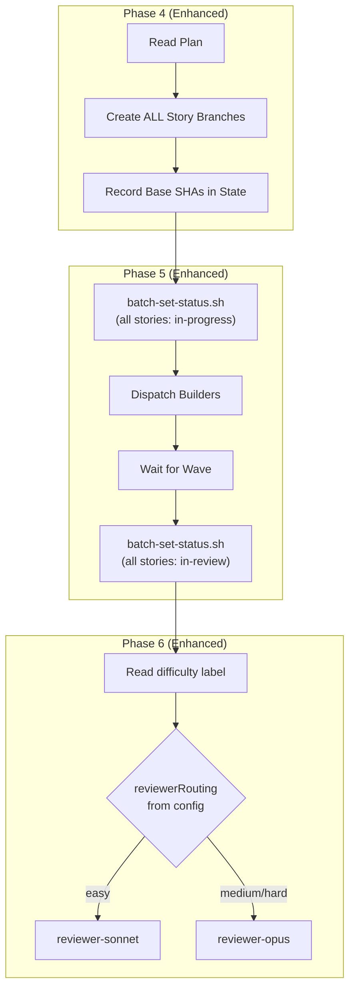
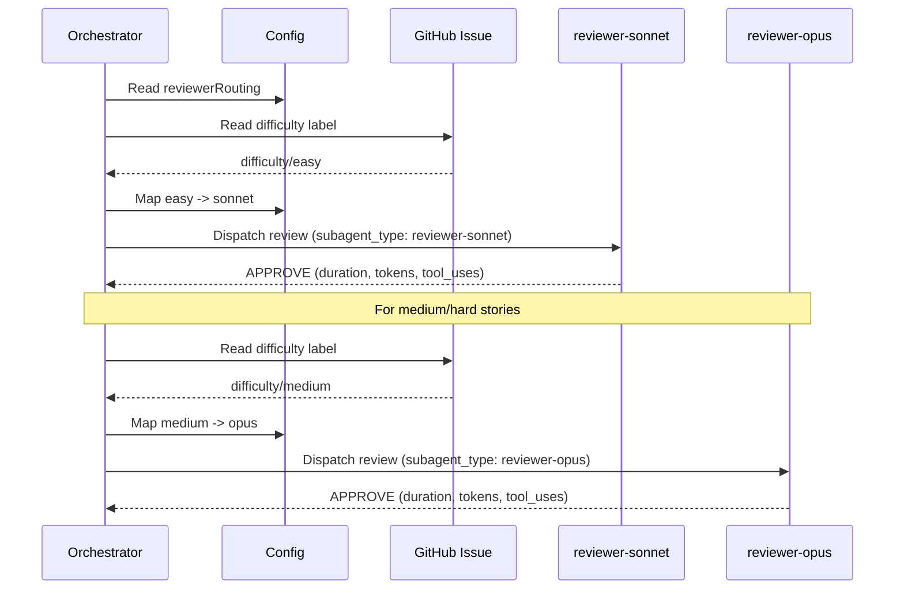

# Design: Orchestrator Improvements

> Historical record (March 2026). Measurements come from controlled synthetic workloads and early infrastructure runs; see [case studies](../case-studies.md) for scoped findings.

> **Status:** Draft

## Problem

The orchestrator has been refined through 14 test runs, producing a stable pipeline with 100% completion rate and zero organic fix cycles. However, several known efficiency gaps remain:

1. **Review cost inefficiency** -- All reviews use Opus regardless of story difficulty. Review is the most expensive phase (35-41% of total run cost per the telemetry analysis). Using Sonnet for easy stories would save ~15-20% of review cost per run.
2. **Wave transition overhead** -- Story branches are created one wave at a time (~30s per wave transition). Board status updates are sequential (3 API calls each, ~1-2 min per run total).
3. **Idle time between build and review** -- The orchestrator waits for all builders in a wave to finish before dispatching any reviewers, leaving the fastest builder's output idle.
4. **Planner API bottleneck** -- The planner interleaves thinking and GitHub issue creation (~12 min phase, most spent on sequential API calls).
5. **Cosmetic divergence** -- Parallel builders produce different formats for shared structural elements (documented in Run 5 E01, Run 12 E01).
6. **Undocumented patterns** -- The orchestrator override pattern (used in Runs 9, 14) and overhead metrics capture (Run 10 showed 51% overhead) lack formal documentation.

## Goals

- Reduce per-run review cost by ~15-20% through difficulty-aware reviewer routing.
- Reduce per-run wall-clock time by ~2-4 min through branch pre-creation and batched board updates.
- Formalize two recurring orchestrator patterns (override, overhead capture) as documented conventions.
- Add planner guidance for format consistency across parallel builders.
- Evaluate streaming reviews and batch issue creation for feasibility and risk.

## Non-Goals

- **Pipelined waves** (starting Wave N+1 builds while Wave N reviews are running) -- High complexity (requires tracking "building-ahead" vs "ready-to-merge" states), deferred to the advanced tier per the roadmap.
- **Parallel retro + PR review** -- Already identified as a separate optimization in the roadmap (item 7). Low effort but couples with the backlog PR sequencing. Can be added independently.
- **Reviewer agent variants** (reviewer-sonnet.md, reviewer-opus.md) -- Unnecessary overhead. Unlike builders where model differences affect code generation quality, reviewer dispatch uses the existing `reviewer.md` agent with `model` parameter override via subagent type. See Approach below.

---

## Improvement 1: Sonnet Reviews for Easy Stories

### Recommendation

Add `reviewerRouting` to `agentic-sdlc-config.json`. The orchestrator reads the difficulty label and dispatches the reviewer with the appropriate model, using reviewer variant agent files (same pattern as builders).

### Reasoning

- Review is 35-41% of total run cost. Easy-story reviews are a pure cost sink -- Opus reviews them in ~52s with ~22K tokens, but Sonnet could do equivalent work for ~70% less cost.
- Across Runs 8-14, zero easy-story reviews found critical issues that Sonnet would have missed. Easy stories are single-file, config, or content changes -- the review surface is small and deterministic.
- The telemetry data shows: easy story reviews average ~22K tokens at Opus cost (~$0.66/review). At Sonnet rates, the same review would cost ~$0.13/review.

### Approach: Reviewer Variant Files

**Recommended.** Follow the same pattern as builder variants (`builder-haiku.md`, `builder-sonnet.md`, `builder-opus.md`):

Create `reviewer-sonnet.md` and `reviewer-opus.md` with identical body content to `reviewer.md` but different `model` frontmatter. The orchestrator dispatches `subagent_type: "reviewer-sonnet"` for easy stories and `subagent_type: "reviewer-opus"` for medium/hard stories.

This mirrors the builder routing pattern and requires no new infrastructure -- just two new agent files and a config section.

### Config Schema Addition

```json
{
  "reviewerRouting": {
    "easy": "sonnet",
    "medium": "opus",
    "hard": "opus"
  }
}
```

The `reviewerRouting` section follows the same structure as `modelRouting` (builder routing). Scripts read it the same way via `config.sh`.

### Alternative Considered

**Single reviewer.md with model parameter.** The Agent tool schema does not support a `model` parameter (`additionalProperties: false` -- documented in CLAUDE.md's Known Limitations). The only way to control the model is via `subagent_type` pointing to a variant file with the correct `model` frontmatter. This is why builder variants exist.

### Changes Required

| File | Change |
|------|--------|
| `.claude/agents/reviewer-sonnet.md` | New file: identical to `reviewer.md`, `model: sonnet` |
| `.claude/agents/reviewer-opus.md` | New file: identical to `reviewer.md`, `model: opus` |
| `.claude/agentic-sdlc-config.json` | Add `reviewerRouting` section |
| `scripts/lib/config.sh` | Add `CFG_REVIEW_EASY`, `CFG_REVIEW_MEDIUM`, `CFG_REVIEW_HARD` |
| `.claude/agents/orchestrator.md` | Update Phase 6 dispatch to use reviewer routing |
| `CLAUDE.md` | Document `reviewerRouting` config, reviewer variant sync convention, dispatch protocol update |
| `scripts/dispatch-workflow.sh` | Update reviewer dispatch to use `reviewerRouting` config |

### Scope Risk

Low. The pattern is well-established (copy from builder variants). The only risk is if Sonnet reviews miss issues that Opus would catch on easy stories -- mitigate by monitoring the first run and comparing verdicts.

---

## Improvement 2: Early Story Branch Creation

### Recommendation

Include. Move all story branch creation to Phase 4 (Read Stories and Build Dependency Graph), immediately after parsing the plan. Record the base commit per epic so all branches are created from a known state.

### Reasoning

- Eliminates ~30s of branch creation overhead per wave transition.
- Creates a cleaner separation: Phase 4 = prepare all git state, Phase 5 = dispatch only.
- Currently the orchestrator creates branches per-wave, which means Phase 5 interleaves git operations with agent dispatch. This is fragile -- a branch creation failure mid-wave can leave the workflow in a partially-dispatched state.

### Approach

In Phase 4, after reading the plan and parsing the dependency graph:

1. Create all epic branches from the integration branch.
2. For each story in the plan, create its story branch from the epic branch.
3. Push all branches to remote.
4. Record the base commit SHA per epic branch (used for cross-contamination detection).

```bash
# Phase 4: Create all branches upfront
git checkout backlog/<N>-<slug> && git pull
for EPIC in <epic-list>; do
  git checkout -b epic/$EPIC backlog/<N>-<slug>
  git push -u origin epic/$EPIC
  EPIC_BASE_SHA=$(git rev-parse HEAD)
  # Record base SHA in state file

  for STORY in <stories-in-epic>; do
    git checkout -b $STORY_BRANCH epic/$EPIC
    git push -u origin $STORY_BRANCH
    git checkout epic/$EPIC  # return to epic for next story
  done
done
```

The orchestrator state file already has `epics.*.stories.*.branch` -- the base SHA can be stored alongside as `epics.*.base_sha`.

### Changes Required

| File | Change |
|------|--------|
| `.claude/agents/orchestrator.md` | Move branch creation from Phase 5 to Phase 4, add base SHA recording |
| `CLAUDE.md` | Update "Story branch creation for parallel waves" convention to reference Phase 4 |

### Scope Risk

Low. This is a reordering of existing operations, not new logic. The main risk is creating branches for stories that never get dispatched (e.g., workflow interrupted mid-run) -- but stale branches are cleaned up by `cleanup-post-merge.sh` and are harmless.

---

## Improvement 3: Streaming Reviews

### Recommendation

**Defer.** The savings (~1-2 min per wave) do not justify the complexity increase in the orchestrator's state tracking for the current project state. Revisit when the pipeline handles larger workloads (10+ stories per wave) or when wall-clock time becomes a bottleneck.

### Reasoning

- **Complexity cost is high.** The orchestrator currently has a clean loop: dispatch builders (parallel) -> wait for all -> dispatch reviewers (parallel) -> wait for all -> merge. Streaming reviews require tracking per-story "built-not-reviewed" state, dispatching reviews as background agents while waiting for remaining builders, and handling the case where a review completes before all builders finish. This adds 3-4 new state transitions to the orchestrator.
- **Savings are modest.** For a 3-story wave where builders take 1m47s-2m25s, the review of the fastest builder starts ~38s earlier. Compound savings across a typical 3-wave run: ~1-2 min. This is ~4-7% of a 30 min run.
- **Risk of new failure modes.** If a reviewer dispatched mid-wave encounters an issue, the orchestrator must decide whether to halt remaining builders (losing parallel progress) or continue (potentially building on a broken foundation). The current batch model avoids this decision entirely.
- **The Agent tool may not support mid-flight dispatch.** Dispatching a reviewer agent while the Agent tool is already waiting on parallel builder returns is untested. The Agent tool returns when ALL dispatched agents complete -- there may be no mechanism to dispatch a new agent mid-wait.

### Alternative Worth Considering

A simpler variant: instead of true streaming, **dispatch reviewers for completed stories immediately after the last builder returns** (in the same response as the merge/cleanup for that wave), rather than waiting for all post-wave verification. This captures ~30s without new state complexity.

---

## Improvement 4: Batched Board Updates

### Recommendation

Include. Accumulate board transitions during wave dispatch and apply them at wave boundaries in a single batch.

### Reasoning

- Each `item-set-status.sh` call does a GraphQL query + mutation + verification = 3 API calls with a 1s verification sleep. For a 3-story wave, setting In Progress + In Review = 6 calls * 3 API round trips = ~18 API calls and ~6s of sleep.
- Batching reduces this to a single pass at wave boundaries.
- Reduces rate limit pressure (the pipeline has hit 5000 points/hour limits in Runs 6, 8, and 10).
- Board state is for human visibility, not workflow correctness -- momentary staleness is acceptable.

### Approach

Create a new `scripts/batch-set-status.sh` that accepts multiple issue-status pairs and executes them in a single script invocation, sharing the verification sleep:

```bash
# Usage: ./scripts/batch-set-status.sh <issue1>:<status1> <issue2>:<status2> ...
# Example: ./scripts/batch-set-status.sh 112:in-progress 113:in-progress 114:in-progress
```

Internally, it:
1. Fetches current status for all issues in parallel (3 concurrent GraphQL queries).
2. Filters to only those that need updating (skip already-correct).
3. Applies mutations sequentially (GitHub Projects API does not handle concurrent mutations).
4. Runs a single verification pass for all issues after a shared 1s sleep.

The orchestrator calls this at two points per wave:
- **Before dispatch:** `batch-set-status.sh <s1>:in-progress <s2>:in-progress <s3>:in-progress`
- **After wave completes:** `batch-set-status.sh <s1>:in-review <s2>:in-review <s3>:in-review`

### Alternative Considered

**Modify `item-set-status.sh` to accept multiple arguments.** Rejected because the current single-issue interface is used by builders (`item-start.sh`, `item-review.sh`) and should remain simple. A new batch script composes with the existing infrastructure without modifying it.

### Changes Required

| File | Change |
|------|--------|
| `scripts/batch-set-status.sh` | New script |
| `scripts/lib/config.sh` | No changes (batch script sources this) |
| `.claude/agents/orchestrator.md` | Update Phase 5 to use batch-set-status at wave boundaries |
| `CLAUDE.md` | Add to helper scripts table |

### Scope Risk

Low. The batch script is a thin wrapper around existing `item-set-status.sh` logic with shared verification. The main risk is that parallel GraphQL queries for fetching current status may hit rate limits in pathological cases -- mitigate with sequential fallback.

---

## Improvement 5: Batch Issue Creation in Planner

### Recommendation

**Defer.** The planner's sequential issue creation is slow (~12 min total phase) but the primary bottleneck is thinking/writing time, not API calls. The batch optimization would save ~2-3 min per plan phase. However, the PM Abstraction Layer (backlog item 109) will fundamentally change how issues are created -- optimizing the current GitHub-specific path has low longevity.

### Reasoning

- **Near-term value is modest.** The planner spends ~5-8 min on thinking/writing and ~4-5 min on sequential API calls. Batching API calls would save ~2-3 min, or ~5-10% of a full run.
- **PM Abstraction makes this obsolete.** Backlog item 109 (PM Abstraction Layer) introduces `pm_create_item()` as the interface. The Local-First PM (item 111) makes creation instant (filesystem writes). Optimizing the GitHub adapter's sequential calls is technical debt that gets replaced.
- **Risk of rate limits.** The planner already consumed 50-60 API calls in Run 10. Batching (e.g., 5 concurrent `gh issue create`) would spike API usage and may trigger secondary rate limits or API abuse detection.
- **Planner instruction complexity.** The planner currently interleaves thinking with issue creation -- "create E01-S01, then use its number in E01-S02's Blocked by field." Batching requires the planner to pre-assign issue numbers or post-process Blocked by fields after all issues exist. This adds planning complexity for a modest speed gain.

### Alternative Worth Considering

A lighter optimization: group the `gh project item-add` and `item-set-status.sh` calls at the end (after all issues are created) rather than running them per-issue. This saves ~1 min without changing the issue creation flow.

---

## Improvement 6: Format Templates for Cross-Story Parallel Content

### Recommendation

Include. Add a guideline to `planner.md` requiring format specification for shared structural elements in parallel stories.

### Reasoning

- Run 5 E01 had three different formats for the same metrics section because different models chose different representations (bullet lists vs. tables vs. prose).
- Run 12 E01 had dash/date inconsistency across parallel stories.
- The fix is trivial (one paragraph in planner instructions) and prevents a recurring cosmetic issue.

### Approach

Add to `planner.md` in the "Writing Docs" or "Output Format" section:

```markdown
### Format Templates for Parallel Content

When an epic's stories produce content with shared structural elements
(e.g., metrics sections, rating tables, status fields, date formats),
the plan MUST specify the exact rendering format for each shared element.
Include a "Format Contract" section in the epic's plan with:

- The element name (e.g., "Metrics Table")
- The exact format (e.g., "Use a 3-column markdown table: Metric | Value | Rating")
- An example snippet

This prevents cosmetic divergence when parallel builders independently
choose different representations for the same structural pattern.
```

The builder agent already follows acceptance criteria over story descriptions. Making the format explicit in the plan's acceptance criteria ensures compliance without builder instruction changes.

### Changes Required

| File | Change |
|------|--------|
| `.claude/agents/planner.md` | Add "Format Templates for Parallel Content" guideline |
| `docs/4-reviews/retro-recommendations.md` | Move recommendation E to Implemented |

### Scope Risk

None. This is a documentation-only change. The planner may not always follow the guideline perfectly, but even partial compliance improves consistency.

---

## Improvement 7: Document Orchestrator Override Pattern

### Recommendation

Include. Formalize the orchestrator override pattern in `orchestrator.md` as a documented convention with required evidence format.

### Reasoning

- The pattern has been used in 2 runs (Run 9 cross-contamination cherry-pick, Run 14 E01-S04 cross-contamination removal).
- Both times, the orchestrator fixed the issue before reviewer dispatch, and the reviewer flagged the pre-fix state. The orchestrator overrode the verdict with documented evidence.
- Without formal documentation, each orchestrator instance re-discovers this pattern, which wastes context window and risks inconsistent override formatting.

### Approach

Add a new section to `orchestrator.md` after the "Error Handling" section:

```markdown
## Orchestrator Override Pattern

When the orchestrator has already fixed an issue before or during reviewer
dispatch (e.g., cherry-picking to fix cross-contamination, removing stale
files from prior waves), and the reviewer flags the pre-fix state as a
critical issue, the orchestrator MAY override the review verdict.

**Requirements for an override:**

1. The fix must be committed and verifiable in git history.
2. The override must be documented as a comment on the story issue with:
   - The commit hash that contains the fix
   - A description of what was fixed and why
   - The reviewer finding being overridden (by number)
   - The note: "Override: issue was fixed by orchestrator before/after
     review dispatch. See commit <hash>."
3. The telemetry entry for the overridden review should record
   0 tokens/0 duration with a note explaining the override.

**When NOT to override:**

- If the reviewer found an issue that the orchestrator did not already fix
- If the fix is incomplete or only partially addresses the finding
- If there is any doubt about whether the fix is correct

In these cases, dispatch a builder for a fix cycle instead.
```

### Changes Required

| File | Change |
|------|--------|
| `.claude/agents/orchestrator.md` | Add "Orchestrator Override Pattern" section |
| `CLAUDE.md` | No changes needed (this is orchestrator-specific, not project-wide) |
| `docs/4-reviews/retro-recommendations.md` | Move recommendation F to Implemented |

### Scope Risk

None. Documentation only.

---

## Improvement 8: Capture Orchestrator Overhead Metrics

### Recommendation

Include. Capture `/cost` output at session start/end and compute the delta. Store in the orchestrator state file and include as a row in backlog telemetry.

### Reasoning

- Orchestrator overhead was 51% of wall-clock time in Run 10 (31m of 61m). This is a significant fraction that is currently unmeasured.
- The orchestrator's own token consumption runs in the parent session and is not returned by the Agent tool. Without explicit capture, this cost is invisible.
- Tracking overhead across runs would surface efficiency regressions (e.g., if a convention change causes the orchestrator to use more tokens).

### Approach

At the start of Phase 0, capture the current session cost:

```bash
# At session start: capture /cost baseline
# The orchestrator notes the session's running token count from the
# Claude Code session context (available via /cost in the UI, or
# from the session metadata if accessible programmatically).
```

At the end of the workflow (after all telemetry is posted), capture the final cost and compute the delta:

```
Orchestrator overhead = Final session tokens - Initial session tokens - Sum(all subagent tokens)
```

Store in the state file:

```json
{
  "session": {
    "start_tokens": 0,
    "end_tokens": null
  },
  "overhead": {
    "tokens": null,
    "estimated_cost": null
  }
}
```

Include as a separate "Orchestrator" row in the backlog telemetry summary:

```
| Orchestrator | orchestrator (overhead) | 15m 30s | 200K | ~$2.00 |
```

### Implementation Constraint

The `/cost` command is an interactive CLI feature -- it is unknown whether it is accessible programmatically from within an agent's bash tool. The orchestrator would need to:

1. Run `/cost` or equivalent and parse the output, OR
2. Use a heuristic: `orchestrator overhead = wall-clock - sum(all subagent durations)` for time, and note that token overhead is not directly measurable.

The heuristic approach is more robust because it does not depend on interactive CLI features. It captures time overhead accurately (which is the primary metric for optimization). Token overhead remains an estimate -- note this in telemetry.

### Changes Required

| File | Change |
|------|--------|
| `.claude/agents/orchestrator.md` | Add overhead capture instructions to Phase 0 (start) and Phase 10 (end) |
| State file schema | Add `session.start_tokens`, `overhead` section |
| `CLAUDE.md` | Update "Capturing orchestrator overhead" section with the heuristic formula |
| `docs/4-reviews/retro-recommendations.md` | Move recommendation H to Implemented |

### Scope Risk

Medium. The `/cost` programmatic access is uncertain. The time-based heuristic is reliable. Token measurement may require future Claude Code platform features. Recommend implementing the time heuristic now and adding token capture when/if the platform exposes it.

---

## Summary: Inclusion Decisions

| # | Improvement | Decision | Rationale |
|---|------------|----------|-----------|
| 1 | Sonnet Reviews for Easy Stories | **Include** | High cost impact (~15-20% review savings), low complexity, established pattern |
| 2 | Early Story Branch Creation | **Include** | Low effort, eliminates wave transition overhead, cleaner phase separation |
| 3 | Streaming Reviews | **Defer** | High complexity, modest savings (~1-2 min), uncertain Agent tool support |
| 4 | Batched Board Updates | **Include** | Medium effort, reduces API pressure and ~1-2 min per run |
| 5 | Batch Issue Creation in Planner | **Defer** | Modest savings, obsoleted by PM Abstraction Layer, rate limit risk |
| 6 | Format Templates for Parallel Content | **Include** | Trivial effort (doc change), addresses recurring cosmetic issue |
| 7 | Document Orchestrator Override Pattern | **Include** | Trivial effort (doc change), formalizes proven pattern |
| 8 | Capture Orchestrator Overhead Metrics | **Include** | Medium effort, surfaces hidden 51% overhead, uses time heuristic |

**6 improvements included, 2 deferred.**

---

## Approaches Considered

### Approach A: Include All 8 (rejected)

Include all 8 improvements in a single backlog item.

**Rejected because:**
- Streaming reviews (3) adds significant orchestrator state complexity for ~1-2 min savings. The Agent tool's parallel dispatch model may not support mid-flight reviewer dispatch.
- Batch issue creation (5) is rendered obsolete by the PM Abstraction Layer (item 109 on the board). Optimizing a path that will be replaced is waste.

### Approach B: Include 6, Defer 2 (recommended)

Include improvements 1, 2, 4, 6, 7, 8. Defer 3 (streaming reviews) and 5 (batch issue creation).

**Why this is the right balance:**
- The 6 included improvements are independent, low-to-medium effort, and deliver clear value.
- The 2 deferred items have the highest risk-to-reward ratio.
- All 6 can be implemented as independent stories within a single epic, enabling parallel dispatch.

### Approach C: Only Documentation Changes (rejected)

Include only improvements 6, 7, 8 (documentation/convention changes). Defer all code changes.

**Rejected because:**
- Improvement 1 (reviewer routing) is the single highest-value item -- ~15-20% cost reduction with a well-established implementation pattern.
- Improvement 2 (early branch creation) is trivial code reordering.
- Improvement 4 (batched board updates) reduces both time and rate limit pressure.

---

## Assumptions & Open Questions

### Assumptions

1. **Agent tool does not support model parameter override.** This is documented in CLAUDE.md's Known Limitations but has not been re-tested with recent Claude Code versions. If it now works, reviewer variants are unnecessary (the orchestrator could pass `model: "sonnet"` directly). The variant file approach works regardless.

2. **Sonnet review quality is sufficient for easy stories.** Based on telemetry showing zero false negatives in easy-story reviews across 14 runs (Opus found no critical issues in easy stories). This assumption should be validated in the first run that uses Sonnet reviews -- compare verdicts between difficulty levels.

3. **`/cost` is not programmatically accessible.** The design defaults to a time-based heuristic for overhead. If `/cost` becomes accessible (e.g., via a Claude Code API), the token-based measurement is strictly better and should replace the heuristic.

4. **Board update batching does not cause functional issues.** The board is for human visibility only. If the orchestrator crashes mid-wave, board state may be stale (some stories shown as "Ready" when they are actually "In Progress"). This is acceptable because `item-set-status.sh` has "already-at-status" skip logic that handles recovery.

### Open Questions

1. **Should `reviewerRouting` default to Opus for all levels (matching current behavior), or should it default to the optimized routing (Sonnet for easy)?** The backlog issue implies the optimized routing is the desired end state. I recommend defaulting to the optimized routing (`easy: sonnet, medium: opus, hard: opus`) since this is the whole point of the improvement.

2. **Should the batch-set-status script retry failed mutations?** The current `item-set-status.sh` retries once on "item not found" (race condition after `item-add`). The batch script should inherit this behavior but not add additional retry complexity.

---

## Architecture Diagram



---

## Data Flow: Reviewer Routing



---

## Estimated Impact

Based on telemetry from Runs 8-14:

| Improvement | Wall-Clock Savings | Cost Savings | Effort |
|---|---|---|---|
| Sonnet reviews for easy | Minimal (Sonnet may be slightly faster) | ~15-20% of review phase (~$0.40-0.80/run) | Low |
| Early branch creation | ~30s per wave transition (~1-1.5 min/run) | None | Low |
| Batched board updates | ~1-2 min per run | None (reduces rate limit pressure) | Medium |
| Format templates | None | None | Trivial |
| Override pattern | None | None (prevents wasted context window) | Trivial |
| Overhead metrics | None | None (enables future optimization) | Medium |
| **Combined** | **~2-4 min/run** | **~$0.40-0.80/run** | |

For a typical 6-story run costing ~$5-7, the cost savings represent a ~7-14% reduction. The wall-clock savings represent a ~7-13% reduction of a ~30 min run.

---

## Risks and Mitigations

| Risk | Mitigation |
|------|-----------|
| Sonnet reviewer misses issues on easy stories | Monitor first run. Easy-story reviews have historically found zero critical issues with Opus. If Sonnet misses something, revert to Opus for all and investigate. |
| Batch board updates leave stale state on crash | `item-set-status.sh` skip-if-correct handles recovery. The orchestrator's mandatory post-run verification sweep fixes any drift. |
| Early branch creation creates branches for stories that never run | `cleanup-post-merge.sh` already handles stale branch cleanup. Harmless. |
| `/cost` is not accessible for overhead metrics | Time-based heuristic is the fallback. Overhead = wall-clock - sum(subagent durations). Token overhead is noted as unmeasurable. |
| Reviewer variant files drift from reviewer.md | Add sync convention to CLAUDE.md (same as builder variant sync) and a propagation script. |
