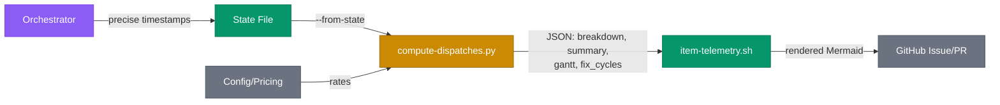

# Telemetry Accuracy & Automation

> Historical record (March 2026). Measurements come from controlled synthetic workloads and early infrastructure runs; see [case studies](../case-studies.md) for scoped findings.

> **Status:** Draft

## Problem Statement

The telemetry pipeline produces inaccurate Gantt charts and requires significant orchestrator effort to construct telemetry strings. Three specific problems:

1. **Inaccurate Gantt charts.** The orchestrator hand-crafts Mermaid Gantt strings using `after` dependency syntax, which models *logical sequencing* (review starts after its builder) rather than *actual wall-clock timing*. In Run 13, the Gantt showed reviews starting immediately after their individual builders, but the orchestrator actually waited for all builders in a wave to finish before dispatching reviews. In Run 14, the wall-clock duration was posted as 102m 43s (sequential sum) instead of the actual 74m 4s because the orchestrator tracked `$SECONDS` unreliably.

2. **Imprecise timestamps.** The orchestrator records `started_at` as rounded estimates rather than capturing exact timestamps at the moment of dispatch. This degrades the accuracy of wall-clock computation in `--dispatches-from-state` mode, which groups dispatches by `started_at` to detect parallelism.

3. **Monolithic telemetry script.** `item-telemetry.sh` is 662 lines (3.3x the 200-line guideline) with ~230 lines of Python embedded in bash heredocs. The Python logic for dispatch computation is not independently testable.

Additionally, two metrics are missing from the telemetry pipeline:

4. **Fix cycle overhead** is not tracked as a structured metric. Run 14 had 3 fix cycles adding $1.53 (13.5%) and 11m 29s, but this was reported as a footnote string, not a computed value.

5. **Autonomous lifecycle duration** has no formal tracking mechanism. Duration data exists across Runs 5-14 but is scattered across PR descriptions, not aggregated.

## Success Criteria

- Gantt chart task positions reflect actual wall-clock start times, not logical dependencies
- Dispatches in the state file include precise `started_at` and `finished_at` timestamps (ISO 8601, second-precision)
- Dispatch computation Python logic lives in `scripts/lib/compute-dispatches.py` and is callable both from `item-telemetry.sh` and independently for testing
- Fix cycle count, duration, and cost are computed from the state file and included in backlog-level telemetry as structured rows
- Lifecycle duration is included in the changelog entry for each run

## Design

### Approach Selection

Three approaches were considered for the Gantt generation problem, which is the most complex change.

#### Approach A: Absolute-offset Gantt from state data (Recommended)

Extend the existing `--dispatches-from-state` code path to also generate the Gantt chart body. Each task's position is an absolute offset from session start, not a relative `after` dependency. The Python script computes `offset_seconds = (started_at - session_start).total_seconds()` for each dispatch and renders Mermaid with absolute timestamps.

**Pros:**
- Gantt reflects actual timing, including idle gaps between waves
- Single source of truth: the state file drives both cost tables and the Gantt
- Eliminates the orchestrator's most error-prone manual task

**Cons:**
- Requires the orchestrator state schema to include `started_at` and `finished_at` on every dispatch (schema change)
- Loses the aesthetic "logical flow" of `after`-based Gantts where tasks chain neatly

#### Approach B: Post-hoc Gantt correction

Keep the orchestrator's hand-crafted `after`-based Gantt but add a separate `--correct-gantt` flag that adjusts task positions using state file timestamps after the fact.

**Pros:** Minimal change to orchestrator behavior

**Cons:** Two Gantt generation paths to maintain; the hand-crafted one remains the primary and still needs to be constructed manually

#### Approach C: Hybrid — orchestrator provides structure, script fills in timing

The orchestrator provides a Gantt "skeleton" (task names, dependency relationships, color tags) and the script fills in absolute offsets from the state file.

**Pros:** Orchestrator retains control over labels and color tags

**Cons:** Added complexity of a two-pass system; labels and color tags can be derived from the dispatch data

**Recommendation: Approach A.** It is the most aligned with the project's "determinism first" principle. The state file already contains everything needed to generate the Gantt. Having the orchestrator construct it manually is exactly the kind of work that should be computed from data, not entrusted to agent judgment. The aesthetic concern is minor and can be addressed with formatting rules in the Python script.

### Component 1: Precise Dispatch Timestamps

**What changes in the orchestrator state schema:**

Each dispatch entry in `dispatches[]` gains two fields:

```json
{
  "id": 3,
  "agent": "builder-sonnet",
  "model": "sonnet",
  "issue": 112,
  "started_at": "2026-03-16T08:12:47Z",
  "finished_at": "2026-03-16T08:15:12Z",
  "duration_ms": 145000,
  "tokens": 103000,
  "tool_uses": 18,
  "result": "success"
}
```

- `started_at`: Captured by the orchestrator using `$(date -u +%Y-%m-%dT%H:%M:%SZ)` **immediately before** the Agent tool dispatch call. For parallel dispatches (same wave), all builders in the wave share the same `started_at` since the orchestrator captures the timestamp once before dispatching all of them.
- `finished_at`: Computed as `started_at + duration_ms` (the Agent tool returns `duration_ms` on completion). Alternatively, captured using `$(date)` immediately after the Agent tool returns, though this includes any orchestrator processing between the Agent tool return and the timestamp capture.
- `duration_ms`: Already recorded (from Agent tool result). Retained as-is.

**Recommendation:** Compute `finished_at = started_at + duration_ms` rather than capturing a second timestamp. This is more precise because it uses the Agent tool's own timing rather than introducing orchestrator processing overhead. The `finished_at` field is derived data, so it could be computed at read time instead of stored. However, storing it simplifies downstream consumers and makes the state file self-contained.

**Backward compatibility:** The orchestrator state schema is versioned (`"version": 1`). Adding `finished_at` is a non-breaking addition (existing readers tolerate unknown keys per the schema contract). No version bump needed.

**Orchestrator convention change:** Update `orchestrator.md` to require that the orchestrator:
1. Records `started_at` using `$(date -u +%Y-%m-%dT%H:%M:%SZ)` immediately before dispatch
2. For parallel waves, records a single `started_at` for all dispatches in the wave (the timestamp of the moment before the first dispatch call)
3. Records `finished_at` as `started_at + duration_ms` after each dispatch returns

### Component 2: Gantt Generation from State Data (`--gantt-from-state`)

**New flag on `item-telemetry.sh`:** `--gantt-from-state <state-file>`

When this flag is provided instead of `--gantt`, the script generates the Gantt body automatically from the state file's `dispatches[]` array. The `--gantt` flag becomes optional when `--gantt-from-state` is present.

**Algorithm:**

1. Read `session.started_at` as the epoch reference (T=0)
2. For each dispatch in `dispatches[]`:
   a. Compute `offset_seconds = (dispatch.started_at - session.started_at).total_seconds()`
   b. Convert to `HH:MM:SS` format for Mermaid's `dateFormat HH:mm:ss`
   c. Compute duration in seconds from `duration_ms / 1000`
3. Sort dispatches by `started_at` (then by `id` for stable ordering within the same timestamp)
4. Generate Mermaid task lines with absolute positioning:
   ```
   E01-S01 Build (2m25s) :w1b1, 00:09:00, 146s
   ```

**Color tag assignment (deterministic from agent type):**

| Agent prefix | Mermaid tag | Color |
|---|---|---|
| `designer` | `:active` | Violet |
| `planner` | `:active` | Violet |
| `retro` | `:active` | Violet |
| `builder-*` | _(none)_ | Emerald |
| `reviewer` | `:done` | Yellow |

Fix cycles are identified by dispatches where the same issue has been dispatched more than once with the same agent type. The second and subsequent dispatches for the same `(issue, agent-prefix)` pair get the `:crit` tag (red).

**Label generation:**

- Design/Plan/Retro: `"Designer (<dur>)"`, `"Planner (<dur>)"`, `"Retro Agent (<dur>)"`
- Build: `"<ENN-SNN> Build (<dur>)"` — derived from the dispatch's `issue` number by looking up the epic/story mapping in `state.epics`
- Review: `"<ENN-SNN> Review (<dur>)"` — same lookup
- Fix cycles: `"<ENN-SNN> Fix (<dur>)"` for builder re-dispatches, `"<ENN-SNN> Re-review (<dur>)"` for reviewer re-dispatches
- PR Review: `"PR Review (<dur>)"` — reviewer dispatch where the issue is not in any epic's stories (it is the backlog issue or has no issue mapping)

**Gantt header (always included):**

```
    title Full Lifecycle Timeline
    dateFormat HH:mm:ss
    axisFormat %M:%S
    tickInterval 5minute
```

The `tickInterval` is auto-selected based on total duration: `2minute` for runs under 30m, `5minute` for 30-90m, `10minute` for 90m+.

**Task ID generation:** Sequential IDs (`t1`, `t2`, ..., `tN`) assigned in chronological order. No semantic IDs like `w1b1` since absolute positioning makes dependency-based IDs unnecessary.

**Interaction with `--gantt`:** If both `--gantt-from-state` and `--gantt` are provided, `--gantt-from-state` takes precedence and `--gantt` is ignored (with a warning to stderr). This allows incremental migration: the orchestrator can start passing `--gantt-from-state` without removing the manual `--gantt` construction immediately.

### Component 3: Extract Python into `scripts/lib/compute-dispatches.py`

**Current state:** `item-telemetry.sh` contains two Python heredoc blocks:

1. `_run_dispatches_computation()` (lines 117-261): Reads a dispatches JSON file, computes per-row costs, aggregates by phase, produces breakdown and summary table rows.
2. State file conversion block (lines 281-371): Reads the orchestrator state file, maps agents to phases, generates task labels, computes wall-clock from `started_at` grouping.

**Extraction plan:**

Create `scripts/lib/compute-dispatches.py` that accepts command-line arguments and reads from stdin or a file:

```
Usage:
  compute-dispatches.py --dispatches <file>
  compute-dispatches.py --from-state <state-file>
  compute-dispatches.py --from-state <state-file> --gantt

Options:
  --dispatches <file>      Structured dispatch JSON (current format)
  --from-state <file>      Orchestrator state file
  --gantt                  Also generate Gantt chart body
  --pricing <file>         Pricing JSON (default: .agentic-workflow/pricing.json)
  --config <file>          Config JSON (default: .claude/agentic-sdlc-config.json)
```

**Output:** JSON to stdout with the same structure the bash script currently parses:

```json
{
  "breakdown": "| Builder (sonnet) | E01-S01 ... | ... |\n...",
  "summary": "| Build | sonnet (3 stories) | 5m 12s | ... |\n...",
  "cost": "5.96",
  "duration_ms": "2161000",
  "tokens": "681000",
  "wall_clock_ms": "1648000",
  "gantt": "    title Full Lifecycle Timeline\n    dateFormat HH:mm:ss\n...",
  "fix_cycles": {
    "count": 3,
    "duration_ms": 689000,
    "cost": "1.53",
    "rate": "0.25",
    "stories_affected": 2
  }
}
```

**`item-telemetry.sh` changes:**

The two Python heredoc blocks are replaced with calls to the external script:

```bash
# Was: _dispatches_result=$(python3 << DISPEOF ... DISPEOF)
# Now:
_dispatches_result=$(python3 "$SCRIPT_DIR/lib/compute-dispatches.py" \
  --dispatches "$dispatches_file" \
  --pricing "$_PRICING_CACHE" --config "$_CFG_FILE")

# Was: python3 << STATEEOF > "$_state_tmp" ... STATEEOF
# Now:
_dispatches_result=$(python3 "$SCRIPT_DIR/lib/compute-dispatches.py" \
  --from-state "$DISPATCHES_FROM_STATE" \
  --pricing "$_PRICING_CACHE" --config "$_CFG_FILE")
```

When `--gantt-from-state` is used, the script also passes `--gantt` to the Python helper and captures the `gantt` field from the output:

```bash
GANTT=$(echo "$_dispatches_result" | jq -r '.gantt // empty')
```

**Line count impact:** The extraction removes ~230 lines of Python from `item-telemetry.sh` (bringing it to ~430 lines) and creates a ~250-line Python file that is independently testable.

**Testing:** The Python script can be tested independently:

```bash
# Unit test: provide a known dispatches JSON, verify output
echo '[{"agent":"Builder (sonnet)","model":"sonnet","task":"E01-S01","duration_ms":146000,"tokens":44000,"phase":"Build"}]' \
  | python3 scripts/lib/compute-dispatches.py --dispatches /dev/stdin --pricing .agentic-workflow/pricing.json
```

### Component 4: Fix Cycle Metrics

**Data source:** Fix cycles are identifiable from `dispatches[]` by counting how many times the same `(issue, agent-prefix)` pair appears. The first dispatch is the original; subsequent dispatches are fix cycles.

**Definition:**
- A **fix cycle** is a builder re-dispatch for the same issue after a reviewer verdict of `REQUEST_CHANGES`. It includes the builder re-dispatch and the subsequent re-review.
- Fix cycle count = number of builder re-dispatches (not counting the original build)
- Fix cycle duration = sum of `duration_ms` for all fix cycle dispatches (re-builds + re-reviews)
- Fix cycle cost = sum of estimated costs for those dispatches

**Output location in telemetry:**

The `fix_cycles` object in the `compute-dispatches.py` output is used by `item-telemetry.sh` to:

1. Add a row to the **Summary** table:
   ```
   | Fix Cycles | 3 cycles (2 stories) | 11m 29s | 142K | ~$1.53 |
   ```
   This row appears between the Review row and the Total row, only when fix cycles exist.

2. Add a structured line to the **Footer**:
   ```
   *Fix cycles: 3 / 12 stories (25% fix rate), adding 11m 29s and ~$1.53 (13.5% of total cost).*
   ```

**No new CLI flag needed.** The fix cycle data is computed automatically whenever `--dispatches` or `--dispatches-from-state` is used. If no fix cycles exist, the row and footer line are omitted.

### Component 5: Lifecycle Duration Baseline

**Approach:** Add a `"lifecycle_duration_ms"` field to the state file that the orchestrator sets at the very end of the workflow (after telemetry is posted, before cleanup). This is the wall-clock time from `session.started_at` to the final telemetry post.

Additionally, the changelog entry for each run should include the lifecycle duration:

```markdown
### 2026-03-16

**Run 15 — <Topic>** (backlog #NNN, 25m wall-clock)
- Feature bullet 1
- Feature bullet 2
```

This is a convention change, not a code change. The orchestrator already writes the changelog entry; it just needs to include the duration.

**Historical baseline (for reference in retro docs, not stored in code):**

| Run | Stories | Wall-clock | Notes |
|-----|---------|-----------|-------|
| 5 | 3 | ~30m | |
| 6 | 3 | ~28m | |
| 8 | 3 | ~40m | Worktree isolation first use |
| 9 | 6 | ~29m | |
| 10 | 4+2 | ~61m | Rate limit overhead |
| 11 | 4+4 | ~41m | |
| 12 | 5 | ~23m | Fastest run |
| 13 | 6 | ~25m | |
| 14 | 12 | ~77m | 3 fix cycles |

This table belongs in the retro recommendations tracker or a future dashboard, not in the telemetry script.

## Architecture

### Data Flow



### File Changes

| File | Change |
|------|--------|
| `scripts/lib/compute-dispatches.py` | **New.** Extracted Python logic for dispatch computation, Gantt generation, and fix cycle metrics. |
| `scripts/item-telemetry.sh` | **Modified.** Replace Python heredocs with calls to `compute-dispatches.py`. Add `--gantt-from-state` flag handling. Reduce from ~662 to ~430 lines. |
| `scripts/templates/telemetry.md` | **Modified.** Add `FIX_CYCLES` conditional block for fix cycle footer line. |
| `.claude/agents/orchestrator.md` | **Modified.** Update timestamp recording convention, update telemetry posting to use `--gantt-from-state`, add changelog duration convention. |
| `CLAUDE.md` | **Modified.** Update helper scripts table with new flags, update telemetry conventions. |

### Backward Compatibility

- `--gantt` flag continues to work as-is. The new `--gantt-from-state` is additive.
- `--dispatches` and `--dispatches-from-state` continue to work. The Python extraction is an internal refactor.
- State files without `finished_at` are handled gracefully (compute from `started_at + duration_ms`).
- Existing orchestrator state files without precise timestamps will produce Gantts with less accurate positioning (timestamps grouped by rounded values), which is no worse than the current hand-crafted approach.

## Assumptions & Open Questions

### Assumptions

1. **Mermaid absolute positioning works with `HH:MM:SS` format.** Mermaid's `dateFormat HH:mm:ss` should support absolute start times like `00:09:00, 146s`. This is consistent with Mermaid documentation, but the exact rendering may vary by Mermaid version on GitHub. Assumed to work based on GitHub's current Mermaid renderer.

2. **Session start timestamp is the reference epoch.** The Gantt's T=0 is `session.started_at` from the orchestrator state file. This means orchestrator overhead (before the first dispatch) shows as a gap at the start of the Gantt. This is intentional — it accurately reflects that no agent work was happening during that time.

3. **`finished_at` should be stored, not computed at read time.** Storing the derived field costs ~25 bytes per dispatch but simplifies all downstream consumers. If storage were a concern (it is not for a JSON file with 10-30 entries), it could be computed on the fly.

4. **Fix cycles are identifiable from dispatch repetition.** A builder re-dispatch for the same issue means a fix cycle occurred. This assumes the orchestrator does not re-dispatch builders for other reasons (e.g., resuming after interruption). Currently, resumed dispatches are recorded as separate entries but are distinguishable because the `result` field of the interrupted dispatch would be `"interrupted"` or `"usage_limit"`, not `"success"`.

5. **The lifecycle duration belongs in the changelog, not in a separate tracking file.** The changelog is already the single place where run summaries live. Adding duration there keeps it discoverable without creating a new artifact.

### Open Questions

1. **Should the Gantt show orchestrator idle time?** The gap between dispatch completion and the next dispatch start represents orchestrator processing (board updates, branch management, merge operations). Should these gaps be explicit (a "gap" task) or implicit (empty space)? **Assumed: implicit** — the empty space is self-explanatory and avoids visual clutter.

2. **Should `compute-dispatches.py` handle the full template rendering?** Currently the Python script outputs table rows and the bash script handles template rendering. An alternative is to have the Python script output the complete rendered Mermaid and markdown. **Assumed: Python outputs data, bash renders** — this keeps the template system in one place (`render_template` in bash + `telemetry.md`).

3. **Should parallel dispatches with different `started_at` timestamps (within a few seconds of each other) be grouped?** The current wall-clock algorithm groups by exact `started_at` match. If timestamps drift by 1-2 seconds due to orchestrator processing between dispatch calls, they would be treated as sequential. **Assumed: use a tolerance window** — dispatches within 5 seconds of each other in a batch are treated as parallel. The 5-second window is generous enough to handle orchestrator overhead between concurrent Agent tool calls but small enough to not merge genuinely sequential dispatches.

## Scope Risks

- **Mermaid rendering edge cases.** Very long runs (90+ minutes) may produce Gantts where tasks are visually tiny. The tick interval auto-selection (2m/5m/10m) mitigates this, but extreme cases (200+ minutes) might need further adjustment. Not worth solving now.

- **State file migration.** Existing state files from in-progress runs lack `finished_at`. The design handles this gracefully (compute from `started_at + duration_ms`), so no migration is needed.

- **Comprehensive test suite for `compute-dispatches.py`.** Writing thorough unit tests for the Python script is valuable but could expand scope. Recommend: one test per mode (`--dispatches`, `--from-state`, `--from-state --gantt`) with a fixture from Run 13 or Run 14 data. More extensive testing can follow in a later pass.
