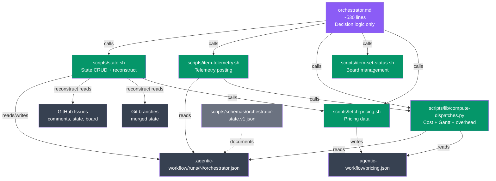

# Design: Split orchestrator.md into Core Instructions and Scripts

> **Status:** Draft

## Problem

`orchestrator.md` is 1,323 lines -- 6.6x the 200-line file guideline and 5x the next largest agent file (`planner.md` at 327 lines). The file is loaded into the orchestrator's system prompt on every API turn. At roughly 8,000-10,000 tokens, this content is repeated across the 200-400 tool calls in a typical autonomous run, consuming 1.2M-2.4M tokens of context budget on instructions alone.

The issue is not that the file is too large for a single file. The issue is that **the file contains scripts that are not scripts**. Of the ~513 lines originally planned for extraction into a reference document, a critical analysis revealed:

| Category | Lines | Percentage |
|----------|-------|------------|
| Already a script (documenting how to call existing scripts) | ~135 | 26% |
| Should be a script (deterministic procedures in markdown) | ~180 | 35% |
| Should be a schema file (JSON schema as markdown) | ~55 | 11% |
| Dead code (legacy, should be deleted) | ~13 | 3% |
| Must remain as instructions (requires agent judgment) | ~130 | 25% |

**61% of the extractable content is scripts written in markdown.** This violates the project's core design philosophy: "When a value can be computed deterministically from existing data, compute it. Never rely on an agent to remember, estimate, or manually track what a script can derive."

## Design Principles

This design is guided by two complementary principles. Both should be documented in CLAUDE.md during implementation.

### Determinism First (existing)

When a value can be computed deterministically from existing data, compute it. The inline Python/bash snippets in orchestrator.md are deterministic procedures -- they read structured data and produce structured output. They belong in scripts, not in agent instructions where the LLM re-interprets them on every invocation.

### Fault Tolerance (new)

The workflow runs long autonomous sessions where interruptions are expected: usage limits, crashes, network failures, window closures. The system must recover gracefully without human intervention.

**The rule:** Every workflow checkpoint must be recoverable from durable state. If the orchestrator is interrupted at any point and restarted -- potentially on a different machine, in a different session, with no memory of prior work -- it must be able to reconstruct its position and resume without data loss.

**Where this applies:**
- **State persistence:** The orchestrator state file captures every dispatch, phase transition, and telemetry data point. If the session is interrupted, the state file enables instant recovery.
- **State reconstruction:** If the state file itself is lost (machine failure, different machine), the `state.sh reconstruct` command rebuilds it from durable external sources (GitHub issue comments, branch state, board status). The telemetry comments posted on each issue are the write-ahead log that makes this possible.
- **Idempotent operations:** Every phase can be re-entered safely. Branch creation checks for existing branches. Story dispatch checks for "Ready for Review" comments. Board updates are idempotent by design.
- **No silent data loss:** Failed dispatches still record telemetry. Interrupted agents accumulate metrics defensively. The system never drops information that was paid for in tokens and time.

**Where AI judgment belongs in recovery:** The orchestrator uses judgment to decide what to do after recovery (which phase to resume, whether to re-dispatch a failed builder, how to handle partial work). But the act of determining *where we are* -- reading the state file, checking GitHub, verifying branch state -- must be deterministic and scripted.

## Approaches Considered

### Approach A: Four-File Split (from the backlog issue)

Split orchestrator.md into a core file plus three reference docs in `docs/5-guides/`:
- `orchestrator-state-schema.md`
- `orchestrator-board-management.md`
- `orchestrator-telemetry-reference.md`

**Rejected because:** Board management is only ~50 lines (too small for its own file). Error handling and the override pattern do not fit cleanly into any of the four files. The reference docs would not travel with the plugin distribution (`docs/5-guides/` is project documentation, not plugin content). Most critically: this approach just moves markdown to different markdown files without addressing the root cause -- the content is deterministic procedures that should be executable scripts.

### Approach B: Two-File Split (runbook)

Split into a core agent file (~450 lines) plus a single reference guide in `.claude/runbooks/orchestrator.md` (~750 lines).

**Rejected because:** The same critical analysis applies. 61% of the runbook content would be scripts written in markdown. We would move the problem from one markdown file to another without making anything more deterministic.

### Approach C: Extract to Scripts (recommended)

Extract inline bash/Python procedures into real scripts. Delete redundant documentation of existing scripts. Delete dead legacy code. The orchestrator.md shrinks through subtraction, not reorganization. No new directories or file conventions needed.

**Selected because:** It addresses the root cause (non-deterministic procedures masquerading as agent instructions), aligns with the project's determinism-first philosophy, establishes script patterns that the PM abstraction layer (#109) will follow, and makes the plugin distribution (#112) cleaner by keeping operational logic in scripts rather than agent prose.

## Design

### New Script: `scripts/state.sh`

A subcommand-based script that encapsulates all orchestrator state file operations. The state file location (`.agentic-workflow/runs/<N>/orchestrator.json`) and format remain unchanged.

```
Usage:
  scripts/state.sh init <backlog-number> --mode <auto|interactive> --model <model>
  scripts/state.sh update --dispatch '<json>'
  scripts/state.sh update --story <number> --status <status>
  scripts/state.sh update --phase <name> --status <status>
  scripts/state.sh update --epic <slug> --base-sha <sha>
  scripts/state.sh overhead
  scripts/state.sh lifecycle-duration
  scripts/state.sh reconstruct <backlog-number>
  scripts/state.sh get <jq-path>
```

#### Subcommand Details

**`init`** -- Creates the state directory, fetches pricing (via `fetch-pricing.sh`), writes the initial JSON template. Currently a 42-line bash heredoc in orchestrator.md (lines 1035-1076). Deterministic: all inputs are arguments.

**`update --dispatch`** -- Appends a dispatch record to the `dispatches[]` array, updates the story's build/review telemetry, and transitions the story status. Currently a 30-line Python snippet in orchestrator.md (lines 1111-1131). Deterministic: structured JSON mutation.

**`update --story`**, **`update --phase`**, **`update --epic`** -- Targeted state mutations. Currently scattered as inline Python throughout the phase logic.

**`overhead`** -- Computes orchestrator overhead from the state file: `overhead_ms = wall_clock - critical_path`. Currently a 38-line Python snippet in orchestrator.md (lines 723-757). Entirely deterministic: reads timestamps from the state file, groups parallel dispatches, computes max per group.

**`lifecycle-duration`** -- Records the final wall-clock lifecycle duration. Currently a 22-line Python snippet in orchestrator.md (lines 775-792). Deterministic: `now() - started_at`.

**`get`** -- Reads a value from the state file using a jq path. Replaces various inline `jq` calls scattered through the phases.

**`reconstruct`** -- Rebuilds the state file from durable external sources when the state file is missing (machine failure, different machine, manual deletion). This is the fault tolerance backstop: the orchestrator calls `state.sh reconstruct <backlog-number>` and gets a usable state file without human intervention. The script reads from these data sources, in order of reliability:

| Data source | What it provides | How it is read |
|-------------|-----------------|----------------|
| GitHub issue comments (telemetry) | Dispatch metrics: model, duration, tokens, cost per story | `gh issue view <N> --json comments` -- parse "Telemetry" comments posted by `item-telemetry.sh` |
| GitHub issue comments (work markers) | Story completion status | Parse "Work Started" and "Ready for Review" comments |
| GitHub issue state + board status | Phase progress, story/epic status | `gh issue list --label backlog/<N>-<slug>` + board status queries |
| Git branch state | Which stories are merged, epic branch heads | `git branch --merged`, `git log --oneline` |
| Cached pricing file | Token rates | `.agentic-workflow/pricing.json` (persists across runs) |
| Config file | Model routing, board IDs | `.claude/agentic-sdlc-config.json` |

The reconstructed state file is not a perfect replica -- some fields are approximated (e.g., `started_at` timestamps derived from comment creation times rather than precise dispatch moments) and overhead cannot be recomputed without the original wall-clock start time. But it is sufficient to: resume the workflow from the correct phase, post accurate aggregate telemetry using `--dispatches-from-state`, and avoid re-dispatching already-completed stories.

This subcommand fully eliminates the need for the legacy manual telemetry path. When the state file is missing, the orchestrator calls `reconstruct` rather than attempting to hand-craft telemetry strings from memory.

#### Script Patterns

The script follows conventions established by existing scripts in the project:

- Sources `scripts/lib/config.sh` for configuration
- Uses the `.agentic-workflow/runs/<N>/` directory structure established by the runtime data design (`docs/2-design/2026-03-15-plugin-runtime-data-and-pricing.md`)
- Uses Python3 for JSON manipulation (consistent with `compute-dispatches.py`)
- Prints results to stdout for the orchestrator to capture
- Returns non-zero on failure with error messages to stderr

### Extend `compute-dispatches.py` (in this backlog item)

Add an `--overhead` flag that computes and formats the orchestrator overhead row for the telemetry summary. This eliminates the need for the orchestrator to manually compute and format the overhead. The existing `--from-state` flag already computes wall-clock duration from dispatch timestamps -- adding overhead is a natural extension. The overhead computation is small (~20 lines of Python) and belongs alongside the existing wall-clock and critical-path logic in `compute-dispatches.py`.

### State Schema File

Extract the JSON schema example (currently 55 lines of markdown) into `scripts/schemas/orchestrator-state.v1.json`. This serves as documentation and could be used for validation in the future. The schema fields table (19 rows explaining each field's purpose) condenses into comments in the schema file and a brief summary in the orchestrator.md.

### Content Deleted from orchestrator.md

| Section | Lines | Action | Rationale |
|---------|-------|--------|-----------|
| Phase 10: Legacy manual telemetry method | 35 | **Delete** | The `--dispatches-from-state` method is the only supported path. If the state file is unavailable, `state.sh reconstruct` rebuilds it from GitHub comments and branch state -- the orchestrator never hand-crafts markdown tables from memory. |
| Phase 10: Gantt color tagging table + conventions | 14 | **Delete** | `compute-dispatches.py` assigns colors automatically. The table documents what the script already does. |
| Phase 10: Duration precision / value column rules | 7 | **Delete** | The scripts handle formatting. The orchestrator does not format durations manually. |
| Phase 10: Orchestrator overhead computation snippet | 38 | **Replace with script call** | `./scripts/state.sh overhead` |
| Phase 10: lifecycle_duration_ms snippet | 22 | **Replace with script call** | `./scripts/state.sh lifecycle-duration` |
| Phase 10: "When using manual --gantt (legacy)" | 3 | **Delete** | Legacy path removed. |
| Cost Computation: jq commands + formula | 14 | **Delete** | `compute-dispatches.py` computes costs. The "never hardcode rates" rule (2 lines) stays. |
| Epic-Level Telemetry: parameter list | 11 | **Condense to 3 lines** | "Post epic telemetry using `item-telemetry.sh` with `--dispatches-from-state`. See the script's `--help` for all flags." |
| State Schema: 55-line JSON example | 55 | **Replace with schema file reference** | `scripts/schemas/orchestrator-state.v1.json` |
| State Schema: field table (19 rows) | 20 | **Condense to 5 lines** | Key fields (`started_at`, `base_sha`, `dispatches[]`) called out inline where they are used in the phase logic. |
| State Lifecycle: Initialize (42-line bash) | 42 | **Replace with script call** | `./scripts/state.sh init <N> --mode autonomous --model opus` |
| State Lifecycle: Update (30-line Python) | 32 | **Replace with script call** | `./scripts/state.sh update --dispatch '...'` |
| State Lifecycle: Read (10-line bash) | 10 | **Replace with script call** | `./scripts/state.sh get '.phases'` |
| State Lifecycle: Cleanup | 5 | **Delete** | `cleanup-post-merge.sh` already handles this. |
| Timestamp recording convention | 10 | **Keep** | Timing protocol the orchestrator must follow. Cannot be scripted -- only the orchestrator knows when it is about to dispatch. |
| State Readers table | 9 | **Keep** | Architectural context. |
| State Fallback (no state file) | 8 | **Replace with script call** | `./scripts/state.sh reconstruct <backlog-number>` -- automated recovery replaces manual fallback protocol. The orchestrator's instruction becomes: "If the state file is missing, run `state.sh reconstruct` before proceeding." |
| System Prompt Hardening | 13 | **Delete** | Legacy NeuralNorris reference. `SdlcWorkflowTool` and `ClaudeDispatchTool` do not exist in the current Claude Code architecture. |
| Override Pattern: example comment format | 5 | **Keep** | Template with judgment-required placeholders. |
| Override Pattern: criteria + when NOT to override | 18 | **Keep** | Decision logic requiring agent judgment. |
| Override Pattern: evidence | 6 | **Keep** | Reinforces correct usage with concrete examples. |
| Phase 8 step 2: per-epic telemetry command | 12 | **Condense** | Becomes a 3-line instruction pointing to the script. |
| Phase 8 step 2: wall-clock subsection | 8 | **Delete** | Auto-computed by `--dispatches-from-state`. |
| CLI dispatch mode (bash examples) | 14 | **Delete** | The secondary CLI mode is for humans in terminals, not for the orchestrator agent. The orchestrator uses the Agent tool. |

### Content Remaining in orchestrator.md

After all extractions and deletions, the orchestrator.md contains:

| Section | Lines (approx) | Content type |
|---------|----------------|-------------|
| YAML frontmatter + intro | 10 | Identity |
| Phase Boundary | 12 | Role definition |
| Dispatch Modes (Agent tool only) | 24 | Decision logic |
| Autonomous Mode | 22 | Decision logic |
| Phases 0-9, 11 (trimmed) | ~270 | Phase sequencing with script calls replacing inline code |
| Phase 10 (condensed) | ~25 | "Post telemetry using `--dispatches-from-state`" + overhead + lifecycle |
| Model Routing | 23 | Decision table |
| GitHub State Management | 23 | Board rules |
| Per-Story Telemetry | 17 | Script call |
| Cost rule | 5 | "Never hardcode rates" |
| Error Handling | 50 | Decision trees (all failure types) |
| Override Pattern | 30 | Judgment criteria |
| Idempotent Restart | 14 | Resume logic |
| Capturing Lessons | 27 | Behavioral instruction |
| Self-Documentation | 9 | Behavioral instruction |
| **Total** | **~530** | |

This represents a **60% reduction** (1,323 to ~530 lines) while keeping all decision logic, judgment calls, and behavioral instructions intact.

## What the Orchestrator Does Differently

Before this change, Phase 10 in orchestrator.md looks like:

```markdown
### Phase 10: Backlog-Level Telemetry

[167 lines of telemetry computation, Python snippets, formatting rules,
 legacy fallback methods, Gantt conventions, overhead calculation...]
```

After this change:

```markdown
### Phase 10: Backlog-Level Telemetry

Post the full lifecycle telemetry summary using `--dispatches-from-state`:

    ./scripts/item-telemetry.sh <backlog-number> \
      --dispatches-from-state .agentic-workflow/runs/<backlog>/orchestrator.json \
      --gantt-from-state .agentic-workflow/runs/<backlog>/orchestrator.json \
      --model opus \
      --commit $(git rev-parse backlog/<N>-<slug>) \
      --footer "<run-specific-notes>" \
      --pr <pr-number>

Compute and record orchestrator overhead:

    ./scripts/state.sh overhead

Record lifecycle duration (final state file write before cleanup):

    ./scripts/state.sh lifecycle-duration

Include an "Orchestrator" row in the --footer with overhead duration.
Token overhead is not measurable -- use "---" for tokens and cost columns.
```

## Architecture



## Roadmap Alignment

### PM Abstraction Layer (#109)

`state.sh` manages the orchestrator's internal state -- not PM operations. PM operations (`item-set-status.sh`, `item-start.sh`, etc.) are separate and will become `pm_set_status()`, `pm_create_item()` when the adapter is built. No conflict.

The subcommand pattern (`state.sh init`, `state.sh update`, `state.sh get`) establishes conventions the PM adapter will follow (`pm.sh create_item`, `pm.sh set_status`). Building `state.sh` now is a dry run for the adapter pattern.

### Local-First PM (#111)

The state file (`.agentic-workflow/runs/`) and work items (future `.sdlc/` or `.agentic-workflow/items/`) are different data with different lifecycles. State files are ephemeral (cleaned up after each run). Work items are durable (project history). No collision.

### Plugin Packaging (#112)

`scripts/state.sh` maps directly to `scripts/state.sh` in the plugin distribution. The leaner orchestrator.md (~530 lines vs 1,323) is easier to distribute and maintain as a plugin agent. The runtime data directory (`.agentic-workflow/`) stays in the consumer project per the approved runtime data design.

### Multi-PM Adapters (#113)

State management is PM-agnostic. The state file contains dispatch metadata (agent, model, duration, tokens) which is the same regardless of which PM tool is used.

## CLAUDE.md Updates Required

1. **Fault Tolerance principle.** Add a new section alongside "Design Philosophy: Determinism First" that documents the Fault Tolerance principle. The text from the Design Principles section of this doc is the starting point.
2. **Helper scripts table.** Add `state.sh` with its subcommands.
3. **Orchestrator State File section.** Update to reference `state.sh` instead of inline code. Replace the "Fallback (no state file)" subsection with a reference to `state.sh reconstruct`.
4. **State schema.** Replace the inline JSON example with a reference to `scripts/schemas/orchestrator-state.v1.json`.

## Assumptions and Resolved Questions

### Assumptions

1. **The System Prompt Hardening section is dead code.** It references `SdlcWorkflowTool` and `ClaudeDispatchTool` from the NeuralNorris era. These do not exist in the current Claude Code Agent tool architecture.

2. **The subcommand pattern for state.sh is preferred over separate scripts.** This keeps the scripts directory clean and establishes a pattern for the future PM adapter. One script with clear subcommands is easier to maintain than `state-init.sh`, `state-update.sh`, `state-overhead.sh`, etc.

### Resolved: State file recovery via `reconstruct`

The legacy manual telemetry method is safe to delete. When the state file is missing, the orchestrator calls `state.sh reconstruct <backlog-number>` which rebuilds the state from GitHub issue comments, branch state, and board status. This is a fully automated recovery path -- the orchestrator never needs to hand-craft telemetry strings from memory, and the human never needs to manually reconstruct workflow state.

This decision is grounded in the Fault Tolerance principle: interruptions are expected in long autonomous sessions, and recovery must be automatic.

### Resolved: `compute-dispatches.py --overhead` ships in this backlog item

The `--overhead` flag is a small addition (~20 lines of Python) that eliminates the orchestrator's 38-line inline overhead computation. It belongs alongside the existing wall-clock and critical-path logic already in `compute-dispatches.py`. Deferring it would leave the largest inline code block in orchestrator.md unaddressed.

## Scope Risks

1. **Scope creep into PM abstraction.** The `state.sh` script should only manage the orchestrator's internal state file. If someone starts adding PM operations (issue creation, board updates) to it, the scope has drifted into #109 territory.

2. **Testing the state.sh script.** The state file operations are currently "tested" by running the orchestrator end-to-end. Extracting them into a script enables unit testing (pass known inputs, verify JSON output), but writing those tests adds scope. Recommend: write the script with testable functions, defer unit tests to a future story.

3. **Updating CLAUDE.md in sync.** CLAUDE.md contains ~150 lines of orchestrator state file documentation that mirrors the content in orchestrator.md. Both files need to be updated in the same pass. This is a convention propagation task, not new design work, but it adds lines changed.
