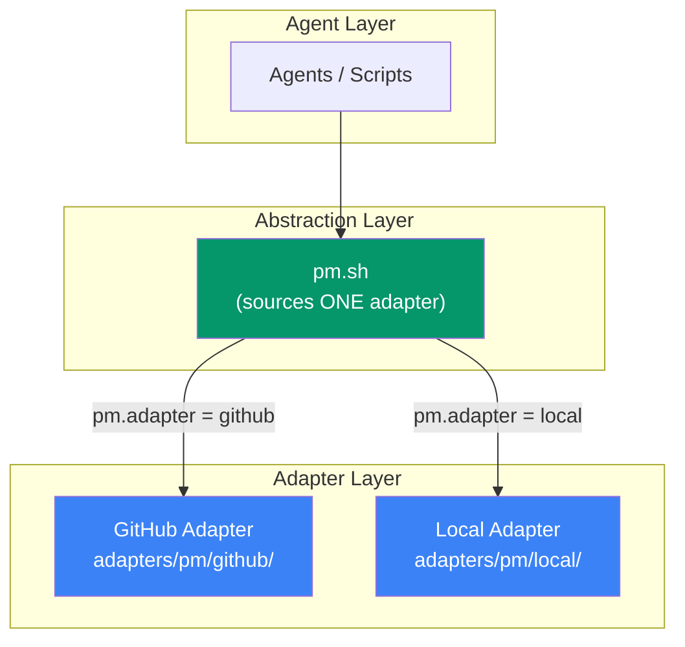
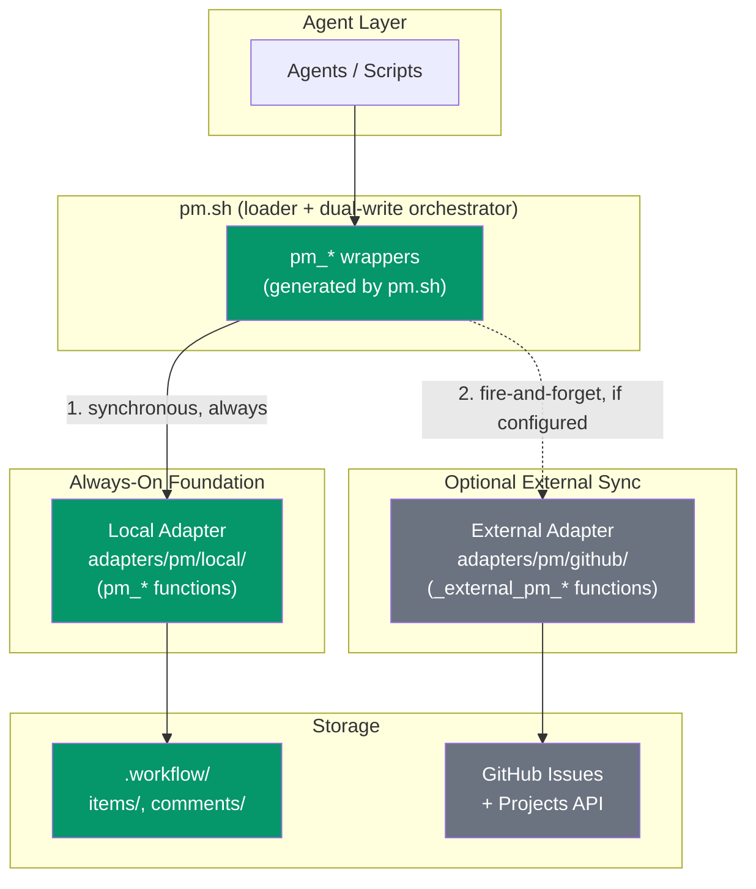
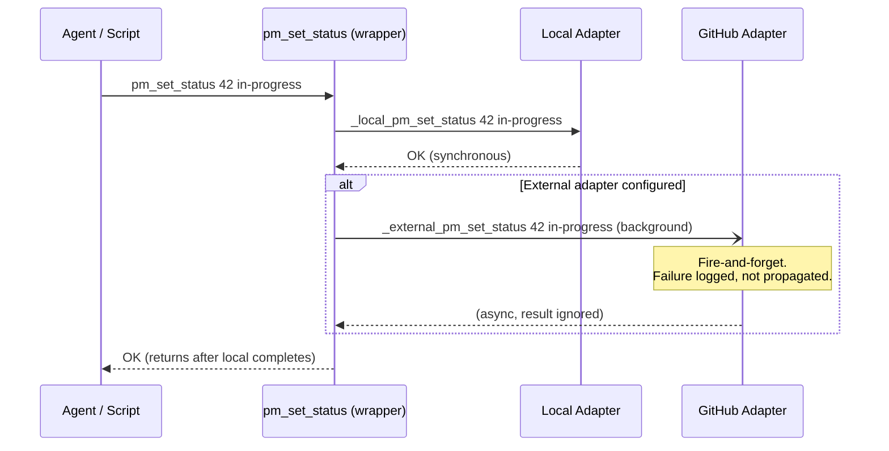
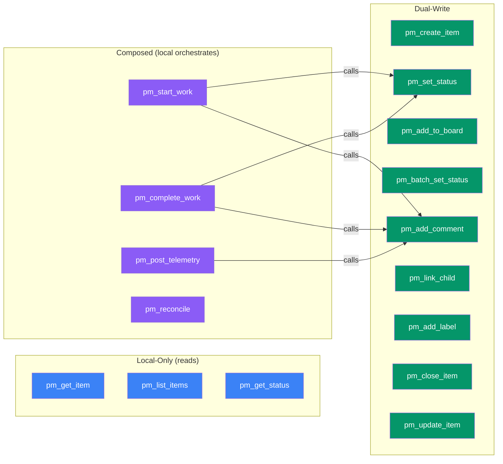

> **Note:** This document is historical context for its backlog item. For the current PM architecture (script layer, inline comments, dual-write adapters), see the [PM Architecture diagram in README.md](../../README.md#project-management-architecture).


# Design: Dual-Write PM Layer

> **Status:** Draft

## 1. Overview

This design refactors `pm.sh` from "source one adapter" to "always source local, optionally source external." The local adapter is not _an_ adapter -- it is the **foundation** that every `pm_*` call passes through. The external adapter (GitHub, Jira, Linear, etc.) is an optional fire-and-forget overlay that syncs state to an external platform for human visibility.

### The problem

BL109 built `pm.sh` as a single-adapter loader: read `pm.adapter` from config, source that adapter's directory, done. BL111 built the local adapter as a peer to the GitHub adapter -- you pick one or the other. But the original vision was:

> External PM tool sync is an optional layer on top. When connected, local files remain the source of truth.

The current architecture cannot deliver this. Switching to `"local"` loses GitHub board visibility. Switching to `"github"` loses offline capability and local file history. The user is forced to choose between offline durability and external visibility. The dual-write pattern described in BL111's issue body was never implemented.

### What this design covers

1. **`pm.sh` loader refactoring** -- always source local, optionally source external
2. **External adapter function namespacing** -- rename external `pm_*` to `_external_pm_*`
3. **Dual-write wrapper generation** -- `pm.sh` generates wrappers that call local then external
4. **Config schema changes** -- `workflowDir` promotion, `pm.adapter` semantic shift
5. **Backward compatibility** -- detection and migration of old config format
6. **Reconciliation** -- local as source of truth, external as sync target
7. **Error handling** -- fire-and-forget semantics for external writes

### What this design does NOT cover

- New external adapters (Jira, Linear) -- that is BL113
- VCS/DOC abstraction layers -- those are BL207/BL208
- Dashboard integration -- that is BL116
- Conflict resolution for bidirectional sync (external -> local) -- future work

## 2. Architecture

### 2.1 Current state (pick-one adapter)



**Problem:** Only one adapter is active at a time. Choosing `github` gives you board visibility but no local files. Choosing `local` gives you offline capability but no board visibility. You cannot have both.

### 2.2 Target state (local always-on, external optional)



**Key changes:**

1. Local adapter is always sourced -- it defines the canonical `pm_*` functions
2. External adapter functions are renamed to `_external_pm_*` to avoid collision
3. `pm.sh` generates wrapper functions that call local first, then external
4. External failures do not break the workflow (fire-and-forget)
5. Config `pm.adapter` means "which external adapter to sync to" (not "which adapter to use")

### 2.3 Call flow



## 3. `pm.sh` Loader Refactoring

### 3.1 Current loader (single-adapter)

```bash
# Current pm.sh (simplified)
PM_ADAPTER=$(_cfg '.pm.adapter' "github")
PM_ADAPTER_DIR="$_PM_SCRIPT_DIR/adapters/pm/$PM_ADAPTER"
for module in "$PM_ADAPTER_DIR"/*.sh; do
  source "$module"
done
```

This sources one adapter and its functions become the `pm_*` namespace. The second adapter is not loaded.

### 3.2 Target loader (always-local + optional-external)

The new `pm.sh` loader follows a three-step process:

1. **Always source local adapter** -- functions are loaded as `pm_*`
2. **Rename local functions** to `_local_pm_*` -- frees the `pm_*` namespace for wrappers
3. **If external configured:** source external adapter with functions as `_external_pm_*`, then generate dual-write wrappers
4. **If no external:** alias `pm_*` directly to `_local_pm_*` (zero overhead)

```bash
#!/usr/bin/env bash
# pm.sh — Dual-write PM loader.
# Always sources local adapter. Optionally overlays an external adapter
# with fire-and-forget dual-write wrappers.

# ... (guards, REPO_ROOT resolution, config sourcing — unchanged) ...

# --- Step 1: Always source local adapter ---
_PM_LOCAL_DIR="$_PM_SCRIPT_DIR/adapters/pm/local"
if [ ! -d "$_PM_LOCAL_DIR" ]; then
  echo "ERROR: Local PM adapter not found at $_PM_LOCAL_DIR" >&2
  return 1 2>/dev/null || exit 1
fi
for _PM_MODULE in "$_PM_LOCAL_DIR"/*.sh; do
  source "$_PM_MODULE"
done

# --- Step 2: Rename local functions to _local_pm_* ---
# Capture every pm_* function defined by the local adapter and create
# _local_pm_* copies. Then unset the pm_* originals to free the namespace.
_PM_LOCAL_FUNCTIONS=()
while IFS= read -r fn; do
  _PM_LOCAL_FUNCTIONS+=("$fn")
done < <(declare -F | awk '/pm_/{print $3}' | grep '^pm_')

for fn in "${_PM_LOCAL_FUNCTIONS[@]}"; do
  eval "_local_${fn}() { ${fn} \"\$@\"; }"  # PLACEHOLDER — see 3.3
done

# --- Step 3: Determine external adapter ---
PM_EXTERNAL=$(_cfg '.pm.adapter' "")

# Backward compat: "local" means no external (local-only mode)
if [ "$PM_EXTERNAL" = "local" ]; then
  PM_EXTERNAL=""
fi

if [ -n "$PM_EXTERNAL" ]; then
  # --- Step 3a: Source external adapter as _external_pm_* ---
  PM_ADAPTER_DIR="$_PM_SCRIPT_DIR/adapters/pm/$PM_EXTERNAL"
  if [ ! -d "$PM_ADAPTER_DIR" ]; then
    echo "WARNING: External PM adapter '$PM_EXTERNAL' not found. Running local-only." >&2
    PM_EXTERNAL=""
  fi
fi

if [ -n "$PM_EXTERNAL" ]; then
  # Source external adapter — its functions will collide with pm_*
  # so we use the _PM_EXTERNAL_PREFIX mechanism (see Section 3.3)
  _PM_LOADING_EXTERNAL=1
  for _PM_MODULE in "$PM_ADAPTER_DIR"/*.sh; do
    source "$_PM_MODULE"
  done
  unset _PM_LOADING_EXTERNAL

  # --- Step 3b: Generate dual-write wrappers ---
  # (see Section 3.4 for the wrapper generation logic)
else
  # No external adapter — pm_* functions are local-only (already defined)
  # No wrappers needed; local functions ARE the pm_* functions
  :
fi
```

### 3.3 Function namespacing strategy

**Recommendation: Source-time prefix injection via adapter-level convention.**

The external adapter files (e.g., `adapters/pm/github/*.sh`) currently define functions named `pm_*`. For dual-write to work, external adapter functions must be named `_external_pm_*` so they do not collide with the local adapter's `pm_*` functions.

**Two approaches were considered:**

**Approach A: Modify external adapter files to detect a prefix flag (SELECTED)**

Each adapter module checks if `_PM_LOADING_EXTERNAL` is set. If so, it defines functions with `_external_` prefix instead of the bare `pm_` prefix. This is a small change per adapter file (one conditional at the top of each function definition block).

```bash
# In adapters/pm/github/board.sh
_PM_FN_PREFIX="${_PM_LOADING_EXTERNAL:+_external_}"

${_PM_FN_PREFIX}pm_set_status() {
  # ... existing implementation ...
}
```

- **Pro:** Clean, explicit, no post-hoc renaming needed
- **Pro:** Each adapter file is self-contained -- it knows its own function names
- **Con:** Requires modifying all 7 GitHub adapter files (mechanical change)

**Approach B: Post-source rename via `eval` and `declare -f`**

Source the external adapter normally (functions collide with local), then use `declare -f` to capture function bodies, `eval` to redefine them with `_external_` prefix, and `unset` the originals.

```bash
# After sourcing external adapter
for fn in "${_PM_LOCAL_FUNCTIONS[@]}"; do
  body=$(declare -f "$fn" | tail -n +2)
  eval "_external_${fn}() ${body}"
  # Restore local version
  eval "${fn}() { _local_${fn} \"\$@\"; }"
done
```

- **Pro:** No changes to adapter files
- **Con:** `eval` + `declare -f` is fragile -- function bodies with special characters break
- **Con:** Performance cost of parsing and redefining all functions
- **Con:** Harder to debug (function origins are obscured)

**Decision: Approach A (prefix injection).** The mechanical change to adapter files is small and one-time. The result is clearer, more debuggable, and avoids `eval` fragility.

### 3.4 Dual-write wrapper generation

When an external adapter is configured, `pm.sh` generates wrapper functions for every `pm_*` function that exists in both adapters. The wrapper calls local synchronously, then external in fire-and-forget mode.

```bash
# Generated wrapper template (one per pm_* function)
_pm_generate_wrapper() {
  local fn_name="$1"
  eval "${fn_name}() {
    # 1. Call local (synchronous, mandatory)
    _local_${fn_name} \"\$@\"
    local _local_rc=\$?

    # 2. Call external (fire-and-forget, optional)
    if declare -f _external_${fn_name} > /dev/null 2>&1; then
      _external_${fn_name} \"\$@\" 2>/dev/null &
      disown 2>/dev/null || true
    fi

    return \$_local_rc
  }"
}

# Generate wrappers for all functions that exist in both adapters
for fn in "${_PM_LOCAL_FUNCTIONS[@]}"; do
  _pm_generate_wrapper "$fn"
done
```

**Key semantics:**

| Property | Behavior |
|----------|----------|
| **Return value** | Always from local adapter (external result is discarded) |
| **Blocking** | Local is synchronous; external runs in background (`&`) |
| **Error handling** | External failures are logged to stderr (redirected to `/dev/null` by default); local failures propagate normally |
| **Missing functions** | If external adapter does not implement a function, no external call is made (graceful degradation) |

### 3.5 Functions with return values

Some `pm_*` functions return values that callers capture (e.g., `pm_create_item` prints an ID on stdout). For these functions, the dual-write wrapper must ensure the local adapter's output is what the caller receives, while still passing the same arguments to the external adapter.

**Problem:** `pm_create_item` returns a local ID (e.g., `3`) but the external adapter creates an issue with a different ID (e.g., `228`). The caller captures the local ID, which is the correct behavior (local is the source of truth). But the external adapter needs the local ID to establish a mapping.

**Recommendation: ID mapping is deferred to reconciliation.**

For this initial implementation, the dual-write wrapper for `pm_create_item` calls both adapters with the same arguments. The external adapter creates an issue and returns its own ID, which is discarded by the wrapper. The association between local ID 3 and GitHub issue 228 is established later by the reconciliation engine (which matches by title and labels).

This is pragmatic: building a robust ID mapping table adds significant complexity (persistence, lookup, conflict resolution) for a feature that reconciliation already provides. The reconciliation approach is documented in the BL111 design doc and is well-understood.

**Exception list -- functions that require special wrapper handling:**

| Function | Return value | Special handling |
|----------|-------------|-----------------|
| `pm_create_item` | Local item ID | External gets same args, returns its own ID (discarded). ID mapping deferred to reconciliation. |
| `pm_get_item` | Item data | Local-only. External read is never needed (local is source of truth). No external call. |
| `pm_list_items` | Item list | Local-only. Same reasoning. |
| `pm_get_status` | Status string | Local-only (exists only in local adapter). No external call. |
| All others | Exit code only | Standard dual-write wrapper. |

Read-only functions (`pm_get_item`, `pm_list_items`, `pm_get_status`) are **not dual-written**. They always read from local. The external adapter's read functions are available as `_external_pm_get_item` etc. for explicit use by the reconciliation engine, but they are not called by the standard wrappers.

```bash
# Read-only functions — always local, no dual-write
_PM_READ_ONLY_FUNCTIONS=(pm_get_item pm_list_items pm_get_status)

_pm_is_read_only() {
  local fn="$1"
  for ro in "${_PM_READ_ONLY_FUNCTIONS[@]}"; do
    [ "$fn" = "$ro" ] && return 0
  done
  return 1
}

# In wrapper generation loop:
for fn in "${_PM_LOCAL_FUNCTIONS[@]}"; do
  if _pm_is_read_only "$fn"; then
    # No wrapper needed — local function IS the pm_* function
    :
  else
    _pm_generate_wrapper "$fn"
  fi
done
```

## 4. Config Schema Changes

### 4.1 Semantic shift of `pm.adapter`

| Aspect | Before (BL109/BL111) | After (this design) |
|--------|----------------------|---------------------|
| **Meaning** | Which adapter to use (pick one) | Which external adapter to sync to (local is always on) |
| **`"github"`** | Use GitHub adapter only | Use local + sync to GitHub |
| **`"local"`** | Use local adapter only | Use local only (no external sync) |
| **`null` / absent** | Default to `"github"` | Local only (no external sync) |

### 4.2 `workflowDir` promotion to top-level

The BL227 issue specifies that `workflowDir` moves from `pm.local.workflowDir` to a top-level config field, because the `.workflow/` directory is project-scoped (not PM-specific) and will be used by future layers (VCS, DOC, feedback).

**Current config:**
```json
{
  "pm": {
    "adapter": "github",
    "local": {
      "workflowDir": ".workflow"
    }
  }
}
```

**New config:**
```json
{
  "workflowDir": ".workflow",
  "pm": {
    "adapter": "github"
  }
}
```

**`config.sh` changes:**

```bash
# Top-level workflow directory (used by PM, future VCS, DOC)
CFG_WORKFLOW_DIR=$(_cfg '.workflowDir' ".workflow")

# Backward compat: if old pm.local.workflowDir exists and top-level doesn't,
# use the old value
if [ "$CFG_WORKFLOW_DIR" = ".workflow" ]; then
  _old_dir=$(_cfg '.pm.local.workflowDir' "")
  if [ -n "$_old_dir" ]; then
    CFG_WORKFLOW_DIR="$_old_dir"
  fi
fi

# Deprecation: keep CFG_LOCAL_WORKFLOW_DIR as alias for backward compat
CFG_LOCAL_WORKFLOW_DIR="$CFG_WORKFLOW_DIR"
```

The local adapter's `_common.sh` already reads `$CFG_LOCAL_WORKFLOW_DIR`. With the alias, no changes are needed in the local adapter itself.

### 4.3 Backward compatibility

**Detection and graceful degradation:**

| Scenario | Config | Behavior |
|----------|--------|----------|
| New dual-write with GitHub | `"pm": {"adapter": "github"}` | Local always-on + dual-write to GitHub |
| New local-only | `"pm": {"adapter": "local"}` or `"pm": {}` | Local-only, no external sync |
| New explicit null | `"pm": {"adapter": null}` | Local-only, no external sync |
| Old GitHub-only (pre-BL227) | `"pm": {"adapter": "github"}` | Same config, new behavior: local + GitHub dual-write |
| Old local-only (pre-BL227) | `"pm": {"adapter": "local"}` | Detected: `"local"` means no external sync. Logs deprecation note. |
| Missing PM section entirely | No `pm` key | Default: local-only |
| Old `pm.local.workflowDir` | `"pm": {"local": {"workflowDir": ".my-workflow"}}` | Value migrated to top-level `workflowDir` via backward compat in `config.sh` |

**Deprecation warning for `pm.adapter = "local"`:**

```bash
if [ "$PM_EXTERNAL" = "local" ]; then
  echo "NOTE: pm.adapter='local' is deprecated. Local is now always-on." >&2
  echo "  To run local-only, set pm.adapter to null or remove it." >&2
  echo "  To sync to GitHub, set pm.adapter to 'github'." >&2
  PM_EXTERNAL=""
fi
```

### 4.4 Complete config schema (post-BL227)

```json
{
  "$comment": "...",
  "workflowDir": ".workflow",
  "github": {
    "repo": "owner/repo",
    "projectNumber": 7,
    "owner": "owner",
    "projectId": "PVT_xxx",
    "statusFieldId": "PVTSSF_xxx"
  },
  "boardStatus": { "...": "..." },
  "modelRouting": { "...": "..." },
  "reviewerRouting": { "...": "..." },
  "pm": {
    "adapter": "github"
  },
  "workflow": { "...": "..." }
}
```

**Note:** The `github` section remains unchanged and is still needed for the GitHub external adapter. It provides GitHub-specific configuration (project IDs, board status option IDs) that the adapter reads at runtime.

## 5. External Adapter Modifications

### 5.1 Function prefix injection

Every GitHub adapter module needs a small modification to support being loaded as an external adapter. The function prefix is controlled by `_PM_LOADING_EXTERNAL`:

```bash
# At the top of each GitHub adapter module (e.g., board.sh)
_PM_FN_PREFIX="${_PM_LOADING_EXTERNAL:+_external_}"
```

Then every function definition uses the prefix:

```bash
# Before (current)
pm_set_status() { ... }

# After
eval "${_PM_FN_PREFIX}pm_set_status() { ... }"
# Or, using the simpler pattern:
${_PM_FN_PREFIX}pm_set_status() { ... }
```

**Recommendation: Use `eval` for the function definition.** Bash does not allow variable expansion in function names directly in all versions. The `eval` pattern is more portable:

```bash
eval "${_PM_FN_PREFIX}pm_set_status() {
  # ... existing implementation unchanged ...
}"
```

**Alternative (no-eval):** Define functions with fixed names and rename post-source. This is Approach B from Section 3.3, rejected for the same reasons.

### 5.2 Idempotency guard update

Current GitHub adapter modules use `declare -f pm_*` as their idempotency guard:

```bash
# Current (board.sh uses pm_set_status check, comments.sh checks pm_add_comment, etc.)
if declare -f pm_set_status > /dev/null 2>&1; then
  return 0 2>/dev/null || exit 0
fi
```

This must be updated to check the prefixed function name:

```bash
if declare -f "${_PM_FN_PREFIX}pm_set_status" > /dev/null 2>&1; then
  return 0 2>/dev/null || exit 0
fi
```

### 5.3 Modules requiring changes

| Module | Functions affected | Change type |
|--------|-------------------|-------------|
| `github/board.sh` | `pm_set_status`, `pm_add_to_board`, `pm_batch_set_status` | Add prefix injection |
| `github/comments.sh` | `pm_add_comment`, `pm_post_telemetry` | Add prefix injection |
| `github/hierarchy.sh` | `pm_link_child` | Add prefix injection |
| `github/items.sh` | `pm_create_item`, `pm_get_item`, `pm_list_items`, `pm_update_item`, `pm_close_item` | Add prefix injection |
| `github/labels.sh` | `pm_add_label` | Add prefix injection |
| `github/lifecycle.sh` | `pm_start_work`, `pm_complete_work` | Add prefix injection |
| `github/reconcile.sh` | `pm_reconcile` | Add prefix injection |

**The change is mechanical and identical across all modules.** Each module adds one line at the top (`_PM_FN_PREFIX=...`) and wraps each function definition in `eval "${_PM_FN_PREFIX}..."`.

### 5.4 Cross-function calls within the external adapter

Several GitHub adapter functions call other `pm_*` functions internally:

- `lifecycle.sh`: `pm_start_work` calls `pm_add_comment` and `pm_set_status`
- `items.sh`: `pm_close_item` calls `pm_set_status`

When loaded as an external adapter, these internal calls must call the external versions (not the local wrapper versions). The prefix injection handles this naturally: within `_external_pm_start_work`, the calls to `pm_add_comment` and `pm_set_status` resolve to the wrapper versions, which call both local and external. This is actually the correct behavior -- the lifecycle functions compose on primitives, and those primitives should dual-write.

**Wait -- that creates a double-write problem.** If `_external_pm_start_work` calls `pm_set_status` (the wrapper), the wrapper calls `_local_pm_set_status` AND `_external_pm_set_status`. But we are already inside an external call chain. The external write for `pm_set_status` would happen twice: once from the wrapper (triggered by `_external_pm_start_work`'s call to `pm_set_status`), and once from the wrapper triggered by the caller's original `pm_start_work` call (which calls `_external_pm_start_work`).

**Solution: External lifecycle functions must NOT be dual-written.**

The wrapper for `pm_start_work` and `pm_complete_work` should only call the local version. The external lifecycle functions (`_external_pm_start_work`, `_external_pm_complete_work`) are composed of primitives (`_external_pm_add_comment`, `_external_pm_set_status`) that are themselves dual-written by the wrappers of `pm_add_comment` and `pm_set_status`. So the external effects happen via the primitive wrappers, not the lifecycle wrapper.

**Add lifecycle functions to the read-only (local-only) list:**

```bash
_PM_LOCAL_ONLY_FUNCTIONS=(
  pm_get_item pm_list_items pm_get_status  # read-only
  pm_start_work pm_complete_work           # composed of dual-written primitives
)
```

This is the correct decomposition:
- `pm_start_work` calls `pm_add_comment` (dual-written) + `pm_set_status` (dual-written)
- No need to separately call `_external_pm_start_work`, which would make the same external API calls again
- The local lifecycle function orchestrates the primitives, each of which dual-writes independently

### 5.5 `pm_post_telemetry` special handling

`pm_post_telemetry` delegates to `item-telemetry.sh`, which is a complex script that handles template rendering, duration computation, Gantt chart generation, and comment posting. Both the local and GitHub adapter implementations delegate to it identically.

For dual-write, `pm_post_telemetry` should be **local-only** (not dual-written):

1. `item-telemetry.sh` calls `pm_add_comment` internally to post the comment
2. `pm_add_comment` is dual-written (writes local file AND posts GitHub comment)
3. Therefore, calling `pm_post_telemetry` once naturally dual-writes

If `pm_post_telemetry` were dual-written, the telemetry would be posted twice to GitHub.

**Prerequisite:** `item-telemetry.sh` must call `pm_add_comment` instead of `gh issue comment` directly. This refactoring was already identified as in-scope in the BL111 design doc (Section 14). It is a prerequisite for this feature and should be included in the implementation plan.

Add to local-only list:

```bash
_PM_LOCAL_ONLY_FUNCTIONS=(
  pm_get_item pm_list_items pm_get_status  # read-only
  pm_start_work pm_complete_work           # composed of dual-written primitives
  pm_post_telemetry                        # delegates to item-telemetry.sh
                                           # which calls pm_add_comment (dual-written)
  pm_reconcile                             # reconciliation is adapter-specific
)
```

### 5.6 `pm_reconcile` handling

Reconciliation is fundamentally different between local and external:

- **Local `pm_reconcile`:** Validates local files against the orchestrator state file
- **External `pm_reconcile`:** Diffs local state against external platform state, pushes corrections

In dual-write mode, reconciliation should run both:

1. First: local reconcile (validate local files are consistent)
2. Then: external reconcile (sync local truth to external platform)

But this is a sequential, orchestrator-driven operation -- not a fire-and-forget background call. The wrapper for `pm_reconcile` should call both synchronously, in sequence.

**Recommendation: Add `pm_reconcile` to the local-only list.** The orchestrator explicitly calls reconciliation at specific points (after PR creation, at phase boundaries). The external reconciliation is a separate explicit call that the orchestrator makes when it wants to sync. This avoids the complexity of a special wrapper that behaves differently from all other wrappers.

The external reconciliation function remains available as `_external_pm_reconcile` for explicit use.

## 6. Dual-Write Function Classification

Based on the analysis in Sections 3.5 and 5.4-5.6, every `pm_*` function falls into one of three categories:

| Category | Functions | Wrapper behavior |
|----------|-----------|-----------------|
| **Dual-write (fire-and-forget)** | `pm_create_item`, `pm_set_status`, `pm_add_to_board`, `pm_batch_set_status`, `pm_add_comment`, `pm_link_child`, `pm_add_label`, `pm_close_item`, `pm_update_item` | Call local sync, then external async (background) |
| **Local-only (no external call)** | `pm_get_item`, `pm_list_items`, `pm_get_status` | Always read from local. External reads available as `_external_pm_*` for explicit use. |
| **Composed (local orchestrates primitives)** | `pm_start_work`, `pm_complete_work`, `pm_post_telemetry`, `pm_reconcile` | Call local version only. The local version calls primitive `pm_*` functions which are themselves dual-written. |



## 7. Error Handling

### 7.1 Fire-and-forget semantics

External adapter calls run in the background (`&`) and their results are discarded. This means:

- **External failures are invisible to callers.** The caller receives the local adapter's exit code. If local succeeds, the caller sees success -- even if GitHub is down.
- **External errors are logged.** The background process redirects stderr to a log file for debugging.
- **No retry on external failures.** If an external call fails, the data is in local files. Reconciliation will catch up later.

```bash
# Fire-and-forget with logging
_pm_external_fire_and_forget() {
  local fn="$1"
  shift
  (
    "$fn" "$@" 2>> "${REPO_ROOT:-.}/.agentic-workflow/logs/external-sync.log"
  ) &
  disown 2>/dev/null || true
}
```

### 7.2 When fire-and-forget is NOT appropriate

Some callers need the external result. Specifically:

- **`pm_create_item` in the planner:** The planner creates issues and immediately uses the returned ID to link sub-issues, add labels, and set board status. In GitHub-mode, the returned ID is the GitHub issue number, which is used in issue titles (`[#227/E01]`), branch names, and cross-references.

**This is the ID mapping problem.** In dual-write mode, `pm_create_item` returns the local ID (e.g., `3`), but the planner needs the GitHub issue number (e.g., `228`) for issue naming and cross-references.

**Recommendation: For this initial implementation, the GitHub adapter remains the primary ID source when configured as external.**

When `pm.adapter = "github"`, the `pm_create_item` wrapper:
1. Calls the external (GitHub) adapter synchronously (not fire-and-forget)
2. Captures the returned GitHub issue number
3. Also creates the local item with the same ID (overriding auto-increment)
4. Returns the GitHub issue number as the item ID

This preserves the current behavior where callers use GitHub issue numbers. The local adapter's `_next_id` counter is not used when an external adapter is configured -- instead, local items are created with the external ID.

```bash
# Special wrapper for pm_create_item
pm_create_item() {
  if [ -n "$PM_EXTERNAL" ]; then
    # External adapter is primary for ID assignment
    local external_id
    external_id=$(_external_pm_create_item "$@") || return $?

    # Create corresponding local item with the external ID
    _local_pm_create_item_with_id "$external_id" "$@"

    echo "$external_id"
  else
    # No external — local is authoritative
    _local_pm_create_item "$@"
  fi
}
```

The local adapter needs a new internal function `_local_pm_create_item_with_id` that accepts an explicit ID instead of auto-incrementing:

```bash
# In local adapter's items.sh
_local_pm_create_item_with_id() {
  local explicit_id="$1"
  shift
  # Same as pm_create_item but uses explicit_id instead of _local_next_id
  # Updates _next_id counter to max(current, explicit_id + 1) to prevent collisions
  ...
}
```

**Why this is better than deferred reconciliation for IDs:** The planner creates 20+ issues in sequence, immediately linking them as sub-issues, adding backlog labels, and referencing them in epic/story titles. If the local ID (3) differs from the GitHub ID (228), every subsequent cross-reference would be wrong. Reconciliation cannot fix issue titles and branch names retroactively.

### 7.3 `pm_create_item` with external adapter unavailable

If the external adapter fails during `pm_create_item`:

1. Log the error
2. Fall back to local-only creation (use auto-increment ID)
3. The local ID will differ from any future GitHub issue. Reconciliation will need to handle this.
4. Print a warning so the orchestrator knows the run is in degraded mode.

```bash
pm_create_item() {
  if [ -n "$PM_EXTERNAL" ]; then
    local external_id
    if external_id=$(_external_pm_create_item "$@" 2>>"$_SYNC_LOG"); then
      _local_pm_create_item_with_id "$external_id" "$@" >/dev/null
      echo "$external_id"
    else
      echo "WARNING: External pm_create_item failed. Falling back to local-only." >&2
      _local_pm_create_item "$@"
    fi
  else
    _local_pm_create_item "$@"
  fi
}
```

## 8. Reconciliation

### 8.1 Reconciliation direction

Reconciliation always flows from **local to external**. Local files are the source of truth. If local says item 42 is `in-review` but GitHub says `in-progress`, the fix is to update GitHub to `in-review`.


### 8.2 Reconciliation triggers

The orchestrator calls `pm_reconcile` at specific points:

1. **After opening the backlog PR** (may trigger GitHub automations that revert board statuses)
2. **At phase boundaries** (belt-and-suspenders check)
3. **On explicit request** (human or diagnostic script)

In dual-write mode, `pm_reconcile` on the local adapter validates local files against the state file. The orchestrator can additionally call `_external_pm_reconcile` to sync local truth to the external platform.

### 8.3 Future: bidirectional sync

Bidirectional sync (external changes propagate to local) is explicitly out of scope. The scenarios where external state diverges from local are:

1. **GitHub automation** reverts board status (known issue, handled by reconciliation pushing local truth back)
2. **Human edits** on GitHub (changes issue title, adds labels) -- these are lost unless pulled
3. **External webhook** changes (CI/CD updates issue state) -- also lost

Handling these requires a sync engine with conflict resolution, which is a separate feature. For now, local is authoritative and the flow is unidirectional.

## 9. Testing Strategy

### 9.1 Unit tests for dual-write wrappers

```bash
# Test: pm_set_status dual-writes
ITEM_ID=$(pm_create_item story "Test" --body "test")
pm_set_status "$ITEM_ID" in-progress

# Verify local
LOCAL_STATUS=$(_local_pm_get_status "$ITEM_ID")
assert_eq "local status" "in-progress" "$LOCAL_STATUS"

# Verify external was called (check mock/log)
assert_contains "external log" "_external_pm_set_status $ITEM_ID in-progress" "$(cat $SYNC_LOG)"
```

### 9.2 Unit tests for read-only functions

```bash
# Test: pm_get_item only reads local
pm_create_item story "Test" --body "test body"
RESULT=$(pm_get_item 1 --json body)

# Should return local data
assert_contains "body from local" "test body" "$RESULT"

# _external_pm_get_item should NOT have been called
assert_not_contains "no external read" "_external_pm_get_item" "$(cat $SYNC_LOG)"
```

### 9.3 Integration tests

1. **Dual-write smoke test:** Create item, set status, add comment -- verify both local file and GitHub issue (requires live GitHub API)
2. **Offline graceful degradation:** Create item with external adapter unavailable -- verify local fallback works
3. **Lifecycle composition:** Call `pm_start_work` -- verify it dual-writes via primitives, not via the lifecycle function
4. **Reconciliation after dual-write:** After several operations, run `pm_reconcile` -- verify no discrepancies

### 9.4 Backward compatibility test

```bash
# Test: old config with pm.adapter=github still works
echo '{"pm":{"adapter":"github"}}' > test-config.json
# Source pm.sh with test config
# Verify: local adapter loaded + GitHub adapter loaded as external
assert "local functions exist" "declare -f _local_pm_set_status"
assert "external functions exist" "declare -f _external_pm_set_status"
assert "wrapper functions exist" "declare -f pm_set_status"
```

## 10. Migration Strategy

### 10.1 Phased migration

This feature follows the "Build Alongside, Verify, Swap" pattern (ADR-0004):

**Phase 1 (Build):** Modify `pm.sh` to implement the dual-write loader. Modify GitHub adapter files to support prefix injection. No behavior change for users running with `pm.adapter = "github"` -- the same API calls happen, just with local files also written.

**Phase 2 (Verify):** Run a test SDLC workflow with dual-write enabled. Verify that:
- Local `.workflow/` files are created for every operation
- GitHub Issues/Projects reflect the same state
- No duplicate API calls (lifecycle composition is correct)
- Performance is acceptable (background calls do not bottleneck)

**Phase 3 (Ship):** Merge to main. Update CLAUDE.md and agent files to reference the new config semantics.

### 10.2 Rollback plan

If dual-write causes issues:
1. Set `pm.adapter` to `null` -- disables external sync, reverts to local-only
2. Or revert the `pm.sh` changes -- old single-adapter behavior is restored

The local adapter files are unchanged (they were already deployed by BL111). The GitHub adapter files are minimally changed (prefix injection is backward-compatible -- when not loaded as external, the prefix is empty and function names are unchanged).

## 11. Assumptions and Open Questions

### Assumptions made

1. **`item-telemetry.sh` refactoring is a prerequisite.** The telemetry script must call `pm_add_comment` instead of `gh issue comment` for dual-write to work transparently. This refactoring was identified in the BL111 design doc and is relatively small (one line change + sourcing pm.sh).

2. **Background processes (`&` + `disown`) are reliable in the workflow.** The orchestrator runs long-lived Bash sessions where backgrounded processes complete before the session exits. If background processes are killed prematurely (e.g., session timeout), some external writes may be lost. This is acceptable because local writes are the source of truth and reconciliation catches up.

3. **The GitHub adapter can be loaded alongside the local adapter without side effects.** Both adapters read from `config.sh` at source time. The GitHub adapter reads `CFG_REPO`, `CFG_PROJECT_ID`, etc. These config values are available whether or not the GitHub adapter is the primary adapter. No config conflicts exist.

4. **`eval` for function definition is acceptable.** The prefix injection pattern uses `eval` to define functions with dynamic names. This is a standard Bash pattern used throughout the codebase (e.g., in test harnesses). The function bodies are static strings from adapter source files, not user input, so injection risk is zero.

5. **ID synchronization via `pm_create_item` (GitHub ID used as local ID) is sufficient.** This avoids building an ID mapping table. The trade-off is that local IDs are not sequential when created via an external adapter (they jump to match GitHub issue numbers).

### Open questions

1. **Should fire-and-forget external calls use `&` (background process) or just sequential calls with error suppression?** Background processes are truly non-blocking but harder to debug. Sequential calls with `|| true` are simpler but add latency to every write. Recommendation: background for the initial implementation -- the latency savings are significant for board operations (GitHub API calls take 1-3 seconds each).

2. **Should the reconciliation engine be extended to support external-to-local sync?** The current design is unidirectional (local -> external). Bidirectional sync would allow human edits on GitHub to propagate to local files. Recommendation: defer. Bidirectional sync requires conflict resolution (what if both sides changed the same field?) which is a substantial feature.

3. **How should `pm_batch_set_status` work with dual-write?** Currently it iterates pairs and calls `pm_set_status` for each. In dual-write mode, each `pm_set_status` call would fire a background GitHub API call. With 20 items in a batch, that is 20 concurrent background API calls. Should the batch function aggregate the external calls? Recommendation: keep the simple iteration. The GitHub API handles 20 concurrent calls without issues (rate limit is 5000 points/hour), and the individual calls are idempotent.

4. **Should the `pm.adapter` field be renamed to `pm.external` for clarity?** The field name `adapter` is ambiguous -- it used to mean "which adapter to use" and now means "which external adapter to sync to." Renaming to `external` would be clearer. However, renaming breaks the backward compatibility promise. Recommendation: keep `adapter` for backward compat, document the semantic shift. Consider adding `pm.external` as an alias in a future version.

## 12. Approaches Considered

### Approach A: Hybrid adapter (REJECTED)

Create a third adapter (`adapters/pm/hybrid/`) that composes local + external adapters. The hybrid adapter would import both and orchestrate dual-write.

- **Pro:** Clean separation -- each adapter is independent
- **Con:** Combinatorial explosion: hybrid-github, hybrid-jira, hybrid-linear
- **Con:** The composition logic (which functions are dual-written, which are local-only) is the same regardless of the external adapter. It belongs in `pm.sh`, not in an adapter.
- **Con:** The hybrid adapter would duplicate the loader logic that `pm.sh` already provides
- **Rejected** because the composition logic is loader-level, not adapter-level. The backlog issue also explicitly rejects this approach.

### Approach B: pm.sh loader with dual-write wrappers (SELECTED)

`pm.sh` always sources local, optionally sources external with namespaced functions, and generates dual-write wrappers. The composition logic lives in `pm.sh`.

- **Pro:** Single place for dual-write logic (pm.sh)
- **Pro:** Any external adapter works without modification (once prefix injection is added)
- **Pro:** No combinatorial explosion -- N external adapters means N adapter directories, not N hybrid adapters
- **Pro:** Local adapter is always available, even if external adapter fails to load
- **Con:** `eval`-based wrapper generation is harder to read than explicit function definitions
- **Con:** Prefix injection requires modifying existing GitHub adapter files
- **Selected** because it is the simplest approach that delivers the dual-write pattern without adapter proliferation.

### Approach C: Event-bus pattern (REJECTED)

Define pm.sh operations as events. Local adapter subscribes as mandatory handler. External adapters subscribe as optional handlers. An event dispatcher calls all subscribers.

- **Pro:** Elegant decoupling -- adapters are event handlers, not called directly
- **Pro:** Multiple external adapters could subscribe simultaneously
- **Con:** Event systems in Bash are unnatural and complex to implement
- **Con:** Overengineered for the current requirement (one local + one external)
- **Con:** Debugging event chains in Bash is significantly harder than debugging direct function calls
- **Rejected** because Bash is not the right language for an event-driven architecture. If the workflow moves to a higher-level language (Python, TypeScript) for plugin packaging, this pattern becomes viable.

## 13. Scope Risks

| Risk | Mitigation |
|------|-----------|
| **`eval`-based wrapper generation is fragile** | Limit `eval` to function name construction (the body is a fixed template). Test thoroughly with special characters in arguments. |
| **Background processes accumulate** | Each fire-and-forget call spawns a background process. For a 30-story run with ~100 board operations, that is ~100 background processes. Mitigation: `disown` detaches them from the shell. The OS handles cleanup. Monitor in test runs. |
| **ID synchronization complexity** | The `pm_create_item` special wrapper (external ID as local ID) is the most complex part. If it proves too fragile, fall back to deferred reconciliation and accept the ID mismatch. |
| **Temptation to build bidirectional sync** | Explicitly out of scope. Document the unidirectional flow clearly. |
| **GitHub adapter prefix injection cascades** | All 7 GitHub adapter modules need the same mechanical change. Risk of missing one. Mitigation: script the change, verify with grep. |
| **`item-telemetry.sh` refactoring grows in scope** | Scope to one change: replace `gh issue comment` with `pm_add_comment`. Do not refactor the template rendering. |

## 14. Related Documents

- [PM Abstraction Layer Design](2026-03-18-pm-abstraction-layer.md) -- the adapter interface (BL109)
- [Local-First PM Design](2026-03-18-local-first-pm.md) -- the local adapter (BL111)
- [Backlog Issue #227](https://github.com/carlosboeing/agentic-sdlc-workflow/issues/227) -- requirements
- [Configurable Workflow Settings](2026-03-15-configurable-workflow-settings.md) -- config schema
