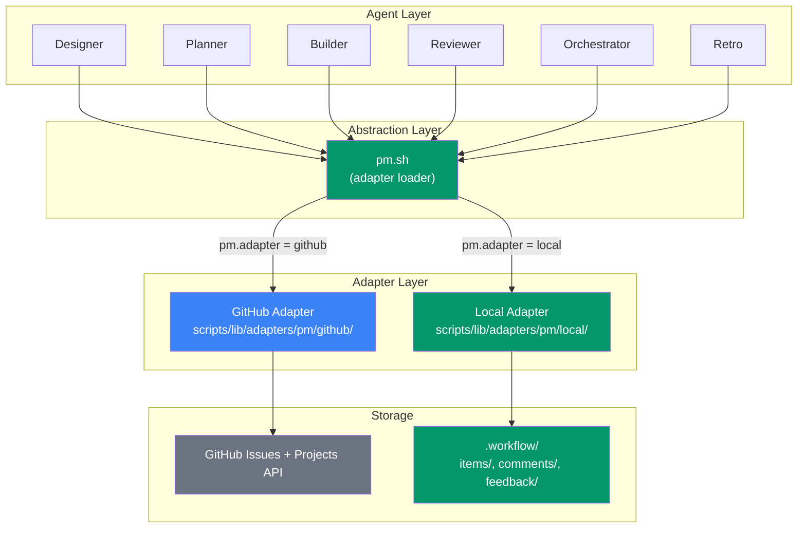
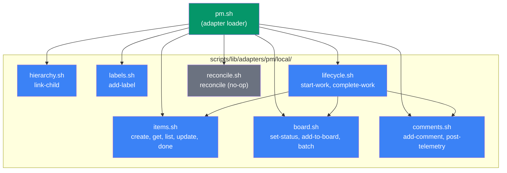

> **Note:** This document is historical context for its backlog item. For the current PM architecture (script layer, inline comments, dual-write adapters), see the [PM Architecture diagram in README.md](../../README.md#project-management-architecture).


# Design: Local-First PM System

> **Status:** Draft

## 1. Overview

This design specifies the **local PM adapter** (`scripts/lib/adapters/pm/local/`), a file-based implementation of the `pm_*` function contract defined by the PM Abstraction Layer (#109). When `pm.adapter` is set to `"local"` in `.claude/agentic-sdlc-config.json`, the entire workflow operates against local `.workflow/` files instead of GitHub Issues/Projects. No external accounts, APIs, or network connectivity are required.

This is the killer differentiator for the agentic SDLC workflow: zero-config, offline-capable project management that lives alongside code in version control. External PM tools become optional sync targets, not prerequisites.

### What this document covers

1. Directory structure and file layout for `.workflow/`
2. Work item file format (YAML frontmatter schema)
3. Comment file format and naming
4. ID generation strategy
5. Module structure for `scripts/lib/adapters/pm/local/` (7 modules mirroring the GitHub adapter)
6. Implementation details for each of the 15 `pm_*` functions
7. How `pm_post_telemetry` works in local mode
8. Config changes
9. Testing strategy

### What this document does NOT cover

- Dual-write sync engine (local + external PM sync) -- deferred to future work
- Dashboard/web UI for browsing `.workflow/` data -- deferred to #116
- VCS abstraction -- separate backlog item (#207)
- Multi-PM adapters (Jira, Linear) -- separate backlog item (#113)

## 2. Architecture



The local adapter is a drop-in replacement for the GitHub adapter. Switching is a single config change:

```json
{
  "pm": {
    "adapter": "local"
  }
}
```

All 15 `pm_*` functions are implemented. All callers (agents, orchestrator, wrapper scripts) continue to work without modification.

## 3. Directory Structure

```
.workflow/
  items/
    1.md                          # Work item (backlog, epic, story, or docs)
    2.md
    3.md
    ...
  comments/
    1/                            # Comments for item 1
      001-work-started.md
      002-telemetry.md
    2/
      001-work-started.md
    ...
  _next_id                        # Auto-increment counter (single integer)
```

### Design decisions

**Flat `items/` directory with numeric IDs.** Items are named `<id>.md` (e.g., `1.md`, `42.md`). The numeric ID is the item identifier used in all `pm_*` function calls, exactly matching how GitHub issue numbers work in the GitHub adapter. This ensures callers do not need to change behavior.

**Recommendation: Numeric-only filenames over slug-based filenames.**
- Reasoning: (1) The GitHub adapter uses numeric issue numbers everywhere -- callers pass `pm_get_item 42`, not `pm_get_item e01-s01-implement-oauth`. Slug-based names would require a lookup layer. (2) Numeric IDs are deterministic and collision-free via auto-increment. (3) The title and slug live in the file's YAML frontmatter -- they do not need to be in the filename.
- Alternative: `<id>-<slug>.md` (e.g., `3-implement-oauth.md`). More human-readable when browsing the directory. Rejected because it complicates ID-based lookups: `pm_get_item 3` would need to glob for `3-*.md`, which is fragile if a file `30-something.md` exists.

**Per-item comment subdirectories.** Comments for item N live in `.workflow/comments/N/`. Each comment is a numbered markdown file. This mirrors the GitHub adapter's behavior where comments are associated with a specific issue, and avoids filename collisions when parallel agents post comments on different items simultaneously.

**No separate `epics/` and `stories/` directories.** The backlog issue already specified this flat structure with type in frontmatter. All items go in `items/` regardless of hierarchy level. The `type` field in frontmatter distinguishes them. This is simpler than type-specific directories and matches how GitHub Issues work (all issues are in one flat list, filtered by labels).

**No `board.yaml`.** Per the backlog issue's "No Centralized Index" refinement, individual file frontmatter IS the index. Reading all statuses = scanning all item files. Performance is effectively instant for any realistic backlog (50 items from frontmatter takes ~50ms).

**No `feedback/` directory in scope.** The `feedback/` directory mentioned in the backlog issue is for the retro agent rework (#107), which is a separate feature. The local adapter does not need to create or manage it.

## 4. Work Item File Format

Each work item is a markdown file with YAML frontmatter:

```markdown
---
id: 3
title: "E01-S01: Implement OAuth callback"
type: story
status: ready
labels:
  - type/feature
  - difficulty/easy
  - hierarchy/story
  - backlog/111-local-first-pm
parent: 1
state: open
created: 2026-03-18T14:00:00Z
updated: 2026-03-18T14:00:00Z
---

## Acceptance Criteria
- [ ] GET /api/auth/callback returns token
- [ ] Token is stored in secure cookie
```

### Frontmatter schema

| Field | Type | Required | Default | Description |
|-------|------|----------|---------|-------------|
| `id` | integer | Yes | Auto-assigned | Unique identifier, matches filename |
| `title` | string | Yes | -- | Display title |
| `type` | enum | Yes | -- | `backlog`, `epic`, `story`, `docs` |
| `status` | enum | Yes | `backlog` | Board status: `backlog`, `ready`, `in-progress`, `in-review`, `done` |
| `labels` | string[] | No | `[]` | All labels (hierarchy, type, difficulty, backlog) |
| `parent` | integer | No | null | ID of parent item (for hierarchy) |
| `state` | enum | Yes | `open` | `open` or `closed` (mirrors GitHub issue state) |
| `created` | ISO 8601 | Yes | Auto-set | Creation timestamp |
| `updated` | ISO 8601 | Yes | Auto-set | Last modification timestamp |

### Status values

The five status values map exactly to the GitHub project board statuses:

| Status | Meaning | Set by |
|--------|---------|--------|
| `backlog` | Unplanned | Default on creation |
| `ready` | Has acceptance criteria, ready for dispatch | Planner |
| `in-progress` | Currently being worked on | `pm_start_work` / `pm_set_status` |
| `in-review` | Implementation complete, awaiting review | `pm_complete_work` / `pm_set_status` |
| `done` | Completed | `pm_close_item` / `pm_set_status` |

### Body content

Everything below the YAML frontmatter `---` delimiter is the item body. This maps to the `--body` parameter on `pm_create_item` and the `body` field on `pm_get_item --json body`. The body is free-form markdown -- acceptance criteria, description, dependency declarations, etc.

### Type-to-hierarchy mapping

The `type` field in frontmatter is set based on the `level` parameter to `pm_create_item`:

| `pm_create_item` level | `type` value | `hierarchy/*` label auto-added |
|------------------------|-------------|-------------------------------|
| `backlog` | `backlog` | `hierarchy/backlog` |
| `epic` | `epic` | `hierarchy/epic` |
| `story` | `story` | `hierarchy/story` |
| `docs` | `docs` | `hierarchy/docs` |

The hierarchy label is automatically added to the `labels` array, matching the GitHub adapter's behavior.

## 5. ID Generation

**Recommendation: Auto-increment file counter.**

The file `.workflow/_next_id` contains a single integer representing the next available ID. When `pm_create_item` is called:

1. Read current value from `.workflow/_next_id` (default 1 if file does not exist)
2. Use that value as the new item's ID
3. Write `current + 1` back to `.workflow/_next_id`
4. Create `.workflow/items/<id>.md`

```bash
_local_next_id() {
  local id_file="$_LOCAL_WORKFLOW_DIR/_next_id"
  local next_id=1
  if [ -f "$id_file" ]; then
    next_id=$(cat "$id_file")
  fi
  echo "$((next_id + 1))" > "$id_file"
  echo "$next_id"
}
```

**Why auto-increment over UUID:** (1) Numeric IDs match the GitHub adapter's interface where callers pass integer issue numbers. (2) UUIDs are unwieldy for human use (`pm_get_item 550e8400-e29b-41d4-a716-446655440000` vs `pm_get_item 3`). (3) Auto-increment is deterministic and trivially simple.

**Why auto-increment over slug-based:** Slugs require title-to-slug conversion, collision detection, and a lookup index for numeric references. Not worth the complexity.

**Concurrency safety:** The workflow's design guarantees no concurrent writes to the same file. Each agent writes only its own work item. The `_next_id` counter is only written by `pm_create_item`, which is called by the planner (sequential) and the orchestrator (sequential). Parallel builders do not create items -- they modify existing ones. Therefore, no locking is needed.

**Alternative considered: UUID.** Would eliminate any theoretical collision risk but makes IDs unusable in human commands and breaks the numeric ID convention used throughout the workflow.

## 6. Comment File Format

Comments for item N live in `.workflow/comments/N/` as numbered markdown files:

```
.workflow/comments/3/
  001-work-started.md
  002-ready-for-review.md
  003-telemetry.md
```

### Naming convention

`<sequence>-<slug>.md` where:
- `<sequence>` is a zero-padded three-digit counter (001, 002, ...)
- `<slug>` is a lowercase, hyphenated summary derived from the comment content

The sequence ensures sort order. The slug is for human readability when browsing the directory.

### Slug derivation

The slug is derived from the comment body's first heading or first line:
- `### Work Started` -> `work-started`
- `### Ready for Review` -> `ready-for-review`
- `### Telemetry` -> `telemetry`
- Falls back to `comment` if no heading is found

```bash
_local_comment_slug() {
  local body="$1"
  local heading
  heading=$(echo "$body" | grep -m1 '^###\? ' | sed 's/^#* //; s/[^a-zA-Z0-9 ]//g' | tr '[:upper:]' '[:lower:]' | tr ' ' '-')
  if [ -z "$heading" ]; then
    heading="comment"
  fi
  echo "$heading"
}
```

### Comment file content

Comment files contain the raw markdown body as-is (no frontmatter wrapper). This matches how GitHub issue comments work -- they are plain markdown. A metadata header is prepended:

```markdown
<!-- posted: 2026-03-18T14:00:00Z -->

### Work Started

| Field | Value |
|-------|-------|
| **Agent** | builder |
| **Model** | sonnet |
| **Started** | 2026-03-18T14:00:00Z |
```

The HTML comment on the first line records the timestamp without affecting rendering. This is machine-parseable for telemetry aggregation and comment search.

### Sequence generation

```bash
_local_next_comment_seq() {
  local item_id="$1"
  local comment_dir="$_LOCAL_WORKFLOW_DIR/comments/$item_id"
  mkdir -p "$comment_dir"
  local count
  count=$(find "$comment_dir" -maxdepth 1 -name "*.md" | wc -l | tr -d ' ')
  printf "%03d" "$((count + 1))"
}
```

## 7. Module Structure

The local adapter mirrors the GitHub adapter's 7-module structure exactly:

```
scripts/lib/adapters/pm/local/
  board.sh          # pm_set_status, pm_add_to_board, pm_batch_set_status
  comments.sh       # pm_add_comment, pm_post_telemetry
  hierarchy.sh      # pm_link_child
  items.sh          # pm_create_item, pm_get_item, pm_list_items, pm_update_item, pm_close_item
  labels.sh         # pm_add_label
  lifecycle.sh      # pm_start_work, pm_complete_work
  reconcile.sh      # pm_reconcile
```



### Shared internal helpers

All modules share access to the workflow directory path and YAML frontmatter parsing utilities. These are defined in `items.sh` (loaded first alphabetically via `board.sh`... actually `board.sh` loads first). To avoid circular dependencies, shared helpers are defined in a `_common.sh` module that loads first:

**Addition: `_common.sh` for shared utilities.**

```
scripts/lib/adapters/pm/local/
  _common.sh        # Shared helpers: path resolution, frontmatter parsing, ID generation
  board.sh          # pm_set_status, pm_add_to_board, pm_batch_set_status
  comments.sh       # pm_add_comment, pm_post_telemetry
  hierarchy.sh      # pm_link_child
  items.sh          # pm_create_item, pm_get_item, pm_list_items, pm_update_item, pm_close_item
  labels.sh         # pm_add_label
  lifecycle.sh      # pm_start_work, pm_complete_work
  reconcile.sh      # pm_reconcile
```

The underscore prefix ensures `_common.sh` sorts first alphabetically and is loaded before all other modules by `pm.sh`'s alphabetical sourcing.

### `_common.sh` contents

```bash
#!/usr/bin/env bash
# _common.sh -- Shared helpers for the local PM adapter.

# Idempotency guard
if [ -n "${_LOCAL_COMMON_LOADED:-}" ]; then
  return 0 2>/dev/null || exit 0
fi
_LOCAL_COMMON_LOADED=1

# Resolve .workflow directory (relative to REPO_ROOT)
_LOCAL_WORKFLOW_DIR="${REPO_ROOT:-.}/.workflow"

# Ensure base directories exist
_local_ensure_dirs() {
  mkdir -p "$_LOCAL_WORKFLOW_DIR/items" "$_LOCAL_WORKFLOW_DIR/comments"
}

# Read a frontmatter field from a work item file.
# Usage: _local_fm_read <file> <field>
# Returns the value or empty string if not found.
_local_fm_read() {
  local file="$1" field="$2"
  sed -n '/^---$/,/^---$/p' "$file" | grep "^${field}:" | head -1 | sed "s/^${field}: *//" | sed 's/^"\(.*\)"$/\1/'
}

# Update a frontmatter field in a work item file.
# Usage: _local_fm_write <file> <field> <value>
_local_fm_write() {
  local file="$1" field="$2" value="$3"
  # Also update the 'updated' timestamp
  local now
  now=$(date -u +"%Y-%m-%dT%H:%M:%SZ")
  if grep -q "^${field}:" "$file" 2>/dev/null; then
    sed -i '' "s|^${field}:.*|${field}: ${value}|" "$file"
  fi
  sed -i '' "s|^updated:.*|updated: ${now}|" "$file"
}

# Read the labels array from frontmatter. Returns one label per line.
_local_fm_read_labels() {
  local file="$1"
  sed -n '/^labels:/,/^[^ -]/p' "$file" | grep '^  - ' | sed 's/^  - //'
}

# Get the next auto-increment ID.
_local_next_id() {
  local id_file="$_LOCAL_WORKFLOW_DIR/_next_id"
  _local_ensure_dirs
  local next_id=1
  if [ -f "$id_file" ]; then
    next_id=$(cat "$id_file")
  fi
  echo "$((next_id + 1))" > "$id_file"
  echo "$next_id"
}

# Resolve item file path from ID.
_local_item_path() {
  echo "$_LOCAL_WORKFLOW_DIR/items/$1.md"
}
```

## 8. Function Implementations

This section details how each of the 15 `pm_*` functions is implemented in the local adapter. The signatures are identical to the GitHub adapter.

### 8.1 items.sh

#### `pm_create_item <level> <title> [--body <text>] [--body-file <path>] [--labels <csv>]`

1. Validate `level` is one of: `backlog`, `epic`, `story`, `docs`
2. Get next ID via `_local_next_id`
3. Map level to hierarchy label (e.g., `story` -> `hierarchy/story`)
4. Parse optional `--body`, `--body-file`, `--labels` flags
5. Build labels array: hierarchy label + any extra CSV labels
6. Write `.workflow/items/<id>.md` with YAML frontmatter and body content
7. Print the ID on stdout (just the number, matching GitHub adapter behavior)

```bash
pm_create_item() {
  local level="$1" title="$2"
  shift 2
  # ... parse flags, build frontmatter, write file ...
  echo "$id"
}
```

**Output contract:** Prints a single integer (the item ID) on stdout. This matches the GitHub adapter which prints the issue number extracted from the URL.

#### `pm_get_item <item-id> [--json <fields>]`

- **Without `--json`:** Prints human-readable output matching `gh issue view` format:
  ```
  title:  E01-S01: Implement OAuth callback
  state:  open
  labels: type/feature, difficulty/easy
  ```
- **With `--json <fields>`:** Prints JSON with the requested fields. Field mapping:

  | JSON field | Frontmatter source |
  |-----------|-------------------|
  | `number` | `id` |
  | `title` | `title` |
  | `state` | `state` (uppercase: `OPEN`/`CLOSED`) |
  | `body` | Content below YAML frontmatter |
  | `labels` | `labels` array, each as `{"name": "<label>"}` |

  Example output for `pm_get_item 3 --json number,title,state`:
  ```json
  {"number":3,"title":"E01-S01: Implement OAuth callback","state":"OPEN","labels":[{"name":"hierarchy/story"}]}
  ```

**Why match the GitHub JSON format:** The orchestrator and scripts parse `pm_get_item` output with `jq`. The JSON field names and structure must match what `gh issue view --json` returns, so no caller changes are needed.

#### `pm_list_items [--label <label>] [--state <open|closed|all>] [--limit <n>]`

Scans all `.workflow/items/*.md` files, filters by label and state, and prints a tab-separated table matching `gh issue list` output format:

```
1    Open    My Backlog Item    2026-03-18
2    Open    E01: Auth Backend  2026-03-18
3    Open    E01-S01: OAuth     2026-03-18
```

Columns: `ID`, `State`, `Title`, `Created date`.

Implementation:
1. Default: `state=open`, `limit=30`
2. For each `.md` file in `.workflow/items/`, read frontmatter
3. Filter by `state` (skip non-matching)
4. Filter by `label` if `--label` specified (check if label exists in `labels` array)
5. Print up to `limit` results
6. Sort by ID descending (newest first, matching `gh issue list` default)

#### `pm_update_item <item-id> [--title <text>] [--body <text>]`

1. Locate `.workflow/items/<id>.md`
2. If `--title` provided, update the `title:` frontmatter field
3. If `--body` provided, replace everything below the closing `---` with the new body
4. Update the `updated:` timestamp

#### `pm_close_item <item-id>`

1. Set `state: closed` in frontmatter
2. Set `status: done` in frontmatter via `pm_set_status` (calls the sibling function)

Matches GitHub adapter behavior: close the issue and set board to Done. Already-closed items are handled gracefully (no error).

### 8.2 board.sh

#### `pm_set_status <item-id> <status>`

1. Validate status is one of: `backlog`, `ready`, `in-progress`, `in-review`, `done`
2. Read current status from frontmatter
3. If already at target status, print skip message and return 0
4. Update `status:` field in frontmatter via `_local_fm_write`
5. Print confirmation: `"#<id> -> <status>"`

No retry logic, no verification queries, no API calls. Filesystem writes are synchronous and reliable. The logging to `.agentic-workflow/logs/board-status.log` is preserved for consistency with the GitHub adapter (the orchestrator and diagnostic scripts read this log).

#### `pm_add_to_board <item-id>`

**No-op.** In the local adapter, items are always "on the board" -- the filesystem IS the board. Prints a confirmation message for consistency:

```bash
pm_add_to_board() {
  echo "#$1 added to board"
}
```

This matches the function signature contract. The GitHub adapter needs this because issues must be explicitly added to a GitHub Project before status can be set. The local adapter has no equivalent prerequisite.

#### `pm_batch_set_status <item>:<status> [...]`

Iterates over each `item:status` pair and calls `pm_set_status` sequentially. No batching optimization needed -- local filesystem operations are fast enough that sequential execution is instant.

```bash
pm_batch_set_status() {
  local pair issue status
  for pair in "$@"; do
    issue="${pair%%:*}"
    status="${pair##*:}"
    pm_set_status "$issue" "$status"
  done
}
```

### 8.3 comments.sh

#### `pm_add_comment <item-id> <body>`

1. Create `.workflow/comments/<item-id>/` directory if it does not exist
2. Determine next sequence number by counting existing `.md` files
3. Derive slug from comment body's first heading
4. Write comment file as `<seq>-<slug>.md` with timestamp HTML comment prefix

#### `pm_post_telemetry <item-id> [flags...]`

**Recommendation: Delegate to `item-telemetry.sh` with local-mode output.**

The telemetry script (`scripts/item-telemetry.sh`) is 600+ lines of template rendering, duration computation, Gantt chart generation, and cost calculation. Reimplementing this in the local adapter would be wasteful and error-prone.

Instead, `pm_post_telemetry` calls `item-telemetry.sh` with a `--local` flag (or detects the adapter automatically). The telemetry script renders the same markdown output but instead of posting a GitHub issue comment, it:
1. Writes the rendered telemetry as a comment file in `.workflow/comments/<id>/`
2. Appends to the PR description if `--pr` is specified (via `gh pr edit` -- this remains a VCS operation, not a PM operation)

Implementation option: `item-telemetry.sh` already composes on `pm_add_comment` indirectly (it uses `gh issue comment`). If it is refactored to call `pm_add_comment` instead, the local adapter automatically handles telemetry storage. This refactor is minimal: replace `gh issue comment "$ISSUE" --body "$BODY"` with `pm_add_comment "$ISSUE" "$BODY"`.

**Alternative considered:** Absorb telemetry rendering into the adapter. Rejected -- too much duplication and the telemetry template is PM-agnostic.

### 8.4 hierarchy.sh

#### `pm_link_child <parent-id> <child-id>`

1. Locate child item file `.workflow/items/<child-id>.md`
2. Set `parent: <parent-id>` in child's YAML frontmatter
3. Print confirmation: `"Linked #<child-id> as sub-issue of #<parent-id>"`

The parent-child relationship is stored in the child's frontmatter. To list a parent's children, scan all items and filter by `parent: <parent-id>`. This is the inverse of the GitHub adapter's `addSubIssue` mutation, which stores the relationship on the platform side.

**Why store on the child, not the parent:** (1) Each child has exactly one parent -- a scalar field, not a list. (2) Adding a child does not require reading and rewriting the parent file (which could conflict with another agent modifying the parent). (3) Querying children is a scan + filter, which is fast for local files.

### 8.5 labels.sh

#### `pm_add_label <item-id> <label> [--create-if-missing] [--color <hex>] [--description <text>]`

1. Read current `labels` array from item's frontmatter
2. If label is already present, return 0 (idempotent)
3. Append label to the `labels` array in frontmatter
4. `--create-if-missing`, `--color`, and `--description` are accepted but no-op in local mode (labels are free-form strings, not managed objects)

The local adapter does not maintain a label registry. Labels are simply strings in the `labels` array. The `--create-if-missing` flag exists for GitHub compatibility (where labels must be created before use) but has no effect locally.

### 8.6 lifecycle.sh

#### `pm_start_work <item-id> [--model <m>] [--agent <a>]`

Composes on `pm_add_comment` and `pm_set_status`, identical to the GitHub adapter:

1. Build "Work Started" comment body (same markdown table format)
2. Call `pm_add_comment` to write the comment file
3. Call `pm_set_status` to set status to `in-progress`

#### `pm_complete_work <item-id> <commit-hash>`

1. Build "Ready for Review" comment body
2. Call `pm_add_comment` to write the comment file
3. Call `pm_set_status` to set status to `in-review`

Both functions produce byte-identical comment content to the GitHub adapter, ensuring that any tooling parsing these comments (the orchestrator's comment verification, state reconstruction) works unchanged.

### 8.7 reconcile.sh

#### `pm_reconcile --from-state <file> [--epic-issues <json>] [--dry-run]`

**Recommendation: Implement as a lightweight local reconciliation.**

Unlike the GitHub adapter, the local adapter does not suffer from external API drift, automation reversions, or race conditions. However, reconciliation still serves a purpose: it validates that the `.workflow/` state matches what the orchestrator state file expects. This catches bugs where a `pm_set_status` call failed silently or a file was corrupted.

Implementation:
1. Read expected statuses from the state file (same Python computation as the GitHub adapter)
2. Read actual statuses by scanning `.workflow/items/*.md` frontmatter
3. Compare and fix any discrepancies (update frontmatter)
4. Print summary (same output format as GitHub adapter)

No API calls needed. The "batch query" is a local filesystem scan. Much faster than the GitHub adapter (~50ms vs ~2-5 seconds).

**Alternative considered: Pure no-op.** Simpler, but loses the defense-in-depth property. If a frontmatter write fails silently (disk full, permissions), reconciliation is the safety net. The cost of implementing it is low (reuse the Python computation, replace API calls with file reads), so it is worth including.

## 9. Output Compatibility

A critical invariant: **callers must not need to change behavior based on which adapter is active.** This means the local adapter must produce output that is parseable by the same code that parses GitHub adapter output.

### Output format contracts

| Function | Output format | Parsing pattern used by callers |
|----------|--------------|-------------------------------|
| `pm_create_item` | Single integer on stdout | `echo "$issue_url" \| grep -oE '[0-9]+$'` or direct capture |
| `pm_get_item` (no flag) | `title: ...\nstate: ...\nlabels: ...` | Human-readable, grep-parseable |
| `pm_get_item --json` | JSON matching `gh issue view --json` schema | `jq -r '.body // empty'`, `.number`, `.title`, `.state`, `.labels[].name` |
| `pm_list_items` | Tab-separated: `ID State Title Date` | Line-by-line parsing |
| `pm_set_status` | `"#N -> status"` or skip message | Informational only |
| `pm_add_comment` | Silent on success | Exit code only |
| `pm_link_child` | `"Linked #N as sub-issue of #M"` | Informational only |
| `pm_add_label` | Silent on success | Exit code only |

### JSON field mapping

The `--json` output from `pm_get_item` must produce valid JSON with field names matching the GitHub adapter's output. The key callers:

- `pm_get_item "$N" --json body | jq -r '.body // empty'` -- used by `item-create.sh`
- `pm_get_item "$N" --json number,title,state` -- used by tests

The local adapter builds this JSON from frontmatter fields using `jq` or a heredoc template.

## 10. Frontmatter Parsing Strategy

YAML frontmatter parsing in Bash is the core technical challenge. The local adapter needs to:

1. **Read** individual fields from frontmatter
2. **Write** (update) individual fields in frontmatter
3. **Read** the labels array
4. **Append** to the labels array
5. **Read** the body (content after frontmatter)
6. **Replace** the body

### Recommendation: `sed`/`awk` for simple fields, targeted YAML parsing for arrays.

**Simple scalar fields** (id, title, status, parent, state, created, updated): Use `sed` and `grep` to read/write. These are single-line `key: value` entries.

```bash
# Read
_local_fm_read() {
  sed -n '/^---$/,/^---$/p' "$1" | grep "^$2:" | head -1 | sed "s/^$2: *//"
}

# Write
_local_fm_write() {
  sed -i '' "s|^$2:.*|$2: $3|" "$1"
}
```

**Array fields** (labels): Use `sed` to extract the block between `labels:` and the next non-indented line.

```bash
# Read labels (one per line)
_local_fm_read_labels() {
  sed -n '/^labels:/,/^[^ -]/p' "$1" | grep '^  - ' | sed 's/^  - //'
}

# Append a label
_local_fm_append_label() {
  local file="$1" label="$2"
  # Insert after last "  - " line in the labels block
  # Or after "labels:" if the array is empty
  sed -i '' "/^labels:/,/^[^ -]/ {
    /^  - /{
      H
    }
  }" "$file"
  # Simpler: use awk to insert after the last label entry
}
```

**Body content** (everything after the closing `---`): Use `awk` to extract.

```bash
# Read body
_local_read_body() {
  awk 'BEGIN{c=0} /^---$/{c++; next} c>=2{print}' "$1"
}

# Replace body
_local_write_body() {
  local file="$1" body="$2"
  local frontmatter
  frontmatter=$(awk 'BEGIN{c=0} /^---$/{c++; if(c==2) exit} {print}' "$file")
  printf '%s\n---\n\n%s\n' "$frontmatter" "$body" > "$file"
}
```

**Why not use a YAML parser (yq, python -c yaml.load):** (1) `yq` is not guaranteed to be installed on all systems -- adding it as a dependency contradicts the zero-dependency promise. (2) Python's `yaml` module requires `import yaml` which is not in the standard library on all systems. (3) The frontmatter format is constrained and predictable -- `sed`/`awk` is sufficient for the known schema. (4) If the schema grows more complex in the future, a Python helper can be added then.

**Scope risk:** Complex YAML edge cases (multi-line values, quoted strings with colons) could break `sed`-based parsing. Mitigation: constrain the schema to simple values only (no multi-line YAML, titles are always quoted strings, labels are simple strings). Document this constraint in the adapter.

## 11. Config Changes

### 11.1 Minimal config for local mode

```json
{
  "pm": {
    "adapter": "local"
  }
}
```

No `github` section needed. No board status IDs, project IDs, or repo configuration. This is the zero-config promise.

### 11.2 Config field: `pm.local.workflowDir`

**Optional override** for the `.workflow/` directory path:

```json
{
  "pm": {
    "adapter": "local",
    "local": {
      "workflowDir": ".workflow"
    }
  }
}
```

Default: `.workflow` (relative to repo root). This field exists for cases where the user wants to place workflow data in a non-default location (e.g., `_workflow/` to avoid `.` prefix hidden directory behavior on some systems).

### 11.3 Updated `config.sh`

Add a new config reader:

```bash
# --- Local PM adapter ---
CFG_LOCAL_WORKFLOW_DIR=$(_cfg '.pm.local.workflowDir' ".workflow")
```

The local adapter modules read `$CFG_LOCAL_WORKFLOW_DIR` from `_common.sh` (resolved relative to `$REPO_ROOT`).

### 11.4 `.gitignore` considerations

The `.workflow/` directory should be committed to the repository by default. This is the "git-native" value proposition -- work item history lives in version control. However, some users may want to gitignore it. The adapter does not enforce either policy. The template `.gitignore` for new projects should NOT include `.workflow/` (i.e., it is tracked by default).

**Recommendation:** Include a note in the adapter's README (or CLAUDE.md) that `.workflow/` is committed by default and can be gitignored if the user prefers. Do not auto-modify `.gitignore`.

## 12. Telemetry in Local Mode

### How `pm_post_telemetry` works

The telemetry pipeline has two concerns: (1) rendering the telemetry markdown, and (2) storing it.

**Rendering** is handled by `item-telemetry.sh` and `compute-dispatches.py` -- these are PM-agnostic. They compute durations, costs, Gantt charts, and format the template. Nothing in the rendering pipeline depends on GitHub.

**Storage** is currently GitHub-specific: the rendered markdown is posted as an issue comment via `gh issue comment`. The local adapter replaces this with a local comment file.

### Implementation plan

1. `pm_post_telemetry` in the local adapter delegates to `item-telemetry.sh` (same as GitHub adapter)
2. `item-telemetry.sh` is refactored to call `pm_add_comment` for posting the telemetry comment, instead of directly calling `gh issue comment`
3. When the local adapter is active, `pm_add_comment` writes the telemetry to `.workflow/comments/<id>/NNN-telemetry.md`
4. The `--pr` flag for appending telemetry to PR descriptions remains a VCS operation (`gh pr edit`) and is handled separately. In pure local mode (no GitHub), this flag is a no-op.

### What telemetry computes still work

| Feature | Works in local mode? | Notes |
|---------|---------------------|-------|
| Duration computation | Yes | Reads orchestrator state file, pure computation |
| Cost estimation | Yes | Reads pricing.json, pure computation |
| Gantt chart generation | Yes | Reads state file, pure Mermaid |
| Breakdown table | Yes | Pure template rendering |
| Posting on issue | Yes | Via `pm_add_comment` -> local file |
| Appending to PR description | No (VCS operation) | Requires `gh pr edit` -- no-op in pure local mode |

## 13. Testing Strategy

### Test structure

Tests follow the existing pattern established by the PM abstraction layer tests. Each module gets a test file:

```
tests/scripts/
  test-local-common-sh.sh       # _common.sh helpers (ID generation, frontmatter parsing)
  test-local-items-sh.sh         # pm_create_item, pm_get_item, pm_list_items, pm_update_item, pm_close_item
  test-local-board-sh.sh         # pm_set_status, pm_add_to_board, pm_batch_set_status
  test-local-comments-sh.sh      # pm_add_comment
  test-local-hierarchy-sh.sh     # pm_link_child
  test-local-labels-sh.sh        # pm_add_label
  test-local-lifecycle-sh.sh     # pm_start_work, pm_complete_work
  test-local-reconcile-sh.sh     # pm_reconcile
```

### Test approach

**No mocking needed.** Unlike the GitHub adapter tests (which mock `gh` commands), the local adapter tests operate on real temporary directories. This makes tests simpler, faster, and more reliable.

```bash
# Setup: create temp .workflow directory
TEMP_DIR=$(mktemp -d)
export _PM_TEST_ADAPTER_DIR="$REPO_ROOT/scripts/lib/adapters/pm/local"
export REPO_ROOT="$TEMP_DIR"

# Source adapter
source "$REPO_ROOT_REAL/scripts/lib/pm.sh"

# Test: create an item
ITEM_ID=$(pm_create_item story "My Test Story" --body "test body")
assert_eq "pm_create_item returns ID" "1" "$ITEM_ID"

# Verify file was created
assert_eq "item file exists" "0" "$(test -f "$TEMP_DIR/.workflow/items/1.md" && echo 0 || echo 1)"

# Verify frontmatter
TITLE=$(_local_fm_read "$TEMP_DIR/.workflow/items/1.md" "title")
assert_eq "title matches" "My Test Story" "$TITLE"
```

### What tests validate

1. **Function signature compatibility:** Every `pm_*` function accepts the same arguments as the GitHub adapter
2. **Output format compatibility:** `pm_create_item` returns a number, `pm_get_item --json` returns valid JSON with the correct field names, `pm_list_items` returns tab-separated output
3. **Frontmatter correctness:** Fields are written and read correctly, including the labels array
4. **ID auto-increment:** Sequential calls produce sequential IDs
5. **Idempotency:** Setting the same status twice is a no-op, adding a duplicate label is a no-op
6. **State transitions:** `pm_start_work` sets `in-progress`, `pm_complete_work` sets `in-review`, `pm_close_item` sets `done` and `closed`
7. **Hierarchy:** `pm_link_child` sets the parent field, children can be queried by parent
8. **Comments:** `pm_add_comment` creates numbered files, `pm_post_telemetry` writes telemetry content
9. **Cross-module composition:** `pm_start_work` calls both `pm_add_comment` and `pm_set_status` (via lifecycle.sh -> comments.sh + board.sh)

### Integration test: adapter swap

A key integration test validates the adapter swap promise:

```bash
# Create items with local adapter
export pm_adapter=local
pm_create_item backlog "Test Backlog" --body "body"
pm_set_status 1 in-progress

# Read with local adapter
STATUS=$(pm_get_item 1 --json state | jq -r '.state')
assert_eq "status is OPEN" "OPEN" "$STATUS"
```

This does not test switching mid-run (which is not a supported use case), but validates that the local adapter produces output that callers parse identically.

## 14. `item-telemetry.sh` Refactoring Scope

For the local adapter to handle `pm_post_telemetry`, `item-telemetry.sh` must call `pm_add_comment` instead of `gh issue comment` directly. This is a small, scoped refactoring:

### Current (GitHub-coupled)

```bash
# In item-telemetry.sh
gh issue comment "$ISSUE" --repo "$CFG_REPO" --body "$RENDERED_BODY"
```

### Target (adapter-agnostic)

```bash
# In item-telemetry.sh
source "$SCRIPT_DIR/lib/pm.sh"
pm_add_comment "$ISSUE" "$RENDERED_BODY"
```

### Scope of change

1. `item-telemetry.sh`: Replace `gh issue comment` call with `pm_add_comment` (1 line change + source pm.sh)
2. The `--pr` flag logic (appending to PR description) stays as-is -- it uses `gh pr edit` which is a VCS operation

This refactoring is prerequisite for the local adapter but benefits all adapters: any future PM adapter (Jira, Linear) automatically gets telemetry posting for free.

## 15. Approaches Considered

### Approach A: Slug-based filenames with centralized index (REJECTED)

Work items stored as `<slug>.md` (e.g., `e01-s01-implement-oauth.md`) with a `board.yaml` index tracking all statuses.

- **Pro:** More human-readable filenames when browsing the directory
- **Con:** Concurrent write conflicts on `board.yaml` when parallel builders finish simultaneously
- **Con:** Slug generation requires title normalization and collision detection
- **Con:** Callers pass numeric IDs (`pm_get_item 42`) -- slug-based names require a lookup layer
- **Rejected** because it adds complexity (index file, collision detection, lookup layer) for marginal benefit (readability). The backlog issue already rejected the centralized index approach.

### Approach B: Numeric IDs with flat filesystem, no index (SELECTED)

Items stored as `<id>.md` with status in frontmatter. No centralized index. Auto-increment counter in `_next_id`.

- **Pro:** Simple, deterministic, matches the GitHub adapter's numeric ID convention
- **Pro:** No concurrent write conflicts (each agent writes only its own file)
- **Pro:** Callers work unchanged (same numeric ID convention)
- **Pro:** Individual files ARE the index -- scanning 50 files takes ~50ms
- **Con:** Less human-readable than slug-based names (mitigated: title is in frontmatter)
- **Selected** because it is the simplest approach that satisfies all constraints

### Approach C: Database-backed (SQLite) with markdown export (REJECTED)

Work items stored in a SQLite database with markdown export for human readability.

- **Pro:** Efficient queries, proper indexing, ACID transactions
- **Con:** Adds a dependency (SQLite, while ubiquitous, is not zero-dependency)
- **Con:** Not git-diffable -- binary database files do not produce meaningful diffs
- **Con:** Overengineered for the scale (fewer than 100 items per run)
- **Rejected** because it contradicts the git-native value proposition and adds unnecessary complexity

## 16. Assumptions and Open Questions

### Assumptions made

1. **No concurrent `pm_create_item` calls.** The auto-increment counter in `_next_id` is not locked. This is safe because item creation is sequential (planner creates items one at a time, orchestrator creates items one at a time). Parallel builders do not create items. If this assumption changes, add file locking with `flock`.

2. **YAML frontmatter stays simple.** The `sed`/`awk`-based parser handles single-line scalar fields and simple list arrays. Multi-line YAML values, nested objects, or anchor/alias syntax are not supported. The adapter constrains its schema to avoid these.

3. **`item-telemetry.sh` refactoring is in scope.** The local adapter needs `pm_post_telemetry` to work, which requires `item-telemetry.sh` to call `pm_add_comment` instead of `gh issue comment`. This is a prerequisite story, not a stretch goal.

4. **The `--pr` flag on `pm_post_telemetry` is a no-op in pure local mode.** Appending telemetry to a PR description requires `gh pr edit`, which is a VCS operation. In local-only mode (no GitHub), there are no PRs. The flag is silently ignored.

5. **`.workflow/` is committed to the repository.** The directory is not gitignored by default. Users can choose to gitignore it, but the default behavior tracks it in version control.

6. **macOS and Linux compatibility.** The `sed -i` flag behaves differently on macOS (requires `''` backup extension) vs Linux (does not). The adapter uses `sed -i ''` which is macOS-compatible. For Linux portability, this may need a compatibility wrapper. Since the workflow currently runs on macOS, this is acceptable for now.

### Open questions (for human reviewer)

1. **Should `pm_get_item` without `--json` match `gh issue view` output exactly?** The GitHub adapter delegates to `gh issue view`, which produces a rich formatted output (URL, assignees, milestones, body). The local adapter could produce a simpler format since there is no URL or assignees. Recommendation: produce a minimal compatible format that callers can parse, but do not replicate every field that has no local equivalent.

2. **Should the `.workflow/` directory name be configurable?** The design includes `pm.local.workflowDir` for this purpose, but it adds config complexity. If no user has expressed a need for this, we could remove it and hardcode `.workflow/`. Recommendation: include the config field since it is trivial and prevents a breaking change later.

3. **Should `pm_reconcile` in local mode also validate against the orchestrator state file, or just check file integrity?** The design proposes full reconciliation (compare state file expectations against actual frontmatter). An alternative is a simpler "consistency check" that just verifies all items have valid frontmatter. Recommendation: full reconciliation for parity with the GitHub adapter.

## 17. Scope Risks

| Risk | Mitigation |
|------|-----------|
| **`sed -i` cross-platform incompatibility** | macOS uses `sed -i ''`, Linux uses `sed -i`. Use a wrapper function. Current workflow runs on macOS only, so deferred. |
| **Frontmatter parsing edge cases** | Constrain the schema to simple values. Document the constraint. Add a validation function that checks file integrity. |
| **`item-telemetry.sh` refactoring grows in scope** | Scope to one line change: replace `gh issue comment` with `pm_add_comment`. Do not refactor the template rendering or computation logic. |
| **Temptation to add dual-write sync engine** | Explicitly out of scope. The sync engine is a separate feature that builds on top of this adapter. |
| **Temptation to build a web dashboard for `.workflow/` data** | Explicitly deferred to #116. The local adapter only provides the data layer. |
| **Performance concerns with scanning all items** | For fewer than 1000 items, scanning is instant (~50ms). Do not add caching or indexing until a measured need exists. |

## 18. Related Documents

- [PM Abstraction Layer Design](2026-03-18-pm-abstraction-layer.md) -- the adapter interface this implements
- [Extraction & Packaging Design](2026-03-11-agentic-sdlc-extraction-design.md) -- original local-first PM rationale
- [Work Item Taxonomy](2026-03-11-agentic-sdlc-workitem-taxonomy.md) -- hierarchy and .workflow/ structure sketch
- [Backlog Issue #111](https://github.com/carlosboeing/agentic-sdlc-workflow/issues/111) -- requirements, directory structure, no-index refinement
