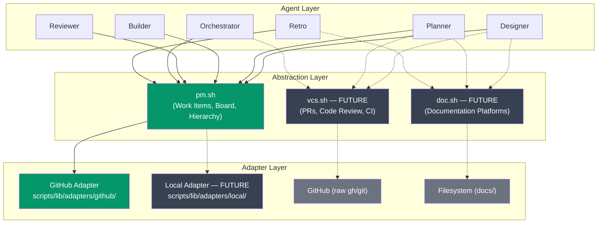
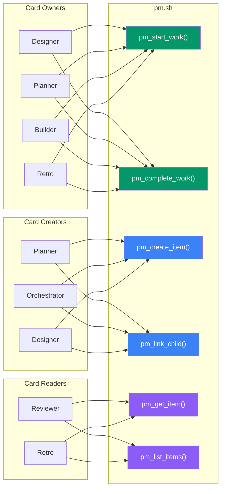
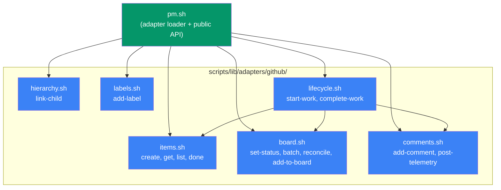
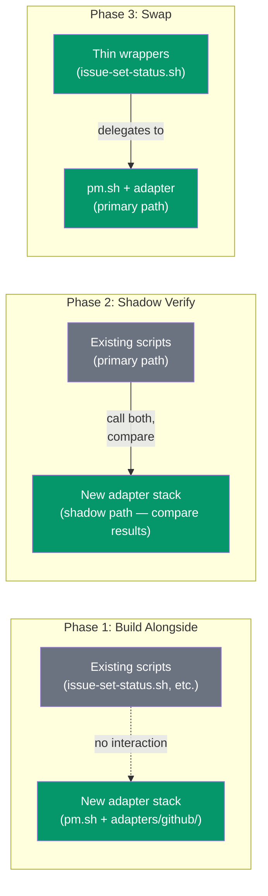

# Design: PM Abstraction Layer

> **Status:** Draft

## 1. Overview

The PM Abstraction Layer introduces a clean boundary between the workflow's process logic (agents, orchestrator, scripts) and the external project management platform (currently GitHub Issues + Projects). Today, 15+ scripts and all 6 agent files embed raw `gh` CLI commands, GitHub-specific GraphQL mutations, and project board option IDs. This coupling blocks every downstream capability on the roadmap: local-first PM (#111), plugin packaging (#112), multi-PM adapters (#113), and running on real software (#108).

This design document defines:

1. A **`scripts/lib/pm.sh`** library with ~13 generic PM functions (the adapter contract)
2. A **GitHub adapter** (`scripts/lib/adapters/github/`) as the first (and currently only) implementation
3. A **standardized agent contract** for how all 6 agents interact with work items
4. A **shadow stack migration strategy** to swap in the new adapter without breaking the running workflow
5. A **cost budget** mechanism (`maxCostPerRun` in config)
6. **Forward compatibility** for downstream items (#111, #112, #113)

### Design Process

This design was developed through an adversarial triangulation pattern -- three independent perspectives (stakeholder vision from the backlog issue, orchestrator constraints from 16 production runs, and designer evaluation) each evaluated the PM/VCS boundary. The boundary was drawn at the point where all three converged: PM operations (work items, board, hierarchy) are abstracted; VCS operations (branches, merges, PRs) are deferred. This convergence was validated by checking that the GitHub adapter can implement every pm.sh function without bypassing the interface -- if it needed to bypass, the interface would be incomplete.

## 2. Three-Layer Abstraction Landscape

The full abstraction architecture has three orthogonal layers. Only the PM layer is built in this item. The VCS and DOC layers are documented for forward compatibility.



**Layer definitions:**

| Layer | Scope | Built in this item | Local-first role |
|-------|-------|--------------------|-----------------|
| **PM** (`pm.sh`) | Work items, board transitions, hierarchy, comments, labels | Yes | Filesystem is both standalone default and cache for external adapters |
| **VCS** (future `vcs.sh`) | Pull requests, code review, CI triggers | No -- deferred | Git is already local-first; only hosting platform (PRs, reviews) needs abstraction |
| **DOC** (future `doc.sh`) | Documentation platforms | No -- mention only | Filesystem (`docs/`) is both standalone default and cache |

**DOC layer note:** The DOC layer with redundancy/cache pattern needs more thinking in a future sprint. There are potential async issues with document sync (concurrent agents writing to the same doc, merge conflicts in frontmatter, eventual consistency between local files and external platforms like Notion/Confluence) that have not been explored. Do not attempt to solve this now.

### VCS Boundary

VCS operations (branches, merges, git commands) stay as raw `gh`/`git` calls for now. Git itself is already local-first and platform-agnostic. Only the hosting-platform operations need abstraction:

**Deferred VCS function signatures** (for future `vcs.sh`):

| Function | Purpose | Current implementation |
|----------|---------|----------------------|
| `vcs_create_pr(base, head, title, body)` | Open a pull/merge request | `gh pr create` |
| `vcs_merge_pr(number, strategy)` | Merge a PR (merge/squash/rebase) | `gh pr merge` |
| `vcs_get_pr(number)` | Read PR details | `gh pr view` |
| `vcs_list_prs(filters)` | List open/closed PRs | `gh pr list` |
| `vcs_comment_pr(number, body)` | Post a PR comment | `gh pr comment` |
| `vcs_review_pr(number, body, verdict)` | Submit a formal review | `gh pr review` |

These signatures map 1:1 to future MCP tool signatures when #112 (Plugin Packaging) is built. The Bash function `vcs_create_pr(base, head, title, body)` becomes MCP tool `vcs_create_pr` with parameters `{base: string, head: string, title: string, body: string}`.

## 3. Agent Architecture Audit

### 3.1 Current State

The following table documents every agent's current PM interactions, gathered by auditing all 6 agent `.md` files and the scripts they invoke.

| Agent | Creates items | Reads items | Board transitions | Comments | Hierarchy | Labels | Telemetry |
|-------|:---:|:---:|:---:|:---:|:---:|:---:|:---:|
| **Designer** | 1 issue (design doc) | `gh issue list`, `gh issue view` | `issue-set-status.sh` (In Progress) | -- | `addSubIssue` (link to backlog) | `type/docs`, `backlog/*` | -- |
| **Planner** | N issues (epics + stories + plan) | `gh issue list`, `gh issue view` | `issue-set-status.sh` (Ready, In Progress) | -- | `addSubIssue` (stories to epic, epics to backlog) | `hierarchy/*`, `backlog/*`, `type/*`, `difficulty/*` | -- |
| **Builder** | -- | `gh issue list`, `gh issue view` | `issue-start.sh` (In Progress), `issue-review.sh` (In Review) | "Work Started", "Ready for Review" | -- | -- | -- |
| **Reviewer** | -- | `gh pr diff`, `gh issue view` | -- | Review findings (on PR or issue) | -- | -- | -- |
| **Orchestrator** | Backlog issue, retro issue | `gh issue list`, `gh issue view`, `gh pr list` | `issue-set-status.sh` (all transitions), `batch-set-status.sh`, `reconcile-board.sh` | Retroactive comments, failure comments | `addSubIssue` (retro to backlog) | `backlog/*` | `issue-telemetry.sh` (all levels) |
| **Retro** | -- | `gh issue view`, `gh api` (PR comments) | -- | Convention change comments | -- | -- | -- |

### 3.2 Current Inconsistencies

1. **Builder uses `issue-start.sh`/`issue-review.sh` but designer/planner/retro do not.** Designer and planner call `issue-set-status.sh` directly. There is no "Work Started" comment for design or plan phases.

2. **Board transitions are duplicated.** Builder scripts call `issue-set-status.sh` as defense-in-depth, AND the orchestrator sets status before/after dispatch. This was necessary because GitHub Projects API is unreliable, but it means 2-3 API calls per transition instead of 1.

3. **Hierarchy creation is scattered.** Designer calls `addSubIssue` for design issue. Planner calls `addSubIssue` for epics and stories. Orchestrator calls `addSubIssue` for retro issue. Each uses raw GraphQL.

4. **Item creation uses different patterns.** Orchestrator uses `issue-create-backlog.sh` (a helper script). Planner uses raw `gh issue create`. Designer uses raw `gh issue create`.

5. **Board management on the critical path.** The orchestrator blocks on `issue-set-status.sh` before and after every dispatch. This adds ~9-10 minutes per 30-story run to the critical path -- pure overhead that delivers no correctness benefit (board is informational, not a prerequisite for dispatch).

6. **Telemetry posting is orchestrator-only.** Agents do not know their own cost or duration. This is correct (the Agent tool returns metrics), but it means telemetry posting cannot be delegated.

### 3.3 Target State

The target agent contract defines three roles based on how agents interact with PM.



**Target state table:**

| Agent | Role | At start | At end | Creates | Reads | Comments | Telemetry |
|-------|------|----------|--------|---------|-------|----------|-----------|
| **Designer** | Card Owner + Creator | `pm_start_work <N>` | `pm_complete_work <N>` | `pm_create_item` (design issue), `pm_link_child` | `pm_get_item`, `pm_list_items` | -- | -- |
| **Planner** | Card Owner + Creator | `pm_start_work <N>` | `pm_complete_work <N>` | `pm_create_item` (epics, stories, plan issue), `pm_link_child`, `pm_add_label`, `pm_add_to_board` | `pm_get_item`, `pm_list_items` | -- | -- |
| **Builder** | Card Owner | `pm_start_work <N>` | `pm_complete_work <N>` | -- | `pm_get_item`, `pm_list_items` | -- | -- |
| **Reviewer** | Card Reader | -- | -- | -- | `pm_get_item`, `pm_list_items` | `pm_add_comment` (review findings) | -- |
| **Orchestrator** | Card Creator | -- | -- | `pm_create_item` (backlog, retro), `pm_link_child`, `pm_add_to_board`, `pm_set_status` (reconciliation only), `pm_reconcile`, `pm_batch_set_status` | `pm_get_item`, `pm_list_items` | `pm_add_comment` (retroactive, failure) | `pm_post_telemetry` |
| **Retro** | Card Owner + Reader | `pm_start_work <N>` | `pm_complete_work <N>` | -- | `pm_get_item`, `pm_list_items` | `pm_add_comment` (convention changes) | -- |

**Key changes from current state:**

1. **Designer and planner now call `pm_start_work`/`pm_complete_work`** -- same lifecycle as builder. No more special-case handling.

2. **Orchestrator does NOT call `pm_start_work`/`pm_complete_work`** for agents' cards. Agents own their own cards. Defense-in-depth (orchestrator also sets status before/after dispatch) is KEPT for Phase 1 because the external GitHub API is unreliable. It is documented as removable in Phase 2 (#111) when local-first PM eliminates the failure mode.

3. **Reviewer has no PM lifecycle contract.** Both story-level and backlog PR-level reviewers are read+comment only. They never own a card, never transition the board. The orchestrator interprets reviewer verdicts and drives state transitions.

4. **Telemetry stays orchestrator-only.** Agents do not know their own cost/duration. The orchestrator captures Agent tool metrics and posts telemetry via `pm_post_telemetry`.

## 4. PM Adapter Interface (`pm.sh`)

### 4.1 Function Signatures

The pm.sh library defines ~13 functions organized into two tiers.

**Tier 1: Lifecycle functions** -- structured, opinionated, encode workflow semantics.

| Function | Signature | Purpose | Board effect |
|----------|-----------|---------|-------------|
| `pm_start_work` | `pm_start_work <item-id> [--model <m>] [--agent <a>]` | Mark work as started. Posts "Work Started" comment, transitions to In Progress. | Ready -> In Progress |
| `pm_complete_work` | `pm_complete_work <item-id> <commit-hash>` | Mark work as ready for review. Posts "Ready for Review" comment, transitions to In Review. | In Progress -> In Review |
| `pm_done` | `pm_done <item-id>` | Close/resolve a work item. Transitions to Done. | * -> Done |
| `pm_post_telemetry` | `pm_post_telemetry <item-id> [--model <m>] [--duration <ms>] [--commit <hash>] [--tokens <n>] [--tool-uses <n>] [--pr <n>] [--dispatches-from-state <file>] [--gantt-from-state <file>] [--summary <md>] [--breakdown <md>] [--footer <md>] [--cost <dollars>]` | Post structured telemetry comment. Renders from template. | None |
| `pm_set_status` | `pm_set_status <item-id> <status>` | Explicit board transition (reconciliation, orchestrator override). Status values: `backlog`, `ready`, `in-progress`, `in-review`, `done`. | As specified |
| `pm_reconcile` | `pm_reconcile --from-state <file> [--epic-issues <json>] [--dry-run]` | Batch-reconcile board state against the state file. Read expected, query actual, fix diffs. | Fixes drifted items |

**Tier 2: Generic functions** -- pass-through, adapter-resolved, no workflow semantics.

| Function | Signature | Purpose |
|----------|-----------|---------|
| `pm_create_item` | `pm_create_item <level> <title> [--body <text>] [--body-file <path>] [--labels <csv>]` | Create a work item. Level: `backlog`, `epic`, `story`, `docs`. Returns item ID. |
| `pm_get_item` | `pm_get_item <item-id> [--json <fields>]` | Read item details (title, body, labels, state). |
| `pm_list_items` | `pm_list_items [--label <label>] [--state <open\|closed\|all>] [--limit <n>]` | Query items by filters. |
| `pm_add_comment` | `pm_add_comment <item-id> <body>` | Post a comment on a work item. |
| `pm_link_child` | `pm_link_child <parent-id> <child-id>` | Establish parent-child hierarchy. |
| `pm_add_label` | `pm_add_label <item-id> <label> [--create-if-missing] [--color <hex>]` | Add a label to an item. Optionally create the label first. |
| `pm_add_to_board` | `pm_add_to_board <item-id>` | Add an item to the project board. Required before `pm_set_status`. |
| `pm_batch_set_status` | `pm_batch_set_status <item-id>:<status> [...]` | Set board status for multiple items. Fetch-all, mutate-sequentially, verify-once. |

### 4.2 Function-to-MCP Mapping

Every pm.sh function maps 1:1 to a future MCP tool signature. When #112 (Plugin Packaging) builds MCP servers, the Bash functions become thin wrappers around MCP tool calls -- or the MCP tools call the same adapter functions directly.

| pm.sh function | MCP tool name | MCP parameters |
|----------------|---------------|----------------|
| `pm_create_item` | `pm_create_item` | `{level: string, title: string, body?: string, labels?: string[]}` |
| `pm_get_item` | `pm_get_item` | `{id: string, fields?: string[]}` |
| `pm_list_items` | `pm_list_items` | `{label?: string, state?: string, limit?: number}` |
| `pm_set_status` | `pm_set_status` | `{id: string, status: string}` |
| `pm_add_comment` | `pm_add_comment` | `{id: string, body: string}` |
| `pm_link_child` | `pm_link_child` | `{parent_id: string, child_id: string}` |
| `pm_start_work` | `pm_start_work` | `{id: string, model?: string, agent?: string}` |
| `pm_complete_work` | `pm_complete_work` | `{id: string, commit: string}` |
| `pm_done` | `pm_done` | `{id: string}` |

### 4.3 Adapter Selection

The active adapter is selected by config:

```json
{
  "pm": {
    "adapter": "github"
  }
}
```

At load time, `pm.sh` sources the appropriate adapter:

```bash
# scripts/lib/pm.sh (simplified)
SCRIPT_DIR="$(cd "$(dirname "${BASH_SOURCE[0]}")" && pwd)"
source "$SCRIPT_DIR/config.sh"

PM_ADAPTER=$(_cfg '.pm.adapter' "github")
ADAPTER_DIR="$SCRIPT_DIR/adapters/$PM_ADAPTER"

if [ ! -d "$ADAPTER_DIR" ]; then
  echo "ERROR: PM adapter '$PM_ADAPTER' not found at $ADAPTER_DIR" >&2
  exit 1
fi

# Source all adapter modules
for module in "$ADAPTER_DIR"/*.sh; do
  source "$module"
done
```

Valid values: `"github"` (current, only adapter built in this item). Future: `"local"` (#111), `"jira"`, `"linear"` (#113).

## 5. GitHub Adapter Structure

### 5.1 Folder Layout

```
scripts/lib/
  pm.sh                         # Adapter loader + public API (sources adapter modules)
  config.sh                     # Existing config reader (unchanged)
  adapters/
    github/
      items.sh                  # pm_create_item, pm_get_item, pm_list_items, pm_done
      board.sh                  # pm_set_status, pm_batch_set_status, pm_reconcile, pm_add_to_board
      comments.sh               # pm_add_comment, pm_post_telemetry
      hierarchy.sh              # pm_link_child
      labels.sh                 # pm_add_label
      lifecycle.sh              # pm_start_work, pm_complete_work (composed from items + board + comments)
```



### 5.2 Shared Infrastructure Absorbed by Adapter

The GitHub adapter absorbs the shared infrastructure currently spread across individual scripts:

| Current location | Moves to | What it does |
|-----------------|----------|-------------|
| `issue-set-status.sh` (item ID lookup via GraphQL) | `board.sh` (`_gh_fetch_item_info`) | Lightweight per-issue query for board item ID + current status |
| `issue-set-status.sh` (status mutation) | `board.sh` (`_gh_mutate_status`) | `gh project item-edit` with option IDs from config |
| `issue-set-status.sh` (post-mutation verification) | `board.sh` (`_gh_verify_status`) | Re-fetch after mutation, log discrepancies |
| `issue-set-status.sh` (retry logic) | `board.sh` (`_gh_retry_fetch`) | 3-second retry on race condition after `item-add` |
| `batch-set-status.sh` (batch fetch + mutate + verify) | `board.sh` (`pm_batch_set_status`) | Orchestrated batch with single verification pass |
| `reconcile-board.sh` (batch query + diff + fix) | `board.sh` (`pm_reconcile`) | Aliased GraphQL query for batch-read, Python diff computation |
| `issue-telemetry.sh` (all of it) | `comments.sh` (`pm_post_telemetry`) | Delegates to the existing `issue-telemetry.sh` script (not rewritten) |
| `issue-create-backlog.sh` (issue creation + board + label) | `items.sh` (`pm_create_item`) + `board.sh` + `labels.sh` | Decomposed into composable adapter functions |

### 5.3 Backward-Compatible Wrappers

Existing script names are preserved as thin wrappers that delegate to pm.sh:

```bash
# scripts/issue-set-status.sh (after migration)
#!/usr/bin/env bash
set -euo pipefail
SCRIPT_DIR="$(cd "$(dirname "${BASH_SOURCE[0]}")" && pwd)"
source "$SCRIPT_DIR/lib/pm.sh"
pm_set_status "$@"
```

This means:
- **No breaking changes** for agents or orchestrator that call `./scripts/issue-set-status.sh`
- The actual logic lives in `scripts/lib/adapters/github/board.sh`
- When the adapter changes (e.g., to `local`), the wrapper calls the same `pm_set_status` which routes to a different adapter

Scripts that become wrappers:

| Script | Delegates to |
|--------|-------------|
| `issue-set-status.sh` | `pm_set_status` |
| `batch-set-status.sh` | `pm_batch_set_status` |
| `issue-start.sh` | `pm_start_work` |
| `issue-review.sh` | `pm_complete_work` |
| `issue-close.sh` | `pm_done` |
| `issue-create-backlog.sh` | `pm_create_item` (with `--level backlog`) + `pm_add_to_board` + `pm_set_status` + `pm_add_label` |
| `reconcile-board.sh` | `pm_reconcile` |
| `setup-labels.sh` | `pm_add_label` (repeated calls) |

Scripts that are NOT wrapped (they remain independent or are VCS-scope):

| Script | Why |
|--------|-----|
| `dispatch-story.sh` | Dispatch logic, not PM |
| `dispatch-workflow.sh` | Lifecycle orchestration, not PM |
| `cleanup-post-merge.sh` | Git cleanup, not PM |
| `check-board-drift.sh` | Diagnostic tool, can use pm.sh internally |
| `state.sh` | Orchestrator state, not PM |
| `fetch-pricing.sh` | Pricing data, not PM |
| `issue-telemetry.sh` | Called by `pm_post_telemetry`, not wrapped |

## 6. Cost Budget

### 6.1 Config Addition

Add `maxCostPerRun` to the workflow config:

```json
{
  "workflow": {
    "maxCostPerRun": 10.00,
    "autoMergePlanPR": true,
    "autoMergeDesignPR": true,
    "skipRetro": false,
    "maxParallelBuilders": 3
  }
}
```

**Default:** `null` (no budget limit). When set to a positive number, the orchestrator checks cumulative cost after each dispatch.

### 6.2 Orchestrator Enforcement

After each builder/reviewer dispatch, the orchestrator:

1. Reads cumulative cost from the state file: `./scripts/state.sh get '.session.total_cost'`
2. Compares against config limit: `_cfg '.workflow.maxCostPerRun' "null"`
3. If over budget: posts a budget-exceeded comment on the backlog issue and halts

```bash
MAX_COST=$(_cfg '.workflow.maxCostPerRun' "null")
if [ "$MAX_COST" != "null" ]; then
  CURRENT_COST=$(./scripts/state.sh get '.session.total_cost')
  if (( $(echo "$CURRENT_COST > $MAX_COST" | bc -l) )); then
    pm_add_comment "$BACKLOG_ISSUE" "Budget exceeded: \$${CURRENT_COST} > \$${MAX_COST} limit. Halting."
    exit 1
  fi
fi
```

The cost check happens at dispatch boundaries, not mid-agent. An individual agent dispatch that exceeds the budget will complete (agents cannot be interrupted mid-run), but no further dispatches will start.

## 7. Migration Strategy: Shadow Stack

The migration follows a three-phase "build alongside, verify, swap" pattern. This is documented as an ADR (Section 11) for reuse in all future core workflow changes.



### Phase 1: Build Alongside (this item)

Create the entire new adapter stack in new files and folders. Do not touch existing scripts. The running workflow uses existing scripts throughout Phase 1.

**What gets built:**
- `scripts/lib/pm.sh` (adapter loader)
- `scripts/lib/adapters/github/items.sh`
- `scripts/lib/adapters/github/board.sh`
- `scripts/lib/adapters/github/comments.sh`
- `scripts/lib/adapters/github/hierarchy.sh`
- `scripts/lib/adapters/github/labels.sh`
- `scripts/lib/adapters/github/lifecycle.sh`

**What does NOT change:**
- `scripts/issue-set-status.sh` (unchanged, still works)
- `scripts/issue-start.sh` (unchanged)
- `scripts/issue-review.sh` (unchanged)
- All agent `.md` files (unchanged)
- Config file (new `pm.adapter` field added, not breaking)

**Validation:** Unit tests for each adapter function. Integration test that runs the full pm.sh surface against the live GitHub API on a test issue.

### Phase 2: Shadow Verify (stretch goal)

Existing scripts optionally call both old and new paths, compare results. Non-blocking -- discrepancies are logged, not fatal.

```bash
# Example: issue-set-status.sh with shadow verification
SCRIPT_DIR="$(cd "$(dirname "${BASH_SOURCE[0]}")" && pwd)"
source "$SCRIPT_DIR/lib/pm.sh"

# Primary path (existing logic)
_legacy_set_status "$@"

# Shadow path (new adapter -- compare, don't fail)
SHADOW_RESULT=$(pm_set_status "$@" 2>&1) || true
if [ "$SHADOW_RESULT" != "$LEGACY_RESULT" ]; then
  echo "SHADOW_MISMATCH: legacy=$LEGACY_RESULT new=$SHADOW_RESULT" >> .agentic-workflow/logs/shadow.log
fi
```

This phase is a stretch goal -- it provides confidence before the swap but is not required for correctness. If time-constrained, skip to Phase 3.

### Phase 3: Swap (next run after verification)

Existing scripts become thin wrappers delegating to pm.sh (as shown in Section 5.3). The old logic is deleted from individual scripts. The adapter is now the primary path.

**Rollback plan:** If the new adapter causes failures in production:

1. Revert the wrapper scripts to their pre-swap state (a single `git revert` of the swap commit)
2. The adapter stack remains in `scripts/lib/adapters/github/` but is not called
3. Debug and fix the adapter, then re-swap

The rollback is safe because the adapter files are additive -- reverting the wrappers restores the original behavior without deleting the new code.

## 8. PM Scope Boundary

### 8.1 What is IN scope for pm.sh

All work item operations:
- Create, read, update, close work items
- Board/status transitions
- Work item comments
- Parent-child hierarchy
- Labels
- Telemetry posting (structured comments)
- Board reconciliation

### 8.2 What is OUT of scope

VCS operations stay as raw `gh`/`git` calls:

| Operation | Why excluded | Current implementation |
|-----------|-------------|----------------------|
| Branch creation | `git checkout -b` -- already platform-agnostic | Raw git |
| Branch merging | `git merge` -- already platform-agnostic | Raw git |
| PR creation | VCS-scope, deferred to future `vcs.sh` | `gh pr create` |
| PR merging | VCS-scope, deferred | `gh pr merge` |
| PR commenting | VCS-scope, deferred | `gh pr comment` |
| PR diff reading | VCS-scope, deferred | `gh pr diff` |
| Code review posting | VCS-scope, deferred | `gh pr review` |

The orchestrator and agents continue to use `gh pr create`, `gh pr merge`, etc. directly until `vcs.sh` is built. This is acceptable because:

1. VCS coupling is lower-friction than PM coupling (fewer scripts, less state management)
2. VCS operations are less frequent per run (~3-5 PR operations vs ~100+ board operations)
3. The PM abstraction delivers 90% of the value needed for #108 and #111

## 9. Forward Compatibility

### 9.1 Local-First PM (#111)

The `pm.sh` interface is designed so a local filesystem adapter can implement every function:

| pm.sh function | Local adapter implementation |
|----------------|---------------------------|
| `pm_create_item` | Write markdown file to `.workflow/items/NNN-slug.md` with YAML frontmatter |
| `pm_get_item` | Parse YAML frontmatter from markdown file |
| `pm_list_items` | Grep across `.workflow/items/*.md` frontmatter |
| `pm_set_status` | Update `status:` field in YAML frontmatter |
| `pm_add_comment` | Append timestamped file to `.workflow/comments/NNN-CCC.md` |
| `pm_link_child` | Set `parent:` in child's frontmatter |
| `pm_add_label` | Append to `labels:` array in frontmatter |
| `pm_add_to_board` | No-op (items are always "on the board" -- the filesystem IS the board) |
| `pm_reconcile` | No-op (no external system to reconcile with) |
| `pm_start_work` | Update `status: in-progress` + write comment file |
| `pm_complete_work` | Update `status: in-review` + write comment file |
| `pm_done` | Update `status: done` |

The interface does NOT require changes for the local adapter. If it does, the abstraction was wrong.

### 9.2 Plugin Packaging (#112)

The pm.sh function signatures map 1:1 to MCP tool signatures (Section 4.2). The plugin packages:

- `pm.sh` as the adapter loader
- `adapters/github/` as the reference adapter
- `adapters/local/` as the zero-config default
- MCP tool definitions that call the same adapter functions

### 9.3 Multi-PM Adapters (#113)

Each new adapter implements the same set of functions in its own folder:

```
scripts/lib/adapters/
  github/     # Built in this item
  local/      # Built in #111
  jira/       # Built in #113
  linear/     # Built in #113
  azure/      # Built in #113
```

Adapter-specific concerns (rate limits, batch support, API pagination, authentication) are handled within each adapter. The pm.sh interface does not expose these -- they are implementation details.

### 9.4 Rate Limit Awareness

Different PM platforms have different rate limits:

| Platform | Rate limit | Batch support |
|----------|-----------|---------------|
| GitHub GraphQL | 5,000 points/hour | Aliased queries (multiple issues per request) |
| Jira Cloud | 100-500 requests/minute | Bulk create/update endpoints |
| Linear | 1,500 requests/hour | Nested mutations |
| Azure DevOps | 200 requests/minute | Batch API (up to 200 operations) |
| Local filesystem | Unlimited | N/A |

Each adapter handles throttling internally with retry/backoff. The pm.sh interface does NOT expose rate limit state to callers -- adapters are responsible for staying within limits.

## 10. Config Schema Changes

### 10.1 New Fields

```json
{
  "pm": {
    "adapter": "github"
  },
  "workflow": {
    "maxCostPerRun": null
  }
}
```

### 10.2 Updated `config.sh`

Add new config readers:

```bash
# --- PM adapter ---
CFG_PM_ADAPTER=$(_cfg '.pm.adapter' "github")

# --- Cost budget ---
CFG_MAX_COST_PER_RUN=$(_cfg '.workflow.maxCostPerRun' "null")
```

### 10.3 Backward Compatibility

The `pm.adapter` field defaults to `"github"` when absent. All existing config files continue to work without modification. The `github` section remains unchanged -- it provides GitHub-specific configuration that the GitHub adapter reads.

## 11. ADR: Build Alongside, Verify, Swap

> **ADR-0004: Migration strategy for core workflow changes**

### Context

Core workflow scripts (board management, telemetry, state) are used by every agent in every run. Modifying them in-place risks breaking the running workflow mid-run. The PM abstraction is the first large-scale refactor of these scripts.

### Decision

All future core workflow changes follow a three-phase migration:

1. **Build alongside:** Create new code in new files/folders. Do not modify existing scripts. The running workflow is unaffected.

2. **Shadow verify (optional):** Existing scripts call both old and new paths, compare results. Discrepancies are logged, not fatal. This phase builds confidence but is not required.

3. **Swap:** Existing scripts become thin wrappers delegating to the new code. The old logic is deleted. One commit, one revert to rollback.

### Consequences

- **Pro:** Zero-risk development phase. New code can be tested independently before it carries production traffic.
- **Pro:** Rollback is always one `git revert` -- the old code is not deleted until Phase 3.
- **Pro:** Shadow verification catches subtle behavioral differences before they affect users.
- **Con:** Temporary code duplication between old scripts and new adapter during Phase 1.
- **Con:** Phase 2 (shadow verify) adds complexity and may be skipped under time pressure.

### Applicability

This ADR applies to changes that affect:
- Scripts called by multiple agents (board management, telemetry, state)
- Config schema changes that affect runtime behavior
- Adapter interfaces that will have multiple implementations

It does NOT apply to:
- Agent `.md` file updates (no runtime state)
- Documentation changes
- Adding new scripts that do not replace existing ones

## 12. Assumptions and Open Questions

### Assumptions Made

1. **Bash is sufficient for the adapter layer.** The GitHub adapter's most complex operations (batched GraphQL queries, JSON processing) already use Python in the current `reconcile-board.sh` and `compute-dispatches.py`. The adapter will continue this Bash+Python hybrid pattern where needed.

2. **`issue-telemetry.sh` is not rewritten.** The telemetry script (602 lines, complex template rendering) is called by `pm_post_telemetry` rather than absorbed into the adapter. It is too large and specialized to duplicate inside the adapter, and its interface (CLI flags) is already clean.

3. **Agent file changes are deferred to Phase 3 (swap).** During Phase 1 (build alongside), agents continue calling `./scripts/issue-start.sh` etc. The wrapper swap in Phase 3 is invisible to agents. Agent `.md` files are updated only if the pm.sh functions have different flag names or semantics than the current scripts.

4. **Defense-in-depth board transitions are kept.** The orchestrator continues to set board status before/after dispatch even though agents also call `pm_start_work`/`pm_complete_work`. This redundancy is documented as removable in Phase 2 when local-first PM eliminates the external API failure mode.

5. **The `Closes` convention avoidance (using `Related (already closed)` for closed issues) is a PM-layer concern.** The adapter should handle this transparently -- when closing an issue that is referenced in a PR, use the correct keyword based on state.

### Open Questions

1. **Should `pm_post_telemetry` wrap `issue-telemetry.sh` or replace it?** Wrapping is simpler (call the existing script), but replacing would bring telemetry fully under the adapter. Recommendation: wrap for now, reassess in #111 when the local adapter needs its own telemetry format.

2. **Should the adapter handle `dispatch-workflow.sh` PM operations?** The dispatch workflow script has 20 `gh` calls -- the most of any script. However, it is being deprecated in favor of the orchestrator agent. Recommendation: do not refactor `dispatch-workflow.sh` -- it will be removed when #112 (Plugin Packaging) ships.

3. **How should adapter errors propagate?** Current scripts use `|| echo "Warning"` for non-critical failures (board status) and `exit 1` for critical failures (item creation). Recommendation: adapter functions return exit codes; callers decide severity. `pm.sh` does not catch or suppress errors.

## 13. Approaches Considered

### Approach A: Monolithic pm.sh (all functions in one file)

All ~13 functions in a single `scripts/lib/pm.sh` file with `if/else` adapter selection.

- **Pro:** Simplest to implement. One file to maintain.
- **Con:** File grows large as adapters are added (each function needs a branch per adapter). Does not compose well with #113 (multi-PM).
- **Rejected** because it does not scale to multiple adapters.

### Approach B: Folder per adapter (SELECTED)

Adapter functions split across domain-specific files within an adapter folder. `pm.sh` is a thin loader that sources the active adapter's modules.

- **Pro:** Clean separation -- adding a Jira adapter means adding `adapters/jira/` with the same file structure.
- **Pro:** Domain grouping (board, items, comments) makes the adapter easier to navigate and test.
- **Con:** More files to create initially.
- **Selected** because it scales to multiple adapters and composes well with the plugin architecture.

### Approach C: MCP server first

Build the GitHub adapter as an MCP server from the start, bypassing the Bash adapter entirely.

- **Pro:** Future-proof for #112 (Plugin Packaging).
- **Con:** Premature -- MCP adds latency, complexity, and a Node.js/Python dependency. The workflow runs in Bash today.
- **Con:** Would block #111 (Local-First PM) which needs filesystem operations that are trivial in Bash but complex in MCP.
- **Rejected** but documented as the long-term destination. The Bash adapter function signatures are designed to map 1:1 to MCP tools (Section 4.2).

## 14. Scope Risks

| Risk | Mitigation |
|------|-----------|
| **Agent file updates cascade** -- changing how agents call PM functions touches all 6 agents + 3 builder variants + 2 reviewer variants (11 files). | Phase 1 does not change agent files. Phase 3 (swap) changes only the wrapper scripts, not agent instructions. Agent file updates are deferred to when `pm.sh` function names differ from current script names. |
| **`issue-telemetry.sh` is complex** (602 lines) and tempting to absorb. | Explicitly out of scope for absorption. `pm_post_telemetry` wraps it. |
| **Shadow verify (Phase 2) may add significant effort** for marginal confidence gain. | Marked as stretch goal. Skip if time-constrained. |
| **`dispatch-workflow.sh` has 20 gh calls** and is tempting to refactor. | Explicitly out of scope. It is being deprecated in favor of the orchestrator agent. |
| **DOC layer abstraction** is tempting to design alongside PM. | Explicitly deferred. Mentioned in Section 2 for context only. Async doc sync issues are unresolved. |

## 15. Related Documents

- [Extraction & Packaging Design](2026-03-11-agentic-sdlc-extraction-design.md) -- PM adapter interface (earlier iteration)
- [Plugin Architecture Appendix](2026-03-10-agentic-sdlc-plugin-architecture.md) -- MCP-based adapter architecture (long-term vision)
- [Roadmap](../1-discovery/2026-03-15-roadmap.md) -- Priority order and dependency graph
- [Configurable Workflow Settings](2026-03-15-configurable-workflow-settings.md) -- Config schema (extended by this design)
