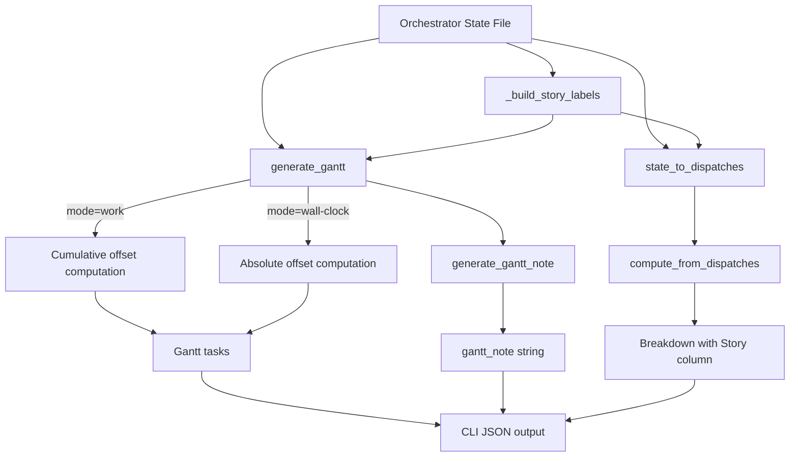

> **Status:** Draft

# Gantt Chart Readability: Story Code Regression and Work Timeline Mode

> Historical record (March 2026). Measurements come from controlled synthetic workloads and early infrastructure runs; see [case studies](../case-studies.md) for scoped findings.

## 1. Problem Statement

Two compounding readability problems in `scripts/lib/compute-dispatches.py` render the Gantt chart and breakdown table unreliable for real-world runs:

**Problem 1 -- Story code regression.** Gantt labels and breakdown table tasks lost their story code prefixes. Labels that should read `E01-S02 Build (9m 3s)` now show as generic `Build (9m 3s)`. This makes it impossible to identify which story each bar represents in multi-story runs.

Evidence from BL#227 telemetry: all builder and reviewer Gantt labels show `Build (91m 2s)`, `PR Review (2m 6s)` -- no story codes anywhere.

**Problem 2 -- Wall-clock timeline distortion.** Sessions with interruptions (API 529 errors, usage limits, overnight pauses) produce unreadable Gantt charts. BL#227 spans 00:00:00 to ~12:20:00 because of a ~9h gap, with only ~40 minutes of actual work. Tasks after the gap are compressed into invisible slivers on the right edge.

A prior gap compression attempt (commit `4f51e4d`) was built and reverted (commit `645be97`) because it interacted badly with stalled durations. The revert taught us that both issues must be solved together in a single coherent design.

## 2. Scope

**In scope:**
- Fix story code label regression in Gantt chart and breakdown table
- Add a "Work Timeline" Gantt mode using cumulative active time
- Stalled dispatch detection and annotation
- Dual-mode CLI flag (`--gantt-mode`)
- Retain wall-clock mode as a diagnostic option
- Add Story column to breakdown table
- Tests for all new behavior

**Out of scope:**
- Flow diagrams, Sankey diagrams, or other chart types (BL#166)
- Phase summary chart (single-bar-per-phase view)
- Story lifecycle swimlanes
- Interactive dispatch consolidation (multiple dispatches of the same issue/agent merged into one bar)
- Throughput normalization (adjusting bar width by tok/s instead of wall-clock)
- Changes to `item-telemetry.sh` (only its Python dependency changes)
- Changes to the telemetry Markdown template (`scripts/templates/telemetry.md`) beyond adding a Story column header

## 3. Approaches Considered

### Approach A: Fix Story Codes Only (Minimal)

Fix the `_build_story_labels()` mapping regression and add a Story column to the breakdown table. Leave the Gantt timeline as wall-clock.

**Pros:** Lowest risk, smallest change surface.
**Cons:** Does not address the primary readability crisis (97% whitespace). BL#227-style charts remain unreadable.

### Approach B: Cumulative Active Time (Recommended)

Replace the Gantt X-axis with cumulative active time. Each wave's offset is computed from the sum of prior waves' `max(duration_ms)` values (the critical path). Gaps between waves are collapsed. Gap indicators are rendered as annotations below the chart.

**Pros:**
- Solves both problems in a single coherent model
- Leverages existing `_group_dispatches_by_parallel_wave()` infrastructure
- Produces compact, readable charts regardless of session interruptions
- Wall-clock mode retained as `--gantt-mode wall-clock` for diagnostic use

**Cons:** Changes the default Gantt output (existing consumers must adapt). However, only the orchestrator and `item-telemetry.sh` consume this output, and both are under our control.

### Approach C: Wall-Clock with Smart Compression

Keep the wall-clock X-axis but compress gaps and normalize stalled durations. This was the approach attempted in commit `4f51e4d`.

**Pros:** Preserves the wall-clock mental model.
**Cons:** Mechanically complex -- must compress gaps AND normalize anomalous durations AND adjust tick intervals, all while maintaining visual coherence. The reverted attempt proved this interaction is fragile. Anomalous bars (91m stalled builds) still dominate the chart scale even after gap compression.

### Recommendation: Approach B

The fundamental insight from the revert is that wall-clock positioning answers the wrong question. Users want to know "how did work flow through the pipeline?" not "when did each task run?" Cumulative active time directly answers the first question. Wall-clock is preserved as a diagnostic mode for the second.

## 4. Design

### 4.1. Story Code Regression Fix

#### Root Cause Analysis

The `_build_story_labels()` function (line 675) correctly extracts story codes from `state.epics.*.stories.*.branch` patterns. The mapping is used by two consumers:

1. **`_gantt_label_for_dispatch()`** (line 708) -- Gantt labels
2. **`state_to_dispatches()`** (line 396) -- breakdown table task labels

The breakdown table in `state_to_dispatches()` has its own independent label generation. It uses `issue_titles` (derived from branch names) but does NOT include story codes. The Gantt path calls `_build_story_labels()` and passes the result to `_gantt_label_for_dispatch()`.

Examining the BL#227 breakdown output confirms: task labels show `Issue #233`, `Issue #234` instead of `E01-S01 Issue #233`, `E01-S02 Issue #234`. The `state_to_dispatches()` function never incorporated story codes -- it was not a regression but a gap that was never filled.

For the Gantt labels, examining the BL#227 output shows `Build (91m 2s)` without story codes. The `_build_story_labels()` function returns a dict mapping issue number to story code. If the state file's `epics.*.stories` keys use string issue numbers (e.g., `"233"`) but the dispatches have integer `issue` fields, the lookup `story_labels.get(issue)` would fail because `story_labels` stores `int(issue_num)` keys (line 693). This is actually correct -- the function casts to `int`.

The actual failure path is more subtle: **`_build_story_labels()` reads from `state.epics`**, but if the state file's epics section is incomplete, empty, or structured differently than expected, the mapping returns empty. The BL#227 run was the first to use the dual-write PM layer, which may have affected how epics were recorded in the state file.

#### Fix

1. **Add story code to breakdown table.** Modify `state_to_dispatches()` to call `_build_story_labels()` and prepend the story code to task labels for builder, reviewer, and fix cycle dispatches. This gives the breakdown table labels like `E01-S01 Destination Profiles (#233)`.

2. **Add a Story column to the breakdown table.** Add a dedicated `Story` column after `Agent` in the breakdown table format. For builder/reviewer/fix dispatches, this shows the story code (e.g., `E01-S02`). For design/plan/retro dispatches, it shows `--`. This makes story identification scannable without parsing the task label.

3. **Add fallback story code extraction.** When `_build_story_labels()` returns no mapping for an issue, attempt to extract the story code from the dispatch's own metadata. The state file's `dispatches[].issue` can be reverse-looked-up against `epics.*.stories` by issue number. If the state file structure varies, add a direct branch-name parsing fallback: if the dispatch has a `branch` field (or the orchestrator records one), parse `e01-s02/slug` directly.

4. **Add diagnostic logging.** When `_build_story_labels()` produces an empty map but `state.epics` is non-empty, emit a warning to stderr identifying which epic/story entries could not be parsed. This makes future regressions immediately visible.

#### Breakdown Table Format Change

Current format:
```
| Agent | Task | Duration | Tokens | Est. Cost |
```

New format:
```
| Agent | Story | Task | Duration | Tokens | Est. Cost |
```

The Story column contains:
- `E01-S02` for builder, reviewer, and fix cycle dispatches
- `--` for design, plan, retro, PR review, and orchestrator dispatches

This requires updating:
- `compute_from_dispatches()` -- add Story column to breakdown rows
- `state_to_dispatches()` -- return story code as a field in the dispatch dict
- `scripts/templates/telemetry.md` -- update the breakdown header row
- Test fixtures -- update expected breakdown row format

### 4.2. Work Timeline Mode (Gantt)

#### Concept

The Work Timeline mode changes the X-axis from wall-clock time to **cumulative active time**. Instead of positioning each dispatch at its absolute `started_at` offset from `session.started_at`, it positions each wave at the cumulative sum of prior waves' critical-path durations.

```
Wall-clock mode:
  [Design 5m] ... [Plan 10m] ... [Build 9m | Build 3m] ........... [Review 2m]
  0:00        0:06           0:17                        9:00       9:02

Work Timeline mode:
  [Design 5m] [Plan 10m] [Build 9m | Build 3m] [Review 2m]
  0:00        0:05       0:15                   0:24
```

The Work Timeline eliminates all dead space. Gaps between waves are replaced with zero-width transitions. Parallel dispatches within a wave are stacked at the same X offset (identical to current behavior within waves).

#### Algorithm

```python
def generate_gantt(state, mode="work"):
    waves = _group_dispatches_by_parallel_wave(sorted_dispatches)

    if mode == "work":
        # Cumulative active time: each wave starts after the prior wave's
        # critical path (max duration) completes
        cumulative_offset = 0.0
        gap_annotations = []
        prev_wave_end_wall = session_start_s  # wall-clock end of previous wave

        for wave_idx, (wave_anchor_s, wave_dispatches) in enumerate(waves):
            # Detect gap between this wave and the previous wave's wall-clock end
            gap_s = wave_anchor_s - prev_wave_end_wall
            if gap_s > GAP_THRESHOLD_S:
                gap_annotations.append((wave_idx, gap_s))

            wave_offset = cumulative_offset
            # Position all dispatches in this wave at wave_offset
            for d in wave_dispatches:
                emit_task(d, offset=wave_offset)

            # Advance cumulative offset by this wave's critical path
            max_dur_s = max(d.duration_ms / 1000 for d in wave_dispatches)
            cumulative_offset += max_dur_s

            # Track wall-clock end for gap detection
            prev_wave_end_wall = wave_anchor_s + max_dur_s

    else:  # mode == "wall-clock"
        # Current behavior: absolute timestamps
        for wave_anchor_s, wave_dispatches in waves:
            offset_s = wave_anchor_s - session_start_s
            for d in wave_dispatches:
                emit_task(d, offset=offset_s)
```

#### Gap Annotations

When the Work Timeline mode detects gaps between waves (wall-clock gap > 5 minutes), it records them. The annotations are returned as a separate `gantt_note` string (not embedded in the Mermaid chart, which does not support annotations).

Format:
```
*Timeline compressed: 2 gaps removed (9h 12m, 45m idle). X-axis shows agent running time, not wall-clock time.*
```

This note is rendered below the Gantt chart via the existing `gantt_note` template variable. The reverted commit (`4f51e4d`) already built this plumbing -- it can be re-used.

#### Stalled Dispatch Detection

A stalled dispatch is one where the `duration_ms` is disproportionate to the `tokens` produced. This typically indicates usage limit pauses, API throttling, or session interruptions within a single Agent tool call.

**Detection heuristic:** throughput < 50 tokens/second.

```python
throughput = tokens / (duration_ms / 1000)
if throughput < 50:
    # Flag as stalled
```

The 50 tok/s threshold is based on observed data:
- Normal Sonnet throughput: 200-400 tok/s
- Normal Opus throughput: 100-200 tok/s
- BL#227 E01-S01 (stalled): 15 tok/s (82K tokens / 91m)

Stalled dispatches are annotated in the Gantt label:

```
E01-S01 Build (91m 2s) [stalled]
```

And in the `gantt_note`:
```
*1 stalled dispatch detected (< 50 tok/s throughput). Duration may include usage limit waits or API throttling.*
```

Stalled detection is informational only -- it does not change bar width, position, or the cumulative offset calculation. The duration_ms from the Agent tool is the only duration metric available, and modifying it would require assumptions about "true" compute time that cannot be validated.

#### CLI Interface

```bash
# Work Timeline (new default)
compute-dispatches.py --from-state <file> --gantt

# Wall-clock (current behavior, explicit opt-in)
compute-dispatches.py --from-state <file> --gantt --gantt-mode wall-clock
```

The `--gantt-mode` flag:
- Default: `work` (cumulative active time)
- Alternative: `wall-clock` (absolute timestamps, current behavior)
- Only valid with `--gantt` and `--from-state`

#### Output Changes

The `generate_gantt()` function currently returns a `str` (the Gantt body). After this change:

```python
def generate_gantt(state, mode="work"):
    """
    Returns:
        str: Mermaid Gantt body (header + task lines)

    Side effect: result dict gets 'gantt_note' key if gaps were compressed.
    """
```

To avoid a breaking return-type change (the reverted commit changed the return to a tuple, which required updating all callers), the function will continue to return a `str`. The `gantt_note` will be returned as a separate key in the CLI output JSON:

```json
{
  "gantt": "...",
  "gantt_note": "*Timeline compressed: ...*"
}
```

The `main()` function handles this by calling `generate_gantt()` and a separate `generate_gantt_note()` function. This avoids the tuple return that caused issues in the reverted commit.

### 4.3. Breakdown Table Story Column

The breakdown table gains a Story column:

```
| Agent | Story | Task | Duration | Tokens | Est. Cost |
|-------|-------|------|----------|--------|-----------|
| Designer (opus) | -- | Design Doc (#228) | 8m 21s | 127K | ~$1.27 |
| Builder (sonnet) | E01-S01 | Config Schema (#233) | 91m 2s | 82K | ~$0.49 |
| Builder (sonnet) | E01-S02 | Prefix Injection (#234) | 9m 3s | 114K | ~$0.69 |
| Reviewer (sonnet) | E01-S01 | Review Config Schema (#233) | 2m 6s | 53K | ~$0.32 |
```

Implementation:
- `state_to_dispatches()` adds a `story_code` field to each dispatch dict (e.g., `"E01-S02"` or `""`)
- `compute_from_dispatches()` reads `d.get("story_code", "")` and emits `--` when empty
- The breakdown total row uses `--` for the Story column
- Summary rows are unaffected (they aggregate by phase, not by story)

### 4.4. Data Flow



### 4.5. Mermaid Rendering Constraints

Mermaid Gantt charts have limitations that constrain the design:

1. **No annotation support.** Gap markers cannot be rendered inside the chart. They must be text below it.
2. **No variable-width spacers.** There is no way to render a visual "gap indicator" bar that is visually distinct from a task.
3. **No log scale.** The X-axis is always linear, so 91m and 48s tasks at the same scale will always have extreme size ratios.
4. **Duration in seconds only.** Task durations must be specified in integer seconds (`Xs` suffix). Sub-second precision is lost.

These constraints confirm that cumulative active time is the right approach. Trying to compress gaps while maintaining wall-clock positioning requires fighting the linear axis, which is fragile. Cumulative active time simply removes the gaps from the data, letting Mermaid render a compact chart naturally.

## 5. Testing Strategy

### 5.1. Story Code Tests

- **`test_build_story_labels_basic`** -- Verify `_build_story_labels()` correctly maps issue numbers to story codes from a well-formed state file.
- **`test_build_story_labels_empty_epics`** -- Verify empty return when `state.epics` is empty.
- **`test_build_story_labels_missing_branch`** -- Verify graceful handling when a story has no `branch` field.
- **`test_breakdown_story_column_present`** -- Verify the breakdown table includes a Story column with correct story codes.
- **`test_breakdown_story_column_dash_for_non_story`** -- Verify `--` for design/plan/retro dispatches.
- **`test_gantt_label_includes_story_code`** -- Verify Gantt labels include story codes (existing test, may need update).

### 5.2. Work Timeline Mode Tests

- **`test_work_timeline_no_gaps`** -- Verify that a session with no gaps produces identical output to wall-clock mode.
- **`test_work_timeline_single_gap`** -- Verify gap is collapsed: wave after a 9h gap starts immediately after the prior wave's critical path.
- **`test_work_timeline_multiple_gaps`** -- Verify multiple gaps are all collapsed.
- **`test_work_timeline_parallel_wave_offset`** -- Verify parallel dispatches share the same cumulative offset.
- **`test_work_timeline_critical_path`** -- Verify that the cumulative offset advances by `max(duration_ms)` of the wave, not the sum.
- **`test_wall_clock_mode_unchanged`** -- Verify `--gantt-mode wall-clock` produces identical output to current behavior.
- **`test_gantt_mode_default_is_work`** -- Verify the default mode is `work`.
- **`test_gantt_mode_invalid_value_error`** -- Verify an invalid mode value produces an error.

### 5.3. Gap Annotation Tests

- **`test_gantt_note_present_when_gaps`** -- Verify `gantt_note` is returned when gaps are detected.
- **`test_gantt_note_absent_when_no_gaps`** -- Verify `gantt_note` is absent when no gaps exist.
- **`test_gantt_note_format`** -- Verify the note contains gap count, gap durations, and the compression explanation.
- **`test_gantt_note_single_gap_singular`** -- Verify "1 gap" (not "1 gaps").

### 5.4. Stalled Detection Tests

- **`test_stalled_detection_below_threshold`** -- Verify dispatch with < 50 tok/s is flagged as stalled.
- **`test_stalled_detection_above_threshold`** -- Verify dispatch with > 50 tok/s is not flagged.
- **`test_stalled_label_in_gantt`** -- Verify `[stalled]` suffix appears in Gantt label.
- **`test_stalled_note_in_gantt_note`** -- Verify stalled dispatch count appears in `gantt_note`.
- **`test_stalled_zero_duration_no_crash`** -- Verify zero-duration dispatch does not cause division by zero.
- **`test_stalled_zero_tokens_not_flagged`** -- Verify zero-token dispatch (e.g., API error) is not flagged as stalled (it has no throughput data).

### 5.5. Regression Tests

- **`test_bl227_state_file_readable_chart`** -- If the BL#227 state file is available, verify the Work Timeline chart is compact (total timeline < 60 minutes, not 12 hours).
- **`test_existing_gantt_tests_pass_in_wall_clock`** -- Verify all existing Gantt tests pass when explicitly using `--gantt-mode wall-clock`.

## 6. Files Modified

| File | Change |
|------|--------|
| `scripts/lib/compute-dispatches.py` | Fix `_build_story_labels()` fallback, add story code to `state_to_dispatches()`, add Story column to breakdown, add `generate_gantt_note()`, add `--gantt-mode` flag, implement cumulative offset in `generate_gantt()`, add stalled detection |
| `scripts/lib/test_compute_dispatches.py` | New tests for story codes, work timeline mode, gap annotations, stalled detection |
| `scripts/templates/telemetry.md` | Update breakdown header to include Story column, add `gantt_note` conditional block |
| `CLAUDE.md` | Update `compute-dispatches.py` CLI docs to include `--gantt-mode` flag |

## 7. Migration and Compatibility

**Breaking change:** The default Gantt output changes from wall-clock to cumulative active time. All existing consumers are internal:
- `item-telemetry.sh` calls `compute-dispatches.py --gantt` -- will get the new default automatically
- Orchestrator passes `--gantt-from-state` to `item-telemetry.sh` -- same effect

No external consumers exist. The change is safe to make as the new default.

**Breakdown table format change:** Adding the Story column changes the number of columns in the breakdown table. The telemetry template header must be updated in sync. The `item-telemetry.sh` script passes the breakdown rows through without parsing columns, so no changes are needed there.

**Existing test compatibility:** Existing tests that check breakdown row format (pipe count, column content) will need updating. Existing Gantt tests that check absolute offsets will need updating or gating behind `mode="wall-clock"`.

## 8. Assumptions and Open Questions

### Assumptions

1. **The 50 tok/s stalled threshold is appropriate.** Based on observed data (normal range 100-400 tok/s, stalled example at 15 tok/s), 50 tok/s provides a 2x safety margin. This can be tuned later without structural changes.

2. **Gaps > 5 minutes are always interruptions.** Orchestrator overhead between waves is typically 30s-2m. A 5-minute threshold avoids false positives from normal orchestrator processing while catching API errors and session pauses.

3. **The `gantt_note` belongs below the chart, not in the Mermaid body.** Mermaid has no annotation support, so this is the only viable placement. The template already supports a `GANTT_NOTE` conditional block pattern (similar to `FOOTER`).

4. **Interactive dispatch consolidation is out of scope.** BL#109's 8 designer dispatches will still show as 8 bars in the Work Timeline. Consolidation adds significant complexity (merging durations, handling partial failures) for a rare case. Deferring to BL#166 if needed.

5. **The Story column in the breakdown table uses `--` for non-story dispatches.** An empty cell would also work but `--` is more visually scannable and consistent with the overhead row's `---` convention.

### Open Questions

1. **Should stalled dispatches use a different Gantt color tag?** Currently they would use the standard builder color (emerald). A distinct color (e.g., a lighter shade or striped pattern) would make them visually identifiable, but Mermaid only supports 4 tag types (`:active`, `:done`, `:crit`, and default). All 4 are already assigned. Using `:crit` for stalled would conflict with fix cycles.

   **Recommendation:** Do not change the color. The `[stalled]` label suffix and `gantt_note` annotation are sufficient. Adding a 5th color would require custom Mermaid CSS which is not portable across GitHub rendering.

2. **Should the `--gantt-mode` flag be exposed in `item-telemetry.sh`?** Currently `item-telemetry.sh` passes `--gantt-from-state` without a mode flag.

   **Recommendation:** Add `--gantt-mode` passthrough to `item-telemetry.sh` for completeness, defaulting to `work`. This allows diagnostic wall-clock charts when needed without changing the default telemetry output.

3. **What happens to the `gantt_note` template variable if `item-telemetry.sh` uses `--gantt` (explicit body) instead of `--gantt-from-state`?** In that case, `compute-dispatches.py` is not called and there is no `gantt_note`.

   **Recommendation:** The `gantt_note` conditional block in the template is only populated when `compute-dispatches.py` returns one. When using `--gantt` with a manual body, no note is emitted. This is correct -- manual Gantt bodies are already curated by the caller.

## 9. Difficulty Assessment

This is a **medium** difficulty feature:
- Single file modification (`compute-dispatches.py`) with well-understood structure
- Comprehensive existing test suite to validate against
- The reverted commit provides a partial implementation template
- No new dependencies or infrastructure changes
- Risk is contained to telemetry visualization (no workflow behavior changes)

Estimated implementation: 1 epic, 2-3 stories (story code fix + work timeline mode + tests).
