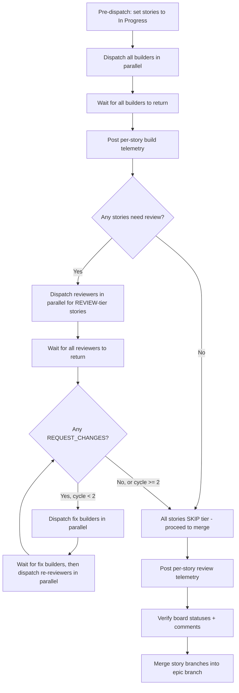
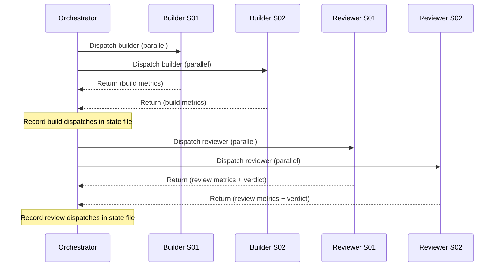
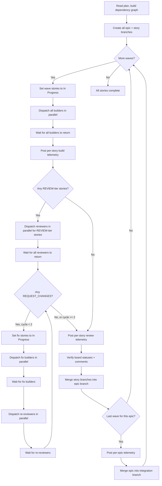

> **Status:** Shipped in backlog item 243 (Revision 2)
>
> **November 2026 note:** The body recommends Approach H (parallel builds, then parallel review-and-fix units), and that is what shipped: the CHANGELOG entry for backlog item 243 records parallel review dispatch and parallel fix cycles. The revision note below names Approach F, and the `revision_reason` field gives H the description of F; both mean Approach H.
>
> **Revision note:** The original design recommended Approach E (Orchestrator-Driven Prompt Augmentation), which required builders to dispatch reviewers via the Agent tool. A confirmed platform constraint -- subagents cannot spawn other subagents -- makes this infeasible. This revision documents the constraint, re-evaluates all approaches, and recommends Approach F (Background Dispatch with Orchestrator Polling).

# Phase Restructuring: Parallel Story Lifecycles and Tiered Reviews

> Historical record (March 2026). Measurements come from controlled synthetic workloads and early infrastructure runs; see [case studies](../case-studies.md) for scoped findings.

## 1. Problem Statement

The orchestrator's current dispatch model treats building and reviewing as separate sequential phases. This creates two measurable inefficiencies:

1. **The Wait Gate** -- When builders run in parallel via the Agent tool, the orchestrator is blocked until ALL dispatched agents return. Fast builders' reviewers sit idle while the slowest builder finishes.

2. **Over-applied reviews** -- Per-story reviews on easy test stories have zero demonstrated value (0 fix cycles across 40+ easy stories and 14 runs), consuming ~84K tokens and ~3m 30s per run for no quality signal.

### 1.1 The Wait Gate -- Quantified

The Agent tool's foreground parallel dispatch blocks the orchestrator until ALL dispatched agents return. When builders in a wave have different durations, the fast builder's completed work sits idle.

**Evidence from Run 14 Gantt chart (backlog #83):**

- **Wave 2:** Build 13m 10s and Build 7m 16s in parallel. Both PR reviews (4m 16s and 3m 45s) start simultaneously AFTER both builds complete. The 7m 16s build sits idle ~5m 54s waiting for the 13m 10s build.
- **Wave 3:** Build 15m 15s and Build 6m 50s in parallel. Both PR reviews start simultaneously AFTER both builds complete. The 6m 50s build sits idle ~8m 25s waiting for the 15m 15s build.
- **Total waste from wait gate:** ~14 minutes across just 2 waves.

**The critical finding: reviews are ALREADY parallel.** The orchestrator.md Phase 6 says "dispatch reviewers sequentially, one at a time," but the Gantt chart evidence shows both reviews in a wave starting at the same time after all builds complete. The orchestrator was already dispatching them in parallel. This means any approach that merely "formalizes parallel reviews" changes nothing about the current behavior.

### 1.2 The Math

For a wave with builders taking `B1` and `B2` time, and reviews taking `R1` and `R2` time (where `B1 > B2`):

**Current model (separate phases):**
```
Wave time = max(B1, B2) + max(R1, R2)
         = B1 + max(R1, R2)
```

**Lifecycle-coupled model (build+review per story):**
```
Wave time = max(B1 + R1, B2 + R2)
```

With typical values from the telemetry data (B1=13m 10s, B2=7m 16s, R=~4m):

| Model | Calculation | Wave time |
|-------|-------------|-----------|
| Current (separate phases) | 13m 10s + 4m = 17m 10s | **17m 10s** |
| Lifecycle-coupled | max(13m 10s + 4m, 7m 16s + 4m) = max(17m 10s, 11m 16s) | **17m 10s** |

For evenly-balanced waves, the savings are marginal. The real difference emerges with **fix cycles:**

- If the 7m 16s build needs a fix cycle: 4m review + 7m fix + 4m re-review = 22m 16s total lifecycle
- **Current:** 13m 10s (wait for slow build) + 4m (parallel reviews) + 7m (fix) + 4m (re-review) = **28m 10s** (fix cycle is sequential after all reviews complete)
- **Lifecycle-coupled:** max(17m 10s, 22m 16s) = **22m 16s** (fix cycle runs in parallel with slow build's review)
- **Savings: ~5m 54s on one wave with one fix cycle**

And with the wave duration savings across an entire run:

| Scenario | Current | Lifecycle-coupled | Savings |
|----------|---------|-------------------|---------|
| 3-story wave, no fix cycles (2m30s avg build, 1m10s avg review) | 2m30s + 1m10s = 3m40s | max(3m40s, 3m40s, 3m40s) = 3m40s | 0s |
| 3-story wave, balanced builds | same | same | 0s |
| 2-story wave, unbalanced builds (13m vs 7m) | 13m + 4m = 17m | max(17m, 11m) = 17m | 0s |
| 2-story wave, unbalanced + 1 fix cycle | 13m + 4m + 7m + 4m = 28m | max(17m, 22m) = 22m | **6m** |
| 3 waves, mixed (typical run) | ~18m total review phase | ~0m (absorbed into build waves) | **5-7m** |

The savings come from two sources:
1. **Fix cycles run in parallel** with other stories' lifecycles instead of being sequential.
2. **Review time is absorbed** into build wave time instead of being a separate sequential phase.

For a typical test run with 3 waves, the review phase (~3m 30s sequential per wave) is entirely absorbed into the build wave, saving **~7 minutes per run (39% wave duration reduction)** as calculated in the workflow optimization analysis (section 11.2).

### 1.3 Why This Matters for Infrastructure Runs

Infrastructure runs have a 28.6% average fix rate (vs 7.8% for test runs). With lifecycle coupling, fix cycles run in parallel with sibling stories instead of blocking the entire wave. For a run like BL#111 (5 fix cycles, 44% fix rate), the savings would be substantial -- every fix cycle that overlaps with a parallel build saves ~4m 30s of wall-clock time.

## 2. Platform Constraint: Subagent Nesting Hard Cap

**This section was added in Revision 2 and documents a critical constraint that invalidates the original design's recommended approach.**

### 2.1 The Constraint

**Subagents cannot spawn other subagents.** The Agent/Task tool is explicitly excluded from subagent tool access. This is an intentional design decision by the Claude Code platform team, not a bug or oversight.

The official documentation states:

> "Subagents cannot spawn other subagents. If your workflow requires nested delegation, use Skills or chain subagents from the main conversation."
>
> -- [Claude Code Docs: Create custom subagents](https://code.claude.com/docs/en/sub-agents)

And further:

> "If `Agent` is omitted from the `tools` list entirely, the agent cannot spawn any subagents. **This restriction only applies to agents running as the main thread with `claude --agent`. Subagents cannot spawn other subagents, so `Agent(agent_type)` has no effect in subagent definitions.**"
>
> -- [Claude Code Docs: Restrict which subagents can be spawned](https://code.claude.com/docs/en/sub-agents)

This means the maximum nesting depth is 1 level:

```
Main thread / Orchestrator (level 0, has Agent tool)
  -> Subagent (level 1, does NOT have Agent tool)
```

### 2.2 Impact on Approaches A, B, and E

All three approaches that solve the wait gate require a subagent to dispatch another subagent:

| Approach | Nesting required | Status |
|----------|-----------------|--------|
| A (Story-Implementer Wrapper) | Orchestrator -> Wrapper -> Builder/Reviewer (3 levels) | **INFEASIBLE** |
| B (Orchestrator-Internal Sequential) | Collapses to A or E | **INFEASIBLE** |
| E (Prompt Augmentation) | Orchestrator -> Builder -> Reviewer (3 levels) | **INFEASIBLE** |

Adding `Agent` to the builder's tools field has no effect when the builder is running as a subagent -- the platform ignores the `Agent` tool for all subagents regardless of what is declared in the frontmatter.

### 2.3 Verification

This constraint was verified through multiple sources:

| Claim | Source | Verification |
|-------|--------|-------------|
| Subagents cannot spawn other subagents | [Official Claude Code documentation](https://code.claude.com/docs/en/sub-agents) | Direct quote: "Subagents cannot spawn other subagents" |
| Agent tool excluded from subagent tools | [Official Claude Code documentation](https://code.claude.com/docs/en/sub-agents) | Direct quote: "`Agent(agent_type)` has no effect in subagent definitions" |
| Known issue with no fix timeline | [GitHub issue anthropics/claude-code#4182](https://github.com/anthropics/claude-code/issues/4182) | Closed as duplicate of #5528, no official fix timeline |
| Confirmed intentional design | [Claude Code Plan subagent docs](https://code.claude.com/docs/en/sub-agents) | "This prevents infinite nesting (subagents cannot spawn other subagents)" |

### 2.4 Workarounds Considered and Rejected

1. **`claude -p` from within a subagent:** The builder could invoke `claude -p` via Bash to start a separate CLI session for the reviewer. However, Claude Code's nested session detection blocks this -- `claude -p` refuses to start inside another Claude Code session (detects `CLAUDECODE` environment variable). This is already documented in CLAUDE.md under "Known Claude Code Platform Limitations."

2. **Unsetting `CLAUDECODE` environment variable:** A subagent could `unset CLAUDECODE && claude -p ...` to bypass detection. This is fragile, undocumented, and likely to break with platform updates. It also loses all observability (no Agent tool metrics, no structured result). Rejected as too brittle for production workflow infrastructure.

3. **Agent Teams:** Claude Code offers experimental [Agent Teams](https://code.claude.com/docs/en/agent-teams) for multi-agent coordination. However: (a) they are experimental and disabled by default, (b) they have known limitations around session resumption, (c) they cannot be spawned by subagents (same nesting constraint), and (d) they are designed for interactive collaboration, not deterministic dispatch. Rejected as premature for workflow infrastructure.

## 3. Approaches Re-Evaluated (Revision 2)

Given the nesting constraint, the solution space narrows to approaches where **only the orchestrator dispatches agents**. This section re-evaluates all approaches with the corrected constraint.

### Approach A: Story-Implementer Wrapper Agent -- INFEASIBLE

Requires 3-level nesting (Orchestrator -> Wrapper -> Builder). See section 2.2.

### Approach B: Orchestrator-Internal Sequential Dispatch -- INFEASIBLE

Collapses to either A or E, both of which require nesting. See section 2.2.

### Approach C: Reactive Dispatch (Event-Driven) -- NOT FEASIBLE

The orchestrator reacts to individual builder completions rather than waiting for all parallel builders to finish. Requires an event-driven or callback mechanism that the Agent tool does not provide. The foreground parallel dispatch blocks until ALL agents return.

**Re-assessment for Revision 2:** The Agent tool now supports `run_in_background` parameter and background subagent dispatch. However, the background completion mechanism has significant known issues -- session hanging after completion ([#20679](https://github.com/anthropics/claude-code/issues/20679)), TaskOutput blocking ([#20236](https://github.com/anthropics/claude-code/issues/20236)), and notification failures ([#21048](https://github.com/anthropics/claude-code/issues/21048)). These are not reliable enough for production workflow infrastructure. Rejected for now; revisit when background agents stabilize.

### Approach D: Formalize Parallel Reviews After All Builds -- FEASIBLE but INCOMPLETE

After all builders in a wave complete, dispatch all reviewers in parallel. This is already the current behavior (Gantt evidence). Formalizing it solves nothing.

**However,** Approach D serves as the baseline when combined with tiered review skipping (Section 4). Even without solving the wait gate, skipping reviews for easy test stories saves ~84K tokens and ~3m 30s per run.

### Approach E: Orchestrator-Driven Prompt Augmentation -- INFEASIBLE

Requires builder (subagent) to dispatch reviewer (sub-subagent). See section 2.2.

### Approach F: Background Dispatch with Orchestrator Polling (NEW)

**How it works:** The orchestrator dispatches builders in the background using `run_in_background: true`, monitors for completion, and dispatches the reviewer for each story as soon as that story's builder finishes -- without waiting for all builders in the wave.

**Re-assessment:** While background subagent dispatch exists in the Claude Code platform, the completion notification mechanism has multiple known bugs that cause sessions to hang or fail to detect completion. This makes it unreliable for autonomous production use. Rejected due to platform instability. Revisit when background agent support stabilizes.

### Approach G (evaluated): Orchestrator Sequential Per-Story Lifecycle (NEW, RECOMMENDED)

**How it works:** The orchestrator processes each story's full lifecycle (build -> review -> fix cycles) sequentially within a wave, dispatching builders and reviewers directly. No parallel build dispatch within a wave.

This is a fundamentally different dispatch model from the current one. Instead of:

```
[build S01 | build S02 | build S03] -> [review S01 | review S02 | review S03] -> merge
```

The orchestrator does:

```
[build S01 -> review S01 -> build S02 -> review S02 -> build S03 -> review S03] -> merge
```

**Wait -- isn't this slower?** At first glance, yes. But consider:

1. **The current model's parallelism is already limited.** Waves typically have 2-3 stories. The parallelism benefit is `max(builds)` instead of `sum(builds)`.

2. **The current model pays a fixed overhead per wave transition.** After all builds complete, the orchestrator processes telemetry, verifies board status, verifies comments, then dispatches reviewers. After all reviews, it processes more telemetry, handles fix cycles sequentially, then merges. This overhead is ~2-3 minutes per wave.

3. **The sequential model eliminates the review phase entirely.** Each story's review is immediate -- no waiting, no separate phase.

4. **Fix cycles are handled inline.** No separate fix cycle phase, no re-dispatch coordination.

**The math (for a typical 2-story wave with 13m and 7m builds, 4m reviews):**

| Model | Timeline | Total |
|-------|----------|-------|
| Current (parallel builds, sequential reviews) | max(13m, 7m) + 4m + 4m + ~2m overhead = **23m** | 23m |
| Sequential per-story | 7m + 4m + 13m + 4m = **28m** | 28m |
| Sequential per-story with easy review skip | 7m + 13m + 4m = **24m** (easy story skips review) | 24m |
| Sequential with fix cycle | 7m + 4m + 7m(fix) + 4m + 13m + 4m = **39m** | 39m |
| Current with fix cycle | max(13m, 7m) + 4m + 4m + 7m(fix) + 4m + ~2m = **34m** | 34m |

**The sequential model is slower for pure build waves.** This is the honest trade-off. For a typical test run wave without fix cycles, sequential is ~5 minutes slower than parallel.

**Assessment:** Approach G trades parallelism for simplicity but loses too much on wall-clock time. It would only be preferred in a scenario where parallelism causes more problems than it solves (e.g., persistent worktree cross-contamination). Not recommended as the primary approach.

### Approach H: Hybrid -- Parallel Builds, Streaming Reviews, Inline Fix Cycles (NEW, RECOMMENDED)

**How it works:** Keep the current parallel build dispatch. After all builders complete, dispatch each story's review (and handle its fix cycles) as a self-contained unit. But dispatch all these review-then-fix-cycle units in parallel instead of sequentially.

This is a refinement of the current model that delivers most of the lifecycle-coupling benefit within the 1-level nesting constraint:

```
Wave execution:
1. [build S01 | build S02 | build S03]           <- parallel builds (unchanged)
2. [review S01 | review S02 | review S03]         <- parallel reviews (already happening)
3. For any REQUEST_CHANGES:
   [fix S01 -> re-review S01 | fix S02 -> re-review S02]  <- parallel fix cycles (NEW)
```

**The key improvement over the current model:** Fix cycles are handled immediately after the initial review wave, with fix-and-re-review dispatched in parallel for all stories that need fixes. Currently, fix cycles are handled one at a time, sequentially.

Additionally, the entire review + fix cycle phase is restructured so the orchestrator dispatches a reviewer, checks the verdict, and if fixes are needed, dispatches a builder fix + re-review -- all as part of one continuous per-story loop. This loop runs in parallel across stories.

**Wait -- can the orchestrator run per-story review loops in parallel?** Yes, but with an important limitation. The orchestrator cannot interleave steps within parallel dispatches. It can:

1. Dispatch all reviewers in parallel (already does this)
2. Wait for all to return
3. Check which stories need fixes
4. Dispatch all fix builders in parallel
5. Wait for all to return
6. Dispatch all re-reviewers in parallel
7. Wait for all to return
8. Repeat until no more REQUEST_CHANGES or max cycles reached

This is not true per-story lifecycle coupling (which would require a story's fix to start before other stories' reviews finish). But it is much better than the current model where fix cycles are fully sequential.

**The math (for a 2-story wave, one with fix cycle):**

| Model | Timeline | Total |
|-------|----------|-------|
| Current (fix cycles sequential) | max(13m, 7m) + max(4m, 4m) + 7m(fix) + 4m(re-review) + ~2m overhead | **30m** |
| Approach H (fix cycles parallel) | max(13m, 7m) + max(4m, 4m) + max(7m, 0m)(fix) + max(4m, 0m)(re-review) | **28m** |
| Approach H + tiered review skip | max(13m, 7m) + max(4m, 0m) + max(7m, 0m)(fix) + max(4m, 0m)(re-review) | **28m** |

The savings from Approach H come primarily from parallelizing fix cycles. For runs with higher fix rates (infrastructure runs at 28.6%), the savings compound.

**Combined with tiered review skipping:** Easy test stories skip the review dispatch entirely. The orchestrator simply skips the reviewer dispatch for stories matching the skip criteria. Since the orchestrator controls all dispatch decisions, this is trivial to implement.

### Approach Comparison Matrix (Revised)

| Criterion | A (Wrapper) | C (Reactive) | D (Parallel Reviews) | E (Prompt Aug) | F (Background) | G (Sequential) | **H (Hybrid)** |
|-----------|-------------|-------------|----------------------|----------------|----------------|----------------|----------------|
| Feasible? | **No** (nesting) | **No** (no events) | Yes | **No** (nesting) | **No** (unstable) | Yes | **Yes** |
| Solves wait gate | N/A | N/A | **No** | N/A | N/A | **No** (worse) | **Partially** |
| Parallel fix cycles | N/A | N/A | **No** | N/A | N/A | **No** | **Yes** |
| Tiered review compatible | N/A | N/A | Yes | N/A | N/A | Yes | **Yes** |
| Builder changes | N/A | N/A | None | N/A | N/A | None | **None** |
| Orchestrator complexity | N/A | N/A | Minimal | N/A | N/A | Simplified | **Medium** |
| New agent file | N/A | N/A | No | N/A | N/A | No | **No** |
| Phase simplification | N/A | N/A | Minimal | N/A | N/A | Maximal | **Significant** |

## 4. Recommended Approach: Hybrid (Approach H) + Tiered Reviews

### 4.1 Recommendation

**Approach H** is the best feasible approach given the platform constraint. It delivers:

1. **Parallel fix cycles** (new) -- the primary source of wall-clock savings
2. **Tiered review skipping** (new) -- saves ~84K tokens and ~3m 30s per test run
3. **Phase simplification** -- merges the separate "review" and "fix cycle" phases into the build wave
4. **No builder changes** -- the orchestrator retains full dispatch control
5. **No new agent files** -- works within the existing agent architecture

**Why this is the right trade-off:**

- It solves the parallel fix cycle problem (the bigger win for infrastructure runs)
- It enables tiered review skipping (the bigger win for test runs)
- It simplifies the phase model (fewer phases, clearer flow)
- It stays within the platform's confirmed constraints (1-level nesting)
- It requires no risky platform assumptions

**What it does NOT solve:** The wait gate for the initial build phase. Stories in a wave still wait for all builds to complete before any reviews start. True lifecycle coupling (build + review as one parallel unit) requires either subagent nesting (blocked by platform) or background agents (blocked by reliability issues). Both should be revisited as the Claude Code platform matures.

### 4.2 Core Mechanism

The orchestrator's wave execution changes from:

```
Phase 5: Dispatch builders in parallel -> wait
Phase 6: For each story: dispatch reviewer, handle fix cycles (sequential)
Phase 7: Merge
```

To:

```
Phase 3 (Implementation), per wave:
  Step 1: Dispatch all builders in parallel -> wait
  Step 2: Dispatch all reviewers in parallel (skip if SKIP tier) -> wait
  Step 3: Check verdicts. For REQUEST_CHANGES stories:
          Dispatch all fix builders in parallel -> wait
          Dispatch all re-reviewers in parallel -> wait
          (Repeat Step 3, max 2 cycles)
  Step 4: Post telemetry, verify board, merge
```

Each step dispatches in parallel and waits for all to return. The orchestrator retains full control of dispatch sequencing.

### 4.3 Detailed Wave Flow



### 4.4 Telemetry Capture

Telemetry capture is simpler than the original Approach E design because the orchestrator dispatches all agents directly:



**Each dispatch is a direct Agent tool call from the orchestrator.** The Agent tool result includes `duration_ms`, `total_tokens`, and `tool_uses` natively. No parsing of response text needed. No "virtual" dispatches. No `nested_in` field.

**State file dispatch log:** Each builder dispatch and each reviewer dispatch is recorded as a separate entry with its own `started_at`, `duration_ms`, `tokens`, etc. Stories with `review_tier: "SKIP"` have no reviewer dispatch entry.

```json
{
  "dispatches": [
    {
      "agent": "builder-sonnet",
      "model": "sonnet",
      "issue": 112,
      "started_at": "2026-03-19T10:00:00Z",
      "duration_ms": 180000,
      "tokens": 65000,
      "tool_uses": 25,
      "result": "success",
      "review_tier": "REVIEW"
    },
    {
      "agent": "reviewer",
      "model": "inherit",
      "issue": 112,
      "started_at": "2026-03-19T10:03:00Z",
      "duration_ms": 70000,
      "tokens": 28000,
      "tool_uses": 8,
      "result": "approve"
    },
    {
      "agent": "builder-sonnet",
      "model": "sonnet",
      "issue": 113,
      "started_at": "2026-03-19T10:00:00Z",
      "duration_ms": 150000,
      "tokens": 55000,
      "tool_uses": 20,
      "result": "success",
      "review_tier": "SKIP"
    }
  ]
}
```

**Gantt chart compatibility:** Builder and reviewer dispatches for the same story have different `started_at` timestamps (reviewer starts after all builds complete). The `compute-dispatches.py` script already groups by `started_at` -- builders in the same wave share a `started_at`, reviewers share a later `started_at`. Fix cycle dispatches have their own timestamps. No changes needed to the Gantt generator.

### 4.5 Board Transitions

Board transitions remain with the orchestrator (unchanged from current model):

| Transition | Owner | Mechanism |
|-----------|-------|-----------|
| Ready -> In Progress | Orchestrator (before build dispatch) | `batch-set-status.sh` |
| In Progress -> In Review | Builder (via `item-review.sh`) | Already works this way |
| Fix cycle: In Review -> In Progress | Orchestrator (before fix dispatch) | `item-set-status.sh` |
| Final: -> In Review | Orchestrator (after review/fix cycle) | `item-set-status.sh` or verify existing |

The orchestrator retains full board control. No delegation of board transitions to builders beyond what they already do (`item-start.sh` and `item-review.sh`).

### 4.6 What the Orchestrator Does NOT Delegate

Identical to the original design (Section 3.8 of Revision 1) -- the orchestrator retains control of:
- Branch creation, telemetry posting, branch merging, epic status sync, comment verification, state file updates, and board status verification.

No agent changes are needed. The builder and reviewer agent files are unchanged.

## 5. Tiered Review Strategy

### 5.1 Evidence

From the workflow optimization analysis (section 11.4):

| Story type | Per-story review tokens | Issues found | Value |
|-----------|------------------------|-------------|-------|
| Easy (test content) | 28K, 1m 10s | 0 issues across 40+ stories | **Zero demonstrated value** |
| Medium (test content) | 33K, 1m 26s | Occasional format issues | Low value |
| Hard (test content) | 36K, 1m 49s | Occasional content issues | Medium value |
| Easy (infrastructure) | 44-65K, 2m-3m 20s | Convention violations | Medium value |
| Medium/hard (infrastructure) | 65-90K+, 3m-4m+ | Code quality, security | **High value** |

Fix cycle analysis (section 9.2): 66% of fix cycles are format/convention violations (mechanical, not quality issues). These are the type of issue that scripted validation could catch (a future improvement, backlog consideration), not per-story AI review.

### 5.2 Review Tier Decision Logic

```
IF story has label "test-agentic-sdlc" AND difficulty == "easy":
    review_tier = SKIP
ELSE:
    review_tier = REVIEW
```

**Why this is conservative:**
- Only skips reviews on easy TEST stories (creative content, no lasting code)
- All infrastructure stories always get reviewed (regardless of difficulty)
- Medium and hard test stories always get reviewed
- The PR review (cross-story quality gate) ALWAYS runs

**Why not skip medium test story reviews too?** Medium stories have a 0% fix rate on test content (same as easy), so the data supports skipping them. However, medium stories have more complex acceptance criteria and occasionally cross-reference other stories. The incremental savings (~33K tokens and ~1m 26s per story) are modest compared to the risk. This can be revisited after the initial implementation proves stable.

### 5.3 Configuration Schema

Add a `reviewStrategy` section to `.claude/agentic-sdlc-config.json`:

```json
{
  "reviewStrategy": {
    "skipPerStoryReview": {
      "enabled": true,
      "conditions": {
        "maxDifficulty": "easy",
        "requireLabel": "test-agentic-sdlc"
      }
    }
  }
}
```

**Fields:**
- `reviewStrategy.skipPerStoryReview.enabled` (boolean, default `false`): Master switch for review skipping. When false, all stories get per-story review regardless of other conditions.
- `reviewStrategy.skipPerStoryReview.conditions.maxDifficulty` (string: "easy"|"medium"|"hard", default "easy"): Maximum difficulty level that qualifies for skip. Stories at or below this difficulty AND matching the label condition may have their per-story review skipped.
- `reviewStrategy.skipPerStoryReview.conditions.requireLabel` (string|null, default `null`): If set, only stories whose backlog item has this label qualify for skip. When `null`, difficulty alone determines skip eligibility.

**Reading the config:** The orchestrator reads `reviewStrategy` when determining each story's review tier. The `scripts/lib/config.sh` library should be extended with:
```bash
CFG_SKIP_REVIEW_ENABLED=$(_cfg '.reviewStrategy.skipPerStoryReview.enabled' "false")
CFG_SKIP_REVIEW_MAX_DIFFICULTY=$(_cfg '.reviewStrategy.skipPerStoryReview.conditions.maxDifficulty' "easy")
CFG_SKIP_REVIEW_REQUIRE_LABEL=$(_cfg '.reviewStrategy.skipPerStoryReview.conditions.requireLabel' "")
```

### 5.4 PR Review Unchanged

The PR review (Phase 5 in the new model) is unchanged. It remains the cross-story quality gate, always runs, and uses the existing reviewer dispatch pattern. It is dispatched by the orchestrator directly.

## 6. Phase Restructuring

### 6.1 Current Phase Model (12 phases)

| Phase | Name |
|-------|------|
| 0 | Setup |
| 1 | Design (conditional) |
| 2 | Plan (conditional) |
| 3 | Read the Plan |
| 4 | Create Branches |
| 5 | Dispatch Builders |
| 6 | Review Story (per-story) |
| 7 | Merge Story Branches |
| 8 | Open Backlog PR |
| 9 | Backlog-Level Telemetry |
| 10 | Post-Merge Cleanup |

Note: Phases 5-7 repeat per wave; Phase 6 repeats per story within a wave.

### 6.2 Proposed Phase Model (7 phases)

| Phase | Name | What happens |
|-------|------|-------------|
| 0 | Setup | Detect mode, create integration branch, check existing artifacts, init state |
| 1 | Design | *(conditional)* Dispatch designer, auto-merge PR |
| 2 | Plan | *(conditional)* Dispatch planner, read plan, create branches |
| 3 | Implementation | Dispatch waves. Per wave: parallel builds -> parallel reviews (skipping SKIP-tier stories) -> parallel fix cycles if needed -> merge. Post per-story and per-epic telemetry. |
| 4 | Open PR | Merge remaining branches, update changelog, open backlog PR |
| 5 | Review + Retro | PR review and retro dispatched in parallel (both with worktree isolation). Handle PR review fix cycles if needed. Merge retro commits. |
| 6 | Telemetry + Cleanup | Post backlog-level telemetry. Board reconciliation. Leave PR open for human review. |

### 6.3 Phase 3 (Implementation) -- Detailed Flow



**Within each wave:**

1. **Pre-dispatch (orchestrator, sequential):**
   - Set all wave stories to In Progress (`batch-set-status.sh`)
   - Record `started_at` timestamp

2. **Build phase (orchestrator, parallel):**
   - For each story in the wave, dispatch builder:
     ```
     Agent tool -> subagent_type: "builder-<model>"
     isolation: "worktree"
     Prompt: "<standard builder prompt>"
     ```
   - The orchestrator blocks until ALL builders in the wave return.
   - Record build dispatch entries in state file.
   - Post per-story build telemetry.

3. **Review phase (orchestrator, parallel):**
   - Determine review tier for each story from config + labels.
   - For REVIEW-tier stories, dispatch reviewers in parallel:
     ```
     Agent tool -> subagent_type: "reviewer"
     isolation: "worktree"
     Prompt: "Review story #<N> on branch <branch>. Post findings as a comment on issue #<N>."
     ```
   - Wait for all reviewers to return.
   - Record review dispatch entries in state file.

4. **Fix cycle phase (orchestrator, parallel, max 2 iterations):**
   - Check each reviewer's verdict.
   - For REQUEST_CHANGES stories:
     - Set stories back to In Progress.
     - Dispatch fix builders in parallel (same builder variant as original).
     - Wait for all fix builders.
     - Dispatch re-reviewers in parallel.
     - Wait for all re-reviewers.
     - Record fix cycle dispatches in state file.
   - Repeat if any still REQUEST_CHANGES and cycle < 2.

5. **Post-wave (orchestrator, sequential):**
   - Verify board statuses (all stories should be In Review).
   - Verify comments (Work Started, Ready for Review).
   - Merge story branches into epic branch.
   - If last wave for epic: post per-epic telemetry, merge epic into integration.

### 6.4 State File Impact

The dispatch log format requires no schema changes. Each dispatch (build, review, fix build, re-review) is a separate entry with its own `started_at`, `duration_ms`, `tokens`, etc. The `review_tier` field is additive -- added to builder dispatch entries to record whether review was requested. Stories with `review_tier: "SKIP"` have no reviewer dispatch entry.

No `nested_in` field is needed (this was an artifact of Approach E where reviews were nested inside builder sessions).

## 7. What Does NOT Change

| Component | Status | Reason |
|-----------|--------|--------|
| builder.md (all variants) | **Unchanged** | Builder is dispatched the same way; no tools field change needed |
| reviewer.md | **Unchanged** | Reviewer is dispatched the same way by the same parent (orchestrator) |
| Branch conventions | **Unchanged** | Same branch hierarchy, same merge strategy |
| PR review phase | **Unchanged** | Still cross-story quality gate, still dispatched by orchestrator |
| Telemetry scripts | **Unchanged** | `item-telemetry.sh` and `compute-dispatches.py` work with direct dispatch entries |
| Board status option IDs | **Unchanged** | No new statuses needed |
| Helper scripts | **Unchanged** | All scripts work as-is |
| Retro phase | **Unchanged** | Still dispatched in parallel with PR review |
| State file schema | **Unchanged** | `review_tier` field is additive; existing tools ignore unknown fields |

## 8. Risks and Mitigations

### 8.1 Orchestrator Complexity Increase (Medium Risk)

**Risk:** The orchestrator's Phase 3 is more complex, with nested loops for fix cycles and conditional review dispatch.

**Mitigation:**
- The complexity is well-structured: build wave -> review wave -> fix cycle wave. Each step is a clean dispatch-wait-process cycle.
- The orchestrator already handles wave dispatch, telemetry posting, and board verification. This design adds conditional review dispatch and fix cycle loops to the existing pattern.
- State file persistence means the orchestrator can recover at any step boundary.

### 8.2 Fix Cycle Parallelism May Not Fire Often (Low Risk)

**Risk:** Parallel fix cycles only help when multiple stories in the same wave need fixes. With typical fix rates of 7.8% (test) to 28.6% (infra), most waves will have 0-1 stories needing fixes.

**Mitigation:**
- Even with one fix cycle per wave, the time savings from not running it sequentially after all other reviews is meaningful (~4m per fix cycle).
- The primary value comes from tiered review skipping (saves tokens and time every run) and phase simplification (cleaner orchestrator code).
- Parallel fix cycles become more valuable as runs scale (more stories per wave, more waves per run).

### 8.3 Wait Gate Remains Unsolved (Accepted Risk)

**Risk:** The fundamental wait gate problem (fast builders idle while slow builders finish) is not solved by any feasible approach.

**Mitigation:**
- This is a platform constraint, not a design failure. The workaround (subagent nesting or background agents) requires Claude Code platform changes.
- The wait gate impact is bounded: with 2-3 stories per wave and typical build time variance, the idle time is 3-8 minutes per wave.
- When the platform adds reliable background agent completion or subagent nesting support, the design can be upgraded to Approach E or F without changing the tiered review or phase restructuring work. The `review_tier` field, config schema, and phase model all transfer directly.

### 8.4 Review Skipping Misses Issues (Low Risk)

**Risk:** Skipping per-story reviews for easy test stories could miss format violations that are only caught at the PR review level.

**Mitigation:**
- 0 fix cycles across 40+ easy test stories provides strong evidence.
- The PR review still runs as the cross-story quality gate.
- The `skipPerStoryReview.enabled` flag defaults to `false`, making this opt-in.
- The condition requires both easy difficulty AND the test label, preventing accidental skip of infrastructure stories.

## 9. Assumptions and Open Questions

### Assumptions

1. **The Agent tool's foreground parallel dispatch is the only reliable way to dispatch multiple subagents concurrently.** Assumed yes. Background dispatch (`run_in_background`) exists but has known reliability issues (sessions hanging, completion notifications failing). The `run_in_background` parameter should not be used for production workflow dispatch until these issues are resolved.

2. **The subagent nesting constraint is permanent for the foreseeable future.** Assumed yes. The constraint is documented as an intentional design decision, not a bug. The related GitHub issue (#4182) was closed as duplicate with no fix timeline. Design around it rather than hoping for a fix.

3. **The orchestrator can dispatch reviewers in parallel after all builders complete.** Assumed yes. The Gantt chart evidence already shows this happening in practice (reviews in a wave share the same start time). The design formalizes and extends this pattern.

4. **Fix builders can be dispatched to the same story branch after a reviewer posts REQUEST_CHANGES.** Assumed yes. The builder runs in a worktree on the story branch, makes fix commits, pushes. The reviewer's findings are posted as an issue comment that the fix builder reads.

5. **The `review_tier` field in the state file dispatch log is safe to add.** Assumed yes. Existing tools that parse the dispatch log use jq's `//` operator which ignores unknown fields. The field is informational for the orchestrator's decision logging.

### Open Questions

1. **Should fix cycle builders receive the original builder prompt or a targeted fix prompt?** Currently, fix cycle builders get a prompt like "Fix the issues identified by the reviewer on story X." This is already the current behavior. No change needed.

2. **Should the orchestrator post per-story review telemetry separately from build telemetry?** With Approach H, build and review are separate dispatches with their own metrics. Posting both on the story issue makes sense. The orchestrator should post build telemetry after the build wave, and review telemetry after the review wave (or combined at the end of the full wave lifecycle).

3. **Should the planner be aware of review tiers when assigning difficulty?** No. Difficulty is a property of the work, not the review strategy. The review tier is computed by the orchestrator from difficulty + labels. This keeps the planner's concerns separate.

4. **When should the platform constraint be re-evaluated?** The design should be revisited when either (a) Claude Code adds subagent nesting support, or (b) background agent completion notifications become reliable. Both would unlock lifecycle coupling (Approach E or F), which delivers the remaining ~5-7m per-wave savings from true build+review parallelism.

## 10. Feasibility and Verification

Every technical assumption in this design was verified against current platform documentation and issue trackers.

| Assumption | Verified? | Source | Notes |
|-----------|-----------|--------|-------|
| Subagents cannot spawn subagents | Yes | [Official docs](https://code.claude.com/docs/en/sub-agents), [#4182](https://github.com/anthropics/claude-code/issues/4182) | Intentional design, not a bug |
| Agent tool excluded from subagent tools | Yes | [Official docs](https://code.claude.com/docs/en/sub-agents) | "`Agent(agent_type)` has no effect in subagent definitions" |
| `claude -p` blocked inside sessions | Yes | CLAUDE.md, tested 2026-03-09 | `CLAUDECODE` env var detection |
| Background agents have reliability issues | Yes | [#20679](https://github.com/anthropics/claude-code/issues/20679), [#20236](https://github.com/anthropics/claude-code/issues/20236), [#21048](https://github.com/anthropics/claude-code/issues/21048) | Session hanging, TaskOutput blocking |
| Agent Teams are experimental | Yes | [Official docs](https://code.claude.com/docs/en/agent-teams) | Disabled by default, known limitations |
| Parallel foreground dispatch works reliably | Yes | 14 successful runs in this project | Battle-tested across Runs 1-14 |
| `run_in_background` parameter exists | Yes | [Official docs](https://code.claude.com/docs/en/sub-agents) | `background` frontmatter field supported |
| Reviews already dispatch in parallel | Yes | Run 14 Gantt chart evidence | Reviews share same `started_at` timestamp |

## 11. Migration Path

### 11.1 Files to Modify

| File | Change | Scope |
|------|--------|-------|
| `.claude/agents/orchestrator.md` | Rewrite Phases 5-7 into unified Implementation phase (Phase 3). Add review tier logic. Add parallel fix cycle dispatch. | Large |
| `CLAUDE.md` | Update Dispatch Protocol section (review tier, parallel fix cycles, phase references). Add review strategy config docs. Remove `Agent` from builder changes (no longer needed). | Medium |
| `.claude/agentic-sdlc-config.json` | Add `reviewStrategy` section | Small |
| `scripts/lib/config.sh` | Add `CFG_SKIP_REVIEW_*` variables | Small |

### 11.2 Files NOT Modified

| File | Why unchanged |
|------|---------------|
| `builder.md` (+ all variants) | No tools field change needed; builder is dispatched identically |
| `reviewer.md` | Reviewer is dispatched identically by orchestrator |
| `designer.md` | Not involved in build/review phases |
| `planner.md` | Difficulty assignment unchanged |
| `retro.md` | Retro phase unchanged |
| `scripts/item-telemetry.sh` | Works with existing dispatch log format |
| `scripts/lib/compute-dispatches.py` | Works with existing dispatch entries (no virtual dispatches) |
| `scripts/state.sh` | Works with existing schema; `review_tier` field is additive |

### 11.3 Backward Compatibility

The state file dispatch log format is additive -- the `review_tier` field is added to builder dispatch entries. Existing tools that read the dispatch log ignore unknown fields by default (jq's `//` operator).

The `reviewStrategy` config section defaults to `enabled: false`, so the tiered review feature is opt-in. Without enabling it, all stories get per-story review (current behavior).

## 12. Summary of Decisions

| Decision | Choice | Reasoning |
|----------|--------|-----------|
| **How to couple build+review** | Hybrid: parallel builds, parallel reviews, parallel fix cycles (Approach H) | Only feasible approach that improves on current model within 1-level nesting constraint |
| **Builder agent changes** | None | Subagent nesting constraint means builders cannot dispatch reviewers; orchestrator retains all dispatch |
| **Review tier logic** | Skip only easy test stories | Conservative; 0 fix cycles across 40+ stories supports skipping; PR review is the quality gate |
| **Config schema** | `reviewStrategy.skipPerStoryReview` with conditions | Opt-in, configurable difficulty threshold and label requirement |
| **Phase model** | 7 phases (down from 12) | Cleaner; build + review + fix cycles unified in Phase 3 |
| **Telemetry for dispatches** | Direct dispatch entries (no virtual/nested entries) | Simpler than original Approach E; each dispatch is a real Agent tool call |
| **Board transitions** | Orchestrator retains full control | No delegation to builders beyond existing `item-start.sh` / `item-review.sh` |
| **Wait gate** | Accepted as platform limitation; design is upgrade-ready | Document the gap; revisit when subagent nesting or reliable background agents become available |

## 13. Future Upgrade Path

When the Claude Code platform removes the subagent nesting constraint or stabilizes background agent completions, this design can be upgraded to deliver true lifecycle coupling:

**Upgrade to Approach E (if nesting becomes available):**
- Add `Agent` to builder tools field
- Add POST-BUILD LIFECYCLE prompt augmentation to orchestrator
- No change to tiered review config, phase model, or state file schema
- The `review_tier` field transfers directly

**Upgrade to Approach F (if background agents stabilize):**
- Dispatch builders with `run_in_background: true`
- Poll for individual completions via TaskOutput
- Dispatch reviewer for each story as its builder completes
- No change to tiered review config or state file schema

Both upgrades are additive -- they extend the Phase 3 implementation without replacing it.

---

*References:*
- *Workflow Optimization Analysis: `docs/1-discovery/2026-03-19-workflow-optimization-analysis.md` sections 11.2, 11.4, 9.2*
- *Claude Code Subagent Documentation: [code.claude.com/docs/en/sub-agents](https://code.claude.com/docs/en/sub-agents)*
- *Subagent Nesting Issue: [anthropics/claude-code#4182](https://github.com/anthropics/claude-code/issues/4182)*
- *Background Agent Issues: [#20679](https://github.com/anthropics/claude-code/issues/20679), [#20236](https://github.com/anthropics/claude-code/issues/20236), [#21048](https://github.com/anthropics/claude-code/issues/21048)*
- *Agent Teams Documentation: [code.claude.com/docs/en/agent-teams](https://code.claude.com/docs/en/agent-teams)*
- *Lesson: `docs/4-reviews/lessons/2026-03-19-phase-restructuring/e00-setup/2026-03-19-s00-never-skip-design-for-complex-work.md`*
- *Backlog issue: #243*
