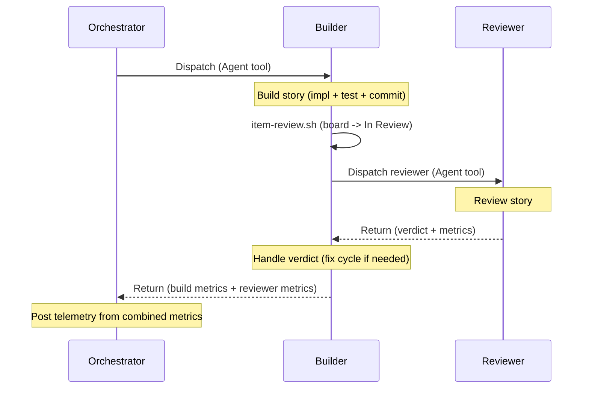
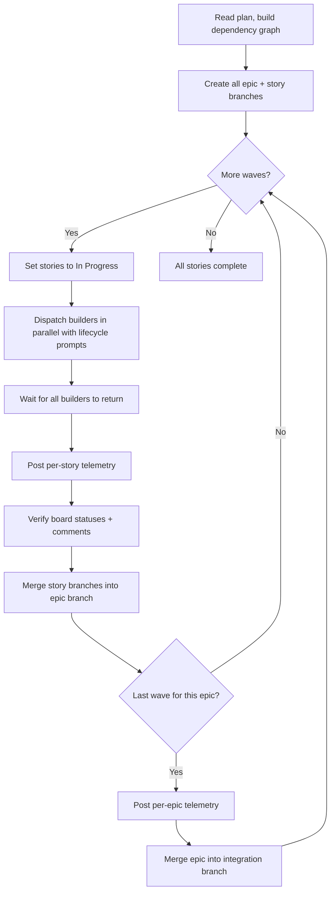

> **Status:** Draft

# Phase Restructuring: Parallel Story Lifecycles and Tiered Reviews

## 1. Problem Statement

The orchestrator's current dispatch model treats building and reviewing as separate sequential phases. This creates two measurable inefficiencies:

1. **The Wait Gate** -- When builders run in parallel via the Agent tool, the orchestrator is blocked until ALL dispatched agents return. Fast builders' reviewers sit idle while the slowest builder finishes.

2. **Over-applied reviews** -- Per-story reviews on easy test stories have zero demonstrated value (0 fix cycles across 40+ easy stories and 14 runs), consuming ~84K tokens and ~3m 30s per run for no quality signal.

### 1.1 The Wait Gate -- Quantified

The Agent tool's foreground parallel dispatch blocks the orchestrator until ALL dispatched agents return. When builders in a wave have different durations, the fast builder's completed work sits idle.

**Evidence from Run 14 Gantt chart (backlog #83):**

- **Wave 2:** Build 13m 10s and Build 7m 16s in parallel. Both PR reviews (4m 16s and 3m 45s) start simultaneously AFTER both builds complete. The 7m 16s build sits idle ~5m 54s waiting for the 13m 10s build.
- **Wave 3:** Build 15m 15s and Build 6m 50s in parallel. Both PR reviews start simultaneously AFTER both builds complete. The 6m 50s build sits idle ~8m 25s waiting for the 15m 15s build.
- **Total waste from wait gate:** ~14 minutes across just 2 waves.

**The critical finding: reviews are ALREADY parallel.** The orchestrator.md Phase 6 says "dispatch reviewers sequentially, one at a time," but the Gantt chart evidence shows both reviews in a wave starting at the same time after all builds complete. The orchestrator was already dispatching them in parallel. This means any approach that merely "formalizes parallel reviews" changes nothing about the current behavior.

### 1.2 The Math

For a wave with builders taking `B1` and `B2` time, and reviews taking `R1` and `R2` time (where `B1 > B2`):

**Current model (separate phases):**
```
Wave time = max(B1, B2) + max(R1, R2)
         = B1 + max(R1, R2)
```

**Lifecycle-coupled model (build+review per story):**
```
Wave time = max(B1 + R1, B2 + R2)
```

With typical values from the telemetry data (B1=13m 10s, B2=7m 16s, R=~4m):

| Model | Calculation | Wave time |
|-------|-------------|-----------|
| Current (separate phases) | 13m 10s + 4m = 17m 10s | **17m 10s** |
| Lifecycle-coupled | max(13m 10s + 4m, 7m 16s + 4m) = max(17m 10s, 11m 16s) | **17m 10s** |

For evenly-balanced waves, the savings are marginal. The real difference emerges with **fix cycles:**

- If the 7m 16s build needs a fix cycle: 4m review + 7m fix + 4m re-review = 22m 16s total lifecycle
- **Current:** 13m 10s (wait for slow build) + 4m (parallel reviews) + 7m (fix) + 4m (re-review) = **28m 10s** (fix cycle is sequential after all reviews complete)
- **Lifecycle-coupled:** max(17m 10s, 22m 16s) = **22m 16s** (fix cycle runs in parallel with slow build's review)
- **Savings: ~5m 54s on one wave with one fix cycle**

And with the wave duration savings across an entire run:

| Scenario | Current | Lifecycle-coupled | Savings |
|----------|---------|-------------------|---------|
| 3-story wave, no fix cycles (2m30s avg build, 1m10s avg review) | 2m30s + 1m10s = 3m40s | max(3m40s, 3m40s, 3m40s) = 3m40s | 0s |
| 3-story wave, balanced builds | same | same | 0s |
| 2-story wave, unbalanced builds (13m vs 7m) | 13m + 4m = 17m | max(17m, 11m) = 17m | 0s |
| 2-story wave, unbalanced + 1 fix cycle | 13m + 4m + 7m + 4m = 28m | max(17m, 22m) = 22m | **6m** |
| 3 waves, mixed (typical run) | ~18m total review phase | ~0m (absorbed into build waves) | **5-7m** |

The savings come from two sources:
1. **Fix cycles run in parallel** with other stories' lifecycles instead of being sequential.
2. **Review time is absorbed** into build wave time instead of being a separate sequential phase.

For a typical test run with 3 waves, the review phase (~3m 30s sequential per wave) is entirely absorbed into the build wave, saving **~7 minutes per run (39% wave duration reduction)** as calculated in the workflow optimization analysis (section 11.2).

### 1.3 Why This Matters for Infrastructure Runs

Infrastructure runs have a 28.6% average fix rate (vs 7.8% for test runs). With lifecycle coupling, fix cycles run in parallel with sibling stories instead of blocking the entire wave. For a run like BL#111 (5 fix cycles, 44% fix rate), the savings would be substantial -- every fix cycle that overlaps with a parallel build saves ~4m 30s of wall-clock time.

## 2. Approaches Considered

Five approaches were evaluated. The first four are described briefly; the fifth is the chosen approach with full technical detail in Section 3.

### Approach A: Story-Implementer Wrapper Agent

Create a new `.claude/agents/story-implementer.md` agent that orchestrates the per-story lifecycle: build, review, fix cycle loop.

**How it works:** The orchestrator dispatches `story-implementer` agents (one per story, in parallel). Each story-implementer dispatches the builder, then the reviewer, then handles fix cycles -- all via the Agent tool. The story-implementer returns only when the story is fully validated.

**Pros:**
- Clean separation of concerns -- builder builds, reviewer reviews, wrapper orchestrates
- Builder and reviewer agent files stay unchanged
- Orchestrator dispatch logic simplifies significantly

**Cons:**
- Introduces 3-level agent nesting: Orchestrator -> Story-Implementer -> Builder/Reviewer. This is untested in the project but architecturally supported by the Agent tool.
- New agent file that must exist before session start (known platform limitation: dynamic agent files at runtime are NOT discovered).
- The wrapper is thin coordination logic (~50-100 lines) that duplicates what the orchestrator already knows how to do (dispatch builders, handle review verdicts, manage fix cycles).
- Telemetry capture complexity: the story-implementer's Agent tool dispatches of builder/reviewer return metrics, but the orchestrator needs those metrics for the state file. The story-implementer must aggregate and return them.

### Approach B: Orchestrator-Internal Sequential Dispatch

The orchestrator dispatches builder and reviewer as sequential tasks within each parallel Agent tool slot.

**How it works:** Each parallel Agent tool dispatch contains prompt instructions that tell the agent to: (1) build the story, (2) dispatch the reviewer, (3) handle fix cycles. But the "agent" receiving these instructions IS the builder -- the builder would need to understand reviewer dispatch.

**Assessment:** This is essentially the same as Approach E (below) but described less precisely. The key question is which agent receives the combined prompt. If it is the builder, this is Approach E. If it is a wrapper, this is Approach A. There is no distinct "Approach B" -- it collapses into one of the others.

### Approach C: Reactive Dispatch (Event-Driven)

The orchestrator reacts to individual builder completions rather than waiting for all parallel builders to finish.

**How it works:** The orchestrator dispatches builders in parallel, but instead of blocking on all N, it polls for individual completions and dispatches reviewers immediately.

**Assessment:** Not feasible with the current Agent tool API. The Agent tool's foreground parallel dispatch blocks until ALL agents return. There is no event-driven or callback mechanism to react to individual completions. This would require Claude Code platform changes.

### Approach D: Formalize Parallel Reviews After All Builds

After all builders in a wave complete, dispatch all reviewers in parallel (instead of sequentially).

**How it works:** Change orchestrator.md Phase 6 from "dispatch reviewers one at a time" to "dispatch all reviewers in parallel."

**Assessment:** This is already the current behavior -- Gantt chart evidence shows reviews launching simultaneously after builds complete. Formalizing it in documentation is correct (the docs should match reality), but **this approach does NOT solve the wait gate problem**. Wave time remains `max(builds) + max(reviews)`. Fix cycles still run sequentially after all reviews. This was the approach the previous planner implemented, and it was rejected because it doesn't deliver the core improvement.

### Approach E: Orchestrator-Driven Prompt Augmentation (RECOMMENDED)

The orchestrator augments the builder's dispatch prompt with post-build lifecycle instructions. The builder, after completing its implementation, dispatches the reviewer itself using the Agent tool.

**Full technical detail in Section 3.**

### Approach Comparison Matrix

| Criterion | A (Wrapper) | B (Internal) | C (Reactive) | D (Parallel Reviews) | **E (Prompt Augmentation)** |
|-----------|-------------|-------------|--------------|----------------------|---------------------------|
| Solves wait gate | Yes | Collapses to A or E | Not feasible | **No** | **Yes** |
| New agent file | Yes | No | N/A | No | **No** |
| Builder changes | None | Major | N/A | None | **Tools field only** |
| Reviewer changes | None | None | N/A | None | **None** |
| Agent nesting depth | 3 levels | 2-3 levels | N/A | 2 levels | **3 levels** |
| Orchestrator complexity | Reduced | Reduced | N/A | Minimal change | **Reduced** |
| Telemetry capture | Complex (aggregation in wrapper) | Complex | N/A | Simple | **Simple (builder returns reviewer metrics)** |
| Session start requirement | Agent file must pre-exist | None | N/A | None | **None (prompt-only)** |
| Fix cycle savings | Yes | Yes | N/A | **None** | **Yes** |

## 3. Recommended Approach: Prompt Augmentation (Approach E)

### 3.1 Core Mechanism

The orchestrator augments each builder's dispatch prompt with a "Post-Build Lifecycle" section. After the builder completes its normal work (implement, test, commit, push, call `item-review.sh`), it reads the lifecycle section and dispatches a reviewer agent using the Agent tool.

**This requires one change to the builder agent files:** Add `Agent` to the YAML frontmatter `tools` field.

Currently, builder.md has no explicit `tools` field. When no `tools` field is present, the agent inherits the default tool set (which includes Read, Write, Edit, Grep, Glob, Bash, and others, but NOT Agent). Adding `Agent` to the tools list is the only persistent change to builder.md.

The lifecycle instructions come entirely from the orchestrator's prompt -- not from builder.md itself. This means:
- builder.md stays focused on building (its core responsibility)
- The orchestrator controls what lifecycle behavior each story gets
- Different stories can get different lifecycle instructions (enabling tiered reviews)

### 3.2 Prompt Structure

The orchestrator constructs the builder's prompt in two parts:

**Part 1: Standard builder prompt** (unchanged from today)
```
Implement story #<N> on branch <branch>.
Read the issue for acceptance criteria: ./scripts/item-get.sh <N>
Epic branch: epic/<slug>
Story branch: <branch>
Model: <model>
```

**Part 2: Post-Build Lifecycle** (new, appended by orchestrator)
```
=== POST-BUILD LIFECYCLE ===
After implementation is complete and item-review.sh has been called:

Review tier: REVIEW

1. Dispatch a reviewer agent on your branch:
   - Use: Agent tool, subagent_type: "reviewer", isolation: "worktree"
   - Prompt: "Review story #<N> on branch <branch>.
     Post findings as a comment on issue #<N>."

2. Read the reviewer's response:
   - If verdict is APPROVE or COMMENT: your work is complete. Return.
   - If verdict is REQUEST_CHANGES:
     a. Fix the issues on your branch (same branch, new commits)
     b. Push fixes: git push origin <branch>
     c. Re-dispatch the reviewer (same prompt as step 1)
     d. Maximum 2 fix cycles. After 2 REQUEST_CHANGES, return with
        status "fix_cycles_exhausted".

3. Include reviewer metrics in your final response:
   - reviewer_duration_ms: <from Agent tool result>
   - reviewer_tokens: <from Agent tool result>
   - reviewer_tool_uses: <from Agent tool result>
   - fix_cycles: <0, 1, or 2>
   - final_verdict: <APPROVE, COMMENT, or REQUEST_CHANGES>
```

For stories with review skipped (tiered review):
```
=== POST-BUILD LIFECYCLE ===
Review tier: SKIP
No per-story review required for this story. The PR review is the quality gate.
After implementation is complete and item-review.sh has been called, return.
```

### 3.3 Agent Tool Nesting: 3-Level Depth

This design creates 3-level nesting:

```
Orchestrator (level 1)
  -> Builder (level 2, via Agent tool)
       -> Reviewer (level 3, via Agent tool from builder)
```

**Risk assessment:** The Agent tool supports arbitrary nesting depth. Each level runs in its own isolated process (especially with `isolation: "worktree"`). There are no known Claude Code platform limitations that prevent 3-level nesting. However, this is untested in this project.

**Mitigation:** The first implementation run should include explicit verification that 3-level nesting works. If it fails, fallback to Approach A (story-implementer wrapper, which also uses 3-level nesting but with a purpose-built wrapper agent).

**Why 3-level nesting is acceptable here:**
- The reviewer at level 3 is a leaf agent -- it doesn't dispatch further agents
- The reviewer is lightweight (28-57K tokens, 1-2m duration)
- Worktree isolation prevents filesystem conflicts between nesting levels
- The builder already has full context about the story branch, so it can pass accurate information to the reviewer

### 3.4 Builder Agent File Changes

**builder.md frontmatter change:**
```yaml
---
name: builder
color: red
description: Production code builder...
tools: Read, Write, Edit, Grep, Glob, Bash, Agent
model: inherit
---
```

The `Agent` tool is added to enable reviewer dispatch. This must be propagated to all three builder variants (builder-haiku.md, builder-sonnet.md, builder-opus.md) using the existing sync command:
```bash
for variant in haiku sonnet opus; do
  sed "s/^name: builder$/name: builder-$variant/;s/^model: inherit$/model: $variant/" \
    .claude/agents/builder.md > .claude/agents/builder-$variant.md
done
```

**builder.md body: no changes to existing instructions.** The lifecycle behavior comes from the orchestrator's prompt augmentation, not from builder.md. However, a brief documentation section should be added near the end of builder.md explaining the concept:

```markdown
## Post-Build Lifecycle (Orchestrator-Injected)

The orchestrator may append a "POST-BUILD LIFECYCLE" section to your dispatch
prompt. If present, follow its instructions after completing your normal build
workflow (implement, test, commit, push, item-review.sh). The lifecycle section
may instruct you to dispatch a reviewer agent and handle fix cycles.

If no POST-BUILD LIFECYCLE section is present, your work ends at item-review.sh
as described in "After Story Complete" above.
```

### 3.5 reviewer.md: No Changes

The reviewer agent is dispatched exactly as it is today -- via the Agent tool with `subagent_type: "reviewer"`. The only difference is that the dispatching agent is the builder (level 2) instead of the orchestrator (level 1). The reviewer doesn't know or care about its nesting depth.

### 3.6 Telemetry Capture

The orchestrator needs telemetry from both the builder and the reviewer for each story. Here is how metrics flow:



**What the orchestrator receives from the Agent tool result:**
- `duration_ms`: Total builder session duration (includes reviewer dispatch time)
- `total_tokens`: Total builder session tokens (includes reviewer dispatch tokens)
- `tool_uses`: Total tool uses (includes reviewer dispatch tool uses)

**What the builder includes in its response text:**
- `reviewer_duration_ms`, `reviewer_tokens`, `reviewer_tool_uses` (from the reviewer's Agent tool result)
- `fix_cycles` count and `final_verdict`

**How the orchestrator records this in the state file:**

For each story, the orchestrator posts TWO dispatch entries:

1. **Builder dispatch:** `agent: "builder-sonnet"`, with the full `duration_ms` and `total_tokens` from the Agent tool result. This includes the time/tokens the builder spent dispatching the reviewer.

2. **Reviewer dispatch (virtual):** `agent: "reviewer"`, with `duration_ms` and `tokens` extracted from the builder's response text. This is a "virtual" dispatch -- it was actually nested inside the builder's session, but recording it separately preserves the existing telemetry format and enables per-agent-type analysis.

The `started_at` for the virtual reviewer dispatch should be computed as: builder's `started_at` + builder's `duration_ms` - reviewer's `duration_ms`. This places it correctly in the timeline for Gantt chart generation.

**Fix cycle dispatches:** If the builder runs fix cycles (re-dispatch builder to fix + re-dispatch reviewer), the builder returns metrics for each cycle. The orchestrator records each as a separate dispatch entry with the `fix_cycle` flag.

### 3.7 Board Transitions

Board transitions shift from the orchestrator to the builder's lifecycle:

| Transition | Current owner | New owner | Mechanism |
|-----------|--------------|-----------|-----------|
| Ready -> In Progress | Orchestrator (before dispatch) | **Orchestrator** (unchanged) | `item-set-status.sh` before Agent tool call |
| In Progress -> In Review | Builder (via `item-review.sh`) | **Builder** (unchanged) | `item-review.sh` already does this |
| Fix cycle: In Review -> In Progress | Orchestrator | **Builder** (during fix cycle) | Builder calls `item-set-status.sh` before fix |
| Final: -> In Review | Orchestrator (after review) | **Builder** (via `item-review.sh` or after final review) | Builder confirms In Review at end of lifecycle |

The orchestrator still sets In Progress before dispatch and verifies In Review after the builder returns (defense-in-depth). The orchestrator also still handles epic status sync.

### 3.8 What the Orchestrator Does NOT Delegate

The orchestrator retains control of:
- **Branch creation** (Phase 4: all branches created upfront)
- **Board status: Ready -> In Progress** (set before dispatch)
- **Telemetry posting** (after builder returns, orchestrator posts to GitHub)
- **Branch merging** (story -> epic -> integration)
- **Epic status sync** (aggregate of stories)
- **Comment verification** (post-wave verification of Work Started / Ready for Review comments)
- **State file updates** (dispatch log, story status)

This preserves the orchestrator's role as the deterministic infrastructure layer. The builder handles the story lifecycle (build + review + fix), while the orchestrator handles the workflow infrastructure (branches, board, telemetry, merges).

## 4. Tiered Review Strategy

### 4.1 Evidence

From the workflow optimization analysis (section 11.4):

| Story type | Per-story review tokens | Issues found | Value |
|-----------|------------------------|-------------|-------|
| Easy (test content) | 28K, 1m 10s | 0 issues across 40+ stories | **Zero demonstrated value** |
| Medium (test content) | 33K, 1m 26s | Occasional format issues | Low value |
| Hard (test content) | 36K, 1m 49s | Occasional content issues | Medium value |
| Easy (infrastructure) | 44-65K, 2m-3m 20s | Convention violations | Medium value |
| Medium/hard (infrastructure) | 65-90K+, 3m-4m+ | Code quality, security | **High value** |

Fix cycle analysis (section 9.2): 66% of fix cycles are format/convention violations (mechanical, not quality issues). These are the type of issue that scripted validation could catch (a future improvement, backlog consideration), not per-story AI review.

### 4.2 Review Tier Decision Logic

```
IF story has label "test-agentic-sdlc" AND difficulty == "easy":
    review_tier = SKIP
ELSE:
    review_tier = REVIEW
```

**Why this is conservative:**
- Only skips reviews on easy TEST stories (creative content, no lasting code)
- All infrastructure stories always get reviewed (regardless of difficulty)
- Medium and hard test stories always get reviewed
- The PR review (cross-story quality gate) ALWAYS runs

**Why not skip medium test story reviews too?** Medium stories have a 0% fix rate on test content (same as easy), so the data supports skipping them. However, medium stories have more complex acceptance criteria and occasionally cross-reference other stories. The incremental savings (~33K tokens and ~1m 26s per story) are modest compared to the risk. This can be revisited after the initial implementation proves stable.

### 4.3 Configuration Schema

Add a `reviewStrategy` section to `.claude/agentic-sdlc-config.json`:

```json
{
  "reviewStrategy": {
    "skipPerStoryReview": {
      "enabled": true,
      "conditions": {
        "maxDifficulty": "easy",
        "requireLabel": "test-agentic-sdlc"
      }
    }
  }
}
```

**Fields:**
- `reviewStrategy.skipPerStoryReview.enabled` (boolean, default `false`): Master switch for review skipping. When false, all stories get per-story review regardless of other conditions.
- `reviewStrategy.skipPerStoryReview.conditions.maxDifficulty` (string: "easy"|"medium"|"hard", default "easy"): Maximum difficulty level that qualifies for skip. Stories at or below this difficulty AND matching the label condition may have their per-story review skipped.
- `reviewStrategy.skipPerStoryReview.conditions.requireLabel` (string|null, default `null`): If set, only stories whose backlog item has this label qualify for skip. When `null`, difficulty alone determines skip eligibility.

**Reading the config:** The orchestrator reads `reviewStrategy` when constructing each builder's prompt. The `scripts/lib/config.sh` library should be extended with:
```bash
CFG_SKIP_REVIEW_ENABLED=$(_cfg '.reviewStrategy.skipPerStoryReview.enabled' "false")
CFG_SKIP_REVIEW_MAX_DIFFICULTY=$(_cfg '.reviewStrategy.skipPerStoryReview.conditions.maxDifficulty' "easy")
CFG_SKIP_REVIEW_REQUIRE_LABEL=$(_cfg '.reviewStrategy.skipPerStoryReview.conditions.requireLabel' "")
```

### 4.4 PR Review Unchanged

The PR review (Phase 5 in the new model) is unchanged. It remains the cross-story quality gate, always runs, and uses the existing reviewer dispatch pattern. It is dispatched by the orchestrator (not the builder), because it reviews the integrated result across all stories.

## 5. Phase Restructuring

### 5.1 Current Phase Model (12 phases)

| Phase | Name |
|-------|------|
| 0 | Setup |
| 1 | Design (conditional) |
| 2 | Plan (conditional) |
| 3 | Read the Plan |
| 4 | Create Branches |
| 5 | Dispatch Builders |
| 6 | Review Story (per-story) |
| 7 | Merge Story Branches |
| 8 | Open Backlog PR |
| 9 | Backlog-Level Telemetry |
| 10 | Post-Merge Cleanup |

Note: Phases 5-7 repeat per wave; Phase 6 repeats per story within a wave.

### 5.2 Proposed Phase Model (7 phases)

| Phase | Name | What happens |
|-------|------|-------------|
| 0 | Setup | Detect mode, create integration branch, check existing artifacts, init state |
| 1 | Design | *(conditional)* Dispatch designer, auto-merge PR |
| 2 | Plan | *(conditional)* Dispatch planner, read plan, create branches |
| 3 | Implementation | Dispatch waves. Each story's full lifecycle (build -> review -> fix cycles) runs inside the wave in parallel. Wave completes when all stories return. Merge story branches into epic branches, merge epic branches into integration branch. Post per-story and per-epic telemetry. |
| 4 | Open PR | Merge remaining branches, update changelog, open backlog PR |
| 5 | Review + Retro | PR review and retro dispatched in parallel (both with worktree isolation). Handle PR review fix cycles if needed. Merge retro commits. |
| 6 | Telemetry + Cleanup | Post backlog-level telemetry. Board reconciliation. Leave PR open for human review. |

### 5.3 Phase 3 (Implementation) -- Detailed Flow

This is the most complex phase. Here is the detailed flow:



**Within each wave:**

1. **Pre-dispatch (orchestrator, sequential):**
   - Set all wave stories to In Progress (`batch-set-status.sh`)
   - Record `started_at` timestamp

2. **Dispatch (orchestrator, parallel):**
   - For each story in the wave, dispatch builder with lifecycle prompt:
     ```
     Agent tool -> subagent_type: "builder-<model>"
     isolation: "worktree"
     Prompt: "<standard builder prompt> + <POST-BUILD LIFECYCLE section>"
     ```
   - The orchestrator blocks until ALL builders in the wave return.

3. **Post-dispatch (orchestrator, sequential):**
   - For each returned builder:
     - Parse reviewer metrics from response text
     - Record builder dispatch in state file
     - Record reviewer dispatch (virtual) in state file
     - Post per-story telemetry (`item-telemetry.sh`)
     - Verify board status (In Review) and comments
   - Merge story branches into epic branch
   - If last wave for epic: post per-epic telemetry, merge epic into integration branch

### 5.4 State File Impact

The dispatch log format remains compatible. The key change is that reviewer dispatches are recorded as "virtual" entries derived from the builder's response:

```json
{
  "dispatches": [
    {
      "agent": "builder-sonnet",
      "model": "sonnet",
      "issue": 112,
      "started_at": "2026-03-19T10:00:00Z",
      "duration_ms": 180000,
      "tokens": 65000,
      "tool_uses": 25,
      "result": "success",
      "review_tier": "REVIEW"
    },
    {
      "agent": "reviewer",
      "model": "inherit",
      "issue": 112,
      "started_at": "2026-03-19T10:02:30Z",
      "duration_ms": 70000,
      "tokens": 28000,
      "tool_uses": 8,
      "result": "approve",
      "nested_in": "builder-sonnet",
      "fix_cycle": 0
    }
  ]
}
```

The `nested_in` field marks virtual dispatches. The `review_tier` field on the builder dispatch records whether review was requested. For stories with `review_tier: "SKIP"`, no virtual reviewer dispatch is recorded.

**Gantt chart compatibility:** The `compute-dispatches.py` script groups dispatches by `started_at` for parallel wave detection. Virtual reviewer dispatches have computed `started_at` times that place them correctly in the timeline (after the builder's build phase, overlapping with other stories' review phases within the same wave). The Gantt generator should render them as separate bars with the existing `:done` (yellow) color tag for reviews.

## 6. What Does NOT Change

| Component | Status | Reason |
|-----------|--------|--------|
| builder.md core instructions | **Unchanged** | Lifecycle behavior comes from prompt, not agent file |
| reviewer.md | **Unchanged** | Reviewer is dispatched the same way (just by builder instead of orchestrator) |
| Branch conventions | **Unchanged** | Same branch hierarchy, same merge strategy |
| PR review phase | **Unchanged** | Still cross-story quality gate, still dispatched by orchestrator |
| Telemetry scripts | **Unchanged** | `item-telemetry.sh` and `compute-dispatches.py` work with the dispatch log format |
| Board status option IDs | **Unchanged** | No new statuses needed |
| Helper scripts | **Unchanged** | `item-start.sh`, `item-review.sh`, `item-set-status.sh` all work as-is |
| Retro phase | **Unchanged** | Still dispatched in parallel with PR review |

## 7. Risks and Mitigations

### 7.1 3-Level Agent Nesting (Medium Risk)

**Risk:** The Agent tool may behave unexpectedly with 3-level nesting (Orchestrator -> Builder -> Reviewer). No prior run has used 3-level nesting.

**Mitigation:**
- The first run with this change should be a test run (creative content, low stakes).
- If 3-level nesting fails, the immediate fallback is Approach A (story-implementer wrapper agent). This also uses 3-level nesting but with a purpose-built wrapper, which may be easier to debug.
- If ALL 3-level nesting fails, the fallback is Approach D (parallel reviews, already the current behavior) plus tiered review skipping. This doesn't solve the wait gate but still delivers the review savings.

### 7.2 Builder Dispatching Reviewer Creates Coupling (Low Risk)

**Risk:** The builder agent now has a dual responsibility: implement the story AND manage the review lifecycle. This increases the builder's cognitive load and session length.

**Mitigation:**
- The lifecycle instructions are in a clearly delineated section ("POST-BUILD LIFECYCLE") that runs AFTER the builder's primary work is complete.
- The builder's Agent file instructions still focus exclusively on building. The lifecycle behavior is injected via prompt, not baked into builder.md.
- Session length increases by the reviewer's duration (1-4 minutes) -- small relative to the builder's own duration (2-15 minutes).

### 7.3 Telemetry Accuracy (Low Risk)

**Risk:** The builder's total `duration_ms` and `total_tokens` include the reviewer's consumption. If the builder doesn't correctly report reviewer metrics in its response text, the orchestrator can't separate builder vs reviewer telemetry.

**Mitigation:**
- The lifecycle prompt explicitly instructs the builder to include reviewer metrics in its response.
- The builder's Agent tool dispatch of the reviewer returns structured metrics (`duration_ms`, `total_tokens`, `tool_uses`) -- same as any Agent tool dispatch.
- If the builder fails to report reviewer metrics, the orchestrator can still compute a reasonable estimate: builder's total minus the expected reviewer cost (based on historical averages of ~28K tokens and ~1m 10s for easy stories, ~65K and ~3m 20s for infra stories).
- The orchestrator should validate: if the builder reports 0 reviewer metrics but `review_tier` was REVIEW, log a warning and use the total as the builder-only metric.

### 7.4 Fix Cycle Board State (Low Risk)

**Risk:** When the builder runs a fix cycle, it needs to set the story back to In Progress (from In Review). Currently, `item-set-status.sh` is called by the orchestrator. With lifecycle coupling, the builder calls it.

**Mitigation:**
- The builder already calls `item-start.sh` (which sets In Progress) and `item-review.sh` (which sets In Review). Adding `item-set-status.sh` for fix cycles is consistent.
- The orchestrator verifies board status after the builder returns (defense-in-depth).
- The builder is already in a worktree with Bash access, so `item-set-status.sh` works without any infrastructure changes.

### 7.5 Worktree Isolation for Nested Reviewer (Low Risk)

**Risk:** The builder runs in a worktree. When it dispatches the reviewer with `isolation: "worktree"`, the reviewer gets its own worktree. This creates nested worktrees (worktree within worktree's git repo). Is this supported?

**Mitigation:**
- Worktree isolation creates a separate git worktree from the MAIN repository, not from the builder's worktree. The Agent tool's `isolation: "worktree"` always uses the root repo.
- The reviewer operates in read-mostly mode (reads diff, reads files, posts comment). Even if worktree creation behaves differently, the reviewer doesn't modify files on the branch -- it only reads and comments.
- If nested worktree dispatch fails, the reviewer can run WITHOUT `isolation: "worktree"` since it doesn't modify files. The builder's prompt can omit the isolation parameter for the reviewer dispatch.

## 8. Assumptions and Open Questions

### Assumptions (what I would have asked the user, and what I assumed)

1. **Agent tool supports 3-level nesting.** Assumed yes, based on the tool's architecture (each dispatch is an independent session). No known documentation says otherwise. The Known Platform Limitations section in CLAUDE.md lists specific Agent tool limitations (no `model` parameter, no dynamic agent files, no `updatedInput` hook) but does not mention a nesting depth limit.

2. **Builder agents without an explicit `tools` field inherit a default set that does NOT include `Agent`.** Assumed yes, because (a) the orchestrator explicitly lists `Agent` in its tools, (b) builder agents currently don't dispatch sub-agents, and (c) the `tools` field is explicitly specified only when non-default tools are needed (orchestrator adds Agent, reviewer restricts to Read/Grep/Glob/Bash).

3. **Worktree-isolated builders can dispatch worktree-isolated reviewers.** Assumed yes, since worktree isolation creates a new worktree from the root repo, not from the current working directory.

4. **The builder can parse the Agent tool's return value (duration_ms, total_tokens, tool_uses) and include it in its text response.** Assumed yes, because the orchestrator already parses these values from Agent tool results.

5. **The review-skipping condition uses the backlog-level label (`test-agentic-sdlc`), not a per-story label.** Assumed this is sufficient because all stories in a test run share the same backlog label.

### Open Questions

1. **Should the builder's `item-review.sh` call happen BEFORE or AFTER the reviewer dispatch?** Currently, `item-review.sh` sets the board to In Review and posts the "Ready for Review" comment. If called before the reviewer, the board shows In Review while the review is actually in progress (correct). If called after, the board shows In Progress during review (incorrect but simpler flow). **Recommendation:** Keep the current order -- `item-review.sh` before reviewer dispatch. The builder already calls it after pushing code, before returning. The lifecycle section runs after `item-review.sh`.

2. **What happens if the builder's session hits a usage limit DURING the reviewer dispatch?** The reviewer may not complete, and the builder can't return reviewer metrics. **Recommendation:** The orchestrator should handle this the same way it handles interrupted builders today -- capture whatever metrics are available, post them, and decide whether to retry.

3. **Should the `nested_in` field in the state file dispatch log affect Gantt chart rendering?** Currently, dispatches with the same `started_at` are grouped as parallel. Virtual reviewer dispatches have different `started_at` values (after the build phase). **Recommendation:** No special handling needed. The Gantt chart should show reviewer dispatches as separate bars, positioned after the build bar within the same story's timeline.

4. **Should the planner be aware of review tiers when assigning difficulty?** Currently, difficulty drives model routing. With tiered reviews, difficulty also affects whether the story gets a per-story review. **Recommendation:** No change to the planner. Difficulty is a property of the work, not the review strategy. The review tier is computed by the orchestrator from difficulty + labels.

## 9. Migration Path

### 9.1 Files to Modify

| File | Change | Scope |
|------|--------|-------|
| `.claude/agents/builder.md` | Add `tools: Read, Write, Edit, Grep, Glob, Bash, Agent` to YAML frontmatter. Add "Post-Build Lifecycle" documentation section. | Small |
| `.claude/agents/builder-haiku.md` | Sync from builder.md (tools field + doc section) | Small |
| `.claude/agents/builder-sonnet.md` | Sync from builder.md (tools field + doc section) | Small |
| `.claude/agents/builder-opus.md` | Sync from builder.md (tools field + doc section) | Small |
| `.claude/agents/orchestrator.md` | Rewrite Phases 5-9 as new Phases 3-6. Add prompt augmentation logic. Update telemetry capture for virtual dispatches. | Large |
| `CLAUDE.md` | Update Dispatch Protocol section (lifecycle model, tiered reviews). Update phase references. Add review strategy config docs. | Medium |
| `.claude/agentic-sdlc-config.json` | Add `reviewStrategy` section | Small |
| `scripts/lib/config.sh` | Add `CFG_SKIP_REVIEW_*` variables | Small |

### 9.2 Files NOT Modified

| File | Why unchanged |
|------|---------------|
| `reviewer.md` | Reviewer is dispatched identically (just by a different parent) |
| `designer.md` | Not involved in build/review phases |
| `planner.md` | Difficulty assignment unchanged |
| `retro.md` | Retro phase unchanged |
| `scripts/item-telemetry.sh` | Works with existing dispatch log format |
| `scripts/lib/compute-dispatches.py` | Works with existing dispatch log format; `nested_in` field is informational |
| `scripts/state.sh` | Works with existing schema; new fields are additive |

### 9.3 Backward Compatibility

The state file dispatch log format is additive -- new fields (`review_tier`, `nested_in`, `fix_cycle`) are added to dispatch entries. Existing tools that read the dispatch log (telemetry scripts, Gantt generator) ignore unknown fields by default (jq's `//` operator).

The `reviewStrategy` config section defaults to `enabled: false`, so the tiered review feature is opt-in. Without enabling it, all stories get per-story review (current behavior). The lifecycle coupling (builder dispatches reviewer) still applies -- it just means every story gets the REVIEW tier.

## 10. Summary of Decisions

| Decision | Choice | Reasoning |
|----------|--------|-----------|
| **How to couple build+review** | Prompt augmentation (Approach E) | No new agent files, builder.md stays focused on building, orchestrator controls lifecycle per-story |
| **Builder agent change** | Add `Agent` to tools field | Minimal change; enables reviewer dispatch without altering builder behavior |
| **Review tier logic** | Skip only easy test stories | Conservative; data supports skipping (0 fix cycles across 40+ stories) but limiting scope reduces risk |
| **Config schema** | `reviewStrategy.skipPerStoryReview` with conditions | Opt-in, configurable difficulty threshold and label requirement |
| **Phase model** | 7 phases (down from 12) | Cleaner, reflects that build+review is one "Implementation" phase |
| **Telemetry for nested dispatches** | Virtual dispatch entries with `nested_in` field | Preserves existing telemetry format; Gantt chart compatible |
| **Board transitions** | Builder handles In Review; orchestrator retains In Progress and verification | Builder already has board access; orchestrator verifies as defense-in-depth |

---

*References:*
- *Workflow Optimization Analysis: `docs/1-discovery/2026-03-19-workflow-optimization-analysis.md` sections 11.2, 11.4, 9.2*
- *Lesson: `docs/4-reviews/lessons/2026-03-19-phase-restructuring/e00-setup/2026-03-19-s00-never-skip-design-for-complex-work.md`*
- *Backlog issue: #243*
