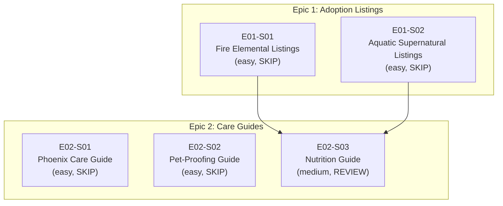

# Run 15 Design: Supernatural Pet Adoption Agency

> **Status:** Draft

## Overview

Fifteenth end-to-end test of the Agentic SDLC pipeline. Primary test objective: **validate the v2 workflow changes from backlog 243** -- tiered review strategy, parallel review dispatch, agent tool inheritance, and the restructured phase model. This is the first run with `reviewStrategy.skipPerStoryReview.enabled: true` in production, meaning easy stories will bypass per-story review entirely.

Content theme: "Eternally Yours Adoption Agency" -- a supernatural pet adoption agency specializing in mythological, elemental, and interdimensional creatures. Every listing and guide is written with the same warmth, professionalism, and structured format of a real shelter, but the content is absurd. The comedy comes from treating phoenix ash cleanup with the same seriousness as litter box maintenance.

## Goals

1. **Tiered review strategy** -- 4 easy stories should receive `review_tier = SKIP` and bypass per-story review. 1 medium story should receive `review_tier = REVIEW` and get a full per-story reviewer dispatch.
2. **Parallel review dispatch** -- The medium story reviewer should dispatch via the standard parallel review path (even though there is only 1 REVIEW-tier story in this run, the plumbing must work).
3. **Agent tool inheritance** -- All agents should have access to WebSearch, WebFetch, MCP servers (tools field omitted from all agent YAML). Builders should be able to research mythological creatures during content creation.
4. **Agent attribution** -- All issues created by `item-create.sh` should show `Created by: <agent>` metadata on GitHub (the `--created-by` flag).
5. **Research-first principle** -- This design doc itself demonstrates research-first by grounding supernatural creature details in real mythology and adoption profiles in real shelter conventions.

## Non-Goals

- Testing fix cycles (Run 14 validated fix cycles thoroughly with 4 planted bugs)
- Testing cross-epic dependencies (all stories are independent within their epic)
- Testing more than 2 epics
- C# compilation or unit tests (markdown content only)
- Publication-quality creative writing (this is a workflow test)

---

## Voice and Tone Guidelines

### The Eternally Yours Brand Voice

**Tone:** Warm, reassuring, and genuinely helpful -- exactly like a well-run animal shelter's website. The agency clearly loves these creatures and wants them in good homes. There is no irony, no winking at the camera. A phoenix's rebirth cycle is discussed with the same calm, factual tone that a shelter would use to explain a dog's crate training needs.

**Register:** Friendly-professional. Think Petfinder bio meets veterinary care sheet. Sentences like "Ember is a sweet girl who needs a patient adopter willing to invest in fireproofing" are the target register -- warm but informative.

**Perspective:** Written by experienced adoption counselors at Eternally Yours who have placed hundreds of supernatural pets. They know the common first-time-owner mistakes ("No, you cannot keep a kraken hatchling in a standard aquarium") and address them preemptively. They are advocates for the animals, not comedians.

### Key Principles

1. **Play it straight.** The humor is structural -- it comes from the collision between mundane adoption-agency language and extraordinary content. Never explain the joke. If the listing says "Cinder is house-trained (fire-resistant flooring required)," that is a factual statement, not a punchline.

2. **Mirror real adoption conventions.** Real shelter bios open with a hook sentence about the pet's personality, not their species stats. Real care guides use numbered steps, callout boxes, and "What to expect in the first week" sections. Real nutrition guides include portion sizes and frequency tables. Match these patterns exactly, then fill them with supernatural content.

3. **Use specific details, not vague fantasy.** Instead of "phoenixes need special food," say "Cinder requires a diet of volcanic mineral supplements (available from Eternally Yours partner vendors) mixed into a base of high-calcium charcoal pellets, served at a minimum temperature of 200C." Specificity is what makes the supernatural feel real.

4. **Compassion for the creatures.** Every listing should convey that these are living beings with feelings, preferences, and histories. A kraken hatchling that was abandoned needs patience and socialization. A selkie pup that lost its pelt needs emotional support. The adoption counselor cares deeply.

### What Real Adoption Profiles Look Like (Research-Informed)

Based on research into real shelter conventions (Petfinder, ASPCA, Best Friends Animal Society):

- **Opening hook:** "Meet [Name]! [Name] is a [age], [personality trait] [species] who..." -- the first sentence is about personality, not stats.
- **Temperament section:** Uses behavioral observations, not labels. "Luna does best in a calm household" rather than "Luna has anxiety."
- **Compatibility notes:** Specific about other pets, children, living situations. "Does well with dogs over 30 lbs; cats are a no-go."
- **Medical/dietary notes:** Clear, non-alarming. "On a grain-free diet due to sensitivities."
- **Call to action:** "If you think you are the right match for [Name], fill out an adoption application today!"

The Eternally Yours listings should follow this exact structure, substituting supernatural specifics for the mundane ones.

---

## Agency World-Building: Eternally Yours Adoption Agency

### Agency Details

| Field | Value |
|-------|-------|
| **Full name** | Eternally Yours Supernatural Pet Adoption Agency |
| **Tagline** | "Every creature deserves a forever home -- even the ones from other dimensions." |
| **Founded** | Established 1847 (originally as a phoenix sanctuary) |
| **Location** | Main shelter at 42 Hearthstone Lane, with satellite facilities in the Abyssal Trench (aquatic wing) and the Ember Fields (fire-elemental wing) |
| **Licensing** | Licensed by the International Supernatural Fauna Authority (ISFA) |
| **Staff** | Adoption counselors are certified in Supernatural Animal Husbandry (SAH) |

### Adoption Listing Template

Every listing in E01 should follow this structure (mirroring real shelter conventions):

```markdown
# Meet [Name]!

**Species:** [Common name] ([Latin/magical classification])
**Age:** [Age, in species-appropriate units]
**Sex:** [Male/Female/Indeterminate/Fluctuating]
**Weight:** [Current weight, noting if variable]
**Arrival date:** [When they came to Eternally Yours]
**ID:** EYAA-[YYYY]-[NNN]

> [One-sentence personality hook -- who they ARE, not what they are]

## About [Name]

[2-3 paragraphs about personality, history, how they came to the agency, what
they are like day-to-day. Include behavioral observations from shelter staff.]

## Temperament

[Behavioral notes using observational language. What environments they thrive
in. Energy level. Socialization status.]

## Special Abilities

[Documented supernatural abilities with safety ratings. Note any abilities
that are developing or unpredictable due to age.]

## Dietary Needs

[Specific food requirements with brands/sources where applicable. Feeding
frequency. Any allergies or sensitivities. Temperature requirements for
food service.]

## Housing Requirements

[Minimum enclosure specifications. Environmental controls needed.
Special infrastructure (fireproofing, pressure-rated tanks, dimensional
anchors, etc.).]

## Compatibility Notes

[Specific guidance on other pets, children, living situations, experience
level required.]

## [CATEGORY-SPECIFIC WARNING SECTION]

[E01-S01: "Fire Safety Warning" / E01-S02: "Tank Requirements"]

## Adoption Fee

[Fee in standard currency, with note about any included equipment or
starter supplies.]

---

*Interested in adopting [Name]? Contact Eternally Yours at
adopt@eternallyyours.org or visit us at 42 Hearthstone Lane.
All adoptions include a complimentary home assessment and
30-day support hotline access.*
```

---

## Creature Research and Design Notes

### Fire-Elemental Pets (E01-S01)

Grounded in real mythology and folklore to give builders specific source material:

**Phoenix (suggested name: Cinder)**
- Mythology basis: Greek/Egyptian -- the phoenix cyclically regenerates, burning to ash and rising reborn. Herodotus described it as eagle-sized with gold and red plumage.
- Adoption angle: Cinder is on their 47th life cycle. They were surrendered after their previous owner could not handle the biweekly rebirth episodes. Cinder is gentle between cycles but becomes agitated in the 24 hours before combustion. Needs an owner who can provide a flame-safe nesting area and emotional support during resurrection (the first few hours post-rebirth are disorienting).
- Dietary needs: Volcanic mineral supplements, high-calcium charcoal pellets, cinnamon bark (a comfort food, not nutritionally necessary). Food must be served at minimum 200C -- cold food causes digestive distress.
- Housing: Requires a fireproof nesting enclosure (minimum 2m x 2m x 2m) with heat-resistant bedding. The rebirth event produces a flash of 1,400C -- the nesting room must be rated for this. Standard home smoke alarms must be replaced with supernatural-rated models (the agency provides these).

**Salamander (suggested name: Flicker)**
- Mythology basis: Medieval European alchemy -- salamanders were believed born from fire, living in volcanoes. Paracelsus classified them as fire elementals. Real salamanders were associated with fire because they emerged from logs when set ablaze (they had been hibernating inside).
- Adoption angle: Flicker is a juvenile fire salamander, approximately 3 years old (estimated lifespan: 400+ years). Found as a hatchling in the cooling vents of a dormant volcano. Flicker is shy and tends to hide in warm crevices. They bond slowly but are fiercely loyal once attached. Their skin temperature runs a constant 85C, so handling requires heat-resistant gloves.
- Dietary needs: Live fire beetles (available from specialty suppliers), ember moss, and a weekly sulfur crystal supplement. Flicker also enjoys basking on heated rocks -- provide a basking surface maintained at 120C.
- Housing: Terrarium with volcanic rock substrate, heat lamps, and a small lava pool (magma substitute available from Eternally Yours partner vendors). Minimum temperature: 65C. The terrarium must be sealed -- fire salamanders can squeeze through gaps as small as 2cm.

**Ember Sprite (suggested name: Spark)**
- Mythology basis: Drawing on fire sprite folklore from Central American (Cipitio) and European (will-o'-the-wisp adjacent) traditions -- small luminous beings associated with campfires, hearths, and forge fires. Traditionally seen as mischievous helpers or omens.
- Adoption angle: Spark is a young ember sprite, estimated age 1 year (lifespan unknown -- sprites do not appear to age). Spark was found abandoned in the ashes of a campfire in a national forest. Ember sprites are highly social and need near-constant interaction -- they become distressed if left alone for more than 2 hours, manifesting as uncontrolled flare-ups. Spark is playful, curious, and has a habit of igniting paper products.
- Dietary needs: Ember sprites "feed" by absorbing heat from open flames. Provide a small, controlled flame source (candles, gas fireplace, or Eternally Yours Sprite Feeding Hearth). They also consume tiny amounts of charcoal dust sprinkled into the flame. They do NOT eat solid food.
- Housing: Ember sprites are free-roaming and do not need an enclosure, but the home must be comprehensively fireproofed. They sleep in warm spots (fireplace hearths, radiators, behind ovens). Remove all paper, fabric, and flammable materials from sprite-accessible areas.

### Aquatic-Supernatural Pets (E01-S02)

**Kraken Hatchling (suggested name: Puddles)**
- Mythology basis: Norse/Scandinavian -- the kraken is a colossal cephalopod capable of dragging ships to the deep. Likely inspired by real giant squid sightings. In folklore, the kraken's presence was signaled by unusual fish behavior and whirlpool formation.
- Adoption angle: Puddles is a kraken hatchling, approximately 6 months old. Current size: 45cm tentacle span (expected adult size: 90-120 meters, reached at approximately age 200). Puddles was rescued from a fishing trawler net and is still learning to control their ink defense mechanism. Puddles is curious and affectionate -- enjoys wrapping tentacles around their caretaker's arm. Will eventually need to be rehomed to open ocean (Eternally Yours assists with this transition).
- Dietary needs: Raw fish (herring, mackerel), live crustaceans for enrichment, and deep-sea bioluminescent plankton supplements (essential for tentacle development). Feed 3 times daily. Puddles is a messy eater -- expect water changes after every meal.
- Tank requirements: Minimum 2,000-liter saltwater tank with pressure rating to 3 atm (kraken hatchlings instinctively try to pressurize their environment). The tank must have secure lid -- Puddles can open standard aquarium lids. Water temperature: 4-8C (deep ocean temperature). Include enrichment items: puzzle feeders, textured rocks, and a small shipwreck model (krakens have an instinctive attraction to shipwrecks).

**Selkie Pup (suggested name: Marina)**
- Mythology basis: Irish/Scottish folklore -- selkies are seal-like beings who can shed their skin to take human form. Stories often involve selkie pelts being hidden by humans to prevent them from returning to the sea. Selkies are associated with longing, grief, and the pull of the ocean.
- Adoption angle: Marina is a selkie pup, approximately 8 months old. Marina's pelt was damaged in a storm, and she is unable to fully shift forms until it heals (estimated 6-12 months). She presents as a silver harbor seal with unusually expressive eyes. Marina is gentle and deeply empathetic -- she is sensitive to her caretaker's emotional state and will attempt to comfort them by nuzzling. She needs regular access to saltwater for skin health and emotional wellbeing.
- Dietary needs: Fresh fish (salmon, cod), seaweed supplements, and moonlight-infused water (leave a bowl of seawater in direct moonlight for 4 hours before offering). Marina is lactose intolerant (common in selkies).
- Tank requirements: Combination habitat: a 3,000-liter saltwater pool (minimum depth 1.5m for diving) connected to a dry haul-out area with soft bedding. Water must be natural seawater or high-quality marine salt mix. Temperature: 10-15C. The pool area should have access to natural moonlight -- artificial light does not provide the same therapeutic benefit.

**Deep-Sea Leviathan Juvenile (suggested name: Abyssal, called "Abby")**
- Mythology basis: Biblical/Near Eastern -- the Leviathan is a primordial sea serpent representing chaos and the untamable deep. Often described as scaled, fire-breathing (even underwater), and impossibly large. In some traditions, only one Leviathan exists at a time.
- Adoption angle: Abby is a juvenile deep-sea leviathan, estimated age 2 years (lifespan: effectively immortal). Current size: 3 meters (expected adult size: classified -- Eternally Yours policy does not disclose adult leviathan dimensions to avoid discouraging potential adopters). Abby was discovered in a deep-sea trench during a marine survey. She is surprisingly docile for her species, though she does produce small bioluminescent pulses when startled. Abby has a calming presence -- other aquatic pets in the facility become more relaxed in her proximity. She requires an experienced aquatic-supernatural pet owner.
- Dietary needs: Deep-sea bioluminescent plankton (primary), supplemented with raw deep-water fish and void essence drops (2 drops per 100L of water weekly). Abby only feeds during "dark periods" -- cover the tank or dim lights during feeding time.
- Tank requirements: Minimum 10,000-liter pressure-rated tank (deep-sea leviathans require pressures of 5-10 atm for comfort). The tank must be built to handle occasional bioluminescent pulses that can reach 50,000 lumens. Water temperature: 2-4C. Complete darkness for 16 hours per day (leviathans are adapted to the abyssal zone). Include a cave structure for hiding -- Abby spends approximately 20 hours per day in her cave.

---

## Epic 1: Adoption Listings

Short-form adoption profiles for supernatural pets. Each story produces 3 listings following the adoption listing template above.

### E01-S01: Fire-Elemental Adoption Listings -- `difficulty/easy`

Create `content/supernatural-pets/fire-elemental-adoptions.md`

**Content requirements:**

- 3 adoption listings: phoenix, fire salamander, ember sprite
- Follow the Eternally Yours Adoption Listing Template (see above)
- Each listing: 300-500 words
- Suggested names: Cinder (phoenix), Flicker (salamander), Spark (ember sprite) -- builders may choose different names
- Each listing must include a **"Fire Safety Warning"** section at the end with specific safety precautions for that creature type
- Use the creature research notes above as a starting point, but builders should elaborate and add personality details
- The three listings should feel like they belong on the same agency website -- consistent formatting, shared conventions (EYAA ID numbers, fee structure, contact info)
- Tone: warm, professional, plays-it-straight (see Voice and Tone Guidelines)

**Why easy:** Three independent listings with a provided template. No cross-references to other stories. The creature details are well-defined in the design doc. The builder's job is to write engaging adoption bios, not invent the world.

**Acceptance criteria:**

- [ ] File exists at `content/supernatural-pets/fire-elemental-adoptions.md`
- [ ] Contains exactly 3 adoption listings (phoenix, salamander, ember sprite)
- [ ] Each listing follows the Adoption Listing Template structure
- [ ] Each listing includes a "Fire Safety Warning" section
- [ ] Each listing is 300-500 words
- [ ] Warm, professional tone maintained throughout (no irony, no breaking character)
- [ ] All three listings use consistent formatting and agency conventions

### E01-S02: Aquatic-Supernatural Adoption Listings -- `difficulty/easy`

Create `content/supernatural-pets/aquatic-supernatural-adoptions.md`

**Content requirements:**

- 3 adoption listings: kraken hatchling, selkie pup, deep-sea leviathan juvenile
- Follow the Eternally Yours Adoption Listing Template (see above)
- Each listing: 300-500 words
- Suggested names: Puddles (kraken), Marina (selkie), Abby (leviathan) -- builders may choose different names
- Each listing must include a **"Tank Requirements"** section at the end with specific aquatic habitat specifications
- Use the creature research notes above as a starting point
- The three listings should feel like they belong on the same agency website as E01-S01 -- same format, same tone, same agency conventions
- Tone: warm, professional, plays-it-straight

**Why easy:** Same structure as E01-S01 but for aquatic creatures. No cross-references. Template and creature details are provided.

**Acceptance criteria:**

- [ ] File exists at `content/supernatural-pets/aquatic-supernatural-adoptions.md`
- [ ] Contains exactly 3 adoption listings (kraken hatchling, selkie pup, leviathan juvenile)
- [ ] Each listing follows the Adoption Listing Template structure
- [ ] Each listing includes a "Tank Requirements" section
- [ ] Each listing is 300-500 words
- [ ] Warm, professional tone maintained throughout
- [ ] All three listings use consistent formatting and agency conventions

---

## Epic 2: Care Guides

Longer-form care guides for new supernatural pet owners. These are standalone reference documents -- the kind of PDF a real adoption agency would email to new owners.

### E02-S01: Phoenix Care Guide -- `difficulty/easy`

Create `content/supernatural-pets/phoenix-care-guide.md`

**Content requirements:**

- Title: "So You Adopted a Phoenix: A First-Time Owner's Guide"
- 600-800 words
- Modeled on real first-time pet owner guides (structured sections, practical advice, reassuring tone)
- Must cover these topics:
  - **Understanding the rebirth cycle:** What to expect, how often it happens, signs that combustion is approaching, what the rebirth looks like, how long recovery takes
  - **Ash cleanup and home maintenance:** Practical guidance on cleaning up after a rebirth event. Products to use. How to protect furniture and flooring. The "ash layer" that accumulates between cycles
  - **Emotional bonding during resurrection:** Phoenixes experience disorientation and vulnerability in the hours after rebirth. How to provide comfort. Why the first 48 hours are critical for trust-building. The emotional toll on the owner (watching your pet die repeatedly is hard even when you know they will come back)
  - **Smoke alarm management:** Why standard smoke alarms are incompatible with phoenix ownership. How to switch to supernatural-rated detectors. What to tell your fire department (Eternally Yours provides a "Supernatural Pet Registration" letter for local authorities)
  - **First-week checklist:** A numbered list of things to do in the first week after bringing your phoenix home
- Include at least one callout box (formatted as a blockquote) with a "Pro Tip" from experienced phoenix owners
- Tone: reassuring, practical, empathetic -- acknowledge that phoenix ownership is challenging but deeply rewarding

**Why easy:** Single document, clear topic, well-defined sections. The guide structure mirrors real pet care sheets, and the phoenix details are thoroughly documented in the creature research notes above.

**Acceptance criteria:**

- [ ] File exists at `content/supernatural-pets/phoenix-care-guide.md`
- [ ] Title is "So You Adopted a Phoenix: A First-Time Owner's Guide"
- [ ] Covers all 4 required topics (rebirth cycle, ash cleanup, emotional bonding, smoke alarms)
- [ ] Includes a first-week checklist as a numbered list
- [ ] Includes at least one "Pro Tip" callout box
- [ ] 600-800 words
- [ ] Reassuring, practical tone maintained throughout

### E02-S02: Interdimensional Pet-Proofing Guide -- `difficulty/easy`

Create `content/supernatural-pets/interdimensional-pet-proofing.md`

**Content requirements:**

- Title: "Interdimensional Pet-Proofing Your Home"
- 600-800 words
- Modeled on real puppy-proofing / pet-proofing home guides (checklists, room-by-room guidance, common hazards)
- Real pet-proofing guides cover: securing cabinets, removing toxic plants, covering electrical cords, blocking access to balconies, pool fencing. This guide covers the supernatural equivalents.
- Must cover these topics:
  - **Portal sealing:** How to identify and seal naturally occurring dimensional portals in your home (common locations: closets, under stairs, behind mirrors). Products available. Why unsealed portals are a pet escape risk and a home insurance liability.
  - **Void-pocket prevention:** What void pockets are (small tears in the fabric of reality, often found in older homes). Why they are dangerous for supernatural pets (risk of partial phasing, temporal displacement, or accidental dimension-hopping). How to detect them (the agency sells a Void Pocket Detection Kit). How to seal them.
  - **Temporal displacement alarms:** What temporal displacement is (your pet accidentally slipping forward or backward in time). Warning signs. How to install temporal displacement alarms (available from Eternally Yours). What to do if your pet is temporally displaced (spoiler: call the hotline, do NOT try to retrieve them yourself).
  - **Phase-through-walls protocol:** Some supernatural pets can phase through solid matter. How to reinforce walls with dimensional anchoring. Which rooms to prioritize (bedroom, kitchen, front door). What to do when your pet phases into the neighbor's house.
  - **Room-by-room checklist:** A concise checklist covering kitchen, bathroom, bedroom, living room, and outdoor areas -- with both mundane and supernatural hazards for each
- Tone: practical and slightly urgent -- the guide should convey that these precautions are non-optional, but without being alarmist. Similar to how a real puppy-proofing guide treats electrical cord hazards.

**Why easy:** Single document, clear topic, well-defined sections. The pet-proofing structure mirrors real home safety guides. No cross-references to other stories.

**Acceptance criteria:**

- [ ] File exists at `content/supernatural-pets/interdimensional-pet-proofing.md`
- [ ] Title is "Interdimensional Pet-Proofing Your Home"
- [ ] Covers all 4 required topics (portal sealing, void pockets, temporal displacement, phase-through-walls)
- [ ] Includes a room-by-room checklist
- [ ] 600-800 words
- [ ] Practical, safety-focused tone maintained throughout

### E02-S03: Supernatural Pet Nutrition Guide -- `difficulty/medium`

Create `content/supernatural-pets/supernatural-nutrition-guide.md`

**Content requirements:**

- Title: "The Comprehensive Supernatural Pet Nutrition Guide"
- 800-1200 words
- Modeled on real pet nutrition guides (structured by dietary category, portion guidance, frequency tables, allergy warnings)
- **Cross-references the pets from E01 by name.** The builder should use the names from the E01 adoption listings. If E01 has not been built yet, use the suggested names from this design doc (Cinder, Flicker, Spark, Puddles, Marina, Abby). If E01 has been built, read the actual names from the E01 files on the epic branch.
- Must cover these dietary categories:
  - **Fire-elemental nutrition:** Volcanic minerals, charcoal supplements, sulfur crystals, ember moss. Temperature requirements for food preparation. What happens if food is served too cold (digestive distress, flame suppression). Reference the specific fire-elemental pets from E01-S01 by name.
  - **Aquatic-supernatural nutrition:** Deep-sea bioluminescent plankton, moonlight-infused water preparation, raw fish requirements (freshness standards, species recommendations). Why standard pet store fish food is insufficient. Reference the specific aquatic pets from E01-S02 by name.
  - **Interdimensional pet nutrition:** Void essence sourcing and handling (safety precautions -- void essence is mildly corrosive to standard containers). Temporal crumbs (what they are, where to source them, shelf life issues caused by their unstable temporal nature). Phase-stable treats for pets that phase through matter.
  - **Weekly meal plan table:** A formatted markdown table showing a 7-day meal plan for at least 3 different pet types (one fire-elemental, one aquatic, one interdimensional). Columns: Day, Pet Name, Morning Meal, Evening Meal, Supplements, Notes.
  - **Common dietary mistakes:** A "Do NOT" list of common feeding errors made by first-time supernatural pet owners (e.g., "Do NOT microwave void essence," "Do NOT feed moonlight-infused water during a lunar eclipse").
  - **Allergen and sensitivity warnings:** Cross-dimensional allergen considerations (an ingredient safe in one dimension may be toxic in another). How to identify food sensitivities in supernatural pets (symptoms differ from mundane pets -- bioluminescence changes, involuntary phasing, localized temporal distortion around the food bowl).

**Why medium:** Longer word count. Cross-references E01 pets by name (requires reading E01 files or using design doc defaults). Multiple structured sections including a formatted table. The nutrition content must be internally consistent across fire-elemental, aquatic, and interdimensional categories while also being consistent with the dietary details in E01 listings.

**Acceptance criteria:**

- [ ] File exists at `content/supernatural-pets/supernatural-nutrition-guide.md`
- [ ] Title is "The Comprehensive Supernatural Pet Nutrition Guide"
- [ ] Covers fire-elemental, aquatic-supernatural, and interdimensional nutrition categories
- [ ] Cross-references at least 4 pets from E01 by name
- [ ] Includes a weekly meal plan table with at least 3 pet types over 7 days
- [ ] Includes a "Common Dietary Mistakes" section
- [ ] Includes allergen and sensitivity warnings
- [ ] 800-1200 words
- [ ] Professional, informative tone maintained throughout
- [ ] Dietary details are consistent with the E01 adoption listings

---

## File Naming Summary

| Story | Filename | Difficulty |
|-------|----------|------------|
| E01-S01 | `content/supernatural-pets/fire-elemental-adoptions.md` | easy |
| E01-S02 | `content/supernatural-pets/aquatic-supernatural-adoptions.md` | easy |
| E02-S01 | `content/supernatural-pets/phoenix-care-guide.md` | easy |
| E02-S02 | `content/supernatural-pets/interdimensional-pet-proofing.md` | easy |
| E02-S03 | `content/supernatural-pets/supernatural-nutrition-guide.md` | medium |

## Difficulty Distribution

| Difficulty | Count | Stories | Review Tier |
|------------|-------|---------|-------------|
| Easy | 4 | E01-S01, E01-S02, E02-S01, E02-S02 | SKIP |
| Medium | 1 | E02-S03 | REVIEW |
| **Total** | **5** | | |

**Review tier rationale:** Config has `skipPerStoryReview.enabled: true`, `maxDifficulty: "easy"`, `requireLabel: "test-agentic-sdlc"`. The backlog issue has label `test-agentic-sdlc`. Therefore:
- 4 easy stories satisfy all conditions: `review_tier = SKIP`
- 1 medium story exceeds `maxDifficulty: "easy"`: `review_tier = REVIEW`

## Dependency Graph



**Dependency rationale:**

- **E01-S01, E01-S02:** Fully independent. No cross-references to any other story.
- **E02-S01, E02-S02:** Fully independent. The phoenix care guide references phoenixes generically, not the specific E01-S01 listing. The pet-proofing guide is about general home preparation.
- **E02-S03:** Cross-references pets from E01 by name. The builder should read E01 files to get the actual pet names. If E01 files are unavailable, the design doc provides fallback names (Cinder, Flicker, Spark, Puddles, Marina, Abby). This is a soft dependency -- the story can be built without E01 files, but the result is better if it references actual names.

## Dispatch Plan

| Wave | Stories | Dispatch | Review Tier | Notes |
|------|---------|----------|-------------|-------|
| **Wave 1** | E01-S01, E01-S02, E02-S01, E02-S02 | Parallel (4 stories, all easy) | All SKIP | 4 easy stories, all independent. `maxParallelBuilders: 3` means the planner may need to split into sub-waves (3 + 1) or dispatch all 4 if the orchestrator supports it. No per-story review needed. |
| **Wave 2** | E02-S03 | Sequential (1 story, medium) | REVIEW | Depends on E01-S01 and E01-S02 (name cross-references). Gets per-story reviewer dispatch. |

**Why this wave structure:**

- **Wave 1:** All 4 easy stories are independent of each other. Dispatching them together maximizes parallelism. Since all are SKIP tier, the wave completes as soon as all builders finish -- no reviewer dispatch needed.
- **Wave 2:** E02-S03 must wait for E01 to be merged into the epic branch so it can read the pet names. It is the only REVIEW-tier story, so it gets a per-story reviewer.

**Estimated execution time:**

- Wave 1 (4 easy, parallel): ~2-3 min wall-clock (limited by `maxParallelBuilders: 3`)
- Wave 2 (1 medium, sequential + review): ~3-4 min wall-clock (build + review)
- Total: ~5-7 min wall-clock, ~12-15 min sequential agent time

## Acceptance Criteria

### Per-Story

- [ ] Output file exists at the specified path
- [ ] Content follows the appropriate template/structure for its type
- [ ] Word count within the specified range
- [ ] Tone matches the Voice and Tone Guidelines (warm, professional, plays-it-straight)
- [ ] No breaking character (no irony, no meta-commentary about the absurdity)

### Per-Epic

- [ ] All stories in the epic pass their acceptance criteria
- [ ] Epic branch merges cleanly into integration branch
- [ ] Consistent formatting across all stories in the epic

### Cross-Epic

- [ ] E02-S03 correctly references pet names from E01 listings
- [ ] Dietary details in E02-S03 are consistent with E01 listing dietary sections
- [ ] Agency name and conventions (Eternally Yours, EYAA IDs, fee structure) are consistent across all documents

### Workflow (Primary Test Objectives)

- [ ] 4 easy stories receive `review_tier = SKIP` and skip per-story review
- [ ] 1 medium story receives `review_tier = REVIEW` and gets per-story reviewer dispatch
- [ ] Reviewer is dispatched in parallel (even if only 1 story, the dispatch mechanism must work)
- [ ] All agents have tool access (WebSearch, WebFetch, MCP) without explicit tool lists in YAML
- [ ] Issues show `Created by: <agent>` metadata
- [ ] Board transitions complete correctly for both SKIP and REVIEW tier stories
- [ ] Worktree isolation used for all parallel dispatches
- [ ] Per-story, per-epic, and backlog-level telemetry posted
- [ ] Backlog PR opened targeting `main`, stays open for human review
- [ ] PR-level review (Phase 5) runs regardless of story-level SKIP tier

## Approaches Considered

### Approach A: Minimal content workload, focus on workflow validation (recommended)

Two small epics (2 + 3 stories), 5 stories total, with a 4:1 easy:medium split designed to exercise the tiered review strategy. No planted bugs, no cross-epic dependencies (except the soft name reference in E02-S03). The theme is rich enough to test content creation quality but small enough to minimize execution time.

**Pros:**
- Fastest possible execution (~5-7 min wall-clock) while still testing all v2 workflow features
- 4:1 SKIP:REVIEW ratio is the ideal test ratio -- heavily exercises the new SKIP path while still having a control story that goes through REVIEW
- No planted bugs keeps the run clean -- Run 14 already validated fix cycles
- The soft cross-reference in E02-S03 tests name consistency without creating hard dependency chains
- Small enough to identify workflow regressions quickly without the noise of a large run

**Cons:**
- Does not test hard stories (no `builder-opus` dispatch)
- Only 1 REVIEW-tier story means limited testing of parallel review dispatch
- No cross-epic hard dependencies

### Approach B: Larger workload with all difficulty tiers

Add a third epic with 2-3 hard stories (e.g., "Adoption Policy Documents" -- supernatural pet custody law, inter-species conflict mediation guide, dimensional liability waivers). This would give a 4:1:2 easy:medium:hard split and test all three builder variants.

**Pros:**
- Tests all difficulty tiers and builder variants
- More stories means more data points for workflow validation
- Hard stories would test `builder-opus` dispatch

**Cons:**
- Adds ~10-15 min to execution time for marginal workflow testing value
- Hard stories are unnecessary for validating the core v2 changes (tiered review, tool inheritance, attribution)
- The backlog issue specifies 2 epics with a 4:1 easy:medium split -- deviating adds scope
- Run 14 already tested hard stories extensively (3 hard stories)

### Approach C: Same structure but with planted bugs

Keep the 5-story structure but plant 1-2 bugs to test fix cycles with the new tiered review strategy.

**Pros:**
- Tests whether fix cycles work correctly for SKIP-tier stories (currently untested -- if a SKIP-tier story has issues, they would only be caught in Phase 5 PR review)
- Tests fix cycles with the restructured phases

**Cons:**
- Run 14 comprehensively tested fix cycles (4 bugs, 4 fix cycles, all successful)
- Planting bugs in easy stories is counterproductive when the goal is testing SKIP -- we want easy stories to pass cleanly so we can verify the SKIP path works end-to-end
- Adds unpredictable execution time

### Decision

**Approach A.** The backlog issue specifies a focused workload designed to validate v2 changes, not to retest capabilities already validated in Run 14. A clean 5-story run with a 4:1 SKIP:REVIEW ratio is the most efficient way to validate tiered reviews, tool inheritance, and agent attribution.

## Feasibility and Verification

| Assumption | Verified? | Evidence |
|------------|-----------|----------|
| `skipPerStoryReview.enabled: true` is set in config | Yes | Read `.claude/agentic-sdlc-config.json` -- confirmed `enabled: true`, `maxDifficulty: "easy"`, `requireLabel: "test-agentic-sdlc"` |
| Backlog issue 290 has label `test-agentic-sdlc` | Yes | `item-get.sh 290 --json labels` returned `test-agentic-sdlc` in the labels array |
| 4 easy stories will receive SKIP tier | Yes | Config: `maxDifficulty: "easy"` + `requireLabel: "test-agentic-sdlc"` + backlog has the label = all easy stories SKIP |
| 1 medium story will receive REVIEW tier | Yes | Medium exceeds `maxDifficulty: "easy"`, so `review_tier = REVIEW` regardless of label |
| `maxParallelBuilders: 3` may require Wave 1 to split | Yes | Config confirms `maxParallelBuilders: 3`. 4 stories in Wave 1 exceeds this -- planner decides whether to split (3+1) or request override |
| Agent tool inheritance works (no tools in YAML) | Partially verified | CLAUDE.md confirms tools were removed from all agents (commit `3dcfad7`). Not runtime-verified -- this run is the first test |
| `--created-by` flag exists on `item-create.sh` | Yes | Used it successfully to create issue 291 for this design doc |
| Content directory `content/supernatural-pets/` does not yet exist | Yes | Not present on integration branch -- builder will `mkdir -p` |

**Unverified assumptions:**

1. **Agent tool inheritance at runtime** -- While the YAML frontmatter change was committed, no run has exercised it yet. This run is the first live test. If agents lack tool access, the orchestrator should fallback to explicit tool lists.
2. **SKIP-tier board transitions** -- The dispatch protocol specifies that SKIP stories go to In Review immediately after build (no reviewer dispatch). This path has not been exercised in a live run.

## Assumptions and Open Questions

### Assumptions

1. **Pet names are suggestions, not mandates.** Builders may choose different names. The design doc provides detailed creature research notes to give builders a strong starting point, but creative license is expected.
2. **Word counts are approximate.** Reviewers should accept content within 10% of the specified range.
3. **The `content/supernatural-pets/` directory will be created by the builder.** Standard `mkdir -p` as in prior runs.
4. **E02-S03's name cross-references are a soft dependency.** If E01 files are unavailable, the builder uses the design doc's suggested names. The reviewer should verify name consistency if E01 files exist on the branch.
5. **No planted bugs.** All stories should pass review cleanly. The focus is on workflow path validation, not fix cycle testing.
6. **The agency world-building details (name, tagline, address, etc.) are provided for consistency but are not mandatory.** Builders should use them for a cohesive result, but minor deviations are acceptable.
7. **Fire safety and tank requirement warnings are the supernatural equivalent of real pet safety disclosures.** They should read like the fine print on a real adoption contract -- specific, legal-sounding, and comprehensive.

### Open Questions

1. **Should Wave 1 dispatch 3 or 4 stories in parallel?** `maxParallelBuilders: 3` suggests 3, but the orchestrator may support 4 if the config is overridable per-run. Left to the planner's discretion.
2. **Should the nutrition guide (E02-S03) be blocked on E01 completion, or can it use the design doc's fallback names?** The design doc provides fallback names to enable the builder to proceed without E01 files, but the result is better with actual names. Left to the planner's dependency graph.
3. **What happens if a SKIP-tier story has quality issues that are only caught in the Phase 5 PR review?** The dispatch protocol says the PR reviewer would flag it, and a fix builder would be dispatched on the integration branch. This is an untested path -- if it occurs, it provides valuable workflow validation data.
