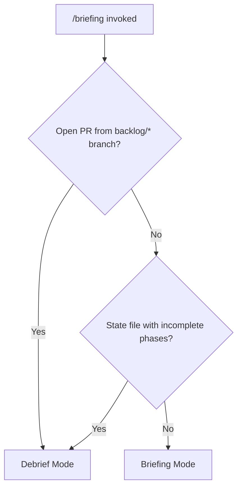

> **Status:** approved

# Briefing Skill: Context-Aware Project Orientation

> Historical record (March 2026). Measurements come from controlled synthetic workloads and early infrastructure runs; see [case studies](../case-studies.md) for scoped findings.

## 1. Problem Statement

Humans managing agentic workflows suffer from **context loss** at two critical moments:

**Moment 1 — Returning between cycles.** After merging a backlog PR or stepping away for days, the human needs to re-orient: what was accomplished, what's on the roadmap, what should be tackled next, what issues have accumulated. Today this is ad-hoc — the human asks "what's our status?" and the AI improvises an answer from whatever it happens to check.

**Moment 2 — Returning after an autonomous cycle.** The orchestrator runs for 30-90 minutes autonomously. The human returns to a completed (or near-complete) workflow with a PR open. They need to quickly understand: what happened, what the reviewer found, what the retro flagged, whether the PR is safe to merge, and what small fixes might be worth doing before merge. Today this requires manually reading retro docs, reviewer comments, telemetry, and lesson files.

Both moments share a common need: **structured orientation that surfaces what matters most, adapted to the current project state.** The human shouldn't have to know which files to read or which commands to run — the AI should investigate and synthesize.

### Why this matters

- **Cognitive overload.** Humans managing multiple workstreams context-switch frequently. Without structured re-orientation, important findings get missed — a reviewer warning buried in an issue comment, a recurring pattern flagged in the retro, a dependency that just became unblocked.
- **Information is scattered.** Relevant data lives across retro docs, telemetry comments, lesson files, the roadmap, the changelog, GitHub issues, PRs, and the project board. No single artifact provides a complete picture.
- **Ad-hoc briefings are inconsistent.** When the human asks "where are we at?", the AI's answer depends on what it happens to check. There's no protocol ensuring all important sources are consulted.

## 2. Scope

**In scope:**
- A Claude Code skill (`/briefing`) that provides structured project orientation
- Context-aware mode detection (briefing vs debrief) based on project state
- Defined output structure for each mode
- Defined data sources the AI must consult
- Conversational follow-up (the human can ask deeper questions after the briefing)

**Out of scope:**
- Scripts or automation — this is a pure AI-driven skill (structured prompt)
- File output — the briefing is conversational, not a `.md` artifact
- Side effects — the skill does not modify board status, post comments, or change state
- Integration with the orchestrator's Phase 0-6 — this runs independently
- Dashboard UI or web interface
- Automated scheduling or periodic execution

## 3. Approaches Considered

### Approach A: Script-Backed Skill

A shell script gathers data deterministically (queries board, reads state files, parses retro docs), then the AI synthesizes the script's output into a human-friendly briefing.

**Pros:** Deterministic data gathering, testable, repeatable output.
**Cons:** The briefing quality is capped by what the script knows to gather. Future model improvements (better reasoning, deeper synthesis) can't help if the script doesn't provide the data. Script maintenance burden grows as data sources evolve. The skill becomes "as good as the script can be" rather than "as good as the model can be."

### Approach B: Pure AI-Driven Skill (Recommended)

The skill is a structured prompt that tells the AI **where to look** and **how to present**, but the AI does all data gathering and synthesis directly. The prompt defines the data sources (roadmap, PRs, retro docs, etc.) and output structure (sections, ordering), but the AI uses judgment to extract what's relevant.

**Pros:**
- Model improvements directly improve briefing quality — a better model produces better synthesis without any code changes
- The AI can make cross-source connections a script never would (e.g., correlating a recurring retro recommendation with a roadmap item)
- Can adapt output depth based on how much there is to report
- Zero script maintenance — data sources are listed declaratively
- Natural follow-up conversation — the AI already has context from its investigation

**Cons:**
- Non-deterministic — different invocations may surface different things
- Depends on model quality for consistent coverage

**Why the cons are acceptable:** The briefing is a judgment task, not infrastructure. The "determinism first" philosophy applies to workflow rails (board updates, telemetry computation, branch operations) — not to understanding and guidance. Non-determinism in synthesis is a feature: the AI may notice something different each time, which is more valuable than a rigid script that always produces identical output.

### Approach C: Hybrid (Script + AI)

A script gathers raw data; the AI synthesizes it. The script ensures nothing is missed; the AI adds judgment.

**Pros:** Guaranteed coverage of data sources.
**Cons:** The script becomes a bottleneck — if a new data source appears, you must update the script, not just mention it in the prompt. The AI can also gather data beyond the script's output, making the script's "guarantee" less valuable. Added complexity for marginal benefit over Approach B (where the prompt's checklist serves the same "don't forget" function).

### Decision

**Approach B.** The skill prompt acts as a structured checklist (ensuring the AI checks all important sources) while leaving the gathering and synthesis to the AI. This maximizes the value of model improvements over time and eliminates script maintenance.

## 4. Design

### 4.1 Skill Location

```
.claude/skills/briefing/SKILL.md
```

Project-local skill, invoked as `/briefing`. Ships with the plugin when packaged.

### 4.2 Mode Detection

The skill instructs the AI to detect project state before choosing output structure:



| Signal | How to detect | Implies |
|--------|--------------|---------|
| Open PR from `backlog/*` branch | `gh pr list --head 'backlog/' --state open` | Debrief mode |
| State file with incomplete phases | Read `.agentic-workflow/runs/*/orchestrator.json`, check `phases` | Debrief mode |
| Neither signal present | Absence of above | Briefing mode |

### 4.3 Data Sources

The skill uses a **three-tier discovery model** to find relevant information:

- **Tier 1 — Frontmatter-driven discovery:** Scan `docs/` for `.md` files with YAML frontmatter fields (`backlog:`, `backlog-issue:`, `status:`, `date:`, `severity:`, etc.). This automatically discovers design docs, plans, retros, and lessons without hardcoding paths. New doc types that follow frontmatter conventions are picked up automatically.
- **Tier 2 — Fixed-path sources:** Singleton operational docs (roadmap, changelog, retro-recommendations) and live commands (PRs, board, git log) that are always at known locations.
- **Tier 3 — CLAUDE.md-referenced docs:** Project-specific reference documents that users mention in their CLAUDE.md files (e.g., `PROJECT.md`, `VISION.md`, `ARCHITECTURE.md`). These are unknown to the workflow but relevant to project orientation. The AI discovers them by scanning CLAUDE.md for file path references.

Sources are listed in priority order — if context limits or depth settings constrain the investigation, the AI reads higher-priority sources first.

#### 4.3.1 Source Priority Table

| Priority | Source | Tier | Briefing | Debrief | Depth: quick | Depth: standard | Depth: deep |
|----------|--------|------|----------|---------|--------------|-----------------|-------------|
| 1 | Open PRs | 2 | Required | Required | Yes | Yes | Yes |
| 2 | Roadmap | 2 | Required | Required | Yes | Yes | Yes |
| 3 | Recent retro docs (last 1-2) | 1 | Required | Required | TL;DR only | Full | Full + older |
| 4 | Design docs (open/pending/recent) | 1 | Required | Optional | — | Yes | Yes |
| 5 | Plan docs (open/pending/recent) | 1 | Required | Optional | — | Yes | Yes |
| 6 | Orchestrator state file | 2 | — | Required | — | Yes | Yes |
| 7 | Lesson files (current cycle) | 1 | — | Required | — | Critical only | All |
| 8 | Reviewer comments on stories | 2 | — | Required | — | Yes | Yes |
| 9 | Changelog (last 3-5 entries) | 2 | Required | Optional | Last 1 | Last 3 | Last 5 |
| 10 | Retro recommendations tracker | 2 | Optional | Optional | — | Outstanding only | Full |
| 11 | CLAUDE.md-referenced docs | 3 | Optional | Optional | — | Yes | Yes |
| 12 | GitHub board (open issues) | 2 | Optional | Optional | — | Yes | Yes |
| 13 | Git log (recent commits) | 2 | Optional | Optional | — | — | Yes |

#### 4.3.2 Tier 1: Frontmatter-Driven Discovery

The AI scans `docs/` for `.md` files using frontmatter fields to discover relevant documents dynamically. This replaces hardcoded path-per-doc-type lookups.

**Discovery queries:**

```bash
# Find all docs related to a specific backlog item
grep -rl "^backlog: <N>$" docs/
grep -rl "^backlog-issue: <N>$" docs/

# Find pending/draft design docs and plans
grep -rl "^status: Draft$" docs/2-design/ docs/3-plans/

# Find recent retro docs (by date prefix or frontmatter)
grep -rl "^date: 2026-03" docs/4-reviews/

# Find high-severity lessons from recent cycles
grep -rl "^severity: critical$" docs/4-reviews/lessons/
grep -rl "^severity: high$" docs/4-reviews/lessons/
```

**Frontmatter fields used for discovery:**

| Field | Doc types | How the briefing uses it |
|-------|-----------|------------------------|
| `backlog:` / `backlog-issue:` | Design docs, plans, retros | Find all artifacts for a given backlog item |
| `status:` | Design docs, plans | Identify pending work (`Draft`, `Approved` but not yet executed) |
| `date:` | All | Determine recency, sort for "most recent" |
| `severity:` | Lesson files | Prioritize critical/high lessons over medium/low |
| `tags:` | Lesson files | Filter by role or area (e.g., `[builder, testing]`) |
| `author:` | All | Identify which agent produced the artifact |

**Prerequisite: Design doc frontmatter standardization.** Design docs currently have inconsistent frontmatter (some use `scope` vs `title`, some lack `status` or `author`). Standardizing design doc frontmatter to include at least `date`, `author`, `backlog`, and `status` is a prerequisite for reliable Tier 1 discovery. This is a small, independent task — normalize existing files and document the convention.

##### Design Docs and Plans (open/pending/recent)

The briefing should surface design docs and plans that represent **pending or in-progress work** — not just the most recent completed item. This answers questions like: "Is there already a design for BL#107?" or "Is there an approved plan waiting to be executed?"

**What to discover:**
- Design docs with `status: Draft` → work in progress, may need attention
- Design docs with `status: Approved` whose backlog item has no corresponding plan → design approved but plan not yet written
- Plan docs with `status: Draft` → plan being developed
- Plan docs with `status: Approved` whose backlog item hasn't started building → ready to execute
- The 2-3 most recent docs by `date:` field → general context on what was designed/planned recently

**Maps to sections:**
- Briefing → "Roadmap & Priorities" (enriches roadmap with artifact readiness), "Decisions & Attention Needed" (draft docs that need review)
- Debrief → "What's Next" (what's already designed/planned and ready to go)

##### Retro Docs (primary source, not supplementary)

Retro docs are the richest single artifact in the workflow — they combine metrics, narrative, evidence, and forward-looking recommendations. The briefing treats retro docs as a **primary source**, not a supplement to the recommendations tracker.

**What to discover:**
- The 1-2 most recent retro docs by `date:` field (or by `backlog-issue:` matching recent backlog items)
- In deep mode: up to 3-4 retros for trend comparison

**What to extract:**
- "What Worked" section → patterns to repeat
- "What Didn't Work" section → issues to address or watch for
- Specific recommendations → actions not yet taken
- Metrics summary → cost, duration, fix cycle rate for trend analysis

**Maps to sections:**
- Debrief → "Key Findings" (primary source), "What Went Well", "What Needs Attention"
- Briefing → "What Happened Last" (richer narrative than changelog), "Outstanding Issues" (recommendations from recent retros)

##### Lesson Files

**What to discover:**
- For debrief: scope to current cycle's lesson folder using `backlog-issue:` or directory path
- For briefing: scan for recent critical/high severity lessons that may indicate systemic issues
- Read YAML frontmatter first (`severity`, `tags`, `story`), then body only for critical/high items

**What to extract:**
- Lessons grouped by severity (critical > high > medium > low)
- Root causes and prevention recommendations
- Count of lessons (high count may indicate a turbulent cycle)
- Cross-cycle patterns (same tags appearing in lessons from multiple cycles)

**Maps to sections:**
- Debrief → "Key Findings" (critical/high), "What Needs Attention" (prevention actions)
- Briefing → "Outstanding Issues" (if critical lessons remain unaddressed)

#### 4.3.3 Tier 2: Fixed-Path Sources

These are singleton files or live commands at known locations. They don't need discovery — the skill reads them directly.

##### Open PRs

**How to read:** `gh pr list --state open --json number,title,headRefName,state,reviewDecision,createdAt,url`

**What to extract:**
- Any PR from a `backlog/*` branch (primary signal for debrief mode)
- PR review status: approved, changes requested, or pending review
- PR age (how long it's been open)
- Non-backlog PRs in flight (design/plan doc PRs, dependency PRs)

**Maps to sections:**
- Debrief → "Merge Readiness", "TL;DR"
- Briefing → "Project Pulse" (stale PRs?), "Decisions & Attention Needed" (PRs awaiting action)

##### Roadmap (`docs/ROADMAP.md`)

**How to read:** Read the full file.

**What to extract:**
- Completed vs total items (progress ratio)
- Active track: priority order, difficulty, dependency chains
- Newly unblocked items after last completed cycle
- Plugin/future track (strategic context)

**Maps to sections:**
- Briefing → "Project Pulse", "Roadmap & Priorities", "Decisions & Attention Needed"
- Debrief → "What's Next"

##### Orchestrator State File (`.agentic-workflow/runs/*/orchestrator.json`)

**How to read:** Find the most recent state file. Read `session`, `phases`, `dispatches[]`, and `overhead` fields.

**What to extract:**
- Phase statuses (completed, pending, in-progress)
- Dispatch log: per-agent durations, tokens, models, results, review tiers
- Wall-clock duration and cost aggregates
- Fix cycle count
- Pricing data

**Maps to sections:**
- Debrief → "Summary" (metrics), "Key Findings" (failed dispatches, anomalies), "Merge Readiness" (all phases complete?)

##### Reviewer Comments on Story Issues

**How to read:** For each story in the current cycle, `gh issue view <N> --comments`. Look for verdict comments (REQUEST_CHANGES / APPROVE).

**What to extract:**
- Verdict per story
- Specific findings (critical, warning, suggestion)
- Whether fix cycles resolved findings
- Cross-story patterns (same finding in multiple stories)

**Maps to sections:**
- Debrief → "Key Findings", "What Needs Attention", "Merge Readiness"

##### Changelog (`docs/CHANGELOG.md`)

**How to read:** Read last 3-5 entries (reverse-chronological).

**What to extract:**
- Recent cycle outcomes (topic, scope, duration, key results)
- Cost and duration trends across entries
- Noted issues or caveats

**Maps to sections:**
- Briefing → "What Happened Last", "Project Pulse" (trends)
- Debrief → Comparison context

##### Retro Recommendations Tracker (`docs/4-reviews/retro-recommendations.md`)

**How to read:** Read the full file. Note: this file may lag behind actual retro docs — treat as **supplementary** to retro docs, not a replacement.

**What to extract:**
- Outstanding recommendations with recurrence count > 1 (systemic patterns)
- High-priority outstanding items
- Recently implemented recommendations (progress on tech debt)
- Total outstanding vs implemented (tech debt ratio)

**Maps to sections:**
- Briefing → "Outstanding Issues", "Project Pulse" (tech debt count)
- Debrief → "What Needs Attention" (relevant outstanding recommendations)

##### GitHub Board

**How to read:** `./scripts/item-list.sh --state open --limit 50`

**What to extract:**
- Issues per status column (Backlog, Ready, In Progress, In Review, Done)
- Anomalies: stuck issues, mixed epic statuses
- Total open issue count

**Maps to sections:**
- Briefing → "Project Pulse", "Roadmap & Priorities"
- Debrief → Board consistency validation

##### Git Log

**How to read:** `git log --oneline -20` on current branch and `main`.

**What to extract:**
- Recent commit activity
- Integration branch ahead of main?
- Unusual commits (manual fixes, reverts)

**Maps to sections:**
- Both modes → Supplementary context for recency and manual interventions

#### 4.3.4 Tier 3: CLAUDE.md-Referenced Docs

Every project has reference documents that aren't part of the SDLC workflow's own artifacts but provide essential context for project orientation. These are project-specific — one project might have `ARCHITECTURE.md` and `VISION.md`, another might have `docs/runbook.md` and `CONTRIBUTING.md`.

Rather than requiring users to configure these explicitly, the skill leverages what's already available: **CLAUDE.md is always loaded into the AI's context.** Projects that follow good CLAUDE.md practices already list their key docs there.

**How it works:**

1. The skill prompt instructs the AI: "Scan the CLAUDE.md content (already in your context) for references to project documentation files — file paths, doc sections, or explicitly listed reference documents."
2. The AI uses judgment to identify which referenced docs are relevant to a project orientation briefing (architecture docs, vision docs, guides) vs which are operational details (script flags, config schemas).
3. Relevant docs are read and their key points are woven into the appropriate briefing sections.

**Examples of what the AI might discover from CLAUDE.md:**

| CLAUDE.md reference | What the AI extracts for the briefing |
|---------------------|--------------------------------------|
| `docs/5-guides/PROJECT.md — full architecture and technical overview` | Current architecture context, recent structural changes |
| `docs/1-discovery/VISION.md — long-term vision and aspirations` | Strategic direction, how current work connects to the bigger picture |
| `docs/6-adrs/ — architecture decision records` | Recent architectural decisions that affect next steps |
| `CONTRIBUTING.md` | Team conventions that might have changed recently |

**Why this works without explicit config:**
- CLAUDE.md is the natural place where projects document their key references — it's already being maintained for AI context
- The AI applies judgment (appropriate for Tier 3 — these are supplementary, not critical sources)
- Zero configuration burden for users — if it's in CLAUDE.md, the briefing considers it
- Portable across projects — each project's CLAUDE.md naturally describes its own doc landscape

**Limitations:**
- Only works for docs referenced in CLAUDE.md — unlisted docs won't be discovered
- The AI must use judgment on relevance, which may vary across invocations
- Large CLAUDE.md files with many file references could lead to over-reading in deep mode

**Maps to sections:**
- Briefing → "Project Pulse" (architectural health), "Roadmap & Priorities" (vision alignment), "Decisions & Attention Needed" (recent ADRs or convention changes)
- Debrief → "What's Next" (how completed work connects to vision), "Key Findings" (if the cycle revealed something that contradicts or advances architectural goals)

#### 4.3.5 Cross-Source Synthesis

Beyond reading individual sources, the skill instructs the AI to look for **connections across sources** that no single source reveals:

- **Recurring patterns:** A recommendation in the tracker that also appears as a lesson in the current cycle → flag as "still happening, needs escalation"
- **Trend detection:** Comparing cost/duration across 3+ retro docs or changelog entries → surface whether metrics are improving or degrading
- **Dependency chains:** A roadmap item that just became unblocked because the last cycle completed its prerequisite → highlight as "newly available"
- **Artifact readiness:** A roadmap item with an approved design doc but no plan → "design done, needs planning"
- **Consistency checks:** Board status vs state file vs PR status → flag discrepancies

### 4.4 Configurable Depth

The skill accepts an optional depth argument that controls how many sources are consulted and how deeply each is read. This allows users to trade comprehensiveness for speed and token efficiency.

**Invocation:**

```
/briefing              → standard depth (default)
/briefing quick        → minimal sources, fast overview
/briefing deep         → all sources, full analysis, trend comparison
```

**What each depth level includes:**

| Aspect | Quick | Standard | Deep |
|--------|-------|----------|------|
| **Sources consulted** | Top 3-4 priority | All required + judgment on optional | All sources |
| **Retro docs read** | TL;DR/summary of latest | Full latest retro | Last 2-3 retros + comparison |
| **Lesson files** | Skip | Critical/high severity only | All severities |
| **Changelog depth** | Last entry only | Last 3 entries | Last 5 entries + trend analysis |
| **Recommendations tracker** | Skip | Outstanding section only | Full file |
| **Design/plan doc scan** | Skip | Recent/pending only | Full scan |
| **Cross-source synthesis** | Skip | Basic (dependency chains, consistency) | Full (trends, recurring patterns, artifact readiness) |
| **Approximate output** | 200-400 words | 600-1000 words | 1000-2000 words |

**Configuration override:** Users can customize the default depth and toggle individual sources in the workflow config file:

```json
{
  "briefing": {
    "defaultDepth": "standard",
    "sources": {
      "roadmap": true,
      "changelog": true,
      "retroDocs": { "enabled": true, "maxCount": 2 },
      "lessonFiles": { "enabled": true, "severityThreshold": "high" },
      "designDocs": true,
      "planDocs": true,
      "retroRecommendations": true,
      "openPRs": true,
      "board": true,
      "stateFile": true,
      "reviewerComments": true,
      "gitLog": false
    }
  }
}
```

Config overrides take precedence over depth presets. For example, a user could set `defaultDepth: "quick"` but enable `retroDocs` to always include retro doc analysis even in quick mode.

**Future consideration — adaptive depth:** Over multiple invocations, the AI could learn which sources the user engages with (asks follow-ups about) vs which they skip. This learning could inform a personalized default. Not in scope for initial implementation but noted as a direction that aligns with the "model improvements improve quality" philosophy.

### 4.5 Output Structure

#### Briefing Mode (between cycles)

Presented when no active cycle is detected. Oriented toward strategic awareness and next-action decision-making.

```markdown
## Briefing — <project name>
<date> · <time since last cycle completed>

### TL;DR
<1-2 sentences: where the project stands and suggested next action>

### Project Pulse
- **Last completed:** <topic> (backlog #N, <wall-clock>, <cost>)
- **Roadmap:** X/Y items complete · next priority: <item> (<difficulty>)
- **Tech debt:** N outstanding recommendations (M high-priority)
- **Trends:** <1-2 notable cross-cycle trends>

### What Happened Last
<3-5 bullets summarizing the last cycle's key outcomes, findings,
and any unresolved issues — synthesized from retro + telemetry>

### Roadmap & Priorities
<Current state: what's done, what's next, what's blocked.
Highlight newly unblocked items after last merge.
Include dependency reasoning for recommended next item.>

### Outstanding Issues
<Accumulated recommendations not yet addressed, grouped by urgency.
Recurring patterns flagged with recurrence count.
Source: retro-recommendations.md + recent lesson files.>

### Decisions & Attention Needed
<2-3 items requiring human judgment. Examples:
- Design decisions the AI can't make alone
- Recurring issues that need a convention change
- Priority/scope trade-offs
- Cost or effort concerns>
```

#### Debrief Mode (PR open / cycle just completed)

Presented when an active backlog PR is detected. Oriented toward merge-readiness assessment and immediate action.

Inspired by the **SBAR (Situation-Background-Assessment-Recommendation)** model from healthcare shift handoffs — designed for the exact scenario of re-orienting after being away while autonomous work was performed.

```markdown
## Debrief — <topic>
<date> · backlog #N · <wall-clock> · <cost>

### TL;DR
<1-2 sentences: how the cycle went and what needs attention before merge>

### Summary
- **Stories:** N built, M reviewed, K fix cycles
- **Cost:** $X.XX (<comparison to recent average if available>)
- **Duration:** Xm wall-clock (Ym sequential, Z% parallel speedup)
- **Models used:** <list>

### Key Findings
<Synthesized from reviewer comments, retro doc, and lesson files.
Grouped by severity:
- **Needs fixing before merge:** <items>
- **Worth knowing:** <items>
- **Positive patterns:** <items>>

### What Went Well
<2-3 highlights worth repeating in future cycles>

### What Needs Attention
<Issues that may need fixing before merge.
For each: what it is, severity, fixable now or defer.
Clear distinction between "must fix" and "nice to have.">

### Merge Readiness
<Explicit recommendation: ready to merge / needs fixes first / needs discussion.
If fixes needed: numbered list of specific items to address.>

### What's Next
<After merge, what becomes unblocked on the roadmap?
Suggested next backlog item with rationale.>
```

### 4.6 Design Principles

**Inverted pyramid.** The most important information comes first (TL;DR), with progressively more detail in later sections. A human who reads only the TL;DR and "Decisions & Attention Needed" (briefing) or TL;DR and "Merge Readiness" (debrief) gets 80% of the value.

**Trend awareness.** Unlike retros (which capture a single cycle), the briefing should surface patterns across cycles when data is available — fix cycle rates, cost trends, recurring recommendation themes. This requires the AI to compare current data against recent changelog entries or multiple retro docs.

**Read-only.** The skill never modifies project state. It is safe to run at any time without side effects.

**Conversational continuation.** The briefing is a starting point, not an endpoint. After reading it, the human naturally asks follow-up questions ("tell me more about finding X", "show me the reviewer comment", "let's start working on BL#107"). The AI retains full context from its investigation.

**No computed metrics.** The skill does not compute costs, durations, or aggregates — it reads them from existing artifacts (telemetry comments, state files, changelog). This avoids duplicating computation that already exists in deterministic scripts.

### 4.7 Skill Prompt Design

The `SKILL.md` file will contain:

1. **Purpose statement** — what the skill does and when to use it
2. **Mode detection instructions** — how to determine briefing vs debrief mode
3. **Data source checklist** — ordered list of sources to consult, with what to extract from each
4. **Output template** — the section structure for each mode (as defined in 4.4)
5. **Tone guidance** — concise, direct, lead with the most important thing, no filler
6. **Anti-patterns** — don't generate the briefing from memory alone; always read current sources; don't modify any files; don't post comments

### 4.8 Prerequisites

- **Design doc frontmatter standardization.** Normalize existing design docs in `docs/2-design/` to include consistent YAML frontmatter: `date`, `author`, `backlog`, `status`. This is a small independent task (update ~15 files + document the convention). Without this, Tier 1 discovery for design docs will produce inconsistent results.

### 4.9 Future Considerations (Not in Scope)

These are documented for future reference, not for implementation now:

- **Adaptive depth (learning from usage).** Over multiple invocations, the AI could track which sections the user engages with (asks follow-ups about) vs which they skip, and adjust the default depth and source prioritization accordingly. This aligns with the "model improvements improve quality" philosophy — the skill gets smarter over time without code changes. Implementation would require writing usage observations to memory after each briefing.
- **Config-based reference docs.** Replace or supplement Tier 3's CLAUDE.md scanning with an explicit `briefing.referenceDocs` config array where users list paths and labels for project-specific docs. More precise than AI judgment on CLAUDE.md references, and supports docs not mentioned in CLAUDE.md. Example: `"referenceDocs": [{"path": "docs/5-guides/PROJECT.md", "label": "Architecture overview"}]`.
- **Saved briefings.** Writing the briefing to a file for async review or sharing with team members.
- **Scheduled briefings.** Auto-generating a briefing at the start of each orchestrator session.
- **Multi-project briefings.** Aggregating status across multiple repositories.
- **Briefing diff.** Comparing the current briefing with the previous one to highlight what changed.
- **Custom sections.** Allowing users to define additional output sections beyond the standard template.

## 5. Implementation Notes

The implementation is a single file: `.claude/skills/briefing/SKILL.md`. The skill prompt should be structured enough to ensure consistent output quality across model versions, but loose enough to benefit from model improvements.

Key implementation decisions:
- The skill should reference project-specific paths (`docs/ROADMAP.md`, `docs/4-reviews/retro-recommendations.md`, etc.) but these could be made configurable for the plugin version
- Mode detection should be fast — check for open PRs and state files before reading heavier sources
- The data source checklist should be ordered by importance, so if context limits are hit, the most valuable sources are already loaded

## 6. Success Criteria

- Running `/briefing` between cycles produces a briefing that answers "where are we at?" and "what should we do next?" without the human needing to read any files manually
- Running `/briefing` after a cycle completes produces a debrief that answers "what happened?", "is it safe to merge?", and "what needs my attention?" without the human needing to read retro docs, reviewer comments, or telemetry
- The human can ask natural follow-up questions and get useful deeper answers
- The briefing consistently checks all defined data sources (not just the ones the AI "remembers")
- The output structure is consistent across invocations (same sections, same ordering)
