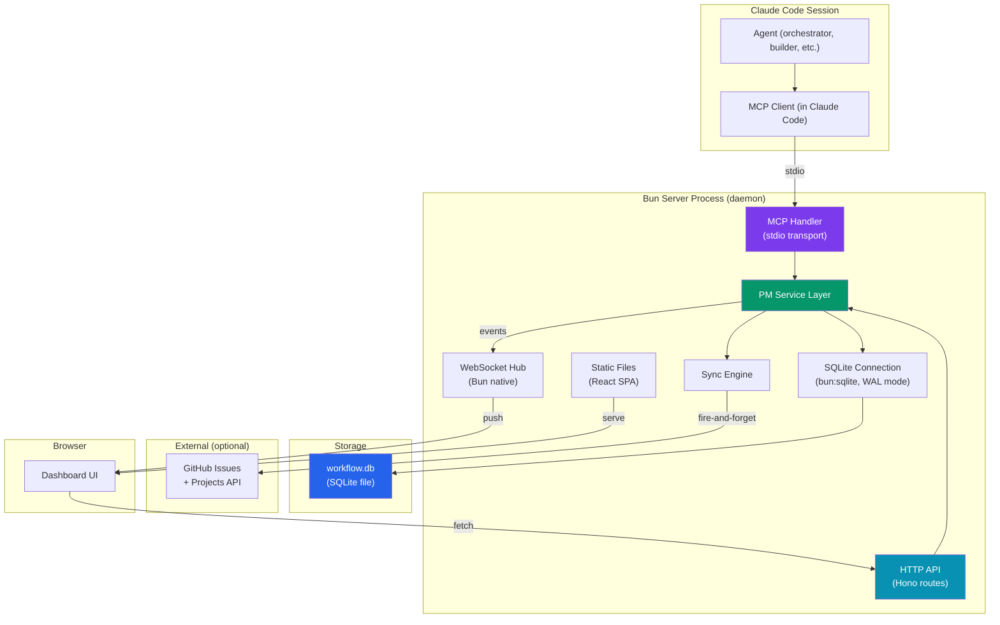
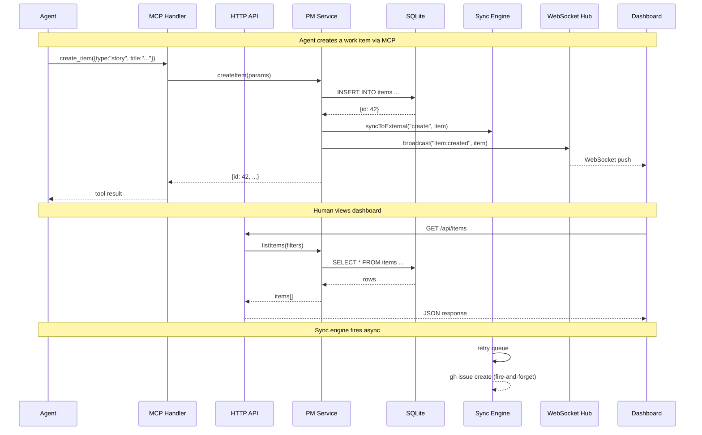
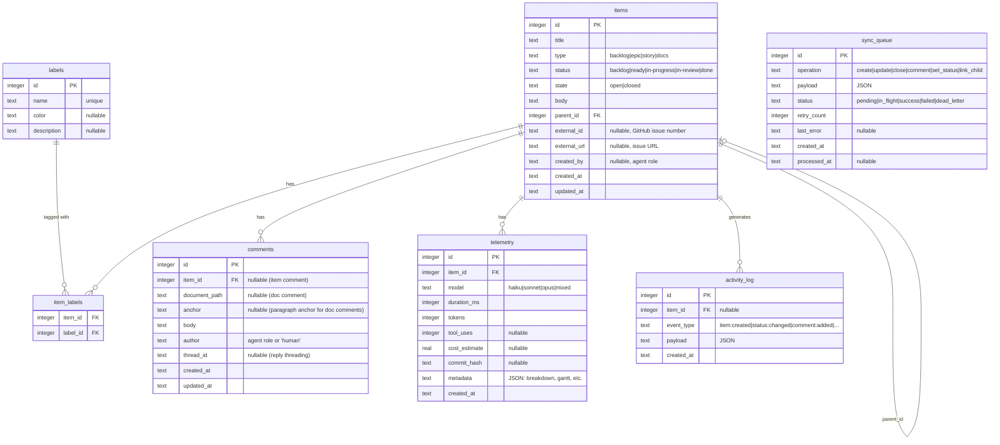
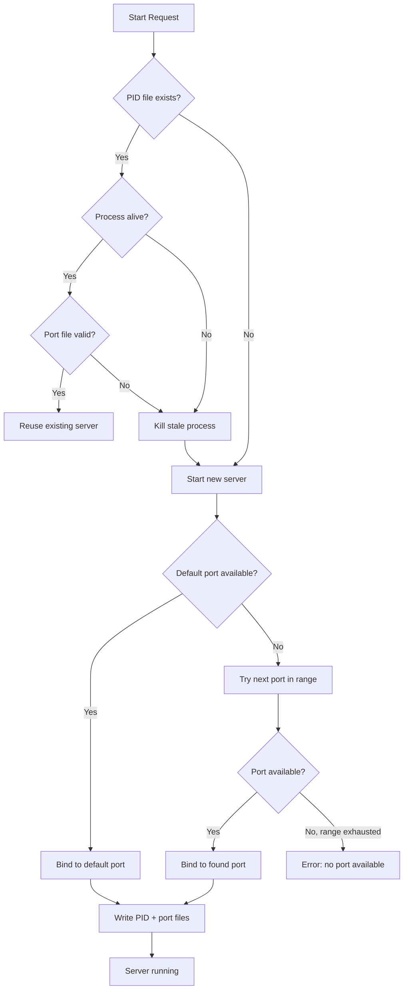
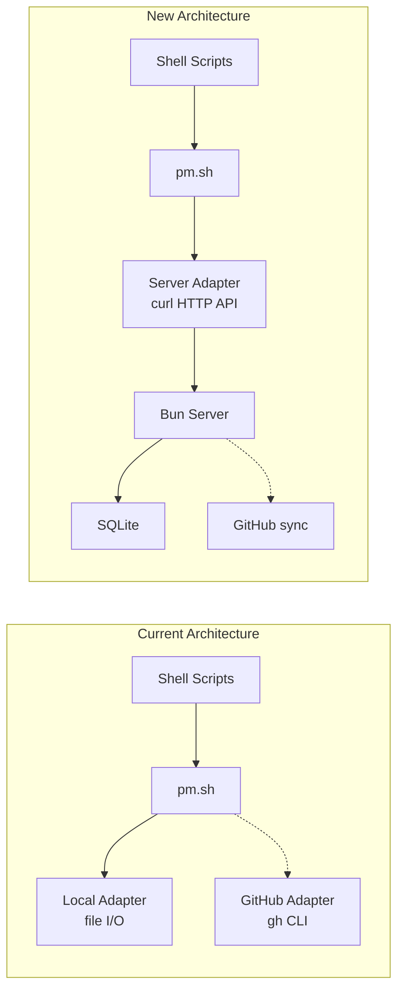
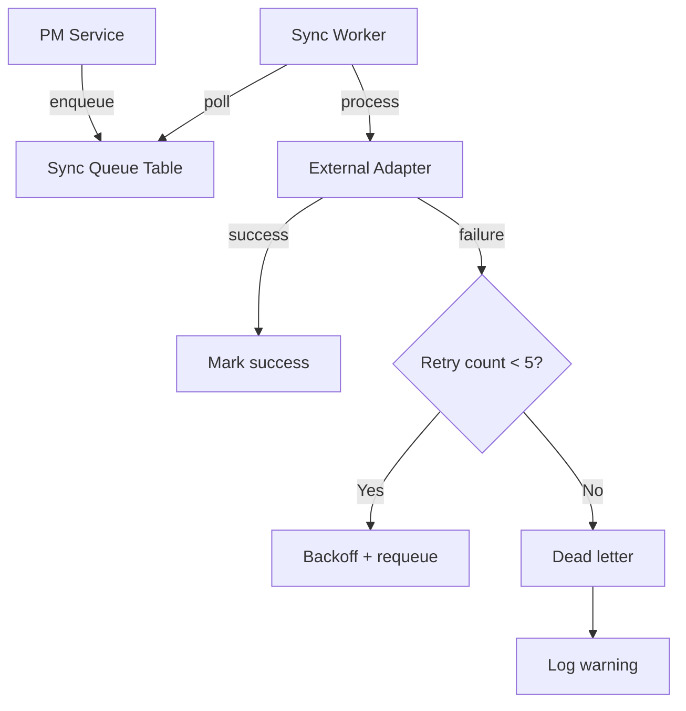
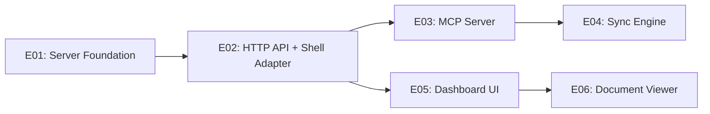

> **Status:** Draft

# Design: Workflow Runtime Service

> Historical record (March 2026). Measurements come from controlled synthetic workloads and early infrastructure runs; see [case studies](../case-studies.md) for scoped findings.

## 1. Overview

The Workflow Runtime Service is a persistent local server that replaces the file-system PM adapter with a SQLite-backed database, serves a dashboard UI for human workflow monitoring, provides a document viewer for design doc review, and exposes PM operations as MCP tools for agent consumption. This is the single most consequential feature on the roadmap -- it addresses durability problems observed across 14+ production runs and transforms the human-in-the-loop experience.

### 1.1 Problem Statement

The current workflow has three interlocking problems:

1. **PM durability.** The file-based local PM adapter (`.workflow/items/`) suffers from worktree isolation data loss (Run 15, rec AM), ID collisions when external creation fails (Run 17, rec AO), and concurrent access races during parallel builder dispatch. These are structural problems with file-based PM -- they cannot be fixed without a database.

2. **Human visibility.** Monitoring a workflow run requires checking GitHub Issues, reading raw markdown files, and switching between CLI and browser. There is no unified view of run progress, cost, or timeline. The orchestrator posts telemetry to GitHub issues, but that is a write-only log -- not an interactive dashboard.

3. **Agent tool friction.** Agents interact with PM through a chain of Agent -> Bash tool -> shell script -> file I/O (or `gh` CLI). Each hop adds latency, parsing fragility, and error surface. MCP tools would let agents call PM operations directly with structured input/output.

### 1.2 Scope

**In scope (this backlog item):**

| Pillar | What ships |
|--------|-----------|
| PM Backend | SQLite database, REST API, migration from `.workflow/items/` |
| MCP Server | stdio transport, PM tool set, `.mcp.json` registration |
| Dashboard UI | Kanban board, item detail, telemetry summary, activity feed |
| Document Viewer | Markdown preview, paragraph-anchored comment threads |
| Server Lifecycle | Daemon management, port discovery, auto-start in Phase 0 |

**Out of scope:**
- WYSIWYG document editor (V2 -- deferred)
- CLI tool for human interaction (deferred)
- Cloud-hosted multi-tenant deployment (future)
- VCS/DOC abstraction layers (separate backlog items)
- New external PM adapters (Jira, Linear -- BL#113)

### 1.3 Dependencies

| Dependency | Status | Relationship |
|-----------|--------|-------------|
| BL#109 PM Abstraction Layer | Complete | Interface this implements |
| BL#111 Local-First PM | Complete | System this replaces |
| BL#227 Dual-Write PM Layer | Complete | Architecture this builds on |
| BL#283 Scale Local PM Storage | Open | Absorbed by this item |

### 1.4 Success Criteria

1. Zero worktree PM data loss during parallel builder dispatch
2. Zero ID collisions during external PM creation failures
3. Dashboard shows real-time run progress without refreshing
4. Design doc comments are readable by agents via MCP/API
5. Shell scripts continue to work unchanged (backward compatibility)
6. Server starts in under 2 seconds, adds no observable latency to PM operations

## 2. Approaches Considered

### Approach A: Monolithic Bun Server (Recommended)

A single Bun process serves the HTTP API (Hono routes), static React SPA, WebSocket hub, SQLite database, and MCP stdio handler. All pillars share one service layer and one database connection.

**Pros:**
- Single process to manage -- simpler lifecycle, no IPC
- Shared service layer eliminates duplication between HTTP and MCP
- Bun's built-in SQLite, WebSocket, and bundler minimize dependencies
- MCP stdio transport runs in-process alongside HTTP (no separate binary)

**Cons:**
- Single point of failure (server crash takes down all capabilities)
- MCP stdio and HTTP daemon in same process requires careful stdio isolation
- Bun is younger than Node.js -- fewer battle-tested production examples

### Approach B: Separate MCP and HTTP Processes

The MCP server runs as a dedicated stdio process (spawned by Claude Code), while the HTTP API/dashboard runs as a separate daemon. Both share the SQLite database file.

**Pros:**
- MCP process lifecycle is managed by Claude Code (automatic start/stop)
- HTTP server crash does not affect MCP tools
- Cleaner stdio isolation (MCP process owns stdin/stdout exclusively)

**Cons:**
- SQLite concurrent access from two processes requires WAL mode and careful locking
- Two processes to manage, monitor, and debug
- Service layer must be duplicated or extracted into a shared library
- Dashboard cannot push real-time updates from MCP operations without a coordination mechanism (the two processes do not share memory)

### Approach C: HTTP-Only (No MCP)

Skip MCP entirely. Shell scripts call the HTTP API via `curl`. Agents continue using Bash tool for PM operations.

**Pros:**
- Simplest architecture -- one protocol, one transport
- No MCP SDK dependency or stdio complexity
- Agents already work via shell scripts

**Cons:**
- Agents still go through Bash tool -> shell script -> curl -> HTTP roundtrip
- No structured tool schemas -- agents parse shell script output
- Does not advance toward the plugin vision (MCP is the plugin tool protocol)
- Misses the opportunity to reduce tool-call overhead for agents

### Recommendation: Approach A (Monolithic Bun Server)

The monolithic approach is the right choice because:

1. **Shared service layer is the critical design goal.** The entire value of this server is that MCP tools, HTTP API, and WebSocket events all call the same PM functions. Splitting into processes undermines this.
2. **MCP stdio isolation is solvable.** The MCP handler reads from stdin and writes to stdout; the HTTP server listens on a port. These do not conflict as long as the server startup and logging do not write to stdout (use stderr for logs). This is a well-understood pattern in the MCP ecosystem.
3. **SQLite single-writer is simpler.** A single process with WAL mode can handle concurrent reads from the dashboard while the service layer serializes writes. Two processes fighting over SQLite is an unnecessary complexity.

The Approach B concern about single-point-of-failure is valid but manageable: the server process is a daemon with auto-restart, and SQLite data survives crashes. Approach C is rejected because it blocks the plugin vision and does not reduce agent tool friction.

## 3. Architecture

### 3.1 System Architecture



### 3.2 Request Flow



### 3.3 Directory Structure

```
server/
  src/
    index.ts                 # Entry point: start daemon, connect MCP
    server.ts                # Bun.serve() setup (HTTP + WS)
    mcp.ts                   # MCP server setup (stdio transport)
    db/
      connection.ts          # Database singleton (bun:sqlite, WAL mode)
      schema.ts              # Drizzle ORM schema definitions
      migrations/            # Drizzle migration files
      seed.ts                # Import from .workflow/items/ (one-time migration)
    services/
      items.ts               # CRUD: create, get, list, update, close
      board.ts               # Board status transitions
      comments.ts            # Comments (item + document)
      hierarchy.ts           # Parent-child linking
      labels.ts              # Label management
      lifecycle.ts           # start_work, complete_work, post_telemetry
      sync.ts                # External PM sync engine (retry queue)
    api/
      routes.ts              # Hono route registration
      items.ts               # /api/items endpoints
      board.ts               # /api/board endpoints
      comments.ts            # /api/comments endpoints
      documents.ts           # /api/documents endpoints
      telemetry.ts           # /api/telemetry endpoints
      websocket.ts           # WebSocket upgrade + pub/sub
      middleware.ts           # CORS, error handling, request logging
    mcp/
      tools.ts               # MCP tool registrations
      transport.ts           # stdio transport wrapper
    types/
      index.ts               # Shared TypeScript types
  frontend/
    src/
      App.tsx                # Root component + routing
      pages/
        Dashboard.tsx        # Kanban board + summary
        ItemDetail.tsx       # Work item detail view
        DocumentViewer.tsx   # Markdown viewer + comments
        Telemetry.tsx        # Cost/token/duration charts
      components/
        KanbanBoard.tsx      # Drag-and-drop board
        ActivityFeed.tsx     # Real-time event log
        GanttChart.tsx       # Interactive timeline
        CommentThread.tsx    # Inline comment threads
      hooks/
        useWebSocket.ts      # WebSocket connection + reconnect
        useItems.ts          # Item data fetching + cache
      lib/
        api.ts               # HTTP client wrapper
    index.html               # SPA entry point
    tailwind.config.ts       # Tailwind configuration
  tests/
    services/                # Service layer unit tests
    api/                     # API integration tests
    mcp/                     # MCP tool tests
  package.json
  tsconfig.json
  drizzle.config.ts
```

## 4. Database Schema

### 4.1 Work Item ID Strategy

**Decision: GitHub-first ID with local fallback.**

The current dual-write system calls GitHub first to get an issue number, then stores locally with that same ID. When GitHub fails, the local adapter falls back to auto-increment, causing ID divergence.

The design preserves this approach but makes it more robust:

1. **Primary key:** Integer `id` column, matching GitHub issue numbers when sync is enabled
2. **Creation flow:** Server calls GitHub API synchronously to create the issue and get the number. If GitHub fails, use server-side auto-increment starting from `max(existing_ids) + 1000` to avoid collision with future GitHub IDs.
3. **External ID mapping:** `external_id` column stores the GitHub issue number (or Jira key, etc.) for items created locally-only. When sync eventually succeeds, the mapping is updated.
4. **Why not UUIDs:** Every agent instruction, every shell script, every convention uses integer IDs (`#42`, `item-get.sh 42`). Switching to UUIDs would require rewriting the entire agent instruction set. Integer IDs that match GitHub issue numbers are the pragmatic choice.

**Collision avoidance:** The `+1000` offset for local-only IDs is a large enough gap to prevent collisions in practice (GitHub issues are created sequentially, and workflows rarely create more than ~50 issues per run). If a collision does occur, the sync engine detects it during reconciliation and re-maps the local ID.

### 4.2 Schema (Drizzle ORM)



### 4.3 Key Design Decisions

**WAL mode enabled at startup.** SQLite WAL mode allows concurrent reads while a write is in progress. The server enables WAL immediately after opening the database:

```typescript
db.run("PRAGMA journal_mode = WAL;");
db.run("PRAGMA foreign_keys = ON;");
db.run("PRAGMA busy_timeout = 5000;");
```

**Activity log for WebSocket events.** Every state change (item created, status changed, comment added) is recorded in `activity_log`. The WebSocket hub reads from this table on client connect (backfill recent events) and broadcasts new entries in real-time. This decouples event generation from event delivery -- if the dashboard is not connected, events are not lost.

**Sync queue for external PM.** The current dual-write system fires external operations in background subshells with no retry. The sync queue adds:
- Persistent retry with exponential backoff (1s, 2s, 4s, 8s, max 60s)
- Dead-letter queue for operations that fail after 5 retries
- Ordered processing per item (comments must arrive in order)
- Idempotency keys to prevent duplicate operations on retry

**Document comments use `document_path` + `anchor`.** The `anchor` field stores a paragraph identifier (e.g., heading slug, line range, or content hash of the paragraph). This anchors comments to specific locations in the document without requiring the document content to be stored in the database. The document itself lives on disk in `docs/`. The `thread_id` field enables reply threading -- child comments reference the parent comment's ID.

## 5. Server Lifecycle

### 5.1 Daemon Management

The server runs as a persistent background daemon. Process management uses a PID file and port discovery file:

```
.agentic-workflow/
  workflow.db           # SQLite database (persists across restarts)
  workflow.db-wal       # WAL file (auto-managed by SQLite)
  workflow.db-shm       # Shared memory index (auto-managed)
  server.pid            # Process ID of running daemon
  server.port           # Actual port number (for discovery)
  server.log            # Daemon log output (stderr)
```

**Start flow:**



**Configuration (in `agentic-sdlc-config.json`):**

```json
{
  "server": {
    "port": 3117,
    "portRange": [3117, 3127],
    "idleTimeoutMinutes": 240,
    "logLevel": "info"
  }
}
```

**Port discovery protocol:**
1. Read `.agentic-workflow/server.port`
2. If file exists, HTTP GET `http://localhost:<port>/api/health`
3. If health check passes, server is running at that port
4. If file missing or health check fails, start new server

### 5.2 Auto-Start Integration

The orchestrator ensures the server is running in Phase 0 before dispatching any agents. The start script is idempotent -- calling it when the server is already running is a no-op.

```bash
# Phase 0: ensure server is running
bun run server/src/index.ts start
# Returns immediately if already running

# Read discovered port
SERVER_PORT=$(cat .agentic-workflow/server.port)
export WORKFLOW_SERVER_URL="http://localhost:$SERVER_PORT"
```

Shell scripts detect the server URL from the environment variable or port file:

```bash
_workflow_server_url() {
  if [ -n "${WORKFLOW_SERVER_URL:-}" ]; then
    echo "$WORKFLOW_SERVER_URL"
  elif [ -f "${REPO_ROOT:-.}/.agentic-workflow/server.port" ]; then
    echo "http://localhost:$(cat "${REPO_ROOT:-.}/.agentic-workflow/server.port")"
  else
    return 1  # Server not running
  fi
}
```

### 5.3 Idle Timeout

The server tracks the timestamp of the last API call or MCP message. If no activity occurs for the configured idle timeout (default 4 hours), the server shuts down gracefully:

1. Stop accepting new connections
2. Wait for in-flight requests to complete (5s timeout)
3. Run WAL checkpoint (flush writes to main database file)
4. Remove PID and port files
5. Exit process

### 5.4 MCP Stdio Considerations

When the server runs as an MCP server (spawned by Claude Code), stdin/stdout are reserved for MCP JSON-RPC messages. The server MUST:

- **Never write to stdout** except MCP protocol messages
- **Use stderr for all logging** (Bun's `console.log` writes to stdout by default -- redirect to stderr or a log file)
- **Start the HTTP listener silently** (no "Server running on port X" to stdout)

The MCP handler and HTTP server coexist in the same process. The MCP handler reads from `process.stdin` and writes to `process.stdout`. The HTTP server listens on a TCP port. There is no conflict because they use different I/O channels.

**Dual-mode startup:**

```typescript
// Entry point: detect mode from arguments
const mode = process.argv[2]; // "start" | "mcp" | undefined

if (mode === "mcp") {
  // Spawned by Claude Code as MCP server
  // Start HTTP server + connect MCP transport to stdio
  const server = await startHttpServer();
  const mcpTransport = new StdioServerTransport();
  await mcpServer.connect(mcpTransport);
} else {
  // Started as standalone daemon (human or orchestrator)
  // Start HTTP server only, no MCP
  const server = await startHttpServer();
  // Daemonize: write PID, detach from terminal
}
```

## 6. HTTP API

### 6.1 Route Design

All routes are prefixed with `/api/` and return JSON. The API is RESTful with consistent conventions:

| Method | Route | Description |
|--------|-------|-------------|
| `GET` | `/api/health` | Health check (port discovery) |
| `GET` | `/api/items` | List items (filters: type, status, state, label) |
| `POST` | `/api/items` | Create item |
| `GET` | `/api/items/:id` | Get item detail |
| `PATCH` | `/api/items/:id` | Update item |
| `DELETE` | `/api/items/:id` | Close item (soft delete) |
| `POST` | `/api/items/:id/status` | Set board status |
| `POST` | `/api/items/:id/children` | Link child item |
| `GET` | `/api/items/:id/children` | List child items |
| `GET` | `/api/items/:id/comments` | List item comments |
| `POST` | `/api/items/:id/comments` | Add item comment |
| `GET` | `/api/items/:id/telemetry` | Get item telemetry |
| `POST` | `/api/items/:id/telemetry` | Post telemetry |
| `POST` | `/api/items/:id/start` | Start work (lifecycle) |
| `POST` | `/api/items/:id/complete` | Complete work (lifecycle) |
| `GET` | `/api/labels` | List all labels |
| `POST` | `/api/labels` | Create label |
| `GET` | `/api/documents/:path` | Get document content + comments |
| `GET` | `/api/documents/:path/comments` | List document comments |
| `POST` | `/api/documents/:path/comments` | Add document comment |
| `GET` | `/api/activity` | Activity feed (paginated, filterable) |
| `GET` | `/api/sync/status` | Sync queue status |
| `POST` | `/api/sync/retry/:id` | Retry a failed sync operation |

### 6.2 WebSocket Protocol

The WebSocket endpoint at `/ws` pushes real-time events to connected dashboards.

**Connection:** `ws://localhost:<port>/ws`

**Message format (server to client):**

```json
{
  "type": "item:status_changed",
  "data": {
    "itemId": 42,
    "oldStatus": "ready",
    "newStatus": "in-progress",
    "timestamp": "2026-03-22T10:30:00Z"
  }
}
```

**Event types:**
- `item:created`, `item:updated`, `item:closed`
- `item:status_changed`
- `comment:added`
- `telemetry:posted`
- `sync:success`, `sync:failed`
- `connection:established` (sent on connect with recent events backfill)

**Subscription topics (Bun native pub/sub):**
- `activity` -- all events (default subscription for dashboard)
- `item:<id>` -- events for a specific item (for detail views)
- `document:<path>` -- events for a specific document (for viewer)

### 6.3 Backward Compatibility (Shell Script Adapter)

The existing shell scripts (`item-create.sh`, `item-get.sh`, etc.) continue to work unchanged. A new PM adapter (`scripts/lib/adapters/pm/server/`) replaces the local file adapter:



The server adapter implements the same `pm_*` function contract as the local adapter, but instead of reading/writing files, it calls the HTTP API:

```bash
# scripts/lib/adapters/pm/server/items.sh
pm_create_item() {
  local level="$1" title="$2"; shift 2
  # ... parse args same as local adapter ...
  local url
  url=$(_workflow_server_url) || { echo "ERROR: server not running" >&2; return 1; }
  curl -s -X POST "$url/api/items" \
    -H "Content-Type: application/json" \
    -d "{\"type\":\"$level\",\"title\":\"$title\",...}" \
    | jq -r '.id'
}
```

**Migration path:** The config `pm.adapter` changes from `"github"` to `"server"`. The server handles external sync internally. When the server is not running, scripts fall back to the existing local file adapter (graceful degradation).

**Fallback behavior:** When the server is not running:
1. Shell scripts detect server absence (port file missing or health check fails)
2. Fall back to local file adapter (current behavior)
3. Print a warning: `"WARNING: workflow server not running, using local file adapter"`
4. When the server starts, it can import any items created during the offline period

## 7. MCP Server

### 7.1 Tool Design

The MCP server exposes PM operations as Claude Code tools. Each tool has a typed input schema (Zod) and returns structured content.

**Tool granularity decision: one tool per operation.** This is preferred over fewer tools with action parameters because:
- Each tool has a focused description that helps the model select it
- Input schemas are simpler and more predictable
- Tool call errors are easier to diagnose
- Aligns with how other MCP servers in the ecosystem are designed

**MCP Tool Set:**

| Tool Name | Description | Input |
|-----------|-------------|-------|
| `create_item` | Create a work item | `{type, title, body?, labels?, parent_id?}` |
| `get_item` | Get item details | `{id, fields?}` |
| `list_items` | List/filter items | `{type?, status?, state?, label?, limit?}` |
| `update_item` | Update item fields | `{id, title?, body?}` |
| `close_item` | Close an item | `{id}` |
| `set_status` | Set board status | `{id, status}` |
| `link_child` | Link child to parent | `{parent_id, child_id}` |
| `add_comment` | Add comment to item | `{item_id, body}` |
| `start_work` | Start work on item | `{id, model, agent}` |
| `complete_work` | Mark work complete | `{id, commit}` |
| `post_telemetry` | Post telemetry data | `{id, model, duration_ms, tokens?, ...}` |
| `add_doc_comment` | Comment on a document | `{path, body, anchor?}` |
| `list_doc_comments` | List comments on doc | `{path}` |

### 7.2 Registration

The MCP server is registered in `.mcp.json` at the project root:

```json
{
  "mcpServers": {
    "workflow-pm": {
      "command": "bun",
      "args": ["run", "server/src/index.ts", "mcp"],
      "env": {}
    }
  }
}
```

When Claude Code starts a session, it spawns `bun run server/src/index.ts mcp`, which:
1. Starts the HTTP server (or connects to an existing instance)
2. Connects the MCP stdio transport
3. Registers all PM tools

This means the HTTP server auto-starts whenever a Claude Code session begins with the project (via MCP server startup). The orchestrator's Phase 0 `ensure server running` check becomes a verification step rather than a start step.

### 7.3 MCP SDK Integration

The server uses `@modelcontextprotocol/sdk` (TypeScript SDK) for MCP protocol handling:

```typescript
import { McpServer } from "@modelcontextprotocol/sdk/server/mcp.js";
import { StdioServerTransport } from "@modelcontextprotocol/sdk/server/stdio.js";
import { z } from "zod";

const mcpServer = new McpServer({
  name: "workflow-pm",
  version: "1.0.0",
});

mcpServer.registerTool("create_item", {
  description: "Create a work item (backlog, epic, story, or docs)",
  inputSchema: z.object({
    type: z.enum(["backlog", "epic", "story", "docs"]),
    title: z.string(),
    body: z.string().optional(),
    labels: z.array(z.string()).optional(),
    parent_id: z.number().optional(),
  }),
}, async ({ type, title, body, labels, parent_id }) => {
  const item = await itemService.create({ type, title, body, labels, parent_id });
  return {
    content: [{ type: "text", text: JSON.stringify(item) }],
  };
});

// ... register all tools ...

const transport = new StdioServerTransport();
await mcpServer.connect(transport);
```

## 8. Dashboard UI

### 8.1 Technology Stack

- **React** with TypeScript
- **Tailwind CSS** for styling
- **Bun HTML imports** for bundling (development: hot reload; production: pre-built)
- **dnd-kit** for Kanban drag-and-drop
- **react-markdown** + **remark-gfm** for markdown rendering
- **mermaid** for diagram rendering (client-side)
- **recharts** for telemetry charts

### 8.2 Page Layout

```
+--------------------------------------------------+
| Workflow Dashboard                    [Run #116]  |
+--------+-----------------------------------------+
| Nav    |  Main Content Area                       |
|        |                                          |
| Board  |  (Kanban / Item Detail / Doc Viewer /    |
| Items  |   Telemetry — based on route)            |
| Docs   |                                          |
| Costs  |                                          |
|        |                                          |
+--------+-------------------+---------------------+
|        |                   | Activity Feed        |
|        |                   | (collapsible panel)  |
+--------+-------------------+---------------------+
```

### 8.3 Kanban Board

Five columns matching the board status values: Backlog, Ready, In Progress, In Review, Done. Each card shows item number, title, type badge, and difficulty label. Drag-and-drop between columns updates the board status via `PATCH /api/items/:id/status`.

Cards are color-coded by type:
- Backlog items: purple
- Epics: blue
- Stories: green
- Docs: gray

### 8.4 Document Viewer

The document viewer renders markdown files with:

1. **Rich preview:** Full markdown rendering with GFM tables, code blocks, and Mermaid diagrams
2. **Paragraph anchoring:** Each heading and paragraph gets a stable anchor ID (slugified heading text or content hash)
3. **Inline comments:** Clicking a paragraph margin icon opens a comment thread for that anchor
4. **Comment display:** Comments appear as a right-side panel, aligned with their anchor paragraph
5. **Agent integration:** Agents read comments via `list_doc_comments` MCP tool and iterate on the document

**File reading:** The server reads markdown files directly from the `docs/` directory on disk. Files are not stored in the database -- only comments about files are.

### 8.5 Real-Time Updates

The dashboard connects to the WebSocket endpoint on load and subscribes to the `activity` topic. Events trigger React state updates (optimistic UI with server reconciliation):

1. Board status changes -> card moves between columns
2. New comments -> comment count badge updates
3. Telemetry posted -> cost/token summaries update
4. Sync failures -> status indicator shows warning

## 9. Sync Engine

### 9.1 Architecture

The sync engine replaces the current fire-and-forget background subshells with a durable queue:



### 9.2 Sync Operations

| Operation | External action | Idempotency |
|-----------|----------------|-------------|
| `create` | `gh issue create` | Check if issue with same title exists |
| `update` | `gh issue edit` | Always safe (last-write-wins) |
| `close` | `gh issue close` | Already-closed is no-op |
| `set_status` | Board status mutation | Idempotent (set to target value) |
| `add_comment` | `gh issue comment` | Idempotency key in payload |
| `link_child` | `addSubIssue` GraphQL | Already-linked is no-op |

### 9.3 External Adapter Interface

The sync engine calls external adapters through a TypeScript interface (not the bash adapter):

```typescript
interface ExternalPmAdapter {
  createItem(item: Item): Promise<{ externalId: string; url: string }>;
  updateItem(id: string, changes: Partial<Item>): Promise<void>;
  closeItem(id: string): Promise<void>;
  setStatus(id: string, status: BoardStatus): Promise<void>;
  addComment(id: string, body: string): Promise<void>;
  linkChild(parentId: string, childId: string): Promise<void>;
}
```

The GitHub adapter implementation calls `gh` CLI or GitHub GraphQL API. Future adapters (Jira, Linear) implement the same interface.

## 10. Migration Strategy

### 10.1 Data Migration

A one-time migration script imports existing `.workflow/items/` data into SQLite:

1. Read all `.md` files from `.workflow/items/`
2. Parse YAML frontmatter (id, title, type, status, state, labels, parent, timestamps)
3. Read body content (everything after the second `---`)
4. Insert into `items` table
5. Read `.workflow/comments/` directory
6. Parse comment files and insert into `comments` table
7. Reconstruct `item_labels` from frontmatter label lists
8. Verify row counts match file counts

The migration runs on first server startup if the database file does not exist and `.workflow/items/` contains files.

### 10.2 Config Migration

The `pm.adapter` config value changes:

| Before | After | Meaning |
|--------|-------|---------|
| `"github"` | `"server"` | Server handles local DB + GitHub sync |
| `"local"` | `"server"` | Server handles local DB only |
| (no server) | fallback to `"local"` | Graceful degradation when server not running |

### 10.3 Rollback

If the server proves unstable, the config can be reverted to `"github"` or `"local"` to use the original file-based adapters. The SQLite database and `.workflow/items/` coexist -- neither is deleted during migration.

## 11. Bun Distribution Strategy

**Decision: Require Bun as a development dependency with auto-install guidance.**

Bun is not bundled with the project. Instead:

1. The server's `package.json` declares `bun` as the runtime via the `engines` field
2. The orchestrator checks for Bun in Phase 0 and prints installation instructions if missing
3. Installation is one command: `curl -fsSL https://bun.sh/install | bash` (macOS/Linux)

**Why not bundle Bun:** The binary is ~50MB and platform-specific (macOS arm64, macOS x64, Linux x64, Windows x64). Bundling all four variants in the repo is 200MB+ of binary. Installing Bun is a one-time 5-second operation.

**Why not auto-install:** Running `curl | bash` automatically without user consent is a security concern. The server prints the command and exits with a clear error message. When this project is packaged as a CC plugin, the plugin installer can handle Bun installation.

**Check script (called from Phase 0):**

```bash
if ! command -v bun &> /dev/null; then
  echo "ERROR: Bun runtime not found." >&2
  echo "Install: curl -fsSL https://bun.sh/install | bash" >&2
  exit 1
fi
```

## 12. Feasibility and Verification

### 12.1 Verified Assumptions

| Assumption | Verification | Status |
|-----------|-------------|--------|
| Bun `bun:sqlite` supports WAL mode | [Bun SQLite docs](https://bun.sh/docs/api/sqlite) show `db.run("PRAGMA journal_mode = WAL;")` with detailed WAL section | VERIFIED |
| Bun `bun:sqlite` supports transactions | Docs show `db.transaction()` with nested savepoints | VERIFIED |
| Bun `bun:sqlite` is synchronous | Docs state "The API is simple, synchronous, and fast" | VERIFIED |
| Bun.serve() supports WebSocket upgrade + pub/sub | [Bun HTTP docs](https://bun.sh/docs/api/http) show `server.upgrade()`, `ws.subscribe()`, `server.publish()` | VERIFIED |
| Bun supports static file serving | Docs show `serveStatic()` and HTML imports for React SPA | VERIFIED |
| Hono runs on Bun with Bun.serve integration | [Hono Bun docs](https://hono.dev/docs/getting-started/bun) show `export default app` pattern | VERIFIED |
| Drizzle ORM supports `bun:sqlite` | [Bun ecosystem guide](https://bun.com/docs/guides/ecosystem/drizzle) + `drizzle-orm/bun-sqlite` package | VERIFIED |
| MCP TypeScript SDK supports stdio transport | [MCP SDK server docs](https://github.com/modelcontextprotocol/typescript-sdk/blob/main/docs/server.md) show `StdioServerTransport` | VERIFIED |
| MCP SDK uses Zod for input schemas | SDK docs show `inputSchema: z.object({...})` pattern | VERIFIED |
| Claude Code discovers MCP servers from `.mcp.json` | [Claude Code MCP docs](https://code.claude.com/docs/en/mcp) confirm project-scoped `.mcp.json` | VERIFIED |
| claude-mem plugin ships Express + React as CC plugin with MCP | Brainstorming doc cites 39K star plugin with this exact architecture | VERIFIED (precedent) |

### 12.2 Assumptions Requiring Build-Time Verification

| Assumption | Risk | Mitigation |
|-----------|------|-----------|
| Hono + Bun WebSocket coexistence | Hono handles HTTP routes; WebSocket upgrade uses Bun native API. May need separate handling. | Test in epic 1 -- if Hono intercepts upgrade requests, use Bun.serve `fetch` for WS upgrade before Hono routing |
| MCP stdio + HTTP server in same Bun process | No known conflict (different I/O channels) but untested in combination | Test in epic 1 -- if stdio logging leaks, redirect console to stderr explicitly |
| `@modelcontextprotocol/sdk` works with Bun runtime | SDK targets Node.js but uses standard APIs. Bun compatibility is very high but not guaranteed. | Test in epic 1 -- if SDK has Node-specific dependencies, use Bun's Node.js compatibility layer |
| Bun HTML imports for React SPA bundling | New feature (Bun 1.2.3+). May have edge cases with Tailwind/PostCSS. | Fallback: use `bun build` separately and serve static files via `serveStatic()` |

### 12.3 Platform Constraints

| Constraint | Impact | Design response |
|-----------|--------|----------------|
| macOS WAL sidecar files persist after close | `.db-wal` and `.db-shm` files remain on disk | Accepted -- files are in `.agentic-workflow/` (gitignored). Run TRUNCATE checkpoint on graceful shutdown. |
| Bun Windows support less mature | Some Bun APIs may not work on Windows | Core APIs (serve, sqlite, static files) are stable. Test in CI. Server can be rewritten to Node.js if needed (API contract is portable). |
| Claude Code subagent nesting hard cap | Subagents cannot spawn other subagents | Not relevant -- MCP server is a process, not a subagent. Agents call MCP tools directly. |
| `bun:sqlite` is synchronous | All DB operations block the event loop | Acceptable for this workload (hundreds of items, sub-millisecond queries). If latency becomes an issue, use `Bun.sql()` (async, PostgreSQL-like) in the future. |

## 13. Error Handling

### 13.1 Server Startup Failures

| Failure | Behavior |
|---------|----------|
| Port in use (all ports in range) | Exit with error, log available port ranges |
| SQLite DB corrupt | Attempt recovery with `.recover`. If failed, rename corrupt DB and start fresh. |
| Bun not installed | Print installation instructions and exit |
| Migration failure | Log error, start with empty DB, warn user |

### 13.2 Runtime Failures

| Failure | Behavior |
|---------|----------|
| HTTP request to invalid route | 404 with JSON error body |
| Validation error (bad input) | 400 with field-level error details |
| SQLite write failure | 500, log error, retry if transient |
| WebSocket disconnect | Client auto-reconnects with backfill |
| External sync failure | Queue for retry (exponential backoff) |
| Server crash | PID file stale, next start detects and cleans up |

### 13.3 Graceful Degradation

If the server process dies or is not running:
1. Shell scripts fall back to the local file PM adapter
2. MCP tools become unavailable (Claude Code shows tool as disconnected)
3. Dashboard is inaccessible (expected -- it is served by the server)
4. No data is lost (SQLite file persists on disk)
5. On next orchestrator Phase 0, server restarts automatically

## 14. Testing Strategy

### 14.1 Service Layer Tests (bun:test)

Unit tests for each service module, using an in-memory SQLite database:

```typescript
import { describe, test, expect, beforeEach } from "bun:test";
import { Database } from "bun:sqlite";

describe("ItemService", () => {
  let db: Database;
  let service: ItemService;

  beforeEach(() => {
    db = new Database(":memory:");
    runMigrations(db);
    service = new ItemService(db);
  });

  test("creates item with auto-increment ID", () => {
    const item = service.create({ type: "story", title: "Test" });
    expect(item.id).toBe(1);
    expect(item.title).toBe("Test");
  });
});
```

### 14.2 API Integration Tests (bun:test)

Test HTTP routes using Bun's built-in `fetch` against the Hono app:

```typescript
describe("POST /api/items", () => {
  test("creates item and returns 201", async () => {
    const res = await app.fetch(new Request("http://localhost/api/items", {
      method: "POST",
      headers: { "Content-Type": "application/json" },
      body: JSON.stringify({ type: "story", title: "Test" }),
    }));
    expect(res.status).toBe(201);
    const body = await res.json();
    expect(body.id).toBeDefined();
  });
});
```

### 14.3 MCP Tool Tests

Test MCP tools by calling the service layer directly (tool handlers are thin wrappers):

```typescript
describe("MCP create_item tool", () => {
  test("returns item in MCP content format", async () => {
    const result = await createItemHandler({ type: "story", title: "Test" });
    expect(result.content[0].type).toBe("text");
    const item = JSON.parse(result.content[0].text);
    expect(item.id).toBeDefined();
  });
});
```

### 14.4 Migration Tests

Test the `.workflow/items/` to SQLite migration against fixture data (a snapshot of real `.workflow/items/` files from a test run).

## 15. Security Considerations

### 15.1 Local-Only by Default

The server listens on `localhost` only (not `0.0.0.0`). There is no authentication for local access -- this matches the threat model (single-user development tool on a personal machine). The browser dashboard and CLI commands on the same machine are trusted.

### 15.2 Future Cloud Hosting

When the server is deployed to a cloud environment (future), it will need:
- Token-based authentication (API keys or JWT)
- Multi-tenancy isolation (workspace/project scoping)
- HTTPS termination (reverse proxy or TLS in Bun)
- Rate limiting

These are out of scope for this design but the API contract is designed to accommodate them: all routes can be wrapped in authentication middleware, and all queries can be scoped by a workspace ID.

### 15.3 Input Validation

All API inputs are validated with Zod schemas. SQL queries use parameterized statements exclusively (never string interpolation). MCP tool inputs are validated by the MCP SDK's Zod schema support.

## 16. Assumptions and Open Questions

### 16.1 Assumptions (made in absence of explicit guidance)

1. **Bun version requirement:** Design assumes Bun 1.2+ (HTML imports, latest SQLite API). Builders will pin the exact version in `package.json`.
2. **No real-time collaboration:** The dashboard is single-user. Multiple browser tabs will work (same WebSocket hub), but there is no multi-user presence or conflict resolution for document comments.
3. **External sync is GitHub-only for now.** The sync engine interface supports multiple adapters, but only the GitHub adapter is implemented in this backlog item.
4. **SQLite is sufficient for scale.** The workflow manages hundreds to low thousands of items. SQLite handles this trivially. If scale becomes a concern (extremely unlikely for a local dev tool), the Drizzle schema can be migrated to PostgreSQL.
5. **No offline-first for the dashboard.** The dashboard requires the server to be running. There is no service worker or IndexedDB cache. This is acceptable because the server is the data source -- if it is down, the dashboard has nothing to show.

### 16.2 Open Questions (for reviewer / planner)

1. **Gantt chart library choice.** The brainstorming doc suggests frappe-gantt. The planner should evaluate alternatives (e.g., custom D3-based chart, vis-timeline) based on interactivity requirements (zoom, dependency arrows, click-to-navigate). This is a builder-level decision.
2. **Document anchor stability.** Heading-slug anchors break when headings are renamed. Content-hash anchors break when content changes. The planner should specify which approach to use and how to handle stale anchors (show orphaned comments in a "detached" section).
3. **Config key for pm.adapter.** Currently `"github"`. Changing to `"server"` requires updating all references. The planner should decide whether to introduce this as a new option or redefine the existing one.
4. **CLI command name.** Deferred, but the HTTP API paths should avoid hardcoding "sdlc" in case the command name is something broader.

## 17. Scope Risks

| Risk | Likelihood | Impact | Mitigation |
|------|-----------|--------|-----------|
| Frontend scope creep (charts, animations) | High | Delays ship date | V1 dashboard ships with Kanban + item detail + activity feed. Gantt and telemetry charts are separate stories that can be deferred. |
| Drizzle ORM migration complexity | Medium | Adds build time | Schema is simple (6 tables). If Drizzle proves too complex, drop to raw `bun:sqlite` queries -- the schema is the contract, not the ORM. |
| Bun compatibility issues | Low | Blocks all work | Bun's core APIs (serve, sqlite) are stable. Risk is in edge cases (WebSocket + Hono, MCP SDK). Each is tested in the first epic. |
| Sync engine reliability | Medium | External sync regressions | V1 sync engine uses simple retry. Run it alongside the existing fire-and-forget for one test run to verify parity before switching over. |

## 18. Implementation Guidance for the Planner

This feature is size XL. The recommended epic decomposition follows the server's dependency graph:

1. **Server Foundation** -- Bun project setup, SQLite schema + migrations, PM service layer, health endpoint. This epic delivers a running server with a database but no external interface beyond a health check.

2. **HTTP API + Shell Adapter** -- Hono routes for all PM operations, server PM adapter for shell scripts, config migration. After this epic, shell scripts work against the server.

3. **MCP Server** -- MCP tool registration, stdio transport, `.mcp.json` configuration, dual-mode startup. After this epic, agents can use MCP tools.

4. **Sync Engine** -- External adapter interface, GitHub adapter, retry queue, dead-letter handling. After this epic, the server replaces the dual-write layer.

5. **Dashboard UI** -- React SPA, Kanban board, item detail, activity feed, WebSocket integration. This epic has no server dependencies beyond the API (which ships in epic 2).

6. **Document Viewer** -- Markdown preview, comment threads, paragraph anchoring, agent integration. This epic extends the dashboard and API with document-specific features.

Epics 1-4 are sequential (each builds on the previous). Epic 5 can start after epic 2 (it only needs the HTTP API). Epic 6 depends on epic 5 (it extends the dashboard).



The planner should aim for 2-4 stories per epic, with difficulty spread across easy/medium/hard based on the technical complexity of each story.
