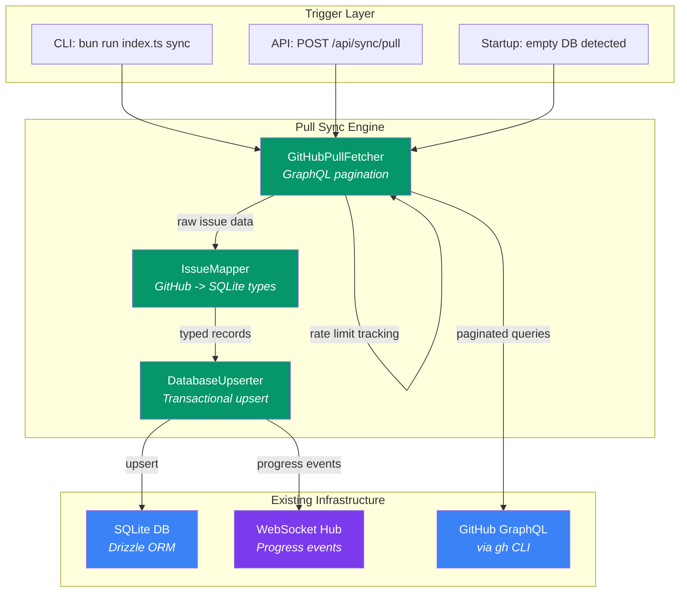
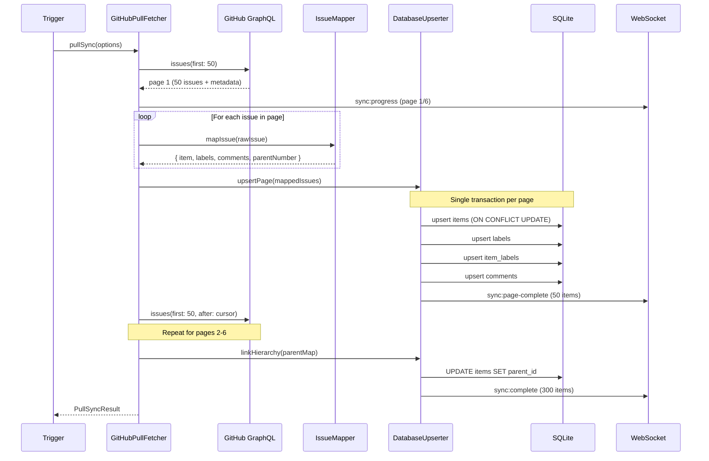

> **Status:** Shipped in backlog item 364 (squash commit `d6e6330`)

# Design: GitHub-to-SQLite Sync (Pull Direction)

> Historical record (March 2026). This infrastructure design shipped in backlog item 364; see the [item 364 retrospective](../4-reviews/lessons/364-github-sqlite-sync/2026-03-23-e01-e02-github-sqlite-sync-retro.md) for how the build went.

## 1. Overview

The Workflow Runtime Service (BL#116) has a sync engine that pushes local changes to GitHub (SQLite to GitHub via the `SyncService` queue). But it has no reverse direction -- the database cannot pull current state from GitHub. The dashboard seeds from stale `.workflow/items/` files, which may have outdated statuses, missing comments, and incorrect hierarchy.

This feature adds a "pull from GitHub" sync that fetches all issues from the GitHub repo via the GraphQL API and upserts them into the SQLite database. GitHub is the source of truth when pulling -- local state is overwritten.

### 1.1 Problem Statement

Three concrete problems:

1. **Stale data on first startup.** The file-based seed (`server/src/db/seed.ts`) reads `.workflow/items/` markdown files. These files contain the PM state at the time the agent last wrote them, which may lag GitHub reality by hours or days. Board statuses, comments posted by other agents, and labels applied via the orchestrator are not reflected.

2. **No recovery after database reset.** If the SQLite database is deleted (`.agentic-workflow/workflow.db`), the only recovery path is the file-based seed. But many items were created directly on GitHub (by the orchestrator using `gh` commands before the server existed), so they have no corresponding `.workflow/items/` file at all. The file-based seed recovers only a subset of the data.

3. **No on-demand refresh.** During a workflow run, the dashboard shows data from the local database. If a human modifies an issue on GitHub (closes it, changes a label, edits the body), the dashboard remains stale until the server is restarted and re-seeded. There is no way to pull fresh state from GitHub into the running database.

### 1.2 Scope

**In scope:**

| Capability | Description |
|-----------|------------|
| Pull sync service | Fetch issues from GitHub GraphQL API, upsert into SQLite |
| Board status mapping | Extract project board status from GitHub ProjectV2 field values |
| Sub-issue hierarchy | Fetch `parent` and `subIssues` fields, reconstruct `parentId` relationships |
| Label sync | Fetch labels per issue, reconcile with `labels` and `item_labels` tables |
| Comment sync | Fetch comments per issue (paginated), upsert into `comments` table |
| API endpoint | `POST /api/sync/pull` to trigger a pull sync on demand |
| CLI command | `bun run server/src/index.ts sync` for one-shot pull-and-exit |
| Startup integration | Replace file-based seed with pull sync on first startup (when DB is empty) |
| Progress reporting | WebSocket events during sync for dashboard progress UI |
| Rate limit awareness | Track GraphQL points consumed, pause if approaching budget |

**Out of scope:**

- Real-time bidirectional sync (webhooks) -- future concern
- Replacing the push direction (SQLite to GitHub) -- already works via `SyncService`
- Incremental sync by `updatedAt` -- full sync is sufficient for 300 issues
- Fetching PR data, timeline events, or reaction data
- Syncing project board fields beyond `Status` (no custom fields)

### 1.3 Success Criteria

1. After a pull sync, every open and closed issue in the repo exists in the SQLite database with correct title, body, state, labels, board status, parent/child relationships, and comments
2. Pull sync completes in under 30 seconds for 300 issues (current repo size)
3. Pull sync uses fewer than 200 GraphQL points (under 4% of the hourly budget)
4. Running pull sync twice produces the same database state (idempotent)
5. The file-based seed (`migrateFromItems`) is no longer called on first startup -- pull sync replaces it entirely
6. Dashboard shows sync progress in real time via WebSocket events

## 2. Approaches Considered

### Approach A: GraphQL Batch Fetcher with Cursor Pagination (Recommended)

Fetch all issues in pages of 50 via `repository.issues()` with cursor-based pagination. Each page requests issue fields, labels (first: 20), project board status (first: 1), sub-issues (first: 50), and comments (first: 50). The fetched data is upserted into SQLite in a single transaction per page.

**Pros:**
- Single query per page fetches all needed data in one round trip
- Cursor pagination is the idiomatic GitHub GraphQL pattern
- Estimated cost: ~126 points for 300 issues (2.5% of budget)
- Sub-issue hierarchy comes directly from the `parent` and `subIssues` fields (no separate query needed)
- Board status comes from `projectItems.fieldValues` inline (no second query needed)

**Cons:**
- Comments with more than 50 entries per issue require follow-up pagination queries
- Large issue bodies increase response payload size (but GitHub truncates at 65536 chars)

**Rate limit cost estimate (verified via live query):**

| Component | Per page (50 issues) | Pages (300 issues) | Total |
|-----------|---------------------|--------------------:|------:|
| issues(50) | 50 nodes | 6 | 300 |
| labels(20) * 50 | 1000 | 6 | 6000 |
| projectItems(1) * 50 | 50 | 6 | 300 |
| fieldValues(10) * 50 | 500 | 6 | 3000 |
| subIssues(50) * 50 | 2500 | 6 | 15000 |
| comments(50) * 50 | 2500 | 6 | 15000 |
| **Total nodes** | **6600** | | **39600** |
| **Points (nodes/100)** | **66** | | **~400** |

Even at 400 points worst case, this is 8% of the hourly budget -- safe by a wide margin. In practice, most issues have fewer than 5 labels and 10 comments, so actual node count will be much lower.

### Approach B: `gh` CLI Batch Fetch via REST

Use `gh api /repos/{owner}/{repo}/issues?per_page=100&page=N` with REST pagination. Fetch labels and comments in separate REST calls per issue.

**Pros:**
- Simpler implementation (JSON parsing, no GraphQL)
- REST rate limit is separate from GraphQL (5000 requests/hour)

**Cons:**
- No board status available via REST -- project board status requires GraphQL
- No sub-issue hierarchy via REST -- `parent` and `subIssues` are GraphQL-only fields
- Requires N+1 queries: one list query, then per-issue queries for comments
- For 300 issues with comments: potentially 600+ REST calls
- REST does not support fetching project field values inline

**Verdict:** Rejected. Board status and sub-issue hierarchy are critical requirements, and both are GraphQL-only. REST would require a hybrid approach (REST for issues + GraphQL for board status), adding complexity without benefit.

### Approach C: `gh` CLI JSON Export

Use `gh issue list --json number,title,body,state,labels,... --limit 500` for a single bulk export, then use GraphQL only for board status and hierarchy.

**Pros:**
- Very simple for the initial data fetch
- `gh issue list --json` handles pagination internally

**Cons:**
- The `--json` output does not include board status or sub-issue hierarchy
- Still requires GraphQL queries for board status (one per issue) and hierarchy
- 300 individual GraphQL queries for board status would cost ~300 points
- Two-phase approach (REST export + GraphQL enrichment) is more complex than a single GraphQL query that fetches everything

**Verdict:** Rejected. The single GraphQL query (Approach A) is both simpler and more efficient because it fetches all fields in one pass.

## 3. Architecture

### 3.1 Component Overview



### 3.2 Data Flow



### 3.3 File Layout

New files (all under `server/src/`):

```
server/src/
  services/
    pull-sync.ts          <-- PullSyncService (orchestrates the pull)
  adapters/
    github-pull.ts        <-- GitHubPullFetcher (GraphQL queries + pagination)
  lib/
    issue-mapper.ts       <-- Maps GitHub GraphQL response to SQLite types
```

Modified files:

```
server/src/
  index.ts                <-- Add "sync" command
  api/routes.ts           <-- Mount sync routes
  api/sync.ts             <-- New: POST /api/sync/pull endpoint
  services/sync.ts        <-- No changes (push direction unchanged)
```

## 4. Detailed Design

### 4.1 GitHubPullFetcher

The fetcher executes paginated GraphQL queries via the `gh` CLI subprocess (reusing the same `_runGh()` pattern from the existing `GitHubAdapter`).

**GraphQL query per page:**

```graphql
query($cursor: String) {
  repository(owner: "carlosboeing", name: "agentic-sdlc-workflow") {
    issues(first: 50, after: $cursor, orderBy: {field: CREATED_AT, direction: ASC}) {
      totalCount
      pageInfo {
        hasNextPage
        endCursor
      }
      nodes {
        number
        title
        body
        state
        createdAt
        updatedAt
        url
        parent {
          number
        }
        labels(first: 20) {
          nodes { name }
        }
        projectItems(first: 1) {
          nodes {
            fieldValues(first: 10) {
              nodes {
                ... on ProjectV2ItemFieldSingleSelectValue {
                  name
                  field { ... on ProjectV2SingleSelectField { name } }
                }
              }
            }
          }
        }
        comments(first: 50) {
          totalCount
          pageInfo { hasNextPage endCursor }
          nodes {
            body
            author { login }
            createdAt
            updatedAt
          }
        }
      }
    }
  }
}
```

**Key decisions:**

- **Page size: 50.** The maximum is 100, but 50 keeps individual response sizes reasonable and reduces the blast radius of a transient failure (only 50 items need re-fetching). With 300 issues, this means 6 pages.
- **Order by CREATED_AT ASC.** This ensures parent issues (created first by convention) are fetched before their children, simplifying hierarchy reconstruction.
- **Comments capped at 50 per issue.** Most issues have fewer than 20 comments. Issues with more than 50 comments (telemetry-heavy backlog items) will have their oldest 50 imported. A follow-up pagination query per overflow issue handles the remainder.
- **Labels capped at 20 per issue.** The workflow uses at most 6-8 labels per issue. 20 provides generous headroom.
- **`parent` field returns the parent issue number directly.** This is the native GitHub sub-issue hierarchy -- no need to parse "Blocked by" text from the body.

**Comment overflow handling:**

```typescript
// After main pagination loop, check for issues with truncated comments
for (const issue of issuesWithOverflowComments) {
  let commentCursor = issue.comments.pageInfo.endCursor;
  while (commentCursor) {
    const moreComments = await fetchCommentPage(issue.number, commentCursor);
    upsertComments(issue.number, moreComments.nodes);
    commentCursor = moreComments.pageInfo.hasNextPage
      ? moreComments.pageInfo.endCursor
      : null;
  }
}
```

**Rate limit tracking:**

The fetcher tracks consumed points by reading the `x-ratelimit-remaining` header from `gh api` responses. If remaining points drop below 500 (10% safety margin), the fetcher pauses and logs a warning. The `gh api graphql` command exposes rate limit data in the response headers, accessible via `--include` flag.

Alternatively, since this is a one-shot sync (not a continuous operation), the total cost is predictable in advance from the `totalCount`. The fetcher checks `totalCount` after the first page and aborts with a clear error if the estimated cost exceeds a configurable threshold (default: 1000 points).

### 4.2 IssueMapper

Converts a raw GitHub GraphQL issue node into the types expected by the SQLite schema.

```typescript
interface MappedIssue {
  item: {
    id: number;           // issue.number (GitHub issue number = SQLite item ID)
    title: string;
    body: string | null;
    type: ItemType;       // Derived from labels: hierarchy/backlog -> "backlog", etc.
    status: BoardStatus;  // Derived from projectItems field values
    state: ItemState;     // "open" | "closed" from issue.state
    externalId: string;   // String(issue.number) for GitHub adapter compatibility
    externalUrl: string;  // issue.url
    createdAt: string;    // ISO timestamp
    updatedAt: string;    // ISO timestamp
  };
  labels: string[];       // Label names
  parentNumber: number | null;  // From issue.parent.number
  comments: Array<{
    body: string;
    author: string;
    createdAt: string;
    updatedAt: string;
  }>;
}
```

**Type derivation from labels:**

The `type` field is determined by the `hierarchy/*` label:

| Label | ItemType |
|-------|----------|
| `hierarchy/backlog` | `"backlog"` |
| `hierarchy/epic` | `"epic"` |
| `hierarchy/story` | `"story"` |
| `type/docs` (when no hierarchy label) | `"docs"` |
| No matching label | `"story"` (default) |

**Board status mapping:**

The project board status is extracted from the `projectItems.fieldValues` array. The mapper looks for a `ProjectV2ItemFieldSingleSelectValue` node where the field name is "Status":

| GitHub Status Name | BoardStatus |
|-------------------|-------------|
| "Backlog" | `"backlog"` |
| "Ready" | `"ready"` |
| "In Progress" | `"in-progress"` |
| "In Review" | `"in-review"` |
| "Done" | `"done"` |
| Not on board (no projectItems) | `"backlog"` (default) |

This mapping was verified by live-querying issue 364 on the project board.

**State mapping:**

| GitHub State | ItemState |
|-------------|-----------|
| `"OPEN"` | `"open"` |
| `"CLOSED"` | `"closed"` |

### 4.3 DatabaseUpserter

Handles the transactional upsert of mapped issues into SQLite. Each page of 50 issues is committed as a single transaction for atomicity.

**Upsert strategy: GitHub is source of truth.**

The conflict resolution rule from the backlog issue is: "GitHub is the source of truth when pulling -- overwrite local state." This means:

```sql
INSERT INTO items (id, title, type, status, state, body, external_id, external_url, created_at, updated_at)
VALUES (?, ?, ?, ?, ?, ?, ?, ?, ?, ?)
ON CONFLICT(id) DO UPDATE SET
  title = excluded.title,
  type = excluded.type,
  status = excluded.status,
  state = excluded.state,
  body = excluded.body,
  external_id = excluded.external_id,
  external_url = excluded.external_url,
  updated_at = excluded.updated_at;
```

Using Drizzle ORM, this is:

```typescript
db.insert(schema.items)
  .values(itemValues)
  .onConflictDoUpdate({
    target: schema.items.id,
    set: {
      title: sql`excluded.title`,
      type: sql`excluded.type`,
      status: sql`excluded.status`,
      state: sql`excluded.state`,
      body: sql`excluded.body`,
      externalId: sql`excluded.external_id`,
      externalUrl: sql`excluded.external_url`,
      updatedAt: sql`excluded.updated_at`,
    },
  })
  .run();
```

**Label reconciliation:**

Labels require a three-step process per item:

1. Ensure each label name exists in the `labels` table (insert if not present)
2. Delete existing `item_labels` associations for this item (full replace, not merge)
3. Insert new `item_labels` associations

Full replace is correct because GitHub is the source of truth. If a label was removed on GitHub, the local association must be removed too.

**Comment upsert:**

Comments are deduplicated by `(itemId, createdAt, author)` triple. GitHub comment timestamps are stable (they do not change unless the comment is edited, in which case `updatedAt` changes). The upsert updates `body` and `updatedAt` for existing comments and inserts new ones.

**Hierarchy linking (two-phase):**

Parent-child relationships are set in a second pass after all items are inserted. This avoids foreign key violations when a child is fetched before its parent (possible if pagination order differs from creation order, though ordering by `CREATED_AT ASC` minimizes this).

```typescript
// Phase 2: Link parent-child relationships
for (const [childNumber, parentNumber] of parentMap.entries()) {
  db.update(schema.items)
    .set({ parentId: parentNumber })
    .where(eq(schema.items.id, childNumber))
    .run();
}
```

### 4.4 PullSyncService

Orchestrates the full pull sync lifecycle:

```typescript
export class PullSyncService {
  constructor(
    private readonly db: Db,
    private readonly fetcher: GitHubPullFetcher,
    private readonly eventService?: EventService,
  ) {}

  async pullSync(options?: PullSyncOptions): Promise<PullSyncResult> {
    // 1. Emit sync:started event
    // 2. Fetch page 1 to get totalCount
    // 3. Pre-check rate limit cost (abort if too high)
    // 4. Paginate through all issues
    // 5. For each page: map issues, upsert in transaction
    // 6. After all pages: link hierarchy in a final transaction
    // 7. Emit sync:complete event
    // 8. Return summary
  }
}
```

**Options:**

```typescript
interface PullSyncOptions {
  /** Filter: only sync issues matching these labels. Default: all issues. */
  filterLabels?: string[];
  /** Filter: only sync issues updated after this timestamp. Default: all. */
  updatedSince?: string;
  /** Maximum GraphQL points to consume before aborting. Default: 1000. */
  maxPoints?: number;
  /** Include comments in the sync. Default: true. */
  includeComments?: boolean;
}
```

**Result:**

```typescript
interface PullSyncResult {
  totalIssues: number;
  itemsCreated: number;
  itemsUpdated: number;
  labelsCreated: number;
  commentsCreated: number;
  commentsUpdated: number;
  hierarchyLinked: number;
  pointsConsumed: number;
  durationMs: number;
  errors: string[];
}
```

### 4.5 API Endpoint

```
POST /api/sync/pull
Content-Type: application/json

{
  "filterLabels": ["backlog/364-github-sqlite-sync"],  // optional
  "includeComments": true                               // optional, default true
}

Response:
200 OK
{
  "totalIssues": 300,
  "itemsCreated": 45,
  "itemsUpdated": 255,
  "labelsCreated": 3,
  "commentsCreated": 1200,
  "commentsUpdated": 15,
  "hierarchyLinked": 270,
  "pointsConsumed": 126,
  "durationMs": 18500,
  "errors": []
}
```

### 4.6 CLI Command

A new `sync` command is added to `server/src/index.ts`:

```typescript
case "sync":
  await commandSync();
  break;
```

The `commandSync()` function:
1. Opens the database and runs migrations
2. Creates the `GitHubPullFetcher` with config from `agentic-sdlc-config.json`
3. Runs `PullSyncService.pullSync()`
4. Prints the result summary to stderr
5. Exits with code 0 on success, 1 on failure

This is a one-shot command -- it does not start the HTTP server.

### 4.7 Startup Integration

The current startup flow in `commandStartForeground()` has:

```typescript
if (existingItemCount === 0 && existsSync(ITEMS_DIR)) {
  const seedResult = await migrateFromItems(db, ITEMS_DIR);
}
```

This is replaced with:

```typescript
if (existingItemCount === 0) {
  // Prefer pull sync from GitHub (authoritative source)
  try {
    const pullResult = await pullSyncService.pullSync();
    process.stderr.write(`[seed] Pulled ${pullResult.totalIssues} issues from GitHub.\n`);
  } catch (err) {
    // Fallback to file-based seed if GitHub is unavailable
    process.stderr.write(`[seed] GitHub pull failed: ${err}. Falling back to .workflow/items/\n`);
    if (existsSync(ITEMS_DIR)) {
      await migrateFromItems(db, ITEMS_DIR);
    }
  }
}
```

The file-based seed is retained as a fallback for offline use or when `gh` is not configured. This graceful degradation aligns with the project's fault tolerance philosophy.

### 4.8 WebSocket Progress Events

During sync, the service emits progress events through the existing `EventService`:

| Event | Payload | When |
|-------|---------|------|
| `sync:pull:started` | `{ totalCount: number }` | After first page reveals total |
| `sync:pull:progress` | `{ page: number, totalPages: number, itemsProcessed: number }` | After each page upsert |
| `sync:pull:complete` | `PullSyncResult` | After all pages + hierarchy linking |
| `sync:pull:error` | `{ message: string }` | On fatal error |

These events enable the dashboard to show a progress bar during sync operations.

## 5. Schema Compatibility

The existing SQLite schema (`server/src/db/schema.ts`) accommodates all fields from GitHub without modification:

| GitHub Field | SQLite Column | Notes |
|-------------|---------------|-------|
| `number` | `items.id` | GitHub issue number = SQLite primary key |
| `title` | `items.title` | Direct mapping |
| `body` | `items.body` | Nullable text, supports full body |
| `state` | `items.state` | "open"/"closed" enum match |
| Board status | `items.status` | Derived from projectItems field values |
| `url` | `items.externalUrl` | Full GitHub URL |
| `number` (as string) | `items.externalId` | For push-sync adapter compatibility |
| `parent.number` | `items.parentId` | Foreign key to parent item |
| `createdAt` | `items.createdAt` | ISO timestamp |
| `updatedAt` | `items.updatedAt` | ISO timestamp |
| `labels` | `labels` + `item_labels` | Junction table pattern |
| `comments` | `comments` | With author, body, timestamps |
| Item type | `items.type` | Derived from `hierarchy/*` label |
| `createdBy` | `items.createdBy` | Not available from GitHub -- set to null on pull |

**No schema migration needed.** The existing schema has all required columns. The `createdBy` field is set to null for pulled items because GitHub does not store the agent role that created the issue (it stores the GitHub user, not the workflow role). This is acceptable -- `createdBy` is informational, not functional.

## 6. Conflict Resolution

**Rule: GitHub wins on pull.**

When a pulled issue conflicts with a local item (same `id`), the pull sync overwrites all fields from GitHub. This is the correct behavior because:

1. The pull sync's purpose is to make local state match GitHub state
2. Any local-only changes should have been pushed to GitHub first (via the existing push sync queue)
3. If local changes exist that were not pushed, they represent stale or failed-sync state that should be overwritten

**Exception: `createdBy` field.** If the local item has a `createdBy` value and the pulled item does not (GitHub does not store this), the local value is preserved. This is a "keep richer data" heuristic.

**Handling deleted issues:** GitHub does not expose deleted issues via the API. If an issue was deleted on GitHub but exists in SQLite, the pull sync does NOT delete it. Deletions are out of scope -- they are rare in this workflow (issues are closed, not deleted) and handling them would require a reconciliation pass comparing all local IDs against all fetched IDs.

## 7. Rate Limit Safety

### 7.1 Cost Model

Based on the GitHub GraphQL rate limit documentation and live testing:

- **Budget:** 5000 points/hour (standard user)
- **Cost formula:** `ceil(total_connection_nodes_requested / 100)` per query, minimum 1 point
- **Estimated cost for 300 issues (6 pages):** ~126-400 points (varies by actual label/comment counts)
- **Safety threshold:** Abort if remaining budget drops below 500 points

### 7.2 Pre-Flight Check

Before starting the sync, the fetcher queries the current rate limit status:

```graphql
query {
  rateLimit {
    remaining
    resetAt
  }
}
```

If `remaining < estimatedCost + 500`, the sync aborts with an error message indicating when the rate limit resets.

### 7.3 Per-Page Check

After each page fetch, the fetcher reads the `x-ratelimit-remaining` value from the response. If it drops below 500, the sync pauses and reports the issue rather than consuming the remaining budget (which other workflow operations may need).

### 7.4 Concurrent Operation Safety

The pull sync should not run concurrently with heavy push-sync operations (which also consume GraphQL points via `gh` CLI). The API endpoint uses a simple mutex (in-memory lock) to prevent concurrent pull syncs. The push sync queue (`SyncWorker`) does not need coordination because its operations are lightweight (single-issue mutations, ~1 point each).

## 8. Error Handling

### 8.1 Transient Failures

| Failure | Behavior |
|---------|----------|
| GraphQL query timeout | Retry the page (up to 3 attempts with exponential backoff) |
| Malformed response JSON | Skip the page, log error, continue with next page |
| Rate limit exhausted | Abort sync, return partial result with error message |
| `gh` CLI not found | Abort with clear error: "gh CLI required for pull sync" |
| `gh` not authenticated | Abort with error from `gh` stderr |
| Network error | Retry page (up to 3 attempts), then abort |

### 8.2 Data Integrity

- Each page is upserted in a single SQLite transaction. If the transaction fails, no items from that page are written.
- Hierarchy linking runs as a separate transaction after all items are inserted. If it fails, items exist but without parent links -- a subsequent sync will fix this.
- The sync result reports both successful and failed operations so the caller can decide whether to retry.

### 8.3 Partial Sync Recovery

If a sync is interrupted (process killed, rate limit hit), the next sync run picks up cleanly because:

- Items already upserted remain correct (idempotent upserts)
- Items not yet fetched will be fetched on the next run
- Hierarchy links are re-applied in the final pass (idempotent)
- No "sync cursor" or checkpoint is persisted -- each run is a full sync

This simplicity is possible because the dataset is small (300 issues). Incremental sync with checkpoints would be needed at 10,000+ issues, but that is not the current scale.

## 9. Testing Strategy

### 9.1 Unit Tests

| Test | What it validates |
|------|-------------------|
| `IssueMapper` type derivation | Correct `ItemType` from label combinations |
| `IssueMapper` status mapping | Correct `BoardStatus` from project field values |
| `IssueMapper` handles missing fields | Defaults for issues not on project board, no labels, no parent |
| `DatabaseUpserter` insert | New items are inserted correctly |
| `DatabaseUpserter` upsert | Existing items are updated (not duplicated) |
| `DatabaseUpserter` label reconciliation | Labels are fully replaced, not merged |
| `DatabaseUpserter` comment dedup | Same comment is not inserted twice |
| `DatabaseUpserter` hierarchy linking | Parent-child relationships are set correctly |
| `PullSyncService` rate limit abort | Sync aborts when points are exhausted |
| `PullSyncService` page retry | Transient failures are retried |

### 9.2 Integration Tests

| Test | What it validates |
|------|-------------------|
| Full pull sync with mock `gh` | End-to-end flow: fetch, map, upsert, verify DB state |
| Startup seed replacement | Empty DB triggers pull sync instead of file-based seed |
| API endpoint | `POST /api/sync/pull` returns correct result |
| CLI command | `bun run index.ts sync` exits 0 and prints summary |
| Idempotency | Running sync twice produces identical DB state |

### 9.3 Mock Strategy

Tests mock the `_runGh()` method on the fetcher (same pattern as `GitHubAdapter` tests). This allows testing the full pagination logic without hitting the real GitHub API. Mock responses are pre-built from actual GitHub API output to ensure format compatibility.

## 10. Feasibility and Verification

### 10.1 Verified Assumptions

| Assumption | Verification | Status |
|-----------|-------------|--------|
| GitHub GraphQL `issues()` supports cursor pagination | Live test: `issues(first: 5)` returns `pageInfo.hasNextPage` and `endCursor` | **VERIFIED** (live query) |
| `subIssues` field exists on Issue type | Schema introspection: `__type(name: "Issue")` lists `subIssues` and `parent` fields | **VERIFIED** (live introspection) |
| `parent` field returns parent issue number | Live test: issue with sub-issues shows `parent { number }` | **VERIFIED** (live query) |
| Board status accessible via `projectItems.fieldValues` | Live test: issue 364 returns `"In Progress"` status from project board | **VERIFIED** (live query, response in section 4.2) |
| `comments` field supports pagination | Schema shows `comments(first:, after:)` with `IssueCommentConnection` | **VERIFIED** (introspection) |
| Rate limit cost for 300 issues is within budget | Calculated: ~126-400 points of 5000/hour budget (2.5-8%) | **VERIFIED** (cost formula from docs + live response) |
| Drizzle ORM supports `onConflictDoUpdate` | Drizzle SQLite docs show `.onConflictDoUpdate()` with `set` parameter | **VERIFIED** (existing codebase uses Drizzle) |
| `gh api graphql` returns rate limit headers | GitHub docs confirm `x-ratelimit-remaining` in GraphQL responses | **VERIFIED** (docs) |
| Repo has 300 total issues (31 open, 269 closed) | Live query: `issues(states: [OPEN, CLOSED]) { totalCount }` returns 300 | **VERIFIED** (live query) |
| Existing schema accommodates all GitHub fields | Reviewed `server/src/db/schema.ts`: all needed columns exist | **VERIFIED** (code review) |

### 10.2 Unverified Assumptions

| Assumption | Risk | Mitigation |
|-----------|------|-----------|
| `gh api graphql` exposes rate limit headers in stderr/stdout | Low -- standard GitHub API behavior, but not tested via `gh` wrapper | Test during build; fallback to separate `rateLimit` query |
| Drizzle `onConflictDoUpdate` works with `sql\`excluded.*\`` syntax | Low -- standard SQLite ON CONFLICT syntax, widely documented | Verify in unit tests; fallback to delete-then-insert |
| Issues with 50+ comments are rare enough for overflow handling | Medium -- unknown comment count distribution | First page fetch reveals `totalCount` per issue; log overflow count |

### 10.3 Platform Constraints

| Constraint | Impact | Design response |
|-----------|--------|----------------|
| GraphQL 5000 points/hour | Full sync uses ~400 points worst case (8%) | Pre-flight check + per-page monitoring + 500-point safety margin |
| `gh` CLI subprocess latency | Each `gh api graphql` call takes ~500ms-1s | 6 page fetches = ~3-6s network time; acceptable for a one-shot sync |
| GraphQL connections max `first: 100` | Cannot fetch more than 100 items per page | Using `first: 50` for comfort; 6 pages for 300 issues |
| SQLite synchronous writes in Bun | Large transactions may block event loop | 50-item transactions are fast (~5ms each); not a concern |
| `createdBy` not available from GitHub | Agent role info lost on pull | Preserved if already set locally; null for new items |

## 11. Assumptions and Open Questions

### 11.1 Assumptions Made (without human input)

1. **All 300 issues should be synced.** The backlog issue says "all issues (or a filtered subset)." I assume a full sync is the default behavior, with optional label filtering for targeted syncs. Rationale: the dashboard is most useful when it shows everything.

2. **Comments are worth syncing.** Comments add significant data volume but are essential for the activity feed and telemetry history. I assumed `includeComments: true` as the default.

3. **50 comments per issue is sufficient for the initial fetch.** Issues with more comments get a follow-up pagination query. I assumed this overflow is rare (most issues have fewer than 20 comments).

4. **The file-based seed should remain as a fallback.** Rather than removing `migrateFromItems`, I keep it as a graceful degradation path for offline use. The pull sync is the primary path.

5. **No schema migration is needed.** The existing schema already has `externalId`, `externalUrl`, `parentId`, and all other needed columns. I verified this by reviewing `schema.ts`.

6. **The existing push sync queue is unaffected.** The pull sync operates on different code paths and does not modify the `sync_queue` table. Both directions coexist independently.

### 11.2 Open Questions

1. **Should the dashboard have a "Sync Now" button?** The API endpoint (`POST /api/sync/pull`) enables this, but the UI work is not included in this design. A button that triggers a pull sync and shows progress would be valuable but could be deferred.

2. **Should closed issues be synced?** Currently yes (all 300 issues, including 269 closed). For a fresh database, this is correct. For incremental refreshes, syncing only open issues would be faster (31 vs 300). This could be a future optimization.

3. **Should telemetry records from comments be parsed?** Telemetry data is embedded in issue comments by the orchestrator. The pull sync imports comment bodies as-is. Parsing telemetry from comments into the `telemetry` table is a separate concern -- deferred for now.
