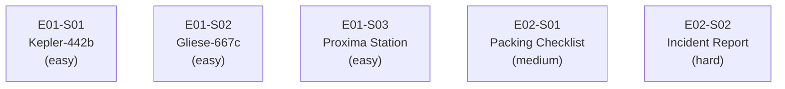

# The Intergalactic Travel Advisory -- SDLC v2 Test (Run 4)

> **Status:** Draft

## Overview

This is the fourth end-to-end test of the Agentic SDLC v2 workflow. The content vehicle is a tongue-in-cheek space tourism bureau publication -- *The Intergalactic Travel Advisory* -- a brochure-style guide for would-be interstellar holidaymakers, written in the deadpan tone of a government travel warning crossed with a budget airline pamphlet.

The content is deliberately short. This is a speed test. Every story produces exactly one markdown file of 100-200 words. The design optimizes for fast agent turnaround, parallel dispatch validation, and clean lifecycle execution.

### Why Run 4?

Run 3 (Mythical Creatures, backlog #89) validated parallel dispatch, reviewer integration, and full autonomous lifecycle. Three issues surfaced:

1. **Board status skipped stages** -- Stories jumped Planned to Done, skipping intermediate states. Convention changes proposed (orchestrator owns all board transitions).
2. **Epic telemetry cross-contamination** -- Both epic issues received identical aggregate telemetry instead of scoped breakdowns.
3. **Word count overruns** -- E01-S04 required 2 fix cycles to trim from 569 to 495 words.

Run 4 targets these by: enforcing strict 200-word caps, using a simpler content structure, and providing a cleaner test surface for the board transition fixes. The reduced scope (5-6 stories vs 7, 100-200 words vs 200-700) should also compress total agent time from ~25 min to ~8-12 min.

## Problem Statement

The SDLC v2 pipeline is functionally validated but operationally rough. Run 3 proved the mechanics work (parallel dispatch, reviewer integration, model routing). Run 4 stress-tests the operational polish: correct board transitions at every stage, scoped epic telemetry, and faster turnaround with tighter content constraints.

## Goals

1. **Validate board transition fixes** -- Every story must visibly pass through Planned, Todo, In Progress, In Review, Done
2. **Validate scoped epic telemetry** -- Each epic issue gets only its own stories; combined PR gets the full breakdown
3. **Confirm tight word counts work** -- All stories 100-200 words, no fix cycles needed
4. **Exercise all three difficulty levels** -- At least 1 easy, 1 medium, 1 hard
5. **At least one parallel wave** -- 2+ stories dispatched concurrently
6. **Complete in ~8-12 minutes** of agent time

## Non-Goals

- Producing a real travel guide (content quality is secondary to workflow validation)
- Testing code compilation, DI wiring, or test execution (no C# code)
- Fixing telemetry script mixed-model cost calculation (out of scope for a content test)

## Content Design

### Theme: Intergalactic Travel Advisory

The advisory is published by the fictional *Bureau of Interstellar Tourism and Safety (BITS)*, a galactic bureaucracy staffed by bored civil servants who have clearly never visited any of the destinations they are warning about. The tone is deadpan official: think "Foreign Office travel advice" meets Douglas Adams meets a budget cruise brochure.

Example voice: *"Visitors to the Methane Seas of Titan-7 are advised that 'breathable' is a relative term. The Bureau accepts no liability for dissolution of organic matter."*

### Output Location

All files go in `test-output/travel-advisory/`. This is a new subdirectory, separate from Run 2's `test-output/` root files and Run 3's `test-output/field-guide/`.

### Content Consistency Contract

To prevent cross-story contradictions (the Stoneback Leviathan problem from Run 3), all stories must respect these shared facts:

- The Bureau is called **BITS** (Bureau of Interstellar Tourism and Safety)
- The galaxy has a currency called the **Galactic Credit (GC)**
- Three destinations exist: **Kepler-442b** (resort world), **Gliese-667c** (adventure/extreme tourism), **Proxima Station** (orbital bazaar/trading post)
- Safety ratings use a 1-5 scale (1 = safe, 5 = almost certainly fatal)

These facts are part of every story's acceptance criteria, so parallel builders produce consistent content without reading each other's output.

## Epic and Story Structure

### Epic 1: Destination Profiles (3 stories)

Three independent destination entries. All can run in parallel (Wave 1). Each is a self-contained brochure page for one destination.

#### E01-S01: Kepler-442b -- The Resort World -- `difficulty/easy`

Create `test-output/travel-advisory/kepler-442b.md`.

**Content requirements:**

- Title: "Kepler-442b -- The Galaxy's Premier Resort World"
- Sections: Overview (2-3 sentences), Climate, Attractions (3 bullet points), Safety Rating (1-5 with one-sentence justification), Bureau Advisory (1-2 sentence official warning)
- Must reference BITS, Galactic Credits, and safety rating scale
- Tone: overselling a destination that is clearly mediocre
- Total length: 100-200 words

**Why easy:** Fill-in-the-blanks brochure entry. Fixed section structure, minimal creative latitude.

#### E01-S02: Gliese-667c -- Extreme Tourism -- `difficulty/easy`

Create `test-output/travel-advisory/gliese-667c.md`.

**Content requirements:**

- Title: "Gliese-667c -- For the Adventurous Traveller"
- Same section structure as E01-S01
- Safety Rating must be higher (more dangerous) than Kepler-442b
- Tone: bureaucratic understatement about genuinely lethal conditions
- Must reference BITS, Galactic Credits, and safety rating scale
- Total length: 100-200 words

**Why easy:** Identical template to E01-S01. Different destination, same structure.

#### E01-S03: Proxima Station -- Orbital Bazaar -- `difficulty/easy`

Create `test-output/travel-advisory/proxima-station.md`.

**Content requirements:**

- Title: "Proxima Station -- The Crossroads of Commerce"
- Same section structure as E01-S01 and E01-S02
- Must mention at least one item available for purchase (priced in Galactic Credits)
- Tone: a government agency grudgingly acknowledging a place it cannot regulate
- Must reference BITS, Galactic Credits, and safety rating scale
- Total length: 100-200 words

**Why easy:** Same template again. Third variation on the same form.

### Epic 2: Advisory Supplements (2-3 stories)

Companion documents that reference the three destinations. These have light dependencies on Epic 1 content (by name only -- the consistency contract ensures builders can work from acceptance criteria, not from reading E01 files).

#### E02-S01: Packing Checklist -- `difficulty/medium`

Create `test-output/travel-advisory/packing-checklist.md`.

**Content requirements:**

- Title: "BITS Official Packing Checklist for Interstellar Travel"
- A table with columns: Item, Quantity, Destination(s), Notes
- At least 6 items, each tagged to one or more of the three destinations
- At least 2 items must have humorous "Notes" (dry bureaucratic humour)
- A footnote disclaimer (1-2 sentences) in the Bureau's voice
- Must reference all three destinations by name
- Total length: 150-200 words

**Why medium:** Requires a markdown table, cross-referencing three destinations, and maintaining the Bureau's voice across structured data. More synthesis than the easy profiles.

#### E02-S02: Safety Incident Report -- `difficulty/hard`

Create `test-output/travel-advisory/incident-report.md`.

**Content requirements:**

- Title: "BITS Incident Report -- Annual Summary (Galactic Year 4271)"
- An introductory paragraph (2-3 sentences) from the Bureau Director
- A table of 3 incidents (one per destination) with columns: Date, Location, Description (1 sentence), Outcome, Bureau Response
- Each incident must be consistent with the destination's character (e.g., Gliese-667c incident should involve extreme conditions)
- A "Lessons Learned" section with 3 numbered points, each drily optimistic
- A closing line: the Bureau's annual safety slogan (invented by the builder)
- Must reference BITS, all three destinations, and Galactic Credits (at least one incident involves financial loss)
- Total length: 150-200 words

**Why hard:** Most complex structure (intro + table + numbered list + creative slogan). Must synthesise information about all three destinations into a coherent narrative. The "hard" label ensures opus is exercised. Despite being only 150-200 words, the density of cross-references and the need for internal consistency across the incident table justify the rating.

## Dependency Graph

**No dependency edges.** All five stories can theoretically run in a single parallel wave. The E02 stories reference E01 destinations by name only (via the consistency contract), not by reading E01 output files.

**Recommended dispatch strategy:**

- **Wave 1:** E01-S01, E01-S02, E01-S03 (3 easy stories, all independent)
- **Wave 2:** E02-S01, E02-S02 (medium + hard, concurrent)

Splitting into two waves is a deliberate choice: it gives the orchestrator a clear point to verify Wave 1 board transitions before proceeding, which is one of Run 4's goals. If the planner prefers a single 5-story wave, that would also work -- the dependency graph supports it.

## Difficulty Distribution

| Difficulty | Stories | Model | Count |
|-----------|---------|-------|-------|
| Easy | E01-S01, E01-S02, E01-S03 | haiku | 3 |
| Medium | E02-S01 | sonnet | 1 |
| Hard | E02-S02 | opus | 1 |
| **Total** | | | **5** |

This is the minimum viable distribution: all three difficulty levels, with easy being the majority (as expected for short templated content). The 3:1:1 ratio keeps costs low while still exercising every model tier.

## Reviewer Integration

The reviewer checks each story for:

1. **File exists** at the specified path in `test-output/travel-advisory/`
2. **Section structure** matches acceptance criteria (correct headings, required sections)
3. **Word count** is within 100-200 words
4. **Consistency contract** -- references BITS, Galactic Credits, safety rating scale, correct destination names
5. **Cross-references** -- E02 stories mention all three destinations by name

Word count is the most likely failure mode (Run 3 lesson). The 200-word cap is aggressive. If a builder overshoots, one fix cycle should be sufficient given the short content length.

## Approaches Considered

### Approach A: 5 stories, 2 epics, two-wave dispatch (recommended)

- E01: 3 destination profiles (all easy, all parallel in Wave 1)
- E02: 2 supplements (1 medium + 1 hard, parallel in Wave 2)
- Total: 5 stories

**Pros:** Meets all constraints (2 epics, 5-6 stories, all difficulty levels, parallel waves). Minimal overhead. Clean separation between "reference pages" (E01) and "cross-cutting documents" (E02). Two waves provide a natural checkpoint for board status verification. Estimated ~8 min agent time.

**Cons:** Only 5 stories -- less surface area for catching workflow bugs than 6-7 stories.

### Approach B: 6 stories, 2 epics, two-wave dispatch

Same as Approach A, but add a third E02 story: "E02-S03: Bureau FAQ" (easy). This would be a short Q&A document answering 4-5 questions about interstellar travel.

**Pros:** 6 stories instead of 5. The extra easy story in E02 means Wave 2 has 3 stories (easy + medium + hard) -- better parallel test.

**Cons:** The FAQ adds ~1-2 minutes of agent time with minimal workflow benefit. The extra story doesn't test anything new (we already have 3 easy stories in E01). Adds orchestration overhead without adding validation value.

### Approach C: 6 stories, 3 epics

Split into E01 (3 profiles), E02 (2 supplements), E03 (1 FAQ). Three epics to test multi-epic orchestration more thoroughly.

**Pros:** Three epics means three epic branches, three epic telemetry postings, more lifecycle surface area.

**Cons:** A single-story epic (E03) is degenerate -- no parallelism, no story-to-story dependency, just overhead. Three epics for 6 stories is overengineered for a speed test. Run 3 already validated 2-epic orchestration.

**Decision: Approach A.** Five stories across 2 epics is the right scope. It meets every constraint, keeps agent time under 10 minutes, and provides two clean parallel waves. The 6th story (Approach B) is not worth the marginal cost.

## Estimated Cost and Duration

Based on Run 3 telemetry (adjusted for shorter word counts):

| Model | Stories | Est. Time/Story | Est. Total Time | Est. Cost/Story |
|-------|---------|-----------------|-----------------|-----------------|
| haiku | 3 | ~1 min | ~3 min | ~$0.03 |
| sonnet | 1 | ~1.5 min | ~1.5 min | ~$0.08 |
| opus | 1 | ~2 min | ~2 min | ~$0.50 |
| **Total** | **5** | | **~6.5 min seq** | **~$0.67** |

With two parallel waves: estimated wall-clock ~3.5 min build time (Wave 1 ~1 min, Wave 2 ~2 min, plus review/merge overhead).

Total including reviews, merges, telemetry: ~8-10 minutes.

## Assumptions and Open Questions

### Assumptions

1. **Board transition convention changes from Run 3 retro are in effect.** The orchestrator now owns all board transitions (Todo after plan merge, In Progress before dispatch, In Review after builder completes). If these changes have not been applied to the orchestrator agent file, Run 4 will reproduce the same board status bugs.
2. **The consistency contract eliminates cross-story contradictions.** By specifying shared facts (BITS, Galactic Credits, destination names, safety scale) in every story's acceptance criteria, parallel builders can produce consistent content without reading each other's output.
3. **200 words is achievable for all stories.** Run 3's easy stories averaged 150-250 words. The 200-word cap here is tighter. Haiku models tend to be concise, so easy stories should be fine. The medium and hard stories have 150-200 word ranges to give slightly more room for the table/list structures.
4. **`test-output/travel-advisory/` does not need a `.gitignore` entry.** Like Runs 2 and 3, test output is committed to the repo. Cleanup is a separate concern.
5. **Epic telemetry scoping convention from Run 3 retro is in effect.** Each epic issue gets only its own stories in the telemetry breakdown. The combined PR gets the full set.

### Open Questions (would have asked the user)

1. **Should Wave 2 be parallel or sequential?** The dependency graph allows full parallelism, but running medium + hard concurrently means the opus story's board transition happens at the same time as the sonnet story's. If board concurrency is still fragile, sequential Wave 2 would be safer. **Assumed: parallel** -- the whole point is to test whether the board fix works under concurrency.
2. **Is 5 stories sufficient, or should we add a 6th?** The backlog says "5-6 stories." Five is the minimum. **Assumed: 5 is sufficient** -- the 6th story adds time without testing new mechanics.
3. **Combined PR or one per epic?** Run 3 used a combined PR and it worked but caused telemetry cross-contamination. **Assumed: one PR per epic** (the default convention) to validate scoped telemetry. If the planner prefers combined, that is also valid but should include explicit scoping.

## Risks

| Risk | Impact | Mitigation |
|------|--------|------------|
| 200-word cap causes fix cycles | Adds 2-3 min per fix cycle | Cap is generous for brochure-style content. Builders warned in AC. |
| Board transitions still fail under parallelism | Run 4 reproduces Run 3 board bugs | Orchestrator owns transitions sequentially; builder scripts are backup only |
| Opus model is slow on a short story | Hard story takes longer than estimated | 150-200 words gives opus less to do. Worst case adds 2 min. |
| All-parallel Wave 1 hits API rate limits | Builder dispatch fails | 3 concurrent haiku is well within Run 3's proven 4-concurrent limit |
