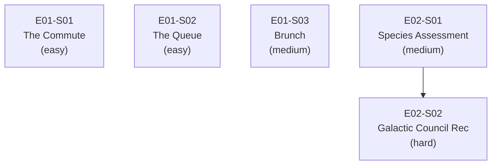

# Alien Anthropological Field Study of Earth -- SDLC v2 Test (Run 7)

> **Status:** Draft

## Overview

Seventh end-to-end test of the Agentic SDLC v2 workflow. The content vehicle is **"Alien Anthropological Field Study of Earth"** -- academic field reports submitted by alien researchers to the *Galactic Bureau of Xenosociology* after a 3-week observational posting on Earth. Peer-reviewed findings on baffling human rituals: commuting, queueing, small talk about weather, and the mysterious cult of "brunch."

Voice: dry academic tone with footnotes and citation-style references to fictional alien journals (*Journal of Primate Anomalies*, *Bipedal Quarterly*). Researchers are genuinely confused but professionally obligated to maintain objectivity. All reports stamped "CLASSIFIED -- Clearance Level: Tentacle-7 and Above."

### Why Run 7?

Prior runs validated pipeline mechanics with corporate (DoomCo), zoological (Mythical Creatures), travel (Intergalactic Advisory), HR (Cat Performance Review), and other content themes. Run 7 retests the full autonomous lifecycle with fresh academic-satire content and the standard 2-epic, 5-story shape.

## Problem Statement

The SDLC v2 pipeline requires continued validation with varied content to confirm stability. Run 7 exercises the complete autonomous lifecycle -- design, plan, parallel build, per-story review, telemetry, and retro -- with novel content that has no overlap with prior runs.

## Goals

1. **Full autonomous lifecycle** -- Design through retro without human intervention (except final PR merge)
2. **Parallel dispatch** -- Wave 1 dispatches 3 stories concurrently
3. **All three difficulty levels** -- easy (haiku), medium (sonnet), hard (opus)
4. **Sequential dependency** -- E02-S02 depends on E02-S01, validating wave ordering
5. **Complete telemetry** -- Per-story, per-epic, and backlog-level telemetry posted
6. **Clean board lifecycle** -- All issues transition Planned -> Todo -> In Progress -> In Review -> Done

## Non-Goals

- Producing polished creative writing (this is a workflow test)
- Testing C# compilation, DI wiring, or unit tests (markdown only)
- Validating Norris runtime integration or DevOps tools
- Testing more than 2 epics or 5 stories

## Content Design

### Theme: Xenosociological Academic Reports

The study is conducted by researchers from the Galactic Bureau of Xenosociology. Documents follow academic conventions: formal headers, classification stamps, footnotes referencing fictional journals, and dry observational language applied to absurd everyday human behaviours.

### Voice Guidelines

- **Tone:** Formal academic with deadpan confusion. The researchers are serious professionals studying what they consider a deeply primitive species.
- **Citations:** Reference fictional journals in parenthetical format -- e.g., (Zorblex et al., *Journal of Primate Anomalies*, Vol. 47)
- **Classification stamp:** Every document opens with "CLASSIFIED -- Clearance Level: Tentacle-7 and Above"
- **Species reference:** Humans are referred to as *Homo sapiens* or "the bipeds" -- never by name

### Output Location

All files go in `test-output/alien-field-study/`. Each story produces one markdown file.

## Epic and Story Structure

### Epic 1: Field Observation Reports -- 3 stories (parallel)

Three independent field reports on different human rituals. All are parallel (Wave 1) with no dependencies between them.

#### E01-S01: "The Commute" -- `difficulty/easy`

Create `test-output/alien-field-study/report-the-commute.md`.

**Content requirements:**

- Classification stamp header
- Title: "Field Report #7741-C: The Daily Migration Pattern"
- Researcher attribution (fictional alien name and department)
- Observation section (3-4 sentences): Describes humans entering metal boxes voluntarily and sitting motionless for hours in congested formation
- Analysis section (2-3 sentences): Hypothesises why the bipeds do not simply relocate closer to their feeding/work sites
- At least one footnote referencing a fictional journal
- Total length: 100-200 words

**Why easy:** Highly formulaic. Single observation, single analysis. Template-driven.

#### E01-S02: "The Queue" -- `difficulty/easy`

Create `test-output/alien-field-study/report-the-queue.md`.

**Content requirements:**

- Classification stamp header
- Title: "Field Report #7741-Q: Ritualistic Linear Formation Behaviour"
- Researcher attribution (fictional alien name and department)
- Observation section (3-4 sentences): Describes the single-file line formation and the social consequences of violation (tutting, glaring, passive-aggressive sighing)
- Analysis section (2-3 sentences): Considers whether queuing is religious, territorial, or a form of social bonding
- At least one footnote referencing a fictional journal
- Total length: 100-200 words

**Why easy:** Same template as E01-S01. Different subject, identical structure.

#### E01-S03: "Brunch" -- `difficulty/medium`

Create `test-output/alien-field-study/report-brunch.md`.

**Content requirements:**

- Classification stamp header
- Title: "Field Report #7741-B: The Cult of Late-Morning Dining"
- Researcher attribution (fictional alien name and department)
- Observation section (4-5 sentences): Describes the elaborate signalling behaviours -- mimosas, avocado toast, photographing food before consumption, the 90-minute wait for a table
- Cultural analysis section (3-4 sentences): Considers brunch's apparent religious significance, its role as a status display, and the paradox of paying premium prices for foods available at any hour
- Recommendations section (2 sentences): Whether further study is warranted
- At least two footnotes referencing fictional journals
- Total length: 150-200 words

**Why medium:** More sections, requires balancing multiple comedic threads (food photography, waiting culture, status signalling). More creative latitude than the easy reports.

### Epic 2: Administrative and Classification Documents -- 2 stories (sequential)

Formal bureau documents. The species assessment (E02-S01) must be written first because the council recommendation (E02-S02) cross-references it.

#### E02-S01: "Preliminary Species Assessment" -- `difficulty/medium`

Create `test-output/alien-field-study/species-assessment.md`.

**Content requirements:**

- Classification stamp header
- Title: "Preliminary Species Assessment: Homo sapiens (Sol-3)"
- Document ID and filing department
- Classification table with rows for: Species Name, Homeworld, Intelligence Rating (disputed), Threat Level (low), Locomotion (bipedal, unstable), Communication (sound-based, inefficient), Notable Deficiencies (list 3-4, e.g., "cannot echolocate", "no natural armour")
- Recommended Contact Protocol section (2-3 sentences): Formal guidance on whether/how to initiate contact
- At least one footnote
- Total length: 150-200 words

**Why medium:** Requires structured tabular content plus a coherent contact protocol section. More format complexity than the field reports.

#### E02-S02: "Recommendation to the Galactic Council" -- `difficulty/hard`

Create `test-output/alien-field-study/council-recommendation.md`.

**Content requirements:**

- Classification stamp header (elevated: "Clearance Level: Tentacle-9 -- Council Eyes Only")
- Title: "Formal Recommendation Re: Sol-3 (Earth) Disposition"
- Senior researcher attribution with rank/title
- Executive summary (2-3 sentences): Summarises findings from the field reports and species assessment
- Options analysis (3 options, 2-3 sentences each): (a) Initiate contact, (b) Quarantine the planet, (c) Designate as nature reserve
- Formal recommendation (2-3 sentences): The senior researcher's chosen option with justification
- Cross-references to the species assessment and at least one field report (by document ID)
- At least two footnotes
- Total length: 180-200 words

**Why hard:** Synthesises content from multiple prior documents. Requires internal consistency with cross-references. Multiple sections with different rhetorical purposes (summary, analysis, recommendation). The most structurally complex piece.

## Dependency Graph

E01-S01, E01-S02, E01-S03, and E02-S01 have no dependencies on each other. E02-S02 depends on E02-S01.

## Dispatch Plan

| Wave | Stories | Dispatch | Notes |
|------|---------|----------|-------|
| **Wave 1** | E01-S01, E01-S02, E01-S03 | Parallel (3 stories) | All independent field reports |
| **Wave 2** | E02-S01 | Sequential | Species assessment -- no dependency on Wave 1 |
| **Wave 3** | E02-S02 | Sequential | Depends on E02-S01 (cross-references species assessment) |

**Note on Wave 2:** E02-S01 has no content dependency on Wave 1 reports, but it runs in Wave 2 because it belongs to a different epic and Wave 1 already has 3 parallel stories. The planner may choose to include E02-S01 in Wave 1 (4 parallel) or keep it in Wave 2 -- either is valid.

## Acceptance Criteria

### Per-Story

- [ ] Output file exists at the specified path in `test-output/alien-field-study/`
- [ ] Content is 100-200 words (180-200 for E02-S02)
- [ ] Classification stamp present
- [ ] At least the required number of footnotes
- [ ] Tone matches the dry academic voice guidelines

### Per-Epic

- [ ] All stories in the epic pass review
- [ ] Epic branch merges cleanly into integration branch

### Workflow

- [ ] All board transitions complete (Planned -> Todo -> In Progress -> In Review -> Done)
- [ ] Per-story telemetry posted (Work Started + Ready for Review + Telemetry)
- [ ] Per-epic telemetry posted
- [ ] Backlog-level telemetry posted
- [ ] Backlog PR opened targeting `main`, stays open for human review
- [ ] All issues auto-close when backlog PR merges

## Approaches Considered

### Approach A: Mirror backlog issue structure exactly (recommended)

Use the 2-epic, 5-story structure from the backlog issue with the exact dependency graph specified. Keep the dispatch plan as described (3 parallel in Wave 1, sequential Waves 2-3).

**Pros:**
- Backlog issue already has well-defined scope and dependencies
- 5 stories is proven to be a good test size (Run 5, Run 6 used similar counts)
- Tests both parallel and sequential dispatch

**Cons:**
- No new workflow features being tested (same shape as prior runs)

### Approach B: Merge E02-S01 into Wave 1 for maximum parallelism

Run 4 stories in parallel (Wave 1) and only E02-S02 sequentially (Wave 2).

**Pros:**
- Tests wider parallelism (4 concurrent vs 3)
- Fewer waves means faster execution

**Cons:**
- E02-S01 belongs to a different epic, so parallel dispatch across epics adds complexity
- Marginal benefit -- 3 parallel already validates the feature

### Decision

**Approach A.** The backlog issue structure is well-designed and tests the right mechanics. The planner can optimise dispatch ordering if they see an opportunity, but the design does not prescribe a change from the backlog's plan.

## Assumptions and Open Questions

### Assumptions

1. **Output directory exists or builders create it:** Builders will `mkdir -p test-output/alien-field-study/` before writing files. This is standard practice from prior runs.
2. **No C# code or tests needed:** This is a content-only test. Builders write markdown files, not source code. The pre-commit hook runs `dotnet test` but since no code changes, tests should pass trivially.
3. **Word count is approximate:** "100-200 words" is a guideline. Reviewers should accept content in the 90-210 range without flagging.
4. **Cross-references in E02-S02 are by document ID:** E02-S02 references E02-S01's species assessment by its document ID (e.g., "see Assessment #7741-SA"). It does not need to read the actual file content -- it references the fictional document number.

### Open Questions

1. **Should E02-S01 run in Wave 1 or Wave 2?** The design recommends Wave 2 (matching the backlog issue), but the planner may choose Wave 1 if they want to test wider parallelism. Either is valid.
2. **Fictional journal consistency:** Should all reports reference the same set of fictional journals, or can each author invent their own? The design leaves this to builder discretion -- consistency is nice but not required for a workflow test.
