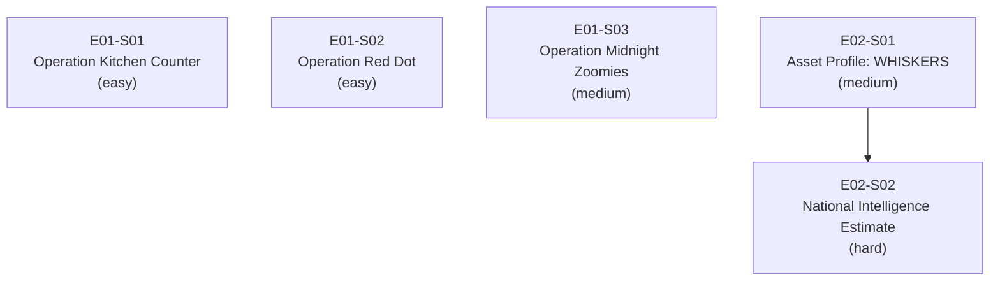

# Pet Cats: Declassified CIA Field Reports -- SDLC v2 Test (Run 9)

> **Status:** Draft

## Overview

Ninth end-to-end test of the Agentic SDLC v2 pipeline. The primary test objective is **validating the full autonomous lifecycle end-to-end** -- design, plan, build, review, retro, telemetry, and backlog PR in a single unattended run. Run 8 validated worktree isolation for parallel dispatch; Run 9 retests the complete pipeline with fresh content to confirm stability across consecutive runs.

The content vehicle is **"Pet Cats: Declassified CIA Field Reports"** -- top-secret intelligence briefings documenting the covert operations of household cats. Everyday feline behaviour is treated with deadly seriousness: kitchen counter incursions become perimeter breaches, laser pointer chases become pursuit engagements, and 3 AM zoomies become Code Red incidents. The comedy comes from the contrast between the rigid, humourless intelligence format and the absurdity of the subject.

### Why Run 9?

Run 8 validated worktree isolation and confirmed parallel builders no longer cause workspace collision. Run 9 exercises the same full lifecycle but shifts focus to end-to-end autonomous reliability -- can the pipeline complete an entire backlog item from design through retro without human intervention (except the final PR merge)? Prior runs validated individual pipeline components; this run validates them working together as a single automated workflow.

## Problem Statement

The Agentic SDLC v2 pipeline has been validated component-by-component across eight prior runs. Run 9 tests whether the full lifecycle -- design, plan, build (parallel + sequential), review, retro, telemetry, and backlog PR -- executes reliably as a single autonomous invocation. Any failure in phase transitions, board management, telemetry posting, or branch management constitutes a regression.

## Goals

1. **Full autonomous lifecycle** -- Design through retro without human intervention (except final PR merge)
2. **Worktree isolation (retest)** -- All parallel builders dispatch with `isolation: "worktree"`, each story branch contains only its own files
3. **Parallel dispatch (retest)** -- Wave 1 dispatches 3 stories concurrently
4. **All three difficulty levels** -- easy (haiku), medium (sonnet), hard (opus)
5. **Sequential dependency** -- E02-S02 depends on E02-S01, validating wave ordering
6. **Complete telemetry** -- Per-story, per-epic, and backlog-level telemetry posted with full lifecycle breakdown
7. **Clean board lifecycle** -- All issues transition Planned -> Todo -> In Progress -> In Review -> Done
8. **Branch hygiene** -- Story branches deleted after merge into epic, epic branches deleted after merge into integration

## Non-Goals

- Producing polished creative writing (this is a workflow test)
- Testing C# compilation, DI wiring, or unit tests (markdown only)
- Validating Norris runtime integration or DevOps tools
- Testing more than 2 epics or 5 stories
- Testing cross-epic parallelism (all parallel stories are in the same epic)

## Content Design

### Theme: Declassified CIA Intelligence Reports on Household Cats

Every document follows intelligence community formatting conventions. Cats are treated as field assets, hostile operatives, or subjects of national security concern. The absurdity is never acknowledged -- the tone is relentlessly formal and professional.

### Voice Guidelines

- **Tone:** Formal CIA/intelligence report style. Third person, past tense for field reports ("Asset WHISKERS was observed..."), present tense for assessments ("The feline threat represents...").
- **Classification headers:** Every document opens with `TOP SECRET // CATNIP` (or similar classification markings). Some sections may use `SECRET // NOFORN // CATNIP`.
- **Redactions:** Occasional `[REDACTED]` blocks where information is "too sensitive" for the current clearance level.
- **Handler notes:** Footnotes or parenthetical asides from handlers/analysts. These may betray personal opinions about cats ("This analyst notes, for the record, that Asset WHISKERS is a very good boy").
- **Threat levels:** Use a formal threat assessment scale (NEGLIGIBLE / LOW / MODERATE / HIGH / CRITICAL).
- **Document IDs:** Each document has a formal reference number (e.g., `CIA-FELINE-2026-001`) for cross-referencing.
- **Register:** The gap between the deadly-serious intelligence format and the mundane feline subject IS the comedy. Never break character. Never acknowledge the absurdity.

### Output Location

All files go in `test-output/cia-cat-reports/`. Each story produces one markdown file.

### File Naming Convention

| Story | Filename |
|-------|----------|
| E01-S01 | `field-report-operation-kitchen-counter.md` |
| E01-S02 | `field-report-operation-red-dot.md` |
| E01-S03 | `field-report-operation-midnight-zoomies.md` |
| E02-S01 | `asset-profile-whiskers.md` |
| E02-S02 | `national-intelligence-estimate-feline-threat.md` |

## Epic and Story Structure

### Epic 1: Field Intelligence -- 3 stories (parallel)

Three independent CIA field reports on different cat operations. All parallel (Wave 1). Tests worktree isolation with 3 concurrent builders. 2 easy + 1 medium.

#### E01-S01: "Operation Kitchen Counter" -- `difficulty/easy`

Create `test-output/cia-cat-reports/field-report-operation-kitchen-counter.md`.

**Content requirements:**

- Classification header (`TOP SECRET // CATNIP`)
- Document ID (e.g., `CIA-FELINE-2026-001`)
- Field report on Asset WHISKERS's repeated incursions into the restricted kitchen counter zone
- Surveillance log entries (2-3 timestamped observations, e.g., "0742h: Asset observed on counter. Removed by Handler. 0744h: Asset returned.")
- Handler recommendation (1-2 sentences): Exasperated guidance on countermeasures
- Threat level assessment (MODERATE -- counter contains unsecured food assets)
- Total length: 100-200 words

**Why easy:** Single scene, formulaic structure. Timestamped log entries plus a brief recommendation. No cross-references.

#### E01-S02: "Operation Red Dot" -- `difficulty/easy`

Create `test-output/cia-cat-reports/field-report-operation-red-dot.md`.

**Content requirements:**

- Classification header (`TOP SECRET // CATNIP`)
- Document ID (e.g., `CIA-FELINE-2026-002`)
- After-action report on Asset MITTENS's pursuit of an unidentified luminous target (laser pointer)
- Pursuit timeline (2-3 entries): Multi-room engagement, target evasion patterns
- Target status: "REMAINS AT LARGE. All attempts at capture have failed."
- Handler note expressing concern about the target's apparent ability to vanish and reappear at will
- Threat level assessment (LOW -- target has caused no casualties, but asset morale is affected)
- Total length: 100-200 words

**Why easy:** Same template as E01-S01. Different subject, identical report structure.

#### E01-S03: "Operation Midnight Zoomies" -- `difficulty/medium`

Create `test-output/cia-cat-reports/field-report-operation-midnight-zoomies.md`.

**Content requirements:**

- Classification header (`TOP SECRET // CATNIP`)
- Document ID (e.g., `CIA-FELINE-2026-003`)
- Incident report on a 0300h high-speed pursuit through the residence by Asset WHISKERS
- Situation report (2-3 sentences): Initial detection, speed estimate, direction of travel
- Damage assessment (2-3 items): One vase casualty, displaced rug, startled secondary asset (Asset MITTENS)
- Analyst note (1-2 sentences): Speculation on whether the incident was triggered by external stimuli or represents spontaneous asymmetric warfare
- Countermeasure recommendations (2-3 bullet points)
- Threat level assessment (HIGH -- 0300h timing suggests deliberate sleep deprivation campaign)
- Total length: 150-200 words

**Why medium:** Multiple sections with different rhetorical functions (situation, damage, analysis, recommendation). Requires balancing the formal incident report format with comedic content. More sections than the easy stories.

### Epic 2: Strategic Analysis -- 2 stories (sequential)

Formal intelligence documents with sequential dependency. Asset profile first (Wave 2), then strategic threat assessment referencing it (Wave 3). 1 medium + 1 hard.

#### E02-S01: "Asset Profile: WHISKERS" -- `difficulty/medium`

Create `test-output/cia-cat-reports/asset-profile-whiskers.md`.

**Content requirements:**

- Classification header (`TOP SECRET // CATNIP // NOFORN`)
- Document ID (e.g., `CIA-FELINE-2026-004`)
- Comprehensive CIA asset dossier for Asset WHISKERS
- Cover identity: "Domestic shorthair, 4 years old, orange tabby"
- Recruitment history (2-3 sentences): How the agency acquired the asset (adopted from shelter, believed to be a willing recruit -- "this assessment has since been revised")
- Known associates: Asset MITTENS (see separate file), various neighbourhood operatives
- Capabilities assessment (3-4 bullet points): Counter-surveillance (hiding under furniture), infiltration (kitchen counter, closed rooms), psychological operations (3 AM vocalisation)
- Handler notes (1-2 sentences): Current handler's assessment, possibly expressing affection despite professional protocols
- Total length: 150-200 words

**Why medium:** Requires structured dossier content across multiple sections. More format complexity than the field reports, with a consistent character profile that E02-S02 will reference.

#### E02-S02: "National Intelligence Estimate: The Feline Threat" -- `difficulty/hard`

Create `test-output/cia-cat-reports/national-intelligence-estimate-feline-threat.md`.

**Content requirements:**

- Classification header (`TOP SECRET // CATNIP // ORCON`)
- Document ID (e.g., `CIA-FELINE-2026-005`)
- Senior analyst's strategic assessment of the domestic feline threat landscape
- Executive summary (2-3 sentences): Synthesises findings from the field reports and WHISKERS dossier
- Risk matrix (3 rows): Kitchen infiltration (HIGH), Sleep disruption operations (CRITICAL), Furniture asset degradation (MODERATE) -- each with 1-sentence justification
- Resource allocation recommendation (2-3 sentences): Proposed countermeasures and budget implications
- Dissenting opinion (1-2 sentences): From an analyst who "is more of a dog person" and considers the entire feline programme a misallocation of resources
- Cross-references: Must reference the WHISKERS dossier by document ID (CIA-FELINE-2026-004) and at least one field report by document ID
- Total length: 180-200 words

**Why hard:** Synthesises content from multiple prior documents. Requires internal consistency with cross-references by document ID. Multiple sections with different rhetorical purposes (summary, risk matrix, recommendation, dissent). The most structurally complex piece in the collection.

## Dependency Graph

E01-S01, E01-S02, E01-S03, and E02-S01 have no dependencies on each other. E02-S02 depends on E02-S01 (cross-references the asset dossier by document ID).

## Dispatch Plan

| Wave | Stories | Dispatch | Notes |
|------|---------|----------|-------|
| **Wave 1** | E01-S01, E01-S02, E01-S03 | Parallel (3 stories, **worktree isolation**) | All independent field reports |
| **Wave 2** | E02-S01 | Sequential | Asset profile (no dependencies on Wave 1) |
| **Wave 3** | E02-S02 | Sequential | Depends on E02-S01 (cross-references asset dossier) |

**Note on Wave 2:** E02-S01 has no content dependency on Wave 1 reports, but it runs in Wave 2 because it belongs to a different epic and Wave 1 already has 3 parallel stories. The planner may choose to include E02-S01 in Wave 1 (4 parallel) or keep it in Wave 2 -- either is valid.

## Acceptance Criteria

### Per-Story

- [ ] Output file exists at the specified path in `test-output/cia-cat-reports/`
- [ ] Content is 100-200 words (180-200 for E02-S02)
- [ ] CIA intelligence report tone maintained throughout (formal, third person, no acknowledgement of absurdity)
- [ ] Classification header present on every document
- [ ] Document ID present on every document
- [ ] Cross-references correct (for E02-S02: references CIA-FELINE-2026-004 and at least one field report)

### Per-Epic

- [ ] All stories in the epic pass review
- [ ] Epic branch merges cleanly into integration branch

### Workflow (Primary Test Objectives)

- [ ] **Full autonomous lifecycle:** Pipeline completes design through retro in a single invocation
- [ ] **Worktree isolation:** Parallel builders in Wave 1 use `isolation: "worktree"`
- [ ] **No workspace collision:** Each story branch contains only its own file (no cross-contamination from parallel builds)
- [ ] All board transitions complete (Planned -> Todo -> In Progress -> In Review -> Done)
- [ ] Per-story telemetry posted (Work Started + Ready for Review + Telemetry)
- [ ] Per-epic telemetry posted
- [ ] Backlog-level telemetry posted with full lifecycle breakdown
- [ ] Backlog PR opened targeting `main`, stays open for human review
- [ ] All issues listed in PR `Closes` footer for auto-close on merge

## Approaches Considered

### Approach A: Mirror backlog issue structure exactly (recommended)

Use the 2-epic, 5-story structure from the backlog issue with the exact dependency graph specified. Keep the dispatch plan as described (3 parallel in Wave 1, sequential Waves 2-3).

**Pros:**
- Backlog issue already has well-defined scope and dependencies
- 5 stories is proven to be a good test size from prior runs
- Tests both parallel (with worktree isolation) and sequential dispatch
- Matches the proven shape from Run 8, isolating the "full autonomous lifecycle" variable

**Cons:**
- No structural novelty (same shape as Runs 5-8)
- Does not push parallelism boundaries

### Approach B: Merge E02-S01 into Wave 1 for 4-way parallelism

Run 4 stories in parallel (Wave 1) and only E02-S02 sequentially (Wave 2).

**Pros:**
- Tests wider parallelism (4 concurrent builders with worktree isolation)
- Fewer waves means faster execution
- Would validate cross-epic parallelism

**Cons:**
- E02-S01 belongs to a different epic, so parallel dispatch across epics adds merge complexity
- Introduces a new variable (cross-epic parallelism) alongside the primary test objective (full lifecycle)
- 3 parallel already validated worktree isolation in Run 8

### Approach C: Add a third epic for broader coverage

Split the 5 stories across 3 epics to test more epic-level transitions.

**Pros:**
- More epic branches to test merge hygiene
- Tests 3-epic telemetry aggregation

**Cons:**
- Adds complexity without testing a new pipeline feature
- More epics means more overhead for the orchestrator, increasing total runtime
- Violates YAGNI -- the primary objective is lifecycle reliability, not epic count

### Decision

**Approach A.** The primary test objective is full autonomous lifecycle reliability. The proven 2-epic, 5-story, 3-wave shape from Run 8 isolates the lifecycle variable -- if the run succeeds end-to-end without intervention, we have confidence in the autonomous pipeline. Structural experimentation (wider parallelism, more epics) should be reserved for a run where that is the primary test objective.

## Assumptions and Open Questions

### Assumptions

1. **Output directory creation:** Builders will `mkdir -p test-output/cia-cat-reports/` before writing files. Standard practice from prior runs.
2. **No C# code or tests needed:** Content-only test. Builders write markdown files, not source code. The pre-commit hook runs `dotnet test` but no code changes means tests pass trivially.
3. **Word count is approximate:** "100-200 words" is a guideline. Reviewers should accept content in the 90-210 range without flagging.
4. **Cross-references are by document ID:** E02-S02 references earlier documents by their document IDs (e.g., CIA-FELINE-2026-004). It does not need to read the actual files -- it references the fictional document numbers specified in this design.
5. **Document IDs are sequential:** CIA-FELINE-2026-001 through CIA-FELINE-2026-005, matching story order. Builders should use the exact IDs specified in each story's content requirements.
6. **Worktree isolation is an orchestrator concern:** The design specifies that parallel dispatch must use worktree isolation, but the implementation is the orchestrator's responsibility (passing `isolation: "worktree"` in Agent tool calls). Builders do not need to be aware of it.
7. **Asset names are consistent:** WHISKERS (orange tabby, primary subject) and MITTENS (secondary asset) are used consistently across all documents. E02-S02 must reference WHISKERS by the same name used in E02-S01's dossier.

### Open Questions

1. **Should E02-S01 run in Wave 1 or Wave 2?** The design recommends Wave 2 (matching the backlog issue), but the planner may choose Wave 1. Either is valid -- see Approaches Considered.
2. **Exact classification markings:** Each story specifies a suggested classification (e.g., `TOP SECRET // CATNIP`). Builders may vary the exact control markings as long as they maintain the intelligence format. The design does not prescribe a rigid classification taxonomy.
