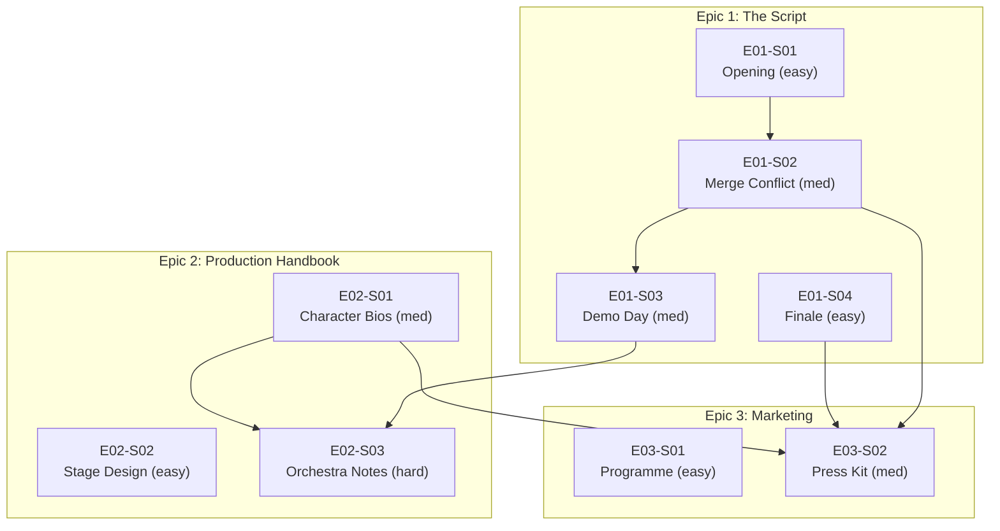

# Run 16 Design: The Debugging -- A Silicon Valley Musical

> **Status:** Draft

## Overview

Sixteenth end-to-end test of the Agentic SDLC pipeline. Primary test objective: **validate the orchestrator after the `orchestrator.md` split** (backlog #150). This is the first run where the orchestrator uses the new `scripts/state.sh` for state management, operates with the slimmed 503-line `orchestrator.md`, and includes the `compute-dispatches.py --overhead` flag for automatic orchestrator overhead calculation.

Content theme: "The Debugging: A Silicon Valley Musical" -- the complete production package for a fictional musical set at CtrlZ, a dysfunctional tech startup where every department communicates only through song. The show follows a cursed sprint where every story point brings a new musical number. CtrlZ's product is an app that promises to undo any life decision (but it keeps shipping bugs instead of features). The creative content spans three production domains: the script (scenes and song lyrics), the production handbook (character bios, stage design, orchestra notes), and the marketing materials (programme guide, press kit).

## Goals

1. **`state.sh` integration** -- Verify the orchestrator correctly calls `state.sh init`, `state.sh update --dispatch`, `state.sh update --story`, `state.sh update --add-story`, `state.sh get`, `state.sh overhead`, and `state.sh lifecycle-duration` instead of inline Python.
2. **Slimmed `orchestrator.md`** -- Confirm the 503-line orchestrator still runs the full lifecycle correctly without the deleted reference material.
3. **`--overhead` flag** -- Verify `compute-dispatches.py --overhead` produces the orchestrator overhead row in telemetry.
4. **Schema validation** -- Confirm the state file matches `scripts/schemas/orchestrator-state.v1.json`.
5. **`update --add-story`** -- Verify the orchestrator uses this subcommand to register stories with `--depends-on` metadata.
6. **Multi-epic parallel dispatch** -- Validate parallel waves within and across epics with worktree isolation.
7. **Cross-epic merge** -- Confirm epic branches merge cleanly into the integration branch when stories have cross-references.
8. **`maxParallelBuilders` config enforcement** -- Wave 1 targets 5-way parallel but config caps at 3. The orchestrator must respect the cap and split the wave.
9. **Fix cycle validation** -- A planted bug in E02-S03 (hard, wrong scene number) should trigger a reviewer fix cycle.
10. **Fault tolerance** -- Verify the orchestrator follows the fault tolerance principle from CLAUDE.md during any interruption.

## Non-Goals

- Testing C# compilation, DI wiring, or unit tests (markdown content only)
- Producing publication-quality creative writing or actual performable musical scores (this is a workflow test)
- Testing more than 3 epics (the backlog issue specifies exactly 3)
- Changes to workflow infrastructure (this run validates existing infrastructure from backlog #150)

---

## Voice and Tone Guidelines

- **Tone:** Comedy. Tech satire meets Broadway energy. Think "The Book of Mormon" meets "Silicon Valley" (HBO). Every tech trope is played at maximum theatrical volume.
- **Register:** Varies by document type. Script scenes use dramatic dialogue with stage directions in italics. Songs use verse/chorus/bridge structure with character attribution. Production handbook uses professional theatre terminology. Marketing materials use breathless PR copy.
- **Perspective:** The musical exists in a world where tech startup culture is treated with the same reverence as grand opera. Jira tickets are life-or-death. Merge conflicts destroy relationships. The CI pipeline is a character. "Ship it" is a battle cry.
- **Consistent universe details:** All documents reference the startup CtrlZ, its product (the "Undo" app), and the same cast of characters. Song titles, scene numbers, and character names must be consistent across all stories. This is the primary cross-reference validation mechanism.

### Character Roster

All stories share these characters. Builders must use these names and roles consistently.

| Character | Role | Vocal Range | Personality |
|-----------|------|-------------|-------------|
| **Jordan Chase** | CEO / Founder | Tenor | Charismatic visionary who communicates exclusively in pitch decks and interpretive dance. Believes every problem can be solved by pivoting. |
| **Priya Mehta** | Product Manager | Mezzo-soprano | The only person who talks to both engineering and the investors. Perpetually writing PRDs that no one reads. Her catchphrase: "It's on the roadmap." |
| **Marcus Chen** | Senior Engineer | Baritone | Wrote the original codebase in a 72-hour hackathon. Hasn't slept since. Speaks in git commands. |
| **Zoe Kim** | Junior Engineer | Soprano | Fresh out of bootcamp, assigned to "fix the CI pipeline" on day one. Idealistic but rapidly losing hope. |
| **Aisha Okafor** | QA Lead | Alto | Has found every bug before it ships. No one listens. Maintains a "told you so" spreadsheet. |
| **Riley Park** | The Intern | Tenor (high) | Asked to "just quickly fix" the CI pipeline. Has been doing this for 6 months. May or may not still be an intern. |
| **The Legacy Codebase** | Personified Ensemble | Full range (ensemble) | A chorus of dancers representing legacy modules. They move in increasingly brittle choreography. When one falls, they all fall. |

### Song Registry

All songs referenced across the musical. Each song has a fixed scene assignment. Cross-references in E02 and E03 must use these exact titles and scene numbers.

| Song Title | Act/Scene | Character(s) | Style/Tempo |
|------------|-----------|--------------|-------------|
| "The Pitch" | Act I, Scene 1 | Jordan (solo) | Up-tempo show opener, jazz hands energy |
| "The Standup Ballad" | Act I, Scene 2 | Full cast | Power ballad, 4/4 time, builds to ensemble |
| "The Merge Conflict" | Act I, Scene 3 | Marcus & Zoe (duet) | Tango, dramatic tension |
| "Rebase or Rewrite?" | Act I, Scene 3 | Full cast (ensemble) | Rock anthem, call-and-response |
| "The Intern's Lament" | Act I, Scene 4 | Riley (solo) | Slow ballad, acoustic guitar |
| "It Worked on My Machine" | Act II, Scene 1 | Priya (solo) | Blues number, spotlight |
| "The Rollback Waltz" | Act II, Scene 2 | Full cast | Waltz, 3/4 time, elegant |
| "Technical Debt (The Musical Number)" | Act II, Scene 3 | The Legacy Codebase (ensemble) | Modern dance / hip-hop fusion |
| "Ctrl+Z (The Reprise)" | Act II, Scene 3 (Finale) | Full cast | Reprise of "The Pitch", triumphant |

---

## Format Contracts

These templates ensure all builders produce consistent output regardless of which story they are assigned.

### Scene Format (E01)

```markdown
# Act [N], Scene [N]: [Scene Title]

*[Setting description in italics]*

**Characters present:** [comma-separated list]

---

[Dialogue in standard script format:]

**CHARACTER NAME:** Dialogue text.

*[Stage direction in italics]*

**CHARACTER NAME:** *(action while speaking)* Dialogue text.

---

### Song: "[Song Title]"

**Performed by:** [Character(s)]
**Style:** [Genre/tempo description]
**Key:** [Musical key]
**Tempo:** [BPM or tempo marking]

**[VERSE 1]**
Lyric line one
Lyric line two
Lyric line three
Lyric line four

**[CHORUS]**
Chorus line one
Chorus line two
Chorus line three
Chorus line four

**[VERSE 2]**
...

**[BRIDGE]**
...

**[FINAL CHORUS / TAG]**
...

*[Stage direction for end of number]*

---
```

### Character Bio Format (E02-S01)

```markdown
## [Character Name]

**Role:** [Role in the show]
**Vocal Range:** [Range]
**Vocal Type:** [Specific voice type notes for casting]

### Backstory
[2-3 sentences of character backstory]

### Motivation
[What drives this character in the show]

### Costume Notes
[Description of costume, including any quick-change requirements]

### Song Assignments
| Song | Role in Number | Notes |
|------|---------------|-------|
| [Song title] | [Lead/Harmony/Ensemble] | [Casting notes] |

---
```

### Technical Spec Format (E02-S02)

```markdown
## [Design Element]

**Location:** [Stage area]
**Scene(s):** [Which scenes use this element]

### Description
[Physical description of the set piece/effect]

### Technical Requirements
- [Bullet list of technical needs]

### Cue Sheet
| Cue | Trigger | Action | Duration |
|-----|---------|--------|----------|
| [Cue ID] | [What triggers it] | [What happens] | [How long] |

---
```

### Orchestra Notes Format (E02-S03)

```markdown
## [Song Title]

**Scene:** Act [N], Scene [N]
**Key:** [Key signature]
**Tempo:** [BPM] ([tempo marking])
**Time Signature:** [e.g., 4/4, 3/4]

### Orchestration
- **Full Pit:** [Yes/No]
- **Lead Instruments:** [List]
- **Arrangement Notes:** [Description of the arrangement approach]

### Vocal Requirements
| Character | Range Required | Notes |
|-----------|---------------|-------|
| [Name] | [Range] | [Special requirements] |

### Transition
- **From:** [Previous scene/song]
- **Transition Duration:** [Time in seconds]
- **Transition Type:** [Segue / Blackout / Applause break]

---
```

### Programme Guide Format (E03-S01)

```markdown
## [Section Title]

[Content in friendly, accessible prose aimed at non-technical audience members]

### Glossary Entry Format
| Tech Term | What It Actually Means | In the Show |
|-----------|----------------------|-------------|
| [Term] | [Plain English explanation] | [How it appears in the musical] |
```

### Press Kit Format (E03-S02)

```markdown
## [Section Title]

[Content in polished PR/marketing prose]

### Critic Quote Format
> "[Quote text]" -- [Publication Name], [Reviewer Name]
> [Star rating as unicode stars]

### Synopsis Format
[Paragraph-form show synopsis with specific song and character references]
```

---

## Epic 1 -- The Script: Scenes & Songs (4 stories)

The musical's script organized by act. Each story produces scenes with dialogue, stage directions, and complete song lyrics (with verse/chorus structure).

### E01-S01: Act I, Scenes 1-2 -- "The Stand-Up (That Isn't Comedy)" -- `difficulty/easy`

Create `test-output/debugging-musical/script/act1-scenes-1-2.md`

**Content requirements:**

- **Scene 1:** Opening number. The stage is a startup pitch event. Jordan Chase pitches investors via interpretive dance while singing "The Pitch" -- an up-tempo show opener about disrupting the "undo" market. The investors are bewildered but intrigued. Stage direction: spotlights follow Jordan's increasingly elaborate gestures. A slide deck projected behind them reads increasingly absurd claims ("10x the undo", "Ctrl+Z as a Service").
- **Scene 2:** The next morning at CtrlZ headquarters. The engineering team assembles for the daily standup. Each team member reports their status through "The Standup Ballad" -- a power ballad where mundane Jira ticket updates become emotionally devastating confessions. Marcus admits the main branch is broken. Zoe reveals she has been rebasing for three days straight. Priya sings about the PRD that no one read. The number builds from solo verses to a full ensemble climax.
- Include full lyrics for both "The Pitch" and "The Standup Ballad" with verse/chorus structure.
- Follow the Scene Format template.
- Word count: 300-500 words

**Why easy:** Two scenes with clear structure. The opening number and standup ballad have straightforward comedic premises. No cross-references to other stories needed.

**Acceptance criteria:**

- [ ] File exists at `test-output/debugging-musical/script/act1-scenes-1-2.md`
- [ ] Follows Scene Format template
- [ ] Contains Scene 1 and Scene 2 with proper dialogue formatting
- [ ] "The Pitch" has full verse/chorus/bridge structure
- [ ] "The Standup Ballad" has full verse/chorus structure with multiple character verses
- [ ] Characters use names from the Character Roster
- [ ] Stage directions are in italics
- [ ] Word count 300-500

### E01-S02: Act I, Scenes 3-4 -- "The Merge Conflict" -- `difficulty/medium`

Create `test-output/debugging-musical/script/act1-scenes-3-4.md`

**Content requirements:**

- **Scene 3:** Marcus and Zoe discover they have both been editing the same file. Their argument escalates into "The Merge Conflict" -- a tango-style duet where they dramatically act out conflicting code changes. The scene then opens up into "Rebase or Rewrite?" -- a full ensemble rock anthem where the entire team picks sides. Half the team chants "REBASE!" while the other half chants "REWRITE!" Aisha watches from QA, shaking her head.
- **Scene 4:** After the merge conflict is resolved (badly), Riley is alone on stage. The intern sings "The Intern's Lament" -- a slow ballad about being asked to "just quickly fix" the CI pipeline on their first day, six months ago. The song should reference specific CI/CD pain points (flaky tests, environment variables, Docker builds that work locally but not in CI).
- Must reference characters and events established in E01-S01 (the broken main branch from the standup, Jordan's pitch).
- Include full lyrics for "The Merge Conflict" (duet), "Rebase or Rewrite?" (ensemble), and "The Intern's Lament" (solo).
- Follow the Scene Format template.
- Word count: 300-500 words

**Why medium:** Three songs in one story. The tango duet and ensemble number require different lyrical styles. Must reference E01-S01 events for narrative continuity.

**Acceptance criteria:**

- [ ] File exists at `test-output/debugging-musical/script/act1-scenes-3-4.md`
- [ ] Follows Scene Format template
- [ ] Contains Scene 3 and Scene 4
- [ ] "The Merge Conflict" is a duet between Marcus and Zoe
- [ ] "Rebase or Rewrite?" is an ensemble number with call-and-response
- [ ] "The Intern's Lament" is a solo for Riley
- [ ] All three songs have verse/chorus structure
- [ ] References events from Act I Scenes 1-2 (broken main branch, the pitch)
- [ ] Word count 300-500

### E01-S03: Act II, Scenes 1-2 -- "The Demo Day Disaster" -- `difficulty/medium`

Create `test-output/debugging-musical/script/act2-scenes-1-2.md`

**Content requirements:**

- **Scene 1:** Demo day. The investors from Scene 1 have returned. The team attempts to demo the Undo app. Everything goes wrong. Priya sings "It Worked on My Machine" -- a blues number where she defends the product while the backend visibly fails (stage effect: red warning lights, error messages scrolling across the backdrop). The demo crashes. Jordan tries to pivot mid-presentation.
- **Scene 2:** The aftermath. The team regroups and decides to roll back to the last stable release. "The Rollback Waltz" -- a graceful 3/4 time number about reverting to safety, performed as a literal waltz where each couple represents a service reverting to a prior version. The number should feel bittersweet -- they are giving up on new features but saving the product.
- Must reference the merge conflict from Act I Scene 3 as a contributing cause of the demo failure.
- Include full lyrics for "It Worked on My Machine" and "The Rollback Waltz".
- Follow the Scene Format template.
- Word count: 300-500 words

**Why medium:** Two songs with contrasting tones (frantic blues vs. graceful waltz). Must reference Act I events. The demo failure scene requires coordinating dialogue, stage effects, and song.

**Acceptance criteria:**

- [ ] File exists at `test-output/debugging-musical/script/act2-scenes-1-2.md`
- [ ] Follows Scene Format template
- [ ] Contains Scene 1 (Demo Day) and Scene 2 (Rollback)
- [ ] "It Worked on My Machine" is a blues solo for Priya
- [ ] "The Rollback Waltz" is in 3/4 time with waltz staging
- [ ] References the merge conflict from Act I Scene 3
- [ ] Both songs have verse/chorus structure
- [ ] Word count 300-500

### E01-S04: Act II, Scene 3 & Finale -- "The Ship It Showdown" -- `difficulty/easy`

Create `test-output/debugging-musical/script/act2-scene-3-finale.md`

**Content requirements:**

- **Scene 3:** The climactic decision. Ship the buggy release or miss the deadline. The team debates while the clock ticks. "Technical Debt (The Musical Number)" -- an ensemble piece where The Legacy Codebase comes alive as dancers representing legacy modules. Each dancer/module performs increasingly brittle choreography. When one stumbles, others catch them. Eventually the dance becomes a chain reaction of failures.
- **Finale:** After the chaos, the team realizes that the real product was never the Undo app -- it was the teamwork, the late nights, the merge conflicts that brought them together. "Ctrl+Z (The Reprise)" reprises the melody of "The Pitch" from Act I Scene 1, but with new lyrics about learning from mistakes rather than undoing them. The full cast takes the stage. The Legacy Codebase dancers join in. Even the investors return for the final chorus.
- Must reference "The Pitch" from Act I Scene 1 (the reprise reuses its melody).
- Include full lyrics for "Technical Debt (The Musical Number)" and "Ctrl+Z (The Reprise)".
- Follow the Scene Format template.
- Word count: 300-500 words

**Why easy:** The finale follows a standard "reprise of the opening" structure. The Technical Debt number is ensemble choreography description (more stage direction than dialogue). Clear narrative resolution.

**Acceptance criteria:**

- [ ] File exists at `test-output/debugging-musical/script/act2-scene-3-finale.md`
- [ ] Follows Scene Format template
- [ ] Contains Scene 3 and the Finale
- [ ] "Technical Debt (The Musical Number)" features The Legacy Codebase as dancers
- [ ] "Ctrl+Z (The Reprise)" reprises the melody of "The Pitch" with new lyrics
- [ ] References "The Pitch" from Act I Scene 1 explicitly
- [ ] Both numbers have full lyrics with verse/chorus structure
- [ ] Word count 300-500

**Dependencies:** E01-S01 and E01-S04 can run in parallel (bookend scenes with no shared narrative between them -- S04 only references Act I Scene 1 by name, not by content). E01-S02 depends on E01-S01 (introduces characters and events referenced later). E01-S03 depends on E01-S02 (Act II builds on Act I conflicts).

---

## Epic 2 -- Production Handbook (3 stories)

Internal documentation for the stage crew, technical team, and performers.

### E02-S01: Character Bios and Vocal Casting Notes -- `difficulty/medium`

Create `test-output/debugging-musical/handbook/character-bios.md`

**Content requirements:**

- Detailed profiles for each character in the Character Roster (Jordan, Priya, Marcus, Zoe, Aisha, Riley, The Legacy Codebase).
- Each profile must follow the Character Bio Format template.
- Include vocal range requirements with specific notes for casting directors (e.g., "Must be able to sustain a high C during the finale").
- Costume notes for each character reflecting their role (e.g., Marcus wears the same hoodie in every scene because he never goes home).
- Song assignments table for each character listing every song they appear in with their role (lead, harmony, ensemble).
- The Legacy Codebase ensemble section should describe the concept of personifying code modules as dancers and include notes on ensemble casting (minimum 6 dancers, each representing a different legacy module).
- Word count: 300-500 words

**Why medium:** Seven character profiles with structured sections each. Song assignment tables require cross-referencing the Song Registry for accuracy. The Legacy Codebase ensemble requires creative treatment different from individual character bios.

**Acceptance criteria:**

- [ ] File exists at `test-output/debugging-musical/handbook/character-bios.md`
- [ ] Follows Character Bio Format template for each character
- [ ] All 7 characters from the Character Roster are included
- [ ] Vocal range and type specified for each character
- [ ] Costume notes for each character
- [ ] Song assignment table for each character with correct song titles from the Song Registry
- [ ] The Legacy Codebase ensemble section describes the personification concept
- [ ] Word count 300-500

### E02-S02: Technical Stage Design and Effects Specs -- `difficulty/easy`

Create `test-output/debugging-musical/handbook/stage-design.md`

**Content requirements:**

- Set design for the main stage: the CtrlZ open-plan office. Describe the desk layout, the whiteboard covered in sprint boards, the server rack in the corner that hums ominously.
- Upstage area: the "server room" -- a darker, mechanical space visible through a glass wall. This is where The Legacy Codebase ensemble performs.
- Lighting cues for key moments: the fire effect in Act II Scene 1 (demo failure), the elegant blue wash for "The Rollback Waltz", the dramatic red for the merge conflict tango.
- Fog machine requirements for "The Rollback Waltz" (rolling fog represents the rollback washing over the codebase).
- Projection specs: the slide deck in Act I Scene 1, the error messages in Act II Scene 1.
- Follow the Technical Spec Format template for each design element.
- Include at least one cue sheet table for the Act II fire effect sequence.
- Word count: 300-500 words

**Why easy:** Technical specs follow a structured template. No cross-references to specific file content needed -- the designer references scenes by number and songs by title (both defined in this design doc).

**Acceptance criteria:**

- [ ] File exists at `test-output/debugging-musical/handbook/stage-design.md`
- [ ] Follows Technical Spec Format template
- [ ] Describes the main stage (open-plan office) set design
- [ ] Describes the upstage server room area
- [ ] Includes lighting cues for at least 3 key moments
- [ ] Includes fog machine specifications for "The Rollback Waltz"
- [ ] Includes projection specifications
- [ ] Contains at least one cue sheet table
- [ ] Word count 300-500

### E02-S03: Orchestra Arrangement Notes and Song Index -- `difficulty/hard`

Create `test-output/debugging-musical/handbook/orchestra-notes.md`

**Content requirements:**

- Full song index listing every song from the Song Registry with: title, scene number, character(s), tempo/key, time signature, orchestration notes.
- For each song, follow the Orchestra Notes Format template.
- Indicate which songs need the full pit orchestra vs. acoustic-only arrangements (e.g., "The Intern's Lament" should be acoustic guitar only; "Rebase or Rewrite?" needs the full band).
- Transition timing between scenes -- how many seconds of underscoring or silence between each number.
- Vocal requirements table for each song showing which characters sing and what range is required.
- Cross-reference character vocal ranges from E02-S01 (character bios) to validate casting requirements match orchestration demands.
- Must reference every song from E01 by title and correct scene number.
- Word count: 300-500 words

**Why hard:** Must cross-reference every song title and scene number from all four E01 stories for accuracy. Must cross-reference character vocal ranges from E02-S01. Nine songs each requiring their own structured template entry. The transition timing requires understanding the full show flow. This is the integration story that ties together the Script and Handbook.

**Acceptance criteria:**

- [ ] File exists at `test-output/debugging-musical/handbook/orchestra-notes.md`
- [ ] Follows Orchestra Notes Format template for each song
- [ ] All 9 songs from the Song Registry are indexed
- [ ] Each song has correct scene number matching the Song Registry
- [ ] Each song has key, tempo, and time signature
- [ ] Full pit vs. acoustic-only indicated for each song
- [ ] Transition timing between all scenes
- [ ] Vocal requirements table for each song
- [ ] Cross-references character vocal ranges from E02-S01
- [ ] Word count 300-500

**Dependencies:** E02-S01 and E02-S02 can run in parallel (independent content). E02-S03 depends on E02-S01 (references character vocal ranges) AND on E01-S03 (needs the complete Act II song list with scene numbers -- cannot write arrangement notes without knowing all the songs).

---

## Epic 3 -- Marketing & Audience Materials (2 stories)

Customer-facing materials for the show's premiere.

### E03-S01: "So You Think You Can Debug?" -- Programme Guide -- `difficulty/easy`

Create `test-output/debugging-musical/marketing/programme-guide.md`

**Content requirements:**

- An audience-facing programme guide that explains the tech jokes for non-technical theatregoers.
- Include a "Welcome" section from the fictional director (Jordan Chase doubles as director -- of course).
- Include a tech glossary with at least 8 entries, using the Programme Guide Format template. Each entry explains a tech term, gives its real meaning, and how it appears in the show. Examples: "Merge conflict -- it's like two people editing the same Google Doc but with more crying", "CI/CD -- stands for 'Constantly Irritating / Continuously Disappointing'", "Technical debt -- the code equivalent of shoving everything in your closet before guests arrive."
- Include a "Meet the Cast" section with one-line descriptions of each character (audience-friendly, not the full bios).
- Include a "Song List" section listing all songs in order of appearance.
- Follow the Programme Guide Format template.
- Word count: 300-500 words

**Why easy:** Standalone audience-facing document. No file dependencies. The tech glossary is creative writing with a simple template. Characters and songs are defined in this design doc.

**Acceptance criteria:**

- [ ] File exists at `test-output/debugging-musical/marketing/programme-guide.md`
- [ ] Follows Programme Guide Format template
- [ ] Includes "Welcome" section from the director
- [ ] Includes tech glossary with at least 8 entries in table format
- [ ] Includes "Meet the Cast" section with all 7 characters
- [ ] Includes "Song List" in performance order
- [ ] Accessible tone for non-technical audience
- [ ] Word count 300-500

### E03-S02: Press Kit with Critic Quotes and Show Synopsis -- `difficulty/medium`

Create `test-output/debugging-musical/marketing/press-kit.md`

**Content requirements:**

- A press kit for the show's premiere, written in polished PR/marketing prose.
- Fictional critic reviews from at least 4 publications. Examples of tone: "Finally, a musical that captures the existential dread of a failed deployment" (The New York Times), "I laughed, I cried, I opened a pull request" (Wired), "The tango number alone is worth the price of admission" (Broadway World).
- Each review should reference specific songs or scenes by name.
- Behind-the-scenes notes about the show's creation (fictional -- treat it as if the show were real).
- A full show synopsis (300+ words of the synopsis itself) that references specific songs by title, characters by name, and describes the arc from pitch to finale.
- The synopsis must reference at least 3 songs from E01 by title with correct scene numbers.
- Must reference character descriptions consistent with E02-S01 (character bios).
- Follow the Press Kit Format template.
- Word count: 300-500 words

**Why medium:** Must cross-reference songs, scenes, and characters from E01 and E02. The critic quotes require different voices (each "publication" has its own style). The synopsis must accurately reflect the show's narrative arc.

**Acceptance criteria:**

- [ ] File exists at `test-output/debugging-musical/marketing/press-kit.md`
- [ ] Follows Press Kit Format template
- [ ] Includes at least 4 fictional critic reviews with publication attribution
- [ ] Critic reviews reference specific songs or scenes by name
- [ ] Includes behind-the-scenes notes
- [ ] Includes full show synopsis referencing at least 3 songs by title
- [ ] Synopsis uses correct scene numbers from the Song Registry
- [ ] Characters referenced consistently with E02-S01
- [ ] Word count 300-500

**Dependencies:** E03-S01 has no dependencies (standalone guide). E03-S02 depends on E01-S02 and E01-S04 (references specific songs by name) and E02-S01 (references character bios).

---

## File Naming Summary

| Story | Filename | Difficulty |
|-------|----------|------------|
| E01-S01 | `test-output/debugging-musical/script/act1-scenes-1-2.md` | easy |
| E01-S02 | `test-output/debugging-musical/script/act1-scenes-3-4.md` | medium |
| E01-S03 | `test-output/debugging-musical/script/act2-scenes-1-2.md` | medium |
| E01-S04 | `test-output/debugging-musical/script/act2-scene-3-finale.md` | easy |
| E02-S01 | `test-output/debugging-musical/handbook/character-bios.md` | medium |
| E02-S02 | `test-output/debugging-musical/handbook/stage-design.md` | easy |
| E02-S03 | `test-output/debugging-musical/handbook/orchestra-notes.md` | hard |
| E03-S01 | `test-output/debugging-musical/marketing/programme-guide.md` | easy |
| E03-S02 | `test-output/debugging-musical/marketing/press-kit.md` | medium |

## Difficulty Distribution

| Difficulty | Count | Stories |
|------------|-------|---------|
| Easy | 4 | E01-S01, E01-S04, E02-S02, E03-S01 |
| Medium | 4 | E01-S02, E01-S03, E02-S01, E03-S02 |
| Hard | 1 | E02-S03 |
| **Total** | **9** | |

## Dependency Graph



**Dependency rationale:**

- **E01-S01:** Fully independent -- establishes characters and opening songs.
- **E01-S02:** Depends on E01-S01 (references events from Act I Scenes 1-2). However, E01-S02 only references E01-S01 by scene number and song title (both defined in this design doc), so this is a narrative dependency, not a file dependency. The planner may treat this as a soft dependency.
- **E01-S03:** Depends on E01-S02 (references the merge conflict from Act I Scene 3).
- **E01-S04:** Fully independent -- only references "The Pitch" from Act I Scene 1 by title (defined in this design doc). Can run in parallel with E01-S01.
- **E02-S01:** Fully independent -- character bios are defined in this design doc's Character Roster.
- **E02-S02:** Fully independent -- stage design references scenes by number and songs by title (all defined in this design doc).
- **E02-S03:** Depends on E02-S01 (cross-references character vocal ranges) AND E01-S03 (needs the complete Act II song list with scene numbers). This is the hard story with true file dependencies.
- **E03-S01:** Fully independent -- standalone audience guide using info from this design doc.
- **E03-S02:** Depends on E01-S02 and E01-S04 (references specific songs by name) and E02-S01 (references character bios). The planner should schedule this after these dependencies complete.

**Note on soft vs. hard dependencies:** Most cross-references in this musical use song titles and scene numbers that are pre-defined in this design doc's Song Registry. This means many "dependencies" are informational (the builder has the data in the design doc) rather than file-level (the builder must read another story's output file). Only E02-S03 (orchestra notes) and E03-S02 (press kit) have true file dependencies where the builder should read prior outputs to ensure accuracy. The planner has discretion on how to schedule soft dependencies.

## Dispatch Plan

| Wave | Stories | Dispatch | Notes |
|------|---------|----------|-------|
| **Wave 1** | E01-S01, E01-S04, E02-S01, E02-S02, E03-S01 | Parallel (5 stories, capped to 3+2 by `maxParallelBuilders`) | All independent starting points. Config caps at 3, so split into sub-waves. |
| **Wave 2** | E01-S02 | Sequential | Depends on E01-S01 (narrative continuity with Act I). |
| **Wave 3** | E01-S03, E03-S02 | Parallel (2-way) | S03 depends on S02; S09 depends on S02+S04+S05 (all complete by now). |
| **Wave 4** | E02-S03 | Sequential | Hard story. Depends on E01-S03 + E02-S01. Planted bug for fix cycle validation. |

**Why this wave structure:**

- **Wave 1:** Five stories have no dependencies. `maxParallelBuilders: 3` caps the wave, so the orchestrator must split (e.g., 3 then 2, or respect the config). This tests config enforcement.
- **Wave 2:** E01-S02 depends on E01-S01 (Wave 1). Sequential dispatch.
- **Wave 3:** E01-S03 depends on E01-S02 (Wave 2). E03-S02 depends on E01-S02, E01-S04, and E02-S01 (all complete from Waves 1-2). Both can run in parallel.
- **Wave 4:** E02-S03 is the hard story that depends on E01-S03 (Wave 3) and E02-S01 (Wave 1). It contains the planted bug for fix cycle validation. Running it last isolates the fix cycle from other work.

**Estimated execution time:**

- Wave 1a (3 easy/medium, parallel): ~3 min wall-clock
- Wave 1b (2 easy/medium, parallel): ~2.5 min wall-clock
- Wave 2 (1 medium, sequential): ~2 min wall-clock
- Wave 3 (2 medium, parallel): ~2.5 min wall-clock
- Wave 4 (1 hard, sequential): ~4 min wall-clock + fix cycle ~4 min
- Reviews and merges: ~10 min
- Total estimate: ~28-35 min wall-clock

---

## Acceptance Criteria

### Per-Story

- [ ] Output file exists at the specified path
- [ ] Content follows the appropriate format template from this design doc
- [ ] Word count within the specified range (300-500 words)
- [ ] Characters use names from the Character Roster consistently
- [ ] Song titles match the Song Registry exactly
- [ ] Scene numbers match the Song Registry exactly
- [ ] Cross-references (where required) are accurate

### Per-Epic

- [ ] All stories in the epic pass review
- [ ] Epic branch merges cleanly into integration branch
- [ ] Cross-references between documents within the epic are consistent

### Cross-Epic

- [ ] E02-S03 (orchestra notes) correctly references all 9 songs with accurate scene numbers
- [ ] E03-S02 (press kit) references songs, scenes, and characters consistently with E01 and E02
- [ ] Character names and vocal ranges are consistent across all three epics

### Workflow (Primary Test Objectives)

- [ ] `state.sh` called correctly throughout the lifecycle (init, update, get, overhead, lifecycle-duration)
- [ ] State file validates against `scripts/schemas/orchestrator-state.v1.json`
- [ ] `--overhead` flag produces orchestrator overhead row in telemetry
- [ ] `--add-story` used to register stories with `--depends-on` metadata
- [ ] Wave 1 respects `maxParallelBuilders: 3` (split into sub-waves)
- [ ] Multi-epic parallel dispatch with worktree isolation works correctly
- [ ] Cross-epic merge (E01, E02, E03 into integration branch)
- [ ] Fix cycle triggered by planted bug in E02-S03 and resolved
- [ ] Per-story, per-epic, and backlog-level telemetry posted
- [ ] Backlog PR opened targeting `main`, stays open for human review
- [ ] All issues listed in PR `Closes` footer for auto-close on merge

---

## Sealed Section: Planted Bug

> **WARNING: DO NOT INCLUDE THIS SECTION IN STORY ISSUES.**
> This section documents the deliberately planted bug for fix cycle testing.
> The orchestrator reads this section to verify the reviewer catches the bug.
> The planner and builder agents must NOT see this section.

### Bug 1: Wrong Scene Number Cross-Reference (E02-S03, hard)

**Story:** E02-S03 "Orchestra Arrangement Notes and Song Index"

**The bug:** The story description instructs the builder to list every song with its correct scene number. However, the builder should be instructed (via the story issue -- planted by the planner at the orchestrator's direction) to reference "The Standup Ballad" as being in **Act I, Scene 4** instead of its correct location in **Act I, Scene 2** (per the Song Registry in this design doc). This is a cross-reference error: the scene number in the orchestra notes will not match the scene number in the E01-S01 script file.

**How to plant it:** The planner will write the E02-S03 story issue with all songs listed correctly EXCEPT "The Standup Ballad" which will be listed as "Act I, Scene 4" in the story description. The acceptance criteria will correctly state "Each song has correct scene number matching the Song Registry" -- creating a contradiction between the story's own text and the AC.

**Expected builder behavior:** The builder will follow the story description and list "The Standup Ballad" in Scene 4. Most builders follow the narrative description over abstract acceptance criteria when they conflict.

**Expected reviewer behavior:** The reviewer should cross-reference the orchestra notes against the Song Registry (defined in the design doc) or the actual E01-S01 file (which places "The Standup Ballad" in Scene 2). The mismatch should trigger REQUEST_CHANGES.

**Fix:** Builder corrects "The Standup Ballad" to Act I, Scene 2. One iteration.

### Bug Summary

| Bug | Type | Story | Epic | Difficulty |
|-----|------|-------|------|------------|
| 1 | Wrong cross-reference (scene number) | E02-S03 | E02 | hard |

**Distribution:** One bug in the hard story, positioned in the final wave to isolate the fix cycle from other work and validate the complete fix cycle path with `state.sh` telemetry.

---

## Approaches Considered

### Approach A: Three epics (Script, Handbook, Marketing), 9 stories, 1 planted bug (recommended)

Three epics mirroring a real musical production lifecycle: first write the script, then create the production handbook, then produce marketing materials. Cross-epic dependencies flow naturally (handbook references the script, marketing references both). One planted bug in the hard story (E02-S03) positioned in the final wave.

**Pros:**
- Three epics test multi-epic orchestration (not tested since Run 11 with 2 epics)
- Natural cross-epic dependency structure (handbook depends on script, marketing depends on both)
- The Song Registry and Character Roster in the design doc provide deterministic cross-reference anchors
- 9 stories with 4/4/1 difficulty distribution is right-sized for the primary test objective (state.sh validation)
- Single planted bug keeps fix cycle validation focused and predictable
- The 5-way parallel Wave 1 directly tests `maxParallelBuilders` config enforcement

**Cons:**
- Only 1 hard story (previous runs had 2-3) -- less Opus builder coverage
- 9 stories is fewer than Run 14's 12 -- less parallel dispatch stress
- Single planted bug means only one fix cycle data point

### Approach B: Three epics, 9 stories, 3 planted bugs

Same structure but with additional bugs in E01-S01 (contradictory AC) and E03-S02 (wrong song title).

**Pros:**
- More fix cycle coverage across different epics
- Tests fix cycles in easy, medium, and hard stories

**Cons:**
- Run 14 already validated multi-bug fix cycles extensively (4 bugs, all caught)
- Adding bugs to Wave 1 stories delays all downstream waves (fix cycles in early stories cascade)
- The primary test objective is `state.sh` integration, not fix cycle breadth
- Three bugs in 9 stories is a 33% defect rate -- unrealistic and may confuse telemetry interpretation

### Approach C: Two epics (Script + Everything Else), 9 stories

Merge the Handbook and Marketing into a single "Production" epic.

**Pros:**
- Simpler epic structure
- Fewer epic branches to manage

**Cons:**
- Misses the 3-epic orchestration test (a key validation target)
- Combining unrelated content (stage design + press kit) into one epic is artificial
- The backlog issue specifies exactly 3 epics

### Decision

**Approach A.** Three epics with one planted bug. The primary validation target is `state.sh` integration and the slimmed orchestrator -- not fix cycle breadth (Run 14 covered that). Three epics exercise multi-epic orchestration, the 5-way Wave 1 tests config enforcement, and the single planted bug in the final wave provides a clean fix cycle data point without cascading delays.

## Assumptions and Open Questions

### Assumptions

1. **Content directory `test-output/debugging-musical/` with subdirectories will be created by the builder.** Standard `mkdir -p` as in prior runs.
2. **Word counts are approximate.** Reviewers should accept content within 10% of the 300-500 range without flagging.
3. **Song titles and scene numbers are deterministic.** The Song Registry in this design doc is the single source of truth. Builders use these exact values. This enables cross-references to work even when stories build in parallel.
4. **Character names are deterministic.** The Character Roster is the single source of truth. All stories use these exact names and roles.
5. **Soft dependencies do not require file reads.** E01-S02's reference to E01-S01 events uses scene numbers and song titles from this design doc, not from the E01-S01 output file. Only E02-S03 and E03-S02 have true file dependencies.
6. **The planted bug is in the story description, not the acceptance criteria.** The AC correctly states "Each song has correct scene number." The story description plants the wrong scene number for "The Standup Ballad."
7. **`maxParallelBuilders: 3` is a hard limit.** The orchestrator must split Wave 1 (5 stories) into sub-waves of 3 + 2.
8. **The reviewer will catch the planted bug.** A scene number mismatch between the story output and the Song Registry/AC is a factual error the reviewer should flag. If missed, that is a genuine test result.
9. **Lyric format is flexible within the template.** Songs can have varying numbers of verses, optional bridges, and optional pre-choruses. The verse/chorus structure is the minimum requirement.
10. **Three epics is the correct structure.** The backlog issue specifies Script, Handbook, and Marketing as the three domains.

### Open Questions

1. **Should Wave 1 dispatch 3+2 or 2+3?** The orchestrator decides based on the `maxParallelBuilders` config. Either split is valid. The design doc does not prescribe a specific split order.
2. **Should E01-S02 be a soft or hard dependency on E01-S01?** This design doc treats it as a narrative dependency (all data is in the design doc). The planner may elevate it to a hard dependency if they believe the builder should read E01-S01's actual output. Left to planner discretion.
3. **Should the press kit (E03-S02) read actual files or use the design doc?** The backlog issue says "references specific songs and characters from E01 and E02 by name." The design doc provides all names. The planner decides whether the builder should also read the files for additional accuracy.
