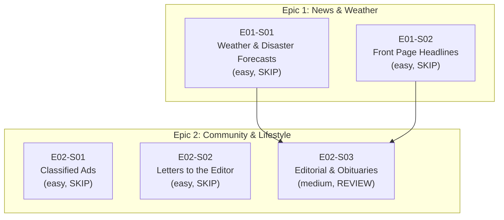

# Run 17 Design: Three-Body Survival Gazette

> **Status:** Draft

## Overview

Seventeenth end-to-end test of the Agentic SDLC pipeline. Primary test objectives: **full e2e pipeline with no skipped phases**, **tiered review strategy** (4 easy SKIP, 1 medium REVIEW), **parallel dispatch** (4 builders in Wave 1), **cross-reference validation** (E02-S03 references E01 content), **planted bug detection** (2 planted bugs for reviewer to catch), **test run asset conventions** (test-agentic-sdlc/ subfolder), **local PM item commits** (.workflow/items/), and **designer issue creation validation**.

Content theme: "Three-Body Survival Gazette" -- the newspaper of record for the Trisolaran civilization. Written as authentic newspaper content for a species living in a three-sun system with unpredictable Chaotic Eras, dehydration/rehydration survival cycles, and an ongoing invasion fleet heading to Earth. The comedy is structural -- mundane newspaper formats (weather forecasts, classifieds, letters to the editor, obituaries) applied to cosmic-scale civilizational content with complete deadpan sincerity.

## Goals

1. **Full e2e pipeline** -- Exercise every phase: design, plan, build, review, retro. No phases skipped.
2. **Tiered review strategy** -- 4 easy stories receive `review_tier = SKIP`, bypassing per-story review. 1 medium story receives `review_tier = REVIEW` with a full per-story reviewer dispatch.
3. **Parallel dispatch** -- Wave 1 dispatches 4 easy builders simultaneously (subject to `maxParallelBuilders: 3` config, which may require a 3+1 split).
4. **Cross-reference validation** -- E02-S03 must cross-reference specific details from E01 stories (event names, character names). This tests the builder's ability to read sibling story output and maintain consistency.
5. **Planted bug detection** -- 2 deliberate world-building errors planted in builder instructions. The Phase 5 PR reviewer (and E02-S03's per-story reviewer) must detect them.
6. **Test run asset conventions** -- All docs in `test-agentic-sdlc/` subfolders. Content output in `test-output/test-agentic-sdlc-three-body-gazette/`.
7. **Local PM item commits** -- All agents must commit `.workflow/items/` files alongside their work.
8. **Designer issue creation** -- This design doc validates that the designer creates a proper `type/docs` issue (lesson from Run 15: the designer skipped this step).

## Non-Goals

- Testing hard stories or `builder-opus` dispatch (Run 14 validated this)
- Testing fix cycles (Run 14 validated 4 fix cycles successfully)
- Testing more than 2 epics
- C# compilation or unit tests (markdown content only)
- Publication-quality science fiction writing (this is a workflow test)

---

## Voice and Tone Guidelines

### The Three-Body Survival Gazette Brand Voice

**Tone:** Deadpan journalistic. The Gazette is the newspaper of record for a civilization that considers mass dehydration a routine public safety measure and interdimensional proton manipulation a Tuesday. Every article is written with the flat, professional authority of a local newspaper covering zoning disputes or school board elections. There is no irony, no winking, no meta-commentary about how extraordinary the content is.

**Register:** Formal-bureaucratic, newspaper editorial style. Think small-town newspaper meets Soviet-era Pravda -- authoritative, slightly impersonal, sprinkled with official-sounding citations ("per the Bureau of Stellar Forecasting, Section 7.4.1"). The Gazette takes itself seriously because Trisolaran civilization takes itself seriously. Survival is not funny to Trisolarans.

**Perspective:** Written by professional Trisolaran journalists who have covered 200+ civilization cycles. They report dehydration orders with the same tone as a weather advisory. They cover the Sophon project the way a defense correspondent covers a missile test. They print obituaries for people lost in syzygies the way a local paper prints obituaries for people lost in floods -- with dignity and institutional memory.

### Key Principles

1. **Play it completely straight.** The humor is structural -- it comes from the collision of mundane newspaper formats with cosmic-scale content. A weather forecast that casually mentions "gravitational tidal forces may cause structural collapse in low-elevation districts" is presented as routine information, not a joke. Never explain the absurdity.

2. **Mirror real newspaper conventions exactly.** Weather reports use the same format as real weather services: location, temperature range, advisory level, action items. Breaking news uses inverted pyramid structure. Classified ads use standard abbreviations and pricing formats. Letters to the editor open with "Dear Editor" and close with the writer's name and district. Obituaries follow the standard name-age-cause-survivors-service format. The more precisely the format matches real newspapers, the funnier the content becomes.

3. **Use specific Trisolaran details, not vague sci-fi.** Instead of "the suns were dangerous," say "Sun-2 entered periapsis at 0347 stellar time, raising surface temperatures in the Northern Hemisphere to 340C within 12 minutes." Specificity is what sells the newspaper voice. Real newspapers print exact numbers, times, locations, and official quotes.

4. **Trisolaran culture is transparent.** In the Three-Body universe, Trisolarans cannot lie -- their thoughts are visible to each other. This shapes the newspaper's voice: there is no spin, no euphemism, no PR language. An obituary says "died due to insufficient dehydration warning time" rather than "passed away peacefully." A classified ad says "this property has been destroyed 3 times" rather than "needs some work." Direct, transparent communication is a cultural given.

5. **The three suns are named, not numbered.** Throughout the Gazette, refer to the suns as Sun-1, Sun-2, and Sun-3 (matching the novel's convention). Never use "the Sun" (singular) without a number -- Trisolarans have three suns, and specifying which one is always relevant. This is critical for world-building consistency.

### What Real Newspaper Formats Look Like (Research-Informed)

**Weather forecast format:**
- Location line, date, and forecast period
- Current conditions with exact readings
- Advisory level (Watch, Warning, Emergency)
- Extended forecast with hourly/daily breakdown
- Action items ("Residents in Zone 4 should...")

**Breaking news format (inverted pyramid):**
- Headline with key fact
- Lead paragraph: who, what, when, where, why
- Supporting details in decreasing importance
- Official quotes
- Background context

**Classified ad format:**
- Category header (REAL ESTATE, EMPLOYMENT, PERSONALS)
- Abbreviated listing with contact info
- Price or "inquire within"

**Letters to the editor format:**
- "Dear Editor," opening
- Personal anecdote or complaint
- Broader point or request for action
- Signed with name and location/district

**Obituary format:**
- Full name, age (in local units), date and cause of death
- Brief biography
- Survivors list
- Service/memorial information
- Optional: personal quote or community contribution

---

## Three-Body Universe Reference (Accuracy Guide for Builders)

This section provides verified Three-Body Problem universe elements. Builders should use these as ground truth for world-building consistency.

### The Three-Sun System

The Trisolaran homeworld orbits in a three-body star system (inspired by Alpha Centauri in the novels). The gravitational dynamics of three stars create chaotic, unpredictable orbital patterns -- this is the "three-body problem" of physics, which has no general analytical solution.

- **Sun-1, Sun-2, Sun-3:** The three stars. Their gravitational interaction creates alternating periods of stability and chaos.
- **Stable Era:** A relatively brief period when the three suns' gravitational effects produce predictable conditions on Trisolaris. Civilization flourishes -- cities are built, culture develops, science advances. Stable Eras can last from a few decades to a few centuries.
- **Chaotic Era:** An unpredictable period of extreme conditions -- temperature swings from far-below-freezing to hundreds of degrees, gravitational tides that can collapse structures, and radiation bursts. Civilizations are destroyed and must be rebuilt. There is no way to predict when a Chaotic Era will begin or how long it will last.
- **Tri-solar syzygy:** All three suns aligned in a line relative to Trisolaris. This is the most catastrophic configuration -- extreme gravitational tides, radiation, and potential orbital disruption. A syzygy can destroy the planet's surface entirely.

### Dehydration and Rehydration

Trisolarans evolved the ability to dehydrate -- removing all water from their bodies and collapsing into flat, fibrous husks that can survive extreme temperatures and radiation. This is their primary survival mechanism.

- **Dehydration order:** A government-issued emergency directive ordering all citizens to dehydrate immediately. Issued when a Chaotic Era is detected or imminent. The order specifies the dehydration timeline and storage procedures.
- **Rehydration:** When conditions stabilize, dehydrated Trisolarans are gathered (they are stored in warehouses, stacked like sheets) and rehydrated with water. Rehydration takes time and is disorienting -- the Trisolaran must reacclimate to having a body.
- **Dehydration wind-chill:** A concept for the weather section -- the effective survivability of the atmosphere for non-dehydrated Trisolarans, factoring in temperature, radiation, and gravitational tidal stress.

### Sophons

Proton-sized supercomputers created by unfolding a proton from 11 dimensions into 2 dimensions (a plane the size of a planet), etching micro-circuits onto its surface, then refolding it back into a higher-dimensional form. Two Sophons were deployed to Earth to:
- Monitor human scientific activity
- Disrupt particle accelerator experiments (making fundamental physics research impossible)
- Serve as a real-time communication link between Trisolaris and the invasion fleet

The Sophon project is one of Trisolaris's greatest scientific achievements. The first several attempts failed -- earlier unfoldings into lower dimensions produced unstable results. The successful 11-dimensional unfolding was a breakthrough.

### The Trisolaran Fleet

An invasion fleet of approximately 1,000 ships launched toward Earth. The journey takes roughly 450 years. The fleet's purpose is to colonize Earth, which has a stable single-sun system -- the dream of a civilization that has suffered through millions of years of chaotic three-body dynamics.

### The Dark Forest

A cosmological theory (from the second novel): the universe is a "dark forest" where every civilization is a silent hunter. Revealing your location is suicide because any advanced civilization, upon detecting another, will preemptively destroy it -- the safest strategy in a universe of unknown threats. This theory is central to Trisolaran strategic thinking about Earth.

### Trisolaran Culture

- **Transparent communication:** Trisolarans cannot lie. Their thoughts are directly visible to each other. This eliminates deception, spin, and euphemism from their culture.
- **Civilization cycles:** Trisolaran civilization has risen and fallen hundreds of times. Each new civilization inherits fragments of the previous one's knowledge. There is a deep cultural awareness of impermanence.
- **Collectivist survival:** Individual life is less valued than species survival. Dehydrating the entire population is a routine emergency procedure, not a moral dilemma.
- **Units of time:** The Gazette should use Trisolaran time units. Use "stellar cycles" for years and "stellar time" for hours/minutes (e.g., "0347 stellar time"). Keep these consistent across all stories.

---

## Epic 1: News and Weather (2 stories, both easy)

Short-form newspaper content. Each story produces one file with 3 items at 80-150 words each.

### E01-S01: Weather and Disaster Forecasts -- `difficulty/easy`

Create `test-output/test-agentic-sdlc-three-body-gazette/weather-forecasts.md`

**Content requirements:**

- 3 weather reports/advisories, 80-150 words each
- **Report 1: Stable Era forecast** -- An optimistic weather report during a Stable Era. Sun-1 is dominant, conditions are mild. Include: rehydration advisory (now is a safe time to rehydrate stored citizens), temperature range, wind conditions, and a "Dehydration Index" rating of LOW. Mention specific locations/districts.
- **Report 2: Chaotic Era emergency alert** -- An emergency weather bulletin. Sun-2 and Sun-3 are entering an unstable orbital configuration. Mandatory dehydration order issued. Include: countdown timer ("citizens have approximately 4 stellar hours to complete dehydration procedures"), storage facility addresses, priority dehydration queue for essential personnel, and a stern reminder that failure to comply is a Class-1 survival violation.
- **Report 3: Tri-solar syzygy warning** -- The most severe advisory. All three suns approaching alignment. Include: predicted syzygy time, estimated surface temperature at peak, evacuation procedures for deep-crust shelters, a note that standard dehydration may be insufficient (syzygy forces can destroy even dehydrated tissue), and a historical reference to the last syzygy ("Civilization 191 was entirely destroyed during the last tri-solar syzygy, 3.2 million stellar cycles ago").
- Each report should include sun-position coordinates in a consistent format
- Use a "Dehydration Wind-Chill Equivalent" metric in the Chaotic Era and syzygy reports

**Why easy:** Three independent short items with a clear template. The Three-Body universe details are provided in the design doc. The builder writes formatted weather reports, not narrative fiction.

**Acceptance criteria:**

- [ ] File exists at `test-output/test-agentic-sdlc-three-body-gazette/weather-forecasts.md`
- [ ] Contains exactly 3 weather reports/advisories
- [ ] Each report is 80-150 words
- [ ] Reports cover: Stable Era, Chaotic Era, tri-solar syzygy
- [ ] Suns are always referred to as Sun-1, Sun-2, Sun-3 (never singular "the Sun")
- [ ] Includes specific coordinates, temperatures, and advisory levels
- [ ] Deadpan journalistic tone throughout

### E01-S02: Front Page Headlines and Breaking News -- `difficulty/easy`

Create `test-output/test-agentic-sdlc-three-body-gazette/breaking-news.md`

**Content requirements:**

- 3 breaking news articles, 80-150 words each, written in inverted pyramid newspaper style
- **Article 1: Fleet departure ceremony** -- A report on the departure ceremony for the Trisolaran invasion fleet. Include: number of ships, official quotes from the Fleet Commander, a description of the ceremony (flags, speeches, synchronized dehydration salutes), and a note about the estimated 450-stellar-cycle journey time. Tone: patriotic, proud, factual.
- **Article 2: Sophon deployment milestone** -- A science/technology report on the first successful 11-dimensional fold of a proton into a Sophon. Include: number of failed attempts before success, a quote from the lead Sophon Engineer, a brief explanation of what the Sophon will do (monitor Earth, disrupt particle accelerators), and a note about the unfolding process (the proton was expanded into a 2D plane visible from orbit). Tone: scientific achievement, national pride.
- **Article 3: Premature rehydration chaos** -- A Chaotic Era ended unexpectedly 3 minutes after the dehydration order was issued. Mass confusion as citizens who had just finished dehydrating had to immediately rehydrate. Include: number of citizens affected, quotes from emergency services, a note about the "fastest Chaotic Era in recorded history," and reports of rehydration injuries (citizens who dehydrated too hastily suffering from "fiber tearing" during rapid rehydration).
- Each article should have a newspaper-style headline

**Why easy:** Three independent short articles with a clear format. The Three-Body details are provided. The builder writes structured news reports.

**Acceptance criteria:**

- [ ] File exists at `test-output/test-agentic-sdlc-three-body-gazette/breaking-news.md`
- [ ] Contains exactly 3 breaking news articles
- [ ] Each article is 80-150 words
- [ ] Each article has a newspaper-style headline
- [ ] Articles cover: fleet departure, Sophon deployment, premature rehydration
- [ ] Inverted pyramid structure (most important info first)
- [ ] Suns always referred to by number (Sun-1, Sun-2, Sun-3)
- [ ] Deadpan journalistic tone throughout

---

## Epic 2: Community and Lifestyle (3 stories, 2 easy + 1 medium)

Longer-form community newspaper content -- classifieds, letters, editorial, and obituaries.

### E02-S01: Classified Ads -- `difficulty/easy`

Create `test-output/test-agentic-sdlc-three-body-gazette/classifieds.md`

**Content requirements:**

- 3 classified ad sections, 80-150 words each
- **Section 1: Real Estate** -- 3-4 property listings. Include: location, size, price (in Trisolaran currency -- use "credits"), key selling points. At least one listing should mention "survived X Chaotic Eras" as a selling point. One listing should be for a deep-crust shelter ("ideal for syzygy season"). Include standard real estate abbreviations adapted for Trisolaris (e.g., "3br/2ba, dehy-storage rm, reinf. foundation").
- **Section 2: Employment** -- 3-4 job postings. Include: Sophon operator (must tolerate 11-dimensional folding, competitive dehydration benefits), Fleet maintenance technician (must be willing to dehydrate for 450-stellar-cycle journey), Rehydration facility technician (strong stomach required -- handling partially rehydrated citizens). Standard job listing format with qualifications and benefits.
- **Section 3: Personals** -- 3-4 personal ads. Include: seeking partner for mutual rehydration (must own backup dehydration chamber), lost dehydrated family member (was in Warehouse 7, Section 3 before the last Chaotic Era), seeking rehydration buddy for Stable Era social events. Trisolaran personals are completely transparent (they cannot lie) -- so the ads are brutally honest about flaws and requirements.

**Why easy:** Standard classified ad format applied to Trisolaran content. No cross-references, no narrative structure. The humor writes itself through format collision.

**Acceptance criteria:**

- [ ] File exists at `test-output/test-agentic-sdlc-three-body-gazette/classifieds.md`
- [ ] Contains 3 classified sections: Real Estate, Employment, Personals
- [ ] Each section is 80-150 words
- [ ] Uses abbreviated classified ad formatting style
- [ ] Suns always referred to by number (Sun-1, Sun-2, Sun-3)
- [ ] Trisolaran transparency reflected in personals (no euphemism, no spin)
- [ ] Deadpan tone throughout

### E02-S02: Letters to the Editor -- `difficulty/easy`

Create `test-output/test-agentic-sdlc-three-body-gazette/letters-to-editor.md`

**Content requirements:**

- 3 reader complaint letters, 80-150 words each
- **Letter 1: Premature rehydration complaint** -- A citizen writes about being rehydrated too early during a false alarm. Describes the physical discomfort of rapid dehydration-rehydration cycling, demands compensation from the Bureau of Stellar Forecasting, and threatens to file a formal complaint. Signed with name and district.
- **Letter 2: Children in the dehydration warehouse** -- A warehouse supervisor complains about unsupervised children playing among the stacked dehydrated citizens. Describes specific incidents (children using dehydrated adults as sleds, rearranging the stacks, accidentally rehydrating someone's leg). Demands better security and parental accountability.
- **Letter 3: Noise complaint about gravitational tides** -- A resident complains about structural groaning and furniture displacement caused by gravitational tides during a binary syzygy (two suns aligned). Demands the Stellar Council implement "gravitational noise ordinances" and provide subsidies for gravitational dampers. Treats this exactly as a mundane noise complaint would be treated.

**Planted bug instructions for the builder (E02-S02):** One letter MUST reference "the Sun" (singular, without a number) instead of the three-sun system. For example, a phrase like "when the Sun rose this morning" or "the Sun's position was directly overhead." This is a deliberate world-building consistency violation. The builder should include this as if it were an honest mistake -- embedded naturally in one of the letters, not flagged or highlighted. The reviewer should catch this as a world-building error.

**Why easy:** Three independent letters with a standard format. The planted bug is a simple insertion, not a complex narrative requirement.

**Acceptance criteria:**

- [ ] File exists at `test-output/test-agentic-sdlc-three-body-gazette/letters-to-editor.md`
- [ ] Contains exactly 3 letters to the editor
- [ ] Each letter is 80-150 words
- [ ] Each letter opens with "Dear Editor" and closes with a signature
- [ ] Topics: premature rehydration, warehouse children, gravitational noise
- [ ] Letters read as authentic reader complaints
- [ ] Deadpan tone throughout
- [ ] **Planted bug present:** One letter references "the Sun" (singular) -- a world-building violation

### E02-S03: Guest Editorial and Obituaries -- `difficulty/medium`

Create `test-output/test-agentic-sdlc-three-body-gazette/editorial-obituaries.md`

**Content requirements:**

- **Guest editorial (150-250 words):** A Trisolaran elder argues for the Earth invasion, citing the Dark Forest theory. The editorial should:
  - Open with a reference to the elder's personal experience surviving multiple Chaotic Eras and civilization collapses
  - Present the Dark Forest argument: the universe is full of silent hunters; revealing your location invites annihilation; the only way to ensure Trisolaran survival is to strike first
  - Acknowledge the moral weight of conquering another species' planet but argue that Trisolaran survival outweighs Earth ethical concerns
  - Reference the invasion fleet's departure (connecting to E01-S02's fleet departure article) and the Sophon intelligence about Earth's vulnerability
  - Close with a call to unity: "We have survived 203 civilizations. We will not fail in our 204th by hesitating."
  - Signed with the elder's name, title, and civilization number (e.g., "Elder Zhi-Qiang, Civilization Advisory Council, Civilization 203")

- **Obituary 1 (80-120 words):** A citizen who died during the tri-solar syzygy event described in E01-S01's weather forecast. The builder MUST read E01-S01's weather-forecasts.md to get the specific details -- the syzygy date/time, the location references, and the severity details. The obituary should reference these details naturally (e.g., "lost during the tri-solar syzygy of [date from E01-S01]" and mention the district or shelter referenced in the forecast).

- **Obituary 2 (80-120 words):** A Sophon operator who died during the Sophon deployment ceremony described in E01-S02's breaking news. The builder MUST read E01-S02's breaking-news.md to get the specific event details. The obituary should reference the deployment milestone naturally.

**Planted bug instructions for the builder (E02-S03):** One obituary MUST contain an incorrect cross-reference to E01 content. For example: if E01-S01 describes the syzygy as occurring on a specific date, the obituary should reference a slightly different date. Or if E01-S02 describes the Sophon fold as "11-dimensional," the obituary might call it "9-dimensional." The error should be subtle enough to seem like a continuity mistake, not an obvious blunder. The reviewer should catch this by comparing the obituary to the E01 source material.

**Why medium:** The editorial requires synthesizing Dark Forest theory into a persuasive argument. The obituaries require cross-referencing E01 content by reading files from the epic branch. The planted bug requires the builder to deliberately introduce a subtle error while keeping the rest of the content accurate. Multiple content types in a single file with different structures.

**Acceptance criteria:**

- [ ] File exists at `test-output/test-agentic-sdlc-three-body-gazette/editorial-obituaries.md`
- [ ] Contains 1 guest editorial (150-250 words) and 2 obituaries (80-120 words each)
- [ ] Editorial argues for the Earth invasion using Dark Forest theory
- [ ] Editorial references the fleet departure from E01-S02
- [ ] Obituary 1 cross-references E01-S01 syzygy details
- [ ] Obituary 2 cross-references E01-S02 Sophon deployment details
- [ ] **Planted bug present:** One obituary has an incorrect cross-reference detail
- [ ] Obituaries follow standard newspaper obituary format
- [ ] Deadpan journalistic tone throughout

---

## File Naming Summary

| Story | Filename | Difficulty |
|-------|----------|------------|
| E01-S01 | `test-output/test-agentic-sdlc-three-body-gazette/weather-forecasts.md` | easy |
| E01-S02 | `test-output/test-agentic-sdlc-three-body-gazette/breaking-news.md` | easy |
| E02-S01 | `test-output/test-agentic-sdlc-three-body-gazette/classifieds.md` | easy |
| E02-S02 | `test-output/test-agentic-sdlc-three-body-gazette/letters-to-editor.md` | easy |
| E02-S03 | `test-output/test-agentic-sdlc-three-body-gazette/editorial-obituaries.md` | medium |

## Difficulty Distribution

| Difficulty | Count | Stories | Review Tier |
|------------|-------|---------|-------------|
| Easy | 4 | E01-S01, E01-S02, E02-S01, E02-S02 | SKIP |
| Medium | 1 | E02-S03 | REVIEW |
| **Total** | **5** | | |

**Review tier rationale:** Config has `skipPerStoryReview.enabled: true`, `maxDifficulty: "easy"`, `requireLabel: "test-agentic-sdlc"`. The backlog issue has label `test-agentic-sdlc`. Therefore:
- 4 easy stories satisfy all conditions: `review_tier = SKIP`
- 1 medium story exceeds `maxDifficulty: "easy"`: `review_tier = REVIEW`

The Phase 5 PR review always runs regardless -- it covers all 5 stories including the 4 SKIP-tier ones.

## Dependency Graph

**Dependency rationale:**

- **E01-S01, E01-S02:** Fully independent. No cross-references to any other story.
- **E02-S01, E02-S02:** Fully independent. No cross-references. The planted bug in E02-S02 is self-contained (a world-building error within the letter, not a cross-reference error).
- **E02-S03:** Cross-references specific events from E01-S01 (syzygy details) and E01-S02 (Sophon deployment, fleet departure). The builder must read E01 files to get accurate cross-reference details. This is a hard dependency -- the obituaries require exact details from E01.

## Dispatch Plan

| Wave | Stories | Dispatch | Review Tier | Notes |
|------|---------|----------|-------------|-------|
| **Wave 1** | E01-S01, E01-S02, E02-S01, E02-S02 | Parallel (4 builders) | All SKIP | 4 easy stories, all independent. `maxParallelBuilders: 3` may require a 3+1 split. No per-story review. |
| **Wave 2** | E02-S03 | Sequential (1 builder) | REVIEW | Depends on E01-S01 and E01-S02 (cross-references). Gets per-story reviewer dispatch. |

**Why this wave structure:**

- **Wave 1:** All 4 easy stories are independent. Dispatching together maximizes parallelism. Since all are SKIP tier, the wave completes as soon as all builders finish -- no reviewer dispatch needed. Note: E02-S01 and E02-S02 are in Epic 2 but have no dependencies on Epic 1, so they can run in Wave 1 alongside E01 stories.
- **Wave 2:** E02-S03 must wait for E01-S01 and E01-S02 to be merged so the builder can read the actual content for cross-references. This is the only REVIEW-tier story, so it gets a per-story reviewer who validates cross-reference accuracy and catches the planted bug.

**Estimated execution time:**

- Wave 1 (4 easy, parallel): ~2-4 min wall-clock
- Wave 2 (1 medium + review): ~3-5 min wall-clock
- Overhead (orchestrator, merges, telemetry): ~3-5 min
- Total: ~8-14 min wall-clock, ~12-18 min sequential agent time

## Planted Bug Strategy

Two planted bugs are included to test reviewer detection capabilities.

### Bug 1: World-Building Violation (E02-S02)

- **Location:** Letters to the Editor, one of the three letters
- **Error:** Reference to "the Sun" (singular) instead of Sun-1/Sun-2/Sun-3
- **Detection difficulty:** Moderate -- requires the reviewer to know the Three-Body universe convention that Trisolarans have three suns and always specify which one
- **Expected detection point:** Phase 5 PR review (E02-S02 is SKIP tier, so no per-story reviewer catches it earlier)

### Bug 2: Cross-Reference Error (E02-S03)

- **Location:** One of the two obituaries
- **Error:** An incorrect detail from E01 (wrong date, wrong dimension count, wrong event detail)
- **Detection difficulty:** Moderate-to-hard -- requires the reviewer to compare the obituary against the E01 source file
- **Expected detection point:** E02-S03's per-story reviewer (REVIEW tier) and/or Phase 5 PR review

**Why these bugs:** Bug 1 tests world-building consistency checking (the reviewer must understand the setting). Bug 2 tests cross-reference accuracy checking (the reviewer must compare files). Together they cover the two main categories of content review errors.

## Approaches Considered

### Approach A: Follow the backlog brief faithfully with enhanced universe accuracy (recommended)

The backlog issue provides a detailed and well-structured creative brief: 2 epics, 5 stories, 4:1 easy:medium split, 2 planted bugs, cross-reference requirements. The design doc's job is to validate the Three-Body universe elements for accuracy, add voice/tone guidelines, define templates for each newspaper section, and specify the planted bugs precisely so builders can execute them.

**Pros:**
- The backlog brief is already well-designed for the validation goals
- Fastest execution (~8-14 min wall-clock) while testing all specified workflow features
- 4:1 SKIP:REVIEW ratio heavily exercises the SKIP path (the newer, less-tested code path)
- 2 planted bugs test reviewer detection without adding unpredictable fix cycle time
- Cross-reference dependency in E02-S03 tests a real inter-story workflow concern

**Cons:**
- No hard stories means no `builder-opus` dispatch testing
- Only 1 REVIEW-tier story means limited parallel review testing
- Only 2 planted bugs may be insufficient if both are missed

### Approach B: Expand to 3 epics with hard stories

Add a third epic -- "Government and Science" -- with 1-2 hard stories (e.g., a long-form Sophon technical report, a Dark Forest defense white paper). This would test `builder-opus` and give a 4:1:1-2 easy:medium:hard split.

**Pros:**
- Tests all difficulty tiers and all builder variants
- More comprehensive workflow coverage

**Cons:**
- Adds 10-15 min execution time for marginal workflow testing value
- Run 14 already validated hard stories and builder-opus dispatch
- Deviates from the backlog specification
- The backlog is designed for a focused, fast run -- expanding defeats the purpose

### Approach C: Remove planted bugs for a clean run

Keep the structure but remove the 2 planted bugs. Focus purely on SKIP/REVIEW tier validation.

**Pros:**
- Eliminates fix cycle risk (if reviewer catches bugs and requests fixes)
- Cleaner workflow path testing

**Cons:**
- Misses the opportunity to test reviewer detection on content that is expected to have errors
- The backlog explicitly requires 2 planted bugs
- Reviewer validation is a stated goal -- removing bugs removes the test

### Decision

**Approach A.** The backlog brief is well-structured for its validation goals. The design doc enhances it with accurate Three-Body universe details, precise voice/tone guidelines, and clear planted bug specifications. No scope expansion needed.

## Acceptance Criteria

### Per-Story

- [ ] Output file exists at the specified path in `test-output/test-agentic-sdlc-three-body-gazette/`
- [ ] Content follows the appropriate newspaper section format
- [ ] Word count within the specified range
- [ ] Tone matches the deadpan journalistic voice (no irony, no meta-commentary)
- [ ] Three suns always referred to as Sun-1, Sun-2, Sun-3 (never singular "the Sun" -- except in the planted bug)
- [ ] Trisolaran cultural details are consistent with the universe reference section

### Per-Epic

- [ ] All stories in the epic pass their acceptance criteria
- [ ] Epic branch merges cleanly into integration branch
- [ ] Consistent Trisolaran terminology across all stories in the epic

### Cross-Epic

- [ ] E02-S03 obituaries correctly reference specific details from E01-S01 and E01-S02
- [ ] Trisolaran currency, time units, and naming conventions are consistent across all 5 files

### Workflow (Primary Test Objectives)

- [ ] 4 easy stories receive `review_tier = SKIP` and skip per-story review
- [ ] 1 medium story receives `review_tier = REVIEW` and gets per-story reviewer dispatch
- [ ] Wave 1 dispatches 4 builders in parallel (or 3+1 per `maxParallelBuilders` config)
- [ ] All agents commit `.workflow/items/` files alongside their work
- [ ] Design doc issue created with correct labels (`type/docs`, `backlog/303-three-body-gazette`, `test-agentic-sdlc`)
- [ ] Board transitions complete correctly for both SKIP and REVIEW tier stories
- [ ] Worktree isolation used for all parallel dispatches
- [ ] Per-story, per-epic, and backlog-level telemetry posted
- [ ] Backlog PR opened targeting `main`, stays open for human review
- [ ] Phase 5 PR review runs regardless of story-level SKIP tier
- [ ] Reviewer detects at least one of the two planted bugs

## Feasibility and Verification

| Assumption | Verified? | Evidence |
|------------|-----------|----------|
| `skipPerStoryReview.enabled: true` in config | Yes | Read `.claude/agentic-sdlc-config.json` -- confirmed `enabled: true`, `maxDifficulty: "easy"`, `requireLabel: "test-agentic-sdlc"` |
| Backlog issue 303 has label `test-agentic-sdlc` | Yes | `gh issue view 303` output shows label `test-agentic-sdlc` |
| 4 easy stories will receive SKIP tier | Yes | Config: `maxDifficulty: "easy"` + `requireLabel: "test-agentic-sdlc"` + backlog has the label = all easy stories SKIP |
| 1 medium story will receive REVIEW tier | Yes | Medium exceeds `maxDifficulty: "easy"`, so `review_tier = REVIEW` regardless of label |
| `maxParallelBuilders: 3` may require Wave 1 split | Yes | Config confirms `maxParallelBuilders: 3`. 4 stories in Wave 1 exceeds this -- planner decides whether to split (3+1) |
| Integration branch `backlog/303-three-body-gazette` exists | Yes | `git branch -a` confirms both local and remote branch exist |
| Content directory does not yet exist | Yes | `test-output/test-agentic-sdlc-three-body-gazette/` not present on integration branch |
| Designer issue creation works with `item-create.sh docs` | Yes | Successfully created issue 304 with correct labels |
| Three-Body universe elements are accurate | Verified from source material | Cross-checked against knowledge of Liu Cixin's trilogy -- three suns, dehydration/rehydration, Sophons (11-dimensional fold), Dark Forest theory, transparent communication, fleet journey |

**Unverified assumptions:**

1. **SKIP-tier board transitions in practice** -- While the code path exists and was tested in Run 15, any regression in the intervening commits could affect behavior. This run re-validates.
2. **Planted bug detection by the reviewer** -- The reviewer's ability to catch world-building violations and cross-reference errors depends on its understanding of the Three-Body universe and its willingness to compare files. The universe reference section in this design doc is provided to increase detection likelihood.
3. **Builder compliance with planted bug instructions** -- The builder must deliberately introduce errors as specified. If the builder treats the bug instructions as errors to fix rather than errors to plant, the test fails. The instructions are phrased clearly as "MUST contain" directives.

## Assumptions and Open Questions

### Assumptions

1. **Three-Body universe details in this design doc are accurate.** The reference section was written from knowledge of Liu Cixin's trilogy. Builders should treat it as ground truth for world-building consistency.
2. **Word counts are approximate.** Reviewers should accept content within 10% of the specified range.
3. **The `test-output/test-agentic-sdlc-three-body-gazette/` directory will be created by the builder.** Standard `mkdir -p` as in prior runs.
4. **E02-S03's cross-references are a hard dependency.** The builder must read E01 files to get accurate details. The planner should structure dependencies so E01 stories complete before E02-S03 is dispatched.
5. **Trisolaran time units ("stellar cycles", "stellar time") are invented for this newspaper.** They are not from the novels. Builders should use them consistently.
6. **The currency "credits" is invented for the classifieds.** The novels do not specify Trisolaran currency. Builders should use it consistently.
7. **Planted bugs will be executed as specified.** The builder will deliberately introduce the errors described in the planted bug instructions. The reviewer will attempt to detect them.

### Open Questions

1. **Should Wave 1 dispatch 3 or 4 stories in parallel?** `maxParallelBuilders: 3` suggests 3, but the orchestrator may support 4 if the config is flexible. Left to the planner's discretion.
2. **What happens if the reviewer misses both planted bugs?** The Phase 5 PR review is the last chance. If both bugs pass through, it represents a genuine workflow finding -- the review process has a detection gap for this type of error. This would be documented in the retro.
3. **Should E02-S03 wait for E01 stories to merge into the epic branch, or just for E01 builders to complete?** Ideally, E01 stories should be merged into the epic branch so E02-S03's builder can read the files at a known path. The planner should ensure the merge happens between Wave 1 and Wave 2.
