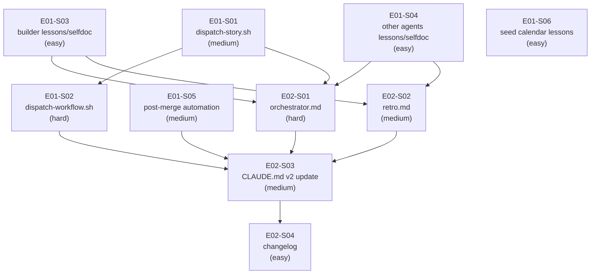

# Agentic SDLC v2 — Implementation Plan

## Context

The Calendar Tool build (12 stories, 167 tests, ~4.5h) was the first end-to-end test of the agentic SDLC. The [retro](../4-reviews/2026-03-09-e01-calendar-retro.md) exposed six structural problems: human orchestrator bottleneck, broken parallel telemetry, unused model routing, builder variant maintenance, no self-improvement loop, and review-as-afterthought. The [v2 design](../2-design/2026-03-09-agentic-sdlc-v2-design.md) proposes fixes for all six.

**Scope:** Phases 1-3 of the v2 migration plan. Phase 4 (Norris integration) is deferred.

**Key decision:** Builder variants (`builder-haiku/sonnet/opus.md`) stay. The orchestrator dispatches via the Agent tool in-session (primary) using `subagent_type: "builder-sonnet"`, and via CLI dispatch scripts (standalone terminal only) using `./scripts/dispatch-story.sh`.

**No C# code changes.** This is entirely agent `.md` files, shell scripts, and CLAUDE.md updates.

---

## Epic 1: Dispatch Scripts + Lesson Conventions

Foundation work that has zero dependency on the new orchestrator/retro agents.

### E01-S01: Create `dispatch-story.sh` — `difficulty/medium`

CLI dispatch wrapper: reads a GitHub issue, writes a prompt file, invokes Claude in headless mode, posts telemetry or failure.

**Create:**

- `scripts/dispatch-story.sh`
- `.dispatch/.gitignore` (contains `*` + `!.gitignore`)

**Pattern to follow:** `scripts/issue-start.sh` — `set -euo pipefail`, `REPO="gavinkilbride/NeuralNorris"`, named arg parsing via `while/case`.

**Acceptance criteria:**

- Usage: `./scripts/dispatch-story.sh <issue-number> --model <model> --agent <agent> [--epic-branch <branch>]`
- Reads issue metadata via `gh issue view <n> --json title,body,labels`
- Extracts difficulty label from issue labels JSON
- Writes prompt file to `.dispatch/story-<n>.md` with: story title, acceptance criteria, epic branch, story branch convention, builder-tagged lessons (`grep -rl "tags:.*builder" docs/4-reviews/lessons/`)
- Pre-flight check: verifies `claude` CLI is available and supports `--agent`, `--model`, `--output-format`, `--max-turns` flags (via `claude --help` or a dry-run). Prints a clear error with expected CC CLI version if any flag is missing.
- Invokes Claude in headless mode with the prompt file, agent, model, and `--output-format json`
- Captures exit code + wall-clock duration (`SECONDS` or `date` arithmetic)
- On success: calls `./scripts/issue-telemetry.sh` with `--model`, `--duration`, `--commit`
- On failure: posts failure comment via `gh issue comment`
- Script is executable

**Branch:** `e01-s01/dispatch-story-script`

---

### E01-S02: Create `dispatch-workflow.sh` — `difficulty/hard`

Full lifecycle CLI orchestration: design → plan → build → review → epic PR → retro.

**Create:** `scripts/dispatch-workflow.sh`

**Depends on:** E01-S01

**Acceptance criteria:**

- Usage: `./scripts/dispatch-workflow.sh <backlog-issue-number> [--skip-design] [--skip-plan] [--autonomous] [--epic <eNN-slug>]`
- `--autonomous` flag: designer/architect skip interactive questions; PRs auto-merged via `gh pr merge`
- Phase 1 (Design): dispatches designer (with "autonomous" prefix when `--autonomous`), auto-merges or polls for merge
- Phase 2 (Plan): dispatches architect (with "autonomous" prefix when `--autonomous`), auto-merges or polls for merge
- Phase 3 (Build): reads stories via `gh issue list --label "epic/<slug>"`, reads difficulty, dispatches via `dispatch-story.sh`, dispatches reviewer after each story
- Phase 4 (Close): opens epic PR with `Closes #NN`, posts epic telemetry
- Phase 5 (Retro): dispatches retro agent
- Sequential execution (parallel dispatch is a follow-up)
- Clear status messages at each phase transition

**Branch:** `e01-s02/dispatch-workflow-script`

---

### E01-S03: Add lessons + self-doc to `builder.md` + variants — `difficulty/easy`

**Modify:** `builder.md`, `builder-haiku.md`, `builder-sonnet.md`, `builder-opus.md`

**Content to add** (after "Code Rules" section):

1. **"Before Starting Any Story"** step: `grep -rl "tags:.*builder" docs/4-reviews/lessons/` — read relevant lessons
2. **"Capturing Lessons"** section — when/how to write lesson files (from v2 design)
3. **"Self-Documentation"** section — when to update CLAUDE.md/agent files (from v2 design)

**Acceptance criteria:**

- `builder.md` has all three new sections
- All three variants are byte-identical to `builder.md` except `name:` and `model:` in YAML frontmatter
- Verified via `diff <(tail -n +6 .claude/agents/builder.md) <(tail -n +6 .claude/agents/builder-sonnet.md)`

**Branch:** `e01-s03/builder-lessons-selfdoc`

---

### E01-S04: Add lessons + self-doc to designer, architect, reviewer — `difficulty/easy`

**Modify:** `designer.md`, `architect.md`, `reviewer.md`

Same two sections as E01-S03, with role-specific tag keywords:

- Designer: `grep -rl "tags:.*design" docs/4-reviews/lessons/`
- Architect: `grep -rl "tags:.*architecture" docs/4-reviews/lessons/`
- Reviewer: `grep -rl "tags:.*review" docs/4-reviews/lessons/`

**Additional reviewer change:** New "Per-Story Review Mode" section:

- Accepts issue number + story branch (not just PR number)
- Reads diff between story branch and epic branch base (review happens **before** story-to-epic merge)
- Checks against CLAUDE.md conventions AND lesson files
- Posts findings as `gh issue comment` on the story issue
- If critical issues found, builder fixes on the story branch and reviewer re-reviews before merge proceeds

**Branch:** `e01-s04/agent-lessons-selfdoc`

---

### E01-S05: Post-merge automation — `difficulty/medium`

When an epic PR is merged (via CC agent or GitHub UI), all linked issues should be closed and their board status set to "Done". Today `issue-merged.sh` only closes issues — it doesn't touch the board. And merging via the GitHub UI skips the script entirely.

**Modify:**

- `scripts/issue-merged.sh` — add board status update to "Done" (option ID `9cfa70ca`)

**Create:**

- `.github/workflows/auto-close-issues.yml` — triggers on PR merge to `main`, parses `Closes #N` from PR body, closes each issue via `gh issue close`

**Pattern to follow:** `scripts/issue-telemetry.sh` for `gh project item-edit` commands; `.github/workflows/sentinel.yml` for workflow structure.

**Acceptance criteria:**

- `issue-merged.sh` closes the issue AND sets project board status to "Done" via `gh project item-edit`
- `issue-merged.sh` is idempotent (handles already-closed issues gracefully)
- `auto-close-issues.yml` triggers only on merged PRs to `main` (not closed-without-merge)
- Workflow extracts all `Closes #N`, `Fixes #N`, `Resolves #N` patterns (case-insensitive) from PR body
- For each extracted issue: closes it via `gh issue close` (does NOT update project board — the default `GITHUB_TOKEN` lacks the `project` scope required for `gh project item-edit`)
- Workflow uses `gh` CLI
- `issue-merged.sh` (local, full `gh` access) handles both issue closure + board update; the workflow is a safety net for issue closure only

**Branch:** `e01-s05/post-merge-automation`

---

### E01-S06: Seed lesson files from Calendar retro — `difficulty/easy`

The lesson system needs initial content so builders have something to grep when v2 goes live. Extract key learnings from the Calendar Tool retrospective (`docs/4-reviews/2026-03-09-e01-calendar-retro.md`) into structured lesson files.

**Create:**

- `docs/4-reviews/lessons/5-calendar-tool/e01-calendar-core/2026-03-09-s01-di-registration-blind-spot.md`
- `docs/4-reviews/lessons/5-calendar-tool/e01-calendar-core/2026-03-09-s01-prefix-stripping-across-layers.md`
- `docs/4-reviews/lessons/5-calendar-tool/e03-calendar-plugin/2026-03-09-s01-file-over-200-lines.md`
- `docs/4-reviews/lessons/5-calendar-tool/e01-calendar-core/2026-03-09-s03-telemetry-lost-in-parallel.md`
- `docs/4-reviews/lessons/5-calendar-tool/e01-calendar-core/2026-03-09-s01-model-routing-not-applied.md`
- `docs/4-reviews/lessons/5-calendar-tool/e03-calendar-plugin/2026-03-09-s01-csrf-validation-gap.md`

**Pattern to follow:** Lesson file format from the v2 design doc (YAML frontmatter with date, author, story, tags, severity + sections: What happened, Root cause, Prevention).

**Acceptance criteria:**

- At least 5 lesson files created, covering the 3 critical + 2 high-severity findings from the retro
- Each file has valid YAML frontmatter with `date`, `author`, `story`, `tags[]`, `severity`
- Each file has "What happened", "Root cause", "Prevention" sections
- Folder structure follows the `<backlog-issue>-<slug>/eNN-<epic>/` convention
- `grep -rl "tags:.*builder" docs/4-reviews/lessons/` returns at least 3 files
- `grep -rl "tags:.*review" docs/4-reviews/lessons/` returns at least 2 files

**Branch:** `e01-s06/seed-calendar-lessons`

---

## Epic 2: Orchestrator + Retro Agents

New agent files and the CLAUDE.md update that ties everything together.

### E02-S01: Create orchestrator agent — `difficulty/hard`

**Create:** `.claude/agents/orchestrator.md`

**Depends on:** E01-S01, E01-S03, E01-S04

**YAML frontmatter:**

```yaml
name: orchestrator
description: Workflow orchestrator — reads plans, dispatches builders/reviewers, manages GitHub state, posts telemetry, drives the full epic lifecycle.
tools: Read, Grep, Glob, Bash, Agent
model: inherit
```

**Key sections:**

1. **Phase Boundary** — dispatches agents, does NOT write code/docs/plans
2. **Two Dispatch Modes:**
   - In-session (primary): Agent tool with `subagent_type: "builder-haiku|sonnet|opus"` and `subagent_type: "reviewer"`
   - CLI (secondary): Bash → `./scripts/dispatch-story.sh`
3. **Workflow Phases** — read plan → read stories → build dependency graph → dispatch builders → post telemetry → dispatch reviewer (on story branch, before merge) → handle critical findings → merge story branches into epic → open epic PR → dispatch retro
4. **Model Routing** — `difficulty/easy`→haiku, `medium`→sonnet, `hard`→opus with dispatch commands for both modes
5. **GitHub State** — project board commands with exact option IDs, epic status sync rules
6. **Telemetry** — per-story + epic-level via `issue-telemetry.sh`
7. **Error Handling** — re-dispatch on review rejection, failure comment on dispatch failure
8. **Capturing Lessons** + **Self-Documentation** (orchestrator-tagged)

**Branch:** `e02-s01/orchestrator-agent`

---

### E02-S02: Create retro agent — `difficulty/medium`

**Create:** `.claude/agents/retro.md`

**Depends on:** E01-S03, E01-S04

**YAML frontmatter:**

```yaml
name: retro
description: Retrospective agent — synthesizes lessons, telemetry, and review findings into a retro doc and proposes convention changes via PR.
tools: Read, Write, Edit, Grep, Glob, Bash
model: inherit
```

**Key sections:**

1. **Phase Boundary** — reads artifacts, writes retro doc + PR. Does NOT modify CLAUDE.md directly
2. **Inputs** — lesson files, git log, issue/PR comments, CLAUDE.md diffs, plan doc (with exact commands)
3. **Outputs:**
   - Retro doc → `docs/4-reviews/lessons/<backlog-issue>-<slug>/YYYY-MM-DD-eNN-<slug>-retro.md` (template matches existing `docs/4-reviews/lessons/5-calendar-tool/2026-03-09-e01-calendar-retro.md`)
   - Convention changes → `docs/retro-<epic>` branch → PR to `main`
4. **Lesson Retention** — notes which lessons are absorbed into conventions
5. **Capturing Lessons** + **Self-Documentation**

**Branch:** `e02-s02/retro-agent`

---

### E02-S03: Update CLAUDE.md with v2 conventions — `difficulty/medium`

**Modify:** `CLAUDE.md`

**Depends on:** E01-S02, E01-S05, E02-S01, E02-S02

**Changes:**

| Section                | Line     | Change                                                                                                            |
| ---------------------- | -------- | ----------------------------------------------------------------------------------------------------------------- |
| Agents table           | 98-106   | Add orchestrator + retro rows, update "Four" → "Six"                                                              |
| For All Agents         | 107-113  | Add bullet: write lesson files when discovering issues                                                             |
| Helper scripts         | 209-217  | Add `dispatch-story.sh`, `dispatch-workflow.sh`, updated `issue-merged.sh` rows                                    |
| Dispatch Protocol      | 219-256  | Rewrite to document both modes (in-session + CLI), add per-story review step, add retro dispatch, add full lifecycle orchestration section |
| NEW: Lesson Conventions | After Documentation Conventions | File format, folder convention, YAML fields, tag discovery, three-tier retention               |

**Keep unchanged:** Builder variant sync convention, all project board option IDs.

**Branch:** `e02-s03/claude-md-v2-update`

---

### E02-S04: Changelog entry — `difficulty/easy`

**Modify:** `docs/CHANGELOG.md`

**Depends on:** E02-S03

Add entry under current date: orchestrator agent, retro agent, dispatch scripts, post-merge automation, lesson conventions, self-documentation, per-story review.

**Branch:** `e02-s04/changelog-sdlc-v2`

---

## Dependency Graph



**Parallel opportunities:**

- **Wave 1:** E01-S01, E01-S03, E01-S04, E01-S05, E01-S06 (all independent)
- **Wave 2:** E01-S02, E02-S01, E02-S02 (after their E01 deps)
- **Wave 3:** E02-S03 (after all of wave 2)
- **Wave 4:** E02-S04 (last)

**Note:** E01-S06 (seed calendar lessons) has no dependencies and no dependents — it can run in any wave but is most natural in wave 1.

---

## Verification

**After all stories complete:**

1. **Scripts:** `test -x scripts/dispatch-story.sh && test -x scripts/dispatch-workflow.sh`
2. **Agent files:** `ls .claude/agents/{designer,architect,builder,builder-haiku,builder-sonnet,builder-opus,reviewer,orchestrator,retro}.md` — 9 files
3. **Builder sync:** `diff <(tail -n +6 .claude/agents/builder.md) <(tail -n +6 .claude/agents/builder-sonnet.md)`
4. **Lessons sections:** `grep -l "Capturing Lessons" .claude/agents/*.md` — 6 unique agents (9 files counting variants)
5. **CLAUDE.md:** agents table has 6 rows, dispatch protocol documents both modes, "Lesson Conventions" section exists
6. **Post-merge:** `issue-merged.sh` sets board status to Done; `auto-close-issues.yml` exists in `.github/workflows/` (closes issues only, no board update)
7. **Seed lessons:** `grep -rl "tags:.*builder" docs/4-reviews/lessons/` returns at least 3 files; folder structure is `5-calendar-tool/eNN-*/`
8. **Functional test:** `./scripts/dispatch-story.sh <test-issue> --model haiku --agent builder --epic-branch epic/e01-calendar-core` — verify prompt file written to `.dispatch/`

---

## Risks

| Risk                                            | Mitigation                                                                          |
| ----------------------------------------------- | ----------------------------------------------------------------------------------- |
| CC CLI syntax changes between versions          | Script prints exact command before running; easy to update                          |
| Orchestrator agent file too large (>300 lines)   | Reference CLAUDE.md for shared conventions instead of duplicating                    |
| Lesson grep slows as files accumulate            | Scope grep to current epic folder first; three-tier retention                        |
| CLAUDE.md changes conflict with other branches   | Merge this epic before starting other epics                                          |
| `auto-close-issues.yml` misses issue patterns    | Script + workflow are redundant paths; orchestrator calls `issue-merged.sh` directly |

---

## Addendum: Single-PR Workflow (2026-03-10)

The original plan assumed one PR per epic to `main`. This was revised to a single PR per backlog item (`backlog/<N>-<slug>` to `main`). All design docs, plans, stories, retro, and changelog ship in one PR. See the design doc addendum for full rationale.
