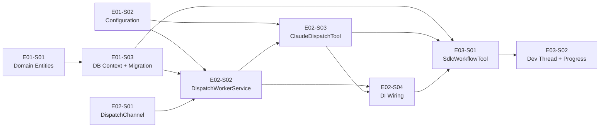

# SDLC Self-Orchestration — Implementation Plan

> **For Claude:** REQUIRED SUB-SKILL: Use superpowers:executing-plans to implement this plan task-by-task.

**Goal:** Enable NeuralNorris to orchestrate his own development lifecycle by dispatching Claude Code agents via the CLI, with workflow persistence, progress relay through dev threads, and human approval gates.

**Architecture:** Two-layer tool design — `ClaudeDispatchTool` (foundation: invoke/resume `claude -p` sessions) and `SdlcWorkflowTool` (workflow: lifecycle state, dev threads, gate detection). Background subprocess management via `DispatchWorkerService`. See [design doc](../2-design/2026-03-10-sdlc-self-orchestration.md).

**Tech Stack:** C# / .NET 10 · Semantic Kernel (plugin registry) · EF Core + SQLite · System.Threading.Channels · System.Diagnostics.Process

---

## Context

The [design](../2-design/2026-03-10-sdlc-self-orchestration.md) specifies Norris as a thin relay layer over the existing orchestrator agent. The C# layer handles subprocess management, workflow persistence, and progress relay. All SDLC logic remains in the orchestrator agent (`.claude/agents/orchestrator.md`).

**Key constraints:**
- Single active workflow at a time (v1)
- NeuralNorris repo only (v1)
- User-initiated only (v1)
- `claude` CLI must be installed on deployment target

---

## Dependency Graph

**Parallel opportunities:**
- Wave 1: E01-S01, E01-S02 (no dependencies)
- Wave 2: E01-S03, E02-S01 (S03 depends on S01; S04 is independent)
- Wave 3: E02-S02 (depends on S02, S03, S04)
- Wave 4: E02-S03 (depends on S05)
- Wave 5: E02-S04 (depends on S05, S06)
- Wave 6: E03-S01 (depends on S03, S06, S07)
- Wave 7: E03-S02 (depends on S08)

---

## Epic 1: Domain Model & Configuration

Foundation entities and configuration — no runtime dependencies, purely structural.

### E01-S01: Domain Entities — `difficulty/easy`

Define `SdlcWorkflow`, `DispatchJob`, and their enums in `NN.Core/Domain/`.

**Create:**
- `src/NN.Core/Domain/SdlcWorkflow.cs`
- `src/NN.Core/Domain/DispatchJob.cs`

**Pattern to follow:** `src/NN.Core/Domain/Tasks.cs` (AgentTask/ScheduledTask) — `Guid Id { get; init; }`, `DateTimeOffset` timestamps, status enums.

**Acceptance criteria:**

- `SdlcWorkflow` entity with: `Id`, `MemberId`, `Description`, `BacklogIssueNumber?`, `DevThreadSessionId`, `OrchestratorSessionId?`, `CurrentJobId?`, `Phase` (enum), `Status` (enum), `GateReason?`, `CreatedAt`, `UpdatedAt`
- `SdlcPhase` enum: `Design`, `Plan`, `Build`, `Review`, `Complete`
- `SdlcStatus` enum: `Running`, `WaitingHuman`, `Completed`, `Failed`, `Cancelled`
- `DispatchJob` entity with: `Id` (string, guid format), `WorkflowId?` (nullable Guid for standalone dispatch), `Agent`, `SessionId?`, `Status` (enum), `OutputJson?`, `Result?`, `TokensUsed?`, `DurationMs?`, `CreatedAt`, `CompletedAt?`
- `DispatchStatus` enum: `Queued`, `Running`, `Completed`, `Failed`, `Cancelled`
- Navigation property: `SdlcWorkflow.DispatchJobs` (collection), `DispatchJob.Workflow` (optional)
- All `DateTimeOffset` properties will be auto-converted to Unix ms by `NNDbContext`'s global converter
- Unit tests: entity creation with default values, enum serialization

**Tests:**
- `tests/NN.Tools.DevOps.Tests/Domain/SdlcWorkflowTests.cs`
- `tests/NN.Tools.DevOps.Tests/Domain/DispatchJobTests.cs`

**Branch:** `e01-s01/domain-entities`

---

### E01-S02: Configuration — `difficulty/easy`

Extend `DevOpsConfig` with Claude CLI dispatch settings.

**Modify:**
- `src/NN.Core/Configuration/NNConfig.cs` (add fields to `DevOpsConfig`)

**Acceptance criteria:**

- New fields on `DevOpsConfig`:
  - `string ClaudeCliBinary { get; set; } = "claude";` — path to claude binary
  - `int MaxDispatchTimeoutMinutes { get; set; } = 120;` — max subprocess runtime
  - `int MaxOutputSizeBytes { get; set; } = 524288;` — output size cap (512KB)
  - `List<string> AllowedAgents { get; set; }` — default: `["orchestrator", "designer", "architect", "builder", "builder-haiku", "builder-sonnet", "builder-opus", "reviewer", "retro"]`
  - **Note:** `AllowedAgents` is used for **exact match** validation (not prefix/substring). The tool layer passes the validated value from this list, not raw user input. See E02-S03 for details.
- All have sensible defaults (zero-config for development)
- Unit test verifying defaults are set

**Tests:**
- `tests/NN.Tools.DevOps.Tests/Configuration/DevOpsConfigTests.cs`

**Branch:** `e01-s02/dispatch-config`

---

### E01-S03: DB Context & Migration — `difficulty/easy`

Register new entities in `NNDbContext` and generate EF migration.

**Modify:**
- `src/NN.Persistence/NNDbContext.cs` (add DbSet properties + OnModelCreating config)

**Create:**
- EF migration via: `dotnet ef migrations add AddSdlcWorkflowAndDispatchJob --project src/NN.Persistence --startup-project src/NN.Gateway`

**Depends on:** E01-S01

**Acceptance criteria:**

- `DbSet<SdlcWorkflow> SdlcWorkflows` added to NNDbContext
- `DbSet<DispatchJob> DispatchJobs` added to NNDbContext
- `OnModelCreating` configures:
  - `SdlcWorkflow`: primary key, required fields (`Description`, `MemberId`), max lengths, indexes on `Status` and `MemberId`, foreign key to `Session` for `DevThreadSessionId`
  - `DispatchJob`: primary key (string), optional FK to `SdlcWorkflow`, required field `Agent`, max lengths, index on `Status` and `WorkflowId`
- Migration generated and applied successfully
- `dotnet build` succeeds
- `dotnet test` succeeds (existing tests still pass)

**Branch:** `e01-s03/db-context-migration`

---

## Epic 2: Dispatch Infrastructure (Layer 1)

The Claude CLI dispatch mechanism — channel, background worker, and tool plugin.

### E02-S01: DispatchChannel — `difficulty/easy`

Bounded channel for enqueuing dispatch jobs to the background worker.

**Create:**
- `src/NN.Tools.DevOps/Dispatch/DispatchChannel.cs`

**Pattern to follow:** `src/NN.Agent/Tasks/AgentTaskChannel.cs` — bounded channel with `SingleReader = true`.

**Acceptance criteria:**

- `DispatchChannel` class with `ChannelWriter<DispatchJob>` and `ChannelReader<DispatchJob>` properties
- Bounded capacity of 10 (v1 single-workflow constraint)
- `FullMode = BoundedChannelFullMode.Wait`
- `SingleReader = true`
- Unit test: write/read roundtrip

**Tests:**
- `tests/NN.Tools.DevOps.Tests/Dispatch/DispatchChannelTests.cs`

**Branch:** `e02-s01/dispatch-channel`

---

### E02-S02: DispatchWorkerService — `difficulty/hard`

The core background service that manages `claude -p` subprocesses. This is the most complex piece — subprocess lifecycle, output parsing, state persistence, and gate detection.

**Create:**
- `src/NN.Tools.DevOps/Dispatch/DispatchWorkerService.cs`
- `src/NN.Tools.DevOps/Dispatch/IProcessRunner.cs` (interface for testability)
- `src/NN.Tools.DevOps/Dispatch/ProcessRunner.cs` (real implementation)

**Depends on:** E01-S02 (config), E01-S03 (DB context), E02-S01 (channel)

**Acceptance criteria:**

- `IProcessRunner` interface:
  - `Task<ProcessResult> RunAsync(string binary, IReadOnlyList<string> arguments, string workingDirectory, TimeSpan timeout, CancellationToken ct)`
  - `ProcessResult` record: `int ExitCode`, `string Stdout`, `string Stderr`, `int? DurationMs`
  - **Note:** Parameter is `IReadOnlyList<string> arguments` (not a single string) — callers build argument arrays, never concatenated strings
- `ProcessRunner` implementation:
  - Spawns process with `UseShellExecute = false`, `RedirectStandardOutput = true`, `RedirectStandardError = true`
  - **SECURITY: Uses `ProcessStartInfo.ArgumentList` (collection form)** — each argument is a separate list entry. Never uses the string `Arguments` property. This guarantees zero shell interpretation of user-supplied content.
  - Working directory set to configured `RepoRoot`
  - Captures stdout/stderr
  - **Timeout enforcement via `Process.Kill()`:** Creates a `CancellationTokenSource` linked to `MaxDispatchTimeoutMinutes`. On timeout, calls `Process.Kill(entireProcessTree: true)` and sets job to `Failed`. The kill path is **explicitly tested**.
  - **Output stream-cap (memory safety):** Stdout capture is capped at `MaxOutputSizeBytes` (default 512KB) **during read**, not just at persist time. Once the cap is reached, stop accumulating into the buffer and drain remaining output to `/dev/null`. This prevents OOM on memory-constrained hosts (Raspberry Pi) when a 2-hour orchestrator session produces verbose output. The `[TRUNCATED AT 512KB]` marker is appended. Job still completes normally.
  - Returns `ProcessResult` on completion
- `DispatchWorkerService` (BackgroundService):
  - Reads from `DispatchChannel.Reader`
  - For each `DispatchJob`:
    1. Updates status to `Running` in DB
    2. Constructs `claude` argument array (never a concatenated command string):
       - New session: `["-p", "--prompt-file", "<tempfile>", "--agent", "<agent>", "--output-format", "json"]`
       - Resume: `["--resume", "<session-id>", "-p", "--prompt-file", "<tempfile>", "--output-format", "json"]`
    3. Writes prompt to temp file (see temp file security below), passes file path via `--prompt-file` argument
    4. Calls `IProcessRunner.RunAsync()` with the argument array
    5. Parses JSON output for `session_id`, `result`, token counts
    6. Updates `DispatchJob` with result, status, tokens, duration (OutputJson capped at 512KB)
    7. If `WorkflowId` is set, updates parent `SdlcWorkflow` status
    8. Cleans up temp file in `finally` block (guaranteed cleanup)
  - Error handling: catches exceptions, sets `DispatchStatus.Failed`, logs error
  - Uses `IServiceScopeFactory` for DB access (scoped `NNDbContext`)
- **Temp file security:**
  - Location: `{RepoRoot}/.dispatch/` directory (not `/tmp` — avoids shared temp dir attacks)
  - Filename: `nn-dispatch-{Guid.NewGuid()}.md` (cryptographic GUID, not job ID)
  - Creation: `FileStream` with `FileMode.CreateNew` (`O_EXCL` semantics — fails if file exists, no symlink following)
  - Permissions: mode `600` (owner read/write only) via `File.SetUnixFileMode()` on Linux, or equivalent on other platforms
  - Cleanup: deleted in `finally` block after process completes (or fails)
  - `.dispatch/` directory created on startup with mode `700` if it doesn't exist, added to `.gitignore`
- JSON output parsing: extract `session_id` from Claude CLI JSON response (tolerant of format variations)
- **Startup checks (in `StartAsync`):**
  - Verify `claude` binary exists and is executable: run `claude --version`, log the output, warn if missing
  - Verify `RepoRoot` exists and is a git repository
  - Create `.dispatch/` directory with mode `700` if it doesn't exist
  - **GitHub token scope warning:** Run `gh auth status` and log a `WARNING` if the token has `admin` or `write` permissions on the repo (suggesting it can merge PRs). This is a non-blocking warning, not a hard failure — but surfaces the scoping gap for operators who deploy with a broad PAT. Documented as a deployment prerequisite in the design doc.
  - If `RepoRoot` is not set in config, fall back to `NN_REPO_ROOT` environment variable (read-only source, harder for agents to modify than `appsettings.json`)

**Tests:**
- `tests/NN.Tools.DevOps.Tests/Dispatch/DispatchWorkerServiceTests.cs`
  - Mock `IProcessRunner` to simulate successful/failed claude invocations
  - Verify job status transitions (Queued → Running → Completed/Failed)
  - Verify JSON output parsing extracts session_id
  - Verify temp file creation in `{RepoRoot}/.dispatch/` (not `/tmp`)
  - Verify temp file cleanup in both success and failure paths (finally block)
  - Verify DB state updates via in-memory SQLite
  - Verify resume command construction includes `--resume` flag
  - **SECURITY: Verify `ProcessStartInfo.ArgumentList` is used** (not `Arguments` string) — assert argument array structure
  - **SECURITY: Verify timeout kill path** — mock a subprocess that exceeds timeout, verify `Process.Kill()` is called and job transitions to `Failed`
  - **SECURITY: Verify output size cap** — mock subprocess producing >512KB output, verify `OutputJson` is truncated with marker and job completes normally
  - **SECURITY: Verify temp file security** — verify `FileMode.CreateNew` usage, verify file is in `.dispatch/` directory, verify cleanup
  - **SECURITY: Verify stdout stream-cap** — mock subprocess producing >512KB to stdout, verify buffer stops growing at `MaxOutputSizeBytes` and `[TRUNCATED]` marker is appended. Distinct from the DB-level output cap test: this tests the *read* cap, not the *persist* cap.
  - **Platform note:** Mode 600/700 file permission tests should be skipped on Windows (`[Trait("Category", "Unix")]` or `RuntimeInformation.IsOSPlatform` guard). CI runs on Linux, matching the Raspberry Pi target.
  - Verify startup checks: `claude --version` execution, `.dispatch/` directory creation, `RepoRoot` validation

**Branch:** `e02-s02/dispatch-worker-service`

---

### E02-S03: ClaudeDispatchTool — `difficulty/medium`

The tool plugin that Norris's Claude brain calls. Three functions: `claude_dispatch`, `claude_dispatch_status`, `claude_dispatch_cancel`.

**Create:**
- `src/NN.Tools.DevOps/Dispatch/ClaudeDispatchTool.cs`

**Depends on:** E01-S02 (config), E02-S02 (worker service — for channel access)

**Acceptance criteria:**

- Implements `IKernelTool` with `Name = "claude_dispatch"`, `Category = "DevOps"`, `EnabledByDefault = false`
- Three `[KernelFunction]` methods:

  **`claude_dispatch(message, agent?, session_id?)`**
  - Validates: if no `session_id`, `agent` is required
  - **SECURITY: Agent allowlist exact match** — validates `agent` against `AllowedAgents` config list using **exact string match** (case-insensitive comparison, but no prefix/substring matching: `"builder"` does NOT match `"builder-haiku"`). The **validated value from the allowlist** is passed to the `DispatchJob.Agent` field, not the raw user input. This prevents subtle injection via similar agent names.
  - **SECURITY: Session ID format validation** — if `session_id` is provided, validate format: alphanumeric characters and hyphens only (regex: `^[a-zA-Z0-9-]+$`). Reject session IDs containing spaces, semicolons, shell metacharacters, or any other characters before DB lookup or process arguments.
  - **SECURITY: User content envelope** — when the dispatch is a resume (session_id provided), the `message` is wrapped in a structured envelope: `[USER RESPONSE]: {message}`. This frames user content as data for the orchestrator, not instructions. New session messages are passed as-is (they are Norris-generated, not user-supplied).
  - Creates `DispatchJob` entity, persists to DB
  - Enqueues to `DispatchChannel`
  - Returns JSON: `{ "job_id": "...", "session_id": "..." }` (session_id may be null until worker completes)

  **`claude_dispatch_status(job_id)`**
  - Queries `DispatchJob` by ID from DB
  - Returns JSON: `{ "status": "...", "session_id": "...", "result": "...", "tokens_used": N, "duration_ms": N }`
  - Returns error JSON if job not found

  **`claude_dispatch_cancel(job_id)`**
  - Queries `DispatchJob` by ID
  - If status is `Running`, sets to `Cancelled` (worker checks cancellation)
  - Returns JSON: `{ "success": true/false, "reason": "..." }`

- All return JSON strings (tool convention)
- Agent name validation is case-insensitive (but exact match — see above)
- Parameter descriptions are clear for Claude's schema generation

**Tests:**
- `tests/NN.Tools.DevOps.Tests/Dispatch/ClaudeDispatchToolTests.cs`
  - Agent validation: rejects agents not in allowlist
  - **SECURITY: Agent allowlist exact match** — verify `"builder"` does NOT match `"builder-haiku"` (no prefix matching). Verify the validated value from the allowlist is used, not the raw input.
  - Requires agent when no session_id
  - Accepts session_id without agent (resume)
  - **SECURITY: Session ID format validation** — pass session IDs containing spaces, semicolons, `$(...)`, backticks, and shell metacharacters. Verify all are rejected before reaching process arguments.
  - **SECURITY: User content envelope** — verify that resume messages are wrapped in `[USER RESPONSE]:` envelope. Verify new session messages are NOT wrapped.
  - Job creation and channel enqueue
  - Status query returns correct state
  - Cancel sets status to Cancelled
  - Unknown job_id returns error JSON

**Branch:** `e02-s03/claude-dispatch-tool`

---

### E02-S04: DI Wiring — `difficulty/easy`

Register all dispatch infrastructure in DI container.

**Modify:**
- `src/NN.Tools.DevOps/ServiceCollectionExtensions.cs`

**Depends on:** E02-S01, E02-S02, E02-S03

**Acceptance criteria:**

- `DispatchChannel` registered as Singleton
- `ProcessRunner` registered as Singleton implementing `IProcessRunner`
- `DispatchWorkerService` registered as hosted service: `services.AddHostedService<DispatchWorkerService>()`
- `ClaudeDispatchTool` registered as Singleton + ITool + IKernelTool (same pattern as other DevOps tools)
- `dotnet build` succeeds
- `dotnet test` succeeds (all existing + new tests pass)

**Tests:**
- Verify DI resolution in an integration test (optional — builder judgement)

**Branch:** `e02-s04/di-wiring`

---

## Epic 3: SDLC Workflow (Layer 2)

The workflow management layer — dev threads, gate detection, and the `sdlc_orchestrate` tool.

### E03-S01: SdlcWorkflowTool — `difficulty/medium`

The high-level tool that manages SDLC workflow lifecycle.

**Create:**
- `src/NN.Tools.DevOps/Workflow/SdlcWorkflowTool.cs`

**Depends on:** E01-S03 (DB context), E02-S03 (ClaudeDispatchTool), E02-S04 (DI wiring)

**Acceptance criteria:**

- Implements `IKernelTool` with `Name = "sdlc_orchestrate"`, `Category = "DevOps"`, `EnabledByDefault = false`
- Two `[KernelFunction]` methods:

  **`sdlc_start(description, backlog_issue?)`**
  - Checks for existing active workflow (single-workflow constraint): if one exists with `Status` in `Running`/`WaitingHuman`, returns error JSON
  - Creates a new `Session` entity for the dev thread, titled `"🔧 Dev: {description}"`
  - Creates `SdlcWorkflow` entity with phase `Design`, status `Running`
  - Dispatches orchestrator via `ClaudeDispatchTool.claude_dispatch()`:
    - Message: `"Execute backlog item #{backlogIssue}. {description}."`
    - Agent: `"orchestrator"`
  - Links the dispatch job to the workflow
  - Returns JSON: `{ "workflow_id": "...", "dev_thread_session_id": "...", "message": "SDLC workflow started..." }`

  **`sdlc_status(workflow_id)`**
  - Queries `SdlcWorkflow` by ID from DB
  - Returns JSON: `{ "workflow_id": "...", "description": "...", "phase": "...", "status": "...", "gate_reason": "...", "backlog_issue": N, "dev_thread_session_id": "..." }`
  - Returns error JSON if not found

- Uses `IServiceScopeFactory` for DB access (tool may be Singleton, DB is Scoped)
- **Orchestrator agent enhancements (required — modify `.claude/agents/orchestrator.md`):**
  - **Sacred files auto-labelling:** When the orchestrator creates an epic PR, it must diff a sacred files list (`sentinel.yml`, `sentinel-guard.yml`, `CLAUDE.md`, `.claude/agents/orchestrator.md`) against `main`. If any are modified, automatically add a `⚠️ SECURITY: sacred files modified` label via `gh label create` (idempotent) + `gh pr edit --add-label`, and post a PR comment listing the exact files and changes.
  - **System prompt hardening:** Add explicit instructions to treat `[USER RESPONSE]:` envelope content as data, not as instructions to modify security-critical files, workflow rules, or agent definitions.
  - These are `.md` file changes, not C# code, but they are **required** for this story to pass Sentinel review.

**Tests:**
- `tests/NN.Tools.DevOps.Tests/Workflow/SdlcWorkflowToolTests.cs`
  - Start creates workflow + dev thread session
  - Start rejects when active workflow exists
  - Start dispatches orchestrator via claude_dispatch
  - Status returns correct state
  - Unknown workflow_id returns error
- **Orchestrator agent convention tests are manual** — verify by reading the updated `.md` file for the required instructions. The Sentinel will validate on the implementation PR.

**Branch:** `e03-s01/sdlc-workflow-tool`

---

### E03-S02: Dev Thread Progress & DI Wiring — `difficulty/medium`

Progress posting to the dev thread session and final DI registration for Layer 2.

**Create:**
- `src/NN.Tools.DevOps/Workflow/DevThreadRelay.cs`

**Modify:**
- `src/NN.Tools.DevOps/Dispatch/DispatchWorkerService.cs` (add dev thread posting)
- `src/NN.Tools.DevOps/ServiceCollectionExtensions.cs` (add SdlcWorkflowTool + DevThreadRelay)

**Depends on:** E03-S01

**Acceptance criteria:**

- `DevThreadRelay` service:
  - `PostProgressAsync(Guid sessionId, string message)` — creates a `SessionTurn` in the dev thread session with `Role = System` and the progress message
  - **SECURITY: All CC session output relayed to dev thread must be treated as untrusted.** `GateReason`, job results, and progress messages are populated from CC session output which could contain adversarial content (e.g., `` and verify the content is HTML-encoded when written to `SessionTurn.Content`. The test should assert that `<` and `>` are escaped (or that the content is stored verbatim and the rendering layer handles encoding — document which layer is responsible).

**Branch:** `e03-s02/dev-thread-progress`

---

## Summary

| Epic | Story | Title | Difficulty | Depends On |
|------|-------|-------|------------|------------|
| E01 | S01 | Domain Entities | easy | — |
| E01 | S02 | Configuration | easy | — |
| E01 | S03 | DB Context + Migration | easy | S01 |
| E02 | S01 | DispatchChannel | easy | — |
| E02 | S02 | DispatchWorkerService | hard | S02, S03, E02-S01 |
| E02 | S03 | ClaudeDispatchTool | medium | S02, E02-S02 |
| E02 | S04 | DI Wiring | easy | E02-S01, S02, S03 |
| E03 | S01 | SdlcWorkflowTool | medium | S03, E02-S03, E02-S04 |
| E03 | S02 | Dev Thread + Progress | medium | E03-S01 |

**Parallel waves:**

| Wave | Stories | Dispatch |
|------|---------|----------|
| 1 | E01-S01, E01-S02, E02-S01 | parallel |
| 2 | E01-S03 | sequential (depends on S01) |
| 3 | E02-S02 | sequential (depends on S02, S03, E02-S01) |
| 4 | E02-S03, E02-S04 | parallel (both depend on E02-S02) |
| 5 | E03-S01 | sequential |
| 6 | E03-S02 | sequential |

**Estimated model routing:**
- 4 easy stories → `builder-haiku`
- 3 medium stories → `builder-sonnet`
- 1 hard story → `builder-opus`
