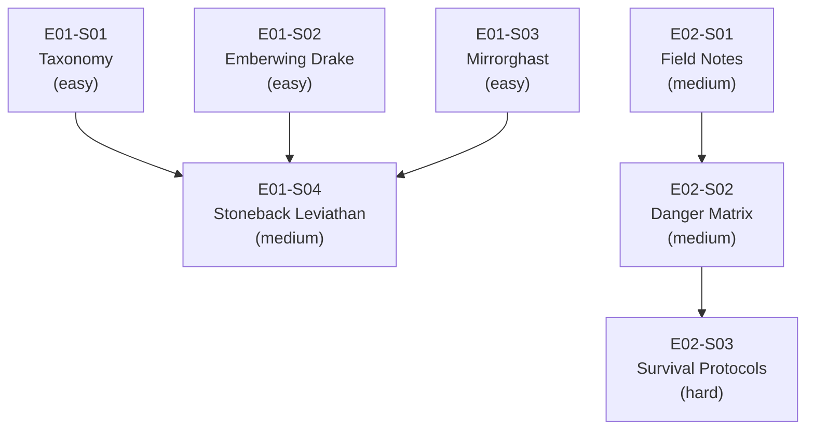

# Mythical Creatures Field Guide -- Implementation Plan

## Context

This is Run 3 of the Agentic SDLC v2 test suite. The content vehicle is a Victorian naturalist's field guide cataloguing mythical creatures, designed to exercise two SDLC v2 mechanisms that remain unvalidated after Run 2:

1. **Parallel dispatch** -- Wave 1 dispatches 4 independent stories concurrently via the Agent tool
2. **Reviewer integration** -- Reviewer dispatched on every story branch before merge

The [design doc](../2-design/2026-03-10-mythical-creatures-field-guide.md) specifies the full content structure, acceptance criteria, and dependency graph. This plan translates that design into executable stories with Git branch conventions, orchestrator dispatch instructions, and reviewer checklists.

**No C# code changes.** All output is markdown files in `test-output/field-guide/`.

---

## Structural Decisions

**Two epics, not three.** The design doc evaluated three approaches and selected two epics (Creature Compendium + Field Operations Manual). This plan follows that decision. A third epic (splitting taxonomy from profiles) would add orchestration overhead without testing anything new.

**Combined epic PR.** Both epics are small (4 + 3 stories) and share the same `test-output/field-guide/` output directory. A single combined PR to `main` reduces overhead and tests the combined-PR workflow variant documented in CLAUDE.md's Epic PR Strategy. The PR body will include `Closes` references for the backlog issue, both epic issues, and all 7 story issues.

**Wave structure optimized for parallel validation.** Wave 1 is the critical test: 4 independent stories dispatched concurrently. If the Agent tool supports concurrent dispatch, this wave validates the mechanism. If not, the fallback is sequential dispatch with a lesson file documenting the failure.

---

## Epic 1: Creature Compendium

The core reference section. Three creature profiles and a classification taxonomy. Stories E01-S01, E01-S02, and E01-S03 are fully independent (Wave 1 parallel candidates). E01-S04 depends on all three completing first because it cross-references them.

### E01-S01: Classification Taxonomy -- `difficulty/easy`

Create `test-output/field-guide/taxonomy.md`.

**Content requirements:**

- Title: "Thornwood Classification System"
- 4 phyla: Draconiformes (dragon-like), Metamorphica (shapeshifters), Phantasma (spectral/ethereal), Megafauna Mythica (giant beasts)
- Each phylum: Latin-style name, common name, 2-3 defining characteristics, 2-3 example species
- Short introduction (2-3 sentences) in Professor Thornwood's voice
- Total length: 150-250 words

**Acceptance criteria:**

- [ ] File exists at `test-output/field-guide/taxonomy.md`
- [ ] Title is "Thornwood Classification System"
- [ ] Contains exactly 4 phyla: Draconiformes, Metamorphica, Phantasma, Megafauna Mythica
- [ ] Each phylum has: Latin name, common name, 2-3 characteristics, 2-3 example species
- [ ] Introduction is 2-3 sentences in first person (professor's voice)
- [ ] Word count: 150-250 words

**Files to create:** `test-output/field-guide/taxonomy.md`

**Dependencies:** None

**Branch:** `e01-s01/taxonomy`

---

### E01-S02: Creature Profile -- Emberwing Drake -- `difficulty/easy`

Create `test-output/field-guide/emberwing-drake.md`.

**Content requirements:**

- Title: "Emberwing Drake (*Draconis ignis*)"
- Sections: Classification, Physical Description (3-4 sentences), Habitat, Diet, Behaviour, Threat Level (1-5 scale with justification)
- Must reference phylum "Draconiformes"
- Include a "Field Sketch" section with ASCII art (max 10 lines)
- Total length: 200-300 words

**Acceptance criteria:**

- [ ] File exists at `test-output/field-guide/emberwing-drake.md`
- [ ] Title contains "Emberwing Drake" and "*Draconis ignis*"
- [ ] Contains all required sections: Classification, Physical Description, Habitat, Diet, Behaviour, Threat Level, Field Sketch
- [ ] References phylum "Draconiformes"
- [ ] Field Sketch section has ASCII art (max 10 lines)
- [ ] Word count: 200-300 words

**Files to create:** `test-output/field-guide/emberwing-drake.md`

**Dependencies:** None

**Branch:** `e01-s02/emberwing-drake`

---

### E01-S03: Creature Profile -- Mirrorghast -- `difficulty/easy`

Create `test-output/field-guide/mirrorghast.md`.

**Content requirements:**

- Title: "Mirrorghast (*Phantasma specularis*)"
- Same section structure as E01-S02
- Must reference phylum "Phantasma"
- Include a "Field Sketch" section with ASCII art
- Total length: 200-300 words

**Acceptance criteria:**

- [ ] File exists at `test-output/field-guide/mirrorghast.md`
- [ ] Title contains "Mirrorghast" and "*Phantasma specularis*"
- [ ] Contains all required sections: Classification, Physical Description, Habitat, Diet, Behaviour, Threat Level, Field Sketch
- [ ] References phylum "Phantasma"
- [ ] Field Sketch section has ASCII art (max 10 lines)
- [ ] Word count: 200-300 words

**Files to create:** `test-output/field-guide/mirrorghast.md`

**Dependencies:** None

**Branch:** `e01-s03/mirrorghast`

---

### E01-S04: Creature Profile -- Stoneback Leviathan -- `difficulty/medium`

Create `test-output/field-guide/stoneback-leviathan.md`.

**Content requirements:**

- Title: "Stoneback Leviathan (*Megabesta lithodus*)"
- Same base sections as E01-S02/S03 PLUS:
  - "Historical Sightings" -- table of 3 sightings (date, location, observer, description)
  - "Interspecies Relationships" -- 2-3 sentences referencing Emberwing Drake and Mirrorghast by name
- Must reference phylum "Megafauna Mythica"
- Include a "Field Sketch" section with ASCII art
- Total length: 350-500 words

**Acceptance criteria:**

- [ ] File exists at `test-output/field-guide/stoneback-leviathan.md`
- [ ] Title contains "Stoneback Leviathan" and "*Megabesta lithodus*"
- [ ] Contains all base sections: Classification, Physical Description, Habitat, Diet, Behaviour, Threat Level, Field Sketch
- [ ] Contains "Historical Sightings" section with a table of 3 sightings
- [ ] Contains "Interspecies Relationships" section mentioning "Emberwing Drake" and "Mirrorghast" by name
- [ ] References phylum "Megafauna Mythica"
- [ ] Word count: 350-500 words

**Files to create:** `test-output/field-guide/stoneback-leviathan.md`

**Dependencies:** E01-S01, E01-S02, E01-S03 (semantic cross-references, not filesystem deps -- but Wave 2 scheduling ensures those are merged first)

**Branch:** `e01-s04/stoneback-leviathan`

---

## Epic 2: Field Operations Manual

The practical companion section. Sequential dependency chain: field notes inform the danger matrix, which informs survival protocols. E02-S01 is independent and runs in Wave 1; E02-S02 and E02-S03 are sequential.

### E02-S01: Field Notes -- The Thornwood Expedition -- `difficulty/medium`

Create `test-output/field-guide/expedition-notes.md`.

**Content requirements:**

- Title: "Field Notes: The Thornwood Expedition, Day 12-14"
- 3 dated journal entries (one per day), each 80-120 words, first person
- Day 12: arrival, signs of Emberwing Drake (*Draconis ignis*) activity
- Day 13: encounter with Mirrorghast (*Phantasma specularis*), narrow escape
- Day 14: distant sighting of Stoneback Leviathan (*Megabesta lithodus*), expedition retreat
- All three creatures referenced by Latin binomial at least once
- "Supplies Consumed" table at end (5 items with quantity)
- Total length: 350-500 words

**Acceptance criteria:**

- [ ] File exists at `test-output/field-guide/expedition-notes.md`
- [ ] Title is "Field Notes: The Thornwood Expedition, Day 12-14"
- [ ] Contains 3 dated journal entries
- [ ] Each entry is 80-120 words and written in first person
- [ ] Day 12 mentions Emberwing Drake activity
- [ ] Day 13 describes a Mirrorghast encounter
- [ ] Day 14 describes a Stoneback Leviathan sighting
- [ ] All three Latin binomials appear: *Draconis ignis*, *Phantasma specularis*, *Megabesta lithodus*
- [ ] Contains a "Supplies Consumed" table with 5 items
- [ ] Word count: 350-500 words

**Files to create:** `test-output/field-guide/expedition-notes.md`

**Dependencies:** None

**Branch:** `e02-s01/expedition-notes`

---

### E02-S02: Danger Classification Matrix -- `difficulty/medium`

Create `test-output/field-guide/danger-matrix.md`.

**Content requirements:**

- Title: "Thornwood Danger Classification Matrix"
- Matrix rating 3 creatures on 4 axes: Aggression (1-5), Evasion Difficulty (1-5), Environmental Hazard (1-5), Predictability (1-5, where 1 = unpredictable)
- Each rating includes a one-sentence justification referencing creature profiles or expedition notes
- Composite "Encounter Risk" score (sum of 4 axes): Low (4-8), Moderate (9-13), High (14-17), Extreme (18-20)
- "Reviewer's Note" paragraph (2-3 sentences) from a fictional peer reviewer disputing one rating
- Total length: 300-400 words

**Acceptance criteria:**

- [ ] File exists at `test-output/field-guide/danger-matrix.md`
- [ ] Title is "Thornwood Danger Classification Matrix"
- [ ] Contains ratings for all 3 creatures on all 4 axes (Aggression, Evasion Difficulty, Environmental Hazard, Predictability)
- [ ] Each rating has a one-sentence justification
- [ ] Contains a composite "Encounter Risk" score per creature with risk category
- [ ] Risk categories follow the specified scale (Low 4-8, Moderate 9-13, High 14-17, Extreme 18-20)
- [ ] Contains a "Reviewer's Note" section (2-3 sentences disputing one rating)
- [ ] Word count: 300-400 words

**Files to create:** `test-output/field-guide/danger-matrix.md`

**Dependencies:** E02-S01 (references expedition outcomes)

**Branch:** `e02-s02/danger-matrix`

---

### E02-S03: Survival Protocols -- `difficulty/hard`

Create `test-output/field-guide/survival-protocols.md`.

**Content requirements:**

- Title: "Survival Protocols for Cryptozoological Field Work"
- Introductory paragraph (3-4 sentences) from Professor Thornwood
- One protocol section per creature (3 total), each with:
  - "If you encounter a [creature]" -- 3-4 numbered steps
  - "Warning signs" -- 2-3 bullet points
  - "Equipment required" -- 2-3 items with descriptions
- "General Field Safety" section with 5 numbered rules
- Protocols must be consistent with danger matrix ratings (most dangerous creature = most cautious protocol)
- Must reference expedition notes at least twice (e.g., "As documented during the Day 13 incident...")
- Closing "Author's Note" (2-3 sentences) on science vs. safety
- Total length: 500-700 words

**Acceptance criteria:**

- [ ] File exists at `test-output/field-guide/survival-protocols.md`
- [ ] Title is "Survival Protocols for Cryptozoological Field Work"
- [ ] Contains an introductory paragraph (3-4 sentences)
- [ ] Contains 3 creature protocol sections, each with: encounter steps (3-4), warning signs (2-3), equipment (2-3)
- [ ] Contains "General Field Safety" section with 5 numbered rules
- [ ] Most dangerous creature (per danger matrix) has the most cautious protocol
- [ ] At least 2 references to expedition notes (with specific day references)
- [ ] Contains a closing "Author's Note" (2-3 sentences)
- [ ] Word count: 500-700 words

**Files to create:** `test-output/field-guide/survival-protocols.md`

**Dependencies:** E02-S01, E02-S02 (references danger ratings and expedition outcomes)

**Branch:** `e02-s03/survival-protocols`

---

## Dependency Graph

## Dispatch Waves

| Wave | Stories | Parallel? | Model(s) | Notes |
|------|---------|-----------|----------|-------|
| 1 | E01-S01, E01-S02, E01-S03, E02-S01 | Yes (4 concurrent) | haiku x3, sonnet x1 | Critical parallel dispatch test |
| 2 | E01-S04, E02-S02 | Yes (2 concurrent) | sonnet x2 | E01-S04 after E01 Wave 1; E02-S02 after E02-S01 |
| 3 | E02-S03 | No (1 story) | opus | Final story, depends on E02-S01 + E02-S02 |

**Wave 1 is the critical validation point.** The orchestrator must dispatch all 4 stories concurrently via the Agent tool. If parallel dispatch fails, fall back to sequential and document the failure in a lesson file under `docs/4-reviews/lessons/2026-03-10-test-agentic-sdlc-run03-mythical-creatures/`.

**Wave 2 parallelism is secondary.** E01-S04 and E02-S02 have no mutual dependency and can run concurrently, but this is less critical than Wave 1.

### Orchestrator Instructions

1. Create epic branches from `main`:
   - `epic/e01-creature-compendium`
   - `epic/e02-field-operations`
2. Push both to remote immediately
3. **Wave 1:** Dispatch 4 builders concurrently via Agent tool:
   - `subagent_type: "builder-haiku"` for E01-S01, E01-S02, E01-S03
   - `subagent_type: "builder-sonnet"` for E02-S01
4. After each builder completes: post telemetry via `issue-telemetry.sh`
5. After each builder completes: dispatch `subagent_type: "reviewer"` on the story branch
6. If reviewer finds critical issues: re-dispatch builder (max 2 cycles)
7. Merge each story branch into its epic branch
8. **Wave 2:** Dispatch E01-S04 (sonnet) and E02-S02 (sonnet) concurrently
9. Review + merge as above
10. **Wave 3:** Dispatch E02-S03 (opus)
11. Review + merge
12. Add `docs/CHANGELOG.md` entry on epic branch
13. Open combined PR to `main` with `Closes` for backlog (#89), both epics, and all 7 stories
14. Post epic telemetry on both epic issues and the PR
15. Dispatch retro agent after PR merge

---

## Reviewer Checklist

The reviewer validates structural compliance, not creative quality. For each story:

1. **File exists** at the specified path under `test-output/field-guide/`
2. **Section structure** matches acceptance criteria headings
3. **Word count** is within the specified range (count via `wc -w`)
4. **Cross-references** are present where required:
   - Taxonomy phylum names in creature profiles
   - Creature names in Stoneback Leviathan's Interspecies Relationships
   - Latin binomials in expedition notes
   - Expedition day references in survival protocols
   - Danger matrix consistency in survival protocols
5. **Voice consistency** -- first person for expedition notes, formal naturalist tone for profiles

---

## Difficulty Classification Rationale

| Story | Difficulty | Files | Cross-refs | Rationale |
|-------|-----------|-------|------------|-----------|
| E01-S01 | easy | 1 create | None | Formulaic taxonomy table, fill-in-the-blanks |
| E01-S02 | easy | 1 create | 1 phylum name | Template-driven profile, minimal creativity |
| E01-S03 | easy | 1 create | 1 phylum name | Identical template to E01-S02 |
| E01-S04 | medium | 1 create | 3 (phylum + 2 creature names) | Additional sections, cross-referencing, ecological narrative |
| E02-S01 | medium | 1 create | 3 Latin binomials | Narrative voice across 3 entries, creature weaving |
| E02-S02 | medium | 1 create | References profiles + notes | Internal logic consistency across ratings |
| E02-S03 | hard | 1 create | References all prior docs | Longest, synthesizes multiple sources, consistency checking |

---

## Epic PR Strategy

**Combined PR.** Both epics merge into a single PR to `main`. The E01 epic branch completes first (Waves 1-2), then E02 (Waves 1-3). After all stories are merged into their respective epic branches:

1. Merge `epic/e02-field-operations` into `epic/e01-creature-compendium` (or create a combined branch)
2. Open PR from the combined branch to `main`
3. PR body includes `Closes #89, closes #<e01-epic>, closes #<e02-epic>, closes #<s01>, ..., closes #<s07>`

This keeps the PR workflow simple for a 7-story test run.

---

## Risks

| Risk | Impact | Mitigation |
|------|--------|------------|
| Parallel dispatch fails (Agent tool concurrency) | All stories sequential; no parallel validation | Fall back to sequential; document in lesson file |
| Reviewer finds nothing actionable on creative content | Review step adds overhead without value | Acceptance criteria are structural, not creative |
| Cross-references inconsistent between parallel stories | Reviewer catches mismatches post-merge | Acceptance criteria specify exact names/phyla |
| Session token limits exceeded mid-orchestration | Orchestrator loses context | Stories are short (200-700 words); Agent tool subagents have independent context |

---

## Estimated Cost & Duration

| Model | Stories | Est. Time/Story | Est. Sequential | Est. Cost/Story |
|-------|---------|-----------------|-----------------|-----------------|
| haiku | 3 | ~1 min | ~3 min | ~$0.03 |
| sonnet | 3 | ~1.5 min | ~4.5 min | ~$0.08 |
| opus | 1 | ~3 min | ~3 min | ~$0.75 |
| **Total** | **7** | | **~10.5 min seq** | **~$1.08** |

With Wave 1 parallel (4 stories): estimated wall-clock ~7 min.
