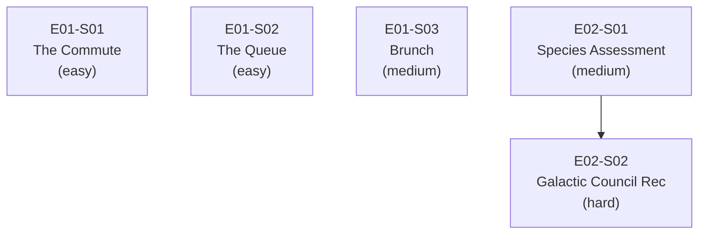

# Implementation Plan: Alien Anthropological Field Study of Earth (Run 7)

> **Backlog:** #205 -- Test SDLC v2 Workflow (Run 7) -- Autonomous Sprint
> **Design:** `docs/2-design/2026-03-11-alien-field-study.md`

## Overview

This plan decomposes the Alien Field Study feature into 2 epics and 5 stories. The feature produces markdown content only (no C# code) in `test-output/alien-field-study/`. Its primary purpose is validating the full autonomous SDLC v2 lifecycle: parallel dispatch, model routing, per-story review, sequential dependencies, and full lifecycle telemetry.

## Structural Decisions

**Why 2 epics (not 1 or 3):** The design doc defines two natural groupings -- field observation reports (Epic 1, independent/parallel) and administrative bureau documents (Epic 2, sequential with cross-references). These have distinct document formats and dependency characteristics. Merging into one epic would lose the parallel vs sequential distinction. Splitting further would create single-story epics without value.

**Why 3+2 story split:** Epic 1's three stories are fully independent field reports following similar templates, ideal for parallel dispatch (Wave 1). Epic 2's two stories have an explicit dependency chain -- the council recommendation references the species assessment. This exercises both parallel and sequential dispatch.

**Wave 2 vs Wave 1 for E02-S01:** The design doc notes E02-S01 has no content dependency on Wave 1 and could run in Wave 1 (4 parallel). I chose to keep it in Wave 2 per the design recommendation -- 3 parallel already validates the feature, and separating epics into distinct waves keeps the execution cleaner.

## Output Structure

```
test-output/alien-field-study/
├── report-the-commute.md          # E01-S01 (easy)
├── report-the-queue.md            # E01-S02 (easy)
├── report-brunch.md               # E01-S03 (medium)
├── species-assessment.md          # E02-S01 (medium)
└── council-recommendation.md      # E02-S02 (hard)
```

## Dependency Graph



## Dispatch Plan

| Wave | Stories | Dispatch | Notes |
|------|---------|----------|-------|
| **Wave 1** | E01-S01, E01-S02, E01-S03 | Parallel (3 stories) | All independent field reports |
| **Wave 2** | E02-S01 | Sequential | Species assessment (no dependency on Wave 1) |
| **Wave 3** | E02-S02 | Sequential | Depends on E02-S01 (cross-references species assessment) |

**Fallback:** If 3-story parallel dispatch fails, fall back to sequential execution (S01, S02, S03, S04, S05).

## Epic 1: Field Observation Reports

Three independent field reports on different human rituals. Each produces one markdown file in `test-output/alien-field-study/`.

### E01-S01: Field Report -- The Commute

- **Difficulty:** `difficulty/easy`
- **File:** `test-output/alien-field-study/report-the-commute.md`
- **Branch:** `e01-s01/the-commute`
- **Dependencies:** None

**Acceptance Criteria:**

- [ ] File exists at `test-output/alien-field-study/report-the-commute.md`
- [ ] Opens with "CLASSIFIED -- Clearance Level: Tentacle-7 and Above"
- [ ] Title: "Field Report #7741-C: The Daily Migration Pattern"
- [ ] Researcher attribution with fictional alien name and department
- [ ] Observation section (3-4 sentences): Describes humans entering metal boxes voluntarily and sitting motionless for hours in congested formation
- [ ] Analysis section (2-3 sentences): Hypothesises why the bipeds do not simply relocate closer to their feeding/work sites
- [ ] At least one footnote referencing a fictional journal (e.g., *Journal of Primate Anomalies*)
- [ ] Humans referred to as *Homo sapiens* or "the bipeds" -- never by name
- [ ] Dry academic tone maintained throughout
- [ ] Word count: 100-200 words

### E01-S02: Field Report -- The Queue

- **Difficulty:** `difficulty/easy`
- **File:** `test-output/alien-field-study/report-the-queue.md`
- **Branch:** `e01-s02/the-queue`
- **Dependencies:** None

**Acceptance Criteria:**

- [ ] File exists at `test-output/alien-field-study/report-the-queue.md`
- [ ] Opens with "CLASSIFIED -- Clearance Level: Tentacle-7 and Above"
- [ ] Title: "Field Report #7741-Q: Ritualistic Linear Formation Behaviour"
- [ ] Researcher attribution with fictional alien name and department
- [ ] Observation section (3-4 sentences): Describes the single-file line formation and the social consequences of violation (tutting, glaring, passive-aggressive sighing)
- [ ] Analysis section (2-3 sentences): Considers whether queuing is religious, territorial, or a form of social bonding
- [ ] At least one footnote referencing a fictional journal
- [ ] Humans referred to as *Homo sapiens* or "the bipeds" -- never by name
- [ ] Dry academic tone maintained throughout
- [ ] Word count: 100-200 words

### E01-S03: Field Report -- Brunch

- **Difficulty:** `difficulty/medium`
- **File:** `test-output/alien-field-study/report-brunch.md`
- **Branch:** `e01-s03/brunch`
- **Dependencies:** None

**Acceptance Criteria:**

- [ ] File exists at `test-output/alien-field-study/report-brunch.md`
- [ ] Opens with "CLASSIFIED -- Clearance Level: Tentacle-7 and Above"
- [ ] Title: "Field Report #7741-B: The Cult of Late-Morning Dining"
- [ ] Researcher attribution with fictional alien name and department
- [ ] Observation section (4-5 sentences): Describes elaborate signalling behaviours -- mimosas, avocado toast, photographing food before consumption, the 90-minute wait for a table
- [ ] Cultural analysis section (3-4 sentences): Considers brunch's apparent religious significance, its role as a status display, and the paradox of paying premium prices for foods available at any hour
- [ ] Recommendations section (2 sentences): Whether further study is warranted
- [ ] At least two footnotes referencing fictional journals
- [ ] Humans referred to as *Homo sapiens* or "the bipeds" -- never by name
- [ ] Dry academic tone maintained throughout
- [ ] Word count: 150-200 words

## Epic 2: Administrative and Classification Documents

Formal bureau documents. The species assessment (E02-S01) must be written first because the council recommendation (E02-S02) cross-references it.

### E02-S01: Preliminary Species Assessment

- **Difficulty:** `difficulty/medium`
- **File:** `test-output/alien-field-study/species-assessment.md`
- **Branch:** `e02-s01/species-assessment`
- **Dependencies:** None

**Acceptance Criteria:**

- [ ] File exists at `test-output/alien-field-study/species-assessment.md`
- [ ] Opens with "CLASSIFIED -- Clearance Level: Tentacle-7 and Above"
- [ ] Title: "Preliminary Species Assessment: Homo sapiens (Sol-3)"
- [ ] Document ID (e.g., "Assessment #7741-SA") and filing department
- [ ] Classification table with rows for: Species Name, Homeworld, Intelligence Rating (disputed), Threat Level (low), Locomotion (bipedal, unstable), Communication (sound-based, inefficient), Notable Deficiencies (list 3-4, e.g., "cannot echolocate", "no natural armour")
- [ ] Recommended Contact Protocol section (2-3 sentences): Formal guidance on whether/how to initiate contact
- [ ] At least one footnote referencing a fictional journal
- [ ] Dry academic tone maintained throughout
- [ ] Word count: 150-200 words

### E02-S02: Recommendation to the Galactic Council

- **Difficulty:** `difficulty/hard`
- **File:** `test-output/alien-field-study/council-recommendation.md`
- **Branch:** `e02-s02/council-recommendation`
- **Dependencies:** E02-S01 (cross-references species assessment by document ID)

**Acceptance Criteria:**

- [ ] File exists at `test-output/alien-field-study/council-recommendation.md`
- [ ] Opens with "CLASSIFIED -- Clearance Level: Tentacle-9 -- Council Eyes Only" (elevated clearance)
- [ ] Title: "Formal Recommendation Re: Sol-3 (Earth) Disposition"
- [ ] Senior researcher attribution with rank/title
- [ ] Executive summary (2-3 sentences): Summarises findings from the field reports and species assessment
- [ ] Options analysis (3 options, 2-3 sentences each): (a) Initiate contact, (b) Quarantine the planet, (c) Designate as nature reserve
- [ ] Formal recommendation (2-3 sentences): The senior researcher's chosen option with justification
- [ ] Cross-references to the species assessment by document ID (e.g., "see Assessment #7741-SA")
- [ ] Cross-references at least one field report by report number (e.g., "see Report #7741-C")
- [ ] At least two footnotes referencing fictional journals
- [ ] Dry academic tone maintained throughout
- [ ] Word count: 180-200 words

## Difficulty Distribution

| Difficulty | Stories | Model | Count |
|-----------|---------|-------|-------|
| Easy | E01-S01, E01-S02 | haiku | 2 |
| Medium | E01-S03, E02-S01 | sonnet | 2 |
| Hard | E02-S02 | opus | 1 |
| **Total** | | | **5** |

## Branch Strategy

```
backlog/205-alien-field-study              <-- integration branch (single PR to main)
+-- epic/e01-field-reports                 <-- epic branch (from integration)
|   +-- e01-s01/the-commute               <-- story branch (from epic)
|   +-- e01-s02/the-queue                 <-- story branch (from epic)
|   +-- e01-s03/brunch                    <-- story branch (from epic)
+-- epic/e02-admin-documents               <-- epic branch (from integration)
    +-- e02-s01/species-assessment         <-- story branch (from epic)
    +-- e02-s02/council-recommendation     <-- story branch (from epic)
```

Stories merge into epic branches (`--no-ff`). Epic branches merge into integration branch (`--no-ff`). Single backlog PR from integration branch to `main` (squash merge by human).

## Reviewer Checks

The reviewer validates structural compliance, not creative quality:

1. File exists at the specified path
2. Section structure matches acceptance criteria headings
3. Word count is within range (100-200 for easy/medium, 180-200 for E02-S02)
4. Cross-references present where required (E02-S02 must reference species assessment and a field report)
5. "CLASSIFIED -- Clearance Level: Tentacle-7 and Above" header on every document (Tentacle-9 for E02-S02)
6. Dry academic tone maintained (not breaking character)
7. Humans never referred to by name -- only as *Homo sapiens* or "the bipeds"

## Estimated Duration

| Phase | Est. Time |
|-------|-----------|
| Design | ~2 min |
| Plan | ~3 min |
| Build (Wave 1: 3 parallel) | ~2 min wall-clock |
| Build (Wave 2: sequential) | ~1.5 min |
| Build (Wave 3: sequential) | ~3 min |
| Review (5 stories) | ~3 min |
| Retro | ~2 min |
| **Total** | **~12-15 min** |
