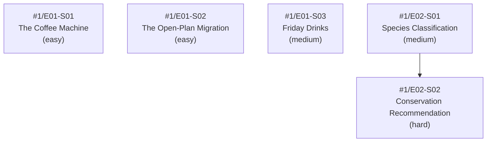

# Implementation Plan: The Office Worker — A Nature Documentary (Run 8)

> **Backlog:** #1 — Test SDLC v2 Workflow (Run 8) — Worktree Isolation
> **Design:** `docs/2-design/2026-03-12-test-agentic-sdlc-run08-office-nature-documentary.md`

## Overview

This plan decomposes the Run 8 test into 2 epics and 5 stories. The primary test objective is validating `isolation: "worktree"` for parallel builder dispatch — the top open defect from Run 7.

All stories produce markdown files in `test-output/office-nature-documentary/`. No C# code, no tests, no DI changes. The pre-commit hook runs `dotnet test` but no source changes means tests pass trivially.

### Structural Decisions

**Why 2 epics (not 1 or 3):** The design specifies two natural groupings — independent field observations (E01) and sequentially dependent analytical documents (E02). Merging into 1 epic loses the parallel/sequential distinction. Splitting further adds no value for 5 stories.

**Why E02-S01 is in Wave 2 (not Wave 1):** The design recommends keeping E02-S01 separate from the 3-way parallel Wave 1. This isolates the worktree variable — if Wave 1 succeeds with 3 parallel builders, we know worktree isolation works without confounding it with cross-epic parallel merge complexity. Wave 2 runs E02-S01 alone, and Wave 3 runs E02-S02 (which depends on E02-S01's document ID).

## Epic and Story Breakdown

### [#1/E01] Field Observations

Three independent documentary episodes. All dispatch in parallel (Wave 1) with `isolation: "worktree"`. This is the primary worktree isolation test.

**Branch:** `epic/e01-field-observations` (from `backlog/1-office-documentary`)

#### [#1/E01-S01] The Coffee Machine — `difficulty/easy`

**Deliverable:** `test-output/office-nature-documentary/episode-the-coffee-machine.md`

**Branch:** `e01-s01/coffee-machine` (from `epic/e01-field-observations`)

**Acceptance criteria:**
- [ ] File exists at `test-output/office-nature-documentary/episode-the-coffee-machine.md`
- [ ] Episode title formatted as documentary heading
- [ ] Narrator observation (4-6 sentences) covering territorial display and dominance hierarchy at the coffee station
- [ ] At least one Latin species/behaviour name
- [ ] At least one production note in brackets (e.g., `[CAMERA: ...]`)
- [ ] 100-200 words total
- [ ] Hushed, reverent, present-tense third-person narration throughout
- [ ] Story branch contains ONLY this file (no cross-contamination from parallel builds)

**Files to create:**
- `test-output/office-nature-documentary/episode-the-coffee-machine.md`

**Why easy:** Single file, single scene, formulaic structure. No cross-references. Builder writes one markdown file following a template.

---

#### [#1/E01-S02] The Open-Plan Migration — `difficulty/easy`

**Deliverable:** `test-output/office-nature-documentary/episode-the-open-plan-migration.md`

**Branch:** `e01-s02/open-plan-migration` (from `epic/e01-field-observations`)

**Acceptance criteria:**
- [ ] File exists at `test-output/office-nature-documentary/episode-the-open-plan-migration.md`
- [ ] Episode title formatted as documentary heading
- [ ] Narrator observation (4-6 sentences) covering seasonal desk-moving behaviour and management reorganisations
- [ ] At least one Latin species/behaviour name
- [ ] At least one production note in brackets
- [ ] 100-200 words total
- [ ] Hushed, reverent, present-tense third-person narration throughout
- [ ] Story branch contains ONLY this file (no cross-contamination from parallel builds)

**Files to create:**
- `test-output/office-nature-documentary/episode-the-open-plan-migration.md`

**Why easy:** Identical structure to E01-S01. Different subject, same template.

---

#### [#1/E01-S03] Friday Drinks — `difficulty/medium`

**Deliverable:** `test-output/office-nature-documentary/episode-friday-drinks.md`

**Branch:** `e01-s03/friday-drinks` (from `epic/e01-field-observations`)

**Acceptance criteria:**
- [ ] File exists at `test-output/office-nature-documentary/episode-friday-drinks.md`
- [ ] Episode title formatted as documentary heading
- [ ] Opening narration (2-3 sentences) setting the scene at 17:00 on the fifth day
- [ ] Courtship and bonding observations (3-4 sentences) covering watering hole rituals
- [ ] Behavioural analysis (2-3 sentences) on the ritual's role in pack cohesion
- [ ] At least two Latin species/behaviour names
- [ ] At least two production notes in brackets
- [ ] 150-200 words total
- [ ] Hushed, reverent, present-tense third-person narration throughout
- [ ] Story branch contains ONLY this file (no cross-contamination from parallel builds)

**Files to create:**
- `test-output/office-nature-documentary/episode-friday-drinks.md`

**Why medium:** Multiple sections with different narrative functions. More creative latitude than easy episodes. Still single-file but requires balancing multiple comedic threads.

---

### [#1/E02] Analytical Documents

Formal species documentation with sequential dependency. E02-S01 must complete before E02-S02 starts (cross-reference by document ID).

**Branch:** `epic/e02-analytical-documents` (from `backlog/1-office-documentary`)

#### [#1/E02-S01] Species Classification Report — `difficulty/medium`

**Deliverable:** `test-output/office-nature-documentary/species-classification-report.md`

**Branch:** `e02-s01/species-classification` (from `epic/e02-analytical-documents`)

**Acceptance criteria:**
- [ ] File exists at `test-output/office-nature-documentary/species-classification-report.md`
- [ ] Document header with formal classification report formatting
- [ ] Document ID present: `Document: HC-CLASS-001`
- [ ] Classification table with rows for: Species, Habitat Range, Subspecies (Manager, Developer, Intern with Latin names), Dietary Habits, Threat Display Behaviours
- [ ] Researcher notes section (2-3 sentences)
- [ ] 150-200 words total
- [ ] Maintains documentary tone in formal report register

**Files to create:**
- `test-output/office-nature-documentary/species-classification-report.md`

**Why medium:** Structured tabular content plus researcher commentary. More format complexity than episode scripts but still single-file.

---

#### [#1/E02-S02] Conservation Status Recommendation — `difficulty/hard`

**Deliverable:** `test-output/office-nature-documentary/conservation-status-recommendation.md`

**Branch:** `e02-s02/conservation-recommendation` (from `epic/e02-analytical-documents`)

**Dependencies:** E02-S01 must be complete (cross-references document ID HC-CLASS-001)

**Acceptance criteria:**
- [ ] File exists at `test-output/office-nature-documentary/conservation-status-recommendation.md`
- [ ] Formal recommendation header with "Senior Researcher Eyes Only" clearance
- [ ] Document ID present: `Document: HC-CONSERVE-001`
- [ ] Executive summary (2-3 sentences) summarising field observations and classification findings
- [ ] Options analysis with 3 options (2-3 sentences each): (a) Full protection, (b) Controlled observation, (c) Cautionary exhibit designation
- [ ] Formal recommendation (2-3 sentences) with chosen option and justification
- [ ] Cross-reference to species classification report by document ID (HC-CLASS-001)
- [ ] Cross-reference to at least one field observation episode
- [ ] 180-200 words total
- [ ] Maintains formal documentary tone throughout

**Files to create:**
- `test-output/office-nature-documentary/conservation-status-recommendation.md`

**Why hard:** Synthesises content from multiple prior documents. Requires internal consistency with cross-references. Multiple sections with different rhetorical purposes. Most structurally complex piece.

## Dependency Graph



E01-S01, E01-S02, E01-S03, and E02-S01 are all independent. E02-S02 depends on E02-S01 (cross-references classification report by document ID HC-CLASS-001).

## Dispatch Plan

| Wave | Stories | Dispatch | Notes |
|------|---------|----------|-------|
| **Wave 1** | E01-S01, E01-S02, E01-S03 | Parallel (3 stories, `isolation: "worktree"`) | Primary worktree isolation test. All independent field observations. |
| **Wave 2** | E02-S01 | Sequential | Species classification. No dependency on Wave 1 but separate epic. |
| **Wave 3** | E02-S02 | Sequential | Depends on E02-S01. Cross-references HC-CLASS-001. |

### Post-Wave Verification

After Wave 1 completes, the orchestrator MUST verify worktree isolation by checking that each story branch contains only its own file:

```bash
# For each story branch, verify only the expected file was changed
git diff --name-only epic/e01-field-observations..e01-s01/coffee-machine
# Should show ONLY: test-output/office-nature-documentary/episode-the-coffee-machine.md
```

This is the primary acceptance criterion for Run 8 — validating that worktree isolation eliminates the workspace collision defect from Run 7.

## Branch Strategy

```
backlog/1-office-documentary                    ← integration branch
├── epic/e01-field-observations                 ← epic branch (from integration)
│   ├── e01-s01/coffee-machine                  ← story branch (from epic)
│   ├── e01-s02/open-plan-migration             ← story branch (from epic)
│   └── e01-s03/friday-drinks                   ← story branch (from epic)
└── epic/e02-analytical-documents               ← epic branch (from integration)
    ├── e02-s01/species-classification           ← story branch (from epic)
    └── e02-s02/conservation-recommendation      ← story branch (from epic)
```

## Builder Instructions (Common)

All stories share these instructions:

1. Create directory: `mkdir -p test-output/office-nature-documentary/`
2. Write the markdown file at the specified path
3. Use explicit file paths with `git add` (never `git add .`)
4. Content must maintain the documentary tone described in the design doc voice guidelines
5. No C# code changes — markdown only

## Risk Assessment

| Risk | Mitigation |
|------|------------|
| Worktree isolation fails silently | Post-wave branch verification checks file lists |
| Builder exceeds word count | Reviewer checks word count as acceptance criterion |
| Cross-reference mismatch (E02-S02 → E02-S01) | E02-S02 issue body specifies exact document ID (HC-CLASS-001) |
| Pre-commit hook fails on markdown-only changes | No source code changes, so `dotnet test` passes trivially |
