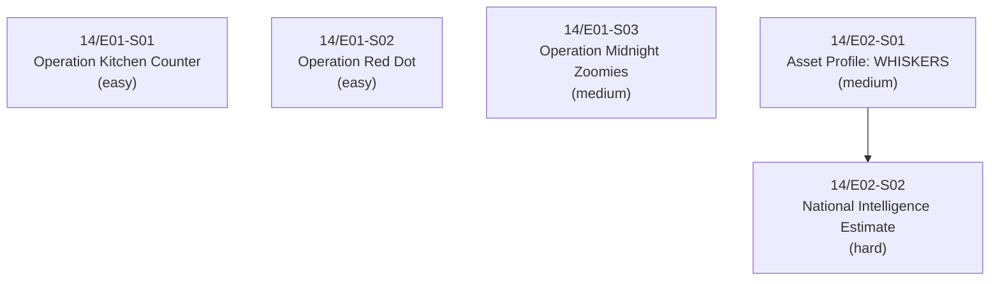

# Implementation Plan: Pet Cats — Declassified CIA Field Reports (Run 9)

> **Backlog:** 14 — Test SDLC v2 Workflow (Run 9) — Full Autonomous Lifecycle
> **Design:** `docs/2-design/2026-03-13-test-agentic-sdlc-cia-cat-reports.md`

## Overview

This plan decomposes the Run 9 test into 2 epics and 5 stories. The primary test objective is validating the **full autonomous lifecycle end-to-end** — design, plan, build, review, retro, telemetry, and backlog PR in a single unattended run.

All stories produce markdown files in `test-output/cia-cat-reports/`. No C# code, no tests, no DI changes. The pre-commit hook runs `dotnet test` but no source changes means tests pass trivially.

### Structural Decisions

**Why 2 epics (not 1 or 3):** The design specifies two natural groupings — independent field reports (E01, parallel) and sequentially dependent strategic analysis documents (E02). Merging into 1 epic loses the parallel/sequential distinction that validates different dispatch modes. Splitting further adds overhead for only 5 stories.

**Why E02-S01 is in Wave 2 (not Wave 1):** E02-S01 has no content dependency on Wave 1, but it belongs to a different epic. Including it in Wave 1 would require cross-epic parallel dispatch and merge, which is not the primary test variable for Run 9. Keeping it in Wave 2 matches the proven shape from Run 8 and isolates the "full autonomous lifecycle" variable.

**Why 3 waves (not 2):** E02-S02 depends on E02-S01 for document ID cross-references, so they cannot run in the same wave. Wave 1 (3 parallel) + Wave 2 (E02-S01) + Wave 3 (E02-S02) is the minimum wave count that respects all dependencies.

## Epic and Story Breakdown

### [14/E01] Field Intelligence

Three independent CIA field reports on different cat operations. All dispatch in parallel (Wave 1) with `isolation: "worktree"`. This retests worktree isolation validated in Run 8.

**Branch:** `epic/e01-field-intelligence` (from `backlog/14-sdlc-v2-full-autonomous`)

#### [14/E01-S01] Operation Kitchen Counter — `difficulty/easy`

**Deliverable:** `test-output/cia-cat-reports/field-report-operation-kitchen-counter.md`

**Branch:** `e01-s01/kitchen-counter` (from `epic/e01-field-intelligence`)

**Acceptance criteria:**
- [ ] File exists at `test-output/cia-cat-reports/field-report-operation-kitchen-counter.md`
- [ ] Classification header present (`TOP SECRET // CATNIP`)
- [ ] Document ID present: `CIA-FELINE-2026-001`
- [ ] Field report on Asset WHISKERS's kitchen counter incursions
- [ ] Surveillance log with 2-3 timestamped observations
- [ ] Handler recommendation (1-2 sentences)
- [ ] Threat level assessment (MODERATE)
- [ ] 100-200 words total
- [ ] Formal CIA report tone — third person, past tense, no acknowledgement of absurdity
- [ ] Story branch contains ONLY this file (no cross-contamination from parallel builds)

**Files to create:**
- `test-output/cia-cat-reports/field-report-operation-kitchen-counter.md`

**Why easy:** Single scene, formulaic structure. Timestamped log entries plus a brief recommendation. No cross-references.

---

#### [14/E01-S02] Operation Red Dot — `difficulty/easy`

**Deliverable:** `test-output/cia-cat-reports/field-report-operation-red-dot.md`

**Branch:** `e01-s02/red-dot` (from `epic/e01-field-intelligence`)

**Acceptance criteria:**
- [ ] File exists at `test-output/cia-cat-reports/field-report-operation-red-dot.md`
- [ ] Classification header present (`TOP SECRET // CATNIP`)
- [ ] Document ID present: `CIA-FELINE-2026-002`
- [ ] After-action report on Asset MITTENS's pursuit of an unidentified luminous target
- [ ] Pursuit timeline with 2-3 entries across multiple rooms
- [ ] Target status: remains at large
- [ ] Handler note expressing concern about the target's ability to vanish and reappear
- [ ] Threat level assessment (LOW)
- [ ] 100-200 words total
- [ ] Formal CIA report tone — third person, past tense, no acknowledgement of absurdity
- [ ] Story branch contains ONLY this file (no cross-contamination from parallel builds)

**Files to create:**
- `test-output/cia-cat-reports/field-report-operation-red-dot.md`

**Why easy:** Same template as E01-S01. Different subject, identical report structure.

---

#### [14/E01-S03] Operation Midnight Zoomies — `difficulty/medium`

**Deliverable:** `test-output/cia-cat-reports/field-report-operation-midnight-zoomies.md`

**Branch:** `e01-s03/midnight-zoomies` (from `epic/e01-field-intelligence`)

**Acceptance criteria:**
- [ ] File exists at `test-output/cia-cat-reports/field-report-operation-midnight-zoomies.md`
- [ ] Classification header present (`TOP SECRET // CATNIP`)
- [ ] Document ID present: `CIA-FELINE-2026-003`
- [ ] Incident report on a 0300h high-speed pursuit through the residence by Asset WHISKERS
- [ ] Situation report (2-3 sentences): initial detection, speed estimate, direction of travel
- [ ] Damage assessment (2-3 items): one vase casualty, displaced rug, startled Asset MITTENS
- [ ] Analyst note (1-2 sentences) speculating on triggers
- [ ] Countermeasure recommendations (2-3 bullet points)
- [ ] Threat level assessment (HIGH — 0300h timing suggests deliberate sleep deprivation campaign)
- [ ] 150-200 words total
- [ ] Formal CIA report tone — third person, past tense, no acknowledgement of absurdity
- [ ] Story branch contains ONLY this file (no cross-contamination from parallel builds)

**Files to create:**
- `test-output/cia-cat-reports/field-report-operation-midnight-zoomies.md`

**Why medium:** Multiple sections with different rhetorical functions (situation, damage, analysis, recommendation). Requires balancing the formal incident report format with comedic content. More sections than the easy stories.

---

### [14/E02] Strategic Analysis

Formal intelligence documents with sequential dependency. Asset profile first (Wave 2), then strategic threat assessment referencing it (Wave 3).

**Branch:** `epic/e02-strategic-analysis` (from `backlog/14-sdlc-v2-full-autonomous`)

#### [14/E02-S01] Asset Profile: WHISKERS — `difficulty/medium`

**Deliverable:** `test-output/cia-cat-reports/asset-profile-whiskers.md`

**Branch:** `e02-s01/asset-profile` (from `epic/e02-strategic-analysis`)

**Acceptance criteria:**
- [ ] File exists at `test-output/cia-cat-reports/asset-profile-whiskers.md`
- [ ] Classification header present (`TOP SECRET // CATNIP // NOFORN`)
- [ ] Document ID present: `CIA-FELINE-2026-004`
- [ ] Cover identity: "Domestic shorthair, 4 years old, orange tabby"
- [ ] Recruitment history (2-3 sentences)
- [ ] Known associates: Asset MITTENS referenced
- [ ] Capabilities assessment (3-4 bullet points)
- [ ] Handler notes (1-2 sentences)
- [ ] 150-200 words total
- [ ] Formal CIA dossier tone throughout

**Files to create:**
- `test-output/cia-cat-reports/asset-profile-whiskers.md`

**Why medium:** Structured dossier content across multiple sections. More format complexity than field reports, with a consistent character profile that E02-S02 will reference.

---

#### [14/E02-S02] National Intelligence Estimate: The Feline Threat — `difficulty/hard`

**Deliverable:** `test-output/cia-cat-reports/national-intelligence-estimate-feline-threat.md`

**Branch:** `e02-s02/feline-threat` (from `epic/e02-strategic-analysis`)

**Dependencies:** E02-S01 must be complete (cross-references document ID CIA-FELINE-2026-004)

**Acceptance criteria:**
- [ ] File exists at `test-output/cia-cat-reports/national-intelligence-estimate-feline-threat.md`
- [ ] Classification header present (`TOP SECRET // CATNIP // ORCON`)
- [ ] Document ID present: `CIA-FELINE-2026-005`
- [ ] Executive summary (2-3 sentences) synthesising field reports and WHISKERS dossier
- [ ] Risk matrix with 3 rows: Kitchen infiltration (HIGH), Sleep disruption operations (CRITICAL), Furniture asset degradation (MODERATE) — each with 1-sentence justification
- [ ] Resource allocation recommendation (2-3 sentences)
- [ ] Dissenting opinion (1-2 sentences) from an analyst who "is more of a dog person"
- [ ] Cross-reference to CIA-FELINE-2026-004 (WHISKERS dossier)
- [ ] Cross-reference to at least one field report by document ID
- [ ] 180-200 words total
- [ ] Formal CIA strategic assessment tone throughout

**Files to create:**
- `test-output/cia-cat-reports/national-intelligence-estimate-feline-threat.md`

**Why hard:** Synthesises content from multiple prior documents. Requires internal consistency with cross-references by document ID. Multiple sections with different rhetorical purposes (summary, risk matrix, recommendation, dissent). Most structurally complex piece in the collection.

## Dependency Graph



E01-S01, E01-S02, E01-S03, and E02-S01 are all independent. E02-S02 depends on E02-S01 (cross-references the asset dossier by document ID CIA-FELINE-2026-004).

## Dispatch Plan

| Wave | Stories | Dispatch | Notes |
|------|---------|----------|-------|
| **Wave 1** | E01-S01, E01-S02, E01-S03 | Parallel (3 stories, `isolation: "worktree"`) | All independent field reports. Retests worktree isolation. |
| **Wave 2** | E02-S01 | Sequential | Asset profile. No dependency on Wave 1 but different epic. |
| **Wave 3** | E02-S02 | Sequential | Depends on E02-S01. Cross-references CIA-FELINE-2026-004. |

### Post-Wave Verification

After Wave 1 completes, the orchestrator MUST verify worktree isolation by checking that each story branch contains only its own file:

```bash
# For each story branch, verify only the expected file was changed
git diff --name-only epic/e01-field-intelligence..e01-s01/kitchen-counter
# Should show ONLY: test-output/cia-cat-reports/field-report-operation-kitchen-counter.md
```

## Branch Strategy

```
backlog/14-sdlc-v2-full-autonomous              <- integration branch
├── epic/e01-field-intelligence                  <- epic branch (from integration)
│   ├── e01-s01/kitchen-counter                  <- story branch (from epic)
│   ├── e01-s02/red-dot                          <- story branch (from epic)
│   └── e01-s03/midnight-zoomies                 <- story branch (from epic)
└── epic/e02-strategic-analysis                  <- epic branch (from integration)
    ├── e02-s01/asset-profile                    <- story branch (from epic)
    └── e02-s02/feline-threat                    <- story branch (from epic)
```

## Builder Instructions (Common)

All stories share these instructions:

1. Create directory: `mkdir -p test-output/cia-cat-reports/`
2. Write the markdown file at the specified path
3. Use explicit file paths with `git add` (never `git add .`)
4. Content must maintain the CIA intelligence report tone described in the design doc voice guidelines
5. No C# code changes — markdown only
6. Use the exact document IDs specified in each story's acceptance criteria
7. Asset names are consistent across all documents: WHISKERS (orange tabby, primary) and MITTENS (secondary)

## Risk Assessment

| Risk | Mitigation |
|------|------------|
| Worktree isolation fails silently | Post-wave branch verification checks file lists |
| Builder exceeds word count | Reviewer checks word count as acceptance criterion |
| Cross-reference mismatch (E02-S02 references wrong doc IDs) | Exact document IDs specified in acceptance criteria |
| Pre-commit hook fails on markdown-only changes | No source code changes, so `dotnet test` passes trivially |
| Full lifecycle fails at phase transition | Orchestrator state file enables recovery on resume |
