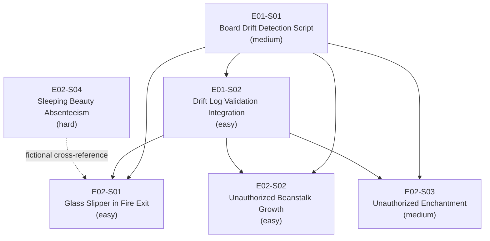

# Implementation Plan: Run 11 -- Board Drift Detection + Incident Reports from Fairy Tale HR

## Overview

This plan decomposes backlog item #41 into 2 epics and 6 stories. The run has two workstreams:

1. **Epic 1 -- Board Drift Detection Infrastructure** (2 stories, sequential): Create a standalone diagnostic script (`check-board-drift.sh`) that exercises timed re-verification of board status mutations, and extend `validate-logs.sh` to report on the drift log.
2. **Epic 2 -- Incident Reports from Fairy Tale HR** (4 stories, mixed parallel/sequential): Four HR incident report markdown files filed by the HR department of FairyTale Corp, a company that exclusively employs fairy tale characters.

Epic 1 must complete before Epic 2 begins so the drift detection infrastructure is available for the orchestrator to optionally invoke during content builds.

## Structural Decisions

**Why 2 epics (not 1 or 3):** The two workstreams are fundamentally different -- infrastructure (shell scripts) vs content (markdown documents). They have a hard ordering dependency (infra before content), different review criteria (script correctness vs tone/template compliance), and different file locations (`scripts/` vs `test-output/`). A single epic would conflate unrelated concerns. Three epics would mean splitting the 4 content stories across two epics without a meaningful distinction between them (all follow the same template, same directory, same voice).

**Why E02-S04 runs in Wave 4 (not Wave 3):** The design doc notes E02-S04 is the most structurally complex story (multi-layered scenario with cross-references to a fictional prior incident). Running it last in a separate wave avoids untested 4-way parallelism and gives the hard-difficulty builder focused attention on the most challenging content. The cross-reference to FT-HR-097 is fictional (no actual file needs to exist), so there is no data dependency -- this is purely a scheduling decision for reliability.

**Why no ADR:** This run introduces no new architectural patterns. The drift detection script follows established script conventions (`issue-set-status.sh` patterns), and the content stories produce markdown files. No DI changes, no new abstractions, no configuration changes.

## File Inventory

| Story | Action | File Path | Type |
|-------|--------|-----------|------|
| E01-S01 | Create | `scripts/check-board-drift.sh` | Bash script |
| E01-S02 | Edit | `scripts/validate-logs.sh` | Bash script |
| E02-S01 | Create | `test-output/fairy-tale-hr/incident-report-001.md` | Content |
| E02-S02 | Create | `test-output/fairy-tale-hr/incident-report-002.md` | Content |
| E02-S03 | Create | `test-output/fairy-tale-hr/incident-report-003.md` | Content |
| E02-S04 | Create | `test-output/fairy-tale-hr/incident-report-004.md` | Content |

## Dependency Graph



**Dependency rationale:**

- E01-S02 depends on E01-S01: the validate-logs extension references the drift log file format that `check-board-drift.sh` creates.
- All E02 stories depend on both E01 stories completing (the entire infra epic merges before content begins, so the orchestrator can exercise drift checking during content builds).
- E02-S01, E02-S02, and E02-S03 are independent of each other -- parallel dispatch with worktree isolation.
- E02-S04 has a dotted-line (soft) dependency on E02-S01 -- Snow White's witness statement cross-references a fictional prior incident (FT-HR-097), not an actual file. Running it in a separate wave is a scheduling choice, not a data dependency.

## Dispatch Plan

| Wave | Stories | Dispatch | Model(s) | Estimated Time |
|------|---------|----------|----------|----------------|
| **Wave 1** | E01-S01 | Sequential | Sonnet | ~2 min |
| **Wave 2** | E01-S02 | Sequential | Haiku | ~1 min |
| **Wave 3** | E02-S01, E02-S02, E02-S03 | Parallel (worktree isolation) | Haiku, Haiku, Sonnet | ~2 min wall-clock |
| **Wave 4** | E02-S04 | Sequential | Opus | ~3 min |

**Estimated total:** ~8 min agent time, ~8 min wall-clock (Wave 3 parallelism offsets Wave 1-2 sequential overhead).

---

## Epic 1: Board Drift Detection Infrastructure

### E01-S01: Board Drift Detection Script (medium)

**Branch:** `e01-s01/check-board-drift`

**Summary:** Create `scripts/check-board-drift.sh` -- a standalone diagnostic script that sets a board status, then re-verifies at timed intervals to detect delayed drift.

**Files to create:**
- `scripts/check-board-drift.sh` (executable)

**Acceptance criteria:**
- [ ] Script is executable (`chmod +x`) and runs without errors
- [ ] Accepts two arguments: `<issue-number>` and `<status>`
- [ ] Calls `issue-set-status.sh` for the initial status set (does not reimplement the mutation)
- [ ] Re-verifies at +10s and +30s intervals using the lightweight per-issue GraphQL query pattern from `issue-set-status.sh` (the `fetch_item_info` function pattern)
- [ ] Prints a human-readable timestamped report to stdout matching the format specified in the design doc
- [ ] Appends structured log entries to `.claude/logs/board-drift.log`
- [ ] Log format: `[ISO-timestamp] issue=N target=status set=OK verify_10s=OK|DRIFT(actual=X) verify_30s=OK|DRIFT(actual=X) result=NO_DRIFT|DRIFT`
- [ ] Exit code 0 for no drift detected, 1 for drift detected, 2 for usage errors or API failures
- [ ] Handles missing arguments gracefully (prints usage message, exits with code 2)
- [ ] Pre-commit hook passes (`dotnet test` is unaffected by a new shell script)

**Implementation notes:**
- Reuse the `fetch_item_info` GraphQL query pattern from `issue-set-status.sh` (lines 67-85) for the timed re-verifications. Copy the function, do not source `issue-set-status.sh` (it exits on its own).
- The script calls `issue-set-status.sh` as a subprocess for the initial set. Parse its exit code and stdout to determine if the set succeeded.
- Use `sleep 10` and then `sleep 20` (30s total from initial set, minus the ~10s already elapsed) for the timed waits.
- The drift log file (`.claude/logs/board-drift.log`) is separate from `board-status.log` to keep diagnostic data isolated from operational logs.
- The `.claude/logs/` directory is already gitignored (covered by `.claude/.gitignore` or parent `.gitignore`). Verify this during implementation.
- Map the status CLI argument (e.g., `in-progress`) to the display name (e.g., `In Progress`) for comparison with GraphQL results, using the same case mapping as `issue-set-status.sh`.

**Difficulty classification:**
- Touches 1 directory (`scripts/`)
- No new abstractions, no DI changes, no EF migrations
- Requires timed delays, multiple GraphQL queries, structured logging, and coordination with `issue-set-status.sh`
- Follows an established pattern (`issue-set-status.sh`) but adds timing and multi-step verification logic
- **Verdict: medium**

---

### E01-S02: Drift Log Validation Integration (easy)

**Branch:** `e01-s02/drift-log-validation`

**Summary:** Extend `scripts/validate-logs.sh` to add a third section that reports on the board drift log file.

**Files to modify:**
- `scripts/validate-logs.sh`

**Acceptance criteria:**
- [ ] New "Board Drift Log" section appears after the existing "Orchestrator Log" section
- [ ] References file path `.claude/logs/board-drift.log`
- [ ] If drift log file does not exist, prints "NOT FOUND -- no drift checks have been run"
- [ ] If drift log exists, counts total checks, `NO_DRIFT` events, and `DRIFT` events
- [ ] If any `DRIFT` events exist, surfaces them prominently with full log line details (matching the `VERIFY_MISMATCH` surfacing pattern in the existing board status section)
- [ ] Existing Board Status Log and Orchestrator Log sections are unchanged (no regressions)
- [ ] Pre-commit hook passes

**Implementation notes:**
- Follow the exact pattern used for `VERIFY_MISMATCH` surfacing (lines 56-62 of `validate-logs.sh`): check count > 0, then grep and print each matching line.
- Add the new section between the existing "Orchestrator Log" section output and the final "=== End Report ===" line.
- Use the existing `count_matching` helper function for counting events.
- Count `NO_DRIFT` by grepping for `result=NO_DRIFT` and `DRIFT` by grepping for `result=DRIFT` (without the `NO_` prefix -- use an anchored pattern like ` result=DRIFT$` or grep for `result=DRIFT` and subtract `NO_DRIFT` count).

**Difficulty classification:**
- Touches 1 file (existing script)
- Follows an established pattern (copy the VERIFY_MISMATCH surfacing logic)
- No new abstractions, no external dependencies
- **Verdict: easy**

---

## Epic 2: Incident Reports from Fairy Tale HR

### Voice Guidelines (for all E02 stories)

- **Tone:** Dry, bureaucratic, humourless corporate HR language. The narrator is an overworked HR professional who has processed too many enchantment-related violations this quarter.
- **Format:** Every report follows the rigid template specified in the design doc. No deviation from the form structure.
- **Register:** The comedy comes entirely from applying mundane workplace policy language to absurd fairy tale situations. Never acknowledge the absurdity. Treat enchanted sleep as "unauthorized use of company time." Treat dragon attacks as "failure to maintain a safe working environment."
- **Witness statements:** Always from another fairy tale character in a mundane corporate role.
- **HR recommendations:** Formal, proportionate to the violation category.

### Content Rules

- Each story produces ONE markdown file, 60-100 words max
- All output goes in `test-output/fairy-tale-hr/`
- No C# code -- markdown content only
- Builder must create the directory with `mkdir -p test-output/fairy-tale-hr/` before writing

### Report Template

Every report must follow this exact structure:

```markdown
# INCIDENT REPORT

**Report No:** FT-HR-XXX
**Date Filed:** [date]
**Filed By:** HR Department, FairyTale Corp
**Subject:** [Character name]
**Violation Category:** [category]

## Summary

[2-3 sentences in dry corporate HR language]

## Witness Statement

> "[1-2 sentences from a witness]"
> -- [Witness name], [Job title]

## HR Recommendation

[1 sentence with the formal recommendation]

---
*This report is filed under the FairyTale Corp Workplace Conduct Policy, Section [X.X]*
```

---

### E02-S01: "The Glass Slipper in the Fire Exit" (easy)

**Branch:** `e02-s01/glass-slipper`

**Summary:** Create incident report FT-HR-001 about Cinderella leaving a glass slipper in the fire exit.

**Files to create:**
- `test-output/fairy-tale-hr/incident-report-001.md`

**Acceptance criteria:**
- [ ] File exists at the specified path
- [ ] Report follows the exact template structure (all sections present in order)
- [ ] Report No: FT-HR-001
- [ ] Subject: Cinderella, Events Coordinator
- [ ] Violation Category: Fire Safety Violation
- [ ] Summary mentions: glass slipper in fire exit, third time this quarter, previous verbal warnings on 14 January and 22 February, obstruction per Building Safety Code Section 3.1
- [ ] Witness: Prince Charming, VP of Client Relations
- [ ] Prince Charming suggests the slipper might be "a conversation piece" rather than a hazard
- [ ] HR Recommendation: formal written warning + mandatory Fire Safety Awareness module completion
- [ ] Policy reference: Section 3.1
- [ ] Total length: 60-100 words
- [ ] Bureaucratic HR tone maintained throughout (no winking, no breaking character)

**Implementation notes:**
- Create directory `test-output/fairy-tale-hr/` with `mkdir -p` before writing
- Word count refers to the body text (summary + witness statement + recommendation), not the metadata fields

**Difficulty classification:**
- Single file, rigid template, content fully specified in design doc
- **Verdict: easy**

---

### E02-S02: "Unauthorized Beanstalk Growth" (easy)

**Branch:** `e02-s02/beanstalk-growth`

**Summary:** Create incident report FT-HR-002 about Jack planting unauthorized magic beans in the office courtyard.

**Files to create:**
- `test-output/fairy-tale-hr/incident-report-002.md`

**Acceptance criteria:**
- [ ] File exists at the specified path
- [ ] Report follows the exact template structure
- [ ] Report No: FT-HR-002
- [ ] Subject: Jack, Senior Acquisitions Analyst
- [ ] Violation Category: Unauthorized Modification of Company Property
- [ ] Summary mentions: magic beans in office courtyard planter, beanstalk breached fourth-floor ceiling, interfering with HVAC, facilities unable to remove, giants reported on roof
- [ ] Witness: The Big Bad Wolf, Head of Security
- [ ] Wolf reports structural concerns and "suspicious activity at altitude"
- [ ] HR Recommendation: immediate beanstalk removal at Jack's expense + suspension of courtyard planter privileges
- [ ] Policy reference: Section 7.4
- [ ] Total length: 60-100 words
- [ ] Bureaucratic HR tone maintained throughout

**Implementation notes:**
- Same directory and template as E02-S01
- Word count challenge: the summary has more narrative elements to compress

**Difficulty classification:**
- Same template as E02-S01, different subject, identical structure
- **Verdict: easy**

---

### E02-S03: "Unauthorized Enchantment in the Breakroom" (medium)

**Branch:** `e02-s03/breakroom-enchantment`

**Summary:** Create incident report FT-HR-003 about the Wicked Witch brewing potions in the breakroom microwave.

**Files to create:**
- `test-output/fairy-tale-hr/incident-report-003.md`

**Acceptance criteria:**
- [ ] File exists at the specified path
- [ ] Report follows the exact template structure
- [ ] Report No: FT-HR-003
- [ ] Subject: The Wicked Witch of the West, Senior Chemist
- [ ] Violation Category: Unauthorized Magic Use in Common Areas
- [ ] Summary mentions: breakroom microwave used for potions, green mist triggering smoke alarm (three times), communal coffee mug transformed into a frog (still at large), two colleagues temporarily turned invisible, breakroom declared hazmat zone
- [ ] Witness: Rapunzel, Facilities Manager
- [ ] Rapunzel notes the frog has been drinking from the water cooler and "seems to be enjoying its new life"
- [ ] HR Recommendation: 30-day suspension of breakroom privileges + mandatory re-training in No-Magic-in-Common-Areas policy + referral to Enchantment Ethics Board
- [ ] Policy reference: Section 12.3
- [ ] Total length: 60-100 words
- [ ] Bureaucratic HR tone maintained throughout

**Implementation notes:**
- This report has the most complex summary: multiple consequences (green mist, frog, invisibility, hazmat zone) must be compressed into the 60-100 word constraint
- The challenge is fitting a multi-part violation into the tight word count without losing the humor
- Consider using a brief enumerated list (a), (b), (c) format for the consequences, as suggested in the design doc

**Difficulty classification:**
- Same template structure, but the summary content is significantly more complex
- Requires condensing a richer scenario into the tight word count while maintaining bureaucratic tone
- More editorial judgment needed than the easy stories
- **Verdict: medium**

---

### E02-S04: "The Sleeping Beauty Absenteeism Case" (hard)

**Branch:** `e02-s04/sleeping-beauty`

**Summary:** Create incident report FT-HR-004 about Sleeping Beauty's 97-day enchantment-based absenteeism.

**Files to create:**
- `test-output/fairy-tale-hr/incident-report-004.md`

**Acceptance criteria:**
- [ ] File exists at the specified path
- [ ] Report follows the exact template structure
- [ ] Report No: FT-HR-004
- [ ] Subject: Sleeping Beauty, Junior Data Analyst
- [ ] Violation Category: Excessive Absenteeism / Unauthorized Use of Company Time
- [ ] Summary mentions: 97 consecutive business days asleep at desk, "enchantment-related medical leave" under Curse Accommodation Policy (Section 9.1), payroll still processing salary, laptop in sleep mode, team redistributed workload (declining morale), prince from M&A volunteered to "resolve the situation", HR flagged consent and fraternization policy concerns
- [ ] Witness: Snow White, VP of Operations
- [ ] Snow White references her own prior incident (FT-HR-097) and notes "this is not the first time we have dealt with enchantment-based absenteeism"
- [ ] HR Recommendation: formal review of Curse Accommodation Policy with Legal, pending determination of whether enchanted sleep qualifies under Extended Leave provisions
- [ ] Policy reference: Section 9.1
- [ ] Cross-reference: FT-HR-097 (Snow White's prior incident)
- [ ] Total length: 60-100 words
- [ ] Bureaucratic HR tone maintained throughout (especially the consent/fraternization concern -- must be completely straight-faced)

**Implementation notes:**
- Most structurally complex report: multi-layered scenario (enchantment, payroll, fraternization, consent, cross-reference) compressed into 60-100 words
- The HR recommendation involves genuine policy ambiguity (does enchantment qualify as medical leave?) rendered in bureaucratic language
- FT-HR-097 is a fictional document number -- no file needs to exist
- The comedy threads (consent concern about the prince, laptop "in sleep mode" matching the character) must be woven in without breaking the straight-faced bureaucratic register

**Difficulty classification:**
- Most complex content with multiple interleaving threads
- Requires compressing the most material into the same word constraint
- Balancing multiple comedic threads within severe word limits
- Cross-reference to fictional prior incident adds structural complexity
- Consent/fraternization policy concern is delicate material requiring precise tone control
- **Verdict: hard**

---

## Branch Strategy

```
backlog/41-board-drift-detection          (integration branch)
├── epic/e01-drift-infra                  (off integration branch)
│   ├── e01-s01/check-board-drift        (off epic branch)
│   └── e01-s02/drift-log-validation     (off epic branch)
└── epic/e02-fairy-tale-hr               (off integration branch, after E01 merges)
    ├── e02-s01/glass-slipper            (off epic branch)
    ├── e02-s02/beanstalk-growth         (off epic branch)
    ├── e02-s03/breakroom-enchantment    (off epic branch)
    └── e02-s04/sleeping-beauty          (off epic branch)
```

**Key sequencing:**
1. Epic 1 branches are created from the integration branch.
2. After both E01 stories merge into `epic/e01-drift-infra`, that epic branch merges (`--no-ff`) into the integration branch.
3. Epic 2 branch is then created from the updated integration branch.
4. Wave 3 story branches (E02-S01, S02, S03) are pre-created from the same epic branch commit before parallel dispatch.
5. After Wave 3 merges into the epic branch, E02-S04 branches from the updated epic branch.

## Risk Assessment

| Risk | Likelihood | Mitigation |
|------|-----------|------------|
| Drift script GraphQL query fails (permissions, rate limit) | Low | Script reuses proven query pattern from `issue-set-status.sh`; run includes only 6 stories so API budget is ample |
| Wave 3 worktree contamination | Low | Proven pattern from Runs 8, 9, and 10; pre-create story branches from same base commit |
| Content stories exceed 100-word limit | Medium | Design doc notes 55-110 is acceptable; reviewer should use a soft threshold |
| E02-S03 cannot fit multi-part violation into word count | Medium | Allow the builder to use abbreviated enumeration (a), (b), (c) format to compress |
| Pre-commit hook blocks content-only commits | Very Low | `dotnet test` is unaffected by markdown and shell script changes |
| Board drift check adds ~40s to the run | Expected | This is intentional -- the script is a diagnostic tool, not production overhead |
