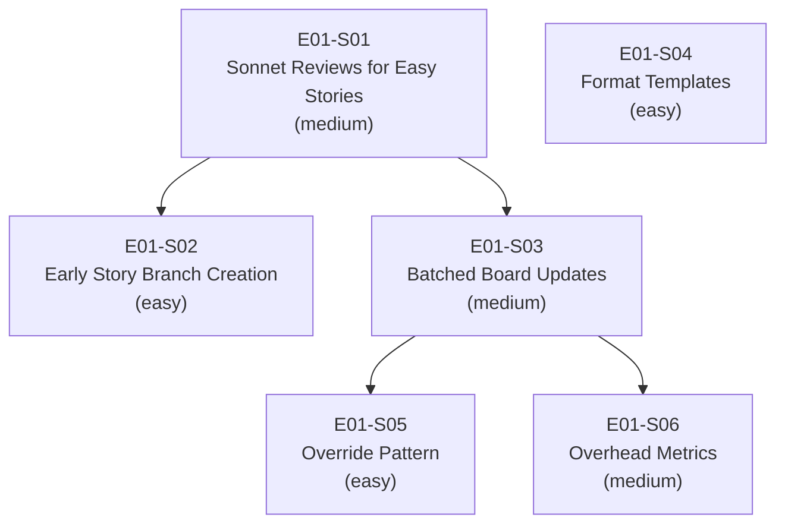

# Implementation Plan: Orchestrator Improvements

## Source

- **Backlog issue:** #105 (Orchestrator Improvements)
- **Design doc:** `docs/2-design/2026-03-16-orchestrator-improvements.md`
- **Integration branch:** `backlog/105-orchestrator-improvements`

## Overview

This plan decomposes 6 independent orchestrator improvements (from the approved design doc) into stories within a single epic. The improvements span config changes, new scripts, agent file updates, and documentation-only convention changes.

### Structural Decision: Single Epic

All 6 improvements are logically independent but share overlapping files (primarily `orchestrator.md` and `CLAUDE.md`). A single epic is the correct choice because:

1. **No natural epic boundary.** The improvements range from config+scripts (reviewer routing, batched board) to pure documentation (format templates, override pattern). Splitting into "code" vs "docs" epics would create artificial separation with no benefit.
2. **Shared-file conflicts dominate.** 5 of 6 stories modify `orchestrator.md`. Splitting into two epics would not enable more parallelism since the file conflicts are within each potential split.
3. **Single merge point.** One epic branch means one merge into the integration branch, reducing merge complexity.

### File Overlap Analysis

| Story | orchestrator.md | CLAUDE.md | config.json | config.sh | planner.md | retro-recs.md | New files |
|-------|:-:|:-:|:-:|:-:|:-:|:-:|:-:|
| S01 Reviewer Routing | Phase 6 | Dispatch protocol, helper scripts, variant sync | reviewerRouting | CFG_REVIEW_* | | | reviewer-sonnet.md, reviewer-opus.md |
| S02 Early Branches | Phase 4 | Branch creation convention | | | | | |
| S03 Batched Board | Phase 5 | Helper scripts table | | | | | batch-set-status.sh |
| S04 Format Templates | | | | | Format section | Rec E | |
| S05 Override Pattern | New section | | | | | Rec F | |
| S06 Overhead Metrics | Phase 0 + Phase 10 | Overhead section | | | | Rec H | |

---

## Epic: E01 -- Orchestrator Improvements

### E01-S01: Sonnet Reviews for Easy Stories (medium)

**Difficulty: medium** -- Multi-file change across config, scripts, and agent files. Follows the established builder variant pattern, but touches 7 files including orchestrator dispatch logic.

**Deliverables:**
- Create `reviewer-sonnet.md` and `reviewer-opus.md` agent variant files
- Add `reviewerRouting` section to config
- Add config reader variables for reviewer routing
- Update orchestrator reviewer dispatch to use routing
- Update CLI dispatch script reviewer dispatch
- Document in CLAUDE.md

**Files to create:**
- `.claude/agents/reviewer-sonnet.md`
- `.claude/agents/reviewer-opus.md`

**Files to modify:**
- `.claude/agentic-sdlc-config.json` -- add `reviewerRouting` section
- `scripts/lib/config.sh` -- add `CFG_REVIEW_EASY`, `CFG_REVIEW_MEDIUM`, `CFG_REVIEW_HARD`
- `.claude/agents/orchestrator.md` -- update Phase 6 dispatch to reference reviewer variants
- `CLAUDE.md` -- add `reviewerRouting` config documentation, update dispatch protocol, add reviewer variant sync convention, update builder variants section
- `scripts/dispatch-workflow.sh` -- update `difficulty_to_model` equivalent for reviewer, update reviewer dispatch call

**Acceptance Criteria:**
- [ ] `reviewer-sonnet.md` exists with `model: sonnet` and identical body to `reviewer.md`
- [ ] `reviewer-opus.md` exists with `model: opus` and identical body to `reviewer.md`
- [ ] `agentic-sdlc-config.json` has `"reviewerRouting": { "easy": "sonnet", "medium": "opus", "hard": "opus" }`
- [ ] `config.sh` exports `CFG_REVIEW_EASY`, `CFG_REVIEW_MEDIUM`, `CFG_REVIEW_HARD` from the `reviewerRouting` config section, with fallback defaults matching the config values
- [ ] `orchestrator.md` Phase 6 shows `subagent_type: "reviewer-sonnet"` for easy stories and `subagent_type: "reviewer-opus"` for medium/hard
- [ ] `orchestrator.md` "Two Dispatch Modes" section updated to show reviewer variant dispatch alongside builder variants
- [ ] `CLAUDE.md` dispatch protocol section documents reviewer routing (same pattern as builder routing)
- [ ] `CLAUDE.md` helper scripts table for `dispatch-workflow.sh` mentions reviewer routing
- [ ] `CLAUDE.md` agent file maintenance section includes reviewer variant sync convention and propagation script (matching builder variant sync pattern)
- [ ] `dispatch-workflow.sh` uses `reviewerRouting` config to select reviewer model instead of hardcoded `--model sonnet`
- [ ] All reviewer variant files have matching body content (only `name` and `model` differ)

**Test Plan:**
- Verify `jq '.reviewerRouting.easy' .claude/agentic-sdlc-config.json` returns `"sonnet"`
- Verify `source scripts/lib/config.sh && echo $CFG_REVIEW_EASY` returns `sonnet`
- Verify reviewer variant files differ only in YAML frontmatter `name` and `model` fields
- Verify `dispatch-workflow.sh` references `CFG_REVIEW_*` variables

**Branch:** `e01-s01/sonnet-reviews-for-easy-stories`

---

### E01-S02: Early Story Branch Creation (easy)

**Difficulty: easy** -- Documentation-only change to `orchestrator.md` and `CLAUDE.md`. Reorders existing operations (branch creation from Phase 5 to Phase 4), no new scripts or logic.

**Deliverables:**
- Update orchestrator Phase 4 to include branch creation
- Update Phase 5 to remove branch creation (dispatch only)
- Update CLAUDE.md branch creation convention

**Files to modify:**
- `.claude/agents/orchestrator.md` -- move branch creation from Phase 5 to Phase 4, add base SHA recording per epic
- `CLAUDE.md` -- update "Story branch creation for parallel waves" convention to reference Phase 4

**Acceptance Criteria:**
- [ ] `orchestrator.md` Phase 4 includes instructions for creating all epic branches and all story branches from the integration branch, with code examples
- [ ] `orchestrator.md` Phase 4 includes recording base commit SHA per epic branch in the state file
- [ ] `orchestrator.md` Phase 5 no longer contains branch creation instructions (dispatch only)
- [ ] `CLAUDE.md` "Story branch creation for parallel waves" section references Phase 4 as the location for branch creation
- [ ] The state file schema section in `orchestrator.md` includes `epics.*.base_sha` field documentation
- [ ] Phase 4 branch creation pushes all branches to remote immediately after creation

**Test Plan:**
- Verify `orchestrator.md` Phase 4 contains `git checkout -b` commands for epic and story branches
- Verify `orchestrator.md` Phase 5 does not contain `git checkout -b` for story branches
- Verify `CLAUDE.md` references Phase 4 for branch creation

**Branch:** `e01-s02/early-story-branch-creation`

---

### E01-S03: Batched Board Updates (medium)

**Difficulty: medium** -- New bash script (`batch-set-status.sh`) plus orchestrator documentation updates. The script reuses patterns from `issue-set-status.sh` but adds batch-specific logic (parallel fetch, shared verification).

**Deliverables:**
- Create `scripts/batch-set-status.sh`
- Update orchestrator Phase 5 to use batch updates at wave boundaries
- Document in CLAUDE.md helper scripts table

**Files to create:**
- `scripts/batch-set-status.sh`

**Files to modify:**
- `.claude/agents/orchestrator.md` -- update Phase 5 to use `batch-set-status.sh` at wave boundaries
- `CLAUDE.md` -- add `batch-set-status.sh` to helper scripts table

**Acceptance Criteria:**
- [ ] `batch-set-status.sh` exists and is executable (`chmod +x`)
- [ ] Script accepts multiple `<issue>:<status>` pairs as arguments (e.g., `./scripts/batch-set-status.sh 112:in-progress 113:in-progress 114:in-progress`)
- [ ] Script sources `scripts/lib/config.sh` for project configuration
- [ ] Script fetches current status for all issues before applying mutations (skip already-correct)
- [ ] Script applies mutations sequentially (GitHub Projects API constraint)
- [ ] Script runs a single verification pass for all issues after mutations with a shared 1s sleep
- [ ] Script logs to `.agentic-workflow/logs/board-status.log` (same log as `issue-set-status.sh`)
- [ ] Script exits 0 on success, 1 on failure
- [ ] Script handles edge cases: no arguments, invalid status names, issue not on board
- [ ] `orchestrator.md` Phase 5 shows `batch-set-status.sh` usage before dispatch (all in-progress) and after wave (all in-review)
- [ ] `CLAUDE.md` helper scripts table includes `batch-set-status.sh` with usage description
- [ ] Script is under 200 lines

**Test Plan:**
- Run `./scripts/batch-set-status.sh` with no arguments -- verify usage message and exit 1
- Run `./scripts/batch-set-status.sh 999:invalid` -- verify error for invalid status
- Run `bash -n scripts/batch-set-status.sh` -- verify no syntax errors
- Verify script sources `config.sh` and references expected variables

**Branch:** `e01-s03/batched-board-updates`

---

### E01-S04: Format Templates for Parallel Content (easy)

**Difficulty: easy** -- Single-file documentation change to `planner.md` plus updating the retro recommendations tracker.

**Deliverables:**
- Add "Format Templates for Parallel Content" guideline to planner.md
- Move recommendation E to Implemented in retro-recommendations.md

**Files to modify:**
- `.claude/agents/planner.md` -- add Format Templates section
- `docs/4-reviews/retro-recommendations.md` -- move rec E from Outstanding to Implemented

**Acceptance Criteria:**
- [ ] `planner.md` contains a new section "Format Templates for Parallel Content" (or equivalent heading)
- [ ] The section requires plans to specify exact rendering format for shared structural elements when an epic's stories produce content with shared patterns
- [ ] The section includes guidance to add a "Format Contract" section in epic plans with: element name, exact format, and example snippet
- [ ] `retro-recommendations.md` Outstanding section no longer contains recommendation E
- [ ] `retro-recommendations.md` Implemented table includes recommendation E with this backlog item as the implementation reference

**Test Plan:**
- Verify `planner.md` contains "Format" in a heading
- Verify `retro-recommendations.md` Implemented table includes "Format templates" row
- Verify recommendation E is not in the Outstanding section

**Branch:** `e01-s04/format-templates-parallel-content`

---

### E01-S05: Document Orchestrator Override Pattern (easy)

**Difficulty: easy** -- Documentation-only change to `orchestrator.md` adding a new section, plus updating the retro recommendations tracker.

**Deliverables:**
- Add "Orchestrator Override Pattern" section to orchestrator.md
- Move recommendation F to Implemented in retro-recommendations.md

**Files to modify:**
- `.claude/agents/orchestrator.md` -- add new section after error handling / before telemetry sections
- `docs/4-reviews/retro-recommendations.md` -- move rec F from Outstanding to Implemented

**Acceptance Criteria:**
- [ ] `orchestrator.md` contains a new section titled "Orchestrator Override Pattern" (or equivalent)
- [ ] Section specifies three requirements for an override: (1) fix committed and verifiable, (2) documented as issue comment with commit hash and overridden finding number, (3) telemetry records override
- [ ] Section specifies when NOT to override: unfixed issues, incomplete fixes, uncertain fixes
- [ ] Section references the evidence from Run 9 and Run 14 as the pattern's source
- [ ] `retro-recommendations.md` Outstanding section no longer contains recommendation F
- [ ] `retro-recommendations.md` Implemented table includes recommendation F with this backlog item as the implementation reference

**Test Plan:**
- Verify `orchestrator.md` contains "Override Pattern" in a heading
- Verify `retro-recommendations.md` Implemented table includes "override pattern" row
- Verify recommendation F is not in the Outstanding section

**Branch:** `e01-s05/document-orchestrator-override-pattern`

---

### E01-S06: Capture Orchestrator Overhead Metrics (medium)

**Difficulty: medium** -- Multi-section changes to `orchestrator.md` (Phase 0 + Phase 10 + state schema), plus `CLAUDE.md` update and retro recommendations tracker. Requires designing the heuristic formula and documenting it precisely.

**Deliverables:**
- Update orchestrator Phase 0 to capture session start baseline
- Update orchestrator Phase 10 to compute overhead delta
- Update state file schema with overhead fields
- Update CLAUDE.md overhead section with the heuristic formula
- Move recommendation H to Implemented in retro-recommendations.md

**Files to modify:**
- `.claude/agents/orchestrator.md` -- Phase 0 (capture start), Phase 10 (compute overhead), state file schema (add fields)
- `CLAUDE.md` -- update "Capturing orchestrator overhead" section with the time-based heuristic formula and state file fields
- `docs/4-reviews/retro-recommendations.md` -- move rec H from Outstanding to Implemented

**Acceptance Criteria:**
- [ ] `orchestrator.md` Phase 0 includes instruction to record `session.start_wall_clock` timestamp in the state file
- [ ] `orchestrator.md` Phase 10 includes instruction to compute overhead using the formula: `overhead_duration = wall_clock - sum(all_subagent_durations_critical_path)` and notes that token overhead is not directly measurable
- [ ] `orchestrator.md` Phase 10 includes instruction to include an "Orchestrator" row in the backlog telemetry summary table
- [ ] State file schema in `orchestrator.md` includes `session.start_wall_clock` field
- [ ] State file schema includes `overhead.duration_ms` and `overhead.estimated_cost` fields (both nullable)
- [ ] `CLAUDE.md` "Capturing orchestrator overhead" section is updated with: (1) the heuristic formula, (2) state file field references, (3) a note that token overhead is an estimate
- [ ] `retro-recommendations.md` Outstanding section no longer contains recommendation H
- [ ] `retro-recommendations.md` Implemented table includes recommendation H with this backlog item as the implementation reference

**Test Plan:**
- Verify `orchestrator.md` contains `start_wall_clock` in the state file schema
- Verify `orchestrator.md` Phase 10 contains "Orchestrator" row example in telemetry
- Verify `CLAUDE.md` contains the overhead heuristic formula
- Verify `retro-recommendations.md` Implemented table includes "overhead metrics" row

**Branch:** `e01-s06/capture-orchestrator-overhead-metrics`

---

## Dependency Graph

### Dependency Rationale

- **S01 and S04 are independent** -- S01 modifies `orchestrator.md`/`CLAUDE.md`/config; S04 modifies only `planner.md` and `retro-recommendations.md`. No file overlap.
- **S03 depends on S01** -- both modify `orchestrator.md` (S01: Phase 6, S03: Phase 5) and `CLAUDE.md`. Sequential to avoid merge conflicts.
- **S02 depends on S01** -- both modify `orchestrator.md` (S01: Phase 6, S02: Phase 4) and `CLAUDE.md`. Sequential to avoid merge conflicts.
- **S05 depends on S03** -- both modify `orchestrator.md`. S05 adds a new section; S03 modifies Phase 5. Sequential to avoid conflicts. S05 also shares `retro-recommendations.md` with S04 but S04 is in Wave 1 so this is naturally resolved.
- **S06 depends on S03** -- both modify `orchestrator.md` and `CLAUDE.md`. S06 modifies Phase 0 + Phase 10 + state schema. Sequential.
- **S02 and S05 can be parallel** in Wave 3 since they modify different sections of `orchestrator.md` (Phase 4 vs new section) and S02 does not touch `retro-recommendations.md`.
- **S06 can run with S05** but both modify `orchestrator.md`. However, S05 adds a standalone section while S06 modifies phases and state schema -- different areas. Since S05 is easy (quick completion), running S06 after S05 in Wave 4 avoids risk.

### Dispatch Plan

| Wave | Stories | Dispatch | Rationale |
|------|---------|----------|-----------|
| **Wave 1** | E01-S01 (#135), E01-S04 (#138) | Parallel | No shared files |
| **Wave 2** | E01-S03 (#137) | Sequential | Shares orchestrator.md + CLAUDE.md with S01 |
| **Wave 3** | E01-S02 (#136), E01-S05 (#139) | Parallel | Different orchestrator.md sections; S02 touches CLAUDE.md but S05 does not |
| **Wave 4** | E01-S06 (#140) | Sequential | Shares orchestrator.md + CLAUDE.md with prior stories |

### GitHub Issues

| Story | Issue | Difficulty |
|-------|-------|------------|
| E01-S01 Sonnet Reviews for Easy Stories | #135 | medium |
| E01-S02 Early Story Branch Creation | #136 | easy |
| E01-S03 Batched Board Updates | #137 | medium |
| E01-S04 Format Templates for Parallel Content | #138 | easy |
| E01-S05 Document Orchestrator Override Pattern | #139 | easy |
| E01-S06 Capture Orchestrator Overhead Metrics | #140 | medium |

**Epic issue:** #132

---

## Risk Assessment

| Risk | Likelihood | Impact | Mitigation |
|------|-----------|--------|------------|
| Merge conflicts in `orchestrator.md` between waves | Medium | Low | Wave sequencing prevents concurrent edits. Builder gets latest from epic branch before starting. |
| Reviewer variant files drift from `reviewer.md` | Low | Medium | S01 adds sync convention + propagation script to CLAUDE.md (matching builder variant pattern). |
| `batch-set-status.sh` GraphQL rate limits on parallel fetch | Low | Low | Script fetches sequentially by default with parallel as optimization. Inherits `issue-set-status.sh` retry logic. |
| Overhead heuristic accuracy | Medium | Low | Time-based heuristic is a known approximation. Token overhead noted as unmeasurable. The heuristic captures the primary metric (time). |

## Notes

- The design doc recommended deferring improvements 3 (Streaming Reviews) and 5 (Batch Issue Creation in Planner). This plan includes only the 6 approved improvements.
- `orchestrator.md` is already noted as approaching 1000 lines (observation v in retro-recommendations.md). Adding 3 more sections (override pattern, overhead capture, branch creation updates) will push it further. This is acceptable for now -- the observation recommends monitoring, not immediate action.
- All stories that modify `retro-recommendations.md` (S04, S05, S06) must update both the Outstanding and Implemented sections in the same commit to maintain consistency.
