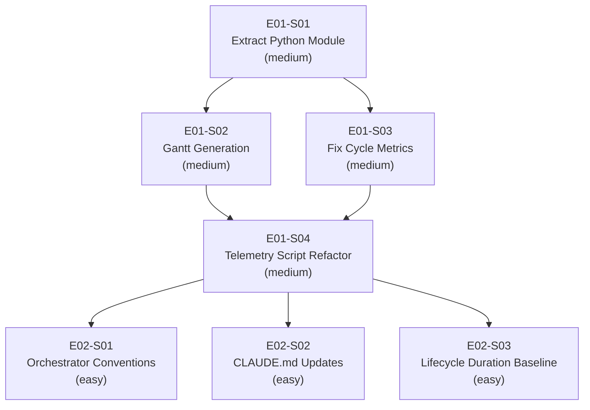

# Implementation Plan: Telemetry Accuracy & Automation

## Overview

This plan decomposes backlog item #106 into 2 epics and 7 stories. The work refactors the telemetry pipeline to eliminate manual Gantt construction, improve timestamp precision, extract embedded Python into a testable module, and add two new metrics (fix cycle overhead and lifecycle duration baseline).

**Epic 1 -- Telemetry Pipeline Refactor** (4 stories, sequential): Extract embedded Python into `scripts/lib/compute-dispatches.py`, update `item-telemetry.sh` to call the external module, add `--gantt-from-state` support, and update the telemetry template for fix cycle metrics.

**Epic 2 -- Conventions & Documentation** (3 stories, mixed parallel/sequential): Update orchestrator conventions for precise timestamps and `--gantt-from-state` usage, update CLAUDE.md helper script table and telemetry conventions, and add the changelog duration convention.

Epic 1 must complete before Epic 2 begins because the convention updates in E02 reference the new flags and capabilities built in E01.

## Structural Decisions

**Why 2 epics (not 1 or 3):** The work splits naturally into code changes (scripts, Python, template) and convention/documentation changes (orchestrator.md, CLAUDE.md, changelog). These have different review criteria (code correctness + test passing vs convention consistency + propagation completeness). A single epic would conflate code and docs. Three epics would split either the code or docs without meaningful distinction -- the Python extraction, Gantt generation, and fix cycle metrics are tightly coupled in the same script pipeline.

**Why E01 has 4 stories (not 3 or 5):** The Python extraction (E01-S01) is the foundation that all other code stories depend on. Gantt generation (E01-S02) and fix cycle metrics (E01-S03) both add features to the extracted Python module. The telemetry script refactor (E01-S04) updates `item-telemetry.sh` to wire the new flag and consume the new output fields. Merging S01 and S04 into one story would exceed the single-session scope (extracting ~230 lines of Python, writing a ~250-line module with tests, AND updating the caller). Splitting Gantt and fix cycles into separate stories keeps each change atomic and independently testable.

**Why no ADR:** The Python extraction is a straightforward refactoring (moving embedded code to an external file) that follows the project's existing pattern of calling Python from bash. No new architectural pattern is introduced -- `item-telemetry.sh` already runs Python via heredocs; it will now call an external script instead. The decision was already made in the design doc.

## File Inventory

| Story | Action | File Path | Type |
|-------|--------|-----------|------|
| E01-S01 | Create | `scripts/lib/compute-dispatches.py` | Python script |
| E01-S01 | Create | `scripts/lib/test_compute_dispatches.py` | Python test |
| E01-S02 | Modify | `scripts/lib/compute-dispatches.py` | Python script |
| E01-S02 | Modify | `scripts/lib/test_compute_dispatches.py` | Python test |
| E01-S03 | Modify | `scripts/lib/compute-dispatches.py` | Python script |
| E01-S03 | Modify | `scripts/lib/test_compute_dispatches.py` | Python test |
| E01-S03 | Modify | `scripts/templates/telemetry.md` | Template |
| E01-S04 | Modify | `scripts/item-telemetry.sh` | Bash script |
| E02-S01 | Modify | `.claude/agents/orchestrator.md` | Agent file |
| E02-S02 | Modify | `CLAUDE.md` | Project conventions |
| E02-S03 | Modify | `CLAUDE.md` | Project conventions |
| E02-S03 | Modify | `.claude/agents/orchestrator.md` | Agent file |

## Dependency Graph



**Dependency rationale:**

- E01-S02 and E01-S03 both depend on E01-S01: they add Gantt generation and fix cycle detection to the Python module created in S01.
- E01-S04 depends on E01-S02 AND E01-S03: the telemetry script refactor wires both the `--gantt-from-state` flag and the `fix_cycles` output field. It also removes the old Python heredocs, which requires all features to be in the external module first.
- E02-S01, E02-S02, and E02-S03 all depend on E01-S04: convention updates reference the new flags and capabilities that must exist before they can be documented.
- E02-S01, E02-S02, and E02-S03 are independent of each other: they modify different files (orchestrator.md, CLAUDE.md, and CLAUDE.md + orchestrator.md respectively, but S02 and S03 touch different sections of CLAUDE.md -- S02 updates the helper scripts table and telemetry conventions, S03 updates the changelog convention and adds the lifecycle_duration_ms state field).

## Dispatch Plan

| Wave | Stories | Dispatch | Model(s) | Estimated Time |
|------|---------|----------|----------|----------------|
| **Wave 1** | E01-S01 | Sequential | Sonnet | ~4 min |
| **Wave 2** | E01-S02, E01-S03 | Parallel (worktree isolation) | Sonnet, Sonnet | ~3 min wall-clock |
| **Wave 3** | E01-S04 | Sequential | Sonnet | ~4 min |
| **Wave 4** | E02-S01, E02-S02, E02-S03 | Parallel (worktree isolation) | Sonnet, Sonnet, Sonnet | ~2 min wall-clock |

**Estimated total:** ~18 min agent time, ~13 min wall-clock (Waves 2 and 4 run in parallel).

---

## Epic 1: Telemetry Pipeline Refactor

### E01-S01: Extract Python Dispatch Computation Module (medium)

**Branch:** `e01-s01/extract-python-module`

**Summary:** Extract the two embedded Python heredoc blocks from `item-telemetry.sh` into `scripts/lib/compute-dispatches.py` as a standalone, testable Python script. This story creates the module with the existing functionality only -- no new features (Gantt, fix cycles) are added yet.

**Files to create:**
- `scripts/lib/compute-dispatches.py` (executable)
- `scripts/lib/test_compute_dispatches.py`

**Acceptance criteria:**
- [ ] `compute-dispatches.py` is executable (`chmod +x`) and has a `#!/usr/bin/env python3` shebang
- [ ] Accepts `--dispatches <file>` mode: reads structured dispatch JSON (array of objects with `agent`, `model`, `task`, `duration_ms`, `tokens`, `phase` fields), computes per-row costs, produces breakdown and summary table rows
- [ ] Accepts `--from-state <state-file>` mode: reads orchestrator state file, maps agents to phases using the same `agent_to_phase` mapping currently in the heredoc, generates task labels from `epics.*.stories`, computes wall-clock duration from `started_at` grouping (same parallel detection algorithm)
- [ ] Accepts `--pricing <file>` for pricing JSON (default: `.agentic-workflow/pricing.json`)
- [ ] Accepts `--config <file>` for config JSON (default: `.claude/agentic-sdlc-config.json`)
- [ ] Outputs JSON to stdout with fields: `breakdown`, `summary`, `cost`, `duration_ms`, `tokens`, `wall_clock_ms` (when `--from-state` is used)
- [ ] Pricing resolution order preserved: config override first, then cached pricing, then warning to stderr
- [ ] `fmt_duration()`, `fmt_tokens()`, `fmt_cost()` formatting functions produce identical output to the current embedded Python
- [ ] Wall-clock computation from `started_at` grouping produces identical results to current embedded Python (dispatches with same `started_at` = parallel, take max; different = sequential, sum)
- [ ] Unit test file exists at `scripts/lib/test_compute_dispatches.py` with tests for both modes
- [ ] Tests pass: `python3 -m pytest scripts/lib/test_compute_dispatches.py -v` (or `python3 scripts/lib/test_compute_dispatches.py` if using unittest)
- [ ] Test for `--dispatches` mode: provides a known dispatch JSON fixture, verifies breakdown rows, summary rows, cost, duration, and token totals
- [ ] Test for `--from-state` mode: provides a known state file fixture, verifies agent-to-phase mapping, task label generation, and wall-clock computation
- [ ] Script runs independently from the command line: `python3 scripts/lib/compute-dispatches.py --dispatches <file> --pricing <file>`

**Implementation notes:**
- Extract the Python code from `item-telemetry.sh` lines 117-261 (the `_run_dispatches_computation` function's heredoc) and lines 281-371 (the state file conversion heredoc). The bash variables referenced via string interpolation (`$_CFG_FILE`, `$_PRICING_CACHE`, `$dispatches_file`, `$DISPATCHES_FROM_STATE`, `$_wall_clock_tmp`) become CLI arguments.
- Use `argparse` for argument parsing. The script should be usable both as a CLI tool and importable as a module for testing.
- Use `if __name__ == '__main__':` to separate the entry point from the functions.
- The test file should include fixtures based on realistic dispatch data (use Run 13 or Run 14 patterns for realistic data shapes). Use `tempfile.NamedTemporaryFile` for test fixture files.
- The `--from-state` mode currently writes wall-clock data to a separate temp file (`$_wall_clock_tmp`). In the extracted version, include `wall_clock_ms` and `has_parallel` in the main JSON output instead of a side-channel file.
- **Do NOT modify `item-telemetry.sh` in this story.** The bash script continues to use the heredocs until E01-S04 wires up the external module call. This keeps the story atomic -- extraction only, no caller changes.

**Difficulty classification:**
- Touches 1 directory (`scripts/lib/`)
- No new abstractions -- moving existing code to an external file
- Requires understanding the existing Python logic, restructuring it with `argparse`, and writing tests
- Multi-file (Python module + test file), standard patterns
- **Verdict: medium**

---

### E01-S02: Gantt Generation from State Data (medium)

**Branch:** `e01-s02/gantt-from-state`

**Summary:** Add `--gantt` flag support to `compute-dispatches.py` that generates a Mermaid Gantt chart body from the state file's `dispatches[]` array using absolute offsets from `session.started_at`.

**Files to modify:**
- `scripts/lib/compute-dispatches.py`
- `scripts/lib/test_compute_dispatches.py`

**Acceptance criteria:**
- [ ] `compute-dispatches.py` accepts `--gantt` flag (only valid with `--from-state`)
- [ ] When `--gantt` is provided, output JSON includes a `gantt` field containing the Mermaid Gantt body (everything after the `gantt` keyword, ready for template injection)
- [ ] Gantt header includes `title Full Lifecycle Timeline`, `dateFormat HH:mm:ss`, and auto-selected `axisFormat` and `tickInterval`:
  - Under 30m total duration: `tickInterval 2minute`
  - 30-90m: `tickInterval 5minute`
  - 90m+: `tickInterval 10minute`
- [ ] Each task position is an absolute offset from `session.started_at`, not a relative `after` dependency
- [ ] Offset computed as `(dispatch.started_at - session.started_at).total_seconds()` and formatted as `HH:MM:SS`
- [ ] Duration computed from `duration_ms / 1000` and rendered in seconds
- [ ] Color tags assigned deterministically from agent type:
  - `designer`, `planner`, `retro` -> `:active` (violet)
  - `builder-*` -> no tag (emerald)
  - `reviewer` -> `:done` (yellow)
- [ ] Fix cycles detected: when the same `(issue, agent-prefix)` pair appears more than once, the second+ dispatches get `:crit` tag (red)
- [ ] Task labels follow the convention: `"<ENN-SNN> Build (<dur>)"` for builders, `"<ENN-SNN> Review (<dur>)"` for reviewers, `"Designer (<dur>)"` for designer, etc.
- [ ] Fix cycle labels: `"<ENN-SNN> Fix (<dur>)"` for builder re-dispatches, `"<ENN-SNN> Re-review (<dur>)"` for reviewer re-dispatches
- [ ] PR Review label: `"PR Review (<dur>)"` for reviewer dispatches where the issue is not in any epic's stories
- [ ] Task IDs are sequential: `t1`, `t2`, ..., `tN` in chronological order
- [ ] Dispatches sorted by `started_at` (then by `id` for stable ordering within same timestamp)
- [ ] Parallel tolerance: dispatches within 5 seconds of each other in `started_at` are treated as starting at the same time (use the earliest timestamp in the group for all tasks in the group)
- [ ] Unit tests added for Gantt generation:
  - Test with sequential dispatches (no parallelism)
  - Test with parallel dispatches (same `started_at`)
  - Test with fix cycles (repeated `(issue, agent)` pair)
  - Test tick interval auto-selection for different total durations
- [ ] When `--gantt` is used without `--from-state`, the script exits with an error message

**Implementation notes:**
- The `session.started_at` field is at the top level of the state file (not inside dispatches). Read it as the epoch reference.
- For the parallel tolerance window: when grouping dispatches for Gantt positioning, sort all dispatches by `started_at`, then merge adjacent dispatches whose `started_at` values are within 5 seconds of each other into the same visual group (all get the earliest timestamp in the group). This is separate from the existing wall-clock parallel detection (which uses exact `started_at` match) -- the 5-second tolerance is only for Gantt visual grouping.
- The `issue` field in dispatches may be `null` (for designer/planner/retro). These dispatches are identified by their `agent` field.
- Use the existing `issue_titles` mapping (from `epics.*.stories`) to generate `ENN-SNN` labels. The epic key (`e01`, `e02`) comes from the outer key; the story number within the epic can be derived from the branch name or from counting stories in order.
- To detect fix cycles: build a counter dict keyed on `(issue, agent_prefix)`. The agent prefix is derived by splitting on `-` and taking the first element (e.g., `builder-sonnet` -> `builder`). For the first occurrence, increment count to 1 (normal). For count > 1, it is a fix cycle.
- Duration formatting in labels: use the compact format `Xm Ys` (e.g., `2m 25s`), matching `fmt_duration()`.

**Difficulty classification:**
- Modifies 1 existing file + test file in `scripts/lib/`
- Adds a new algorithmic feature (absolute offset Gantt generation) with multiple edge cases (parallel tolerance, fix cycle detection, tick interval auto-selection)
- Requires datetime arithmetic and Mermaid syntax generation
- Multi-file, standard patterns but non-trivial logic
- **Verdict: medium**

---

### E01-S03: Fix Cycle Metrics (medium)

**Branch:** `e01-s03/fix-cycle-metrics`

**Summary:** Add fix cycle detection and metric computation to `compute-dispatches.py`, and update the telemetry template to include a fix cycle footer line and summary row.

**Files to modify:**
- `scripts/lib/compute-dispatches.py`
- `scripts/lib/test_compute_dispatches.py`
- `scripts/templates/telemetry.md`

**Acceptance criteria:**
- [ ] `compute-dispatches.py` output JSON includes a `fix_cycles` object when fix cycles are detected:
  ```json
  {
    "fix_cycles": {
      "count": 3,
      "duration_ms": 689000,
      "cost": "1.53",
      "rate": "0.25",
      "stories_affected": 2
    }
  }
  ```
- [ ] Fix cycle detection: a builder re-dispatch for the same issue after a reviewer dispatch for that issue constitutes a fix cycle. The fix cycle includes the builder re-dispatch AND the subsequent re-review dispatch.
- [ ] Fix cycle count = number of builder re-dispatches (not counting the original build)
- [ ] Fix cycle duration = sum of `duration_ms` for all fix cycle dispatches (re-builds + re-reviews)
- [ ] Fix cycle cost = sum of estimated costs for those dispatches
- [ ] Fix cycle rate = fix cycle count / total number of unique builder issues (stories dispatched)
- [ ] Stories affected = count of unique issue numbers that had at least one fix cycle
- [ ] When no fix cycles exist, the `fix_cycles` field is either absent or `null` (not an object with zeros)
- [ ] Template updated: `scripts/templates/telemetry.md` includes a `FIX_CYCLES` conditional block
- [ ] Fix cycle summary row: `| Fix Cycles | <count> cycles (<stories> stories) | <duration> | <tokens> | <cost> |` -- appears between the last phase row and the Total row in the Summary table
- [ ] Fix cycle footer line: `*Fix cycles: <count> / <total_stories> stories (<rate>% fix rate), adding <duration> and <cost> (<pct>% of total cost).*`
- [ ] The template adds `{{FIX_SUMMARY_ROW}}` injection point in the Summary table area
- [ ] The template adds `{{FIX_FOOTER}}` injection point before the disclaimer
- [ ] `item-telemetry.sh` gains two new template variables: `FIX_SUMMARY_ROW` and `FIX_FOOTER` (populated from the Python output when fix cycles exist, empty otherwise)
- [ ] `item-telemetry.sh` adds a `FIX_CYCLES` condition to `eval_condition()`
- [ ] Unit tests added for fix cycle detection:
  - Test with zero fix cycles (all stories pass review first time)
  - Test with fix cycles (one story has a builder re-dispatch after a reviewer dispatch)
  - Test with multiple fix cycles on the same story
  - Test cost computation for fix cycle dispatches

**Implementation notes:**
- Fix cycle detection algorithm: iterate through dispatches in order. For each dispatch, check if it's a builder dispatch. If it's a builder dispatch for an issue that has already been built (a previous builder dispatch for the same issue exists), it is a fix cycle. The subsequent reviewer dispatch for the same issue (if any) is also part of the fix cycle.
- The detection relies on dispatch ordering (dispatches are appended in chronological order). Do not rely on `started_at` grouping -- use the sequential `id` ordering.
- For the template changes: add `<!-- IF_FIX_CYCLES -->` / `<!-- END_FIX_CYCLES -->` blocks. The `FIX_CYCLES` condition is true when the `FIX_SUMMARY_ROW` variable is non-empty.
- The `FIX_SUMMARY_ROW` is injected inside the Summary table (between `{{SUMMARY}}` rows and the Total row). Since the Total row is currently part of the Python-computed `summary` string, the fix cycle row must be injected by the Python script itself -- append it to the summary rows before the Total row. This means the template does not need a `{{FIX_SUMMARY_ROW}}` injection point; instead, the Python script includes the fix cycle row in its `summary` output.
- The `FIX_FOOTER` is a separate injection point in the template, after `{{FOOTER}}` and before the disclaimer.
- In `item-telemetry.sh`, parse the `fix_cycles` object from the Python output and format the footer line.

**Difficulty classification:**
- Modifies 3 files (Python module, test file, template)
- Adds fix cycle detection algorithm with several edge cases
- Requires coordinating changes across Python output and bash template rendering
- Multi-file, standard patterns but requires careful integration
- **Verdict: medium**

---

### E01-S04: Wire External Python Module in item-telemetry.sh (medium)

**Branch:** `e01-s04/wire-external-module`

**Summary:** Replace the two embedded Python heredoc blocks in `item-telemetry.sh` with calls to the external `compute-dispatches.py` module. Add `--gantt-from-state` flag handling. This is the integration story that connects E01-S01/S02/S03 to the telemetry script.

**Files to modify:**
- `scripts/item-telemetry.sh`

**Acceptance criteria:**
- [ ] The `_run_dispatches_computation()` function in `item-telemetry.sh` no longer contains a Python heredoc. Instead, it calls `python3 "$SCRIPT_DIR/lib/compute-dispatches.py" --dispatches <file> --pricing <pricing> --config <config>` and parses the JSON output
- [ ] The `--dispatches-from-state` code path no longer contains a Python heredoc. Instead, it calls `python3 "$SCRIPT_DIR/lib/compute-dispatches.py" --from-state <state-file> --pricing <pricing> --config <config>` and parses the JSON output
- [ ] Wall-clock computation is read from the Python output's `wall_clock_ms` field instead of a separate temp file
- [ ] `has_parallel` is read from the Python output instead of a separate temp file
- [ ] New flag `--gantt-from-state <state-file>` accepted in argument parsing
- [ ] When `--gantt-from-state` is provided, the script calls `compute-dispatches.py` with `--from-state <state-file> --gantt` and captures the `gantt` field from output
- [ ] When both `--gantt-from-state` and `--gantt` are provided, `--gantt-from-state` takes precedence (with a warning to stderr)
- [ ] When `--gantt-from-state` is used, the script also processes dispatches from the state file (combining `--dispatches-from-state` behavior + Gantt generation in a single Python call)
- [ ] Fix cycle footer line is populated from `fix_cycles` in the Python output and set as `FIX_FOOTER` variable
- [ ] `FIX_CYCLES` condition added to `eval_condition()` function
- [ ] Fix cycle summary row is included in the `SUMMARY` variable (the Python script includes it in the summary output)
- [ ] `format_duration()` bash function definition is moved ABOVE the dispatches processing section (currently defined below where it is first called in the state-file path -- this is a latent bug)
- [ ] Temp file cleanup updated: remove the `$_wall_clock_tmp` temp file management (no longer needed)
- [ ] Script line count reduced from ~662 to ~450 or fewer (removing ~230 lines of Python heredocs, adding ~20 lines of external call + JSON parsing)
- [ ] Existing `--dispatches` and `--dispatches-from-state` flags continue to work identically (backward compatibility)
- [ ] Existing `--gantt` flag continues to work as-is (manual Gantt strings still accepted)

**Implementation notes:**
- The key refactoring is replacing two Python heredocs with two calls to the external script. The bash argument parsing, template rendering, and `gh` posting code remain in `item-telemetry.sh`.
- For `--gantt-from-state`, the implementation is a convenience that combines `--dispatches-from-state` + automatic Gantt. A single call to `compute-dispatches.py --from-state <file> --gantt` produces all needed data (breakdown, summary, cost, duration, tokens, wall_clock_ms, gantt, fix_cycles).
- The `FIX_FOOTER` variable is set by parsing `fix_cycles` from the Python output. Format: `*Fix cycles: <count> / <total_stories> stories (<rate_pct>% fix rate), adding <duration> and <cost> (<cost_pct>% of total cost).*`
- Note the `format_duration()` function is currently defined at line 397 but first called at line 382 (in the wall-clock auto-computation block). The heredoc path worked around this because Python had its own `fmt_duration`. With the external module, this bash function may be called earlier. Move its definition to before the dispatches processing section.

**Difficulty classification:**
- Modifies 1 file (`item-telemetry.sh`) but requires careful surgery to replace embedded code without breaking the surrounding bash logic
- Touches argument parsing, multiple code paths, template variable setup, and temp file management
- Requires understanding the interaction between bash and the external Python module
- Backward compatibility testing needed for all existing flag combinations
- **Verdict: medium**

---

## Epic 2: Conventions & Documentation

### E02-S01: Orchestrator Convention Updates (easy)

**Branch:** `e02-s01/orchestrator-conventions`

**Summary:** Update `.claude/agents/orchestrator.md` to document precise timestamp recording, `--gantt-from-state` usage, and the updated state schema with `finished_at`.

**Files to modify:**
- `.claude/agents/orchestrator.md`

**Acceptance criteria:**
- [ ] State schema example in `orchestrator.md` includes `finished_at` field on each dispatch entry
- [ ] Dispatch recording instructions updated: `started_at` must be captured using `$(date -u +%Y-%m-%dT%H:%M:%SZ)` immediately before Agent tool dispatch
- [ ] Parallel wave convention: for parallel dispatches, record a single `started_at` for all dispatches in the wave (the timestamp before the first dispatch call)
- [ ] `finished_at` convention: computed as `started_at + duration_ms` after each dispatch returns
- [ ] Phase 10 (Backlog-Level Telemetry) updated: the `--gantt` parameter in the example is replaced with `--gantt-from-state <state-file>`
- [ ] The explanatory text notes that `--gantt-from-state` generates the Gantt automatically from dispatch data, eliminating manual Gantt construction
- [ ] The manual `--gantt` example is preserved as the "Legacy method" (or moved to a fallback section) for cases where the state file is unavailable
- [ ] The `dispatches[]` schema example shows real ISO timestamps instead of `"..."` placeholder values
- [ ] Gantt color tagging section updated to note that `compute-dispatches.py` assigns tags automatically from agent type -- the orchestrator no longer needs to manually assign tags
- [ ] Fix cycle footer is mentioned as automatically included in backlog telemetry when fix cycles are detected
- [ ] No changes to other phases (the orchestrator's dispatch behavior does not change, only the state recording precision and telemetry posting method)

**Implementation notes:**
- The primary changes are in the State Schema section (adding `finished_at` to the example), the Phase 10 section (updating the telemetry posting command), and the Gantt color tagging section (noting automation).
- Be careful to preserve all existing instructions about board management, dispatch protocol, and error handling. Only update sections directly related to timestamps, Gantt construction, and telemetry posting.
- The state schema version stays at 1 (adding `finished_at` is a non-breaking addition per the design doc).

**Difficulty classification:**
- Modifies 1 file (agent markdown)
- Documentation-only changes with clear specifications
- Follows an established pattern (updating instructions to reference new script features)
- **Verdict: easy**

---

### E02-S02: CLAUDE.md Telemetry Convention Updates (easy)

**Branch:** `e02-s02/claude-md-updates`

**Summary:** Update CLAUDE.md to document the new `--gantt-from-state` flag, the `compute-dispatches.py` helper, and the fix cycle telemetry conventions.

**Files to modify:**
- `CLAUDE.md`

**Acceptance criteria:**
- [ ] Helper scripts table updated: `item-telemetry.sh` signature includes `--gantt-from-state <state-file>` in the options list
- [ ] Helper scripts table updated: new row for `scripts/lib/compute-dispatches.py` with brief description: `Compute dispatch metrics (breakdown, summary, Gantt, fix cycles) from state or dispatch JSON`
- [ ] `--gantt-from-state` flag documented in the `item-telemetry.sh` usage section near the existing `--gantt` documentation
- [ ] Wall-clock auto-computation section updated to mention that `--gantt-from-state` also computes wall-clock (same as `--dispatches-from-state`)
- [ ] Backlog PR Strategy section updated: the `--gantt` parameter in the backlog-level telemetry example is replaced with `--gantt-from-state`
- [ ] Gantt color tagging section notes that tags are now auto-assigned by `compute-dispatches.py` based on agent type
- [ ] Fix cycle footer convention noted: automatically included when fix cycles are detected via `--dispatches-from-state` or `--gantt-from-state`
- [ ] No unrelated changes to other sections of CLAUDE.md

**Implementation notes:**
- Focus on the sections that reference `item-telemetry.sh`, Gantt construction, and telemetry conventions. The primary sections to update: helper scripts table, `--dispatches-from-state` documentation, backlog PR strategy, Gantt color tagging, and value column convention.
- The wall-clock auto-computation paragraph already describes the `--dispatches-from-state` behavior; extend it to cover `--gantt-from-state` as well.

**Difficulty classification:**
- Modifies 1 file (CLAUDE.md)
- Documentation-only, updating existing sections with new flag names and descriptions
- Straightforward grep-and-update pattern
- **Verdict: easy**

---

### E02-S03: Lifecycle Duration Baseline Convention (easy)

**Branch:** `e02-s03/lifecycle-duration-baseline`

**Summary:** Add the `lifecycle_duration_ms` convention to the orchestrator state schema and update the changelog convention to include wall-clock duration in run entries.

**Files to modify:**
- `.claude/agents/orchestrator.md`
- `CLAUDE.md`

**Acceptance criteria:**
- [ ] Orchestrator state schema example includes `lifecycle_duration_ms` field at the `session` level
- [ ] `lifecycle_duration_ms` is documented as: set by the orchestrator at the very end of the workflow (after telemetry is posted, before cleanup), representing wall-clock time from `session.started_at` to the final telemetry post
- [ ] The orchestrator Phase 10 (or Phase 11) instructions include a step to compute and store `lifecycle_duration_ms` in the state file
- [ ] Changelog convention in CLAUDE.md updated: run entries should include wall-clock duration in the heading, e.g.: `**Run 15 -- <Topic>** (backlog #NNN, 25m wall-clock)`
- [ ] Changelog convention in `orchestrator.md` updated (if changelog instructions exist there) to include the duration
- [ ] Historical baseline table from the design doc is NOT added to any code file (it belongs in retro docs, not in scripts or conventions)

**Implementation notes:**
- The `lifecycle_duration_ms` field is added to the state schema documentation (the example JSON in orchestrator.md). No script changes are needed -- the orchestrator already writes to the state file; this just documents a new field it should set.
- The changelog convention is a small update to the existing changelog section. If there is no explicit changelog section in CLAUDE.md, add a brief note near the Documentation Conventions section.
- Check `orchestrator.md` for any existing changelog instructions and update those too.

**Difficulty classification:**
- Modifies 2 files (convention documentation only)
- No code changes, no script modifications
- Adding a new field to a JSON schema example and updating a heading convention
- **Verdict: easy**

---

## Branch Strategy

```
backlog/106-telemetry-accuracy           (integration branch)
+-- epic/e01-telemetry-pipeline          (off integration branch)
|   +-- e01-s01/extract-python-module    (off epic branch)
|   +-- e01-s02/gantt-from-state         (off epic branch, after E01-S01 merges)
|   +-- e01-s03/fix-cycle-metrics        (off epic branch, after E01-S01 merges)
|   +-- e01-s04/wire-external-module     (off epic branch, after E01-S02 and E01-S03 merge)
+-- epic/e02-conventions                 (off integration branch, after E01 merges)
    +-- e02-s01/orchestrator-conventions (off epic branch)
    +-- e02-s02/claude-md-updates        (off epic branch)
    +-- e02-s03/lifecycle-duration-baseline (off epic branch)
```

**Key sequencing:**
1. Epic 1 branch is created from the integration branch.
2. E01-S01 merges into the epic branch first (foundation).
3. E01-S02 and E01-S03 branch from the updated epic branch and run in parallel (Wave 2).
4. After Wave 2 merges, E01-S04 branches from the updated epic branch.
5. After E01-S04 merges, the epic branch merges (`--no-ff`) into the integration branch.
6. Epic 2 branch is created from the updated integration branch.
7. Wave 4 story branches (E02-S01, S02, S03) are pre-created from the same epic branch commit before parallel dispatch.
8. After all merge into the epic branch, the epic branch merges into the integration branch.

## Risk Assessment

| Risk | Likelihood | Mitigation |
|------|-----------|------------|
| Python module output format differs subtly from heredoc output | Medium | Unit tests compare against known fixtures; E01-S04 tests end-to-end by running `item-telemetry.sh` with test data |
| Mermaid absolute positioning syntax not supported by GitHub renderer | Low | Design doc assumption 1 notes this; fallback is `after`-based Gantt with manual offset comments |
| `format_duration()` move in E01-S04 introduces a bash regression | Low | The function is self-contained; moving it up is safe. Verify by running existing test fixtures through the script |
| Parallel Wave 2 (E01-S02 + E01-S03) creates merge conflicts in `compute-dispatches.py` | Medium | Both stories add code to the same Python file but in different areas (Gantt in S02, fix cycles in S03). Pre-create branches from same base. If conflicts arise, resolve during merge to epic branch. |
| E02 stories create merge conflicts in CLAUDE.md or orchestrator.md | Low | S01 and S03 both modify orchestrator.md, but in different sections (S01: state schema + Phase 10, S03: state schema lifecycle_duration + changelog). The specific sections are non-overlapping. |
| Fix cycle detection incorrectly classifies resumed (interrupted) dispatches as fix cycles | Low | Design doc assumption 4 notes that interrupted dispatches have `result: "interrupted"` or `"usage_limit"`, not `"success"`. Filter on `result` field if needed. |
