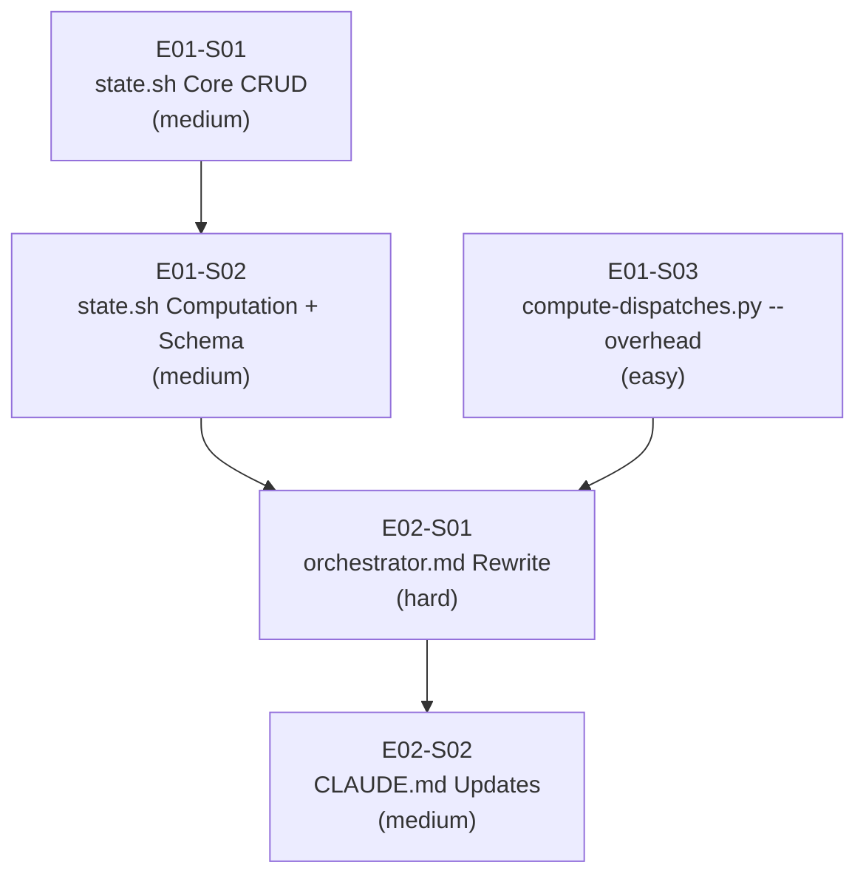

# Implementation Plan: Split orchestrator.md into Core Instructions and Scripts

## Source

- **Backlog issue:** #150 (Split orchestrator.md into Core Instructions and Reference Docs)
- **Design doc:** `docs/2-design/2026-03-17-split-orchestrator-md.md`
- **Integration branch:** `backlog/150-split-orchestrator-md`

## Overview

This plan decomposes backlog item #150 into 2 epics and 5 stories. The work extracts deterministic procedures from `orchestrator.md` into a new `scripts/state.sh` script, extends `compute-dispatches.py` with an `--overhead` flag, deletes dead code and redundant documentation, trims `orchestrator.md` from 1,323 to ~530 lines, extracts the state schema to a JSON file, and updates CLAUDE.md with the Fault Tolerance principle and new script references.

**Epic 1 -- Script Extraction and Creation** (3 stories, sequential): Create `scripts/state.sh` with core subcommands (init, update, get, overhead, lifecycle-duration), create the state schema file, and extend `compute-dispatches.py` with `--overhead`.

**Epic 2 -- orchestrator.md Rewrite and CLAUDE.md Updates** (2 stories, sequential): Rewrite orchestrator.md to replace inline code with script calls and delete dead/redundant content, then update CLAUDE.md with the Fault Tolerance principle and propagate changes.

Epic 1 must complete before Epic 2 begins because the orchestrator.md rewrite in E02 replaces inline code blocks with calls to scripts created in E01. The scripts must exist and be tested before the documentation references them.

## Structural Decisions

**Why 2 epics (not 1 or 3):** The work splits naturally into executable artifacts (bash script, Python extension, JSON schema) and documentation changes (orchestrator.md rewrite, CLAUDE.md updates). These have fundamentally different review criteria: E01 stories produce testable scripts that must handle edge cases, while E02 stories are documentation refactors that must maintain behavioral equivalence. A single epic would make review unwieldy -- the reviewer would need to simultaneously verify script correctness AND documentation consistency. Three epics would split E01 or E02 without meaningful benefit since E01's stories are sequential and E02's stories touch overlapping files.

**Why E01 has 3 stories (not 2 or 4):** The `state.sh` script is the centerpiece -- but it has two natural parts: (1) the core CRUD subcommands (init, update, get) that the orchestrator uses every run, and (2) the computation subcommands (overhead, lifecycle-duration) plus the reconstruct fault-tolerance backstop. These have different complexity levels and test strategies. Splitting further (e.g., separating reconstruct into its own story) would create a story with too few lines to justify standalone review. The `compute-dispatches.py --overhead` extension is a separate story because it modifies a different file with its own test suite.

**Why E02 has 2 stories (not 1 or 3):** The orchestrator.md rewrite and CLAUDE.md updates are tightly coupled (CLAUDE.md references orchestrator.md conventions), but they touch different files with different review criteria. Merging them into one story would exceed single-session scope (~700 lines of changes across 2 large files). Splitting further would create artificial boundaries -- the CLAUDE.md updates are a coherent unit (Fault Tolerance principle + helper scripts table + state file section + schema reference).

**Why no `reconstruct` subcommand in this backlog item:** The design doc describes `state.sh reconstruct` as the fault tolerance backstop. However, implementing a full reconstruction from GitHub issue comments, branch state, and board status is significantly more complex than the other subcommands. It requires parsing telemetry comment formats, querying multiple GitHub APIs, and handling partial/inconsistent state. Including it would push E01-S02 from medium to hard difficulty and risk scope creep. The plan includes the reconstruct subcommand stub (prints "not yet implemented" and exits 1) in E01-S02. The orchestrator.md rewrite in E02-S01 references reconstruct as a future capability. A separate backlog item should address the full implementation when fault tolerance becomes a priority.

**Why no ADR:** The design decision (extracting inline scripts to real scripts) follows the project's existing pattern. `item-telemetry.sh` already calls `compute-dispatches.py` for complex computation. `state.sh` follows the same pattern: bash wrapper that delegates to Python for JSON manipulation. No new architectural pattern is introduced.

## File Inventory

| Story | Action | File Path | Type |
|-------|--------|-----------|------|
| E01-S01 | Create | `scripts/state.sh` | Bash script (core subcommands) |
| E01-S02 | Modify | `scripts/state.sh` | Bash script (overhead, lifecycle-duration, reconstruct stub) |
| E01-S02 | Create | `scripts/schemas/orchestrator-state.v1.json` | JSON schema |
| E01-S03 | Modify | `scripts/lib/compute-dispatches.py` | Python script |
| E01-S03 | Modify | `scripts/lib/test_compute_dispatches.py` | Python test |
| E02-S01 | Modify | `.claude/agents/orchestrator.md` | Agent file |
| E02-S02 | Modify | `CLAUDE.md` | Project conventions |

## Dependency Graph



**Dependency rationale:**

- E01-S02 depends on E01-S01: The overhead and lifecycle-duration subcommands need the core state.sh infrastructure (argument parsing, state file path resolution, Python helpers) built in S01.
- E01-S03 is independent of E01-S01 and E01-S02: The `--overhead` flag extends `compute-dispatches.py` which already has its own test suite and infrastructure. No dependency on state.sh.
- E02-S01 depends on E01-S02 AND E01-S03: The orchestrator.md rewrite replaces inline code blocks with `state.sh` calls (from S01+S02) and references the `--overhead` flag (from S03). Both must exist before the documentation can reference them.
- E02-S02 depends on E02-S01: CLAUDE.md references orchestrator.md conventions. The CLAUDE.md updates document the new state.sh script, the Fault Tolerance principle, and updated state file references. These must be consistent with the rewritten orchestrator.md.

## Dispatch Plan

| Wave | Stories | Dispatch | Model(s) | Estimated Time |
|------|---------|----------|----------|----------------|
| **Wave 1** | E01-S01, E01-S03 | Parallel (worktree isolation) | Sonnet, Sonnet | ~5 min wall-clock |
| **Wave 2** | E01-S02 | Sequential | Sonnet | ~4 min |
| **Wave 3** | E02-S01 | Sequential | Opus | ~8 min |
| **Wave 4** | E02-S02 | Sequential | Sonnet | ~5 min |

**Total estimated wall-clock:** ~22 min (sequential sum: ~27 min, 1 parallel wave saves ~5 min)

---

## Epic: E01 -- Script Extraction and Creation

### E01-S01: state.sh Core CRUD Subcommands (medium)

**Difficulty: medium** -- Creates a new script with multiple subcommands, Python-based JSON manipulation, sourcing of shared config library, and argument parsing. Follows established patterns from existing scripts but requires new subcommand routing infrastructure.

**Deliverables:**
- Create `scripts/state.sh` with subcommands: `init`, `update`, `get`
- The script sources `scripts/lib/config.sh` for configuration
- Uses Python3 for JSON manipulation (consistent with `compute-dispatches.py`)
- Prints results to stdout, errors to stderr
- Returns non-zero on failure

**Subcommand Specifications:**

**`init <backlog-number> --mode <auto|interactive> --model <model>`**
Replaces the 42-line bash heredoc currently in orchestrator.md lines 1035-1076.
- Creates `.agentic-workflow/runs/<backlog>/` directory
- Calls `./scripts/fetch-pricing.sh` to get live pricing
- Captures `start_wall_clock` timestamp
- Writes initial state JSON template to `.agentic-workflow/runs/<backlog>/orchestrator.json`
- Prints the state file path to stdout on success

**`update --dispatch '<json>'`**
Replaces the 30-line Python snippet currently in orchestrator.md lines 1111-1131.
- Appends a dispatch record to the `dispatches[]` array
- The JSON argument must include: `agent`, `model`, `issue` (nullable), `started_at`, `duration_ms`, `tokens`, `tool_uses`, `result`
- Computes `finished_at` from `started_at + duration_ms`
- Assigns sequential `id` (length of dispatches + 1)
- If `issue` is present and matches a story in `epics.*.stories`, updates that story's build/review telemetry based on agent type
- Prints the dispatch id to stdout

**`update --story <number> --status <status>`**
- Updates a story's status field in the epics structure
- Valid statuses: `pending`, `building`, `built`, `reviewing`, `reviewed`, `merged`, `done`
- Exits with error if story number is not found in any epic

**`update --phase <name> --status <status>`**
- Updates a phase's status field in `phases`
- Valid phases: `design`, `plan`, `build`, `review`, `retro`
- Valid statuses: `pending`, `in_progress`, `complete`, `skipped`
- Supports additional fields via `--pr <number>` and `--telemetry '<json>'`

**`update --epic <slug> --base-sha <sha>`**
- Creates or updates an epic entry in `epics`
- Records `base_sha` for cross-contamination detection
- Initializes empty `stories` dict if creating new

**`get <jq-path>`**
- Reads a value from the state file using a jq expression
- Prints the result to stdout
- Exits with error if the state file does not exist

**Script Infrastructure:**
- Locate state file: `STATE_DIR=".agentic-workflow/runs"`, state file discovered from the current branch or passed via `--backlog` flag on `init`
- For `update` and `get`, auto-detect backlog number from the state file in the current directory context (scan `.agentic-workflow/runs/*/orchestrator.json`) or accept `--backlog <N>` override
- All subcommands validate that the state file exists (except `init` which creates it)

**Files to create:**
- `scripts/state.sh`

**Acceptance Criteria:**
- [ ] `scripts/state.sh` is executable (`chmod +x`)
- [ ] `scripts/state.sh init 150 --mode autonomous --model opus` creates `.agentic-workflow/runs/150/orchestrator.json` with the correct schema structure
- [ ] The init subcommand calls `fetch-pricing.sh` and embeds the pricing data in the state file
- [ ] The init subcommand captures `start_wall_clock` as an ISO 8601 UTC timestamp
- [ ] `scripts/state.sh update --dispatch '{"agent":"builder-sonnet","model":"sonnet","issue":112,"started_at":"2026-03-17T10:00:00Z","duration_ms":109000,"tokens":103000,"tool_uses":18,"result":"success"}'` appends the dispatch with computed `finished_at` and sequential `id`
- [ ] `scripts/state.sh update --story 112 --status built` updates the story status
- [ ] `scripts/state.sh update --phase design --status complete` updates the phase status
- [ ] `scripts/state.sh update --epic e01 --base-sha abc1234` creates/updates the epic entry
- [ ] `scripts/state.sh get '.session.backlog'` prints the backlog number
- [ ] All subcommands exit non-zero on failure with error messages to stderr
- [ ] Script sources `scripts/lib/config.sh`
- [ ] Script follows `set -euo pipefail` convention used by all other scripts
- [ ] Running `init` when state file already exists exits with error (not idempotent -- use `get` to check existence first)

**Test Plan:**
- Manually run each subcommand in sequence and verify JSON output with `jq`
- Verify `init` creates directory structure and valid JSON
- Verify `update --dispatch` appends correctly and computes `finished_at`
- Verify `update --story` with invalid story number exits non-zero
- Verify `get` with nonexistent state file exits non-zero
- Clean up `.agentic-workflow/runs/` after testing

**Git branch:** `e01-s01/state-sh-core`

---

### E01-S02: state.sh Computation Subcommands and Schema File (medium)

**Difficulty: medium** -- Extends state.sh with computation logic (overhead, lifecycle-duration) that involves datetime arithmetic in Python, plus creates the JSON schema file. The reconstruct subcommand is stubbed only. Requires reading and understanding the existing overhead computation in orchestrator.md.

**Deliverables:**
- Add `overhead`, `lifecycle-duration`, and `reconstruct` (stub) subcommands to `scripts/state.sh`
- Create `scripts/schemas/orchestrator-state.v1.json` with the state file JSON schema

**Subcommand Specifications:**

**`overhead`**
Replaces the 38-line Python snippet currently in orchestrator.md lines 723-757.
- Reads `session.start_wall_clock` from state file
- Captures current time as end wall clock
- Computes total wall-clock ms: `end - start`
- Groups dispatches by `started_at` to identify parallel waves
- Computes critical-path subagent duration: sum of max(duration_ms) per wave
- Computes overhead: `total_wall_clock - critical_path`
- Writes `overhead.duration_ms` to state file (clamped to >= 0)
- Sets `overhead.estimated_cost` to null (token overhead not measurable)
- Prints formatted overhead duration to stdout (e.g., "Overhead: 12m 30s")

**`lifecycle-duration`**
Replaces the 22-line Python snippet currently in orchestrator.md lines 775-792.
- Reads `session.started_at` from state file
- Captures current time
- Computes `lifecycle_duration_ms = now - started_at`
- Writes to `session.lifecycle_duration_ms` in state file
- Prints formatted duration to stdout (e.g., "Lifecycle duration: 45m 12s")

**`reconstruct <backlog-number>`**
Stub implementation only -- full implementation deferred to a future backlog item.
- Prints "state.sh reconstruct: not yet implemented" to stderr
- Exits with code 1
- The stub exists so that orchestrator.md can reference the subcommand and the error message clearly communicates the limitation

**Schema File:**

`scripts/schemas/orchestrator-state.v1.json` contains the JSON schema that documents the state file structure. This replaces the 55-line JSON example and 19-row field table currently in orchestrator.md. The schema serves as documentation and could be used for future validation.

**Files to modify:**
- `scripts/state.sh` -- add `overhead`, `lifecycle-duration`, `reconstruct` subcommands

**Files to create:**
- `scripts/schemas/` directory
- `scripts/schemas/orchestrator-state.v1.json`

**Acceptance Criteria:**
- [ ] `scripts/state.sh overhead` computes and writes `overhead.duration_ms` to the state file
- [ ] `scripts/state.sh overhead` prints human-readable overhead (e.g., "Overhead: 12m 30s") to stdout
- [ ] `scripts/state.sh overhead` sets `overhead.estimated_cost` to null
- [ ] `scripts/state.sh overhead` handles the case where dispatches array is empty (overhead = full wall-clock)
- [ ] `scripts/state.sh lifecycle-duration` computes and writes `session.lifecycle_duration_ms` to the state file
- [ ] `scripts/state.sh lifecycle-duration` prints human-readable duration to stdout
- [ ] `scripts/state.sh reconstruct 150` exits with code 1 and prints a clear "not yet implemented" message to stderr
- [ ] `scripts/schemas/orchestrator-state.v1.json` is valid JSON
- [ ] Schema file documents all v1 fields: `version`, `session.*`, `overhead.*`, `pricing.*`, `phases.*`, `epics.*`, `dispatches[]`
- [ ] Schema file includes `description` fields explaining the purpose of each field (replacing the 19-row table in orchestrator.md)
- [ ] Overhead computation produces a value clamped to >= 0 (handles clock skew)

**Blocked by:** E01-S01 (needs state.sh infrastructure)

**Test Plan:**
- Create a state file with known dispatch data using `state.sh init` + `state.sh update --dispatch`
- Run `state.sh overhead` and verify the computed value matches manual calculation
- Verify parallel dispatch grouping: two dispatches with the same `started_at` should use max(duration_ms), not sum
- Run `state.sh lifecycle-duration` and verify the written value is reasonable (positive, non-zero)
- Run `state.sh reconstruct 150` and verify exit code 1
- Validate `orchestrator-state.v1.json` is parseable JSON (e.g., `python3 -c "import json; json.load(open('scripts/schemas/orchestrator-state.v1.json'))"`)

**Git branch:** `e01-s02/state-sh-computation`

---

### E01-S03: compute-dispatches.py --overhead Flag (easy)

**Difficulty: easy** -- Single-file addition (~20 lines of Python) to an existing script with an established test suite. The overhead computation logic is straightforward: read wall-clock from state, subtract critical path. The wall-clock and critical-path computations already exist in `compute_wall_clock()`.

**Deliverables:**
- Add `--overhead` flag to `compute-dispatches.py`
- When `--overhead` is passed with `--from-state`, compute orchestrator overhead and include it in the output JSON
- Add tests for the new functionality

**Implementation Details:**

The `--overhead` flag adds two fields to the output JSON:
- `overhead_ms`: Integer -- computed as `(now() - session.start_wall_clock) - wall_clock_ms`. However, since `compute-dispatches.py` runs as a batch computation (not during a live session), the script cannot capture "now()". Instead, it computes overhead from the state file's `overhead.duration_ms` if already set (by `state.sh overhead`), or falls back to: `overhead_ms = max(0, session_lifecycle_duration_ms - wall_clock_ms)` if `session.lifecycle_duration_ms` is set. If neither field is available, `overhead_ms` is null.
- `overhead_row`: Markdown table row formatted as: `| Orchestrator | overhead (branch ops, merges, board mgmt) | Xm Ys | --- | --- |`

The overhead row is NOT included in the summary or breakdown tables automatically -- it is returned as a separate field so the caller can include it where appropriate (e.g., in `--footer`).

**Files to modify:**
- `scripts/lib/compute-dispatches.py` -- add `--overhead` flag and computation
- `scripts/lib/test_compute_dispatches.py` -- add tests for overhead computation

**Acceptance Criteria:**
- [ ] `compute-dispatches.py --from-state <file> --overhead` includes `overhead_ms` in the output JSON
- [ ] `compute-dispatches.py --from-state <file> --overhead` includes `overhead_row` in the output JSON when overhead is computable
- [ ] When `state.overhead.duration_ms` is set in the state file, `overhead_ms` uses that value directly
- [ ] When `state.overhead.duration_ms` is null but `session.lifecycle_duration_ms` is set, computes overhead as `lifecycle_duration_ms - wall_clock_ms`
- [ ] When neither field is available, `overhead_ms` is null and `overhead_row` is null
- [ ] Overhead is clamped to >= 0
- [ ] `--overhead` without `--from-state` produces an error (flag requires state file)
- [ ] New tests pass: `python3 -m pytest scripts/lib/test_compute_dispatches.py -v`
- [ ] Existing tests still pass (no regressions)

**Blocked by:** none

**Test Plan:**
- Add test with state file containing `overhead.duration_ms` set -- verify direct read
- Add test with state file containing `session.lifecycle_duration_ms` but null overhead -- verify fallback computation
- Add test with neither field set -- verify null output
- Add test verifying `--overhead` requires `--from-state`
- Run full test suite to verify no regressions

**Git branch:** `e01-s03/compute-dispatches-overhead`

---

## Epic: E02 -- orchestrator.md Rewrite and CLAUDE.md Updates

### E02-S01: orchestrator.md Rewrite (hard)

**Difficulty: hard** -- This is the largest single-file change in the backlog item. The orchestrator.md rewrite touches nearly every section of a 1,323-line file, replacing inline code blocks with script calls, deleting dead code, condensing verbose documentation, and preserving all decision logic. The difficulty is in maintaining behavioral equivalence while cutting ~800 lines -- every deletion must be verified as either moved to a script (E01), documented in CLAUDE.md (E02-S02), or genuinely dead. This requires deep understanding of the orchestrator's behavior across all 14 prior runs.

**Deliverables:**
- Rewrite orchestrator.md from ~1,323 lines to ~530 lines
- Replace inline code blocks with `state.sh` script calls
- Delete dead code (System Prompt Hardening section)
- Delete redundant script documentation (CLI dispatch mode, Gantt color tagging table, duration precision rules, legacy manual telemetry method, cost computation jq commands)
- Condense verbose sections (epic-level telemetry, state schema, state lifecycle)
- Replace state schema JSON example with reference to `scripts/schemas/orchestrator-state.v1.json`
- Replace state fallback section with reference to `state.sh reconstruct`

**Section-by-Section Changes (from the design doc):**

| Section | Lines Removed | Action |
|---------|:---:|--------|
| Phase 10: Legacy manual telemetry method | 35 | Delete |
| Phase 10: Gantt color tagging table + conventions | 14 | Delete |
| Phase 10: Duration precision / value column rules | 7 | Delete |
| Phase 10: Orchestrator overhead computation snippet | 38 | Replace with `./scripts/state.sh overhead` |
| Phase 10: lifecycle_duration_ms snippet | 22 | Replace with `./scripts/state.sh lifecycle-duration` |
| Phase 10: "When using manual --gantt (legacy)" | 3 | Delete |
| Cost Computation: jq commands + formula | 14 | Delete |
| Epic-Level Telemetry: parameter list | 11 | Condense to 3 lines |
| State Schema: 55-line JSON example | 55 | Replace with schema file reference |
| State Schema: field table (19 rows) | 20 | Condense to 5 lines |
| State Lifecycle: Initialize (42-line bash) | 42 | Replace with `./scripts/state.sh init` |
| State Lifecycle: Update (30-line Python) | 32 | Replace with `./scripts/state.sh update --dispatch` |
| State Lifecycle: Read (10-line bash) | 10 | Replace with `./scripts/state.sh get` |
| State Lifecycle: Cleanup | 5 | Delete (cleanup-post-merge.sh handles this) |
| State Fallback (no state file) | 8 | Replace with `state.sh reconstruct` reference |
| System Prompt Hardening | 13 | Delete (dead code) |
| CLI dispatch mode (bash examples) | 14 | Delete |
| Phase 8 step 2: wall-clock subsection | 8 | Delete (auto-computed by --dispatches-from-state) |
| Phase 8 step 2: per-epic telemetry command | 12 | Condense |

**Sections that MUST remain intact (not reduced):**
- Phase Boundary (CRITICAL)
- Two Dispatch Modes -- Agent tool section (trim CLI section)
- Autonomous Mode
- All Phases 0-9, 11 (trim code blocks, keep decision logic)
- Model Routing
- GitHub State Management
- Per-Story Telemetry
- Error Handling (all failure types)
- Override Pattern (criteria + when NOT to override + evidence)
- Idempotent Restart
- Capturing Lessons
- Self-Documentation

**Files to modify:**
- `.claude/agents/orchestrator.md`

**Acceptance Criteria:**
- [ ] orchestrator.md is between 480 and 580 lines (target: ~530)
- [ ] All inline Python snippets for state manipulation replaced with `state.sh` calls
- [ ] Phase 10 references `state.sh overhead` and `state.sh lifecycle-duration`
- [ ] Phase 0 references `state.sh init` for state file initialization
- [ ] State update examples reference `state.sh update --dispatch`
- [ ] System Prompt Hardening section is deleted entirely
- [ ] Legacy manual telemetry method is deleted entirely
- [ ] CLI dispatch mode (Secondary: CLI (Bash)) section is reduced to 2-3 lines max (keep the reference, delete the multi-line examples)
- [ ] Gantt color tagging table is deleted (computed by compute-dispatches.py)
- [ ] Duration precision and value column rules are deleted (handled by scripts)
- [ ] Cost Computation section retains ONLY the "never hardcode rates" rule (2 lines)
- [ ] State Schema section references `scripts/schemas/orchestrator-state.v1.json` instead of inline JSON example
- [ ] State Fallback section references `state.sh reconstruct` instead of manual fallback protocol
- [ ] Epic-Level Telemetry section condensed to point at `item-telemetry.sh --dispatches-from-state`
- [ ] Timestamp recording convention (10 lines) is preserved -- it requires orchestrator judgment
- [ ] State Readers table (9 lines) is preserved -- it is architectural context
- [ ] Override Pattern (criteria + when NOT + evidence) is fully preserved
- [ ] All Error Handling sections are fully preserved
- [ ] Idempotent Restart section is fully preserved
- [ ] YAML frontmatter is unchanged
- [ ] No behavioral changes -- the orchestrator's decision logic, phase sequencing, and error handling are identical
- [ ] All `state.sh` commands referenced in the rewrite match the subcommands implemented in E01-S01 and E01-S02

**Blocked by:** E01-S02 (needs state.sh with all subcommands), E01-S03 (needs --overhead flag)

**Test Plan:**
- Run `wc -l` on the rewritten file -- must be in [480, 580] range
- Grep for deleted content to verify removal:
  - `grep -c "SdlcWorkflowTool\|ClaudeDispatchTool"` should return 0
  - `grep -c "Legacy method"` should return 0
  - `grep -c "Gantt color tagging"` should return 0
- Grep for required content to verify preservation:
  - `grep -c "state.sh init"` should be >= 1
  - `grep -c "state.sh overhead"` should be >= 1
  - `grep -c "state.sh lifecycle-duration"` should be >= 1
  - `grep -c "state.sh update --dispatch"` should be >= 1
  - `grep -c "orchestrator-state.v1.json"` should be >= 1
  - `grep -c "Override Pattern\|When NOT to override"` should be >= 1
  - `grep -c "Idempotent Restart"` should be >= 1
- Verify no Python heredocs remain (inline code extraction complete):
  - `grep -c "python3 -c" orchestrator.md` should return 0 for state file operations (some may remain for non-state operations, verify each)

**Git branch:** `e02-s01/orchestrator-rewrite`

---

### E02-S02: CLAUDE.md Updates and Convention Propagation (medium)

**Difficulty: medium** -- Multi-section updates to CLAUDE.md (678 lines), touching the Design Philosophy section, Helper Scripts table, Orchestrator State File subsection, and state schema references. Must maintain consistency with the rewritten orchestrator.md from E02-S01. Requires reading both files to ensure cross-references are correct.

**Deliverables:**
- Add Fault Tolerance principle to CLAUDE.md alongside "Design Philosophy: Determinism First"
- Add `state.sh` to the Helper Scripts table
- Update the "Orchestrator State File" subsection to reference `state.sh` instead of inline code
- Replace state schema references with `scripts/schemas/orchestrator-state.v1.json`
- Replace the "Fallback (no state file)" subsection with `state.sh reconstruct` reference
- Verify all cross-references between CLAUDE.md and the rewritten orchestrator.md

**Section-by-Section Changes:**

1. **New section: "Design Philosophy: Fault Tolerance"** (after "Design Philosophy: Determinism First")
   - Add the Fault Tolerance principle from the design doc
   - Keep it concise (~15 lines): rule, where it applies (4 bullets), where AI judgment belongs

2. **Helper Scripts table**
   - Add row: `scripts/state.sh <subcommand> [args]` with description covering all subcommands (init, update, get, overhead, lifecycle-duration, reconstruct)

3. **Orchestrator State File section** (currently at line ~420-456 of CLAUDE.md)
   - Update to reference `state.sh` instead of inline code examples
   - Replace "Initialize" instruction with `state.sh init` call
   - Replace "Update" instruction with `state.sh update` calls
   - Replace "Read" instruction with `state.sh get` call
   - Replace "Fallback (no state file)" with reference to `state.sh reconstruct`

4. **State schema reference**
   - Replace any inline JSON schema example references with `scripts/schemas/orchestrator-state.v1.json`

**Files to modify:**
- `CLAUDE.md`

**Acceptance Criteria:**
- [ ] CLAUDE.md contains a "Fault Tolerance" section with the rule statement, application bullets, and AI judgment boundary
- [ ] Fault Tolerance section is positioned after the Determinism First section (before or within the Design Philosophy block)
- [ ] Helper Scripts table includes `state.sh` with all subcommands listed
- [ ] Orchestrator State File section references `state.sh init`, `state.sh update`, `state.sh get`
- [ ] Fallback subsection references `state.sh reconstruct` and notes it is not yet implemented (stub)
- [ ] State schema reference points to `scripts/schemas/orchestrator-state.v1.json`
- [ ] No stale references to inline Python snippets for state manipulation
- [ ] Cross-references to orchestrator.md are consistent with the rewritten version (section names, line references removed since they will drift)
- [ ] All existing CLAUDE.md content not related to this change is preserved

**Blocked by:** E02-S01 (needs orchestrator.md rewrite completed for consistent cross-references)

**Test Plan:**
- Verify Fault Tolerance section exists: `grep -c "Fault Tolerance" CLAUDE.md` >= 1
- Verify Helper Scripts table includes state.sh: `grep "state.sh" CLAUDE.md` returns the table row
- Verify no stale inline code references: search for removed orchestrator.md patterns
- Verify cross-reference consistency: search for `orchestrator.md §` references and verify they match the rewritten section names
- Count total lines to verify CLAUDE.md grew by approximately 20-30 lines (net: added Fault Tolerance, added state.sh row, replaced fallback)

**Git branch:** `e02-s02/claude-md-updates`

---

## Cross-Epic Dependency Summary

```text
E01 (Script Extraction)           E02 (Documentation)
  S01 state.sh Core ----+
                         |
  S03 --overhead     ----+----> S01 orchestrator.md Rewrite ----> S02 CLAUDE.md
                         |
  S02 state.sh Compute --+
```

E01-S01 and E01-S03 can run in parallel (Wave 1). Everything else is sequential.
