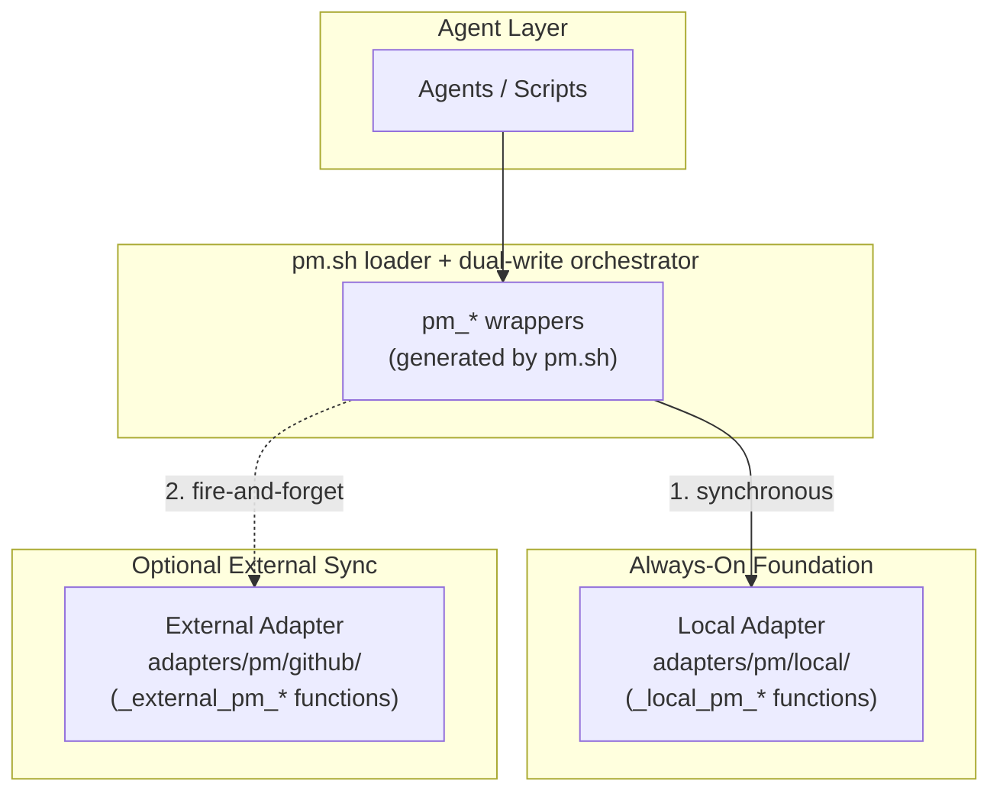
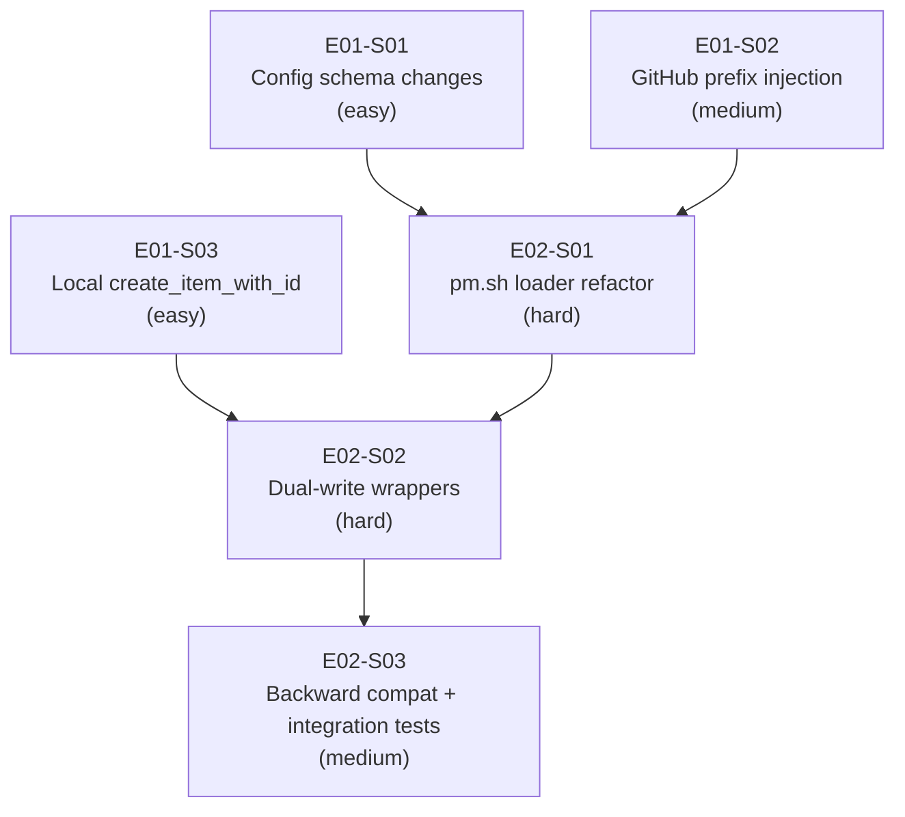

# Implementation Plan: Dual-Write PM Layer

## 1. Summary

This plan decomposes the dual-write PM layer design into implementable stories across two epics. The feature refactors `pm.sh` from "source one adapter" to "always source local, optionally source external" with fire-and-forget dual-write wrappers.

**Why two epics:** The work naturally divides into (1) infrastructure changes that make dual-write possible (config, prefix injection, loader refactoring) and (2) the dual-write wrappers, classification logic, and tests that verify the system works end-to-end. Epic 1 is foundation work that must complete before Epic 2 can begin, and splitting them keeps stories atomic and single-session-sized.

## 2. Scope

### In scope

1. Config changes: `workflowDir` promotion to top-level, `pm.adapter` semantic shift, backward compat in `config.sh`
2. Prefix injection (`_PM_FN_PREFIX`) across all 7 GitHub adapter modules
3. `pm.sh` loader refactoring: always-local + optional-external sourcing
4. Dual-write wrapper generation with function classification (dual-write / local-only / composed)
5. Special `pm_create_item` wrapper with external-as-ID-source logic
6. `_local_pm_create_item_with_id` helper in the local adapter
7. Fire-and-forget error logging for external calls
8. Tests for dual-write behavior, prefix injection, config changes, backward compat

### Out of scope

- New external adapters (Jira, Linear) -- BL113
- VCS/DOC abstraction layers -- BL207/BL208
- Dashboard integration -- BL116
- Bidirectional sync (external -> local)

## 3. Architecture Overview

## 4. Epic and Story Breakdown

### Epic 1: Foundation -- Config, Prefix Injection, and Local Adapter Extension

Infrastructure changes that prepare the codebase for dual-write: config schema, external adapter namespacing, and local adapter ID extension.

#### E01-S01: Config schema changes (workflowDir promotion + backward compat)

**Difficulty:** easy

**Files to modify:**
- `scripts/lib/config.sh` -- add `CFG_WORKFLOW_DIR`, backward compat alias
- `.claude/agentic-sdlc-config.json` -- add top-level `workflowDir` field

**Acceptance criteria:**
- [ ] `config.sh` reads `workflowDir` from top-level config (default: `.workflow`)
- [ ] If top-level `workflowDir` is absent but `pm.local.workflowDir` exists, the old value is used (backward compat)
- [ ] `CFG_LOCAL_WORKFLOW_DIR` is retained as an alias for `CFG_WORKFLOW_DIR` (no breaking changes for existing local adapter code)
- [ ] `CFG_WORKFLOW_DIR` is exported and available to all scripts
- [ ] Config JSON adds `"workflowDir": ".workflow"` at top level
- [ ] Existing `test-config-sh.sh` tests still pass
- [ ] New tests verify: top-level `workflowDir` is read; `pm.local.workflowDir` fallback works; alias consistency

**Test plan:**
- Extend `tests/scripts/test-config-sh.sh` with new test groups for `CFG_WORKFLOW_DIR` and backward compat

---

#### E01-S02: Prefix injection for all 7 GitHub adapter modules

**Difficulty:** medium

**Files to modify:**
- `scripts/lib/adapters/pm/github/board.sh`
- `scripts/lib/adapters/pm/github/comments.sh`
- `scripts/lib/adapters/pm/github/hierarchy.sh`
- `scripts/lib/adapters/pm/github/items.sh`
- `scripts/lib/adapters/pm/github/labels.sh`
- `scripts/lib/adapters/pm/github/lifecycle.sh`
- `scripts/lib/adapters/pm/github/reconcile.sh`

**Acceptance criteria:**
- [ ] Each module sets `_PM_FN_PREFIX="${_PM_LOADING_EXTERNAL:+_external_}"` at the top
- [ ] Each `pm_*` function definition uses `eval "${_PM_FN_PREFIX}pm_<name>() { ... }"` pattern
- [ ] Idempotency guards check `declare -f "${_PM_FN_PREFIX}pm_<name>"` instead of bare `pm_<name>`
- [ ] When `_PM_LOADING_EXTERNAL` is unset (normal mode), functions are defined as bare `pm_*` -- zero behavioral change
- [ ] When `_PM_LOADING_EXTERNAL=1`, functions are defined as `_external_pm_*`
- [ ] Internal cross-function calls within the external adapter (e.g., `pm_close_item` calling `pm_set_status`) resolve correctly via the prefix
- [ ] All private helpers (e.g., `_gh_status_to_option_id`, `_board_log`, `_gh_fetch_item_info`) remain unprefixed (they are internal)
- [ ] Existing tests pass unchanged (normal sourcing mode)
- [ ] New test verifies: sourcing with `_PM_LOADING_EXTERNAL=1` defines `_external_pm_*` functions

**Implementation notes:**
- The `eval` wrapping is mechanical: extract existing function body, wrap in `eval "${_PM_FN_PREFIX}pm_name() { ... }"`. Escape inner double quotes and dollar signs.
- `board.sh` has 3 public functions, `items.sh` has 5, `comments.sh` has 2, `hierarchy.sh` has 1, `labels.sh` has 1, `lifecycle.sh` has 2, `reconcile.sh` has 1 -- total 15 function definitions to modify.
- Private helpers (`_board_log`, `_gh_status_to_option_id`, `_gh_fetch_item_info`, `_gh_extract_item_info`, `_gh_mutate_status`, `_gh_verify_status`, `_gh_fetch_with_retry`) are NOT prefixed. They are adapter-internal utilities.
- Cross-function calls within `lifecycle.sh` (e.g., `pm_start_work` calling `pm_add_comment` and `pm_set_status`) must also use the prefix: `${_PM_FN_PREFIX}pm_add_comment`. This ensures that when loaded as external, `_external_pm_start_work` calls `_external_pm_add_comment`, not the wrapper version (which would cause double-writes).
- Cross-function calls within `items.sh` (`pm_close_item` calling `pm_set_status`) follow the same pattern.

**Test plan:**
- New test `tests/scripts/test-github-prefix-injection.sh` that sources each module with `_PM_LOADING_EXTERNAL=1` and verifies `_external_pm_*` functions exist
- Run existing `test-board-sh.sh`, `test-items-sh.sh`, `test-lifecycle-sh.sh`, `test-comments-sh.sh` to verify no regression

---

#### E01-S03: Local adapter `_local_pm_create_item_with_id` helper

**Difficulty:** easy

**Files to modify:**
- `scripts/lib/adapters/pm/local/items.sh` -- add `_local_pm_create_item_with_id` function

**Acceptance criteria:**
- [ ] New function `_local_pm_create_item_with_id <explicit-id> <level> <title> [--body ...] [--labels ...]` creates an item file using the explicit ID instead of auto-incrementing
- [ ] The `_next_id` counter file is updated to `max(current, explicit_id + 1)` to prevent future collisions
- [ ] The item file is written at `$_LOCAL_WORKFLOW_DIR/items/<explicit-id>.md` with correct frontmatter
- [ ] The function shares implementation with `pm_create_item` (extracts shared logic into a private helper `_local_write_item`) to avoid duplication
- [ ] Function is not exported as a `pm_*` function -- it is a private helper (underscore prefix)
- [ ] Tests verify: item created with explicit ID; `_next_id` counter bumped past explicit ID; normal `pm_create_item` still auto-increments correctly after explicit ID usage

**Test plan:**
- Extend `tests/scripts/test-local-items-sh.sh` with test groups for `_local_pm_create_item_with_id`

---

### Epic 2: Dual-Write Loader and Integration Tests

The `pm.sh` refactoring, wrapper generation, function classification, and comprehensive tests.

#### E02-S01: Refactor `pm.sh` loader for always-local + optional-external

**Difficulty:** hard

**Files to modify:**
- `scripts/lib/pm.sh` -- complete rewrite of the loader logic

**Acceptance criteria:**
- [ ] `pm.sh` always sources `adapters/pm/local/*.sh` first
- [ ] After sourcing local, all `pm_*` functions from the local adapter are captured and renamed to `_local_pm_*` using `eval` + `declare -f`
- [ ] If `pm.adapter` config value is set and not `"local"`: set `_PM_LOADING_EXTERNAL=1`, source `adapters/pm/<external>/*.sh` (functions load as `_external_pm_*`), unset `_PM_LOADING_EXTERNAL`
- [ ] If `pm.adapter` is `"local"`, absent, or null: no external adapter sourced; `pm_*` functions alias directly to `_local_pm_*` (zero overhead path)
- [ ] Deprecation note printed to stderr when `pm.adapter = "local"` is detected (informing user that local is now always-on)
- [ ] If external adapter directory is not found: warning printed, falls back to local-only mode (no error exit)
- [ ] `PM_ADAPTER`, `PM_ADAPTER_DIR`, `PM_EXTERNAL` exported for downstream consumers
- [ ] `_PM_TEST_ADAPTER_DIR` override still works (for existing test infrastructure)
- [ ] Idempotency guard updated: tracks loaded state for both local and external
- [ ] Dual-write wrapper generation (see E02-S02) is invoked after external adapter is sourced

**Implementation notes:**
- The local adapter rename uses `declare -f` to capture function bodies and `eval` to create `_local_pm_*` copies. Then unsets the original `pm_*` functions. This is the only place `eval` + `declare -f` is used for renaming (the external adapter uses source-time prefix injection, which is cleaner).
- The `_PM_TEST_ADAPTER_DIR` path must be updated to work with the new two-adapter model. When `_PM_TEST_ADAPTER_DIR` is set, it replaces the full loader (both local and external) with a single mock directory -- this preserves existing test behavior.
- This story produces the loader skeleton. The actual wrapper generation logic is in E02-S02.

**Test plan:**
- Update `tests/scripts/test-pm-sh.sh` to verify:
  - Local functions are always available (both `pm_*` and `_local_pm_*`)
  - External functions available as `_external_pm_*` when configured
  - `_PM_TEST_ADAPTER_DIR` override still works
  - Deprecation note for `pm.adapter = "local"`
  - Graceful fallback when external adapter directory is missing

---

#### E02-S02: Dual-write wrapper generation with function classification

**Difficulty:** hard

**Files to modify:**
- `scripts/lib/pm.sh` -- add wrapper generation logic (called from the loader in E02-S01)

**Acceptance criteria:**
- [ ] Function classification list defined in `pm.sh`:
  - **Dual-write:** `pm_create_item`, `pm_set_status`, `pm_add_to_board`, `pm_batch_set_status`, `pm_add_comment`, `pm_link_child`, `pm_add_label`, `pm_close_item`, `pm_update_item`
  - **Local-only:** `pm_get_item`, `pm_list_items`, `pm_get_status`
  - **Composed:** `pm_start_work`, `pm_complete_work`, `pm_post_telemetry`, `pm_reconcile`
- [ ] For dual-write functions: wrapper calls `_local_pm_*` synchronously, then `_external_pm_*` fire-and-forget (background `&` + `disown`) if the external function exists
- [ ] For local-only functions: `pm_*` aliases directly to `_local_pm_*` (no external call)
- [ ] For composed functions: `pm_*` aliases directly to `_local_pm_*` (the local version internally calls `pm_add_comment`/`pm_set_status` which are dual-write wrappers)
- [ ] `pm_create_item` has a special wrapper: calls external synchronously (not fire-and-forget) to get the external ID, then calls `_local_pm_create_item_with_id` with that ID, returns the external ID. Falls back to local-only `_local_pm_create_item` if external fails.
- [ ] Fire-and-forget wrapper logs external calls to `.agentic-workflow/logs/external-sync.log`
- [ ] Wrapper return value is always from the local adapter (except `pm_create_item` in external mode, which returns the external ID)
- [ ] When no external adapter is configured, no wrappers are generated -- `pm_*` maps directly to `_local_pm_*`
- [ ] All wrappers handle the case where `_external_pm_*` does not exist (graceful skip)

**Implementation notes:**
- The `_pm_generate_wrapper` function uses `eval` to define each wrapper. The function body is a fixed template string, not user input.
- The `pm_create_item` special case is the most complex part. It must be hardcoded (not generated from the template) because its semantics differ from standard dual-write.
- The fire-and-forget helper `_pm_external_fire_and_forget` wraps the background execution and log redirection.

**Test plan:**
- New test `tests/scripts/test-dual-write-wrappers.sh`:
  - Dual-write: mock external, call `pm_set_status`, verify both `_local_pm_set_status` and `_external_pm_set_status` called
  - Local-only: call `pm_get_item`, verify `_external_pm_get_item` NOT called
  - Composed: call `pm_start_work`, verify `_external_pm_add_comment` and `_external_pm_set_status` called (via primitive dual-write), but `_external_pm_start_work` NOT called
  - `pm_create_item`: verify external ID returned, local item created with same ID
  - `pm_create_item` fallback: verify local fallback when external fails
  - No-external mode: verify `pm_*` calls go directly to `_local_pm_*`

---

#### E02-S03: Backward compatibility and integration tests

**Difficulty:** medium

**Files to modify:**
- `tests/scripts/test-dual-write-integration.sh` -- new file
- `tests/scripts/test-pm-sh.sh` -- updates for backward compat tests

**Acceptance criteria:**
- [ ] Test: old config `{"pm": {"adapter": "github"}}` loads local adapter + GitHub adapter as external
- [ ] Test: config `{"pm": {"adapter": "local"}}` loads local-only, prints deprecation note to stderr
- [ ] Test: config with no `pm` section loads local-only
- [ ] Test: config `{"pm": {"adapter": null}}` loads local-only
- [ ] Test: `workflowDir` top-level config is respected by the local adapter
- [ ] Test: `pm.local.workflowDir` backward compat migration works (old config location read when top-level absent)
- [ ] Integration test: full lifecycle through dual-write (create item, set status, add comment, complete work) verifies both local files written AND external functions called
- [ ] Integration test: external adapter failure during `pm_create_item` falls back to local, prints warning
- [ ] Integration test: `pm_start_work` composition -- verify it calls `pm_add_comment` (dual-write wrapper) and `pm_set_status` (dual-write wrapper), NOT `_external_pm_start_work`
- [ ] All existing test suites pass without modification (backward compat)

**Implementation notes:**
- Integration tests use mock adapters (no live GitHub API). The mock external adapter logs calls to a file for verification.
- The test for "external adapter failure" uses a mock that exits with code 1.

**Test plan:**
- This IS the test story -- the deliverable is the test suite itself.

## 5. Function Classification Reference

This table is the authoritative reference for wrapper behavior. Builders for E02-S02 must implement exactly this classification.

| Function | Category | Wrapper behavior |
|----------|----------|-----------------|
| `pm_create_item` | Dual-write (special) | External sync (returns external ID), local sync (with external ID), fallback to local-only |
| `pm_set_status` | Dual-write | Local sync, external fire-and-forget |
| `pm_add_to_board` | Dual-write | Local sync, external fire-and-forget |
| `pm_batch_set_status` | Dual-write | Local sync, external fire-and-forget |
| `pm_add_comment` | Dual-write | Local sync, external fire-and-forget |
| `pm_link_child` | Dual-write | Local sync, external fire-and-forget |
| `pm_add_label` | Dual-write | Local sync, external fire-and-forget |
| `pm_close_item` | Dual-write | Local sync, external fire-and-forget |
| `pm_update_item` | Dual-write | Local sync, external fire-and-forget |
| `pm_get_item` | Local-only | Always read from local |
| `pm_list_items` | Local-only | Always read from local |
| `pm_get_status` | Local-only | Always read from local |
| `pm_start_work` | Composed | Local only (calls `pm_add_comment` + `pm_set_status` which are dual-write) |
| `pm_complete_work` | Composed | Local only (calls `pm_add_comment` + `pm_set_status` which are dual-write) |
| `pm_post_telemetry` | Composed | Local only (delegates to `item-telemetry.sh` which calls `pm_add_comment`) |
| `pm_reconcile` | Composed | Local only (`_external_pm_reconcile` available for explicit orchestrator use) |

## 6. Dependency Graph

### Dispatch Plan

| Wave | Stories | Dispatch | Rationale |
|------|---------|----------|-----------|
| **Wave 1** | E01-S01, E01-S02, E01-S03 | Parallel (3 builders) | All three are independent -- config changes, GitHub adapter changes, and local adapter changes touch separate files |
| **Wave 2** | E02-S01 | Sequential | Depends on E01-S01 (config) and E01-S02 (prefix injection) |
| **Wave 3** | E02-S02 | Sequential | Depends on E02-S01 (loader) and E01-S03 (create_item_with_id) |
| **Wave 4** | E02-S03 | Sequential | Depends on E02-S02 (wrappers must exist for integration tests) |

## 7. Files Inventory

### Modified files

| File | Story | Change |
|------|-------|--------|
| `scripts/lib/config.sh` | E01-S01 | Add `CFG_WORKFLOW_DIR`, backward compat alias |
| `.claude/agentic-sdlc-config.json` | E01-S01 | Add top-level `workflowDir` |
| `scripts/lib/adapters/pm/github/board.sh` | E01-S02 | Prefix injection |
| `scripts/lib/adapters/pm/github/comments.sh` | E01-S02 | Prefix injection |
| `scripts/lib/adapters/pm/github/hierarchy.sh` | E01-S02 | Prefix injection |
| `scripts/lib/adapters/pm/github/items.sh` | E01-S02 | Prefix injection |
| `scripts/lib/adapters/pm/github/labels.sh` | E01-S02 | Prefix injection |
| `scripts/lib/adapters/pm/github/lifecycle.sh` | E01-S02 | Prefix injection |
| `scripts/lib/adapters/pm/github/reconcile.sh` | E01-S02 | Prefix injection |
| `scripts/lib/adapters/pm/local/items.sh` | E01-S03 | Add `_local_pm_create_item_with_id` |
| `scripts/lib/pm.sh` | E02-S01, E02-S02 | Complete loader rewrite + wrapper generation |
| `tests/scripts/test-config-sh.sh` | E01-S01 | New test groups for `CFG_WORKFLOW_DIR` |
| `tests/scripts/test-pm-sh.sh` | E02-S01, E02-S03 | Update for new loader behavior |

### New files

| File | Story | Purpose |
|------|-------|---------|
| `tests/scripts/test-github-prefix-injection.sh` | E01-S02 | Verify prefix injection across all 7 modules |
| `tests/scripts/test-dual-write-wrappers.sh` | E02-S02 | Verify wrapper generation and classification |
| `tests/scripts/test-dual-write-integration.sh` | E02-S03 | End-to-end backward compat + integration |

## 8. Risk Mitigations

| Risk | Mitigation |
|------|-----------|
| `eval`-based function definition in GitHub adapter breaks with special characters | Function bodies are static code from adapter source files. Test with arguments containing quotes, pipes, and backslashes. |
| `declare -f` rename in `pm.sh` (local functions) is fragile | Use `eval "$(declare -f pm_foo | sed '1s/pm_foo/_local_pm_foo/')"` pattern which preserves function body exactly. Test with multi-line function bodies. |
| Background processes from fire-and-forget accumulate | Each uses `disown`. OS handles cleanup. Monitor process count in integration tests. |
| `pm_create_item` special wrapper adds latency (synchronous external call) | This is intentional -- the planner needs the external ID immediately. Document that this is the one non-fire-and-forget call. |
| Prefix injection changes break cross-function calls within GitHub adapter | E01-S02 implementation notes explicitly address this: internal calls must also use `${_PM_FN_PREFIX}`. Test verifies both normal and external modes. |

## 9. Structural Decisions

1. **Two epics, not one:** Epic 1 (foundation) has three independent stories that can run in parallel. Epic 2 (integration) has sequential dependencies. This gives Wave 1 maximum parallelism (3 builders) while respecting the inherent dependency chain for the loader and wrappers.

2. **Prefix injection before loader refactoring:** E01-S02 modifies the GitHub adapter files in isolation. This is cleaner than trying to do both prefix injection and loader changes in the same story. The builder can verify prefix injection works by sourcing a single module with `_PM_LOADING_EXTERNAL=1`.

3. **Separate test story (E02-S03):** Integration tests need the full dual-write stack working. Making tests a separate story (rather than bundling them with E02-S02) keeps each story focused and avoids a mega-story.

4. **`_local_pm_create_item_with_id` in E01-S03:** This is a small, isolated change to the local adapter. Putting it in its own story (rather than in E02-S02) allows it to run in parallel with E01-S01 and E01-S02 in Wave 1.
