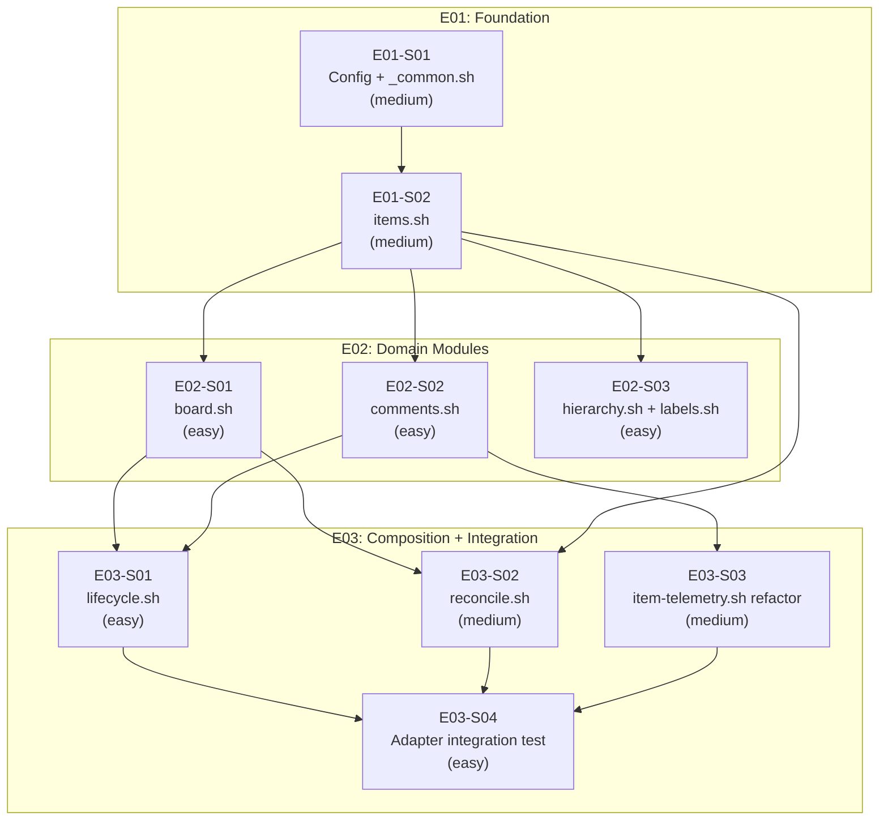
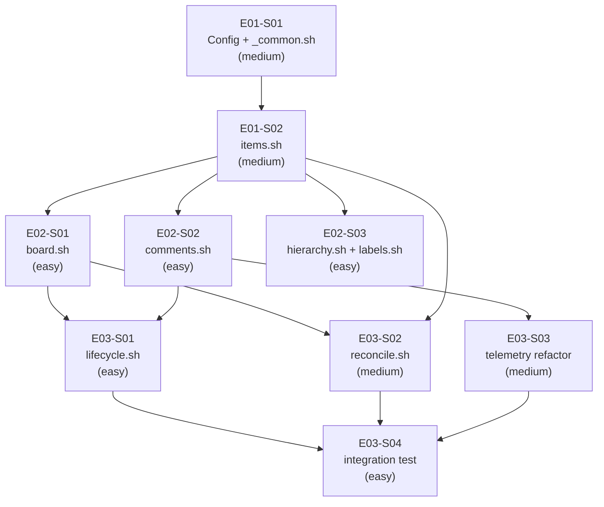

# Implementation Plan: Local-First PM System

## 1. Overview

This plan decomposes the Local-First PM System design (backlog #111) into three epics and nine stories. The local adapter implements all 15 `pm_*` functions against `.workflow/` files on the local filesystem, mirroring the existing GitHub adapter structure.

### Decomposition rationale

The design specifies 8 modules (1 shared `_common.sh` + 7 domain modules) plus a config update and a `item-telemetry.sh` refactor. The decomposition follows a layered dependency strategy:

- **E01 (Foundation):** The shared utilities and core item CRUD that everything else depends on. These must be built first.
- **E02 (Domain Modules):** Four independent modules (`board.sh`, `comments.sh`, `hierarchy.sh`, `labels.sh`) that depend only on `_common.sh`. These can all be built in parallel.
- **E03 (Composition and Integration):** Modules that compose on multiple E02 modules (`lifecycle.sh` depends on `board.sh` + `comments.sh`), reconciliation (depends on `board.sh` + `items.sh`), and the `item-telemetry.sh` refactor that makes telemetry adapter-agnostic.

**Why 3 epics instead of 1 large or 7 tiny:** Three epics give meaningful parallelism (4 parallel stories in E02), clear dependency boundaries, and manageable epic-level progress tracking. A single epic would force all 9 stories into a linear dependency chain, wasting time. Seven per-module epics would add overhead with no benefit since modules within E02 are truly independent.

## 2. Architecture



## 3. Epics and Stories

---

### E01: Foundation

Establishes the shared utilities (`_common.sh`) and core item CRUD (`items.sh`) that all other modules depend on. Also adds the `CFG_LOCAL_WORKFLOW_DIR` config field.

#### E01-S01: Config Extension and Shared Utilities (`_common.sh`)

**Difficulty:** medium

**Summary:** Create the `_common.sh` shared module with frontmatter parsing, ID generation, path resolution, and directory initialization. Add `CFG_LOCAL_WORKFLOW_DIR` to `config.sh`.

**Files to create:**
- `scripts/lib/adapters/pm/local/_common.sh`
- `tests/scripts/test-local-common-sh.sh`

**Files to modify:**
- `scripts/lib/config.sh` (add `CFG_LOCAL_WORKFLOW_DIR`)

**Acceptance criteria:**
- [ ] `_common.sh` defines `_LOCAL_WORKFLOW_DIR` resolved from `CFG_LOCAL_WORKFLOW_DIR` (default `.workflow`)
- [ ] `_local_ensure_dirs` creates `items/` and `comments/` subdirectories
- [ ] `_local_next_id` reads/increments `_next_id` file, returns current ID, starts at 1
- [ ] `_local_item_path` returns `$_LOCAL_WORKFLOW_DIR/items/$1.md`
- [ ] `_local_fm_read <file> <field>` extracts scalar frontmatter value
- [ ] `_local_fm_write <file> <field> <value>` updates scalar field and `updated` timestamp
- [ ] `_local_fm_read_labels <file>` returns labels array (one per line)
- [ ] `_local_fm_append_label <file> <label>` adds to the labels array in frontmatter
- [ ] `_local_read_body <file>` returns content below closing `---`
- [ ] `_local_write_body <file> <body>` replaces content below closing `---`
- [ ] Idempotency guard prevents double-sourcing
- [ ] `config.sh` reads `CFG_LOCAL_WORKFLOW_DIR` from `.pm.local.workflowDir` with default `.workflow`
- [ ] Test file validates all helpers with temporary directories (no mocking needed)
- [ ] All files under 200 lines

**Test plan:**
- Test `_local_next_id` returns sequential IDs (1, 2, 3...)
- Test `_local_next_id` starts at 1 when `_next_id` file does not exist
- Test `_local_fm_read` extracts `title`, `status`, `id`, `parent` from sample frontmatter
- Test `_local_fm_write` updates field and `updated` timestamp
- Test `_local_fm_read_labels` returns all labels from array
- Test `_local_fm_append_label` adds new label without duplicating existing ones
- Test `_local_read_body` extracts body content correctly
- Test `_local_write_body` replaces body without affecting frontmatter
- Test `_local_ensure_dirs` creates directory structure
- Test `CFG_LOCAL_WORKFLOW_DIR` config reading with and without config file

**Git branch:** `e01-s01/config-common`

---

#### E01-S02: Local Items Module (`items.sh`)

**Difficulty:** medium

**Summary:** Implement the core item CRUD functions: `pm_create_item`, `pm_get_item`, `pm_list_items`, `pm_update_item`, `pm_close_item`. This is the most function-dense module (5 functions) and the foundation for all higher-level operations.

**Files to create:**
- `scripts/lib/adapters/pm/local/items.sh`
- `tests/scripts/test-local-items-sh.sh`

**Acceptance criteria:**
- [ ] `pm_create_item <level> <title> [flags]` validates level, generates ID, writes `.workflow/items/<id>.md` with YAML frontmatter, returns integer ID on stdout
- [ ] `pm_create_item` maps level to hierarchy label (backlog -> hierarchy/backlog, etc.)
- [ ] `pm_create_item` supports `--body`, `--body-file`, `--labels` flags
- [ ] `pm_get_item <id>` without flags prints human-readable output (`title: ...\nstate: ...\nlabels: ...`)
- [ ] `pm_get_item <id> --json <fields>` returns JSON matching `gh issue view --json` schema (fields: number, title, state, body, labels)
- [ ] `pm_list_items [--label] [--state] [--limit]` scans items, filters, returns tab-separated output
- [ ] `pm_update_item <id> [--title] [--body]` updates frontmatter/body
- [ ] `pm_close_item <id>` sets state to closed and calls `pm_set_status done`
- [ ] Error handling: invalid level, missing item file, unknown options
- [ ] Output format contracts: `pm_create_item` prints just the number, `pm_get_item --json` is valid JSON parseable by `jq`
- [ ] All files under 200 lines

**Test plan:**
- Test `pm_create_item` creates file with correct frontmatter (id, title, type, status, labels, state, timestamps)
- Test `pm_create_item` returns sequential IDs across multiple calls
- Test `pm_create_item` with `--body` and `--body-file` flags
- Test `pm_create_item` with `--labels` appends to hierarchy label
- Test `pm_create_item` error on invalid level
- Test `pm_get_item` human-readable format
- Test `pm_get_item --json number,title,state` returns valid JSON with correct field names
- Test `pm_get_item --json body` returns body content
- Test `pm_get_item --json labels` returns `[{"name":"label"}]` format
- Test `pm_list_items` defaults (state=open, limit=30)
- Test `pm_list_items` with `--label`, `--state`, `--limit` filters
- Test `pm_update_item` updates title and body
- Test `pm_close_item` sets state to closed (uses mock `pm_set_status`)
- Test error on nonexistent item

**Git branch:** `e01-s02/local-items`

---

### E02: Domain Modules

Four modules that depend on `_common.sh` (and partially on `items.sh` for type awareness) but are independent of each other. All can be built in parallel.

#### E02-S01: Local Board Module (`board.sh`)

**Difficulty:** easy

**Summary:** Implement `pm_set_status`, `pm_add_to_board`, and `pm_batch_set_status`. Since there is no external API, status changes are direct frontmatter writes. Logging to `.agentic-workflow/logs/board-status.log` is preserved for compatibility.

**Files to create:**
- `scripts/lib/adapters/pm/local/board.sh`
- `tests/scripts/test-local-board-sh.sh`

**Acceptance criteria:**
- [ ] `pm_set_status <id> <status>` validates status enum, updates `status:` in frontmatter, logs to board-status.log
- [ ] `pm_set_status` prints skip message when already at target status
- [ ] `pm_set_status` prints confirmation `"#N -> status"` on change
- [ ] `pm_add_to_board <id>` is a no-op that prints `"#N added to board"`
- [ ] `pm_batch_set_status <id>:<status> [...]` iterates and calls `pm_set_status` for each pair
- [ ] `pm_batch_set_status` validates pair format, errors on invalid input
- [ ] Logging matches the GitHub adapter format (timestamps, issue number, status)
- [ ] All files under 200 lines

**Test plan:**
- Test `pm_set_status` updates frontmatter status field
- Test `pm_set_status` updates the `updated` timestamp
- Test `pm_set_status` logs to board-status.log
- Test `pm_set_status` skips when already at target
- Test `pm_set_status` error on invalid status name
- Test `pm_add_to_board` returns success (no-op)
- Test `pm_batch_set_status` with multiple pairs
- Test `pm_batch_set_status` error on malformed pair

**Git branch:** `e02-s01/local-board`

---

#### E02-S02: Local Comments Module (`comments.sh`)

**Difficulty:** easy

**Summary:** Implement `pm_add_comment` and `pm_post_telemetry`. Comments are written as numbered markdown files in `.workflow/comments/<id>/`.

**Files to create:**
- `scripts/lib/adapters/pm/local/comments.sh`
- `tests/scripts/test-local-comments-sh.sh`

**Acceptance criteria:**
- [ ] `pm_add_comment <id> <body>` creates comment directory, generates sequence number, derives slug from body heading
- [ ] Comment files named `<seq>-<slug>.md` (e.g., `001-work-started.md`)
- [ ] Comment files have `<!-- posted: <ISO timestamp> -->` on the first line
- [ ] Sequence numbers are zero-padded (001, 002, ...)
- [ ] Slug derivation: first `###` or `##` heading, lowercase, hyphenated; falls back to `comment`
- [ ] `pm_post_telemetry <id> [flags...]` delegates to `item-telemetry.sh` passing all flags through
- [ ] Idempotency guard prevents double-sourcing
- [ ] All files under 200 lines

**Test plan:**
- Test `pm_add_comment` creates file in correct directory
- Test comment filename format (sequence + slug)
- Test sequential comments get incrementing sequence numbers
- Test slug derivation from various headings
- Test slug fallback to "comment" when no heading
- Test timestamp HTML comment is present
- Test comment body content is preserved

**Git branch:** `e02-s02/local-comments`

---

#### E02-S03: Local Hierarchy and Labels Modules (`hierarchy.sh` + `labels.sh`)

**Difficulty:** easy

**Summary:** Implement `pm_link_child` (sets `parent:` field in child frontmatter) and `pm_add_label` (appends to labels array). These are the simplest modules, combined into one story because each is under 30 lines.

**Files to create:**
- `scripts/lib/adapters/pm/local/hierarchy.sh`
- `scripts/lib/adapters/pm/local/labels.sh`
- `tests/scripts/test-local-hierarchy-labels-sh.sh`

**Acceptance criteria:**
- [ ] `pm_link_child <parent-id> <child-id>` sets `parent: <parent-id>` in child's frontmatter
- [ ] `pm_link_child` prints `"Linked #<child-id> as sub-issue of #<parent-id>"`
- [ ] `pm_link_child` validates that both item files exist
- [ ] `pm_add_label <id> <label> [--create-if-missing] [--color <hex>] [--description <text>]` appends label to frontmatter array
- [ ] `pm_add_label` is idempotent (duplicate label is a no-op)
- [ ] `pm_add_label` accepts `--create-if-missing`, `--color`, `--description` as no-op flags (for GitHub compatibility)
- [ ] Both modules have idempotency guards
- [ ] All files under 200 lines

**Test plan:**
- Test `pm_link_child` sets parent field in child item
- Test `pm_link_child` confirmation message
- Test `pm_link_child` error on nonexistent child item
- Test `pm_add_label` appends new label to existing labels array
- Test `pm_add_label` is idempotent (no duplicate)
- Test `pm_add_label` works with empty labels array
- Test `pm_add_label` ignores `--create-if-missing`, `--color`, `--description`

**Git branch:** `e02-s03/local-hierarchy-labels`

---

### E03: Composition and Integration

Modules that compose on E02 outputs, plus the integration test suite.

#### E03-S01: Local Lifecycle Module (`lifecycle.sh`)

**Difficulty:** easy

**Summary:** Implement `pm_start_work` and `pm_complete_work`. These compose on `pm_add_comment` (comments.sh) and `pm_set_status` (board.sh), identical to the GitHub adapter. The comment body must be byte-identical to the GitHub adapter output.

**Files to create:**
- `scripts/lib/adapters/pm/local/lifecycle.sh`
- `tests/scripts/test-local-lifecycle-sh.sh`

**Acceptance criteria:**
- [ ] `pm_start_work <id> [--model <m>] [--agent <a>]` posts "Work Started" comment and sets status to `in-progress`
- [ ] `pm_complete_work <id> <commit-hash>` posts "Ready for Review" comment and sets status to `in-review`
- [ ] Comment markdown tables are byte-identical to the GitHub adapter output (same headings, same fields)
- [ ] Both functions compose on `pm_add_comment` and `pm_set_status` (no direct file writes)
- [ ] Warning is printed if board status update fails (non-fatal)
- [ ] Idempotency guard prevents double-sourcing
- [ ] All files under 200 lines

**Test plan:**
- Test `pm_start_work` creates comment file with "Work Started" heading
- Test `pm_start_work` sets status to in-progress
- Test `pm_start_work` comment contains model and agent fields
- Test `pm_complete_work` creates comment file with "Ready for Review" heading
- Test `pm_complete_work` sets status to in-review
- Test `pm_complete_work` comment contains commit hash

**Git branch:** `e03-s01/local-lifecycle`

---

#### E03-S02: Local Reconciliation Module (`reconcile.sh`)

**Difficulty:** medium

**Summary:** Implement `pm_reconcile` that validates `.workflow/` state against the orchestrator state file. Reuses the Python computation from the GitHub adapter but replaces API calls with local filesystem reads.

**Files to create:**
- `scripts/lib/adapters/pm/local/reconcile.sh`
- `tests/scripts/test-local-reconcile-sh.sh`

**Acceptance criteria:**
- [ ] `pm_reconcile --from-state <file> [--epic-issues <json>] [--dry-run]` computes expected statuses from state file
- [ ] Reads actual statuses by scanning `.workflow/items/*.md` frontmatter
- [ ] Compares expected vs actual and reports discrepancies
- [ ] Fixes discrepancies by updating frontmatter (unless `--dry-run`)
- [ ] Output format matches GitHub adapter: `"#N: Status"` for consistent, `"#N: expected=X actual=Y"` for discrepancies
- [ ] Summary line shows issue count and fix count
- [ ] Logging to board-status.log for reconciliation events
- [ ] All files under 200 lines

**Test plan:**
- Test reconcile with all statuses consistent (no fixes needed)
- Test reconcile detects and fixes status discrepancy
- Test dry-run mode reports but does not fix
- Test with mock orchestrator state file containing dispatches, story statuses, and epic issues
- Test summary output format

**Git branch:** `e03-s02/local-reconcile`

---

#### E03-S03: `item-telemetry.sh` Adapter Refactor

**Difficulty:** medium

**Summary:** Refactor `item-telemetry.sh` to call `pm_add_comment` instead of `gh issue comment` directly. This makes telemetry posting adapter-agnostic, enabling the local adapter's `pm_post_telemetry` to work automatically. Minimal scope: one line change plus sourcing `pm.sh`.

**Files to modify:**
- `scripts/item-telemetry.sh` (source `pm.sh`, replace `gh issue comment` with `pm_add_comment`)

**Files to update (test):**
- `tests/scripts/test-item-telemetry.sh` (update any tests that mock `gh issue comment` to account for the `pm_add_comment` path)

**Acceptance criteria:**
- [ ] `item-telemetry.sh` sources `pm.sh` at startup
- [ ] Comment posting uses `pm_add_comment "$ISSUE_NUMBER" "$RENDERED"` instead of `gh issue comment`
- [ ] The `--pr` flag logic (`gh pr edit`) remains unchanged (VCS operation, not PM)
- [ ] All existing `test-item-telemetry.sh` tests pass (may need mock adapter adjustment)
- [ ] When `pm.adapter=github`, behavior is byte-identical to current (GitHub adapter's `pm_add_comment` calls `gh issue comment`)
- [ ] When `pm.adapter=local`, telemetry is written to `.workflow/comments/<id>/NNN-telemetry.md`

**Test plan:**
- Verify existing telemetry tests still pass with the pm.sh delegation
- Test that `pm_add_comment` is called (not `gh issue comment` directly) by intercepting function calls
- Test local adapter telemetry writes comment file with correct content

**Git branch:** `e03-s03/telemetry-refactor`

---

#### E03-S04: Adapter Integration Test Suite

**Difficulty:** easy

**Summary:** Create an integration test that exercises the full local adapter through the `pm.sh` loader, validating the complete workflow: create items, set statuses, add comments, link hierarchy, post telemetry. This validates cross-module composition and the adapter swap promise.

**Files to create:**
- `tests/scripts/test-local-integration.sh`

**Acceptance criteria:**
- [ ] Test sources `pm.sh` with `_PM_TEST_ADAPTER_DIR` pointing to the local adapter
- [ ] Tests exercise the full item lifecycle: create backlog -> create epic -> create story -> link hierarchy -> set status -> start work -> complete work -> done
- [ ] Verifies `pm_list_items` filtering by label and state
- [ ] Verifies `pm_get_item --json` output is parseable by the same `jq` patterns used with the GitHub adapter
- [ ] Verifies comment files are created in correct structure
- [ ] Verifies frontmatter integrity after multiple operations
- [ ] All tests use temporary directories (no side effects)
- [ ] File under 200 lines

**Test plan:**
- Full lifecycle test: create 3 items (backlog, epic, story), link hierarchy, transition through all statuses
- Output compatibility test: `pm_get_item --json` fields match GitHub adapter output schema
- List filtering test: filter by label, state, limit
- Comment test: verify comment files after `pm_start_work` and `pm_complete_work`
- Idempotency test: double status set, double label add

**Git branch:** `e03-s04/local-integration-test`

---

## 4. Dependency Graph



### Dispatch Plan

| Wave | Stories | Parallel? | Rationale |
|------|---------|-----------|-----------|
| **Wave 1** | E01-S01 | Sequential | Foundation, no dependencies |
| **Wave 2** | E01-S02 | Sequential | Depends on E01-S01 |
| **Wave 3** | E02-S01, E02-S02, E02-S03 | Parallel (3-way) | All depend only on E01-S02, no shared files |
| **Wave 4** | E03-S01, E03-S02, E03-S03 | Parallel (3-way) | Depend on Wave 3 modules (lifecycle on board+comments, reconcile on board+items, telemetry on comments) |
| **Wave 5** | E03-S04 | Sequential | Integration test depends on all prior stories |

**Critical path:** E01-S01 -> E01-S02 -> E02-S01 -> E03-S01 -> E03-S04 (5 waves, max parallelism of 3 in waves 3 and 4)

## 5. File Inventory

### Files created (new)

| File | Story | Purpose |
|------|-------|---------|
| `scripts/lib/adapters/pm/local/_common.sh` | E01-S01 | Shared helpers: path, frontmatter, ID gen |
| `scripts/lib/adapters/pm/local/items.sh` | E01-S02 | pm_create_item, pm_get_item, pm_list_items, pm_update_item, pm_close_item |
| `scripts/lib/adapters/pm/local/board.sh` | E02-S01 | pm_set_status, pm_add_to_board, pm_batch_set_status |
| `scripts/lib/adapters/pm/local/comments.sh` | E02-S02 | pm_add_comment, pm_post_telemetry |
| `scripts/lib/adapters/pm/local/hierarchy.sh` | E02-S03 | pm_link_child |
| `scripts/lib/adapters/pm/local/labels.sh` | E02-S03 | pm_add_label |
| `scripts/lib/adapters/pm/local/lifecycle.sh` | E03-S01 | pm_start_work, pm_complete_work |
| `scripts/lib/adapters/pm/local/reconcile.sh` | E03-S02 | pm_reconcile |
| `tests/scripts/test-local-common-sh.sh` | E01-S01 | Tests for _common.sh |
| `tests/scripts/test-local-items-sh.sh` | E01-S02 | Tests for items.sh |
| `tests/scripts/test-local-board-sh.sh` | E02-S01 | Tests for board.sh |
| `tests/scripts/test-local-comments-sh.sh` | E02-S02 | Tests for comments.sh |
| `tests/scripts/test-local-hierarchy-labels-sh.sh` | E02-S03 | Tests for hierarchy.sh + labels.sh |
| `tests/scripts/test-local-lifecycle-sh.sh` | E03-S01 | Tests for lifecycle.sh |
| `tests/scripts/test-local-reconcile-sh.sh` | E03-S02 | Tests for reconcile.sh |
| `tests/scripts/test-local-integration.sh` | E03-S04 | Integration test suite |

### Files modified (existing)

| File | Story | Change |
|------|-------|--------|
| `scripts/lib/config.sh` | E01-S01 | Add `CFG_LOCAL_WORKFLOW_DIR` |
| `scripts/item-telemetry.sh` | E03-S03 | Source pm.sh, replace `gh issue comment` with `pm_add_comment` |
| `tests/scripts/test-item-telemetry.sh` | E03-S03 | Update mocks for pm_add_comment delegation |

## 6. Testing Strategy

### No mocking needed for local adapter tests

Unlike the GitHub adapter tests (which require a fake `gh` stub), the local adapter operates on temporary directories. Each test:

1. Creates a `TEMP_DIR` with `mktemp -d`
2. Sets `REPO_ROOT="$TEMP_DIR"` and `_PM_TEST_ADAPTER_DIR` to the local adapter
3. Sources `pm.sh`
4. Exercises functions against real filesystem
5. Cleans up `TEMP_DIR` on exit

This makes tests simpler, faster, and more reliable than the GitHub adapter tests.

### Test helper pattern

All test files follow the established pattern from `test-items-sh.sh`:

```bash
PASS=0; FAIL=0
assert_eq() { ... }
assert_contains() { ... }
assert_exit_zero() { ... }
assert_exit_nonzero() { ... }
# Test groups...
echo "Results: $PASS/$TOTAL passed, $FAIL failed"
[ "$FAIL" -gt 0 ] && exit 1
```

### Running tests

```bash
# Individual module
bash tests/scripts/test-local-items-sh.sh

# All local adapter tests
for t in tests/scripts/test-local-*.sh; do bash "$t"; done
```

## 7. Format Contract

Since E02 stories produce parallel adapter modules with shared structural patterns, the following format contracts apply:

| Element | Exact Format | Example |
|---------|-------------|---------|
| Item frontmatter YAML | Exact field order: id, title, type, status, labels, parent, state, created, updated | See section 4 of design doc |
| Labels array in YAML | `labels:\n  - label1\n  - label2` (2-space indent, `- ` prefix) | `labels:\n  - hierarchy/story\n  - type/feature` |
| Human-readable output | `title:  <title>\nstate:  <state>\nlabels: <csv>` (2-space alignment after colon) | `title:  My Story\nstate:  open\nlabels: hierarchy/story, type/feature` |
| JSON output | `{"number":N,"title":"...","state":"OPEN",...}` (state uppercase) | `{"number":3,"title":"My Story","state":"OPEN","labels":[{"name":"hierarchy/story"}]}` |
| Tab-separated list | `ID\tState\tTitle\tDate` (state Title Case) | `3\tOpen\tMy Story\t2026-03-18` |
| Board log format | `[ISO-timestamp] key=value key=value` | `[2026-03-18T14:00:00Z] issue=3 status=in-progress START` |
| Comment filename | `<NNN>-<slug>.md` (3-digit zero-padded seq, lowercase hyphenated slug) | `001-work-started.md` |
| Comment timestamp | `<!-- posted: <ISO 8601> -->` on first line | `<!-- posted: 2026-03-18T14:00:00Z -->` |
| Status set output | `"#N -> <status>"` (hash, number, arrow, status) | `"#3 -> in-progress"` |
| Board skip message | `"#N already at <status>"` | `"#3 already at in-progress"` |
| Link confirmation | `"Linked #N as sub-issue of #M"` | `"Linked #5 as sub-issue of #2"` |

Builders must follow these exact formats. Acceptance criteria for each story explicitly reference this format contract.

## 8. Cross-Platform Note

The design doc notes that `sed -i ''` (macOS) differs from `sed -i` (Linux). Since the workflow currently runs on macOS only, all implementations should use `sed -i ''`. This is documented here as a deferred concern: if Linux support is needed later, add a `_local_sed_i()` wrapper in `_common.sh`.
