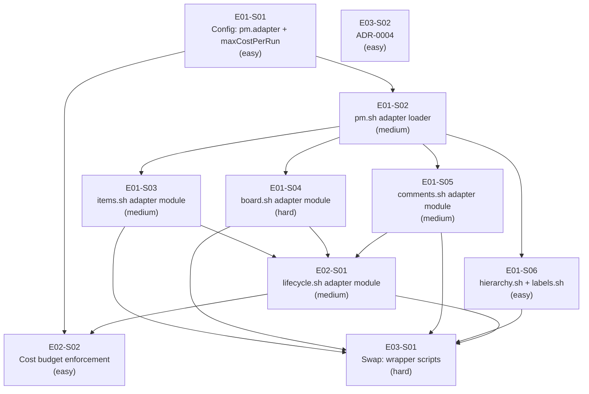

# Implementation Plan: PM Abstraction Layer

## 1. Summary

This plan decomposes backlog item #109 into three epics covering the full PM abstraction layer build. The work follows the design doc's three-phase shadow stack migration strategy: **Phase 1 (Build Alongside)** creates the entire new adapter stack in new files without touching existing scripts, **Phase 2 (Shadow Verify)** is a stretch goal deferred to a future item, and **Phase 3 (Swap)** converts existing scripts into thin wrappers. Config changes and cost budgets are included.

### Structural Decision: Why Three Epics

The design doc defines six adapter modules (items, board, comments, hierarchy, labels, lifecycle), a config change, a cost budget feature, and a swap phase. I decomposed these into three epics rather than one large epic or six small ones:

- **E01 (Foundation):** Config changes + `pm.sh` loader + the four independent leaf adapter modules (items, board, comments, hierarchy, labels). These have no dependencies on each other and can be built in parallel within the epic.
- **E02 (Lifecycle + Cost Budget):** The lifecycle module depends on items, board, and comments from E01. The cost budget depends on config from E01. Both compose on top of E01 outputs.
- **E03 (Swap + ADR):** Converting existing scripts to wrappers depends on the entire adapter stack from E01+E02 being complete. The ADR documents the migration strategy used.

This grouping maximizes parallelism within E01 (5 independent stories) while respecting the genuine dependencies in E02 and E03.

## 2. Architecture

### File Layout (New Files Only -- Phase 1)

```
scripts/lib/
  pm.sh                                 # NEW: Adapter loader + public API
  adapters/
    pm/
      github/
        items.sh                        # NEW: pm_create_item, pm_get_item, pm_list_items, pm_done
        board.sh                        # NEW: pm_set_status, pm_batch_set_status, pm_reconcile, pm_add_to_board
        comments.sh                     # NEW: pm_add_comment, pm_post_telemetry
        hierarchy.sh                    # NEW: pm_link_child
        labels.sh                       # NEW: pm_add_label
        lifecycle.sh                    # NEW: pm_start_work, pm_complete_work (composes items+board+comments)
.claude/
  agentic-sdlc-config.json             # MODIFIED: add pm.adapter, workflow.maxCostPerRun
docs/6-adrs/
  0004-shadow-stack-migration.md        # NEW: ADR for build-alongside-verify-swap pattern
```

### File Layout (Phase 3 -- Swap)

Existing scripts become thin wrappers:

```
scripts/
  issue-set-status.sh                   # MODIFIED: delegates to pm_set_status
  batch-set-status.sh                   # MODIFIED: delegates to pm_batch_set_status
  issue-start.sh                        # MODIFIED: delegates to pm_start_work
  issue-review.sh                       # MODIFIED: delegates to pm_complete_work
  issue-close.sh                        # MODIFIED: delegates to pm_done
  issue-create-backlog.sh               # MODIFIED: delegates to pm_create_item + pm_add_to_board + pm_set_status + pm_add_label
  reconcile-board.sh                    # MODIFIED: delegates to pm_reconcile
  setup-labels.sh                       # MODIFIED: delegates to pm_add_label (repeated)
```

### Dependency Graph



### Dispatch Plan

| Wave | Stories | Dispatch | Rationale |
|------|---------|----------|-----------|
| **Wave 1** | E01-S01 (config) | Sequential | Foundation for everything else |
| **Wave 2** | E01-S02 (pm.sh loader) | Sequential | Depends on config |
| **Wave 3** | E01-S03 (items), E01-S04 (board), E01-S05 (comments), E01-S06 (hierarchy+labels) | Parallel (4 builders) | All depend only on pm.sh loader, independent of each other |
| **Wave 4** | E02-S01 (lifecycle), E03-S02 (ADR) | Parallel (2 builders) | lifecycle depends on items+board+comments; ADR is independent |
| **Wave 5** | E02-S02 (cost budget) | Sequential | Depends on lifecycle + config |
| **Wave 6** | E03-S01 (swap wrappers) | Sequential | Depends on entire adapter stack |

## 3. Epic and Story Breakdown

---

### E01: PM Adapter Foundation

Build the adapter loader, config changes, and four independent leaf adapter modules. This epic creates the entire pm.sh public API surface except for the lifecycle functions (which compose on top of these).

#### E01-S01: Config Schema Extension (pm.adapter + maxCostPerRun)

**Difficulty:** easy

**Files to modify:**
- `.claude/agentic-sdlc-config.json`
- `scripts/lib/config.sh`

**Acceptance Criteria:**
- [ ] Config file has `"pm": { "adapter": "github" }` section
- [ ] Config file has `"workflow": { "maxCostPerRun": null }` field (alongside existing workflow fields)
- [ ] `config.sh` exports `CFG_PM_ADAPTER` (default: `"github"`)
- [ ] `config.sh` exports `CFG_MAX_COST_PER_RUN` (default: `"null"`)
- [ ] Existing config variables unchanged -- all current tests still pass
- [ ] When `pm.adapter` is absent from config, defaults to `"github"`
- [ ] When `workflow.maxCostPerRun` is absent, defaults to `"null"`

**Test Plan:**
- Source `config.sh` and verify `CFG_PM_ADAPTER` = `"github"`
- Source `config.sh` and verify `CFG_MAX_COST_PER_RUN` = `"null"`
- Verify all existing `CFG_*` variables retain their current values
- Temporarily modify config to set `pm.adapter` to `"local"`, verify `CFG_PM_ADAPTER` = `"local"`

**Branch:** `e01-s01/config-pm-adapter`

---

#### E01-S02: pm.sh Adapter Loader

**Difficulty:** medium

**Files to create:**
- `scripts/lib/pm.sh`

**Files to read (not modify):**
- `scripts/lib/config.sh`
- `.claude/agentic-sdlc-config.json`

**Acceptance Criteria:**
- [ ] `pm.sh` sources `config.sh` to read `CFG_PM_ADAPTER`
- [ ] Resolves adapter directory: `scripts/lib/adapters/pm/$PM_ADAPTER/`
- [ ] Sources all `*.sh` files in the adapter directory (alphabetical order)
- [ ] Exits with error if adapter directory does not exist
- [ ] Exits with error if adapter directory contains no `.sh` files
- [ ] `SCRIPT_DIR` variable is computed correctly for use by adapter modules
- [ ] `REPO_ROOT` variable is exported for adapter modules that need the repo root
- [ ] Can be sourced multiple times safely (idempotent -- no duplicate sourcing)
- [ ] Creates the `scripts/lib/adapters/pm/github/` directory structure (empty, for subsequent stories)
- [ ] Exports `PM_ADAPTER_DIR` for adapter modules to reference sibling modules

**Test Plan:**
- Create a mock adapter directory with a test module, source `pm.sh`, verify function from test module is callable
- Verify error exit when adapter directory does not exist
- Verify error exit when adapter directory is empty
- Source `pm.sh` twice, verify no errors or duplicate function definitions

**Branch:** `e01-s02/pm-sh-loader`

---

#### E01-S03: GitHub Adapter -- items.sh

**Difficulty:** medium

**Files to create:**
- `scripts/lib/adapters/pm/github/items.sh`

**Files to read (not modify):**
- `scripts/issue-create-backlog.sh` (extract item creation logic)
- `scripts/issue-close.sh` (extract close logic)

**Acceptance Criteria:**
- [ ] `pm_create_item <level> <title> [--body <text>] [--body-file <path>] [--labels <csv>]` creates a GitHub issue
  - Level is `backlog`, `epic`, `story`, or `docs` -- maps to the appropriate `hierarchy/*` label
  - Returns the issue number on stdout (just the number, not the URL)
  - Applies all labels from `--labels` CSV in addition to the hierarchy label
  - Handles `--body` and `--body-file` mutually exclusively
- [ ] `pm_get_item <item-id> [--json <fields>]` reads issue details
  - Without `--json`: prints title, state, and labels (human-readable)
  - With `--json <fields>`: passes through to `gh issue view --json <fields>` and prints raw JSON
- [ ] `pm_list_items [--label <label>] [--state <open|closed|all>] [--limit <n>]` queries issues
  - Defaults: `--state open`, `--limit 30`
  - Passes filters through to `gh issue list`
- [ ] `pm_done <item-id>` closes the issue and sets board status to Done
  - Calls `gh issue close` with `--reason completed`
  - Calls the board adapter's status function (available because all modules are sourced together)
  - Handles already-closed issues gracefully (no error)
- [ ] All functions use `$CFG_REPO` from the sourced config
- [ ] File is under 200 lines

**Test Plan:**
- Source `pm.sh`, call `pm_create_item story "Test item" --body "test body"`, verify issue created on GitHub, capture returned number
- Call `pm_get_item` on the created issue, verify title matches
- Call `pm_list_items --label hierarchy/story --limit 1`, verify at least one result
- Call `pm_done` on the test issue, verify it closes
- Verify `pm_create_item backlog "Test" --labels "type/feature"` applies both `hierarchy/backlog` and `type/feature` labels

**Branch:** `e01-s03/adapter-items`

---

#### E01-S04: GitHub Adapter -- board.sh

**Difficulty:** hard

**Files to create:**
- `scripts/lib/adapters/pm/github/board.sh`

**Files to read (not modify):**
- `scripts/issue-set-status.sh` (extract all board logic)
- `scripts/batch-set-status.sh` (extract batch logic)
- `scripts/reconcile-board.sh` (extract reconcile logic)

**Acceptance Criteria:**
- [ ] Internal helper `_gh_fetch_item_info <issue-number>` performs the lightweight per-issue GraphQL query (same as current `issue-set-status.sh`), returns JSON
- [ ] Internal helper `_gh_extract_item_info <json>` sets `ITEM_ID` and `CURRENT_STATUS` variables
- [ ] Internal helper `_gh_mutate_status <item-id> <option-id>` performs `gh project item-edit`
- [ ] Internal helper `_gh_verify_status <issue-number> <expected-display>` re-fetches and compares, logs discrepancies
- [ ] Internal helper `_gh_status_to_option_id <status>` maps status name to option ID using `CFG_STATUS_*` variables
- [ ] Internal helper `_gh_status_to_display <status>` maps status name to display name (e.g., `in-progress` -> `In Progress`)
- [ ] `pm_set_status <item-id> <status>` sets board status with retry, verification, and logging (full port of `issue-set-status.sh` logic)
- [ ] `pm_add_to_board <item-id>` adds an issue to the project board via `gh project item-add`
- [ ] `pm_batch_set_status <item-id>:<status> [...]` performs batch operations (full port of `batch-set-status.sh`)
- [ ] `pm_reconcile --from-state <file> [--epic-issues <json>] [--dry-run]` performs reconciliation (full port of `reconcile-board.sh`)
- [ ] All logging goes to `.agentic-workflow/logs/board-status.log` (same format as current)
- [ ] Status values accepted: `backlog`, `ready`, `in-progress`, `in-review`, `done`
- [ ] Retry logic: 3-second retry on item not found (same as current)
- [ ] Post-mutation verification: 1-second delay + re-fetch (same as current)

**Test Plan:**
- Source `pm.sh`, call `pm_set_status` on a test issue, verify status changed on the board
- Call `pm_set_status` with the same status twice, verify second call prints "already at" and skips
- Call `pm_add_to_board` on a new issue, verify it appears on the board
- Call `pm_batch_set_status` with two issues, verify both change
- Call `pm_reconcile --dry-run`, verify it reports current board state without mutations
- Verify log entries are written to `board-status.log`
- Verify invalid status name produces error exit code 1

**Branch:** `e01-s04/adapter-board`

---

#### E01-S05: GitHub Adapter -- comments.sh

**Difficulty:** medium

**Files to create:**
- `scripts/lib/adapters/pm/github/comments.sh`

**Files to read (not modify):**
- `scripts/issue-telemetry.sh` (understand interface for wrapping)

**Acceptance Criteria:**
- [ ] `pm_add_comment <item-id> <body>` posts a comment on the GitHub issue
  - Uses `gh issue comment <item-id> --repo $CFG_REPO --body <body>`
  - Returns exit code 0 on success, non-zero on failure
- [ ] `pm_post_telemetry <item-id> [flags...]` wraps `issue-telemetry.sh`
  - Passes all flags through to the existing `issue-telemetry.sh` script unchanged
  - Locates `issue-telemetry.sh` relative to `REPO_ROOT`
  - Does NOT rewrite or duplicate telemetry logic
  - Accepts all flags that `issue-telemetry.sh` accepts: `--model`, `--duration`, `--commit`, `--tokens`, `--tool-uses`, `--rate`, `--cost`, `--wall-clock`, `--breakdown`, `--gantt`, `--gantt-from-state`, `--summary`, `--footer`, `--pr`, `--dispatches`, `--dispatches-from-state`
- [ ] File is under 50 lines (thin wrapper)

**Test Plan:**
- Source `pm.sh`, call `pm_add_comment <test-issue> "Test comment"`, verify comment appears on the issue
- Call `pm_post_telemetry` with minimal flags (`--model sonnet --duration 1000 --commit abc123`), verify telemetry comment posted
- Verify `pm_post_telemetry` passes `--pr` flag through correctly

**Branch:** `e01-s05/adapter-comments`

---

#### E01-S06: GitHub Adapter -- hierarchy.sh + labels.sh

**Difficulty:** easy

**Files to create:**
- `scripts/lib/adapters/pm/github/hierarchy.sh`
- `scripts/lib/adapters/pm/github/labels.sh`

**Files to read (not modify):**
- `scripts/setup-labels.sh` (extract label creation pattern)
- CLAUDE.md (addSubIssue GraphQL mutation)

**Acceptance Criteria:**
- [ ] `pm_link_child <parent-id> <child-id>` establishes parent-child hierarchy
  - Uses `gh api graphql` with the `addSubIssue` mutation
  - Parent and child IDs are GitHub issue numbers (the function fetches node IDs internally)
  - Returns exit code 0 on success
  - Prints a confirmation message (e.g., `"Linked #<child> as sub-issue of #<parent>"`)
- [ ] `pm_add_label <item-id> <label> [--create-if-missing] [--color <hex>] [--description <text>]`
  - Without `--create-if-missing`: adds the label to the issue (fails if label does not exist)
  - With `--create-if-missing`: creates the label first (idempotent -- skips if exists), then adds it
  - `--color` defaults to `"5319E7"` (deep purple, for backlog labels)
  - Uses `gh issue edit --add-label` to apply
  - Uses `gh label create` with `--force` for idempotent creation
- [ ] `hierarchy.sh` is under 40 lines
- [ ] `labels.sh` is under 60 lines

**Test Plan:**
- Source `pm.sh`, create two test issues, call `pm_link_child`, verify parent-child relationship on GitHub
- Call `pm_add_label` with an existing label, verify it is applied
- Call `pm_add_label` with a non-existent label and `--create-if-missing`, verify label is created and applied
- Call `pm_add_label` with a non-existent label without `--create-if-missing`, verify error exit

**Branch:** `e01-s06/adapter-hierarchy-labels`

---

### E02: Lifecycle and Cost Budget

Build the lifecycle adapter module (which composes on top of E01's items, board, and comments modules) and the cost budget enforcement mechanism.

#### E02-S01: GitHub Adapter -- lifecycle.sh

**Difficulty:** medium

**Files to create:**
- `scripts/lib/adapters/pm/github/lifecycle.sh`

**Files to read (not modify):**
- `scripts/issue-start.sh` (extract start logic)
- `scripts/issue-review.sh` (extract review logic)
- `scripts/lib/adapters/pm/github/items.sh` (composing)
- `scripts/lib/adapters/pm/github/board.sh` (composing)
- `scripts/lib/adapters/pm/github/comments.sh` (composing)

**Acceptance Criteria:**
- [ ] `pm_start_work <item-id> [--model <m>] [--agent <a>]` marks work as started
  - Posts a "Work Started" comment (same format as current `issue-start.sh`: table with Agent, Model, Started timestamp)
  - Sets board status to In Progress via `pm_set_status` (defense-in-depth -- documented as removable in Phase 2)
  - Defaults `--model` and `--agent` to `"unknown"` if not provided
  - Uses `pm_add_comment` for the comment, `pm_set_status` for the board transition
- [ ] `pm_complete_work <item-id> <commit-hash>` marks work as ready for review
  - Posts a "Ready for Review" comment (same format as current `issue-review.sh`: table with Commit, Completed timestamp)
  - Sets board status to In Review via `pm_set_status`
  - Uses `pm_add_comment` for the comment, `pm_set_status` for the board transition
- [ ] Both functions compose on top of sibling adapter modules (comments.sh, board.sh) -- no direct `gh` calls
- [ ] Comment format is byte-identical to current scripts (existing orchestrator comment parsers must still work)
- [ ] File is under 80 lines

**Test Plan:**
- Source `pm.sh`, call `pm_start_work <test-issue> --model sonnet --agent builder`, verify "Work Started" comment posted and board status is In Progress
- Call `pm_complete_work <test-issue> abc123`, verify "Ready for Review" comment posted and board status is In Review
- Verify comment format matches current `issue-start.sh` / `issue-review.sh` output exactly (grep for `### ` + emoji + title pattern)
- Call `pm_start_work` without `--model`/`--agent`, verify defaults to "unknown"

**Branch:** `e02-s01/adapter-lifecycle`

---

#### E02-S02: Cost Budget Enforcement

**Difficulty:** easy

**Files to create:**
- `scripts/lib/cost-budget.sh`

**Files to read (not modify):**
- `scripts/lib/config.sh` (read `CFG_MAX_COST_PER_RUN`)
- `scripts/state.sh` (read `.session.total_cost`)

**Acceptance Criteria:**
- [ ] `check_cost_budget <state-file>` reads the cumulative cost from the state file and compares against the config limit
  - Returns exit code 0 if under budget or no limit configured (`maxCostPerRun: null`)
  - Returns exit code 1 if over budget
  - Prints a message on stdout indicating current cost and limit
  - When over budget, the message includes the exact overage: `"Budget exceeded: $X.XX > $Y.YY limit"`
- [ ] The function is a standalone sourced library, not an adapter module (it reads config and state, not PM state)
- [ ] When `maxCostPerRun` is `null`, the function always returns 0 (no limit)
- [ ] When `maxCostPerRun` is a positive number, the function reads `.session.total_cost` from the state file using `jq`
- [ ] File is under 40 lines

**Note:** This story creates the cost budget check function only. The orchestrator integration (calling it after each dispatch) is a documentation/convention change -- the orchestrator reads this function from its instructions. Since agent .md files are NOT updated in this backlog item (per the design doc), the orchestrator integration is deferred to when agents are updated to call `pm.sh` functions.

**Test Plan:**
- Create a mock state file with `session.total_cost: 5.00`, config `maxCostPerRun: 10.00`, verify `check_cost_budget` returns 0
- Same mock with `session.total_cost: 12.00`, verify returns 1 and prints budget exceeded message
- Config with `maxCostPerRun: null`, verify always returns 0 regardless of cost
- Config without `maxCostPerRun` field at all, verify defaults to null behavior

**Branch:** `e02-s02/cost-budget`

---

### E03: Swap and Documentation

Convert existing scripts to thin wrappers delegating to pm.sh, and write the ADR documenting the migration strategy.

#### E03-S01: Swap -- Existing Scripts Become Wrappers

**Difficulty:** hard

**Files to modify:**
- `scripts/issue-set-status.sh` (158 lines -> ~10 lines)
- `scripts/batch-set-status.sh` (158 lines -> ~10 lines)
- `scripts/issue-start.sh` (50 lines -> ~10 lines)
- `scripts/issue-review.sh` (37 lines -> ~10 lines)
- `scripts/issue-close.sh` (26 lines -> ~10 lines)
- `scripts/issue-create-backlog.sh` (115 lines -> ~30 lines)
- `scripts/reconcile-board.sh` (163 lines -> ~10 lines)
- `scripts/setup-labels.sh` (45 lines -> ~25 lines)

**Files to read (not modify):**
- All adapter modules from E01 and E02

**Acceptance Criteria:**
- [ ] Each script becomes a thin wrapper: `source pm.sh` + delegate to the appropriate `pm_*` function
- [ ] `issue-set-status.sh` delegates to `pm_set_status "$@"`
- [ ] `batch-set-status.sh` delegates to `pm_batch_set_status "$@"`
- [ ] `issue-start.sh` delegates to `pm_start_work "$@"`
- [ ] `issue-review.sh` delegates to `pm_complete_work "$@"`
- [ ] `issue-close.sh` delegates to `pm_done "$@"`
- [ ] `issue-create-backlog.sh` composes: `pm_create_item backlog` + `pm_add_to_board` + `pm_set_status backlog` + `pm_add_label` (preserves the multi-step backlog creation flow including title prefixing and placeholder replacement)
- [ ] `reconcile-board.sh` delegates to `pm_reconcile "$@"`
- [ ] `setup-labels.sh` calls `pm_add_label` in a loop with `--create-if-missing` for each standard label
- [ ] All scripts preserve their existing CLI interface (same arguments, same exit codes, same output format)
- [ ] All scripts have the same shebang (`#!/usr/bin/env bash`) and `set -euo pipefail`
- [ ] Running the full test suite with the wrapper scripts produces identical results to the original scripts
- [ ] No `gh` CLI calls remain in any wrapped script (all GitHub interactions go through `pm.sh`)
- [ ] The `issue-create-backlog.sh` wrapper preserves the `#<this-issue>` placeholder replacement and `[#N]` title prefixing logic (these are orchestrator-level concerns that stay in the wrapper, not the adapter)

**Test Plan:**
- Run each wrapper script with the same arguments as the original script, compare output
- `./scripts/issue-set-status.sh <issue> ready` -- verify board transition works
- `./scripts/issue-start.sh <issue> --model sonnet --agent builder` -- verify "Work Started" comment posted
- `./scripts/issue-review.sh <issue> abc123` -- verify "Ready for Review" comment posted
- `./scripts/issue-close.sh <issue>` -- verify issue closed and board status is Done
- `./scripts/batch-set-status.sh <issue1>:ready <issue2>:ready` -- verify batch operation works
- `./scripts/reconcile-board.sh --from-state <file> --dry-run` -- verify reconciliation works
- Verify exit codes match original behavior (0 on success, 1 on failure)
- Verify that existing orchestrator, builder, and reviewer agents can call the wrapper scripts without changes

**Branch:** `e03-s01/swap-wrappers`

---

#### E03-S02: ADR-0004 -- Shadow Stack Migration Strategy

**Difficulty:** easy

**Files to create:**
- `docs/6-adrs/0004-shadow-stack-migration.md`

**Acceptance Criteria:**
- [ ] ADR follows the existing format (see `docs/6-adrs/0002-agentic-sdlc-builder-agent-model-routing.md` for structure)
- [ ] Sections: Context, Decision, Alternatives Considered, Consequences, Applicability
- [ ] Documents the three-phase pattern: Build Alongside, Shadow Verify (optional), Swap
- [ ] Context explains why in-place modification of core workflow scripts is risky
- [ ] Decision describes the three phases with concrete examples from the PM abstraction
- [ ] Alternatives section covers: in-place refactor, feature flags, full rewrite
- [ ] Consequences section covers pros (zero-risk dev, single-commit rollback) and cons (temporary duplication)
- [ ] Applicability section defines when this ADR applies and when it does not
- [ ] References the PM abstraction (#109) as the first application of this pattern
- [ ] Content aligns with design doc Section 11

**Test Plan:**
- File exists at `docs/6-adrs/0004-shadow-stack-migration.md`
- Content includes all required sections
- No code or scripts are modified

**Branch:** `e03-s02/adr-0004`

---

## 4. Cross-Cutting Concerns

### Testing Strategy

All adapter modules are tested against the live GitHub API on test issues. There is no mock layer for GitHub in this project -- the workflow's test strategy is end-to-end validation via test runs. Each story's test plan describes specific commands that exercise the adapter function.

For the swap story (E03-S01), the key validation is that the wrapper scripts produce identical behavior to the original scripts. The existing test suites (if any) and the existing orchestrator/builder/reviewer agents serve as integration tests -- if they work with the wrappers, the swap is correct.

### Error Handling Convention

Adapter functions follow the existing error convention from the scripts they port:
- Critical failures (item creation, board mutation) return non-zero exit code
- Non-critical failures (board status verification mismatch) log a warning but return 0
- The `pm.sh` loader does NOT catch or suppress adapter errors -- callers decide severity

### Logging Convention

All board-related functions log to `.agentic-workflow/logs/board-status.log` using the same format as current `issue-set-status.sh`:
```
[<ISO-timestamp>] issue=<N> status=<S> <message>
```

### File Size Constraints

Per the project's coding convention, all new files must be under 200 lines. Expected sizes:
- `pm.sh`: ~40 lines (loader only)
- `items.sh`: ~120 lines
- `board.sh`: ~180 lines (most complex -- ports three scripts)
- `comments.sh`: ~30 lines (thin wrapper around `gh issue comment` + `issue-telemetry.sh`)
- `hierarchy.sh`: ~30 lines
- `labels.sh`: ~40 lines
- `lifecycle.sh`: ~60 lines
- `cost-budget.sh`: ~30 lines

If `board.sh` exceeds 200 lines during implementation, split the reconciliation logic into a separate `reconcile.sh` within the same adapter directory. The builder should make this judgment during implementation.

### What is NOT Changed

Per the design doc's explicit scope:
- Agent `.md` files are NOT updated (deferred until pm.sh function names differ from current script names)
- `issue-telemetry.sh` is NOT rewritten -- `pm_post_telemetry` wraps it
- `dispatch-workflow.sh` is NOT refactored (being deprecated)
- `dispatch-story.sh` is NOT refactored (dispatch logic, not PM)
- `cleanup-post-merge.sh` is NOT refactored (git cleanup, not PM)
- `check-board-drift.sh` is NOT refactored (diagnostic tool)
- `state.sh` is NOT refactored (orchestrator state, not PM)
- `fetch-pricing.sh` is NOT refactored (pricing data, not PM)

## 5. Risk Mitigation

| Risk | Mitigation |
|------|-----------|
| `board.sh` exceeds 200 lines | Builder splits reconciliation into separate file within adapter directory |
| `issue-create-backlog.sh` wrapper is complex (placeholder replacement, title prefixing) | These orchestrator-level concerns stay in the wrapper script, not the adapter |
| Comment format divergence breaks orchestrator parsers | E02-S01 acceptance criteria requires byte-identical comment format |
| Adapter loader sourcing order matters | `pm.sh` sources alphabetically; `lifecycle.sh` comes after `items.sh`, `board.sh`, `comments.sh` alphabetically, so dependencies are naturally available |
| Cost budget function depends on state.sh which is not being refactored | `cost-budget.sh` reads the state file directly with `jq`, independent of `state.sh` |
