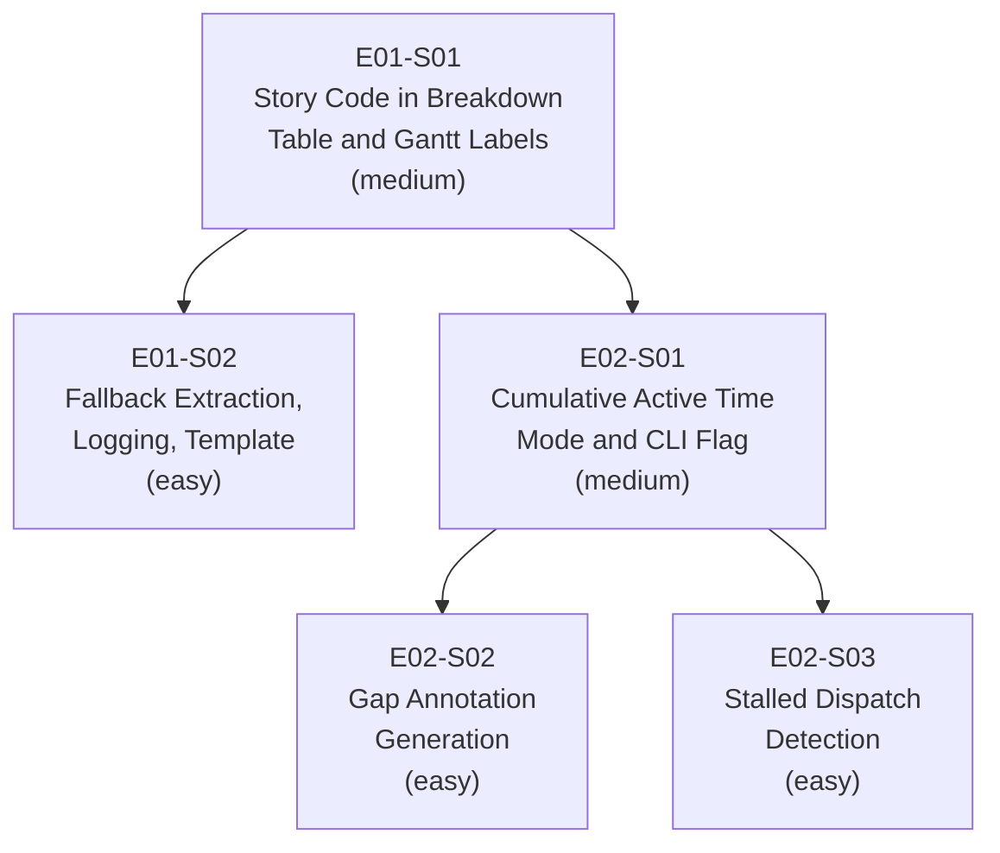

# Implementation Plan: Gantt Chart Readability

## 1. Overview

This plan implements two Gantt chart readability fixes from the approved design doc (`docs/2-design/2026-03-19-gantt-chart-readability.md`):

1. **Story code regression** -- Restore story code prefixes (e.g., `E01-S02`) in Gantt labels and add a Story column to the breakdown table.
2. **Work Timeline mode** -- Replace the default Gantt X-axis with cumulative active time to eliminate session-gap whitespace.

Both changes target `scripts/lib/compute-dispatches.py` (1001 lines) and its test file `scripts/lib/test_compute_dispatches.py` (1924 lines).

## 2. Structural Decisions

**Why 2 epics instead of 1:** The story code fix and the work timeline mode share the same Gantt code path but are functionally independent. The story code fix modifies the data path (`state_to_dispatches`, `_build_story_labels`, `compute_from_dispatches`) while the work timeline modifies the rendering path (`generate_gantt`, new `generate_gantt_note`). Splitting into two epics allows parallel execution of independent stories and clearer code review boundaries. Additionally, E01 changes the breakdown table format (adding a column), which affects test fixtures; E02 depends on this being stable before adding Gantt mode tests.

**Why E01 has 2 stories:** The breakdown Story column and the Gantt label fix are in different functions but share the `_build_story_labels` mapping. Story 1 fixes the mapping and adds the breakdown column (which is simpler and provides the foundation). Story 2 adds fallback extraction and diagnostic logging to harden the mapping for edge cases, and updates the telemetry template. These are separable but S02 depends on S01's story_code field in the dispatch dict.

**Why E02 has 3 stories:** The work timeline mode has three distinct layers: (1) the cumulative offset algorithm and `--gantt-mode` CLI flag, (2) gap annotation generation and `gantt_note` output, and (3) stalled dispatch detection. Each layer is testable in isolation. S01 is the core algorithm change and is the most complex. S02 and S03 are independent of each other but both depend on S01's mode parameter being in place.

## 3. Epic and Story Breakdown

### E01: Story Code Regression and Breakdown Table

Fix the story code mapping, add the Story column to the breakdown table, add fallback extraction, and update the telemetry template.

#### E01-S01: Story Code in Breakdown Table and Gantt Labels (medium)

**What:** Add `story_code` field to the dispatch dict returned by `state_to_dispatches()`, add a Story column to the breakdown table in `compute_from_dispatches()`, and verify Gantt labels include story codes from the existing `_build_story_labels()` mapping.

**Files to modify:**
- `scripts/lib/compute-dispatches.py`
  - `state_to_dispatches()` -- call `_build_story_labels()` and attach `story_code` to each dispatch dict
  - `compute_from_dispatches()` -- add Story column to breakdown rows (between Agent and Task)
  - Breakdown total row -- add `--` placeholder for Story column
- `scripts/lib/test_compute_dispatches.py`
  - Update `DISPATCHES_FIXTURE` entries to include `story_code` field (or handle missing gracefully)
  - Update all breakdown row assertions that check pipe count or column content
  - Add `test_breakdown_story_column_present` -- verify story codes appear in Story column
  - Add `test_breakdown_story_column_dash_for_non_story` -- verify `--` for design/plan/retro
  - Add `test_breakdown_total_row_has_story_placeholder` -- verify total row has Story column

**Acceptance criteria:**
- [ ] `state_to_dispatches()` returns `story_code` field on each dispatch (e.g., `"E01-S02"` or `""`)
- [ ] Breakdown table has 6 columns: `| Agent | Story | Task | Duration | Tokens | Est. Cost |`
- [ ] Builder/reviewer/fix cycle dispatches show story code (e.g., `E01-S02`) in Story column
- [ ] Design/plan/retro dispatches show `--` in Story column
- [ ] Total row shows empty or `--` in Story column
- [ ] Gantt labels include story codes (existing `_gantt_label_for_dispatch` already works when `_build_story_labels` returns data; this story verifies the data flow from `state_to_dispatches`)
- [ ] All existing tests pass with updated column expectations
- [ ] New tests verify Story column presence and values

#### E01-S02: Fallback Story Code Extraction, Diagnostic Logging, and Template Update (easy)

**What:** Add fallback story code extraction when `_build_story_labels()` returns empty, add diagnostic stderr logging, and update the telemetry template header row.

**Files to modify:**
- `scripts/lib/compute-dispatches.py`
  - `_build_story_labels()` -- add warning to stderr when `state.epics` is non-empty but no labels extracted
  - `state_to_dispatches()` -- add fallback: if `_build_story_labels()` returns no mapping for an issue, attempt reverse lookup via `state.epics.*.stories` by issue number
- `scripts/templates/telemetry.md`
  - Update breakdown header row from `| Agent | Task | Duration | Tokens | Est. Cost |` to `| Agent | Story | Task | Duration | Tokens | Est. Cost |`
- `scripts/lib/test_compute_dispatches.py`
  - Add `test_build_story_labels_empty_epics` -- verify empty return when `state.epics` is empty
  - Add `test_build_story_labels_missing_branch` -- verify graceful handling when a story has no `branch` field
  - Add `test_story_code_fallback_when_mapping_empty` -- verify fallback extraction works
  - Add `test_story_code_diagnostic_warning` -- verify stderr warning when epics exist but mapping is empty

**Acceptance criteria:**
- [ ] When `_build_story_labels()` returns empty but `state.epics` is non-empty, a warning is printed to stderr
- [ ] Fallback extraction derives story code from `state.epics.*.stories` keys when branch parsing fails
- [ ] Telemetry template breakdown header includes Story column
- [ ] Missing branch field does not crash `_build_story_labels()`
- [ ] New tests pass

### E02: Work Timeline Mode

Add cumulative active time Gantt mode, gap annotations, and stalled dispatch detection.

#### E02-S01: Cumulative Active Time Mode and CLI Flag (medium)

**What:** Implement the core work timeline algorithm in `generate_gantt()` and add the `--gantt-mode` CLI flag to `compute-dispatches.py` and passthrough in `item-telemetry.sh`.

**Files to modify:**
- `scripts/lib/compute-dispatches.py`
  - `generate_gantt()` -- add `mode` parameter (default `"work"`); when `mode="work"`, compute cumulative offset from wave critical paths; when `mode="wall-clock"`, retain current absolute-timestamp behavior
  - `main()` -- add `--gantt-mode` argument (choices: `work`, `wall-clock`; default: `work`); pass to `generate_gantt()`
  - `_select_tick_interval()` -- adjust for work timeline (total active time may be much shorter than wall-clock)
- `scripts/item-telemetry.sh`
  - Add `--gantt-mode` flag passthrough to `compute-dispatches.py`
- `scripts/lib/test_compute_dispatches.py`
  - Add `test_work_timeline_no_gaps` -- verify no-gap session produces same offsets as wall-clock
  - Add `test_work_timeline_single_gap` -- verify gap is collapsed (wave after 9h gap starts right after prior wave's critical path)
  - Add `test_work_timeline_multiple_gaps` -- verify multiple gaps all collapsed
  - Add `test_work_timeline_parallel_wave_offset` -- verify parallel dispatches share the same cumulative offset
  - Add `test_work_timeline_critical_path` -- verify cumulative offset advances by `max(duration_ms)` of wave, not sum
  - Add `test_wall_clock_mode_unchanged` -- verify `--gantt-mode wall-clock` produces identical output to current behavior
  - Add `test_gantt_mode_default_is_work` -- verify default mode is `work`
  - Add `test_gantt_mode_invalid_value_error` -- verify invalid mode value produces error
  - Update existing Gantt tests that rely on absolute wall-clock offsets to specify `mode="wall-clock"` or adapt to cumulative offsets

**Acceptance criteria:**
- [ ] `generate_gantt(state, mode="work")` uses cumulative active time (no dead space between waves)
- [ ] `generate_gantt(state, mode="wall-clock")` produces current behavior (absolute timestamps)
- [ ] Default mode is `work`
- [ ] `--gantt-mode` CLI flag works with `--gantt` and `--from-state`
- [ ] `--gantt-mode` without `--gantt` is either ignored or rejected (no crash)
- [ ] `item-telemetry.sh --gantt-mode <mode>` passes through to Python
- [ ] Existing Gantt tests pass (with mode adjustments)
- [ ] New cumulative offset tests pass

#### E02-S02: Gap Annotation Generation (easy)

**What:** Detect gaps between waves in work timeline mode and generate the `gantt_note` string. Add the `gantt_note` key to the CLI JSON output.

**Files to modify:**
- `scripts/lib/compute-dispatches.py`
  - Add `generate_gantt_note()` function (or integrate gap tracking into `generate_gantt()`)
  - Gap threshold constant: `_GAP_THRESHOLD_S = 300` (5 minutes)
  - Format: `*Timeline compressed: N gap(s) removed (Xh Ym, Zh Wm idle). X-axis shows agent running time, not wall-clock time.*`
  - `main()` -- include `gantt_note` in JSON output when present
- `scripts/item-telemetry.sh`
  - Extract `gantt_note` from Python output when present
  - Pass `gantt_note` to template rendering (if applicable, or append below chart)
- `scripts/templates/telemetry.md`
  - Add `GANTT_NOTE` conditional block below the Gantt chart (after `END_GANTT`, before `IF_FOOTER`)
- `scripts/lib/test_compute_dispatches.py`
  - Add `test_gantt_note_present_when_gaps` -- verify `gantt_note` returned when gaps > 5m exist
  - Add `test_gantt_note_absent_when_no_gaps` -- verify `gantt_note` absent when no gaps
  - Add `test_gantt_note_format` -- verify note contains gap count, gap durations, compression explanation
  - Add `test_gantt_note_single_gap_singular` -- verify "1 gap" not "1 gaps"

**Acceptance criteria:**
- [ ] Gaps > 5 minutes between waves produce a `gantt_note` string
- [ ] `gantt_note` is included in CLI JSON output when present
- [ ] `gantt_note` is absent from output when no gaps exist
- [ ] Note format uses correct singular/plural for gap count
- [ ] Note lists individual gap durations
- [ ] `item-telemetry.sh` can extract and use `gantt_note`
- [ ] Template has `GANTT_NOTE` conditional block
- [ ] New tests pass

#### E02-S03: Stalled Dispatch Detection (easy)

**What:** Detect dispatches with throughput < 50 tok/s and annotate them in Gantt labels and `gantt_note`.

**Files to modify:**
- `scripts/lib/compute-dispatches.py`
  - Add `_STALLED_THRESHOLD_TOKS = 50` constant
  - `_gantt_label_for_dispatch()` -- add stalled detection; append `[stalled]` suffix when throughput < 50 tok/s
  - `generate_gantt_note()` (or wherever gap note is built) -- include stalled dispatch count in note
  - Handle edge cases: zero duration (no division by zero), zero tokens (not flagged as stalled)
- `scripts/lib/test_compute_dispatches.py`
  - Add `test_stalled_detection_below_threshold` -- verify dispatch with < 50 tok/s is flagged
  - Add `test_stalled_detection_above_threshold` -- verify dispatch with > 50 tok/s is not flagged
  - Add `test_stalled_label_in_gantt` -- verify `[stalled]` suffix appears in Gantt label
  - Add `test_stalled_note_in_gantt_note` -- verify stalled count appears in `gantt_note`
  - Add `test_stalled_zero_duration_no_crash` -- verify zero-duration dispatch does not cause division by zero
  - Add `test_stalled_zero_tokens_not_flagged` -- verify zero-token dispatch is not flagged

**Acceptance criteria:**
- [ ] Dispatches with throughput < 50 tok/s get `[stalled]` suffix in Gantt label
- [ ] Dispatches with throughput >= 50 tok/s are not flagged
- [ ] Zero-duration dispatches do not crash (division by zero guarded)
- [ ] Zero-token dispatches (e.g., API error) are not flagged as stalled (no throughput data)
- [ ] Stalled count appears in `gantt_note` when stalled dispatches exist
- [ ] Stalled detection is informational only -- does not change bar width, position, or cumulative offset
- [ ] New tests pass

## 4. CLAUDE.md Update

After all stories complete, update CLAUDE.md:
- Add `--gantt-mode` to the `compute-dispatches.py` CLI docs in the helper scripts table
- Document the new default behavior (work timeline mode vs wall-clock)

This will be handled as part of the final story's PR review or as an inline update.

## 5. Dependency Graph

**Cross-epic dependency:** E02-S01 depends on E01-S01 because the work timeline mode's `generate_gantt()` signature changes must be compatible with the story code data flow established in E01. Specifically, E01-S01 adds the `story_code` field to dispatches which E02-S01's updated `generate_gantt()` consumes. If E02-S01 were built without E01-S01, the story code field would not exist in the dispatch dicts and tests would need to be rewritten.

### Dispatch Plan

| Wave | Stories | Dispatch |
|------|---------|----------|
| **Wave 1** | E01-S01 | Sequential (foundation) |
| **Wave 2** | E01-S02, E02-S01 | Parallel (independent after E01-S01) |
| **Wave 3** | E02-S02, E02-S03 | Parallel (both depend on E02-S01 only) |

## 6. Format Contract

Both epics produce content in the same file (`compute-dispatches.py`). The following format contracts ensure consistency:

| Element | Exact Format | Example |
|---------|-------------|---------|
| Breakdown row | `\| Agent \| Story \| Task \| Duration \| Tokens \| Est. Cost \|` | `\| Builder (sonnet) \| E01-S02 \| Destination Profiles (#73) \| 3m 13s \| 60K \| ~$0.36 \|` |
| Story column value (builder/reviewer/fix) | `ENN-SNN` | `E01-S02` |
| Story column value (non-story) | `--` | `--` |
| Breakdown total row Story column | empty | `\| \| **Total (5 dispatches)** \| ... \|` |
| Gantt stalled label suffix | ` [stalled]` (space before bracket) | `E01-S01 Build (91m 2s) [stalled]` |
| gantt_note gap format | `*Timeline compressed: N gap(s) removed (Xh Ym, ... idle). X-axis shows agent running time, not wall-clock time.*` | `*Timeline compressed: 2 gaps removed (9h 12m, 45m idle). X-axis shows agent running time, not wall-clock time.*` |
| gantt_note stalled format | `*N stalled dispatch(es) detected (< 50 tok/s throughput). Duration may include usage limit waits or API throttling.*` | `*1 stalled dispatch detected (< 50 tok/s throughput). Duration may include usage limit waits or API throttling.*` |
| Gap threshold | 300 seconds (5 minutes) | Constant `_GAP_THRESHOLD_S = 300` |
| Stalled threshold | 50 tokens/second | Constant `_STALLED_THRESHOLD_TOKS = 50` |

## 7. Risk Assessment

**Low risk overall.** All changes are in a single Python file with comprehensive existing tests (1924 lines). The reverted commit provides a partial implementation template for the work timeline features.

**Risks:**
1. **Existing test breakage from column change** (E01-S01) -- Adding the Story column shifts pipe positions in breakdown rows. All tests that assert on breakdown content must be updated. Mitigation: the story explicitly lists this as a task.
2. **Existing Gantt test breakage from mode change** (E02-S01) -- Changing the default Gantt mode from wall-clock to work timeline will break tests that assert on absolute offsets. Mitigation: update tests to use `mode="wall-clock"` or adapt assertions.
3. **`item-telemetry.sh` passthrough** (E02-S01) -- Shell script changes alongside Python changes. Mitigation: the passthrough is a simple flag relay with no logic.

## 8. Files Modified Summary

| File | E01-S01 | E01-S02 | E02-S01 | E02-S02 | E02-S03 |
|------|---------|---------|---------|---------|---------|
| `scripts/lib/compute-dispatches.py` | X | X | X | X | X |
| `scripts/lib/test_compute_dispatches.py` | X | X | X | X | X |
| `scripts/templates/telemetry.md` | | X | | X | |
| `scripts/item-telemetry.sh` | | | X | X | |
| `CLAUDE.md` | | | X | | |
