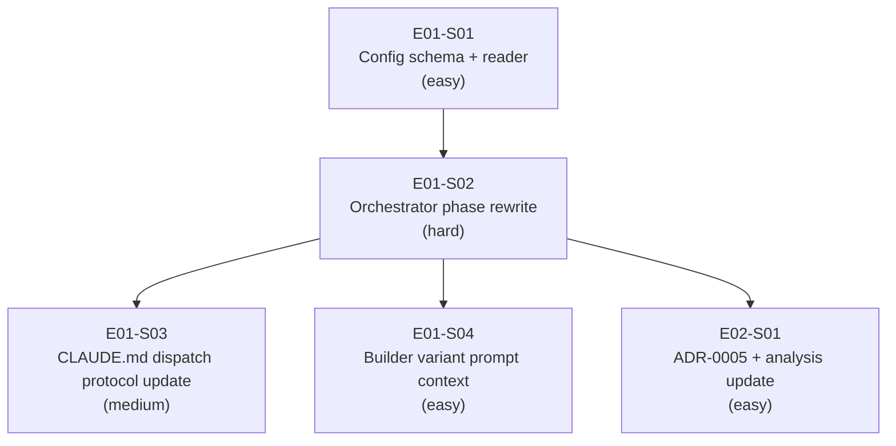

# Implementation Plan: Phase Restructuring

## 1. Overview

This plan implements backlog #243 -- restructuring the orchestrator's dispatch model so that each story's full lifecycle (build, review, fix cycle) runs as a single parallel unit within a wave, and implementing a tiered review strategy based on difficulty.

**Chosen approach: Orchestrator-driven prompt augmentation (Approach E).** No new agent files are created. The orchestrator drives the per-story lifecycle by:
1. Dispatching builders in parallel (current behavior)
2. After builders complete, dispatching reviewers in parallel for stories that require review (new: reviews are parallel, not sequential)
3. Skipping per-story review entirely for easy stories when configured
4. Augmenting builder dispatch prompts with review-tier context so builders can pre-validate acceptance criteria more aggressively

**Why Approach E over Approach B (story-implementer wrapper):** Approach B requires a new `story-implementer.md` agent that dispatches builders and reviewers via the Agent tool. This introduces a new abstraction layer and a new agent file. The Agent tool only exists on the orchestrator; adding it to a wrapper creates a nested dispatch pattern that is more complex to debug and reason about. Approach E keeps all dispatch logic in the orchestrator, which already owns the Agent tool and state management. The key insight is that parallel reviews (dispatching all reviewers for a wave simultaneously) achieve most of the velocity gain without the architectural complexity of per-story wrappers.

**Why not full `max(build + review per story)` parallelism:** The Agent tool's parallel dispatch model requires the orchestrator to wait for ALL dispatched agents in a batch to return before it can act on any individual result. The orchestrator cannot react to a single builder completing and immediately dispatch its reviewer while other builders are still running. True per-story lifecycle parallelism would require either nested Agent dispatch (Approach B) or orchestrator-level async handling (not supported). The practical alternative -- parallel builds then parallel reviews -- achieves wave time of `max(builds) + max(reviews)` instead of the theoretical `max(build + review)`, but still eliminates the current `max(builds) + sum(reviews)` bottleneck.

**Velocity comparison for a 3-story wave (2m 30s avg build, 1m 10s avg review):**

| Model | Formula | Wave Time |
|-------|---------|-----------|
| Current (sequential reviews) | `max(builds) + sum(reviews)` | 2m 30s + 3m 30s = **6m 00s** |
| Approach E (parallel reviews) | `max(builds) + max(reviews)` | 2m 30s + 1m 10s = **3m 40s** |
| Approach B (per-story wrappers) | `max(build + review)` | max(3m 40s, 3m 20s, 3m 00s) = **3m 40s** |

Approaches B and E produce identical wave times for evenly-balanced stories. Approach E has slightly worse worst-case when one story's build is much longer (the reviewer for all stories waits for the slowest builder), but the difference is negligible for typical workloads.

With tiered reviews (skipping easy story reviews), wave time drops further for easy-heavy waves:
- 3 easy stories: `max(builds)` = **2m 30s** (no review phase at all)
- 2 easy + 1 medium: `max(builds) + max(reviews for 1 medium)` = **3m 40s**

## 2. Architecture Decision

### ADR-0005: Parallel Reviews and Tiered Review Strategy

**Context:** The orchestrator's current dispatch model treats building and reviewing as separate sequential phases. Reviews for all stories in a wave run sequentially after all builders complete. Easy test stories have never triggered a meaningful fix cycle (0/40+ stories).

**Decision:**
1. Reviews within a wave are dispatched in parallel (not sequentially).
2. Per-story review is skipped for easy stories when `reviewStrategy.skipEasyReview` is `true` in config.
3. The orchestrator determines review tier before dispatch and includes it in the builder's prompt context.
4. No new agent files are created; the orchestrator drives all dispatch sequencing.

**Consequences:**
- Wave duration reduces from `max(builds) + sum(reviews)` to `max(builds) + max(reviews)` (~39% improvement)
- Easy story waves skip review entirely, further reducing duration
- Fix cycle handling remains in the orchestrator (post-review, not inside a wrapper)
- State file dispatch log captures both builder and reviewer dispatches with the same wave grouping
- The PR review remains the cross-story quality gate

## 3. Dependency Analysis

This feature modifies infrastructure files that define the workflow itself. The key constraint is that changes to `orchestrator.md`, `CLAUDE.md`, and config must be coordinated to avoid inconsistency. The plan uses two epics:

- **E01: Core Infrastructure** -- Config schema, config reader, orchestrator phase rewrite, and CLAUDE.md convention update. These changes must be coordinated in a specific dependency order.
- **E02: Documentation and Validation** -- ADR, analysis update, and a test validation story that verifies the end-to-end behavior.

**Why two epics instead of one:** E01 stories have strict dependencies (config must exist before orchestrator reads it, orchestrator must be updated before CLAUDE.md references the new model). E02 stories are independent of each other but depend on E01 being complete. Separating them allows the orchestrator to dispatch E02 stories in parallel after E01 completes.



### Dispatch Plan

| Wave | Stories | Dispatch | Rationale |
|------|---------|----------|-----------|
| **Wave 1** | E01-S01 | Sequential (1 story) | Config foundation -- must exist before orchestrator changes |
| **Wave 2** | E01-S02 | Sequential (1 story, hard) | Core orchestrator rewrite, depends on config |
| **Wave 3** | E01-S03, E01-S04 | Parallel (2 stories) | Both depend on E01-S02, independent of each other |
| **Wave 4** | E02-S01 | Sequential (1 story) | Documentation, depends on E01-S02 |

## 4. Files to Create/Modify

| File | Action | Story |
|------|--------|-------|
| `.claude/agentic-sdlc-config.json` | Modify -- add `reviewStrategy` section | E01-S01 |
| `scripts/lib/config.sh` | Modify -- read `reviewStrategy` fields | E01-S01 |
| `.claude/agents/orchestrator.md` | Modify -- rewrite Phase 5/6/7 into unified Implementation/Merge/Review phases | E01-S02 |
| `CLAUDE.md` | Modify -- update Dispatch Protocol, Board transitions, In-session dispatch sections | E01-S03 |
| `.claude/agents/builder.md` | Modify -- add review-tier context section | E01-S04 |
| `.claude/agents/builder-haiku.md` | Modify -- sync with builder.md | E01-S04 |
| `.claude/agents/builder-sonnet.md` | Modify -- sync with builder.md | E01-S04 |
| `.claude/agents/builder-opus.md` | Modify -- sync with builder.md | E01-S04 |
| `docs/6-adrs/0005-parallel-reviews-tiered-strategy.md` | Create | E02-S01 |
| `docs/1-discovery/2026-03-19-workflow-optimization-analysis.md` | Modify -- mark items 5 and 7 as done | E02-S01 |

## 5. Story Details

### E01-S01: Config Schema and Reader for Review Strategy

**Difficulty:** easy

Add the `reviewStrategy` config section to `agentic-sdlc-config.json` and update `config.sh` to expose the new fields.

**Config schema addition:**

```json
{
  "reviewStrategy": {
    "skipEasyReview": true,
    "requireReviewForInfra": true
  }
}
```

- `skipEasyReview` (boolean, default `true`): When true, stories with `difficulty/easy` label skip per-story review. The PR review is the sole quality gate.
- `requireReviewForInfra` (boolean, default `true`): When true, ALL stories in non-test-run backlog items get per-story review regardless of difficulty. Determined by absence of the `test-agentic-sdlc` label on the backlog issue.

**Config reader variables to add:**

```bash
CFG_SKIP_EASY_REVIEW=$(_cfg '.reviewStrategy.skipEasyReview' "true")
CFG_REQUIRE_REVIEW_FOR_INFRA=$(_cfg '.reviewStrategy.requireReviewForInfra' "true")
```

**Files to modify:**
- `.claude/agentic-sdlc-config.json`
- `scripts/lib/config.sh`

**Acceptance criteria:**
- [ ] `reviewStrategy.skipEasyReview` field exists in config with value `true`
- [ ] `reviewStrategy.requireReviewForInfra` field exists in config with value `true`
- [ ] `config.sh` exports `CFG_SKIP_EASY_REVIEW` and `CFG_REQUIRE_REVIEW_FOR_INFRA`
- [ ] Default values are `true` for both when the section is absent from config
- [ ] Existing config fields are unchanged

**Test plan:**
- Source `config.sh` and verify `CFG_SKIP_EASY_REVIEW` equals `true`
- Source `config.sh` and verify `CFG_REQUIRE_REVIEW_FOR_INFRA` equals `true`
- Remove the `reviewStrategy` section and verify defaults still produce `true`

---

### E01-S02: Orchestrator Phase Rewrite -- Unified Implementation Phase

**Difficulty:** hard

Rewrite the orchestrator's Phase 5 (Dispatch Builders), Phase 6 (Review Story), and Phase 7 (Merge Story Branches) into a unified structure with parallel reviews and tiered review logic.

**Current phase structure (to be replaced):**
- Phase 5: Dispatch Builders (parallel builders, sequential status updates)
- Phase 6: Review Story (sequential reviewer dispatch, fix cycles)
- Phase 7: Merge Story Branches (sequential merges)

**New phase structure:**

**Phase 5: Implementation (Build + Review per wave)**

For each wave of independent stories:

1. **Set board statuses** to In Progress for all stories in the wave (batch).
2. **Dispatch all builders** in parallel (existing behavior, unchanged).
3. **After all builders return:** Post per-story telemetry. Verify comments and board statuses.
4. **Determine review tier** for each story in the wave:
   - Read difficulty label from the story issue
   - Read backlog issue labels to check for `test-agentic-sdlc`
   - Apply tiered logic:
     - If `skipEasyReview` is true AND story is `difficulty/easy` AND backlog has `test-agentic-sdlc` label (or `requireReviewForInfra` is false): **skip review**
     - Otherwise: **require review**
5. **For stories requiring review:** Dispatch all reviewers in parallel (not sequentially).
6. **After all reviewers return:** Handle verdicts:
   - APPROVE/COMMENT: proceed to merge
   - REQUEST_CHANGES: dispatch fix cycle (builder re-dispatch, then re-review, max 2 cycles). Fix cycles are sequential per story.
7. **Set board statuses** to In Review for all stories (batch). Verify comments.

**Phase 6: Merge Story Branches**

Unchanged from current Phase 7. Sequential merge of each story into epic branch, epic into integration branch.

**Phase 7: Open Backlog PR**

Renumbered from current Phase 8. Content unchanged.

**Phase 8: Review (PR Review)**

Renumbered from current Phase 8 sub-section. PR review + retro dispatch in parallel. Content unchanged.

**Phase 9: Backlog-Level Telemetry**

Renumbered from current Phase 9. Content unchanged.

**Phase 10: Post-Merge Cleanup**

Renumbered from current Phase 10. Content unchanged.

**Key changes to orchestrator.md:**
- Phase 5 absorbs current Phases 5-6 into a single "Implementation" phase
- Reviewer dispatch changes from sequential to parallel (multiple Agent tool calls)
- New tiered review logic section with config-driven skip behavior
- Fix cycle handling remains inline (not delegated to a wrapper agent)
- Phase numbering shifts: 5=Implementation, 6=Merge, 7=Open PR, 8=Review, 9=Telemetry, 10=Cleanup

**Review tier determination pseudocode:**

```
function shouldSkipReview(storyIssue, backlogIssue):
    if not config.reviewStrategy.skipEasyReview:
        return false  # config says always review

    storyDifficulty = getLabel(storyIssue, "difficulty/*")
    if storyDifficulty != "easy":
        return false  # only easy stories can skip

    if config.reviewStrategy.requireReviewForInfra:
        backlogLabels = getLabels(backlogIssue)
        if "test-agentic-sdlc" not in backlogLabels:
            return false  # infra stories always reviewed

    return true  # skip review for this easy test story
```

**Files to modify:**
- `.claude/agents/orchestrator.md` -- Phase 5/6/7 rewrite, renumber remaining phases

**Acceptance criteria:**
- [ ] Phase 5 is renamed to "Implementation" and contains build + review dispatch logic
- [ ] Reviewers are dispatched in parallel (multiple Agent tool calls), not sequentially
- [ ] Tiered review logic reads `skipEasyReview` and `requireReviewForInfra` from config
- [ ] Easy test stories skip per-story review when configured
- [ ] Infrastructure stories (no `test-agentic-sdlc` label) always get reviewed
- [ ] Fix cycle handling (max 2) remains within the implementation phase
- [ ] Phases 6-10 are renumbered correctly with updated cross-references
- [ ] All internal phase references within orchestrator.md are updated
- [ ] State file dispatch logging is unchanged (dispatches are still recorded individually)
- [ ] Telemetry posting order is unchanged (per-story after each builder, per-epic after each epic merges)
- [ ] Board transition logic is updated: batch In Progress before builders, batch In Review after all reviews complete

**Test plan:**
- Review orchestrator.md for internal consistency (no dangling phase references)
- Verify all Phase N references match the new numbering
- Verify the tiered review pseudocode matches the config schema from E01-S01
- Verify fix cycle handling is complete (builder re-dispatch, reviewer re-dispatch, max 2 cycles, post-worktree cleanup)

---

### E01-S03: CLAUDE.md Dispatch Protocol Update

**Difficulty:** medium

Update `CLAUDE.md` to reflect the new dispatch model: parallel reviews, tiered review strategy, and updated phase numbering.

**Sections to update in CLAUDE.md:**

1. **"In-session dispatch (primary)" section** (lines ~308-329):
   - Replace step 6 ("Dispatch reviewer on the story branch, mandatory, before merging") with tiered review logic
   - Add: "For easy test stories with `skipEasyReview` enabled, skip per-story review. The PR review is the sole quality gate."
   - Replace: "After all complete, review and merge sequentially" with "After all builders complete, dispatch reviewers in parallel for stories requiring review"

2. **"Parallel dispatch" paragraph** (line ~364):
   - Update: "After all complete, review and merge sequentially" becomes "After all complete, dispatch reviewers for eligible stories in parallel, then merge sequentially"

3. **"Board transitions in autonomous mode" section** (lines ~216-224):
   - Update step 3: "After builder completes: Set the story to In Review" -- now conditional. Stories that skip review go to In Review after build; stories that get reviewed go to In Review after review completes.
   - Add step 3a: "After all reviewers in a wave complete: set reviewed stories to In Review"

4. **"Story branch creation for parallel waves" section** (line ~366):
   - Update Phase reference from "Phase 4" to correct new number if changed

5. **Review strategy config documentation:**
   - Add a note in the Configuration section about `reviewStrategy` fields

**Files to modify:**
- `CLAUDE.md`

**Acceptance criteria:**
- [ ] In-session dispatch steps include tiered review logic
- [ ] Parallel dispatch paragraph reflects parallel review dispatch
- [ ] Board transitions section accounts for review-skipped stories
- [ ] Phase number references are updated if orchestrator phase numbers changed
- [ ] `reviewStrategy` config is documented in the Configuration or Dispatch Protocol section
- [ ] No stale references to "Phase 6: Review Story" or sequential review dispatch

**Test plan:**
- Grep CLAUDE.md for "Phase 5", "Phase 6", "Phase 7" and verify all references are correct
- Grep for "sequential" + "review" and verify no stale references to sequential review dispatch
- Verify the dispatch protocol steps 1-13 are consistent with orchestrator.md

---

### E01-S04: Builder Variant Prompt Context for Review Tier

**Difficulty:** easy

Add a section to `builder.md` (and sync to all three variants) that documents the review-tier context the builder may receive in its dispatch prompt. This enables builders to be more aggressive about self-validation when they know no per-story review will follow.

**Section to add to builder.md (after "After Story Complete" section):**

```markdown
## Review Tier Context

The orchestrator may include review tier information in your dispatch prompt:

- **"Review tier: SKIP"** -- No per-story reviewer will check your work. The PR review is the sole quality gate. Be extra rigorous with acceptance criteria validation (step 3 in "After Story Complete").
- **"Review tier: REVIEW"** -- A reviewer will check your work after you complete. Follow the standard workflow.

If no review tier is specified, assume REVIEW (a reviewer will check your work).
```

This is a documentation-only change to the builder agent. The orchestrator constructs the prompt with review tier context; the builder uses it to calibrate self-validation rigor.

**Files to modify:**
- `.claude/agents/builder.md` -- add Review Tier Context section
- `.claude/agents/builder-haiku.md` -- sync
- `.claude/agents/builder-sonnet.md` -- sync
- `.claude/agents/builder-opus.md` -- sync

**Acceptance criteria:**
- [ ] `builder.md` contains a "Review Tier Context" section
- [ ] Section documents both SKIP and REVIEW tiers
- [ ] SKIP tier instructs the builder to be more rigorous with AC validation
- [ ] All three builder variants (`builder-haiku.md`, `builder-sonnet.md`, `builder-opus.md`) are synced with `builder.md`
- [ ] No other changes to builder agent behavior or tools

**Test plan:**
- Diff builder.md against each variant to verify only name/model frontmatter differs
- Verify the Review Tier Context section is present in all four files

---

### E02-S01: ADR-0005 and Analysis Update

**Difficulty:** easy

Create ADR-0005 documenting the parallel reviews and tiered review strategy decision. Update the workflow optimization analysis to mark recommendations 5 and 7 as done.

**ADR-0005 content:**
- Title: Parallel Reviews and Tiered Review Strategy
- Status: Accepted
- Context: Sequential reviews are the wave bottleneck; easy story reviews have zero demonstrated value
- Decision: Parallel review dispatch + configurable easy review skip
- Consequences: ~39% wave time reduction, ~84K token savings per test run

**Analysis update:**
- In section 13.2 (items 3-4) and 13.3 (items 5-7): mark items 5 and 7 with strike-through and "Done" annotation, similar to items 1 and 2

**Files to create:**
- `docs/6-adrs/0005-parallel-reviews-tiered-strategy.md`

**Files to modify:**
- `docs/1-discovery/2026-03-19-workflow-optimization-analysis.md` -- mark items 5 and 7 as done

**Acceptance criteria:**
- [ ] ADR-0005 exists with correct number (0005) and follows existing ADR format
- [ ] ADR covers context, decision, alternatives considered, and consequences
- [ ] Analysis items 5 and 7 are marked as done with strike-through formatting
- [ ] Done annotations include commit reference placeholder for the implementing commit

**Test plan:**
- Verify ADR file exists at correct path
- Verify ADR number (0005) follows existing sequence (0002, 0004)
- Verify analysis items 5 and 7 have done markers

## 6. Structural Decisions

**Why two epics instead of three or one:**
- One epic would have 5 stories with strict sequential dependencies in the first 3, making parallel dispatch impossible. Splitting into E01 (core) and E02 (docs) allows E02 to run after E01 without waiting for the full E01 merge.
- Three epics would over-fragment: the documentation story (E02-S01) is a natural companion to E01 but doesn't need to block on E01's internal merge.

**Why E01-S02 is hard:**
- Touches the orchestrator's core dispatch logic -- the most complex single file in the project
- Must rewrite three phases (5, 6, 7) into a new structure while preserving all existing safety checks
- Must renumber all downstream phases and update all cross-references
- Must implement the tiered review logic correctly (config reading, label checking, conditional dispatch)
- High risk of regression -- the orchestrator's phase logic is the foundation of the entire workflow

**Why E01-S01 is easy:**
- Single-file config change (well-documented pattern from prior config additions)
- Single-file config reader change (follows existing `_cfg` pattern exactly)
- No behavioral changes -- just adding fields

**Why E01-S03 is medium:**
- Multi-section updates within a large file (CLAUDE.md is 720+ lines)
- Must coordinate references with orchestrator.md's new phase numbering
- Risk of stale cross-references across the two files

**Why E01-S04 is easy:**
- Adding a single documentation section to builder.md
- Mechanical sync to three variant files using the existing sed command
- No behavioral changes to the builder agent

## 7. Risk Assessment

| Risk | Likelihood | Impact | Mitigation |
|------|-----------|--------|------------|
| Orchestrator phase renumbering breaks internal references | Medium | High | E01-S02 acceptance criteria requires grep verification of all Phase N references |
| CLAUDE.md and orchestrator.md fall out of sync | Medium | High | E01-S03 explicitly cross-references orchestrator.md phase numbers; reviewer checks both |
| Builder variants drift from builder.md | Low | Medium | E01-S04 uses the standard sed sync command; acceptance criteria verifies all four files |
| Config defaults produce unexpected behavior | Low | Medium | Defaults are `true` for both flags, matching the issue's recommendation |
| Parallel review dispatch hits GitHub API contention | Medium | Low | Same contention risk as parallel builder dispatch, which has worked reliably since R8 |

## 8. What Is NOT In Scope

- **No new agent files.** The `story-implementer.md` wrapper (Approach B) is explicitly not implemented.
- **No changes to `compute-dispatches.py` or telemetry scripts.** The dispatch log format is unchanged.
- **No changes to `state.sh` or the orchestrator state schema.** Dispatches are still recorded individually.
- **No express mode implementation.** That is a separate backlog item that builds on this work.
- **No builder AC validation script.** That is recommendation 4, a separate concern.
- **No changes to the reviewer agent.** The reviewer's behavior is unchanged; only the orchestrator's decision of when/whether to dispatch it changes.
