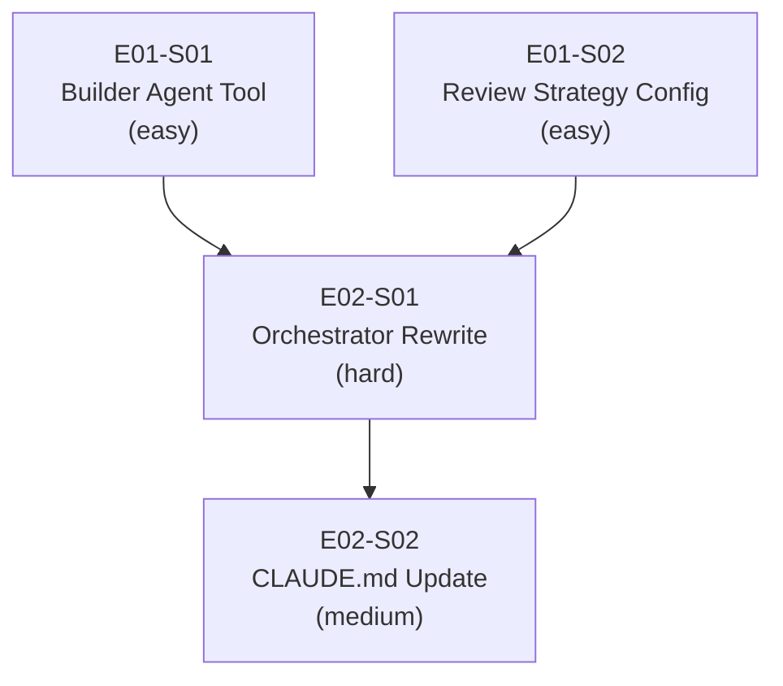

# Implementation Plan: Phase Restructuring

## 1. Overview

This plan implements the design documented in `docs/2-design/2026-03-19-phase-restructuring.md`. The core change is **Approach E (Orchestrator-Driven Prompt Augmentation)**: builders dispatch their own reviewers via the Agent tool after building, with the lifecycle instructions injected by the orchestrator's dispatch prompt.

**Key outcomes:**

1. Each story's full lifecycle (build, review, fix cycles) runs as a single parallel unit within a wave
2. Easy test stories skip per-story review when configured (tiered review strategy)
3. Orchestrator phase model reduces from 12 to 7 phases
4. Telemetry captures virtual reviewer dispatches with `nested_in` field

## 2. Architecture Decisions

### Why two epics instead of three

The work has two natural domains:

1. **Agent infrastructure** -- changes to builder.md, builder variants, config, and config.sh that enable the new capabilities (Agent tool in builders, review strategy config)
2. **Orchestrator rewrite** -- rewriting orchestrator.md phases and CLAUDE.md dispatch protocol to use prompt augmentation and the new phase model

These are distinct because (a) the agent infrastructure must exist before the orchestrator can reference it, and (b) the orchestrator rewrite is a single large interconnected change that cannot be parallelized further without creating merge conflicts across heavily cross-referenced files.

A third epic for "telemetry changes" was considered but rejected -- the telemetry format changes (virtual dispatches, `nested_in` field) are documented inline in the orchestrator rewrite since they are inseparable from the dispatch logic that produces them.

### Why stories are mostly sequential

The files modified in this backlog item are heavily interconnected:

- `CLAUDE.md` references orchestrator.md phase numbers, dispatch protocol, board transitions
- `orchestrator.md` references builder.md capabilities, config.sh variables, CLAUDE.md conventions
- `builder.md` references CLAUDE.md conventions

Parallel stories modifying these files would create merge conflicts or require one story to work against stale content. The plan uses a sequential dependency chain within each epic, with limited parallelism where file ownership is disjoint.

## 3. Epic and Story Breakdown

### E01: Agent Infrastructure and Config

Establishes the prerequisites that the orchestrator rewrite depends on: builder tool capability, review strategy configuration, and config reader.

#### E01-S01: Add Agent Tool to Builder and Variants (easy)

**What:** Add `tools: Read, Write, Edit, Grep, Glob, Bash, Agent` to `builder.md` YAML frontmatter. Add a "Post-Build Lifecycle" documentation section to builder.md body (per design doc section 3.4). Sync all three builder variants using the existing sed command.

**Files to create/modify:**

| File | Change |
|------|--------|
| `.claude/agents/builder.md` | Add `tools` field to frontmatter; add "Post-Build Lifecycle" section at end of body |
| `.claude/agents/builder-haiku.md` | Sync from builder.md |
| `.claude/agents/builder-sonnet.md` | Sync from builder.md |
| `.claude/agents/builder-opus.md` | Sync from builder.md |

**Acceptance criteria:**

- [ ] `builder.md` frontmatter includes `tools: Read, Write, Edit, Grep, Glob, Bash, Agent`
- [ ] "Post-Build Lifecycle (Orchestrator-Injected)" section exists at end of builder.md body, matching design doc section 3.4
- [ ] All three variants have identical body content to builder.md (only `name` and `model` differ)
- [ ] No existing builder behavior is altered -- the section explicitly states behavior is only activated by orchestrator prompt injection

**Test plan:**

- Verify frontmatter parses correctly: `grep "^tools:" .claude/agents/builder*.md`
- Verify all four files have the Agent tool: `grep -c "Agent" .claude/agents/builder*.md`
- Verify variant sync: diff body content of all four files (exclude first 5 lines of frontmatter)

**Blocked by:** none

**Branch:** `e01-s01/builder-agent-tool`

---

#### E01-S02: Add Review Strategy Config and Config Reader (easy)

**What:** Add `reviewStrategy` section to `agentic-sdlc-config.json` (per design doc section 4.3). Add corresponding `CFG_SKIP_REVIEW_*` variables to `scripts/lib/config.sh`.

**Files to create/modify:**

| File | Change |
|------|--------|
| `.claude/agentic-sdlc-config.json` | Add `reviewStrategy` section with `skipPerStoryReview.enabled`, `conditions.maxDifficulty`, `conditions.requireLabel` |
| `scripts/lib/config.sh` | Add `CFG_SKIP_REVIEW_ENABLED`, `CFG_SKIP_REVIEW_MAX_DIFFICULTY`, `CFG_SKIP_REVIEW_REQUIRE_LABEL` variables |

**Acceptance criteria:**

- [ ] `agentic-sdlc-config.json` includes `reviewStrategy.skipPerStoryReview` section matching design doc section 4.3 schema
- [ ] Default: `enabled: true`, `maxDifficulty: "easy"`, `requireLabel: "test-agentic-sdlc"`
- [ ] `config.sh` exports `CFG_SKIP_REVIEW_ENABLED`, `CFG_SKIP_REVIEW_MAX_DIFFICULTY`, `CFG_SKIP_REVIEW_REQUIRE_LABEL`
- [ ] Config reader uses correct jq paths and sensible defaults (enabled=false, maxDifficulty=easy, requireLabel=null)
- [ ] Existing config variables are unchanged

**Test plan:**

- Source `config.sh` and verify new variables exist: `source scripts/lib/config.sh && echo $CFG_SKIP_REVIEW_ENABLED`
- Verify jq paths resolve correctly: `jq '.reviewStrategy.skipPerStoryReview.enabled' .claude/agentic-sdlc-config.json`
- Verify existing variables still work: `source scripts/lib/config.sh && echo $CFG_REPO`

**Blocked by:** none

**Branch:** `e01-s02/review-strategy-config`

---

### E02: Orchestrator Rewrite and Convention Propagation

Rewrites the orchestrator dispatch model and propagates all convention changes to CLAUDE.md. This is the core of the feature.

#### E02-S01: Rewrite orchestrator.md Phase Model (hard)

**What:** Rewrite orchestrator.md to implement the new 7-phase model (design doc section 5.2). The key changes are:

1. Merge current Phases 5 (Dispatch Builders) + 6 (Review Story) + 7 (Merge Story Branches) into new **Phase 3: Implementation**
2. Add prompt augmentation logic -- orchestrator constructs builder dispatch prompts with POST-BUILD LIFECYCLE section (design doc section 3.2)
3. Add review tier decision logic (design doc section 4.2) -- orchestrator checks config + labels to determine REVIEW vs SKIP
4. Update telemetry capture for virtual reviewer dispatches with `nested_in` field (design doc section 3.6)
5. Update board transition documentation to reflect builder-managed In Review during lifecycle (design doc section 3.7)
6. Current Phase 8 (Open Backlog PR) becomes Phase 4
7. Current Phase 8's PR review + retro section becomes Phase 5
8. Current Phase 9 (Backlog-Level Telemetry) + Phase 10 (Post-Merge Cleanup) become Phase 6

**Files to create/modify:**

| File | Change |
|------|--------|
| `.claude/agents/orchestrator.md` | Full rewrite of Phases 5-9 into Phases 3-6. Add prompt augmentation template. Add review tier logic. Update telemetry capture. |

**Acceptance criteria:**

- [ ] Phase model matches design doc section 5.2 (Phases 0-6)
- [ ] Phase 3 (Implementation) includes the full flow from design doc section 5.3
- [ ] Prompt augmentation template matches design doc section 3.2 (both REVIEW and SKIP variants)
- [ ] Review tier decision logic matches design doc section 4.2 (check `test-agentic-sdlc` label + difficulty)
- [ ] Orchestrator reads `CFG_SKIP_REVIEW_*` config variables to determine review tier
- [ ] Virtual reviewer dispatch recording documented with `nested_in` field per design doc section 5.4
- [ ] Board transitions table updated per design doc section 3.7
- [ ] Section 3.8 items preserved: orchestrator retains branch creation, In Progress status, telemetry posting, merging, epic status sync, comment verification, state file updates
- [ ] Phase references are internally consistent (no references to old phase numbers)
- [ ] PR review phase (Phase 5) remains unchanged -- still dispatched by orchestrator
- [ ] Retro dispatch still runs in parallel with PR review per existing pattern
- [ ] Fix cycle handling within lifecycle documented (builder manages up to 2 fix cycles)
- [ ] Idempotent restart logic updated for new phase model

**Test plan:**

- Verify no references to old phase numbers (Phase 5: Dispatch Builders, Phase 6: Review Story, Phase 7: Merge, Phase 8: Open PR, Phase 9: Telemetry, Phase 10: Cleanup)
- Verify prompt augmentation template includes all fields from design doc section 3.2
- Verify SKIP variant documented for tiered review
- Verify virtual dispatch JSON example matches design doc section 5.4

**Blocked by:** E01-S01 (builder must have Agent tool before orchestrator can reference it), E01-S02 (config must exist before orchestrator can read it)

**Branch:** `e02-s01/orchestrator-rewrite`

---

#### E02-S02: Update CLAUDE.md Dispatch Protocol and Conventions (medium)

**What:** Update CLAUDE.md to reflect the new dispatch model, phase structure, and tiered review strategy. This is convention propagation -- every section that references the old phase model or dispatch protocol must be updated.

**Sections to update:**

| CLAUDE.md Section | Change |
|-------------------|--------|
| Dispatch Protocol > In-session dispatch | Update step 6 (reviewer dispatch) to note that per-story review is now builder-driven via prompt augmentation. Orchestrator no longer dispatches per-story reviewers. Steps 7-8 (fix cycles, merge) happen inside the builder's lifecycle. |
| Dispatch Protocol > In-session dispatch | Update step 10-13 (PR review + retro) with new phase numbers |
| Board transitions in autonomous mode | Update items 2-5 to reflect builder-managed review lifecycle. Add note about tiered review skipping. |
| Builder variants | Note that all variants now include `Agent` in their tools field |
| Telemetry sections | Document virtual reviewer dispatches, `nested_in` field, `review_tier` field |
| Review strategy config | Add documentation for `reviewStrategy` config section |
| Orchestrator state persistence | Update dispatch log format documentation with new fields |

**Files to create/modify:**

| File | Change |
|------|--------|
| `CLAUDE.md` | Update Dispatch Protocol, Board Transitions, Builder Variants, Telemetry, State Persistence sections |

**Acceptance criteria:**

- [ ] Dispatch Protocol steps reflect new lifecycle model (builder dispatches reviewer)
- [ ] Board transitions table updated per design doc section 3.7
- [ ] Builder variants section notes `Agent` tool in tools field
- [ ] Telemetry sections document virtual dispatches with `nested_in` and `review_tier` fields
- [ ] `reviewStrategy` config section documented with field descriptions and defaults
- [ ] No references to old phase numbers (Phase 5: Dispatch Builders, Phase 6: Review Story, etc.)
- [ ] No references to "orchestrator dispatches reviewer" for per-story reviews (only PR review)
- [ ] All cross-references between CLAUDE.md and orchestrator.md are consistent

**Test plan:**

- Grep for old phase names: `grep -n "Phase 5\|Phase 6\|Phase 7\|Phase 8\|Phase 9\|Phase 10" CLAUDE.md`
- Grep for old dispatch pattern: `grep -n "Dispatch reviewer.*story" CLAUDE.md`
- Verify review strategy config docs match actual config JSON
- Cross-reference board transition table with orchestrator.md

**Blocked by:** E02-S01 (CLAUDE.md must reflect the finalized orchestrator.md content)

**Branch:** `e02-s02/claudemd-update`

---

## 4. Dependency Graph



### Dispatch Plan

| Wave | Stories | Dispatch | Rationale |
|------|---------|----------|-----------|
| **Wave 1** | E01-S01, E01-S02 | Parallel | Independent file sets (builder agents vs config), no shared files |
| **Wave 2** | E02-S01 | Sequential | Depends on both E01 stories; touches orchestrator.md exclusively |
| **Wave 3** | E02-S02 | Sequential | Depends on E02-S01; must read finalized orchestrator.md to propagate conventions to CLAUDE.md |

### Critical Path

```
Wave 1 (parallel) -> Wave 2 (E02-S01) -> Wave 3 (E02-S02)
```

Wall-clock estimate: Wave 1 takes `max(easy, easy)` time, Wave 2 takes hard-story time, Wave 3 takes medium-story time. Total: approximately the sum of one easy + one hard + one medium story duration.

## 5. Deferred Work

The following items were identified in the design doc but are explicitly out of scope for this plan:

| Item | Why deferred |
|------|-------------|
| Skipping medium test story reviews | Design doc section 4.2: data supports it (0% fix rate) but incremental savings modest. Revisit after initial implementation proves stable. |
| Scripted format validation (pre-review) | Design doc section 4.1 reference: 66% of fix cycles are format violations. A scripted linter would reduce fix cycles further. Separate backlog item. |
| `state.sh reconstruct` implementation | Referenced in CLAUDE.md as a stub. Not blocked by this work. |
| `compute-dispatches.py` updates for `nested_in` | The Gantt generator already works with the dispatch log format; `nested_in` is informational. If future analysis wants to render nested dispatches differently, that is a separate enhancement. |

## 6. Risk Mitigation

### 3-Level Agent Nesting (Primary Risk)

**Risk:** Orchestrator -> Builder -> Reviewer nesting is untested in this project.

**Mitigation in this plan:** The first test run after merging this work validates nesting. If it fails:
- **Immediate fallback:** Remove `Agent` from builder tools, revert to orchestrator-dispatched reviews (current behavior). The config and phase restructuring remain valid.
- **Alternative:** Implement Approach A (story-implementer wrapper agent). This also uses 3-level nesting but with a purpose-built thin agent, which may be easier to debug.

### Large Orchestrator Rewrite (E02-S01)

**Risk:** Single story touching a large, heavily-referenced file.

**Mitigation:** This story is classified as `difficulty/hard` (routed to Opus). The orchestrator.md rewrite is a coherent conceptual change (merge phases 5-7 into phase 3, renumber, add prompt template). It cannot be split further without creating cross-story merge conflicts. The builder has the full design doc for reference.

### Convention Propagation Completeness (E02-S02)

**Risk:** CLAUDE.md has many sections referencing the old phase model. Missing a reference creates an inconsistency.

**Mitigation:** The story's acceptance criteria include explicit grep commands to verify no old phase references remain. The reviewer catches any missed references.

## 7. ADR: Prompt Augmentation over Wrapper Agent

A separate ADR (`docs/6-adrs/0005-prompt-augmentation-lifecycle.md`) documents the decision to use prompt augmentation (Approach E) instead of a wrapper agent (Approach A) for lifecycle coupling. See the design doc section 2 for the full comparison.
