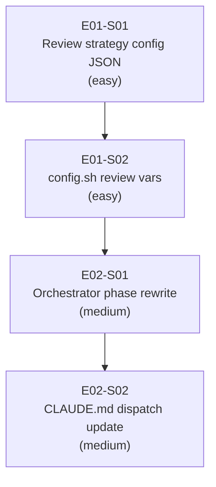

# Implementation Plan: Phase Restructuring

## 1. Overview

This plan implements Approach H (Hybrid) from the approved design doc (`docs/2-design/2026-03-19-phase-restructuring.md`, Revision 2). The two deliverables are:

1. **Tiered review strategy** -- Add a `reviewStrategy` config section and `config.sh` variables so the orchestrator can skip per-story reviews for easy test stories. Default off.
2. **Orchestrator phase restructuring** -- Rewrite the orchestrator's Phases 5-7 into a unified Implementation phase (Phase 3 in the new model) that dispatches parallel reviews after parallel builds, handles fix cycles in parallel, and respects the review tier. Update CLAUDE.md's Dispatch Protocol to match.

No builder, reviewer, or telemetry script changes are required. No new agent files are created. The orchestrator retains all dispatch control -- no story requires a builder to dispatch a reviewer (infeasible per the subagent nesting constraint documented in the design).

## 2. Structural Decisions

**Why 2 epics instead of 1:** The config/library work (E01) is a prerequisite for the orchestrator rewrite (E02). Separating them allows the config story to be built, reviewed, and merged first, giving the orchestrator rewrite story a stable foundation to reference. Additionally, the config changes are small and mechanical while the orchestrator rewrite is the largest single-file change -- keeping them in separate epics provides cleaner review boundaries and isolates risk.

**Why E01 has 2 stories:** The config file change and the `config.sh` library extension are in different files and can be developed independently. However, E01-S02 (config.sh) depends on E01-S01 (config JSON) because the `_cfg` calls must reference fields that exist in the config file. Splitting lets the config schema be reviewed first.

**Why E02 has 2 stories:** The orchestrator rewrite is the bulk of the work, but the CLAUDE.md Dispatch Protocol section is a separate documentation file with its own review concerns (convention propagation, accuracy of phase references, consistency with orchestrator.md). Making CLAUDE.md a separate story ensures a reviewer checks convention consistency independently. E02-S02 depends on E02-S01 because CLAUDE.md must describe what orchestrator.md actually implements.

**Why the stories are sequenced as a chain, not parallel:** Each story builds on the previous one's output. The config schema must exist before config.sh reads it, config.sh must exist before orchestrator.md references it, and orchestrator.md must be written before CLAUDE.md describes it. The dependency chain is: E01-S01 -> E01-S02 -> E02-S01 -> E02-S02. This means 4 sequential waves, but each story is relatively small (the orchestrator rewrite is the only medium-difficulty story).

## 3. Epic and Story Breakdown

### E01: Review Strategy Configuration

Add the `reviewStrategy` config section and extend `config.sh` to expose the new settings as shell variables.

#### E01-S01: Add reviewStrategy to config JSON (easy)

**What:** Add the `reviewStrategy` section to `.claude/agentic-sdlc-config.json` with the schema defined in the design doc (section 5.3).

**Files to create/modify:**
- `.claude/agentic-sdlc-config.json` -- add `reviewStrategy` section

**Branch:** `e01-s01/review-strategy-config`

**Blocked by:** none

**Acceptance criteria:**
- [ ] `.claude/agentic-sdlc-config.json` contains a `reviewStrategy` section at the top level
- [ ] `reviewStrategy.skipPerStoryReview.enabled` is `true` (enabling the feature for this project)
- [ ] `reviewStrategy.skipPerStoryReview.conditions.maxDifficulty` is `"easy"`
- [ ] `reviewStrategy.skipPerStoryReview.conditions.requireLabel` is `"test-agentic-sdlc"`
- [ ] Existing config fields are unchanged
- [ ] JSON is valid (parseable by `jq`)

**Test plan:**
- Validate JSON: `jq . .claude/agentic-sdlc-config.json`
- Verify field values: `jq '.reviewStrategy.skipPerStoryReview.enabled' .claude/agentic-sdlc-config.json` returns `true`
- Verify maxDifficulty: `jq -r '.reviewStrategy.skipPerStoryReview.conditions.maxDifficulty' .claude/agentic-sdlc-config.json` returns `easy`
- Verify requireLabel: `jq -r '.reviewStrategy.skipPerStoryReview.conditions.requireLabel' .claude/agentic-sdlc-config.json` returns `test-agentic-sdlc`

#### E01-S02: Extend config.sh with review strategy variables (easy)

**What:** Add `CFG_SKIP_REVIEW_*` variables to `scripts/lib/config.sh` that read from the `reviewStrategy` section, with sensible defaults matching the design doc.

**Files to create/modify:**
- `scripts/lib/config.sh` -- add three new variables after the existing `CFG_MAX_COST_PER_RUN` line

**Branch:** `e01-s02/config-sh-review-vars`

**Blocked by:** E01-S01 (needs the config JSON schema to exist)

**Acceptance criteria:**
- [ ] `config.sh` defines `CFG_SKIP_REVIEW_ENABLED` reading from `.reviewStrategy.skipPerStoryReview.enabled` with default `"false"`
- [ ] `config.sh` defines `CFG_SKIP_REVIEW_MAX_DIFFICULTY` reading from `.reviewStrategy.skipPerStoryReview.conditions.maxDifficulty` with default `"easy"`
- [ ] `config.sh` defines `CFG_SKIP_REVIEW_REQUIRE_LABEL` reading from `.reviewStrategy.skipPerStoryReview.conditions.requireLabel` with default `""`
- [ ] The header comment listing available variables is updated to include the three new variables
- [ ] Sourcing `config.sh` with the updated config file produces correct values
- [ ] Sourcing `config.sh` with an empty/missing `reviewStrategy` section produces correct defaults

**Test plan:**
- Source the file and echo each variable: `source scripts/lib/config.sh && echo "$CFG_SKIP_REVIEW_ENABLED"` returns `true` (from real config)
- Test defaults by creating a temp config without `reviewStrategy`:
  ```bash
  echo '{}' > /tmp/test-config.json
  _CFG_FILE_OVERRIDE=/tmp/test-config.json source scripts/lib/config.sh
  echo "$CFG_SKIP_REVIEW_ENABLED"  # should be "false"
  echo "$CFG_SKIP_REVIEW_MAX_DIFFICULTY"  # should be "easy"
  echo "$CFG_SKIP_REVIEW_REQUIRE_LABEL"  # should be ""
  ```

### E02: Orchestrator Phase Restructuring and Convention Updates

Rewrite the orchestrator's phase model and update CLAUDE.md conventions to match.

#### E02-S01: Rewrite orchestrator.md phases (medium)

**What:** Restructure `.claude/agents/orchestrator.md` to implement the 7-phase model from the design doc (section 6.2). The current Phases 5 (Dispatch Builders), 6 (Review Story), and 7 (Merge Story Branches) collapse into a single Phase 3 (Implementation). Phase 8 becomes Phase 4, Phase 8's PR review/retro becomes Phase 5, and Phase 9 becomes Phase 6. The Phase 3 implementation adds: parallel review dispatch after parallel builds, review tier logic, and parallel fix cycle handling.

**Files to create/modify:**
- `.claude/agents/orchestrator.md` -- rewrite Workflow Phases section

**Branch:** `e02-s01/orchestrator-phase-rewrite`

**Blocked by:** E01-S02 (needs config.sh variables for review tier logic references)

**Acceptance criteria:**
- [ ] Phase model has 7 phases (0-6) as specified in design doc section 6.2
- [ ] Phase 0 (Setup) is unchanged from current
- [ ] Phase 1 (Design) is unchanged from current
- [ ] Phase 2 (Plan) is unchanged from current -- still includes "read the plan" and "create branches" logic (folded from old Phases 3-4)
- [ ] Phase 3 (Implementation) implements the wave flow from design section 6.3:
  - Step 1: Parallel builder dispatch (unchanged pattern)
  - Step 2: Parallel reviewer dispatch for REVIEW-tier stories (skipping SKIP-tier)
  - Step 3: Parallel fix cycle handling (fix builders in parallel, then re-reviewers in parallel, max 2 cycles)
  - Step 4: Post-wave verification, merge, telemetry
- [ ] Phase 3 includes review tier decision logic: reads `CFG_SKIP_REVIEW_ENABLED`, `CFG_SKIP_REVIEW_MAX_DIFFICULTY`, `CFG_SKIP_REVIEW_REQUIRE_LABEL` from config; compares against story difficulty label and backlog labels; assigns `review_tier` as REVIEW or SKIP
- [ ] Phase 3 records `review_tier` field in state file dispatch entries for builder dispatches
- [ ] Phase 4 (Open PR) combines current Phase 8 functionality
- [ ] Phase 5 (Review + Retro) combines current Phase 8 steps 4-7 (PR reviewer + retro dispatch, fix cycles, merge retro commits)
- [ ] Phase 6 (Telemetry + Cleanup) combines current Phase 9 and Phase 10
- [ ] Phase 6 still documents "Review Story is mandatory" for REVIEW-tier stories -- only SKIP-tier stories skip per-story review
- [ ] The `review_tier` SKIP logic explicitly documents that it only applies to per-story reviews; the PR review (Phase 5) always runs
- [ ] All existing safety conventions are preserved: worktree isolation, post-worktree cleanup, branch creation upfront, comment verification, board reconciliation
- [ ] Phase numbering in all cross-references within the file is updated (no stale "Phase 8" references)

**Test plan:**
- Read the file and verify phase count: count `### Phase` headings (should be 7: 0-6)
- Verify no stale phase references: `grep -n "Phase [789]" .claude/agents/orchestrator.md` should return only the mapping note explaining the old-to-new numbering (if any) and no operational references
- Verify review tier logic is present: `grep -n "review_tier" .claude/agents/orchestrator.md` returns matches in Phase 3
- Verify `CFG_SKIP_REVIEW` references: `grep -n "CFG_SKIP_REVIEW" .claude/agents/orchestrator.md` returns matches
- Verify fix cycle parallelism: confirm Phase 3 dispatches fix builders "in parallel" (not sequentially)
- Verify no "dispatch reviewer" instructions inside builder agent scope -- reviewer dispatch is always by orchestrator

#### E02-S02: Update CLAUDE.md Dispatch Protocol (medium)

**What:** Update the Dispatch Protocol section and related cross-references in `CLAUDE.md` to reflect the new phase model and tiered review strategy. This is the convention propagation story -- ensuring CLAUDE.md is consistent with the rewritten `orchestrator.md`.

**Files to create/modify:**
- `CLAUDE.md` -- update Dispatch Protocol section, add reviewStrategy config documentation, update phase references throughout

**Branch:** `e02-s02/claude-md-dispatch-update`

**Blocked by:** E02-S01 (needs the orchestrator rewrite to describe accurately)

**Acceptance criteria:**
- [ ] The "In-session dispatch (primary)" numbered list is updated to reflect the new wave model:
  - Steps 1-5 (build dispatch, telemetry, epic status) remain similar
  - Step 6 changes from "Dispatch reviewer (mandatory)" to "Dispatch reviewers in parallel for REVIEW-tier stories; skip for SKIP-tier stories"
  - Step 7 changes from "If reviewer finds issues: re-dispatch builder to fix, then re-review" to "For REQUEST_CHANGES: dispatch fix builders in parallel, then re-reviewers in parallel (max 2 cycles)"
  - Steps 8-13 (merge, open PR, PR review/retro, etc.) renumbered as needed
- [ ] A new subsection or paragraph documents the review tier logic: conditions for SKIP (enabled + difficulty <= maxDifficulty + label match), default behavior (all reviewed)
- [ ] The `reviewStrategy` config schema is documented in CLAUDE.md's Configuration section or near the Dispatch Protocol
- [ ] `config.sh` header comment reference is updated: the "After sourcing" comment lists the three new `CFG_SKIP_REVIEW_*` variables
- [ ] All stale phase number references in CLAUDE.md are updated (search for "Phase 5", "Phase 6", etc. and verify they match the new numbering or are removed)
- [ ] The "Parallel dispatch" paragraph still documents parallel builders but now also mentions parallel reviewers and parallel fix cycles
- [ ] The `review_tier` field is documented in the state file dispatch log section (if referenced in CLAUDE.md)
- [ ] No references to builders dispatching reviewers exist (this was never the case in CLAUDE.md, but verify)

**Test plan:**
- Search for stale phase references: `grep -n "Phase [5-9]" CLAUDE.md` -- verify each hit is intentional (e.g., historical context) not operational
- Search for review tier documentation: `grep -n "review_tier\|reviewStrategy\|SKIP.*tier\|REVIEW.*tier" CLAUDE.md` returns matches
- Search for `CFG_SKIP_REVIEW`: `grep -n "CFG_SKIP_REVIEW" CLAUDE.md` returns at least one match documenting the variables
- Verify no builder-dispatches-reviewer language: `grep -n "builder.*dispatch.*reviewer\|builder.*review" CLAUDE.md` -- should not find any instruction for builders to dispatch reviewers
- Cross-reference check: compare the numbered dispatch steps in CLAUDE.md with the phase descriptions in orchestrator.md -- they should describe the same flow

## 4. Dependency Graph



### Dispatch Plan

| Wave | Stories | Dispatch | Rationale |
|------|---------|----------|-----------|
| **Wave 1** | E01-S01 | Sequential | Foundation: config schema |
| **Wave 2** | E01-S02 | Sequential (depends on E01-S01) | Reads from config JSON |
| **Wave 3** | E02-S01 | Sequential (depends on E01-S02) | References config.sh vars |
| **Wave 4** | E02-S02 | Sequential (depends on E02-S01) | Describes orchestrator.md |

All stories are sequential due to the dependency chain. No parallel dispatch opportunities exist within this feature -- each story's output is an input to the next. This is inherent to the nature of the work (config -> library -> agent file -> convention doc).

## 5. Risk Notes

**Orchestrator.md rewrite scope (E02-S01):** This is the largest story. The current orchestrator.md is 529 lines. The rewrite touches Phases 5-7 (~80 lines) but also requires updating all phase number cross-references throughout the file. The builder should be instructed to: (1) rewrite Phases 5-7 into the new Phase 3, (2) renumber Phase 8 -> Phase 4, Phase 8 steps 4-7 -> Phase 5, Phase 9 -> Phase 6, Phase 10 -> Phase 6 continuation, (3) search for all "Phase N" references and update them. This is classified as medium because it follows an existing pattern (the design doc provides the exact flow) and touches a single file, but the renumbering requires careful cross-reference verification.

**CLAUDE.md consistency (E02-S02):** CLAUDE.md is 670+ lines with numerous references to phases and dispatch behavior. The builder must grep for all stale phase numbers and dispatch protocol references. This is medium difficulty because the scope of changes is well-defined but the surface area is large.

**No builder changes needed:** The design explicitly confirms that `builder.md`, `builder-sonnet.md`, `builder-haiku.md`, `builder-opus.md`, and `reviewer.md` are unchanged. Builders should not touch these files.

## 6. ADR

No new ADR is required. The design doc (Revision 2) already documents the architectural decision (Approach H over A/B/C/E/F/G) with full rationale, the platform constraint that drove the decision, and the future upgrade path. An ADR would duplicate this content.

## 7. Files Summary

| File | Story | Change |
|------|-------|--------|
| `.claude/agentic-sdlc-config.json` | E01-S01 | Add `reviewStrategy` section |
| `scripts/lib/config.sh` | E01-S02 | Add 3 `CFG_SKIP_REVIEW_*` variables |
| `.claude/agents/orchestrator.md` | E02-S01 | Rewrite phases 5-7 into unified Phase 3; renumber 8-10 to 4-6 |
| `CLAUDE.md` | E02-S02 | Update Dispatch Protocol, add review strategy docs, fix phase refs |
