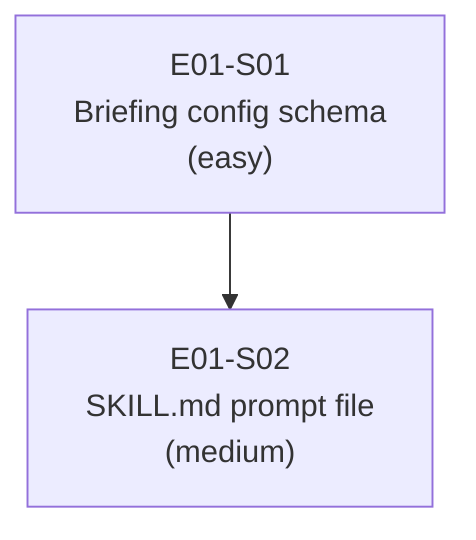

# Implementation Plan: Briefing Skill

## 1. Overview

This plan implements the Briefing Skill from the approved design doc (`docs/2-design/2026-03-22-briefing-skill.md`). The deliverable is a single Claude Code skill file (`.claude/skills/briefing/SKILL.md`) plus a config schema extension for the `briefing` section.

The skill provides structured project orientation via `/briefing`, with two modes:
- **Briefing mode** (between cycles): strategic awareness, roadmap status, suggested next action
- **Debrief mode** (PR open / cycle just completed): merge-readiness assessment, reviewer findings, retro insights

This is a size/S feature. The primary work is prompt engineering -- no scripts, no production code, no tests in the traditional sense. The acceptance criteria are behavioral: the skill file must contain the right instructions for the AI to follow consistently.

## 2. Structural Decisions

**Why 1 epic (not 2):** The feature has two logical parts -- (1) the skill file itself and (2) the config schema extension. However, the config schema work is a single-file change that takes < 5 minutes and is a dependency of the skill file (which references config values). Splitting into two epics would add dispatch overhead that exceeds the work itself. One epic with two stories keeps the dependency clear while minimizing orchestration cost.

**Why 2 stories (not 1):** The config schema extension (E01-S01) is a mechanical JSON change with a clear pattern to follow (existing `reviewStrategy` section). The SKILL.md file (E01-S02) is the substantive prompt engineering work. Separating them ensures the config schema is committed and stable before the skill file references it. This also lets the config change be reviewed independently -- it touches the project's shared configuration file, which has broader impact than the skill file.

**Why not 3 stories (splitting SKILL.md into modes):** The two modes (briefing/debrief) share mode detection logic, data source discovery, depth configuration, tone guidance, and anti-patterns. Splitting by mode would create two files with 60%+ overlap, or require a shared preamble file that Claude Code skills don't support. A single file with clearly separated output templates is the right structure.

## 3. Epic and Story Breakdown

### E01: Briefing Skill Implementation

Build the `/briefing` skill file and its config schema support.

#### E01-S01: Add briefing config section to agentic-sdlc-config.json (easy)

**What:** Add the `briefing` section to the workflow config file, following the schema from the design doc section 4.4. This provides the `defaultDepth` and per-source toggle configuration that the skill file will reference.

**Files to create/modify:**
- `.claude/agentic-sdlc-config.json` -- add `briefing` section after `reviewStrategy`

**Config schema to add:**

```json
"briefing": {
  "defaultDepth": "standard",
  "sources": {
    "roadmap": true,
    "changelog": true,
    "retroDocs": { "enabled": true, "maxCount": 2 },
    "lessonFiles": { "enabled": true, "severityThreshold": "high" },
    "designDocs": true,
    "planDocs": true,
    "retroRecommendations": true,
    "openPRs": true,
    "board": true,
    "stateFile": true,
    "reviewerComments": true,
    "gitLog": false
  }
}
```

**Acceptance criteria:**
- [ ] `.claude/agentic-sdlc-config.json` contains a `briefing` section with `defaultDepth` and `sources` fields
- [ ] The JSON is valid (passes `jq .` validation)
- [ ] Default values match the design doc: `defaultDepth: "standard"`, all sources enabled except `gitLog`
- [ ] Existing config sections (`github`, `boardStatus`, `modelRouting`, `pm`, `workflow`, `reviewStrategy`) are unchanged
- [ ] No new scripts or library changes required -- this is config-only

**Blocked by:** none

**Branch:** `e01-s01/briefing-config`

#### E01-S02: Create SKILL.md for /briefing skill (medium)

**What:** Create the skill prompt file at `.claude/skills/briefing/SKILL.md` that implements the full briefing skill as designed. This is the core deliverable -- a structured prompt that instructs the AI on mode detection, data source discovery, depth handling, output structure, and behavioral guardrails.

**Files to create:**
- `.claude/skills/briefing/SKILL.md` -- the skill prompt file

**Skill file structure:**

The SKILL.md must contain these sections (derived from design doc section 4.7):

1. **Purpose statement** -- what the skill does, when to use it, invocation syntax (`/briefing [quick|deep]`)
2. **Mode detection** -- step-by-step instructions for determining briefing vs debrief mode:
   - Check for open PRs from `backlog/*` branches: `gh pr list --head 'backlog/' --state open`
   - Check for state files with incomplete phases: read `.agentic-workflow/runs/*/orchestrator.json`
   - If either signal present: debrief mode; otherwise: briefing mode
3. **Depth configuration** -- how to read config and apply depth presets:
   - Read `briefing.defaultDepth` from `.claude/agentic-sdlc-config.json`
   - Override with argument if provided (`/briefing quick`, `/briefing deep`)
   - Source priority table with depth-level columns (from design doc section 4.3.1)
   - Config source toggles override depth presets
4. **Data source checklist** -- ordered by priority, with what to extract from each:
   - **Tier 1 (frontmatter-driven):** grep commands for frontmatter fields, what fields to use
   - **Tier 2 (fixed-path):** exact file paths and commands for each source
   - **Tier 3 (CLAUDE.md-referenced):** scan CLAUDE.md for doc references
5. **Cross-source synthesis** -- instructions for connecting findings across sources
6. **Output template: Briefing mode** -- section structure from design doc section 4.5
7. **Output template: Debrief mode** -- SBAR-inspired section structure from design doc section 4.5
8. **Tone and style** -- concise, direct, lead with most important, no filler, use metrics where available
9. **Anti-patterns** -- explicit "do NOT" list:
   - Do not generate from memory alone -- always read current sources
   - Do not modify any files or post comments
   - Do not compute metrics -- read them from existing artifacts
   - Do not skip sources in the checklist without noting it
10. **Conversational continuation** -- after presenting the briefing, remain available for follow-up questions using the context gathered during investigation

**Acceptance criteria:**
- [ ] `.claude/skills/briefing/SKILL.md` exists and is a valid markdown file
- [ ] Skill is discoverable as `/briefing` by Claude Code (correct path: `.claude/skills/briefing/SKILL.md`)
- [ ] Mode detection instructions include both PR check and state file check
- [ ] All 13 data sources from the priority table (design doc section 4.3.1) are listed with extraction instructions
- [ ] Three depth levels (`quick`, `standard`, `deep`) are defined with source inclusion rules
- [ ] Config reference points to `.claude/agentic-sdlc-config.json` briefing section
- [ ] Briefing mode output template matches design doc section 4.5 (TL;DR, Project Pulse, What Happened Last, Roadmap & Priorities, Outstanding Issues, Decisions & Attention Needed)
- [ ] Debrief mode output template matches design doc section 4.5 (TL;DR, Summary, Key Findings, What Went Well, What Needs Attention, Merge Readiness, What's Next)
- [ ] Anti-patterns section explicitly prohibits file modification, comment posting, and metric computation
- [ ] Tier 1 discovery uses frontmatter grep commands (not hardcoded paths per doc type)
- [ ] Tier 3 instructs the AI to scan CLAUDE.md for referenced project docs
- [ ] Cross-source synthesis section covers: recurring patterns, trend detection, dependency chains, artifact readiness, consistency checks
- [ ] Word count guidance matches design doc: quick (200-400), standard (600-1000), deep (1000-2000)

**Blocked by:** E01-S01 (config schema must exist so the skill can reference it)

**Branch:** `e01-s02/briefing-skill-md`

## 4. Dependency Graph



### Dispatch Plan

| Wave | Stories | Dispatch |
|------|---------|----------|
| **Wave 1** | E01-S01 | Sequential (solo) |
| **Wave 2** | E01-S02 | Sequential (depends on E01-S01) |

All stories are sequential -- E01-S02 depends on E01-S01. No parallelism possible with only 2 stories in a dependency chain.

## 5. Files Created/Modified Summary

| File | Action | Story |
|------|--------|-------|
| `.claude/agentic-sdlc-config.json` | Modify (add `briefing` section) | E01-S01 |
| `.claude/skills/briefing/SKILL.md` | Create (new file, new directory) | E01-S02 |

## 6. Risk Assessment

**Low risk overall.** This feature:
- Creates one new file and modifies one existing file
- Has no script dependencies, no test dependencies, no cross-project impact
- Does not affect any existing workflow behavior (read-only skill)
- Config change is additive (new section, no existing fields modified)

**Main quality risk:** The SKILL.md prompt quality determines briefing usefulness. The builder (sonnet for easy, sonnet for medium) must write a comprehensive prompt that covers all data sources and output structures from the design doc. The review cycle provides a safety net -- the reviewer will validate coverage against the design doc's source priority table and output templates.
