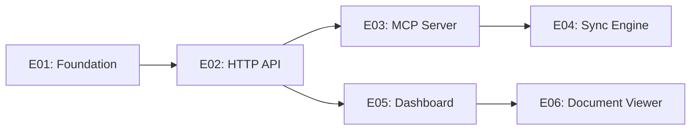
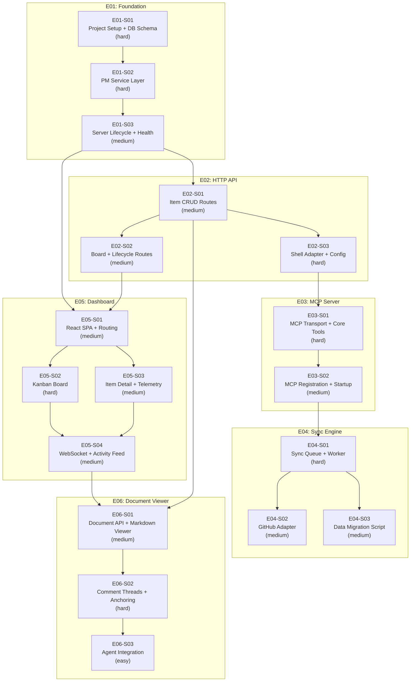

# Implementation Plan: Workflow Runtime Service

## 1. Overview

This plan decomposes the Workflow Runtime Service design (backlog #116) into six epics and nineteen stories. The server is a persistent Bun daemon that replaces the file-system PM adapter with a SQLite-backed database, serves a React dashboard, provides a document viewer with inline comments, and exposes PM operations as MCP tools for agent consumption.

### Decomposition Rationale

The design specifies five pillars (PM Backend, MCP Server, Dashboard, Document Viewer, Server Lifecycle) with a clear dependency graph. The decomposition follows the server's layered architecture:

- **E01 (Foundation):** Bun project scaffolding, SQLite database schema, PM service layer, daemon lifecycle. This epic delivers a running server with a database and health endpoint but no external API surface. Everything else depends on this.
- **E02 (HTTP API):** Hono route handlers for all PM operations, the server PM shell adapter for backward compatibility, and config migration. After this epic, shell scripts work against the server instead of files.
- **E03 (MCP Server):** MCP tool registration, stdio transport, dual-mode startup, `.mcp.json` configuration. After this epic, agents can use native MCP tools for PM operations.
- **E04 (Sync Engine):** External adapter interface, GitHub adapter, durable retry queue with dead-letter handling. After this epic, the server replaces the dual-write layer entirely.
- **E05 (Dashboard):** React SPA scaffolding, Kanban board with drag-and-drop, item detail view, telemetry summary, WebSocket integration for real-time updates, activity feed.
- **E06 (Document Viewer):** Markdown preview with Mermaid rendering, paragraph-anchored comment threads, API endpoints for document comments, agent integration.

**Why 6 epics instead of fewer or more:** Six epics map directly to the server's architectural layers, each delivering a testable milestone. Fewer epics would create overly large stories (the dashboard alone has multiple distinct pages). More epics would fragment the dependency graph and add orchestration overhead without improving parallelism -- the server's layers are naturally sequential except for E05 which can start after E02.

**Parallelism opportunities:** E01-E04 are strictly sequential (each builds on the previous). E05 (Dashboard) can start after E02 completes because it only needs the HTTP API. E06 (Document Viewer) depends on E05 (extends the SPA) and E02 (document API endpoints). Within each epic, some stories are independent and can run in parallel. The plan identifies 3 waves where parallel dispatch is possible.

**Story sizing:** Each story targets 30-60 minutes of builder time. Stories that touch new abstractions or cross-cutting concerns (DB schema, service layer, MCP transport) are rated medium or hard. Stories that follow established patterns (additional API routes, UI components consuming existing APIs) are rated easy or medium.

### Open Question Resolutions

The design doc raised four open questions (section 16.2). The plan resolves them:

1. **Gantt chart library:** Deferred to E05. The builder will evaluate frappe-gantt vs custom SVG during implementation. The story acceptance criteria require interactive zoom and click-to-navigate; the specific library is a builder decision.

2. **Document anchor stability:** The plan uses heading-slug anchors with a stale-anchor migration strategy. When a heading is renamed, orphaned comments appear in a "Detached Comments" section at the bottom of the viewer. This is simpler to implement than content-hash anchors and aligns with GitHub's own anchor behavior.

3. **Config key for pm.adapter:** The plan introduces `"server"` as a new adapter value alongside the existing `"github"` and `"local"` options. When `"server"` is configured, `pm.sh` routes to the server adapter. Fallback to `"local"` when the server is not running preserves backward compatibility.

4. **CLI command name:** The HTTP API paths use `/api/` prefix without any "sdlc" reference. A future CLI simply becomes an HTTP client to these routes.

## 2. Architecture

### Epic Dependency Graph

### Full Story Dependency Graph

## 3. Epics and Stories

---

### E01: Server Foundation

Establishes the Bun project, SQLite database with Drizzle ORM, PM service layer, and daemon lifecycle management. After this epic, the server starts, creates/reads/writes items in SQLite, and exposes a health endpoint.

#### E01-S01: Bun Project Setup and Database Schema

**Difficulty:** hard

**Summary:** Initialize the Bun project with TypeScript, configure Drizzle ORM with `bun:sqlite`, define the full database schema (6 tables: items, labels, item_labels, comments, telemetry, sync_queue, activity_log), create migration files, and write tests for schema correctness and WAL mode.

This is rated hard because it introduces a new technology stack (Bun + Drizzle + SQLite), creates the foundational abstractions (DB connection singleton, migration runner), and requires cross-cutting decisions (ID strategy, timestamp format, foreign key constraints).

**Files to create:**
- `server/package.json` -- Bun project with dependencies (drizzle-orm, drizzle-kit, zod, hono)
- `server/tsconfig.json` -- TypeScript config for Bun
- `server/drizzle.config.ts` -- Drizzle configuration
- `server/src/db/connection.ts` -- Database singleton (WAL mode, foreign keys, busy timeout)
- `server/src/db/schema.ts` -- Drizzle schema (all 7 tables)
- `server/src/db/migrate.ts` -- Migration runner using Drizzle
- `server/src/types/index.ts` -- Shared TypeScript types (ItemType, BoardStatus, SyncStatus, etc.)
- `server/tests/db/schema.test.ts` -- Schema correctness tests

**Acceptance criteria:**
- [ ] `bun install` succeeds with all dependencies
- [ ] `bun run server/src/db/migrate.ts` creates all 7 tables in a fresh SQLite database
- [ ] WAL mode is enabled (verified by PRAGMA query in tests)
- [ ] Foreign key constraints are enforced (verified by constraint violation test)
- [ ] All TypeScript types use precise union types (no `string` for status fields)
- [ ] Schema matches the design doc ER diagram exactly (items, labels, item_labels, comments, telemetry, sync_queue, activity_log)
- [ ] In-memory SQLite database works for tests (`:memory:` constructor)
- [ ] All tests pass with `bun test`

**Blocked by:** none

---

#### E01-S02: PM Service Layer

**Difficulty:** hard

**Summary:** Implement the PM service layer that all interfaces (HTTP API, MCP, sync engine) will call. Services: ItemService (CRUD, search, filtering), BoardService (status transitions), CommentService (item comments), HierarchyService (parent-child linking), LabelService (label management), LifecycleService (start_work, complete_work). Each service takes a database connection as a constructor parameter (dependency injection via constructor, not a global).

This is rated hard because it implements the core business logic that all other epics depend on. Incorrect service behavior propagates to every consumer. The service must handle concurrent access patterns (multiple agents calling simultaneously) and maintain data integrity.

**Files to create:**
- `server/src/services/items.ts` -- ItemService: create, get, list (with filters), update, close
- `server/src/services/board.ts` -- BoardService: setStatus, getStatus
- `server/src/services/comments.ts` -- CommentService: addComment, listComments (for items)
- `server/src/services/hierarchy.ts` -- HierarchyService: linkChild, listChildren, getParent
- `server/src/services/labels.ts` -- LabelService: createLabel, listLabels, addLabelToItem
- `server/src/services/lifecycle.ts` -- LifecycleService: startWork, completeWork, postTelemetry
- `server/tests/services/items.test.ts`
- `server/tests/services/board.test.ts`
- `server/tests/services/comments.test.ts`
- `server/tests/services/hierarchy.test.ts`
- `server/tests/services/labels.test.ts`
- `server/tests/services/lifecycle.test.ts`

**Acceptance criteria:**
- [ ] ItemService.create() inserts a row and returns the item with assigned ID
- [ ] ItemService.list() supports filtering by type, status, state, label, and limit
- [ ] ItemService.get() returns null for non-existent items (not throw)
- [ ] BoardService.setStatus() validates the status value against the enum
- [ ] CommentService.addComment() creates comment and returns it with generated ID
- [ ] HierarchyService.linkChild() sets parent_id on the child item
- [ ] HierarchyService.listChildren() returns only direct children
- [ ] LabelService.addLabelToItem() creates the label if it does not exist (upsert)
- [ ] LifecycleService.startWork() sets status to in-progress and records in activity_log
- [ ] LifecycleService.postTelemetry() inserts telemetry row and broadcasts activity event
- [ ] All services use parameterized SQL (no string interpolation)
- [ ] All services accept the database connection via constructor (testable with in-memory DB)
- [ ] Each service has at least 5 unit tests covering happy path and edge cases
- [ ] All tests pass with `bun test`

**Blocked by:** E01-S01

---

#### E01-S03: Server Lifecycle and Health Endpoint

**Difficulty:** medium

**Summary:** Implement the daemon lifecycle manager: start (with PID file and port discovery), stop, health endpoint, idle timeout, and graceful shutdown. The server uses `Bun.serve()` with Hono for HTTP routing. This story delivers a running server that responds to `/api/health` but has no other routes.

**Files to create:**
- `server/src/server.ts` -- Bun.serve() setup with Hono app, port binding, health route
- `server/src/index.ts` -- Entry point: parse CLI args (start/stop/mcp), daemon management
- `server/src/lifecycle.ts` -- PID file management, port discovery, idle timeout, graceful shutdown
- `server/tests/lifecycle.test.ts` -- Lifecycle management tests
- `server/tests/api/health.test.ts` -- Health endpoint integration test

**Acceptance criteria:**
- [ ] `bun run server/src/index.ts start` starts the server as a background daemon
- [ ] Server writes `.agentic-workflow/server.pid` and `.agentic-workflow/server.port`
- [ ] `GET /api/health` returns `200 { "status": "ok", "uptime": <seconds> }`
- [ ] Starting when already running is a no-op (idempotent)
- [ ] Port fallback: if configured port is busy, try next port in configured range
- [ ] `bun run server/src/index.ts stop` sends SIGTERM, waits for shutdown, removes PID/port files
- [ ] Graceful shutdown: WAL checkpoint, close connections, remove PID/port files
- [ ] Idle timeout triggers graceful shutdown after configured period of inactivity
- [ ] Server binds to `localhost` only (not `0.0.0.0`)
- [ ] All logging goes to stderr (not stdout -- reserved for future MCP mode)
- [ ] Tests pass with `bun test`

**Blocked by:** E01-S02

---

### E02: HTTP API and Shell Adapter

Adds Hono route handlers for all PM operations and creates the server PM shell adapter so existing shell scripts can call the HTTP API instead of the file system.

#### E02-S01: Item CRUD and Query Routes

**Difficulty:** medium

**Summary:** Implement Hono routes for item CRUD operations: create, get, list (with query parameter filters), update, and close. All routes validate input with Zod schemas and delegate to the PM service layer. Includes error handling middleware (400 for validation, 404 for not found, 500 for server errors).

**Files to create:**
- `server/src/api/routes.ts` -- Hono route registration (mounts all route groups)
- `server/src/api/items.ts` -- Item CRUD route handlers
- `server/src/api/middleware.ts` -- CORS, error handling, request logging middleware
- `server/src/api/validation.ts` -- Zod schemas for request validation
- `server/tests/api/items.test.ts` -- API integration tests (using Hono test client)

**Acceptance criteria:**
- [ ] `POST /api/items` creates an item and returns 201 with the created item
- [ ] `GET /api/items` returns items with support for query params: `type`, `status`, `state`, `label`, `limit`
- [ ] `GET /api/items/:id` returns 200 with item detail or 404 if not found
- [ ] `PATCH /api/items/:id` updates allowed fields and returns 200
- [ ] `DELETE /api/items/:id` soft-closes the item (sets state to closed) and returns 200
- [ ] Invalid request bodies return 400 with field-level Zod error details
- [ ] All routes return JSON with consistent error format: `{ "error": "message", "details": [...] }`
- [ ] CORS middleware allows requests from `localhost` origins
- [ ] Tests use Hono's `app.fetch()` test pattern (no real server needed)
- [ ] All tests pass with `bun test`

**Blocked by:** E01-S03

---

#### E02-S02: Board, Lifecycle, Comment, and Hierarchy Routes

**Difficulty:** medium

**Summary:** Implement remaining PM routes: board status transitions, lifecycle operations (start/complete work), item comments, item hierarchy (link child, list children), label management, and telemetry posting. These routes complete the HTTP API surface that shell scripts and the dashboard will consume.

**Files to create:**
- `server/src/api/board.ts` -- Board status route handlers
- `server/src/api/comments.ts` -- Comment route handlers
- `server/src/api/hierarchy.ts` -- Hierarchy route handlers (link child, list children)
- `server/src/api/labels.ts` -- Label route handlers
- `server/src/api/lifecycle.ts` -- Lifecycle route handlers (start, complete)
- `server/src/api/telemetry.ts` -- Telemetry route handlers
- `server/tests/api/board.test.ts`
- `server/tests/api/comments.test.ts`
- `server/tests/api/hierarchy.test.ts`
- `server/tests/api/telemetry.test.ts`

**Acceptance criteria:**
- [ ] `POST /api/items/:id/status` sets board status and returns 200
- [ ] `POST /api/items/:id/start` triggers lifecycle start_work and returns 200
- [ ] `POST /api/items/:id/complete` triggers lifecycle complete_work and returns 200
- [ ] `GET /api/items/:id/comments` returns paginated comments for an item
- [ ] `POST /api/items/:id/comments` adds a comment and returns 201
- [ ] `POST /api/items/:id/children` links a child item and returns 200
- [ ] `GET /api/items/:id/children` returns direct children
- [ ] `GET /api/labels` returns all labels
- [ ] `POST /api/labels` creates a label (upsert) and returns 201
- [ ] `POST /api/items/:id/telemetry` posts telemetry data and returns 201
- [ ] `GET /api/items/:id/telemetry` returns telemetry for an item
- [ ] All routes validate input with Zod schemas
- [ ] All tests pass with `bun test`

**Blocked by:** E02-S01

---

#### E02-S03: Server PM Shell Adapter and Config Migration

**Difficulty:** hard

**Summary:** Create the server PM shell adapter (`scripts/lib/adapters/pm/server/`) that implements the same `pm_*` function interface as the local adapter but calls the HTTP API via `curl`. Update `pm.sh` to route to the server adapter when `pm.adapter` is `"server"`. Update the config file with the new `"server"` adapter value and add the `server` config section (port, portRange, idleTimeoutMinutes, logLevel). Implement graceful fallback to the local adapter when the server is not running.

This is rated hard because it touches the PM routing layer (cross-cutting), requires backward compatibility with all existing shell scripts, and involves config schema changes that propagate to `config.sh`.

**Files to create:**
- `scripts/lib/adapters/pm/server/items.sh` -- Server adapter item operations
- `scripts/lib/adapters/pm/server/board.sh` -- Server adapter board operations
- `scripts/lib/adapters/pm/server/comments.sh` -- Server adapter comment operations
- `scripts/lib/adapters/pm/server/hierarchy.sh` -- Server adapter hierarchy operations
- `scripts/lib/adapters/pm/server/labels.sh` -- Server adapter label operations
- `scripts/lib/adapters/pm/server/lifecycle.sh` -- Server adapter lifecycle operations
- `scripts/lib/adapters/pm/server/_common.sh` -- Server URL discovery, health check, curl helpers

**Files to modify:**
- `scripts/lib/pm.sh` -- Add `"server"` adapter routing with fallback to local
- `scripts/lib/config.sh` -- Add `CFG_SERVER_PORT`, `CFG_SERVER_PORT_RANGE`, `CFG_SERVER_IDLE_TIMEOUT`, `CFG_SERVER_LOG_LEVEL`
- `.claude/agentic-sdlc-config.json` -- Add `server` section, update `pm.adapter` to `"server"`
- `tests/scripts/test-local-items-sh.sh` -- Verify existing tests still pass (no regression)

**Acceptance criteria:**
- [ ] `pm.sh` sources server adapter when `pm.adapter` is `"server"` in config
- [ ] Server adapter implements all `pm_*` functions from the local adapter interface
- [ ] Each `pm_*` function calls the corresponding HTTP API endpoint via `curl`
- [ ] When server is not running, `pm.sh` falls back to local adapter with a stderr warning
- [ ] `_workflow_server_url()` reads from `WORKFLOW_SERVER_URL` env var or `.agentic-workflow/server.port` file
- [ ] Health check (`/api/health`) is used to verify server availability before routing
- [ ] Config file has `server` section with `port`, `portRange`, `idleTimeoutMinutes`, `logLevel`
- [ ] `config.sh` exports `CFG_SERVER_PORT`, `CFG_SERVER_PORT_RANGE` variables
- [ ] Existing shell script tests still pass (backward compatibility)
- [ ] All new shell adapter functions have error handling (non-zero curl exit, non-200 response)
- [ ] All tests pass

**Blocked by:** E02-S01, E02-S02

---

### E03: MCP Server

Adds MCP protocol support so Claude Code agents can call PM operations as native tools via stdio transport.

#### E03-S01: MCP Transport and Core Tool Registration

**Difficulty:** hard

**Summary:** Integrate `@modelcontextprotocol/sdk` with the Bun server. Implement the MCP stdio transport handler, register core PM tools (create_item, get_item, list_items, update_item, close_item, set_status, link_child, add_comment), and verify that the MCP protocol works end-to-end with the service layer.

This is rated hard because it introduces the MCP SDK (new dependency with potential Bun compatibility edge cases), requires careful stdio isolation (stdout reserved for MCP JSON-RPC, all logging to stderr), and creates the abstraction bridge between MCP tool schemas and the PM service layer.

**Files to create:**
- `server/src/mcp/server.ts` -- McpServer instance creation and tool registration
- `server/src/mcp/transport.ts` -- Stdio transport setup and isolation
- `server/src/mcp/tools.ts` -- MCP tool handler implementations (delegates to services)
- `server/tests/mcp/tools.test.ts` -- MCP tool handler tests (call service layer directly)

**Acceptance criteria:**
- [ ] MCP server registers all core PM tools: create_item, get_item, list_items, update_item, close_item, set_status, link_child, add_comment
- [ ] Each MCP tool has a Zod input schema matching the design doc tool set table
- [ ] Tool handlers delegate to the PM service layer (thin wrappers, no business logic)
- [ ] Tool results use MCP content format: `{ content: [{ type: "text", text: JSON.stringify(result) }] }`
- [ ] Stdio transport reads from stdin and writes to stdout exclusively
- [ ] No logging output goes to stdout (all to stderr or log file)
- [ ] Tool input validation errors return MCP error responses (not crashes)
- [ ] Tests verify each tool handler produces correct service calls and MCP responses
- [ ] All tests pass with `bun test`

**Blocked by:** E02-S03

---

#### E03-S02: MCP Registration and Dual-Mode Startup

**Difficulty:** medium

**Summary:** Add `.mcp.json` configuration so Claude Code auto-discovers the MCP server. Implement dual-mode startup: `bun run server/src/index.ts mcp` starts both HTTP server and MCP stdio transport in the same process; `bun run server/src/index.ts start` starts HTTP only (daemon mode). Add lifecycle tools (start_work, complete_work, post_telemetry) and document comment tools (add_doc_comment, list_doc_comments) to the MCP tool set.

**Files to create:**
- `.mcp.json` -- MCP server registration for Claude Code
- `server/tests/mcp/startup.test.ts` -- Dual-mode startup tests

**Files to modify:**
- `server/src/index.ts` -- Add `mcp` mode: start HTTP server + connect MCP transport
- `server/src/mcp/tools.ts` -- Add lifecycle and document comment tools

**Acceptance criteria:**
- [ ] `.mcp.json` at project root registers `workflow-pm` MCP server
- [ ] `bun run server/src/index.ts mcp` starts HTTP server AND connects MCP stdio transport
- [ ] `bun run server/src/index.ts start` starts HTTP server only (daemon mode, no MCP)
- [ ] MCP tool set includes all 13 tools from the design doc table
- [ ] In MCP mode, HTTP server starts silently (no stdout output)
- [ ] In MCP mode, server port is written to `.agentic-workflow/server.port` for shell script discovery
- [ ] MCP server responds to `ping` and `tools/list` protocol messages
- [ ] Tests verify mode detection from CLI arguments
- [ ] All tests pass with `bun test`

**Blocked by:** E03-S01

---

### E04: Sync Engine

Replaces the fire-and-forget external PM sync with a durable retry queue backed by the sync_queue table.

#### E04-S01: Sync Queue and Worker

**Difficulty:** hard

**Summary:** Implement the sync queue system: SyncService enqueues operations (create, update, close, set_status, add_comment, link_child) into the sync_queue table. SyncWorker polls the queue, processes operations via the external adapter interface, handles retries with exponential backoff, and moves failed operations to dead-letter status.

This is rated hard because it implements an asynchronous queue processor with retry semantics, idempotency keys, ordered processing per item, and needs to be resilient to partial failures.

**Files to create:**
- `server/src/services/sync.ts` -- SyncService: enqueue, processQueue, retry, deadLetter
- `server/src/services/sync-worker.ts` -- SyncWorker: polling loop, backoff logic, ordered processing
- `server/src/types/sync.ts` -- Sync operation types, external adapter interface
- `server/tests/services/sync.test.ts` -- Sync queue and worker tests

**Acceptance criteria:**
- [ ] SyncService.enqueue() inserts an operation into sync_queue with status `pending`
- [ ] SyncWorker polls sync_queue for `pending` operations at configurable interval
- [ ] Operations are processed in insertion order per item_id (comments must arrive in order)
- [ ] Successful operations are marked `success` with `processed_at` timestamp
- [ ] Failed operations increment `retry_count` and set `last_error`
- [ ] Retry uses exponential backoff: 1s, 2s, 4s, 8s, max 60s
- [ ] Operations exceeding 5 retries are marked `dead_letter`
- [ ] Each operation payload includes an idempotency key to prevent duplicates on retry
- [ ] Worker can be started and stopped cleanly (for tests and shutdown)
- [ ] Tests use a mock external adapter to verify queue processing behavior
- [ ] All tests pass with `bun test`

**Blocked by:** E03-S02

---

#### E04-S02: GitHub External Adapter

**Difficulty:** medium

**Summary:** Implement the GitHub external adapter that fulfills the ExternalPmAdapter interface. Each operation maps to a GitHub API call (via `gh` CLI or direct GraphQL). The adapter handles the specific GitHub conventions: issue creation, board status mutation via project item-edit, sub-issue linking via addSubIssue, etc.

**Files to create:**
- `server/src/adapters/github.ts` -- GitHub ExternalPmAdapter implementation
- `server/tests/adapters/github.test.ts` -- GitHub adapter tests (with mocked `gh` calls)

**Acceptance criteria:**
- [ ] GitHubAdapter implements the ExternalPmAdapter interface completely
- [ ] `createItem()` calls `gh issue create` and returns the issue number and URL
- [ ] `updateItem()` calls `gh issue edit` to update title/body/labels
- [ ] `closeItem()` calls `gh issue close`
- [ ] `setStatus()` looks up the project item ID and calls `gh project item-edit`
- [ ] `addComment()` calls `gh issue comment`
- [ ] `linkChild()` calls the `addSubIssue` GraphQL mutation
- [ ] All external calls are wrapped in try/catch with meaningful error messages
- [ ] Tests mock the `gh` CLI subprocess calls (no real GitHub API calls)
- [ ] All tests pass with `bun test`

**Blocked by:** E04-S01

---

#### E04-S03: Data Migration Script

**Difficulty:** medium

**Summary:** Write a one-time migration script that imports existing `.workflow/items/` markdown files into the SQLite database. Parses YAML frontmatter, body content, and reconstructs item_labels join table entries. The migration runs automatically on first server startup when the database file does not exist and `.workflow/items/` contains files.

**Files to create:**
- `server/src/db/seed.ts` -- Migration script: read `.workflow/items/*.md`, parse, insert into SQLite
- `server/tests/db/seed.test.ts` -- Migration tests using fixture files

**Files to modify:**
- `server/src/index.ts` -- Run migration on first startup if DB is empty and `.workflow/items/` exists

**Acceptance criteria:**
- [ ] Migration reads all `.md` files from `.workflow/items/`
- [ ] YAML frontmatter fields map to item columns: id, title, type, status, state, labels, parent, created, updated
- [ ] Body content (after second `---`) maps to item body column
- [ ] Labels from frontmatter are created in labels table and linked via item_labels
- [ ] Parent-child relationships from frontmatter `parent` field are preserved
- [ ] Migration is idempotent: running twice does not create duplicates (checks by ID)
- [ ] Migration reports summary: N items imported, M labels created, K relationships linked
- [ ] Test uses fixture `.md` files representing a real workflow state
- [ ] Migration handles edge cases: missing frontmatter fields, empty body, no parent
- [ ] All tests pass with `bun test`

**Blocked by:** E04-S01

---

### E05: Dashboard UI

React SPA served by the Bun server, providing visual workflow monitoring.

#### E05-S01: React SPA Scaffolding and Static Serving

**Difficulty:** medium

**Summary:** Set up the React SPA with TypeScript, Tailwind CSS, and client-side routing. Configure the Bun server to serve the built SPA as static files. Create the app shell with navigation sidebar (Board, Items, Docs, Costs), layout components, and the HTTP client wrapper for API calls.

**Files to create:**
- `server/frontend/index.html` -- SPA entry point
- `server/frontend/src/main.tsx` -- React mount point
- `server/frontend/src/App.tsx` -- Root component with routing (react-router or simple hash routing)
- `server/frontend/src/pages/Dashboard.tsx` -- Dashboard page placeholder (renders board)
- `server/frontend/src/pages/ItemDetail.tsx` -- Item detail page placeholder
- `server/frontend/src/pages/DocumentViewer.tsx` -- Document viewer page placeholder
- `server/frontend/src/pages/Telemetry.tsx` -- Telemetry/costs page placeholder
- `server/frontend/src/components/Layout.tsx` -- App shell: sidebar nav + main content area
- `server/frontend/src/components/Sidebar.tsx` -- Navigation sidebar
- `server/frontend/src/lib/api.ts` -- HTTP client wrapper (fetch-based, typed responses)
- `server/frontend/src/lib/types.ts` -- Frontend TypeScript types (mirroring server types)
- `server/frontend/tailwind.config.ts` -- Tailwind configuration
- `server/frontend/src/styles/globals.css` -- Tailwind base imports

**Files to modify:**
- `server/src/server.ts` -- Add static file serving for the SPA (Bun serveStatic or manual)
- `server/package.json` -- Add React, Tailwind, and build dependencies

**Acceptance criteria:**
- [ ] `bun run build` (or equivalent) builds the React SPA to `server/frontend/dist/`
- [ ] Server serves the SPA at root URL (`/`)
- [ ] Client-side routing works: `/`, `/items/:id`, `/docs/:path`, `/costs` all render correct page
- [ ] Navigation sidebar links navigate between pages without full page reload
- [ ] HTTP client wrapper (`api.ts`) has typed methods for all API endpoints
- [ ] API client handles errors (non-200 responses) and surfaces them to the UI
- [ ] Tailwind CSS is configured and working (test with a styled component)
- [ ] Placeholder pages render with correct titles
- [ ] SPA works when served from the Bun server (not just dev mode)

**Blocked by:** E01-S03, E02-S02

---

#### E05-S02: Kanban Board

**Difficulty:** hard

**Summary:** Implement the Kanban board component with five status columns (Backlog, Ready, In Progress, In Review, Done). Cards show item number, title, type badge (color-coded), and difficulty label. Drag-and-drop between columns updates board status via the API. Board fetches data from `GET /api/items` and renders cards in their status columns.

This is rated hard because drag-and-drop requires a third-party library (dnd-kit), precise DOM positioning, optimistic UI updates with server reconciliation, and filtering/sorting logic.

**Files to create:**
- `server/frontend/src/components/KanbanBoard.tsx` -- Board with 5 status columns
- `server/frontend/src/components/KanbanCard.tsx` -- Item card with type badge and labels
- `server/frontend/src/components/KanbanColumn.tsx` -- Column with drop zone
- `server/frontend/src/hooks/useItems.ts` -- Item data fetching, caching, and optimistic updates
- `server/frontend/src/components/TypeBadge.tsx` -- Color-coded type badge (backlog=purple, epic=blue, story=green, docs=gray)

**Files to modify:**
- `server/frontend/src/pages/Dashboard.tsx` -- Render KanbanBoard
- `server/package.json` -- Add dnd-kit dependency

**Acceptance criteria:**
- [ ] Board renders 5 columns: Backlog, Ready, In Progress, In Review, Done
- [ ] Each column shows items filtered by that board status
- [ ] Cards display: item number, title, type badge (color-coded), difficulty label if present
- [ ] Drag-and-drop moves a card between columns
- [ ] Drop triggers `POST /api/items/:id/status` with the new status
- [ ] Optimistic update: card moves immediately, reverts on API error
- [ ] Empty columns show a placeholder message
- [ ] Board refreshes data on mount and after status changes
- [ ] Cards are clickable, navigating to the item detail page

**Blocked by:** E05-S01

---

#### E05-S03: Item Detail and Telemetry Summary

**Difficulty:** medium

**Summary:** Implement the item detail page showing full item information: title, body (rendered markdown), status, type, labels, parent/children hierarchy, comments list, and telemetry data. The telemetry summary page shows aggregate cost, token usage, and duration across all items.

**Files to create:**
- `server/frontend/src/components/ItemHeader.tsx` -- Title, status badge, type badge, labels
- `server/frontend/src/components/ItemBody.tsx` -- Markdown-rendered body (react-markdown + remark-gfm)
- `server/frontend/src/components/ItemComments.tsx` -- Comment list with add-comment form
- `server/frontend/src/components/ItemHierarchy.tsx` -- Parent link + children list
- `server/frontend/src/components/TelemetrySummary.tsx` -- Aggregate cost/tokens/duration display
- `server/frontend/src/hooks/useItem.ts` -- Single item detail fetching

**Files to modify:**
- `server/frontend/src/pages/ItemDetail.tsx` -- Render full item detail view
- `server/frontend/src/pages/Telemetry.tsx` -- Render telemetry summary
- `server/package.json` -- Add react-markdown, remark-gfm dependencies

**Acceptance criteria:**
- [ ] Item detail page loads item data from `GET /api/items/:id`
- [ ] Item body renders as markdown with GFM support (tables, code blocks, checkboxes)
- [ ] Comments section lists all item comments chronologically
- [ ] Add-comment form submits via `POST /api/items/:id/comments` and appends to list
- [ ] Hierarchy section shows parent item link and children items list
- [ ] Labels render as colored badges
- [ ] Telemetry page shows aggregate metrics: total cost, total tokens, total duration
- [ ] Telemetry data fetched from `GET /api/items/:id/telemetry` aggregated across all items
- [ ] Navigating back to the board preserves the board state

**Blocked by:** E05-S01

---

#### E05-S04: WebSocket Integration and Activity Feed

**Difficulty:** medium

**Summary:** Implement the WebSocket hub on the server and the real-time activity feed on the dashboard. The server broadcasts events (item created, status changed, comment added, telemetry posted) via WebSocket. The dashboard subscribes on load and updates the UI in real-time. The activity feed is a collapsible right-side panel showing recent events.

**Files to create:**
- `server/src/api/websocket.ts` -- WebSocket upgrade handler, pub/sub with Bun native topics
- `server/src/services/events.ts` -- EventService: broadcast events, log to activity_log table
- `server/frontend/src/hooks/useWebSocket.ts` -- WebSocket connection, auto-reconnect, message parsing
- `server/frontend/src/components/ActivityFeed.tsx` -- Real-time event log (collapsible panel)
- `server/frontend/src/components/ActivityItem.tsx` -- Single activity event display
- `server/tests/api/websocket.test.ts` -- WebSocket integration tests

**Files to modify:**
- `server/src/server.ts` -- Add WebSocket upgrade handling to Bun.serve
- `server/src/services/items.ts` -- Emit events on create/update/close
- `server/src/services/board.ts` -- Emit events on status change
- `server/src/services/comments.ts` -- Emit events on comment added
- `server/frontend/src/components/Layout.tsx` -- Add collapsible activity feed panel
- `server/frontend/src/hooks/useItems.ts` -- Update cache on WebSocket events

**Acceptance criteria:**
- [ ] WebSocket endpoint at `/ws` accepts connections and subscribes to `activity` topic
- [ ] Server broadcasts events on: item created, item updated, item closed, status changed, comment added, telemetry posted
- [ ] Events logged to activity_log table for persistence and backfill
- [ ] On WebSocket connect, server sends recent events (last 50) as backfill
- [ ] Dashboard Kanban board updates automatically when items change (no refresh needed)
- [ ] Activity feed panel shows events in reverse chronological order
- [ ] Activity feed is collapsible (toggle button in layout)
- [ ] WebSocket auto-reconnects on disconnect with exponential backoff
- [ ] Connection status indicator in the UI (connected/disconnected/reconnecting)
- [ ] Tests verify WebSocket message format and event broadcasting
- [ ] All tests pass with `bun test`

**Blocked by:** E05-S02, E05-S03

---

### E06: Document Viewer

Extends the dashboard with markdown document preview and inline comment threads for design doc review.

#### E06-S01: Document API Routes and Markdown Viewer

**Difficulty:** medium

**Summary:** Add HTTP API routes for document operations: reading markdown files from disk, listing files in `docs/` directories, and rendering them in the dashboard's document viewer page. The viewer uses react-markdown with remark-gfm and client-side Mermaid rendering for diagrams.

**Files to create:**
- `server/src/api/documents.ts` -- Document route handlers: get content, list files
- `server/src/services/documents.ts` -- DocumentService: readFile, listDirectory (reads from `docs/` on disk)
- `server/frontend/src/components/MarkdownViewer.tsx` -- Full markdown renderer with Mermaid support
- `server/frontend/src/components/DocumentTree.tsx` -- File tree navigation (docs directory listing)
- `server/frontend/src/hooks/useDocument.ts` -- Document content fetching
- `server/tests/api/documents.test.ts` -- Document API tests

**Files to modify:**
- `server/src/api/routes.ts` -- Mount document routes
- `server/frontend/src/pages/DocumentViewer.tsx` -- Render document tree + markdown viewer
- `server/package.json` -- Add mermaid dependency (client-side)

**Acceptance criteria:**
- [ ] `GET /api/documents/:path` returns markdown file content from the `docs/` directory
- [ ] Path traversal is prevented (reject paths with `..`, absolute paths, or paths outside `docs/`)
- [ ] `GET /api/documents` lists files/directories under `docs/` with recursive tree structure
- [ ] Document viewer renders markdown with GFM support (tables, code blocks, checkboxes)
- [ ] Mermaid code blocks (`\`\`\`mermaid`) render as diagrams (client-side rendering)
- [ ] File tree sidebar shows the `docs/` directory structure, clickable to load files
- [ ] Document viewer preserves scroll position when switching between files
- [ ] 404 returned for non-existent files
- [ ] Tests verify path traversal prevention
- [ ] All tests pass with `bun test`

**Blocked by:** E05-S04, E02-S01

---

#### E06-S02: Comment Threads and Paragraph Anchoring

**Difficulty:** hard

**Summary:** Implement paragraph-anchored inline comment threads for the document viewer. Each paragraph and heading in the rendered markdown gets a stable anchor ID (slugified heading text for headings, sequential index for paragraphs). Users can click a margin icon to open/create a comment thread for that anchor. Comments are stored in the database with `document_path` and `anchor` fields. Stale anchors (when headings are renamed) appear in a "Detached Comments" section.

This is rated hard because it requires custom markdown parsing (adding anchor IDs to rendered elements), DOM manipulation for margin comment icons, thread management (parent/child comments), and stale anchor detection.

**Files to create:**
- `server/frontend/src/components/CommentThread.tsx` -- Comment thread display (parent + replies)
- `server/frontend/src/components/CommentForm.tsx` -- New comment / reply form
- `server/frontend/src/components/AnchoredParagraph.tsx` -- Paragraph wrapper with margin comment icon
- `server/frontend/src/components/DetachedComments.tsx` -- Section for orphaned comments
- `server/frontend/src/hooks/useDocComments.ts` -- Document comment fetching and management
- `server/tests/api/doc-comments.test.ts` -- Document comment API tests

**Files to modify:**
- `server/src/api/documents.ts` -- Add document comment routes (list, create)
- `server/src/services/comments.ts` -- Add document comment methods (using document_path + anchor)
- `server/frontend/src/components/MarkdownViewer.tsx` -- Wrap paragraphs with AnchoredParagraph
- `server/frontend/src/pages/DocumentViewer.tsx` -- Add comment panel alongside markdown viewer

**Acceptance criteria:**
- [ ] `GET /api/documents/:path/comments` returns all comments for a document
- [ ] `POST /api/documents/:path/comments` creates a comment with optional `anchor` and `thread_id`
- [ ] Each heading in rendered markdown has a stable anchor ID (slugified heading text)
- [ ] Each paragraph has a sequential anchor ID (paragraph index within the document)
- [ ] Margin icon appears on hover for each anchored element
- [ ] Clicking margin icon opens a comment thread for that anchor
- [ ] Comment thread shows parent comment and replies in chronological order
- [ ] Reply form submits with `thread_id` pointing to parent comment
- [ ] Comments with anchors that no longer exist in the document appear in "Detached Comments" section
- [ ] Comment panel appears as a right-side panel aligned with the anchor paragraph
- [ ] Tests verify anchor generation, comment CRUD, and stale anchor detection
- [ ] All tests pass with `bun test`

**Blocked by:** E06-S01

---

#### E06-S03: Document Comment Agent Integration

**Difficulty:** easy

**Summary:** Ensure the MCP tools `add_doc_comment` and `list_doc_comments` work end-to-end with the document comment system. Write integration tests that simulate an agent reading comments, iterating on a document, and posting responses. Update agent instructions to document the new MCP tools for document review.

**Files to create:**
- `server/tests/mcp/doc-comments.test.ts` -- End-to-end MCP document comment tests

**Files to modify:**
- `server/src/mcp/tools.ts` -- Verify add_doc_comment and list_doc_comments tool handlers work with document service

**Acceptance criteria:**
- [ ] `add_doc_comment` MCP tool creates a comment on a document with optional anchor
- [ ] `list_doc_comments` MCP tool returns all comments for a document path
- [ ] Round-trip test: add a comment via MCP, retrieve it via MCP, verify content matches
- [ ] Test with anchored comments: add comment to specific heading, verify anchor is stored
- [ ] Test with thread replies: add reply to existing comment, verify thread_id linkage
- [ ] MCP tool error handling: non-existent document path returns meaningful error
- [ ] All tests pass with `bun test`

**Blocked by:** E06-S02

---

## 4. Dispatch Plan

### Wave Assignments

| Wave | Stories | Dispatch | Rationale |
|------|---------|----------|-----------|
| **Wave 1** | E01-S01 | Sequential | Foundation -- everything depends on this |
| **Wave 2** | E01-S02 | Sequential | Service layer depends on schema |
| **Wave 3** | E01-S03 | Sequential | Server lifecycle depends on services |
| **Wave 4** | E02-S01 | Sequential | First API routes, depends on server |
| **Wave 5** | E02-S02, E05-S01 | Parallel (2) | Board/lifecycle routes independent of SPA scaffolding; both depend on E02-S01/E01-S03 |
| **Wave 6** | E02-S03 | Sequential | Shell adapter depends on all E02 routes |
| **Wave 7** | E03-S01, E05-S02, E05-S03 | Parallel (3) | MCP transport independent of dashboard components |
| **Wave 8** | E03-S02, E05-S04 | Parallel (2) | MCP registration independent of WebSocket feed |
| **Wave 9** | E04-S01, E06-S01 | Parallel (2) | Sync queue independent of document viewer |
| **Wave 10** | E04-S02, E04-S03, E06-S02 | Parallel (3) | GitHub adapter, migration, and doc comments are independent |
| **Wave 11** | E06-S03 | Sequential | Final integration test depends on all doc comment work |

**Total waves:** 11 (sequential duration: 19 stories; parallel optimization reduces critical path to 11 waves)

**Critical path:** E01-S01 -> E01-S02 -> E01-S03 -> E02-S01 -> E02-S02 -> E02-S03 -> E03-S01 -> E03-S02 -> E04-S01 -> E04-S02 (10 sequential steps on the server backend path)

### Dependency Rules for Parallel Safety

- **Wave 5:** E02-S02 and E05-S01 share no files. E02-S02 writes to `server/src/api/` and `server/tests/api/`. E05-S01 writes to `server/frontend/` and modifies `server/src/server.ts` (static file serving) and `server/package.json`. Potential conflict on `server/package.json` -- but E05-S01 adds frontend deps while E02-S02 adds no deps. Low risk; merge resolution is trivial.
- **Wave 7:** E03-S01 writes to `server/src/mcp/`. E05-S02 and E05-S03 write to `server/frontend/`. No file overlap.
- **Wave 8:** E03-S02 modifies `server/src/index.ts` and `server/src/mcp/tools.ts`. E05-S04 modifies `server/src/server.ts` and `server/frontend/`. Potential conflict on server entry point -- E03-S02 adds MCP mode detection, E05-S04 adds WebSocket upgrade. Different sections of the same file. Low risk.
- **Wave 9:** E04-S01 writes to `server/src/services/sync*`. E06-S01 writes to `server/src/api/documents.ts` and `server/frontend/`. No file overlap.
- **Wave 10:** E04-S02 writes to `server/src/adapters/`. E04-S03 writes to `server/src/db/seed.ts`. E06-S02 writes to `server/frontend/`. No file overlap.

## 5. ADR: Bun as Server Runtime

**Decision:** Use Bun as the runtime for the workflow server.

**Context:** The server needs a TypeScript runtime with built-in SQLite, WebSocket support, static file serving, and fast startup. Node.js with better-sqlite3 + ws + express is the conventional choice, but Bun provides all of these as built-in APIs with a significantly simpler dependency tree.

**Consequences:**
- Bun becomes a development dependency (must be installed on developer machines)
- The `bun:sqlite` API is synchronous, which is acceptable for this workload but would need to be replaced for high-concurrency scenarios
- If Bun introduces breaking changes, the API contract (HTTP routes, database schema) is portable to Node.js -- only the server implementation changes
- The MCP SDK targets Node.js but should work on Bun (verified in design doc section 12.1)

This decision is documented in `docs/6-adrs/0005-bun-server-runtime.md`.

## 6. ADR: Server PM Adapter Pattern

**Decision:** Add `"server"` as a new PM adapter value (alongside `"github"` and `"local"`) that routes all `pm_*` calls through the HTTP API, with automatic fallback to the local file adapter when the server is not running.

**Context:** The existing PM system uses `pm.sh` to route between adapters based on config. Adding a server adapter follows this established pattern. The server handles external sync internally, so the dual-write layer in `pm.sh` is bypassed when using the server adapter.

**Consequences:**
- Shell scripts continue to work unchanged (the adapter interface is preserved)
- The server becomes the single PM backend when running (no more dual-write at the shell layer)
- External sync moves from `pm.sh` background subshells to the server's sync queue (more reliable)
- When the server is not running, graceful degradation to the local file adapter preserves workflow functionality

This decision is documented in `docs/6-adrs/0006-server-pm-adapter-pattern.md`.
