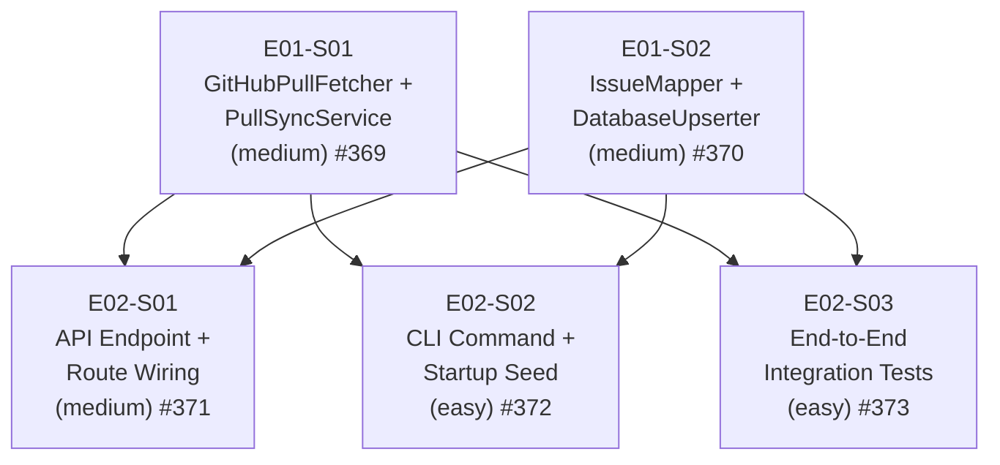

# Implementation Plan: GitHub-to-SQLite Sync (Pull Direction)

## 1. Overview

This plan decomposes the approved design for GitHub-to-SQLite pull sync into two epics and five stories. The pull sync engine fetches all issues from the GitHub GraphQL API and upserts them into the SQLite database, replacing the stale file-based seed as the primary data source for the dashboard.

### 1.1 Design Reference

- **Design doc:** `docs/2-design/2026-03-23-github-sqlite-sync.md`
- **Backlog:** #364

### 1.2 Structural Decisions

**Why two epics, not three:** The design identifies three component groups (Core Engine, Triggers/Integration, Dashboard UI). A "Dashboard Sync Button" epic was considered but deferred -- the design explicitly leaves the UI sync button as an open question (section 11.2, question 1). The two epics cleanly separate (1) the core sync engine (self-contained, testable in isolation) from (2) the integration points that wire it into the existing server infrastructure. This avoids a single-story epic for UI that adds hierarchy without value.

**E01 story split:** The core engine has two natural boundaries -- the network layer (GitHubPullFetcher + PullSyncService) and the data layer (IssueMapper + DatabaseUpserter). Splitting these allows parallel builders, each with a focused responsibility and independent test suite. The PullSyncService is placed in E01-S01 because it orchestrates the fetcher and needs to exist before E02 can wire it into the API and CLI. However, PullSyncService.pullSync() depends on IssueMapper and DatabaseUpserter, so E01-S01 defines the service class and its public interface but the implementation of the sync loop body is completed after E01-S02 provides the mapper and upserter. In practice, E01-S01 mocks the mapper/upserter in its tests, and E01-S02 provides the real implementations -- the integration test in E02-S03 verifies the full pipeline.

**E02-S03 as a separate integration test story:** Rather than distributing integration tests across E02-S01 and E02-S02, a dedicated story ensures the full pipeline is tested end-to-end with realistic mock data. This catches interface mismatches between the mapper, upserter, and service that unit tests cannot detect.

## 2. Epic and Story Breakdown

### E01: Core Sync Engine

Build the three internal components of the pull sync engine. All components are testable in isolation with mocked `gh` CLI output and in-memory SQLite.

| Story | Title | Difficulty | Files |
|-------|-------|-----------|-------|
| E01-S01 | GitHubPullFetcher and PullSyncService | medium | `server/src/adapters/github-pull.ts`, `server/src/services/pull-sync.ts`, tests |
| E01-S02 | IssueMapper and DatabaseUpserter | medium | `server/src/lib/issue-mapper.ts`, `server/src/services/database-upserter.ts`, tests |

### E02: Integration and Triggers

Wire the core sync engine into the server's existing infrastructure: API endpoint, CLI command, startup seed replacement, and end-to-end integration tests.

| Story | Title | Difficulty | Files |
|-------|-------|-----------|-------|
| E02-S01 | API Endpoint and Route Wiring | medium | `server/src/api/sync.ts`, `server/src/api/routes.ts`, tests |
| E02-S02 | CLI Command and Startup Seed Replacement | easy | `server/src/index.ts` |
| E02-S03 | End-to-End Integration Tests | easy | `server/tests/services/pull-sync-integration.test.ts` |

## 3. Dependency Graph



**Key dependencies:**

- E01-S01 and E01-S02 have **no dependencies** and can run in parallel (Wave 1)
- E02-S01, E02-S02, and E02-S03 all depend on both E01-S01 and E01-S02 completing first
- E02-S01, E02-S02, and E02-S03 are independent of each other and can run in parallel (Wave 2)

### Dispatch Plan

| Wave | Stories | Dispatch | Rationale |
|------|---------|----------|-----------|
| **Wave 1** | E01-S01 (#369), E01-S02 (#370) | Parallel | No dependencies between them |
| **Wave 2** | E02-S01 (#371), E02-S02 (#372), E02-S03 (#373) | Parallel | All depend on Wave 1; independent of each other |

**Critical path:** Wave 1 (max of S01, S02 durations) + Wave 2 (max of S03, S04, S05 durations). Expected: ~10-15 min per medium story, ~5-8 min per easy story.

## 4. Story Details

### E01-S01: GitHubPullFetcher and PullSyncService (#369)

**Difficulty:** medium

**Description:** Implement the `GitHubPullFetcher` (GraphQL pagination via `gh` CLI subprocess) and `PullSyncService` (orchestration, rate limit checks, progress events). The fetcher follows the same `_runGh()` pattern as the existing `GitHubAdapter` in `server/src/adapters/github.ts`.

**Files to create:**

- `server/src/adapters/github-pull.ts` -- `GitHubPullFetcher` class
- `server/src/services/pull-sync.ts` -- `PullSyncService` class
- `server/tests/adapters/github-pull.test.ts` -- fetcher unit tests
- `server/tests/services/pull-sync.test.ts` -- service tests

**Key interfaces:**

```typescript
export interface GitHubPullFetcherConfig {
  repo: string;
  pageSize?: number;     // default: 50
  maxPoints?: number;    // default: 1000
}

export interface PullSyncOptions {
  filterLabels?: string[];
  updatedSince?: string;
  maxPoints?: number;
  includeComments?: boolean;  // default: true
}

export interface PullSyncResult {
  totalIssues: number;
  itemsCreated: number;
  itemsUpdated: number;
  labelsCreated: number;
  commentsCreated: number;
  commentsUpdated: number;
  hierarchyLinked: number;
  pointsConsumed: number;
  durationMs: number;
  errors: string[];
}
```

**Acceptance criteria:**

- GitHubPullFetcher executes the GraphQL query from design section 4.1 via `_runGh()`
- Cursor pagination loops until `hasNextPage` is false
- Page size defaults to 50, configurable via constructor
- Rate limit pre-check queries `rateLimit { remaining, resetAt }` before sync starts
- Per-page rate limit check reads remaining points from the response
- Aborts with clear error when remaining points drop below 500
- Comment overflow: issues with `comments.pageInfo.hasNextPage === true` get follow-up pagination queries
- Retry logic: retries failed pages up to 3 times with exponential backoff
- PullSyncService.pullSync() orchestrates: fetch pages, map, upsert, link hierarchy
- Emits `sync:pull:started`, `sync:pull:progress`, `sync:pull:complete`, `sync:pull:error` events via EventService (optional dependency)
- Returns PullSyncResult with all counters populated
- Tests mock `_runGh()` using the same `spyOn` pattern as `server/tests/adapters/github.test.ts`

### E01-S02: IssueMapper and DatabaseUpserter (#370)

**Difficulty:** medium

**Description:** Implement the `IssueMapper` (GitHub GraphQL types to SQLite types) and `DatabaseUpserter` (transactional upsert into SQLite via Drizzle ORM). The upserter handles items, labels, comments, and hierarchy linking.

**Files to create:**

- `server/src/lib/issue-mapper.ts` -- `IssueMapper` with `mapIssue()` and helpers
- `server/src/services/database-upserter.ts` -- `DatabaseUpserter` class
- `server/tests/lib/issue-mapper.test.ts` -- mapper unit tests
- `server/tests/services/database-upserter.test.ts` -- upserter unit tests

**Key interfaces:**

```typescript
export interface MappedIssue {
  item: {
    id: number;
    title: string;
    body: string | null;
    type: ItemType;
    status: BoardStatus;
    state: ItemState;
    externalId: string;
    externalUrl: string;
    createdAt: string;
    updatedAt: string;
  };
  labels: string[];
  parentNumber: number | null;
  comments: Array<{
    body: string;
    author: string;
    createdAt: string;
    updatedAt: string;
  }>;
}
```

**Type derivation from labels:**

| Label | ItemType |
|-------|----------|
| `hierarchy/backlog` | `"backlog"` |
| `hierarchy/epic` | `"epic"` |
| `hierarchy/story` | `"story"` |
| `type/docs` (when no hierarchy label) | `"docs"` |
| No matching label | `"story"` (default) |

**Board status mapping:**

| GitHub Status Name | BoardStatus |
|-------------------|-------------|
| "Backlog" | `"backlog"` |
| "Ready" | `"ready"` |
| "In Progress" | `"in-progress"` |
| "In Review" | `"in-review"` |
| "Done" | `"done"` |
| Not on board | `"backlog"` (default) |

**Acceptance criteria:**

- IssueMapper.mapIssue() converts GitHubIssueNode to MappedIssue
- Type derivation from labels follows the table above
- Status derivation extracts ProjectV2ItemFieldSingleSelectValue where field name is "Status", maps case-insensitively
- Comment author uses `author.login`, defaults to `"unknown"` when author is null
- DatabaseUpserter.upsertPage() inserts/updates items via Drizzle `onConflictDoUpdate` on `items.id`
- Preserves existing `createdBy` when local value is non-null and GitHub value would be null
- Label reconciliation: ensure label exists in `labels` table, delete existing `item_labels` for item, insert new associations (full replace, not merge)
- Comment dedup by `(itemId, createdAt, author)` triple -- update body/updatedAt on conflict
- DatabaseUpserter.linkHierarchy() sets `parentId` from accumulated parent map in a single transaction
- Each page upsert runs in a single SQLite transaction
- Tests use `setupTestDb()` from `server/tests/helpers/setup-db.ts`

### E02-S01: API Endpoint and Route Wiring (#371)

**Difficulty:** medium

**Description:** Create `POST /api/sync/pull` endpoint with a sync route group. Wire into the existing route registration in `routes.ts`. Add a concurrency mutex to prevent parallel pull syncs. Also add `GET /api/sync/status` for monitoring.

**Blocked by:** E01-S01 (#369), E01-S02 (#370)

**Files to create:**

- `server/src/api/sync.ts` -- sync route group with `createSyncRouter()`
- `server/tests/api/sync.test.ts` -- API integration tests

**Files to modify:**

- `server/src/api/routes.ts` -- import and mount sync route group

**Acceptance criteria:**

- `POST /api/sync/pull` accepts JSON body: `{ filterLabels?: string[], includeComments?: boolean }`
- Returns 200 with PullSyncResult on success
- Returns 409 Conflict when a sync is already in progress (in-memory mutex)
- Returns 500 with error details on failure
- Request validation: `filterLabels` must be string array if present, `includeComments` must be boolean if present; return 400 on invalid input
- `GET /api/sync/status` returns `{ state: "idle" | "running", progress?: object, lastResult?: PullSyncResult }`
- Route group is mounted in `routes.ts` via `registerRoutes()`, following the existing pattern
- PullSyncService is constructed with the same `db` and EventService as other services
- GitHubPullFetcher config is read from `agentic-sdlc-config.json` via `github.repo` field
- Tests use `createApp()` pattern from existing API tests

### E02-S02: CLI Command and Startup Seed Replacement (#372)

**Difficulty:** easy

**Description:** Add `sync` command to `server/src/index.ts` for one-shot pull-and-exit. Replace the file-based seed with pull sync on first startup, keeping file seed as offline fallback.

**Blocked by:** E01-S01 (#369), E01-S02 (#370)

**Files to modify:**

- `server/src/index.ts` -- add `sync` case to command switch, modify `commandStartForeground()` and `commandMcp()` seed logic

**Acceptance criteria:**

- `bun run server/src/index.ts sync` runs pull sync and exits with code 0 on success, 1 on failure
- Prints summary to stderr: total issues, items created/updated, labels, comments, hierarchy links, points consumed, duration
- Does not start the HTTP server (one-shot operation: open DB, migrate, sync, close DB)
- `commandStartForeground()`: when DB is empty, attempts pull sync first; catches errors and falls back to file-based seed if GitHub is unavailable
- `commandMcp()`: same startup seed replacement logic
- Fallback log message: `[seed] GitHub pull failed: <error>. Falling back to .workflow/items/`
- Success log message: `[seed] Pulled <N> issues from GitHub.`
- Usage help updated to include `sync` command

### E02-S03: End-to-End Integration Tests (#373)

**Difficulty:** easy

**Description:** Create integration tests that verify the full pull sync pipeline from mocked GitHub response through to verified database state. Test idempotency, partial recovery, label reconciliation, and comment update behavior.

**Blocked by:** E01-S01 (#369), E01-S02 (#370)

**Files to create:**

- `server/tests/services/pull-sync-integration.test.ts` -- end-to-end integration tests

**Acceptance criteria:**

- Full pipeline test: mock `_runGh()` responses for 2 pages of issues (10 items total with labels, comments, hierarchy), run `PullSyncService.pullSync()`, verify all items, labels, comments, and hierarchy in the database match expected state
- Idempotency test: run `pullSync()` twice with identical mock data, verify row counts are identical (no duplicate items, labels, or comments)
- Partial sync recovery test: first sync processes 1 page then aborts (simulated rate limit), second sync runs to completion -- verify all items present and correct
- Label reconciliation test: first sync has item with labels [A, B], second sync has same item with labels [B, C] -- verify `item_labels` contains only [B, C] after second sync
- Hierarchy test: mock parent issue (backlog) and child issues (epics, stories) across pages, verify `parentId` is set correctly after the linking pass
- Comment update test: first sync has a comment with body "version 1", second sync has same comment (same author + createdAt) with body "version 2" -- verify body is updated in the database
- Mock data uses realistic GitHub GraphQL response shapes matching the query in design section 4.1
- Tests use `setupTestDb()` from `server/tests/helpers/setup-db.ts`

## 5. Testing Strategy

### Unit Tests (per story)

| Component | Test file | Scope |
|-----------|----------|-------|
| GitHubPullFetcher | `server/tests/adapters/github-pull.test.ts` | Pagination, rate limits, retries, comment overflow |
| PullSyncService | `server/tests/services/pull-sync.test.ts` | Orchestration, event emission, abort on rate limit |
| IssueMapper | `server/tests/lib/issue-mapper.test.ts` | Type derivation, status mapping, missing fields |
| DatabaseUpserter | `server/tests/services/database-upserter.test.ts` | Upsert, labels, comments, hierarchy, transactions |
| Sync API | `server/tests/api/sync.test.ts` | HTTP endpoints, validation, concurrency |

### Integration Tests

| Test file | Scope |
|----------|-------|
| `server/tests/services/pull-sync-integration.test.ts` | Full pipeline with mock `gh`, idempotency, partial recovery |

### Mock Strategy

Tests mock the `_runGh()` method on the fetcher using `spyOn` (same pattern as `server/tests/adapters/github.test.ts`). This allows testing the full pagination logic without hitting the real GitHub API. Mock responses are structured to match actual GitHub GraphQL output.

## 6. Files Summary

### New Files

| File | Created by |
|------|-----------|
| `server/src/adapters/github-pull.ts` | E01-S01 |
| `server/src/services/pull-sync.ts` | E01-S01 |
| `server/src/lib/issue-mapper.ts` | E01-S02 |
| `server/src/services/database-upserter.ts` | E01-S02 |
| `server/src/api/sync.ts` | E02-S01 |
| `server/tests/adapters/github-pull.test.ts` | E01-S01 |
| `server/tests/services/pull-sync.test.ts` | E01-S01 |
| `server/tests/lib/issue-mapper.test.ts` | E01-S02 |
| `server/tests/services/database-upserter.test.ts` | E01-S02 |
| `server/tests/api/sync.test.ts` | E02-S01 |
| `server/tests/services/pull-sync-integration.test.ts` | E02-S03 |

### Modified Files

| File | Modified by | Change |
|------|------------|--------|
| `server/src/api/routes.ts` | E02-S01 | Mount sync route group |
| `server/src/index.ts` | E02-S02 | Add `sync` command, replace file seed with pull sync |

## 7. GitHub Issues

All issues were created during an earlier planning pass and are already on the project board with correct labels, hierarchy, and board status.

| Issue | Title | Type | Difficulty | Epic |
|-------|-------|------|-----------|------|
| #367 | [#364/E01] Core Sync Engine | Epic | -- | -- |
| #368 | [#364/E02] Integration and Triggers | Epic | -- | -- |
| #369 | [#364/E01-S01] GitHubPullFetcher and PullSyncService | Story | medium | E01 |
| #370 | [#364/E01-S02] IssueMapper and DatabaseUpserter | Story | medium | E01 |
| #371 | [#364/E02-S01] API Endpoint and Route Wiring | Story | medium | E02 |
| #372 | [#364/E02-S02] CLI Command and Startup Seed Replacement | Story | easy | E02 |
| #373 | [#364/E02-S03] End-to-End Integration Tests | Story | easy | E02 |
| #374 | [#364] Write implementation plan | Docs | -- | -- |
