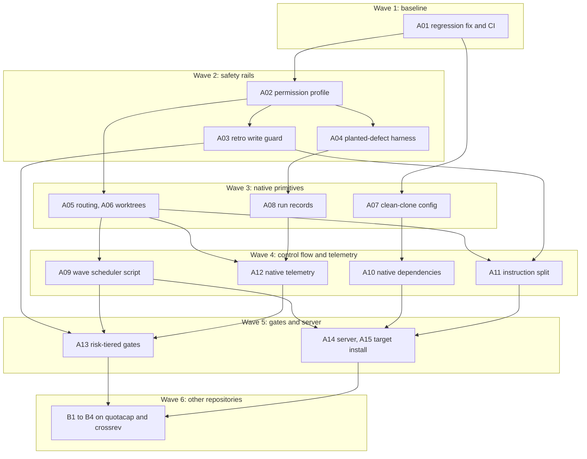

# Real-task backlog for the next end-to-end workflow run

## Summary

This plan replaces the synthetic prose workloads that exercised the agentic SDLC workflow in March 2026 with 19 real engineering tasks: 15 on the workflow repository itself and 4 in two public tools whose code the workflow did not write, quotacap and crossrev. Each task is bounded to an agent run of hours, has deterministic acceptance tests, carries a risk tier that decides its human gates, and maps to the 15 workflow capabilities the synthetic runs covered, with deliberate probes for a merge conflict, an interrupted run, interactive approval, fix-cycle exhaustion and planted defects. The plan also fixes what each run records and how results are reported with their scope, and it authorizes no run.

## Document control

- Source baseline: this repository at `5c4b571`, before the release preparation (read-only review of `.claude/agents/`, `scripts/`, `server/`, `docs/ROADMAP.md` and the 19 open issues on 2026-11-20); the [public release assessment](../4-reviews/2026-11-20-public-release-assessment.md) and the [state-of-practice research](../1-discovery/2026-11-20-state-of-practice-research.md); public trees and roadmaps of quotacap at `93ccdf6` and crossrev at `e5366d6`; public roadmaps of penmark (`d120c94`), copydesk (`5ae5f7e`) and chat-harness (`0989715`) for candidate screening.
- Work authorization: drafting only. The end-to-end run itself is not authorized. No backlog issue is created, no run starts, no budget is committed and no GitHub state changes until the operator authorizes the run with its waves, budget and stopping point.
- Release dependency: [ADR 0007](../6-adrs/0007-merge-reference-design-and-publish.md) publishes this repository with the reference design merged into it, and the fix for the `4d3ab9b` regression ships with the release. Items A01 and A03 overlap with that release work (open question 1).
- Status on 2026-11-21: the release preparation delivered the core of A01 (restored code in `72f7476`, CI with a `required` gate in `ab3d57e`), part of A02 (a `dontAsk` allowlist with deny rules and the `Agent` hook matcher in `4be6d23` and `57aabfa`, owner board values removed in `93c7598`) and part of A03 (a retro scope guard keyed on the commit subject and a post-retro test run in the orchestrator prompt, `b5a4212`). These changes were made directly, not through a workflow run. Their remaining acceptance criteria stay open below.
- Next checkpoint: operator review of this plan and answers to the open questions.

## Selection rules

Every backlog item meets all of these:

| Rule | Test applied |
|---|---|
| Genuinely useful | It closes a weakness named in the [public release assessment](../4-reviews/2026-11-20-public-release-assessment.md) or the [state-of-practice research](../1-discovery/2026-11-20-state-of-practice-research.md), or a "Next" item on a public roadmap. No task exists only to exercise the workflow. |
| Bounded | One backlog item, at most three epics, finishable in one agent run of hours. |
| Deterministically verifiable | Acceptance is decided by tests, schema checks or recorded state, not by an LLM grade. |
| Low risk to run | Tests run offline with stubs. No live paid service, no real credential and no production data in tests. |
| Covers the workflow | It exercises at least one of the 15 capabilities in the coverage matrix. |
| Current platform facts | Design re-verifies every Claude Code, Agent SDK, MCP and GitHub fact it relies on against official docs at run time. |

## Risk tiers and human gates

Each item carries one tier. The tier decides review depth and which human gates apply.

| Tier | Applies to | Story review | Backlog PR review | Design and plan PRs | Run mode |
|---|---|---|---|---|---|
| T1 | Docs, tests, run records, derived telemetry views, summary text | SKIP allowed for easy stories | PR-level reviewer | Auto-merge into the integration branch | Autonomous |
| T2 | Scripts, runtime service, PM adapters, agent prompts that do not change gates, public API or wire contracts | REVIEW for every story | PR-level reviewer plus one cross-family review | Auto-merge into the integration branch | Autonomous |
| T3 | Permissions, human gates, halt logic, CI required checks, retro write scope, any control that stops another tool | REVIEW for every story | PR-level reviewer plus one cross-family review | A human answers design questions and merges both PRs | Interactive |

Always human, in every tier:

- Merge to `main` of any repository.
- Repository visibility changes.
- Deleting a repository or a remote branch. Cleanup of trial and sandbox branches is approved once per wave as a listed set.
- Git history rewrites.
- Spending beyond the agreed budget, including paid review services.
- Opening issues or pull requests on a public repository other than the run's own target.
- Branch protection, repository settings, creating Projects boards or sandbox repositories.

## Track A: the workflow repository

Target for every item in this track: the workflow repository. "Blocked by" lists direct blockers only.

| ID | Title | Difficulty | Tier | Mode | Blocked by | Capabilities |
|---|---|---|---|---|---|---|
| A01 | Restore the reverted runtime work and add CI | medium | T3 | interactive | none | 3, 4, 9, 10, 15 |
| A02 | Safe permission profile and enforced role boundaries | medium | T3 | interactive | A01 | 9 |
| A03 | Retro write guard and post-retro test run | medium | T3 | interactive | A02 | 9, 12 |
| A04 | Planted-defect harness and recall scorer | medium | T2 | autonomous | A02 | 2, 14 |
| A05 | Model and effort routing through per-call parameters | easy | T2 | autonomous | A02 | 4, 5, 14 |
| A06 | Native worktree isolation, orchestrator included | medium | T2 | autonomous | A02 | 2, 14 |
| A07 | Clean-clone configuration and optional board | medium | T2 | autonomous | A01 | 2, 7, 10, 13 |
| A08 | Retain raw run records | easy | T1 | autonomous | A04 | 6, 11, 14 |
| A09 | Wave scheduling as a tested script | hard | T3 | interactive | A05, A06 | 2, 3, 4, 5, 8, 9 |
| A10 | Native sub-issues and dependencies | medium | T2 | autonomous | A07 | 1, 3, 14 |
| A11 | Short instruction file plus path-scoped rules | medium | T2 | autonomous | A03, A05, A06 | 2, 13 |
| A12 | Native telemetry with GenAI attribute names and a budget halt | hard | T2 | autonomous | A05, A08 | 3, 4, 11, 13, 14 |
| A13 | Risk-tiered gates instead of the "autonomous" keyword | medium | T3 | interactive | A03, A09, A12 | 6, 9, 13 |
| A14 | Server auto-start, MCP specification check and sync-failure handling | hard | T2 | autonomous | A07, A09 | 3, 8, 15 |
| A15 | Install the workflow into another repository | medium | T2 | autonomous | A02, A10, A11 | 1, 15 |

### A01 Restore the reverted runtime work and add CI

- **Why:** commit `4d3ab9b` ("docs(retro): add retrospective for BL 116") changed 39 files (376 insertions, 864 deletions) and reverted a PR-review fix committed 55 seconds earlier, together with the `pm.sh` server fallback, the document-comment schema and route, frontend API methods, part of the startup-wiring test and the backlog item 116 CHANGELOG entry. Since then 12 server tests fail and 2 test files fail to load on a clean checkout (623 of 635 pass). The repository has no CI, so nothing noticed. Every later run needs a trustworthy baseline.
- **Scope:** epic 1 restores the reverted changes from `refs/pull/362/head` (`ff484e5`, fetched from GitHub) file by file and reconciles them with later work (backlog item 364). Epic 2, blocked by epic 1, adds one CI workflow with server, telemetry and hermetic shell-test jobs aggregated by a single `required` job, SHA-pinned actions and Dependabot, following the OSS house standard in agentic-toolkit (`reference/reference-oss-standards.md`). Branch protection is applied by the operator.
- **Acceptance:**
  - `bun test` in `server/` on a clean export reports 0 failures and 0 load errors.
  - `python3 scripts/lib/test_compute_dispatches.py` passes (252 tests at baseline).
  - Shell suites run in CI with a `gh` stub that fails on any call. Suites that need live `gh` (for example `test-dispatch-workflow.sh`) are listed with a reason and excluded.
  - A scratch pull request with one deliberately failing test shows `required` red. It is closed unmerged.
  - Every action is pinned to a 40-character SHA with a version comment. Dependabot covers GitHub Actions and the server's packages.
- **Verification:** clean `git archive` export with `gh` removed from `PATH` and an empty `HOME`, the method used in the public release assessment. CI run links in the backlog PR.
- **Probe:** designated interactive run (capability 9). The human answers the designer's and planner's questions and merges the design and plan PRs.

### A02 Safe permission profile and enforced role boundaries

- **Why:** unattended runs were designed around `--dangerously-skip-permissions`. The project allowlist holds leftover `dotnet` rules and a broad `Bash(gh *)`. Role boundaries are instructions only, and `4d3ab9b` shows a docs-only role changing code. Current Claude Code docs restrict `bypassPermissions` to isolated containers and VMs and offer `auto` and `dontAsk` modes, per-agent `permissionMode` and `disallowedTools`.
- **Scope:** an exact allowlist for headless runs in `dontAsk` mode, covering the commands the workflow actually runs (`bun`, `python3`, `./scripts/*`, the `git` and `gh` subcommands in use). Deny rules for irreversible actions: force push, deleting `main` or branches outside the run's namespace, `gh repo edit` visibility changes, `gh repo delete`. A PreToolUse check that refuses `gh pr merge` when the base is `main`, while merges into integration branches stay allowed. Reviewer and PR reviewer get no edit tools. The `Task` hook matcher becomes `Agent`, and the log filter's stale `issue-*` names become `item-*`. First-run text in README and CLAUDE.md no longer recommends bypass mode.
- **Acceptance:**
  - A test reads `.claude/settings.json` and agent frontmatter and fails on any `dotnet` rule, a bare `Bash(gh *)` allow, a missing deny rule from the listed set, or an edit tool available to a reviewer.
  - A headless smoke session in `dontAsk` mode runs `item-get.sh` against a fixture and `bun test` without a prompt. A scripted denied command and a merge into `main` are both refused, and the refusals appear in the log.
  - The logging hook writes one line per Agent dispatch in the smoke run.
  - A grep test finds no current document recommending bypass mode outside a container or VM. Historical records are excluded.
- **Verification:** tests in CI plus the smoke transcript attached to the backlog PR.

### A03 Retro write guard and post-retro test run

- **Why:** the parallel retro committed a stale worktree snapshot on top of the advancing integration branch, and the PR reviewer had reviewed a frozen snapshot, so the revert reached `main` ([case study 2](../case-studies.md#2-a-retrospective-commit-that-reverted-reviewed-code)). CLAUDE.md states that the retro only adds docs, and nothing enforces it. Workflow issue 107 asks for a document-only retro.
- **Scope:** a commit-time guard that refuses retro commits outside an allowlist (`docs/`, lesson files, CLAUDE.md and rules files, agent definitions) and refuses any retro commit whose parent is not the current head of the integration branch. Phase 5 runs the full test entrypoint from A01 after the retro commit and before the backlog PR is marked ready, and halts on failure. Retro proposals carry an evidence link and a named before-and-after metric.
- **Acceptance:**
  - A regression test reproduces the `4d3ab9b` mechanism in a fixture repository (stale worktree, advancing branch) and the guard refuses the commit.
  - A retro commit touching `server/src/` is refused; one touching `docs/` passes.
  - A Phase 5 fixture with a failing test halts with reason `post_retro_tests_failed` and the backlog PR stays draft.
  - A lint test fails on a retro proposal without evidence and metric fields.
- **Verification:** tests in CI. The first later run shows the post-retro test run in its state file.

### A04 Planted-defect harness and recall scorer

- **Why:** reviewer recall was measured in March by asking builders to plant bugs, and 2 of 4 planted bugs were neutralized because builders followed the acceptance criteria. Recall needs defects of known type injected independently of the builder, and a guarantee that none reaches `main`.
- **Scope:** an operator-run injector that applies a mutation from a fixed class list to a story branch after the builder finishes and before review, committed in the story's commit style. A sealed manifest stored outside every agent-readable path, enforced by an A02 deny rule. A scorer that matches review findings to manifest entries (same file, same hunk, effect named), with an adjudication file for ambiguous matches. A re-plant mode that re-applies a defect after each fix cycle, used for the cap-exhaustion probe. A release guard that checks every planted mutation is absent from the final tree and reverts and records any that survived.
- **Defect classes:** D1 boundary or off-by-one; D2 inverted or missing condition; D3 swallowed error; D4 removed or weakened test assertion; D5 unrelated file change inside a story diff; D6 behaviour that contradicts a stated acceptance criterion; D7 weakened safety check, such as a broadened allow rule or removed input validation.
- **Acceptance:** fixture tests per class (inject, detect by a scripted reviewer output, score); a test that an agent session cannot read the manifest path; a release-guard test where an undetected defect is reverted and counted as a miss; scorer output in a fixed JSON schema.
- **Verification:** tests in CI. First live use in A05.

### A05 Model and effort routing through per-call parameters

- **Why:** the four builder variant files exist because the Agent tool had no model parameter in March 2026. It now takes a per-call model alias, and reasoning effort has become a second routing axis. Model prices have also changed, so routing should name (model, effort) pairs and record them.
- **Scope:** one `builder` definition. `modelRouting` maps each difficulty to a model and an effort. Dispatches pass the model per call and the effort per call where the Agent tool supports it, otherwise per agent definition (verified at design time). Variant files are removed or kept under a historical label, as the design records. The state file records model and effort per dispatch. The telemetry model type accepts the current model families.
- **Acceptance:** a config schema test accepts pairs and rejects unknown effort values; an orchestrator instruction test asserts dispatches name `builder` only; a `compute-dispatches.py` fixture with mixed pairs renders one row per pair; the live run uses at least two pairs.
- **Verification:** tests in CI and the run's state file.
- **Probes:** 2 planted defects, one of them in re-plant mode. Expected: the orchestrator halts after the second fix cycle with reason `fix_cycles_exhausted`, dispatches no third fix, and a human removes the defect before the run resumes (capability 5).

### A06 Native worktree isolation, orchestrator included

- **Why:** the hand-built worktree handling came from real collisions ([case study 3](../case-studies.md#3-parallel-builders-collided-then-isolation-tightened-in-four-steps)), and the orchestrator still shares the main checkout (workflow issue 149). Claude Code now provides `isolation: worktree`, base-ref selection, `.worktreeinclude` for gitignored files, isolation checks and automatic sweeps.
- **Scope:** isolation declared in every agent definition; base ref chosen per role; gitignored configuration made available through `.worktreeinclude`; the orchestrator started in its own worktree with the run state directory at a stable path outside it; custom worktree creation and cleanup removed where the platform covers it. Up-front branch creation from the recorded base SHA and the merge ordering stay, because the platform does not cover them.
- **Acceptance:** a grep test finds no `git worktree add` or `git worktree remove` in agents and scripts outside a documented exception list; `cleanup-post-merge.sh` tests show it no longer manages agent worktrees; a fixture proves the state file survives an orchestrator worktree restart; in the live run the main checkout's HEAD and status are identical at start and end.
- **Verification:** tests in CI plus the before and after checkout snapshot in the run record.
- **Probe:** 3 planted defects.

### A07 Clean-clone configuration and optional board

- **Why:** the config file, CLAUDE.md, README, design docs and tests hard-code the owner's repository and Projects v2 IDs, so a clone fails or targets the owner's board. The designer and planner depend on user-level "brainstorming" and "writing-plans" skills and the context7 MCP server, none declared in the repository.
- **Scope:** a placeholder config template plus a gitignored local config; `setup-board.sh`, which discovers the board fields and writes the local config (creating a board stays an operator action); a `pm.board: none` mode; owner values removed from current docs and tests, with historical records untouched; undeclared skill and MCP dependencies declared or removed; a documented first run without a board.
- **Acceptance:** a pattern test fails if current tracked files contain Projects v2 node IDs or the owner's board URL; a `config.sh` test loads the template plus a local override; with `pm.board: none`, a mocked-`gh` run of `item-create.sh` and `item-set-status.sh` makes no `gh project` call; a test fails if an agent definition names a skill or MCP server outside the declared dependency list.
- **Verification:** tests in CI; a clean clone runs the offline first-run path without owner values.
- **Probe:** deliberate merge conflict (capability 7). The backlog issue asks the planner to put two stories in one wave that both edit the `github` block of the config template: one replaces owner values with placeholders and adds `pm.board`, the other adds `setup-board.sh`, which writes board IDs into the same block. Expected: the second story merge into the epic branch conflicts, the orchestrator runs `git merge --abort`, comments on the story issue with the conflicting files, includes the conflict in the backlog PR description and halts. A human resolves the conflict on the epic branch and restarts the run. If the planner sequences the stories instead, the probe is recorded as "not armed", not as a pass.

### A08 Retain raw run records

- **Why:** `cleanup-post-merge.sh` deletes `.agentic-workflow/runs/` after every merge, so the March analyses can be reproduced only from GitHub comments. The measurement protocol below needs raw records that others can recompute.
- **Scope:** in Phase 6 the orchestrator writes a run record bundle (state file, telemetry inputs, the native telemetry export once A12 lands, an orchestrator log with home-directory paths and token-like strings redacted) onto the integration branch, so it merges with the backlog PR. A reader regenerates the posted telemetry comment from the bundle. Cleanup refuses to delete state before the bundle exists. Bundle commits are excluded from the rework metric by path.
- **Acceptance:** `compute-dispatches.py --from-state` on a fixture bundle reproduces the posted telemetry table exactly; a redaction test with a fixture containing a home path and a token-like string; a cleanup test that refuses when no bundle exists.
- **Verification:** tests in CI; the bundle of this run reproduces its own telemetry comment.
- **Probe:** SKIP-tier probe (capability 6). All stories are easy and SKIP-eligible. One planted defect goes into a SKIP-tier story, and the PR-level reviewer must find it. The current SKIP condition requires the `test-agentic-sdlc` label, so the run configuration sets `requireLabel` to a run-specific label for this item; A13 later replaces the label condition with tiers.

### A09 Wave scheduling as a tested script

- **Why:** phase sequencing, wave order, the fix-cycle limit and every halt are LLM instruction-following inside a 656-line prompt, and `maxParallelBuilders` is enforced by the prompt at best. Claude Code now runs resumable orchestration scripts (dynamic workflows, also available in the Agent SDK) in which the plan lives in code and agent results can be schema-checked.
- **Scope:** Phase 3 (build, review, fix cycles and merge per wave) moves into a saved dynamic workflow or an Agent SDK script, chosen in the design with current docs. A pure scheduling module computes waves from the plan's dependency graph, splits sub-waves at `maxParallelBuilders`, enforces the 2-cycle cap, returns typed halt reasons (`merge_conflict`, `fix_cycles_exhausted`, `dispatch_failed`, `dependency_open`) and resumes from the state file. Builder and reviewer returns are validated against JSON schemas. The prompt keeps Phases 0 to 2 and 4 to 6 and calls the script for Phase 3.
- **Acceptance:**
  - Unit tests with a fake agent function over three dependency-graph fixtures (linear, wide, cross-epic) cover wave order, the sub-wave split at a cap of 3, a halt at cycle 2 with no third dispatch, a merge-conflict halt with no resolution attempt, and a resume that skips completed stories.
  - Schema tests reject malformed builder and reviewer returns.
  - A live run executes Phase 3 through the script and leaves a state file that validates against `orchestrator-state.v1.json`.
  - A test proves `maxParallelBuilders` is read by code.
- **Verification:** tests in CI; the live run's state file and transcript.

### A10 Native sub-issues and dependencies

- **Why:** dependencies are a machine-parsed `**Blocked by:**` line in each issue body, and hierarchy also relies on `hierarchy/*` labels. GitHub provides sub-issues (the workflow already calls `addSubIssue`) and native blocked-by relationships (GA since 2025-08-21).
- **Scope:** the planner records dependencies as native relationships; the Phase 0 pre-check and the A09 scheduler read native relationships, with the body line as a fallback during migration; the PM adapter interface gains dependency functions in the GitHub, server and local adapters. Issue types are configured per organization, so availability for a user-owned repository is verified in design and the `hierarchy/*` labels stay as the fallback.
- **Acceptance:** mocked-`gh` tests for create, read and fallback; the pre-check halts with `dependency_open` when a native blocker is open (unit test, plus one live check on a throwaway issue in the run's target repository); server tests show dependencies stored and returned; the planner creates the expected relationships for a fixture plan.
- **Verification:** tests in CI; the live check's halt in the state file.
- **Probe:** 2 planted defects.

### A11 Short instruction file plus path-scoped rules

- **Why:** CLAUDE.md is 827 lines. Current Claude Code guidance keeps each CLAUDE.md under 200 lines because longer files reduce adherence. Four of the five "Known Claude Code Platform Limitations" it lists no longer hold. A15 also needs the workflow's rules in separate files, so a target repository keeps its own CLAUDE.md.
- **Scope:** CLAUDE.md under 200 lines; content moved into path-scoped `.claude/rules/` files and into skills where it is procedural; the stale limitations moved to a dated historical section with their current status; one rules-file template (purpose, scoped paths, rules, evidence links); a mapping file from every old heading to its new home.
- **Acceptance:** a test asserts CLAUDE.md is under 200 lines; a test asserts every old H2 and H3 heading appears in the mapping and every destination exists; a lint test checks each rules file against the template; a link check over moved content passes; every dropped rule has a "removed because" entry in the mapping.
- **Verification:** tests in CI; the mapping file reviewed in the backlog PR.
- **Probe:** sub-wave probe (capability 2). At least four independent stories, one per rules file, with `maxParallelBuilders` at 3, so one wave splits into sub-waves. The shared template is the cross-story consistency contract (capability 13).

### A12 Native telemetry with GenAI attribute names and a budget halt

- **Why:** cost is estimated from total tokens at a blended rate, with prices scraped from a web page; cache tokens are not modelled; orchestrator tokens are excluded; Agent tool return fields are not captured (workflow issue 282). Claude Code now exports cost and token metrics natively over OpenTelemetry, including cache tokens, and the OpenTelemetry GenAI conventions name agent operations and attributes (still "Development" status). `cost-budget.sh` is never called and `maxCostPerRun` is null.
- **Scope:** native export configured for every run; a converter from the export into per-dispatch fields (cost, input, output, cache read and cache creation tokens, model, effort, duration); Agent tool return fields captured where present; records named with GenAI attributes at a pinned convention version, with custom attributes in one project namespace; price scraping and blended rates kept only as a labelled fallback; `cost-budget.sh` wired to halt at `maxCostPerRun` with reason `budget_exceeded`; the Gantt chart and tables kept as derived views.
- **Acceptance:** a golden test converts a fixture export into an expected per-story table; a test asserts every emitted attribute name is in the pinned GenAI list or the project namespace; a budget test halts when fixture cost exceeds the cap; the existing telemetry tests pass, or each changed test states why; the A08 bundle includes the export.
- **Verification:** tests in CI; the live run reports native cost next to the old estimate, as a scoped comparison for this one run.
- **Probe:** 2 planted defects. The attribute-name table is the cross-story contract (capability 13).

### A13 Risk-tiered gates instead of the "autonomous" keyword

- **Why:** autonomy is switched on by the word "autonomous" in the prompt, and `autoMergePlanPR`, `autoMergeDesignPR`, `skipRetro` and `maxParallelBuilders` are read by no script. Current practice matches review depth and human gates to what a change can break and how reversible it is (risk-tiered oversight, Thoughtworks Radar "Trial"), and warns against empty approval steps (human-in-the-loop theater, "Caution").
- **Scope:** a zone config that maps path globs to tiers; a deterministic classifier from changed paths and item labels to a tier, where the highest tier touched wins; the tier decides SKIP eligibility (T1 only), PR review depth (cross-family review at T2 and T3) and design and plan auto-merge (T1 and T2) versus human approval (T3); irreversible actions stay human in every tier; every remaining workflow config key is read by code or removed; the run record logs each gate decision and who made it.
- **Acceptance:** table-driven classifier tests, including mixed-tier changes; a test fails if a config key is read by no script; a test shows `state.sh init` derives the mode from the tier; a T3 fixture blocks plan auto-merge; the live run logs one gate-decision entry per decision.
- **Verification:** tests in CI; the run record's gate log.

### A14 Server auto-start, MCP specification check and sync-failure handling

- **Why:** `pm.sh` loads the server adapter as the primary local backend, but the server must be started by hand (workflow issue 363). The MCP stdio server is built on SDK `^1.27.1`, and the current MCP specification is 2026-07-28, a breaking, stateless revision. The fire-and-forget GitHub sync has never been exercised under deliberate failure.
- **Scope:** on-demand server start within the configured port range, with a health check and idle shutdown; a design-time check of the 2026-07-28 changes against the stdio server, an SDK upgrade if needed, and the supported specification version documented; contract tests for the 13 MCP tools; sync failure handling verified against a stub GitHub server (retry with backoff, dead-letter, reconcile after recovery).
- **Acceptance:** auto-start tests for cold start, port in use and a stale PID; an MCP contract test lists 13 tools with their schemas and calls each against an in-memory database; a sync-failure test shows local writes succeed while the stub returns errors, items reach dead-letter after the configured attempts, and reconcile restores GitHub state after recovery.
- **Verification:** tests in CI; probe evidence in the run record.
- **Probes:** interrupted run (capability 8): once at least one story of the second wave is merged and one builder is in flight, the operator stops the orchestrator session and restarts it with the same command. Expected: completed stories are skipped, the in-flight story restarts on its existing branch, the interrupted dispatch's metrics are kept and marked `(resumed)`, no duplicate issues are created, and final totals equal the sum of the segments. Sync failure (capability 15): during one story the sync worker points at a failing endpoint, local writes continue, the run does not halt, and reconcile catches up afterwards.

### A15 Install the workflow into another repository

- **Why:** Track B needs the workflow to run in repositories it did not write. Agents and scripts assume they live in this repository's `.claude/` and `scripts/`. Plugin packaging (workflow issue 112) is larger than this run needs.
- **Scope:** a bootstrap script, or a documented setup chosen in design, that installs agents, scripts, rules files and a config template into a target clone without overwriting target files; the target's own instruction files and hooks stay in force; no board by default; a dry-run mode that lists what it would write; an uninstall that removes only what it installed.
- **Acceptance:** tests against a scratch git repository: the expected files are installed, existing files are never overwritten, dry-run writes nothing, and uninstall returns the tree to its original state (empty diff); a smoke run in a scratch repository creates one item through the server-backed PM path with `pm.board: none`.
- **Verification:** tests in CI; the smoke run's record.

## Track B: other public repositories

### Candidates screened

| Repository | Candidate | Decision | Reason |
|---|---|---|---|
| quotacap | `forecast` tool input contract | Chosen (B1) | Listed under "Next"; small, test-backed MCP change |
| quotacap | Remove the deprecated `usedPct` and `sessionPct` wire aliases | Chosen (B2) | Listed under "Next"; removal condition met; touches store, formatters, CLI and docs |
| quotacap | Kimi included monthly window | Not chosen | Monthly parsing partly exists; the change needs a fresh sanitized capture of current CLI output |
| quotacap | Windows binary target | Not chosen | Release pipeline change that needs a Windows runner and signing decisions |
| crossrev | Name split-reviewed files in the summary | Chosen (B3) | Listed under "Next actions"; one summary line per split file; golden tests |
| crossrev | CLI control for the `crossrev/stop` label | Chosen (B4) | Listed under "Next actions"; contains a real design question (see B4) |
| crossrev | Resolver merges the base branch | Not chosen | Hard; changes the resolve leg's duties; needs live testbed runs |
| crossrev | Scheduled harness pin verification | Not chosen | Installs live vendor CLIs and opens pull requests on a schedule: spending and GitHub mutation |
| penmark | CriticMarkup import and export | Reserve | Bounded parser work with round-trip tests; held back to keep Track B to two repositories |
| penmark | Comment deep links | Not chosen | Deferred upstream until the publisher ID is decided |
| copydesk | TypeScript port | Not chosen | Weeks, not hours |
| copydesk | `doctor` report of duplicated instruction blocks | Reserve | Bounded, deterministic |
| chat-harness | none | Not used | No public roadmap file at the inspected revision |

Track B runs in private sandbox copies of the target repositories (open question 2). Issues, branches, planted defects and trial runs stay in the sandbox. A human opens one ordinary upstream pull request per item with the squashed, defect-free result, and the target repository's own CI and review decide it.

### Backlog

| ID | Title | Target | Difficulty | Tier | Mode | Blocked by | Capabilities |
|---|---|---|---|---|---|---|---|
| B1 | `forecast` tool input contract | quotacap | easy | T2 | autonomous | A13, A14, A15 | 4, 14 |
| B2 | Remove the deprecated wire aliases | quotacap | medium | T2 | autonomous | A13, A14, A15 | 2, 13, 14 |
| B3 | Name split-reviewed files in the review summary | crossrev | easy | T1 | autonomous | A13, A14, A15 | 6, 14 |
| B4 | CLI control for the loop's stop label | crossrev | medium | T3 | interactive | A13, A14, A15 | 5, 9, 13, 14 |

The roadmaps of both repositories trail their code in places: quotacap already validates the `forecast` provider at runtime. Each Track B design phase therefore starts by confirming against the code what remains of the roadmap item.

### B1 quotacap: `forecast` tool input contract

- **Why:** the MCP `forecast` tool advertises `provider` as a free string, so a calling agent cannot discover valid ids, and validation failures come back as message prefixes (`invalid-argument:`, `unknown-provider`, `missing-reading`) rather than one stable shape. The roadmap lists "`forecast` input validation (enum, error shape)".
- **Scope:** advertise the registered provider ids, including grouped ids, as an `enum` in the tool's input schema; return validation failures in one structured error shape with a stable code, keeping the existing prefixes readable for current callers; update the MCP documentation.
- **Acceptance:** an MCP test shows the advertised enum equals the registered ids; one test per error case asserts the structured code; `get_quotas` output is unchanged (existing tests); `npm test` passes.
- **Verification:** the repository's vitest suite and its CI.
- **Probe:** 2 planted defects.

### B2 quotacap: remove the deprecated `usedPct` and `sessionPct` wire aliases

- **Why:** the rename to `weeklyPct` and `fiveHourPct` kept the old names for one release, and the roadmap's removal condition (one release after nested monthly windows) has long been met. The aliases are set in the store mapper and read by the CLI fallback and the formatters.
- **Scope:** remove the aliases from the wire type and the store mapper, the CLI's `weeklyPct ?? usedPct` fallback and the formatter reads; keep the physical column names; update the architecture document and the CHANGELOG under "Removed". Whether the CLI must still read older daemons is a design decision (the daemon is replaced on version skew), and the version number of the release is the maintainer's decision.
- **Acceptance:** tests assert that `/api/quotas`, `/api/state` and MCP `get_quotas` responses carry no `usedPct` or `sessionPct` key; a grep test finds no alias read in `src/` outside migration code; a fixture database written by an older version still loads; `npm test` passes.
- **Verification:** vitest suite and CI.
- **Probe:** 3 planted defects. Store, formatter, CLI and documentation stories are independent, giving a wave of at least three stories in code the workflow did not write.

### B3 crossrev: name split-reviewed files in the review summary

- **Why:** a file too large for one review call is reviewed in parts, but only the model prompt says so ("Shown as slice N of M"). The operator-facing summary names no file reviewed that way, so the coverage is invisible.
- **Scope:** one summary line per split-reviewed file, naming the file and its part count, in the pull request comment and the terminal output; the coverage ledger stays the single source; CHANGELOG entry.
- **Acceptance:** render or golden tests for zero, one and several split files; `go test ./...` and `go vet ./...` pass.
- **Verification:** Go test suite and CI.
- **Probe:** 2 planted defects, one in a SKIP-tier story, so the PR-level reviewer is tested on code the workflow did not write.

### B4 crossrev: CLI control for the loop's stop label

- **Why:** `crossrev/stop` is the loop's human-facing kill switch. It is read in several places but written only by the resolve leg when it escalates. A human who needs it while a leg is pushing commits must use the label picker or a raw API call.
- **Scope:** commands that apply and remove the label on a pull request, idempotent, with clear output, plus docs and CHANGELOG. Design question: `crossrev stop --pr N` already exists and stops a local run and clears its lock, so the design must say how the label control relates to it (a flag, a new name, or an extended `stop`). A human answers it in the interactive design phase.
- **Acceptance:** tests with the repository's fake forge cover apply when absent, no-op when present, remove, pull request not found and missing permission; the existing local-run `stop` tests stay green or change only as the approved design states; `go test ./...` passes.
- **Verification:** Go test suite and CI.
- **Probe:** 3 planted defects; interactive approval on code the workflow did not write (capability 9).

## Coverage matrix

The 15 capabilities come from the public release assessment. After a port, the capability is exercised by the new mechanism: for example, capability 4 means every routing entry runs once after A05, not that both builder variant files run.

| # | Capability | Deliberate probe | Evidence that it happened |
|---|---|---|---|
| 1 | Three-level issue hierarchy, sub-issues, dependency parsing and halt on open dependencies | A10 live check | `dependency_open` halt in the state file; sub-issue links on GitHub |
| 2 | Parallel waves with 3 or more independent stories and `maxParallelBuilders` sub-waves | A11 | Wave and sub-wave timestamps in the state file and Gantt chart |
| 3 | Sequential dependent waves and cross-epic dependencies | A09 | Wave order matches the plan's dependency graph |
| 4 | All difficulty levels, every routing entry used | A05 | Model and effort per dispatch in the state file |
| 5 | Reviewer REQUEST_CHANGES, fix cycle, re-review; cap exhaustion and human halt | A05 re-plant | `fix_cycles_exhausted` halt at cycle 2; no third fix dispatch |
| 6 | SKIP versus REVIEW tier, with the PR-level review catching a SKIP-tier defect | A08 | Scorer record: SKIP-tier defect found by the PR-level reviewer, or a recorded miss |
| 7 | Merge conflict between parallel stories (halt path) | A07 | `merge_conflict` halt, issue comment, no agent-made merge commit for the pair |
| 8 | Interrupted run, resume, idempotent restart, resumed-agent metrics | A14 | Two session segments, `(resumed)` markers, no duplicate issues |
| 9 | Interactive mode with human design and plan approval | A01 | Human-merged design and plan PRs; answers recorded on the issue |
| 10 | Board reconciliation after PR linking automation | A07 | Reconcile output after the PR opens; board state matches issue state |
| 11 | Telemetry: per story, per epic, backlog, Gantt, fix-cycle footer, overhead | A12 | Telemetry comment regenerated from the A08 bundle |
| 12 | Retro convention proposal merged and later adopted | A03 | Proposal with evidence link merged; a later run's instructions contain it |
| 13 | Cross-story consistency contracts and format templates | A11 | Template lint passes for every story's output |
| 14 | Planted defects of known type, to measure reviewer recall | A05, A06, A08, A10, A12, B1 to B4 | Scorer output against the sealed manifest |
| 15 | Server-backed PM path and MCP tools, with GitHub sync failure | A14 | Dead-letter and reconcile entries; the run continued |

Grid. `D` marks the deliberate probe for a capability, `x` marks other planned exercise. Capabilities 1, 11 and 12 are exercised by every run, 10 by every run with the board on, and 15 by every run on the server-backed PM path. The run report marks each cell as observed or not observed, because a planned probe can fail to arm.

| Item | 1 | 2 | 3 | 4 | 5 | 6 | 7 | 8 | 9 | 10 | 11 | 12 | 13 | 14 | 15 |
|---|---|---|---|---|---|---|---|---|---|---|---|---|---|---|---|
| A01 | | | x | x | | | | | D | x | | | | | x |
| A02 | | | | | | | | | x | | | | | | |
| A03 | | | | | | | | | x | | | D | | | |
| A04 | | x | | | | | | | | | | | | x | |
| A05 | | | | D | D | | | | | | | | | D | |
| A06 | | x | | | | | | | | | | | | D | |
| A07 | | x | | | | | D | | | D | | | x | | |
| A08 | | | | | | D | | | | | x | | | D | |
| A09 | | x | D | x | x | | | x | x | | | | | | |
| A10 | D | | x | | | | | | | | | | | D | |
| A11 | | D | | | | | | | | | | | D | | |
| A12 | | | x | x | | | | | | | D | | x | D | |
| A13 | | | | | | x | | | x | | | | x | | |
| A14 | | | x | | | | | D | | | | | | | D |
| A15 | x | | | | | | | | | | | | | | x |
| B1 | | | | x | | | | | | | | | | D | |
| B2 | | x | | | | | | | | | | | x | D | |
| B3 | | | | | | x | | | | | | | | D | |
| B4 | | | | | x | | | | x | | | | x | D | |

Planted defects planned: 10 in Track A (A05 2, A06 3, A08 1, A10 2, A12 2) and 10 in Track B (B1 2, B2 3, B3 2, B4 3).

## Measurement protocol

### Run record

Each attempt at a backlog item is one run with its own ID (`RT-01`, `RT-02` and so on). A repeat trial of the same item gets a suffix (`RT-07a`, `RT-07b`). Before each run the operator writes a manifest:

| Field | Content |
|---|---|
| Identity | Run ID, item ID, track, target repository and base SHA |
| Harness version | Workflow commit SHA at run start, config file hash |
| Platform | Claude Code version, model and effort per role, permission mode, Bun and `gh` versions |
| Run shape | Tier, interactive or autonomous, board on or off, PM backend |
| Probes armed | Planted defects (count only; the manifest stays sealed), interrupt, conflict, sync failure, re-plant |
| Budget | Cap for this run, set by the operator |

### Metrics

| Metric | Definition | Reported as | Source |
|---|---|---|---|
| First-pass acceptance, stories | REVIEW-tier stories approved at their first review | x of n stories, per track and tier | State file verdicts |
| First-pass acceptance, backlog PR | PR-level and cross-family reviewers approve without a fix round, and the human merges without requesting changes | Yes or no per run; x of n runs | PR reviews |
| Fix-loop count | Fix cycles per story (0, 1, 2, halted) and PR-level fix rounds | Distribution per run and per track | State file |
| Review findings per change | Findings per story and per backlog PR, by severity and reviewer layer; after adjudication, valid, invalid or out of scope | Counts; per 100 changed lines as a secondary view | Review comments, adjudication log |
| Planted-defect recall | Planted defects found by each reviewer layer before the backlog PR is ready, by defect class | x of n per class, layer and track | Sealed manifest, A04 scorer |
| Cost per merged change | Native-telemetry cost of every session in the run, orchestrator included, divided by merged backlog PRs; failed attempts count against their item | Currency, with billing basis (API or subscription-equivalent) and cache-token share | Claude Code OpenTelemetry export |
| Tokens | Input, output, cache read and cache creation, by model and role | Counts | OpenTelemetry export |
| Lead time | Agent time from run start to backlog PR ready; human wait from ready to merged; both summed | Minutes; median and range across runs | State file, PR timestamps |
| Critical path and overhead | Critical path and orchestrator overhead, as computed today | Minutes | `state.sh overhead` |
| Rework | Commits after the backlog PR is marked ready (agent or human, bundle commits excluded), lines changed by humans before merge, reverts and follow-up fixes within the window | Counts and lines | Git history, PRs |
| Change failure | CI red on `main` after the merge, or a defect traced to the change within the window | Count | CI history, issues |
| Human interventions | Planned gate actions (answers, approvals, merges) and unplanned rescues (halt responses, manual commits, conflict resolution, permission answers, restarts) | Counts by type; minutes when logged | Intervention log, state file |
| Halts | Halts by reason | Counts | State file |
| Retro proposals | Proposed, adopted by merge, and observed in a later run | Counts with links | Retro documents |
| Acceptance result | The item's deterministic acceptance tests pass and CI `required` is green on the merge commit | Yes or no | CI |

The window for rework and change failure ends at the close of the next wave or after 14 days, whichever comes first. Native OpenTelemetry export is enabled for every run from wave 1 through Claude Code's documented environment settings (names verified at run time); before A12 lands, the workflow's own estimate is recorded only for comparison.

### Per-run procedure

1. Write the manifest. Arm probes. Store the planted-defect manifest outside every agent-readable path.
2. Run the item. The operator logs every intervention with time, type and reason.
3. Before the backlog PR is marked ready, run the A04 release guard. Any planted defect still present is reverted and counted as a miss.
4. Adjudicate review findings: valid, invalid or out of scope.
5. Archive the run record (manually until A08 lands, by the workflow afterwards).
6. Human review and merge to `main`. Track the rework and change-failure window.

### Repeatability with pass^k

- Items: B1, B3 and A08 (easy) and B2 (medium), so the cost stays small and both tracks are represented.
- Trials: k = 3 per item, each from the same base SHA in a fresh sandbox clone with identical configuration and no leftover branches or history from earlier trials. Trials carry no probes.
- A trial passes when the acceptance tests pass, CI `required` is green, the PR-level reviewer approves, no human commits code and no halt occurs other than planned gates.
- pass^3 for an item holds when all three trials pass. Report it as "pass^3 held for x of 4 items", plus each item's k-of-3 count and the minimum, median and maximum of cost and lead time.
- Only one trial per item merges upstream. The others are closed unmerged, and their branches are deleted with the operator's approval.

### Reporting rules

- Every number carries its scope line: items, track, n, date range, Claude Code version, models and effort, permission mode, billing basis and whether probes were armed.
- Percentages appear only next to their counts ("4 of 11 stories"). For n below 10, report counts only.
- Track A and Track B, and T1, T2 and T3, are reported separately and never pooled into one headline.
- March 2026 synthetic metrics appear only as labelled historical context and are never compared with real-task results as if they measured the same thing.
- Planted-defect recall is labelled as recall on injected defects of seven known classes. It is not an estimate of organic defect recall.
- Self-hosting bias is stated: the harness changes between waves, so each result names the harness version it ran on.
- Results go into one review record in the workflow repository, with the run record bundles that allow recomputation. Any number quoted elsewhere carries its scope line.

## Run order

| Wave | Items | Exit criterion before the next wave |
|---|---|---|
| 1 Baseline | A01 | Server, telemetry and shell suites green; CI `required` green on `main` |
| 2 Safety rails | A02, A03, A04 | Headless runs work in `dontAsk` mode with no bypass; retro guard active; harness self-test passes |
| 3 Native primitives | A05, A06, A07, A08 | Per-call routing; native worktrees; board optional; run records retained |
| 4 Control flow and telemetry | A09, A10, A11, A12 | Phase 3 runs from the script; native dependencies; CLAUDE.md under 200 lines; native cost and budget halt |
| 5 Gates and server | A13, A14, A15 | Tiers decide gates; server starts on demand; install into a scratch repository works |
| 6 Other repositories | B1 to B4, then pass^k trials | Results review record written |

Items within a wave run one at a time, and each starts from `main` after the previous item's human merge, so items never conflict with each other. The operator can stop after any wave. Waves 1 and 2 alone deliver the fixes the release needs. The graph omits edges that are implied by other edges.

## Existing synthetic test material

The release preparation decided this differently from the first draft of this plan: the synthetic workload outputs and the per-run designs and plans were removed from the published tree and remain in Git history ([ADR 0007](../6-adrs/0007-merge-reference-design-and-publish.md)).

| Material | Disposition |
|---|---|
| Workload outputs of the 15 synthetic runs | Removed from the tree; reachable in Git history and in the runs' pull requests |
| Designs and plans of the synthetic runs | Removed from the tree; reachable in Git history |
| Lessons and retrospectives of the synthetic runs | Kept under `docs/4-reviews/lessons/synthetic-workloads/`, because many record real infrastructure findings |
| Content checks for the removed outputs in `scripts/lib/` and `tests/scripts/` | Skipped by `scripts/run-offline-tests.sh`; removal is a cleanup item |
| Issues and PRs of the synthetic runs | Left as they are. Adding the `test-agentic-sdlc` label to the two runs that lack it is a GitHub change for the operator to approve. |
| March metrics from synthetic runs | Reported only as historical context, never pooled with real-task results |
| Future use | Optional cheap smoke test of orchestration mechanics after a harness change. A smoke run is not counted in real-task results. |

## Out of scope

| Item | Reason |
|---|---|
| Plugin packaging (workflow issue 112) | A15 covers what this run needs at a fraction of the size |
| VCS and DOC abstraction layers (207, 208), configurable taxonomy (110), multi-PM adapters (113) | Abstraction work without a consumer in this run |
| Domain profiles (114), specialist agents (115), multi-repo orchestration (117), learning across projects (118) | Large features; better evaluated after this run's results |
| Adversarial deliberation agent (148) | Overlaps with cross-family review; decide after recall data exists |
| CLI script redesign (289), telemetry diagrams (166) | Lower value than the items chosen |
| State reconstruction from GitHub (`state.sh reconstruct` stub) | A09's resume from the state file covers the interrupted-run probe; reconstruction is a follow-up if the probe shows a gap |
| Agent teams, cloud sessions, scheduled tasks | Agent teams are experimental and not worktree-isolated; the other two change where runs execute and what they cost |
| README rewrite, privacy cleanup, issue-tracker hygiene | Release preparation, not backlog work |
| Re-baselining the difficulty-to-model table | A measurement to make from this run's data, not a task in it |

## Risks and open questions

### Risks

| Risk | Mitigation |
|---|---|
| Cost overrun on the hard items (A09, A12, A14) before the budget halt exists | The operator sets per-run caps and reviews spend after every wave. March reference points, at March prices: about $3 to $11 API-equivalent per synthetic run and about $50 for the 19-story runtime-service item. |
| A planted defect reaches `main` or an upstream repository | A04 release guard, sealed manifest, human merge, and squashed upstream PRs opened by a human from the sandbox |
| Self-hosting bias: the workflow changes itself between waves | Harness SHA in every manifest; results reported per wave and track, never as one population |
| Platform features are new or pre-stable (dynamic workflows, OpenTelemetry traces in beta, GenAI conventions in Development, MCP 2026-07-28) | Design re-verifies against official docs; versions pinned per wave; the convention version is recorded in telemetry |
| Model or Claude Code version changes mid-series | Pin per wave; record in the manifest; a version change starts a new reporting segment |
| A probe fails to arm (for example the planner avoids the conflict) | Recorded as "not armed" with the reason, and repeated once if cheap |
| Track B noise in public repositories | Sandbox copies; one human-opened upstream PR per item |
| Target-repository conventions (instruction files, hooks, review loops) conflict with the workflow's | A11 moves workflow rules into separate files; A15 never overwrites target files; the target's own CI and review decide upstream |
| Human approvals become rubber stamps | The intervention log records time spent and changes requested for each approval; an approval with no reading time is reported as such |
| Recall on injected defects is read as general reviewer quality | Reporting rule above; per-class counts only |

### Open questions

1. A01 and A03 overlap with the release work, which requires the regression fix, CI and the retro guard to ship with the release. Recommendation: run both through the workflow, in interactive mode, as part of release preparation, so the release fix is also the first real-task evidence. Trade-off: the release waits for two supervised runs. If the release work fixes them directly instead, drop A01 and A03 from the run and keep their acceptance criteria as release checks. Update 2026-11-21: the release work fixed the core of both directly (see Document control), so the remaining choice is whether to drop A01 and A03 from the run or to run only their open acceptance criteria.
2. Where does Track B run? Recommendation: private sandbox copies of quotacap and crossrev, with one human-opened upstream PR per item. Trade-off: the upstream PR loses the per-story history, which stays in the sandbox.
3. Board: keep a Projects board on for Track A runs, which capability 10 needs, by reusing the existing board or creating a sandbox board? Recommendation: a sandbox board created by `setup-board.sh` after A07, and the existing board before that.
4. Budget: what are the per-run cap and the total cap? No default is assumed.
5. Cross-family review at T2 and T3: which reviewer runs it (for example crossrev with a non-Claude model, or a separate Codex session), and is its cost inside the budget?
6. pass^k: are 12 extra trials (k = 3 on four items) affordable? The minimum useful set is B1 and B3 (6 trials).
7. Should the run start before or after the workflow repository becomes public? Issues, comments and telemetry from the run become part of the public record either way once the repository is public.

## Document history

- 2026-11-20: drafted from the release-preparation requirements and decision, the public release assessment, the state-of-practice research, a read-only review of the workflow repository at `5c4b571` (agents, scripts, server, roadmap and open issues), and the public roadmaps and code of quotacap and crossrev, with penmark, copydesk and chat-harness screened.
- 2026-11-21: published in this repository. Links point to records here; the synthetic-material section follows the release decision; Document control and open question 1 record what the release preparation delivered directly.
