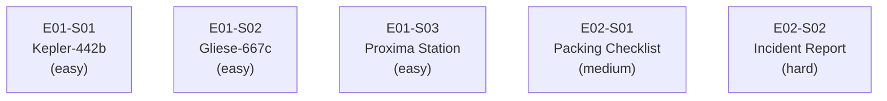

# Intergalactic Travel Advisory -- Implementation Plan

## Context

This is Run 4 of the Agentic SDLC v2 test suite. The content vehicle is a tongue-in-cheek space tourism bureau publication -- *The Intergalactic Travel Advisory* -- a brochure-style guide published by the fictional Bureau of Interstellar Tourism and Safety (BITS). The design optimizes for speed: every story produces exactly one markdown file of 100-200 words, all output goes to `test-output/travel-advisory/`, and no C# code is involved.

Run 4 validates operational fixes identified in Run 3:

1. **Board transition correctness** -- Every story must pass through Planned, Todo, In Progress, In Review, Done (Run 3 skipped stages)
2. **Scoped epic telemetry** -- Each epic issue receives only its own stories in the breakdown (Run 3 had cross-contamination)
3. **Backlog-level telemetry** -- Full lifecycle cost summary on the backlog issue (new convention)
4. **Tight word counts** -- 100-200 words per story, no fix cycles needed (Run 3 had overruns at 200-700)

The [design doc](../2-design/2026-03-10-intergalactic-travel-advisory.md) specifies the full content structure, acceptance criteria, and consistency contract. This plan translates that design into executable stories.

**No C# code changes.** All output is markdown files in `test-output/travel-advisory/`.

---

## Issue Reference

| ID | Issue | Title | Difficulty | Model |
|----|-------|-------|------------|-------|
| Backlog | #106 | Test SDLC v2 Workflow (Run 4) | -- | -- |
| Plan | #109 | Write implementation plan | -- | -- |
| E01 | #110 | Destination Profiles | -- | -- |
| E01-S01 | #112 | Kepler-442b -- The Resort World | easy | haiku |
| E01-S02 | #113 | Gliese-667c -- Extreme Tourism | easy | haiku |
| E01-S03 | #114 | Proxima Station -- Orbital Bazaar | easy | haiku |
| E02 | #111 | Advisory Supplements | -- | -- |
| E02-S01 | #115 | Packing Checklist | medium | sonnet |
| E02-S02 | #116 | Safety Incident Report | hard | opus |

---

## Structural Decisions

**Two epics, five stories.** The design doc evaluated three approaches and selected Approach A: 2 epics, 5 stories. A 6th story (FAQ) was rejected as adding time without testing new mechanics. A 3rd epic was rejected as a degenerate single-story epic. This plan follows the design doc's decision.

**Separate epic PRs (not combined).** Run 3 used a combined PR and this contributed to telemetry cross-contamination. Run 4 uses separate PRs per epic to validate scoped telemetry. Each epic branch gets its own PR to `main`, each with properly scoped `Closes` references.

**Two-wave dispatch.** All five stories have no hard dependencies (the consistency contract provides shared facts via acceptance criteria, not by reading other files). A single 5-story wave would work technically, but two waves provide a natural checkpoint for the orchestrator to verify Wave 1 board transitions before proceeding -- which is a primary Run 4 goal. Wave 1 = 3 easy (haiku), Wave 2 = 1 medium (sonnet) + 1 hard (opus).

---

## Content Consistency Contract

All stories must respect these shared facts (embedded in each story's acceptance criteria):

- The Bureau is called **BITS** (Bureau of Interstellar Tourism and Safety)
- The galaxy uses **Galactic Credits (GC)** as currency
- Three destinations: **Kepler-442b** (resort world), **Gliese-667c** (adventure/extreme tourism), **Proxima Station** (orbital bazaar/trading post)
- Safety ratings use a **1-5 scale** (1 = safe, 5 = almost certainly fatal)

This contract enables parallel builders to produce consistent content without reading each other's output.

---

## Epic 1: Destination Profiles

Three independent destination entries. All run in parallel (Wave 1). Each is a self-contained brochure page for one destination, following an identical template.

### E01-S01: Kepler-442b -- The Resort World -- `difficulty/easy`

Create `test-output/travel-advisory/kepler-442b.md`.

**Content requirements:**

- Title: "Kepler-442b -- The Galaxy's Premier Resort World"
- Sections: Overview (2-3 sentences), Climate, Attractions (3 bullet points), Safety Rating (1-5 with one-sentence justification), Bureau Advisory (1-2 sentence official warning)
- Must reference BITS, Galactic Credits, and safety rating scale
- Tone: overselling a destination that is clearly mediocre
- Total length: 100-200 words

**Acceptance criteria:**

- [ ] File exists at `test-output/travel-advisory/kepler-442b.md`
- [ ] Title is "Kepler-442b -- The Galaxy's Premier Resort World"
- [ ] Contains sections: Overview, Climate, Attractions, Safety Rating, Bureau Advisory
- [ ] Attractions section has exactly 3 bullet points
- [ ] Safety Rating is a number 1-5 with a one-sentence justification
- [ ] References "BITS" or "Bureau of Interstellar Tourism and Safety" at least once
- [ ] References "Galactic Credits" or "GC" at least once
- [ ] Word count: 100-200 words (verified via `wc -w`)

**Files to create:** `test-output/travel-advisory/kepler-442b.md`

**Dependencies:** None

**Branch:** `e01-s01/kepler-442b`

---

### E01-S02: Gliese-667c -- Extreme Tourism -- `difficulty/easy`

Create `test-output/travel-advisory/gliese-667c.md`.

**Content requirements:**

- Title: "Gliese-667c -- For the Adventurous Traveller"
- Same section structure as E01-S01 (Overview, Climate, Attractions, Safety Rating, Bureau Advisory)
- Safety Rating must be higher (more dangerous) than Kepler-442b
- Tone: bureaucratic understatement about genuinely lethal conditions
- Must reference BITS, Galactic Credits, and safety rating scale
- Total length: 100-200 words

**Acceptance criteria:**

- [ ] File exists at `test-output/travel-advisory/gliese-667c.md`
- [ ] Title is "Gliese-667c -- For the Adventurous Traveller"
- [ ] Contains sections: Overview, Climate, Attractions, Safety Rating, Bureau Advisory
- [ ] Attractions section has exactly 3 bullet points
- [ ] Safety Rating is a number 1-5, higher than Kepler-442b's (i.e., 3 or above)
- [ ] References "BITS" or "Bureau of Interstellar Tourism and Safety" at least once
- [ ] References "Galactic Credits" or "GC" at least once
- [ ] Word count: 100-200 words (verified via `wc -w`)

**Files to create:** `test-output/travel-advisory/gliese-667c.md`

**Dependencies:** None

**Branch:** `e01-s02/gliese-667c`

---

### E01-S03: Proxima Station -- Orbital Bazaar -- `difficulty/easy`

Create `test-output/travel-advisory/proxima-station.md`.

**Content requirements:**

- Title: "Proxima Station -- The Crossroads of Commerce"
- Same section structure as E01-S01 and E01-S02
- Must mention at least one item available for purchase (priced in Galactic Credits)
- Tone: a government agency grudgingly acknowledging a place it cannot regulate
- Must reference BITS, Galactic Credits, and safety rating scale
- Total length: 100-200 words

**Acceptance criteria:**

- [ ] File exists at `test-output/travel-advisory/proxima-station.md`
- [ ] Title is "Proxima Station -- The Crossroads of Commerce"
- [ ] Contains sections: Overview, Climate, Attractions, Safety Rating, Bureau Advisory
- [ ] Attractions section has exactly 3 bullet points
- [ ] At least one item priced in Galactic Credits (e.g., "50 GC")
- [ ] Safety Rating is a number 1-5 with a one-sentence justification
- [ ] References "BITS" or "Bureau of Interstellar Tourism and Safety" at least once
- [ ] Word count: 100-200 words (verified via `wc -w`)

**Files to create:** `test-output/travel-advisory/proxima-station.md`

**Dependencies:** None

**Branch:** `e01-s03/proxima-station`

---

## Epic 2: Advisory Supplements

Companion documents that reference the three destinations. These reference E01 destinations by name only (via the consistency contract), not by reading E01 output files. Both stories run in parallel (Wave 2).

### E02-S01: Packing Checklist -- `difficulty/medium`

Create `test-output/travel-advisory/packing-checklist.md`.

**Content requirements:**

- Title: "BITS Official Packing Checklist for Interstellar Travel"
- A markdown table with columns: Item, Quantity, Destination(s), Notes
- At least 6 items, each tagged to one or more of the three destinations
- At least 2 items must have humorous "Notes" (dry bureaucratic humour)
- A footnote disclaimer (1-2 sentences) in the Bureau's voice
- Must reference all three destinations by name (Kepler-442b, Gliese-667c, Proxima Station)
- Total length: 150-200 words

**Acceptance criteria:**

- [ ] File exists at `test-output/travel-advisory/packing-checklist.md`
- [ ] Title is "BITS Official Packing Checklist for Interstellar Travel"
- [ ] Contains a markdown table with columns: Item, Quantity, Destination(s), Notes
- [ ] Table has at least 6 rows (excluding header)
- [ ] At least 2 rows have humorous text in the Notes column
- [ ] All three destinations appear in the Destination(s) column: Kepler-442b, Gliese-667c, Proxima Station
- [ ] Contains a footnote disclaimer (1-2 sentences)
- [ ] References "BITS" or "Bureau of Interstellar Tourism and Safety" at least once
- [ ] References "Galactic Credits" or "GC" at least once
- [ ] Word count: 150-200 words (verified via `wc -w`)

**Files to create:** `test-output/travel-advisory/packing-checklist.md`

**Dependencies:** None (uses consistency contract for destination names)

**Branch:** `e02-s01/packing-checklist`

---

### E02-S02: Safety Incident Report -- `difficulty/hard`

Create `test-output/travel-advisory/incident-report.md`.

**Content requirements:**

- Title: "BITS Incident Report -- Annual Summary (Galactic Year 4271)"
- An introductory paragraph (2-3 sentences) from the Bureau Director
- A markdown table of 3 incidents (one per destination) with columns: Date, Location, Description (1 sentence), Outcome, Bureau Response
- Each incident must be consistent with the destination's character (e.g., Gliese-667c incident involves extreme conditions)
- A "Lessons Learned" section with 3 numbered points, each drily optimistic
- A closing line: the Bureau's annual safety slogan (invented by the builder)
- Must reference BITS, all three destinations, and Galactic Credits (at least one incident involves financial loss)
- Total length: 150-200 words

**Acceptance criteria:**

- [ ] File exists at `test-output/travel-advisory/incident-report.md`
- [ ] Title is "BITS Incident Report -- Annual Summary (Galactic Year 4271)"
- [ ] Contains an introductory paragraph (2-3 sentences)
- [ ] Contains a markdown table with columns: Date, Location, Description, Outcome, Bureau Response
- [ ] Table has exactly 3 rows (one per destination): Kepler-442b, Gliese-667c, Proxima Station
- [ ] Each incident is consistent with the destination's character
- [ ] Contains a "Lessons Learned" section with exactly 3 numbered points
- [ ] Each "Lessons Learned" point has a drily optimistic tone
- [ ] Contains a closing safety slogan line
- [ ] References "BITS" or "Bureau of Interstellar Tourism and Safety" at least once
- [ ] References "Galactic Credits" or "GC" at least once (in at least one incident)
- [ ] Word count: 150-200 words (verified via `wc -w`)

**Files to create:** `test-output/travel-advisory/incident-report.md`

**Dependencies:** None (uses consistency contract for destination names and characteristics)

**Branch:** `e02-s02/incident-report`

---

## Dependency Graph

**No dependency edges.** All five stories can theoretically run in a single wave. The consistency contract (shared facts in acceptance criteria) eliminates cross-story file dependencies.

---

## Dispatch Waves

| Wave | Stories | Parallel? | Model(s) | Notes |
|------|---------|-----------|----------|-------|
| 1 | E01-S01, E01-S02, E01-S03 | Yes (3 concurrent) | haiku x3 | All easy, all independent, same template |
| 2 | E02-S01, E02-S02 | Yes (2 concurrent) | sonnet x1, opus x1 | Medium + hard, concurrent board transition test |

**Wave 1 validates parallel dispatch with homogeneous models.** Three haiku builders on identical templates. The orchestrator must verify all three pass through every board state correctly before proceeding to Wave 2.

**Wave 2 validates mixed-model parallelism.** Sonnet and opus running concurrently tests whether board transitions work under heterogeneous load. This is the primary concurrency stress test for Run 4.

### Orchestrator Instructions

1. Create epic branches from `main`:
   - `epic/e01-destination-profiles`
   - `epic/e02-advisory-supplements`
2. Push both to remote immediately
3. Set all story issues to **Todo** (sequentially, one at a time)
4. **Wave 1:** Set E01-S01, E01-S02, E01-S03 to **In Progress** (sequentially), then dispatch 3 builders concurrently:
   - `subagent_type: "builder-haiku"` for all three
5. After each builder completes: set story to **In Review** (sequentially), post telemetry
6. Dispatch reviewer on each story branch (sequentially)
7. If reviewer finds issues: re-dispatch builder (max 2 cycles)
8. Merge each story branch into `epic/e01-destination-profiles`
9. **Verify Wave 1 board states** -- all 3 stories should be In Review
10. **Wave 2:** Set E02-S01 and E02-S02 to **In Progress** (sequentially), then dispatch 2 builders concurrently:
    - `subagent_type: "builder-sonnet"` for E02-S01
    - `subagent_type: "builder-opus"` for E02-S02
11. After each builder completes: set story to **In Review** (sequentially), post telemetry
12. Dispatch reviewer on each story branch
13. Merge each story branch into `epic/e02-advisory-supplements`
14. Add `docs/CHANGELOG.md` entry on each epic branch
15. Open separate PRs per epic to `main`:
    - E01 PR: `Closes #110, closes #112, closes #113, closes #114`
    - E02 PR: `Closes #106, closes #111, closes #115, closes #116` (backlog close on last PR)
16. Post scoped epic telemetry on each epic issue and PR
17. Post backlog-level telemetry on #106 after both PRs merge
18. Dispatch retro agent

---

## Epic PR Strategy

**Separate PRs per epic.** This is a deliberate choice to validate scoped telemetry (Run 3's combined PR caused cross-contamination). Each epic gets its own PR to `main`.

- **E01 PR:** From `epic/e01-destination-profiles` to `main`. Closes the E01 epic issue and all 3 E01 story issues.
- **E02 PR:** From `epic/e02-advisory-supplements` to `main`. Closes the E02 epic issue, both E02 story issues, and the backlog issue (#106).

Both PRs use squash merge (`gh pr merge --squash --delete-branch`).

---

## Reviewer Checklist

The reviewer validates structural compliance, not creative quality. For each story:

1. **File exists** at the specified path under `test-output/travel-advisory/`
2. **Section structure** matches acceptance criteria headings
3. **Word count** is within 100-200 words (verified via `wc -w`)
4. **Consistency contract** -- references BITS, Galactic Credits, safety rating scale, correct destination names
5. **Cross-references** -- E02 stories mention all three destinations by name
6. **Table structure** -- E02-S01 has correct columns, E02-S02 has correct columns and 3 rows

---

## Difficulty Classification Rationale

| Story | Difficulty | Files | Cross-refs | Rationale |
|-------|-----------|-------|------------|-----------|
| E01-S01 | easy | 1 create | None | Fill-in-the-blanks brochure, fixed section template |
| E01-S02 | easy | 1 create | None | Identical template to E01-S01, different destination |
| E01-S03 | easy | 1 create | None | Identical template to E01-S01, third variation |
| E02-S01 | medium | 1 create | 3 destination names | Markdown table, cross-referencing all destinations, structured data |
| E02-S02 | hard | 1 create | 3 destinations + GC | Most complex structure (intro + table + numbered list + slogan), cross-references all destinations, internal consistency |

**Classification rationale for E02-S02 as hard:** Despite being only 150-200 words, the density of structural requirements (intro paragraph + 3-row table with 5 columns + 3 numbered lessons + creative slogan) and the need for internal consistency across the incident table justify routing to opus. The "hard" label also ensures opus is exercised in this test run.

---

## Risks

| Risk | Impact | Mitigation |
|------|--------|------------|
| 200-word cap causes fix cycles | Adds 2-3 min per fix cycle | Cap is generous for brochure-style content; builders warned in AC |
| Board transitions still fail under parallelism | Run 4 reproduces Run 3 bugs | Orchestrator owns transitions sequentially; builder scripts are backup |
| Opus is slow on a short story | Hard story takes longer than estimated | 150-200 words gives opus less to do; worst case adds 2 min |
| Separate PRs add merge overhead | Extra 2-3 min vs combined PR | Validates scoped telemetry; worth the overhead |

---

## Estimated Cost & Duration

| Model | Stories | Est. Time/Story | Est. Sequential | Est. Cost/Story |
|-------|---------|-----------------|-----------------|-----------------|
| haiku | 3 | ~1 min | ~3 min | ~$0.03 |
| sonnet | 1 | ~1.5 min | ~1.5 min | ~$0.08 |
| opus | 1 | ~2 min | ~2 min | ~$0.50 |
| **Total** | **5** | | **~6.5 min seq** | **~$0.67** |

With two parallel waves: estimated wall-clock ~3.5 min build time (Wave 1 ~1 min, Wave 2 ~2 min, plus review/merge overhead).

Total including reviews, merges, telemetry: ~8-10 minutes.
