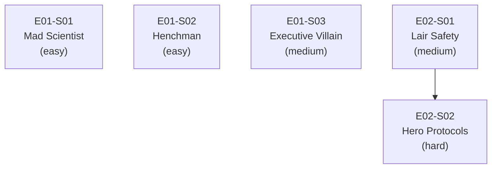

# The Supervillain Employee Handbook -- Implementation Plan

## Context

This is Run 5 of the Agentic SDLC v2 test suite. The content vehicle is **"The Supervillain Employee Handbook"** -- an internal onboarding manual for new hires at *DoomCo Industries -- World's Leading Evil Enterprise*. Voice: deadpan corporate HR meets cartoon villainy.

Run 5 retests the full SDLC pipeline after Run 4 fixes, using completely different content to avoid template bias. All five stories produce one markdown file each (100-300 words), all output goes to `test-output/doomco-handbook/`, and no C# code is involved.

The [design doc](../2-design/2026-03-10-doomco-handbook.md) specifies the full content structure, acceptance criteria, and cross-reference rules. This plan translates that design into executable stories.

**No C# code changes.** All output is markdown files in `test-output/doomco-handbook/`.

---

## Issue Reference

| ID | Issue | Title | Difficulty | Model |
|----|-------|-------|------------|-------|
| Backlog | #146 | Test SDLC v2 Workflow (Run 5) | -- | -- |
| Plan | #149 | Write implementation plan | -- | -- |
| E01 | #150 | Role Profiles | -- | -- |
| E01-S01 | #152 | Role Profile -- Mad Scientist | easy | haiku |
| E01-S02 | #153 | Role Profile -- Henchman (General) | easy | haiku |
| E01-S03 | #154 | Role Profile -- Executive Villain (C-Suite) | medium | sonnet |
| E02 | #151 | Company Policies | -- | -- |
| E02-S01 | #155 | Lair Safety & Compliance Guidelines | medium | sonnet |
| E02-S02 | #156 | Hero Encounter Protocols & Monologue Best Practices | hard | opus |

---

## Structural Decisions

**Two epics, five stories.** The design doc evaluated three approaches and selected Approach A: 2 epics, 5 stories. A 6th story (Henchman Union Regulations) was rejected as adding time without testing new SDLC mechanics. A 3rd epic was rejected as violating the backlog brief. This plan follows the design doc's decision.

**Separate epic PRs (not combined).** Each epic gets its own PR to `main`. This follows the CLAUDE.md default and is consistent with Run 4's approach for scoped telemetry.

**Three-wave dispatch.** The design doc defines three waves based on cross-reference dependencies. While E01-S02 and E01-S03 have semantic cross-references to other roles, these are specified in acceptance criteria (not filesystem dependencies). However, the design doc places E01-S03 and E02-S01 in Wave 2 because E01-S03 references the other two roles and benefits from them being complete. E02-S02 depends on E02-S01 for lair safety zone references. This plan follows the design doc's wave structure.

---

## Content Consistency Contract

All stories must respect these shared facts (embedded in each story's acceptance criteria):

- The company is **DoomCo Industries** (full: *DoomCo Industries -- World's Leading Evil Enterprise*)
- The HR department is **Department of Villainous Human Resources**
- All documents are stamped **"CONFIDENTIAL -- Evil Eyes Only"**
- Three roles: **Mad Scientist** (Research & Doomsday Development), **Henchman (General)** (Operations & Minion Management), **Executive Villain (C-Suite)** (Executive Villainy & Strategic Doom)
- Role profile template: Position Summary, Required Evil Skills, Common Workplace Violations, Evil Performance Metrics

This contract enables parallel builders to produce consistent content without reading each other's output.

---

## Epic 1: Role Profiles

Three villain role profiles. E01-S01 and E01-S02 are independent and run in parallel (Wave 1). E01-S03 runs in Wave 2.

### E01-S01: Role Profile -- Mad Scientist -- `difficulty/easy`

Create `test-output/doomco-handbook/role-mad-scientist.md`.

**Content requirements:**

- Header: "CONFIDENTIAL -- Evil Eyes Only" and DoomCo Industries branding
- Title: "Role Profile: Mad Scientist"
- Department: Research & Doomsday Development
- Sections: Position Summary (2-3 sentences), Required Evil Skills (4-5 bullet points), Common Workplace Violations (3 bullets), Evil Performance Metrics (3 metrics with target values)
- Deadpan HR tone throughout
- Total length: 100-200 words

**Acceptance criteria:**

- [ ] File exists at `test-output/doomco-handbook/role-mad-scientist.md`
- [ ] Contains header text "CONFIDENTIAL -- Evil Eyes Only"
- [ ] Title is "Role Profile: Mad Scientist"
- [ ] Department listed as "Research & Doomsday Development"
- [ ] Contains sections: Position Summary, Required Evil Skills, Common Workplace Violations, Evil Performance Metrics
- [ ] Position Summary is 2-3 sentences
- [ ] Required Evil Skills has 4-5 bullet points
- [ ] Common Workplace Violations has 3 bullet points
- [ ] Evil Performance Metrics has 3 metrics with target values
- [ ] Deadpan corporate HR tone maintained throughout
- [ ] Word count: 100-200 words (verified via `wc -w`)

**Files to create:** `test-output/doomco-handbook/role-mad-scientist.md`

**Dependencies:** None

**Branch:** `e01-s01/role-mad-scientist`

---

### E01-S02: Role Profile -- Henchman (General) -- `difficulty/easy`

Create `test-output/doomco-handbook/role-henchman.md`.

**Content requirements:**

- Same template structure as E01-S01
- Title: "Role Profile: Henchman (General)"
- Department: Operations & Minion Management
- Sections: Position Summary, Required Evil Skills, Common Workplace Violations, Evil Performance Metrics
- Must reference the Mad Scientist role in at least one bullet (e.g., "Must tolerate proximity to Mad Scientist experiments")
- Total length: 100-200 words

**Acceptance criteria:**

- [ ] File exists at `test-output/doomco-handbook/role-henchman.md`
- [ ] Contains header text "CONFIDENTIAL -- Evil Eyes Only"
- [ ] Title is "Role Profile: Henchman (General)"
- [ ] Department listed as "Operations & Minion Management"
- [ ] Contains sections: Position Summary, Required Evil Skills, Common Workplace Violations, Evil Performance Metrics
- [ ] Position Summary is 2-3 sentences
- [ ] Required Evil Skills has 4-5 bullet points
- [ ] Common Workplace Violations has 3 bullet points
- [ ] Evil Performance Metrics has 3 metrics with target values
- [ ] References "Mad Scientist" at least once
- [ ] Deadpan corporate HR tone maintained throughout
- [ ] Word count: 100-200 words (verified via `wc -w`)

**Files to create:** `test-output/doomco-handbook/role-henchman.md`

**Dependencies:** None

**Branch:** `e01-s02/role-henchman`

---

### E01-S03: Role Profile -- Executive Villain (C-Suite) -- `difficulty/medium`

Create `test-output/doomco-handbook/role-executive-villain.md`.

**Content requirements:**

- Same template structure as E01-S01/S02 PLUS two additional sections:
  - "Monologue Requirements" -- 3-4 bullet points on mandatory monologue length, approved dramatic pauses, and villain catchphrase registration
  - "Direct Reports" -- a short org chart listing Mad Scientist and Henchman (General) as direct reports with a one-line description of each
- Title: "Role Profile: Executive Villain (C-Suite)"
- Department: Executive Villainy & Strategic Doom
- Must reference both the Mad Scientist and Henchman roles by name
- Total length: 150-250 words

**Acceptance criteria:**

- [ ] File exists at `test-output/doomco-handbook/role-executive-villain.md`
- [ ] Contains header text "CONFIDENTIAL -- Evil Eyes Only"
- [ ] Title is "Role Profile: Executive Villain (C-Suite)"
- [ ] Department listed as "Executive Villainy & Strategic Doom"
- [ ] Contains sections: Position Summary, Required Evil Skills, Common Workplace Violations, Evil Performance Metrics, Monologue Requirements, Direct Reports
- [ ] Position Summary is 2-3 sentences
- [ ] Required Evil Skills has 4-5 bullet points
- [ ] Common Workplace Violations has 3 bullet points
- [ ] Evil Performance Metrics has 3 metrics with target values
- [ ] Monologue Requirements has 3-4 bullet points
- [ ] Direct Reports lists both "Mad Scientist" and "Henchman (General)" with descriptions
- [ ] Deadpan corporate HR tone maintained throughout
- [ ] Word count: 150-250 words (verified via `wc -w`)

**Files to create:** `test-output/doomco-handbook/role-executive-villain.md`

**Dependencies:** None (cross-references from AC, not filesystem)

**Branch:** `e01-s03/role-executive-villain`

---

## Epic 2: Company Policies

Operational policies that reference the role profiles from Epic 1. E02-S02 depends on E02-S01 (hero encounter protocols reference lair safety zones).

### E02-S01: Lair Safety & Compliance Guidelines -- `difficulty/medium`

Create `test-output/doomco-handbook/lair-safety.md`.

**Content requirements:**

- Header: "CONFIDENTIAL -- Evil Eyes Only"
- Title: "Lair Safety & Compliance Guidelines"
- Issued by: DoomCo Health, Safety & Evil Compliance Division
- Sections:
  - "General Lair Safety" -- 4-5 numbered rules (fire exits near lava pits, proper labelling of doomsday devices, etc.)
  - "Department-Specific Hazards" -- one hazard entry per role from Epic 1 (Mad Scientist: chemical spills, Henchman: trap door proximity, Executive Villain: ego-related structural damage)
  - "Inspection Schedule" -- a small table with 3 rows: area, frequency, inspector title
- Must reference all three roles from Epic 1 by name
- Total length: 150-250 words

**Acceptance criteria:**

- [ ] File exists at `test-output/doomco-handbook/lair-safety.md`
- [ ] Contains header text "CONFIDENTIAL -- Evil Eyes Only"
- [ ] Title is "Lair Safety & Compliance Guidelines"
- [ ] Issued by "DoomCo Health, Safety & Evil Compliance Division"
- [ ] Contains section "General Lair Safety" with 4-5 numbered rules
- [ ] Contains section "Department-Specific Hazards" with entries for Mad Scientist, Henchman (General), and Executive Villain (C-Suite)
- [ ] Contains section "Inspection Schedule" with a markdown table (3 rows: area, frequency, inspector title)
- [ ] References all three roles by name: "Mad Scientist", "Henchman", "Executive Villain"
- [ ] Deadpan corporate HR tone maintained throughout
- [ ] Word count: 150-250 words (verified via `wc -w`)

**Files to create:** `test-output/doomco-handbook/lair-safety.md`

**Dependencies:** None (cross-references from AC, not filesystem)

**Branch:** `e02-s01/lair-safety`

---

### E02-S02: Hero Encounter Protocols & Monologue Best Practices -- `difficulty/hard`

Create `test-output/doomco-handbook/hero-protocols.md`.

**Content requirements:**

- Header: "CONFIDENTIAL -- Evil Eyes Only"
- Title: "Hero Encounter Protocols & Monologue Best Practices"
- Issued by: DoomCo Department of Villainous Human Resources
- Sections:
  - "Hero Alert Levels" -- a table with 3 levels (Yellow/Orange/Red), trigger conditions, and required response per role (Mad Scientist, Henchman, Executive Villain)
  - "Monologue Best Practices" -- 5 numbered guidelines for delivering a villain monologue during hero encounters (timing, dramatic pauses, never revealing the full plan, approved catchphrases, mandatory escape route check)
  - "Post-Encounter Debrief" -- 3 required steps after a hero encounter (incident report, lair damage assessment, morale recovery for henchmen)
  - "Emergency Evacuation" -- references the lair safety zones from E02-S01 and specifies evacuation order by seniority (Executive Villain first, naturally)
- Must reference all three roles from Epic 1
- Must reference the Lair Safety Guidelines from E02-S01 at least twice
- Total length: 200-300 words

**Acceptance criteria:**

- [ ] File exists at `test-output/doomco-handbook/hero-protocols.md`
- [ ] Contains header text "CONFIDENTIAL -- Evil Eyes Only"
- [ ] Title is "Hero Encounter Protocols & Monologue Best Practices"
- [ ] Issued by "DoomCo Department of Villainous Human Resources"
- [ ] Contains section "Hero Alert Levels" with a markdown table: 3 levels (Yellow, Orange, Red), trigger conditions, role-specific responses
- [ ] Contains section "Monologue Best Practices" with 5 numbered guidelines
- [ ] Contains section "Post-Encounter Debrief" with 3 required steps
- [ ] Contains section "Emergency Evacuation" referencing lair safety zones and evacuation order by seniority
- [ ] References all three roles by name: "Mad Scientist", "Henchman", "Executive Villain"
- [ ] References "Lair Safety" or "Lair Safety & Compliance Guidelines" at least twice
- [ ] Deadpan corporate HR tone maintained throughout
- [ ] Word count: 200-300 words (verified via `wc -w`)

**Files to create:** `test-output/doomco-handbook/hero-protocols.md`

**Dependencies:** E02-S01 (references lair safety zones)

**Branch:** `e02-s02/hero-protocols`

---

## Dependency Graph

**One dependency edge:** E02-S02 depends on E02-S01 because the hero encounter protocols reference lair safety zones. All other stories are independent via the consistency contract.

---

## Dispatch Waves

| Wave | Stories | Parallel? | Model(s) | Notes |
|------|---------|-----------|----------|-------|
| 1 | E01-S01, E01-S02 | Yes (2 concurrent) | haiku x2 | Both easy, both independent, same template |
| 2 | E01-S03, E02-S01 | Yes (2 concurrent) | sonnet x2 | Medium stories, independent (cross-refs from AC) |
| 3 | E02-S02 | No (1 sequential) | opus x1 | Hard, depends on E02-S01 |

**Wave 1 validates parallel dispatch with homogeneous models.** Two haiku builders on identical templates.

**Wave 2 validates parallel dispatch across epics.** E01-S03 (Epic 1) and E02-S01 (Epic 2) run concurrently. Both are medium/sonnet. E01-S03 references the other roles by name from AC, not by reading files. E02-S01 similarly references roles from AC.

**Wave 3 is sequential.** E02-S02 must reference lair safety zones from E02-S01, making it a true dependency. This is also the hard/opus story, ensuring the full difficulty range is exercised.

### Orchestrator Instructions

1. Create epic branches from `main`:
   - `epic/e01-role-profiles`
   - `epic/e02-company-policies`
2. Push both to remote immediately
3. Set all story issues to **Todo** (sequentially, one at a time)
4. **Wave 1:** Set E01-S01, E01-S02 to **In Progress** (sequentially), then dispatch 2 builders concurrently:
   - `subagent_type: "builder-haiku"` for both
5. After each builder completes: set story to **In Review** (sequentially), post telemetry
6. Dispatch reviewer on each story branch (sequentially)
7. If reviewer finds issues: re-dispatch builder (max 2 cycles)
8. Merge each story branch into `epic/e01-role-profiles`
9. **Wave 2:** Set E01-S03, E02-S01 to **In Progress** (sequentially), then dispatch 2 builders concurrently:
   - `subagent_type: "builder-sonnet"` for both
10. After each builder completes: set story to **In Review** (sequentially), post telemetry
11. Dispatch reviewer on each story branch
12. Merge E01-S03 into `epic/e01-role-profiles`, merge E02-S01 into `epic/e02-company-policies`
13. **Wave 3:** Set E02-S02 to **In Progress**, dispatch 1 builder:
    - `subagent_type: "builder-opus"`
14. After builder completes: set story to **In Review**, post telemetry
15. Dispatch reviewer on story branch
16. Merge E02-S02 into `epic/e02-company-policies`
17. Add `docs/CHANGELOG.md` entry on each epic branch
18. Open separate PRs per epic to `main`:
    - E01 PR: `Closes #<E01>, closes #<E01-S01>, closes #<E01-S02>, closes #<E01-S03>`
    - E02 PR: `Closes #146, closes #<E02>, closes #<E02-S01>, closes #<E02-S02>` (backlog close on last PR)
19. Post scoped epic telemetry on each epic issue and PR
20. Post backlog-level telemetry on #146 after both PRs merge
21. Dispatch retro agent

---

## Epic PR Strategy

**Separate PRs per epic.** Each epic gets its own PR to `main`, consistent with the CLAUDE.md default and Run 4 approach.

- **E01 PR:** From `epic/e01-role-profiles` to `main`. Closes the E01 epic issue and all 3 E01 story issues.
- **E02 PR:** From `epic/e02-company-policies` to `main`. Closes the E02 epic issue, both E02 story issues, and the backlog issue (#146).

Both PRs use squash merge (`gh pr merge --squash --delete-branch`).

---

## Reviewer Checklist

The reviewer validates structural compliance, not creative quality. For each story:

1. **File exists** at the specified path under `test-output/doomco-handbook/`
2. **Section structure** matches acceptance criteria headings
3. **Word count** is within the specified range (verified via `wc -w`)
4. **Consistency contract** -- references DoomCo Industries, correct role names, correct department names
5. **Cross-references** -- E02 stories mention all three roles by name; E02-S02 references lair safety at least twice
6. **Table structure** -- E02-S01 inspection schedule and E02-S02 hero alert levels have correct columns and rows

---

## Difficulty Classification Rationale

| Story | Difficulty | Files | Cross-refs | Rationale |
|-------|-----------|-------|------------|-----------|
| E01-S01 | easy | 1 create | None | Fill-in-the-blanks role profile, fixed section template |
| E01-S02 | easy | 1 create | 1 role name | Identical template to E01-S01, one cross-reference to Mad Scientist |
| E01-S03 | medium | 1 create | 2 role names | Extra sections (Monologue Requirements, Direct Reports), cross-references both other roles |
| E02-S01 | medium | 1 create | 3 role names | Structured compliance doc with table, cross-references all three roles |
| E02-S02 | hard | 1 create | 3 roles + lair safety | Most complex structure (table + 5 guidelines + 3 steps + evacuation), cross-references all roles and E02-S01 |

**Classification rationale for E02-S02 as hard:** Despite being only 200-300 words, the density of structural requirements (alert table with role-specific responses + 5 numbered guidelines + 3 debrief steps + evacuation section) and the need for cross-referencing all prior documents justify routing to opus. The "hard" label also ensures opus is exercised in this test run.

---

## Risks

| Risk | Impact | Mitigation |
|------|--------|------------|
| Word count cap causes fix cycles | Adds 2-3 min per fix cycle | Caps are generous for template content; builders warned in AC |
| Board transitions fail under parallelism | Run 5 reproduces prior bugs | Orchestrator owns transitions sequentially; builder scripts are backup |
| Opus is slow on a short story | Hard story takes longer than estimated | 200-300 words gives opus less to do; worst case adds 2 min |
| Three waves instead of two adds time | Extra ~1 min sequential overhead | Wave 3 exercises the opus model separately, which is worth the overhead |

---

## Estimated Cost & Duration

| Model | Stories | Est. Time/Story | Est. Sequential | Est. Cost/Story |
|-------|---------|-----------------|-----------------|-----------------|
| haiku | 2 | ~1 min | ~2 min | ~$0.03 |
| sonnet | 2 | ~1.5 min | ~3 min | ~$0.08 |
| opus | 1 | ~3 min | ~3 min | ~$0.75 |
| **Total** | **5** | | **~8 min seq** | **~$0.97** |

With three waves (2 parallel, 2 parallel, 1 sequential): estimated wall-clock ~5-6 min build time, plus review/merge overhead.

Total including reviews, merges, telemetry: ~8-12 minutes (per backlog brief).
