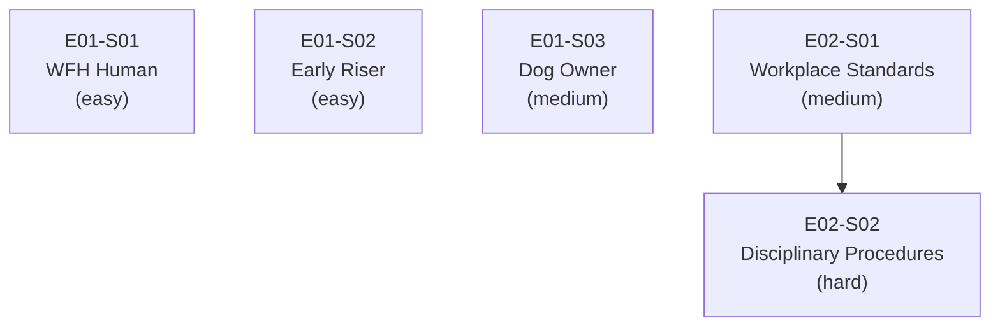

# Implementation Plan: The Cat's Employee Performance Review (Run 6)

> **Backlog:** #162 — Test SDLC v2 Workflow (Run 6) — Single-PR Workflow
> **Design:** `docs/2-design/2026-03-10-cat-performance-review.md`

## Overview

This plan decomposes the Cat Performance Review feature into 2 epics and 5 stories. The feature produces markdown content only (no C# code) in `test-output/cat-performance-review/`. Its primary purpose is validating the single-PR workflow introduced in #161.

## Structural Decisions

**Why 2 epics (not 1 or 3):** The design doc specifies two natural groupings — individual employee reviews (Epic 1, independent/parallel) and corporate policy documents (Epic 2, sequential with cross-references). Merging them into one epic would lose the parallel vs sequential distinction. Splitting further would create epics with only one story each, adding overhead without value.

**Why 3+2 story split:** Epic 1's three stories are fully independent (same template, different humans), making them ideal for parallel dispatch. Epic 2's two stories have an explicit dependency chain (disciplinary procedures reference workplace standards). This split exercises both parallel and sequential dispatch in one run.

## Output Structure

```
test-output/cat-performance-review/
├── review-wfh-human.md          # E01-S01 (easy)
├── review-early-riser.md        # E01-S02 (easy)
├── review-dog-owner.md          # E01-S03 (medium)
├── workplace-standards.md       # E02-S01 (medium)
└── disciplinary-procedures.md   # E02-S02 (hard)
```

## Dependency Graph



## Dispatch Plan

| Wave | Stories | Dispatch | Notes |
|------|---------|----------|-------|
| **Wave 1** | E01-S01, E01-S02, E01-S03 | Parallel (3 stories) | All independent, same template |
| **Wave 2** | E02-S01 | Sequential | References employee types by category name from AC |
| **Wave 3** | E02-S02 | Sequential | Depends on E02-S01 (cross-references workplace standards) |

**Fallback:** If 3-story parallel dispatch fails, fall back to sequential execution (S01, S02, S03, S04, S05).

## Epic 1: Human Employee Reviews

Three independent performance reviews following the same template. Each produces one markdown file in `test-output/cat-performance-review/`.

### E01-S01: Performance Review — The Work-From-Home Human

- **Difficulty:** `difficulty/easy`
- **File:** `test-output/cat-performance-review/review-wfh-human.md`
- **Branch:** `e01-s01/wfh-human`
- **Dependencies:** None

**Acceptance Criteria:**

- [ ] File exists at `test-output/cat-performance-review/review-wfh-human.md`
- [ ] Header: "CONFIDENTIAL — Cats Only. If You Are a Dog, Stop Reading."
- [ ] Feline Resources Department — Whiskers & Associates branding
- [ ] Title: "Annual Performance Review: The Work-From-Home Human"
- [ ] Cat-assigned employee name (e.g., "Lap Provider #7")
- [ ] Sections: Lap Availability (2-3 sentences), Performance Metrics (3-4 metrics rated out of 5 paws), Areas for Improvement (2-3 bullets), Overall Rating (X/5 paws with one-sentence summary)
- [ ] Deadpan HR tone throughout
- [ ] Word count: 100-200 words

### E01-S02: Performance Review — The Early Riser

- **Difficulty:** `difficulty/easy`
- **File:** `test-output/cat-performance-review/review-early-riser.md`
- **Branch:** `e01-s02/early-riser`
- **Dependencies:** None

**Acceptance Criteria:**

- [ ] File exists at `test-output/cat-performance-review/review-early-riser.md`
- [ ] Header: "CONFIDENTIAL — Cats Only. If You Are a Dog, Stop Reading."
- [ ] Feline Resources Department — Whiskers & Associates branding
- [ ] Title: "Annual Performance Review: The Early Riser"
- [ ] Cat-assigned employee name (different from E01-S01)
- [ ] At least one metric related to pre-dawn feeding schedule compliance
- [ ] Sections: Lap Availability, Performance Metrics (3-4 metrics), Areas for Improvement (2-3 bullets), Overall Rating (X/5 paws)
- [ ] Deadpan HR tone throughout
- [ ] Word count: 100-200 words

### E01-S03: Performance Review — The One Who Got a Dog

- **Difficulty:** `difficulty/medium`
- **File:** `test-output/cat-performance-review/review-dog-owner.md`
- **Branch:** `e01-s03/dog-owner`
- **Dependencies:** None

**Acceptance Criteria:**

- [ ] File exists at `test-output/cat-performance-review/review-dog-owner.md`
- [ ] Header: "CONFIDENTIAL — Cats Only. If You Are a Dog, Stop Reading."
- [ ] Feline Resources Department — Whiskers & Associates branding
- [ ] Title: "Annual Performance Review: The One Who Got a Dog"
- [ ] Cat-assigned employee name with note "under review for potential termination"
- [ ] Same base sections as E01-S01/S02 (Lap Availability, Performance Metrics, Areas for Improvement, Overall Rating)
- [ ] Additional section: "Disciplinary Notice" (2-3 sentences about acquiring a canine)
- [ ] Additional section: "Corrective Action Plan" (3 bullet points for required remediation)
- [ ] Dog referred to as "unauthorized workplace intruder" or similar corporate euphemism
- [ ] Overall rating significantly lower than E01-S01/S02
- [ ] Deadpan HR tone throughout
- [ ] Word count: 150-200 words

## Epic 2: HR Policies & Procedures

Corporate policy documents that reference employee types from Epic 1 by category name (from acceptance criteria, not by reading files).

### E02-S01: Feline Workplace Standards & Human Conduct Guidelines

- **Difficulty:** `difficulty/medium`
- **File:** `test-output/cat-performance-review/workplace-standards.md`
- **Branch:** `e02-s01/workplace-standards`
- **Dependencies:** None (references employee types by category name from AC, not from files)

**Acceptance Criteria:**

- [ ] File exists at `test-output/cat-performance-review/workplace-standards.md`
- [ ] Header: "CONFIDENTIAL — Cats Only. If You Are a Dog, Stop Reading."
- [ ] Title: "Feline Workplace Standards & Human Conduct Guidelines"
- [ ] Issued by: Feline Resources Department — Whiskers & Associates
- [ ] Section: "Acceptable Human Conduct" — 4-5 numbered rules
- [ ] Section: "Mandatory Human Obligations" — 3-4 bullet points (feeding schedules, lap availability quotas, door-opening response time SLAs)
- [ ] Section: "Prohibited Behaviours" — 3 bullet points (must include introducing dogs, vacuum cleaner during nap hours, closing bathroom door)
- [ ] References at least two employee types by category: "Work-From-Home Humans" and "Early Risers"
- [ ] Deadpan corporate policy tone
- [ ] Word count: 150-200 words

### E02-S02: Disciplinary Procedures & Termination Protocols

- **Difficulty:** `difficulty/hard`
- **File:** `test-output/cat-performance-review/disciplinary-procedures.md`
- **Branch:** `e02-s02/disciplinary-procedures`
- **Dependencies:** E02-S01 (references workplace standards document)

**Acceptance Criteria:**

- [ ] File exists at `test-output/cat-performance-review/disciplinary-procedures.md`
- [ ] Header: "CONFIDENTIAL — Cats Only. If You Are a Dog, Stop Reading."
- [ ] Title: "Disciplinary Procedures & Termination Protocols"
- [ ] Issued by: Feline Resources Department — Whiskers & Associates
- [ ] Section: "Offence Classification Table" — markdown table with 3 severity levels (Minor Infraction, Major Violation, Termination-Worthy Offence), example offences, prescribed penalties
- [ ] Section: "Progressive Discipline Process" — 4 numbered steps from verbal warning (hissing) through termination (the cat leaves and never returns)
- [ ] Section: "Termination Protocols" — 3 bullet points covering procedure for dog acquisition (references Workplace Standards and Dog Owner review)
- [ ] Section: "Appeals Process" — 2 sentences explaining there is no appeals process because cats are never wrong
- [ ] References Workplace Standards document (E02-S01) at least twice
- [ ] References Dog Owner employee type (E01-S03)
- [ ] Internally consistent offence-to-penalty mapping across severity levels
- [ ] Deadpan corporate policy tone
- [ ] Word count: 200-300 words

## Difficulty Distribution

| Difficulty | Stories | Model | Count |
|-----------|---------|-------|-------|
| Easy | E01-S01, E01-S02 | haiku | 2 |
| Medium | E01-S03, E02-S01 | sonnet | 2 |
| Hard | E02-S02 | opus | 1 |
| **Total** | | | **5** |

## Branch Strategy

```
backlog/162-cat-performance-review          ← integration branch (single PR to main)
├── epic/e01-human-reviews                  ← epic branch (from integration)
│   ├── e01-s01/wfh-human                  ← story branch (from epic)
│   ├── e01-s02/early-riser                ← story branch (from epic)
│   └── e01-s03/dog-owner                  ← story branch (from epic)
└── epic/e02-hr-policies                    ← epic branch (from integration)
    ├── e02-s01/workplace-standards         ← story branch (from epic)
    └── e02-s02/disciplinary-procedures     ← story branch (from epic)
```

Stories merge into epic branches (`--no-ff`). Epic branches merge into integration branch (`--no-ff`). Single backlog PR from integration branch to `main` (squash merge by human).

## Reviewer Checks

The reviewer validates structural compliance, not creative quality:

1. File exists at the specified path
2. Section structure matches acceptance criteria headings
3. Word count is within range (100-200 for easy/medium, 200-300 for E02-S02)
4. Cross-references present where required
5. "CONFIDENTIAL — Cats Only" header on every document
6. Deadpan corporate HR tone maintained (not breaking character)

## Estimated Duration

| Phase | Est. Time |
|-------|-----------|
| Design | ~2 min |
| Plan | ~3 min |
| Build (Wave 1: 3 parallel) | ~2 min wall-clock |
| Build (Wave 2: sequential) | ~1.5 min |
| Build (Wave 3: sequential) | ~3 min |
| Review (5 stories) | ~3 min |
| Retro | ~2 min |
| **Total** | **~12-15 min** |
