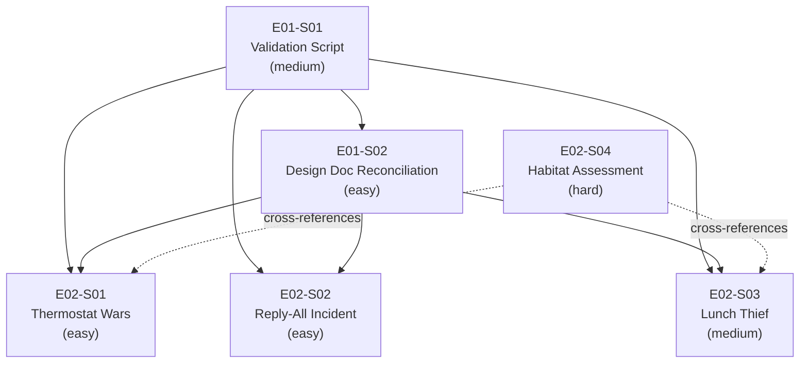

# Implementation Plan: Run 10 -- Orchestrator Logging Validation + Office Nature Documentary (Season 2)

## Overview

This plan decomposes backlog item #27 into 2 epics and 6 stories. The run has two workstreams:

1. **Epic 1 -- Logging Infrastructure Validation** (2 stories, sequential): Create a post-run log validation script and reconcile the logging design doc with the actual implementation.
2. **Epic 2 -- Nature Documentary Content Season 2** (4 stories, mixed parallel/sequential): Four new content files in the Office Nature Documentary universe, exercising all three difficulty levels and worktree-isolated parallel dispatch.

Epic 1 must complete before Epic 2 begins. The logging infrastructure is already implemented on `main` (hooks, filter config, board-status logging); Epic 1 validates and documents it. Epic 2 then exercises it by generating real build activity that the hooks capture.

## Structural Decisions

**Why 2 epics (not 1 or 3):** The two workstreams -- infrastructure validation and content creation -- are fundamentally different in nature (scripts/docs vs markdown content), have a hard ordering dependency (infra first), and use different review criteria. Splitting content into two epics would add branch management overhead with no benefit since all four content stories share the same voice, directory, and review criteria.

**Why E02-S04 is in Wave 4 (not Wave 3):** The design doc notes E02-S04 cross-references Season 2 episodes by title. While the references are by document ID and title string (not file content), running E02-S04 last ensures the builder can see the completed episodes if it chooses to verify consistency. This also tests 3-way parallelism (proven in Runs 8 and 9) without introducing untested 4-way parallelism, keeping the run shape conservative.

**Why no ADR:** This run introduces no new architectural patterns or conventions. The validation script follows existing script conventions. The design doc reconciliation updates an existing document. An ADR would be empty boilerplate.

## File Inventory

| Story | Action | File Path | Type |
|-------|--------|-----------|------|
| E01-S01 | Create | `scripts/validate-logs.sh` | Bash script |
| E01-S02 | Edit | `docs/2-design/2026-03-13-orchestrator-logging.md` | Design doc |
| E02-S01 | Create | `test-output/office-nature-documentary/s2-episode-the-thermostat-wars.md` | Content |
| E02-S02 | Create | `test-output/office-nature-documentary/s2-episode-the-reply-all-incident.md` | Content |
| E02-S03 | Create | `test-output/office-nature-documentary/s2-episode-the-lunch-thief.md` | Content |
| E02-S04 | Create | `test-output/office-nature-documentary/s2-habitat-assessment-phone-booth.md` | Content |

## Dependency Graph



**Dependency rationale:**

- E01-S02 depends on E01-S01 because the design doc reconciliation references the validation script path.
- E02-S01, E02-S02, and E02-S03 depend on both E01 stories (the entire logging epic must complete first so content build waves exercise the logging).
- E02-S04 has dotted-line (soft) dependencies on E02-S01 and E02-S03 -- it cross-references Season 2 episodes by title and document ID. These are cosmetic references, not file reads, but running E02-S04 last makes the references verifiable.

## Dispatch Plan

| Wave | Stories | Dispatch | Model(s) | Notes |
|------|---------|----------|----------|-------|
| **Wave 1** | E01-S01 | Sequential | Sonnet | Validation script -- must exist before E01-S02 |
| **Wave 2** | E01-S02 | Sequential | Haiku | Design doc text edits -- depends on E01-S01 |
| **Wave 3** | E02-S01, E02-S02, E02-S03 | Parallel (worktree isolation) | Haiku, Haiku, Sonnet | Three independent content episodes |
| **Wave 4** | E02-S04 | Sequential | Opus | Habitat assessment with cross-references |

**Estimated total agent time:** 10-15 minutes (E01 ~3-5 min, E02 ~7-10 min).

---

## Epic 1: Logging Infrastructure Validation

### E01-S01: Logging Validation Script (medium)

**Branch:** `e01-s01/validate-logs`

**Summary:** Create `scripts/validate-logs.sh` -- a post-run diagnostic script that reads both log files and reports whether expected events were captured.

**Files to create:**
- `scripts/validate-logs.sh` (executable)

**Acceptance criteria:**
- [ ] Script is executable (`chmod +x`) and runs without errors when log files exist
- [ ] Script handles missing log files gracefully (reports "not found" instead of crashing)
- [ ] Parses `.claude/logs/board-status.log` and counts events by type: `START`, `MUTATION`, `VERIFY_OK`, `VERIFY_MISMATCH`, `SKIP`
- [ ] Parses `.claude/logs/orchestrator.log` and counts events by tool type: `Bash`, `Task`/`Agent`
- [ ] `VERIFY_MISMATCH` events are surfaced prominently with full log line details
- [ ] Summary table is human-readable (matches format from design doc)
- [ ] Exit code 0 when run (diagnostic script, not a test)
- [ ] Pre-commit hook passes (`dotnet test` is unaffected by a new shell script)

**Implementation notes:**
- Use `grep -c` for counting, `grep` for extracting mismatch lines
- Handle both `Task` and `Agent` tool names in orchestrator log parsing (the hook may log either)
- No external dependencies beyond standard POSIX tools (grep, awk, wc)

**Difficulty classification:**
- Touches 1 project directory (`scripts/`)
- No new abstractions
- No DI or EF changes
- Requires parsing structured log formats and conditional formatting
- Existing pattern: follows `scripts/item-set-status.sh` script conventions
- **Verdict: medium** (multi-section script with log parsing logic)

---

### E01-S02: Design Doc Reconciliation (easy)

**Branch:** `e01-s02/design-doc-reconciliation`

**Summary:** Update `docs/2-design/2026-03-13-orchestrator-logging.md` to reconcile the design with the actual implementation.

**Files to modify:**
- `docs/2-design/2026-03-13-orchestrator-logging.md`

**Acceptance criteria:**
- [ ] Hook registration code block updated to match actual `.claude/settings.json` format (flat `matcher` string, not nested `toolName` object)
- [ ] `Task` vs `Agent` naming discrepancy documented (Claude Code API uses `Task`, not `Agent`)
- [ ] YAML frontmatter `status` updated from `draft` to `implemented`
- [ ] "Post-Implementation Notes" section added at the end documenting:
  - Implementation is on `main` as of commit `c7d2eda`
  - Validation script location (`scripts/validate-logs.sh`)
  - How to run the validator after a workflow session
- [ ] No other sections materially changed (this is reconciliation, not rewriting)

**Implementation notes:**
- The current hook registration section (lines ~114-131) shows a nested `matcher` object. The actual format in `.claude/settings.json` uses a flat `matcher` string.
- Read `.claude/settings.json` to get the exact current format for the code block replacement.

**Difficulty classification:**
- Touches 1 file (documentation)
- No logic, no scripts, no external dependencies
- Text edits to an existing document
- **Verdict: easy**

---

## Epic 2: Nature Documentary Content -- Season 2

### Voice Guidelines (for all E02 stories)

- **Tone:** Hushed, reverent, deeply serious. Present tense, third person. The narrator genuinely believes these are fascinating discoveries.
- **Latin nomenclature:** Subspecies and behaviours receive formal Latin names (e.g., *Homo corporatus thermostatus*, *ritualus lunchbreakus*).
- **Production notes:** Bracketed camera/sound directions: `[CAMERA: ...]`, `[SFX: ...]`.
- **Species reference:** Office workers are always "the specimen," "the male/female," or the Latin subspecies name -- never human names.
- **Register:** The gap between grandiose narration and mundane subject IS the comedy. Never break the fourth wall.

### Content Rules

- Each story produces ONE markdown file, 100-200 words (180-200 for E02-S04)
- Output directory: `test-output/office-nature-documentary/`
- File names use `s2-` prefix
- No C# code -- markdown only

---

### E02-S01: "The Thermostat Wars" (easy)

**Branch:** `e02-s01/thermostat-wars`

**Summary:** Create a nature documentary episode about the eternal office thermostat conflict.

**Files to create:**
- `test-output/office-nature-documentary/s2-episode-the-thermostat-wars.md`

**Acceptance criteria:**
- [ ] File exists at the specified path
- [ ] Episode title formatted as a documentary heading
- [ ] Narrator observation (4-6 sentences): The eternal thermostat conflict between *Homo corporatus frigidus* (parka-wearing) and *H. corporatus tropicus* (desk fan at maximum)
- [ ] At least one Latin species/behaviour name
- [ ] At least one production note in brackets (`[CAMERA: ...]` or `[SFX: ...]`)
- [ ] Total length: 100-200 words
- [ ] Documentary tone maintained (hushed, reverent, present tense, third person)
- [ ] No human names used -- only "the specimen," "the male/female," or Latin subspecies

**Difficulty classification:**
- Single file, single scene, formulaic structure identical to Run 8 easy stories
- **Verdict: easy**

---

### E02-S02: "The Reply-All Incident" (easy)

**Branch:** `e02-s02/reply-all-incident`

**Summary:** Create a nature documentary episode about the catastrophic reply-all email event.

**Files to create:**
- `test-output/office-nature-documentary/s2-episode-the-reply-all-incident.md`

**Acceptance criteria:**
- [ ] File exists at the specified path
- [ ] Episode title formatted as a documentary heading
- [ ] Narrator observation (4-6 sentences): The accidental reply-all broadcast, frozen screens, sharp inhalations, onset of *silentium mortis*, retreat to the bathroom refuge habitat
- [ ] At least one Latin species/behaviour name
- [ ] At least one production note in brackets
- [ ] Total length: 100-200 words
- [ ] Documentary tone maintained
- [ ] No human names used

**Difficulty classification:**
- Same template as E02-S01, different subject
- **Verdict: easy**

---

### E02-S03: "The Lunch Thief" (medium)

**Branch:** `e02-s03/lunch-thief`

**Summary:** Create a nature documentary episode about the communal refrigerator and the mysterious lunch theft.

**Files to create:**
- `test-output/office-nature-documentary/s2-episode-the-lunch-thief.md`

**Acceptance criteria:**
- [ ] File exists at the specified path
- [ ] Episode title formatted as a documentary heading
- [ ] Opening narration (2-3 sentences): Setting the scene -- communal refrigerator, shared resource, unwritten treaty
- [ ] The crime (3-4 sentences): Discovery of consumed lunch, victim's distress display (*lamentatium sandwichii*), forensic analysis, passive-aggressive note deployment
- [ ] The aftermath (2-3 sentences): Escalation to all-staff email, surveillance camera installation (cardboard box with "CAMERA" on it), cold peace
- [ ] At least two Latin species/behaviour names
- [ ] At least two production notes in brackets
- [ ] Total length: 150-200 words
- [ ] Documentary tone maintained
- [ ] No human names used

**Difficulty classification:**
- Multiple narrative sections with different rhetorical functions (setup, crime, aftermath)
- Requires maintaining comedic escalation across sections
- More structural complexity than the easy episodes
- **Verdict: medium**

---

### E02-S04: "Endangered Habitat Assessment: The Phone Booth" (hard)

**Branch:** `e02-s04/habitat-assessment`

**Summary:** Create a formal research document assessing the critically endangered phone booth habitat in the open-plan office ecosystem.

**Files to create:**
- `test-output/office-nature-documentary/s2-habitat-assessment-phone-booth.md`

**Acceptance criteria:**
- [ ] File exists at the specified path
- [ ] Formal assessment header: "Senior Researcher Eyes Only", document ID: "HC-HABITAT-002"
- [ ] Executive summary (2-3 sentences): Phone booth critically endangered, occupied 23.7 hours/day by individuals who "just need five minutes"
- [ ] Threat analysis (3-4 sentences): Territorial squatting (*occupatio perpetua*), repurposing as crying rooms, management proposals for "collaboration pods", cross-reference to HC-CLASS-001
- [ ] Conservation recommendation (2-3 sentences): Protected status under Open Office Endangered Habitats Act, mandatory 15-minute time limits enforced by passive-aggressive timer
- [ ] Cross-references to HC-CLASS-001 (Run 8 species classification report) present
- [ ] Cross-reference to at least one Season 2 episode present
- [ ] Total length: 180-200 words
- [ ] Formal bureaucratic voice layered on top of documentary narration
- [ ] No human names used

**Implementation notes:**
- HC-CLASS-001 is the species classification report from Run 8 (`test-output/office-nature-documentary/species-classification-report.md`). The builder should read it to extract the correct document ID and any species names it can reference.
- Season 2 episodes referenced should match the titles from E02-S01 through E02-S03.

**Difficulty classification:**
- Formal document structure with multiple rhetorical sections
- Cross-references to both Run 8 content (HC-CLASS-001) and Season 2 episodes
- The builder needs to read an existing file for consistency
- Most structurally complex piece, requiring internal consistency and dual voice (bureaucratic + documentary)
- **Verdict: hard**

---

## Branch Strategy

```
backlog/27-orchestrator-logging          (integration branch)
├── epic/e01-logging-infra               (off integration branch)
│   ├── e01-s01/validate-logs            (off epic branch)
│   └── e01-s02/design-doc-reconciliation (off epic branch)
└── epic/e02-documentary-s2              (off integration branch, after E01 merges)
    ├── e02-s01/thermostat-wars          (off epic branch)
    ├── e02-s02/reply-all-incident       (off epic branch)
    ├── e02-s03/lunch-thief              (off epic branch)
    └── e02-s04/habitat-assessment       (off epic branch)
```

**Key sequencing:**
1. Epic 1 branches are created from the integration branch.
2. After both E01 stories merge into `epic/e01-logging-infra`, that epic branch merges into the integration branch.
3. Epic 2 branch is then created from the updated integration branch (so it includes the logging infrastructure).
4. Wave 3 story branches (E02-S01, S02, S03) are pre-created from the same epic branch commit before parallel dispatch.
5. After Wave 3 merges, E02-S04 branches from the updated epic branch.

## Risk Assessment

| Risk | Likelihood | Mitigation |
|------|-----------|------------|
| Validation script fails on edge cases (empty logs, missing files) | Low | Acceptance criteria explicitly require graceful handling |
| Wave 3 worktree contamination | Low | Proven pattern from Runs 8 and 9; pre-create story branches from same base commit |
| Content stories exceed word count | Medium | Word count is a guideline (90-210 acceptable range per design doc) |
| E02-S04 cross-references are inconsistent with actual episode titles | Low | E02-S04 runs after episodes are complete; builder can read actual files |
| Pre-commit hook blocks content-only commits | Low | `dotnet test` is unaffected by markdown and shell script changes |
