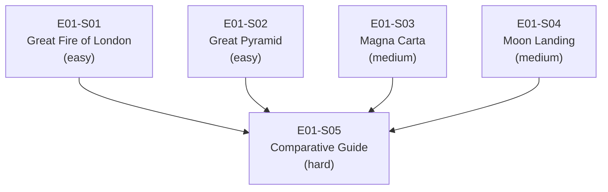

# Implementation Plan: Run 12 — Time Traveler's Yelp Reviews

## Summary

Single-epic plan with 5 content stories decomposed from the approved design doc. All stories produce markdown content files in `test-output/time-traveler-reviews/`. No C# code, no EF migrations, no DI changes -- this is a pure content-creation workload for validating configurable workflow settings from PR #55.

### Structural Decision: Single Epic

The design doc evaluated three approaches and recommended Approach A (single epic). This plan follows that recommendation. A single epic is appropriate because:

- The primary test objectives (config validation, pricing, plan detection) are infrastructure concerns orthogonal to epic count
- Prior runs (8-11) have already validated multi-epic workflows
- A single epic with a clear dependency graph (4 independent reviews + 1 dependent guide) exercises parallelism and dependency handling without unnecessary orchestrator overhead

## Epic 1: Time Traveler's Yelp Reviews

### Stories

| ID | Title | Difficulty | Output File | Word Count |
|----|-------|-----------|-------------|------------|
| E01-S01 | The Great Fire of London -- 1 Star | easy | `test-output/time-traveler-reviews/review-001.md` | 150-250 |
| E01-S02 | The Construction of the Great Pyramid -- 3 Stars | easy | `test-output/time-traveler-reviews/review-002.md` | 150-250 |
| E01-S03 | The Signing of the Magna Carta -- 4 Stars | medium | `test-output/time-traveler-reviews/review-003.md` | 250-400 |
| E01-S04 | The Moon Landing -- 5 Stars | medium | `test-output/time-traveler-reviews/review-004.md` | 250-400 |
| E01-S05 | ChronoTrip Comparative Guide | hard | `test-output/time-traveler-reviews/guide.md` | 400-600 |

### Story Details

#### E01-S01: The Great Fire of London -- 1 Star (easy)

**Files to create:**
- `test-output/time-traveler-reviews/review-001.md`

**Branch:** `e01-s01/great-fire-review`

**Acceptance criteria:**
- [ ] File exists at `test-output/time-traveler-reviews/review-001.md`
- [ ] Follows review template (rating, reviewer, date visited, date reviewed, trip type, review text, helpful votes)
- [ ] Star rating rendered as Unicode stars (1 of 5)
- [ ] Historical facts accurate: dates 2-5 September 1666, Pudding Lane origin, fire spread pattern
- [ ] Reviewer pseudonym: ChronoNomad_42
- [ ] Trip Type: Solo
- [ ] Word count 150-250
- [ ] Authentic Yelp complaint voice maintained throughout
- [ ] No management response section

**Test plan:**
- Verify file exists and is valid markdown
- Verify word count within range
- Verify template structure (all required sections present)
- Verify historical accuracy of dates and locations

#### E01-S02: The Construction of the Great Pyramid -- 3 Stars (easy)

**Files to create:**
- `test-output/time-traveler-reviews/review-002.md`

**Branch:** `e01-s02/great-pyramid-review`

**Acceptance criteria:**
- [ ] File exists at `test-output/time-traveler-reviews/review-002.md`
- [ ] Follows review template structure
- [ ] Star rating rendered as Unicode stars (3 of 5)
- [ ] Historical facts accurate: c. 2560 BCE, Giza Plateau, construction context
- [ ] Reviewer pseudonym: TemporalTourist_88
- [ ] Trip Type: Couple
- [ ] Word count 150-250
- [ ] Tourist disappointment voice maintained throughout
- [ ] No management response section

**Test plan:**
- Verify file exists and is valid markdown
- Verify word count within range
- Verify template structure
- Verify historical accuracy

#### E01-S03: The Signing of the Magna Carta -- 4 Stars (medium)

**Files to create:**
- `test-output/time-traveler-reviews/review-003.md`

**Branch:** `e01-s03/magna-carta-review`

**Acceptance criteria:**
- [ ] File exists at `test-output/time-traveler-reviews/review-003.md`
- [ ] Follows review template with management response section
- [ ] Star rating rendered as Unicode stars (4 of 5)
- [ ] Historical facts accurate: 15 June 1215, Runnymede, barons, King John
- [ ] King John management response references Pope Innocent III annulment (historically accurate)
- [ ] Reviewer pseudonym: HistoryHopper_Prime
- [ ] Trip Type: School Group
- [ ] Two distinct voices: tourist reviewer vs. King John
- [ ] Word count 250-400
- [ ] Catering complaint included

**Test plan:**
- Verify file exists and is valid markdown
- Verify word count within range
- Verify template structure including management response
- Verify two distinct voices
- Verify historical accuracy (annulment by Pope Innocent III)

#### E01-S04: The Moon Landing -- 5 Stars (medium)

**Files to create:**
- `test-output/time-traveler-reviews/review-004.md`

**Branch:** `e01-s04/moon-landing-review`

**Acceptance criteria:**
- [ ] File exists at `test-output/time-traveler-reviews/review-004.md`
- [ ] Follows review template with management response section
- [ ] Star rating rendered as Unicode stars (5 of 5)
- [ ] Historical facts accurate: 20 July 1969, Sea of Tranquility, Armstrong, Apollo 11
- [ ] NASA management response in professional tone
- [ ] Reviewer pseudonym: CosmicBackpacker_77
- [ ] Trip Type: Solo
- [ ] Practical travel tips section included
- [ ] Two distinct voices: tourist reviewer vs. NASA PR
- [ ] Word count 250-400

**Test plan:**
- Verify file exists and is valid markdown
- Verify word count within range
- Verify template structure including management response
- Verify travel tips are present
- Verify historical accuracy

#### E01-S05: ChronoTrip Comparative Guide (hard)

**Files to create:**
- `test-output/time-traveler-reviews/guide.md`

**Branch:** `e01-s05/comparative-guide`

**Dependencies:** E01-S01, E01-S02, E01-S03, E01-S04 (must read completed review files for cross-references)

**Acceptance criteria:**
- [ ] File exists at `test-output/time-traveler-reviews/guide.md`
- [ ] References at least 3 of the 4 reviewed destinations by name with specific details from the review files
- [ ] "Top Tips from Fellow Travelers" section with quotes attributed to correct pseudonyms (ChronoNomad_42, TemporalTourist_88, HistoryHopper_Prime, CosmicBackpacker_77)
- [ ] Destination Comparison Matrix: markdown table with at least 5 rating categories (Safety, Amenities, Historical Significance, Instagram-Worthiness, Overall Value)
- [ ] Temporal Travel Insurance Disclaimer in legal/fine-print voice
- [ ] "Coming Soon" section with at least 2 future destinations
- [ ] Word count 400-600
- [ ] Consistent professional travel agency marketing tone
- [ ] Cross-references are consistent with the actual content of review files

**Test plan:**
- Verify file exists and is valid markdown
- Verify word count within range
- Verify all required sections are present
- Cross-check reviewer pseudonyms match those in review files
- Cross-check destination details match review content
- Verify comparison matrix is a well-formed markdown table

## Dependency Graph

**Dependency rationale:**
- E01-S01 through E01-S04 are completely independent -- each covers a different historical event with no shared state
- E01-S05 must run after all four reviews because it cross-references their content, quotes their pseudonyms, and builds a comparison matrix from their ratings
- The builder for E01-S05 should read the completed review files from the epic branch to ensure cross-reference accuracy

## Dispatch Plan

| Wave | Stories | Dispatch | Model | Notes |
|------|---------|----------|-------|-------|
| **Wave 1** | E01-S01, E01-S02, E01-S03 | Parallel (worktree isolation) | sonnet, sonnet, sonnet | 2 easy + 1 medium; respects `maxParallelBuilders: 3` |
| **Wave 2** | E01-S04 | Sequential | sonnet | 1 medium; could not fit in Wave 1 due to config limit |
| **Wave 3** | E01-S05 | Sequential | opus | Hard story; depends on all 4 reviews being merged to epic branch |

**Wave sizing rationale:** The config sets `maxParallelBuilders: 3`. Wave 1 includes 3 of the 4 independent reviews. E01-S04 runs alone in Wave 2 because it cannot be parallelized with E01-S05 (which depends on it) and could not fit in Wave 1. Wave 3 is the hard dependent story.

**Pre-Wave 3 merge:** Before dispatching E01-S05, all four review story branches must be merged into the epic branch so the builder can read the completed review files for accurate cross-references.

## Estimated Execution Time

| Phase | Estimate |
|-------|----------|
| Wave 1 (3x parallel: 2 easy + 1 medium) | ~2 min wall-clock |
| Wave 2 (1x medium) | ~2 min |
| Wave 3 (1x hard) | ~3 min |
| Reviews + merges overhead | ~5 min |
| **Total** | **~12 min wall-clock** |

## Workflow Validation Checklist

These are the primary test objectives from the backlog issue. The orchestrator should verify each after the run completes:

- [ ] Config-driven model routing: easy and medium stories dispatch `builder-sonnet`, hard dispatches `builder-opus`
- [ ] Config-driven pricing: Opus telemetry shows ~$30/M blended rate
- [ ] Config-driven board status: `item-set-status.sh` reads option IDs from config
- [ ] Plan detection: Phase 3 uses YAML frontmatter grep (`^backlog: 56$`)
- [ ] Worktree isolation: Wave 1 parallel builders use `isolation: "worktree"`
- [ ] No workspace collision: each story branch contains only its own file
- [ ] All board transitions complete (Planned -> Todo -> In Progress -> In Review -> Done)
- [ ] Per-story, per-epic, and backlog-level telemetry posted
- [ ] Backlog PR opened targeting `main`, stays open for human review
- [ ] All issues listed in PR `Closes` footer for auto-close on merge
