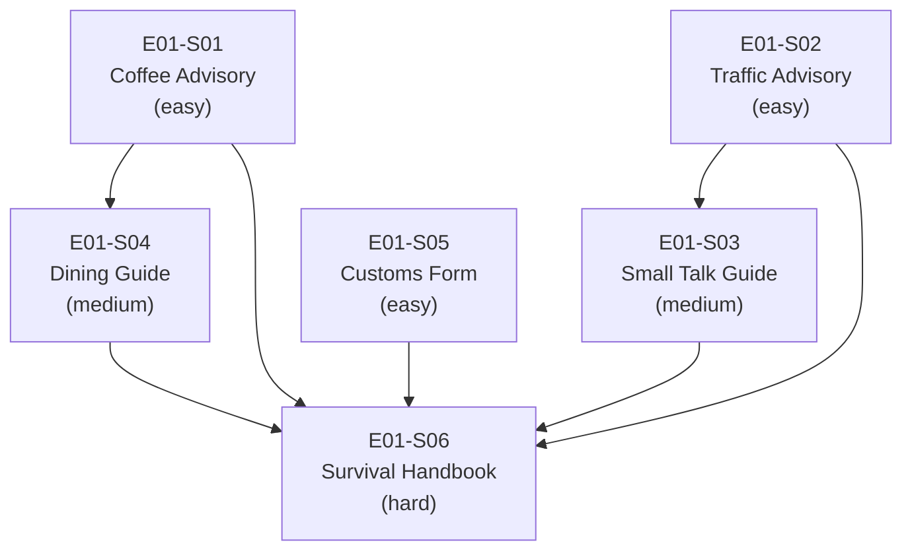

# Implementation Plan: Run 13 — Alien Tourist Bureau

## Summary

This plan decomposes the approved design for Run 13 (Alien Tourist Bureau) into one epic with six stories. The primary workflow test objectives are runtime data consolidation (`.agentic-workflow/`), live pricing (`fetch-pricing.sh`), and automated telemetry (`--dispatches-from-state`).

All stories produce markdown content files under `test-output/alien-tourist-bureau/`. No code, no tests, no infrastructure changes.

## Structural Decisions

**Single epic (E01) with 6 stories.** The design doc recommended this structure and it is appropriate: all content is thematically unified (GFBTT documents), shares the same output directory, and has a clean dependency chain. Two epics would add orchestrator overhead with no benefit.

**3-wave dispatch.** The dependency graph has three natural layers: independent easy stories (Wave 1), medium stories that cross-reference Wave 1 outputs (Wave 2), and one hard story that cross-references everything (Wave 3). The `maxParallelBuilders: 3` config limit is respected.

## Epic and Story Breakdown

### E01: Alien Tourist Bureau Documents

All six GFBTT documents. The epic branch is `epic/e01-alien-tourist-bureau`, created from `backlog/69-alien-tourist-bureau`.

---

#### E01-S01: Travel Advisory — Coffee (easy)

**File:** `test-output/alien-tourist-bureau/advisory-coffee.md`
**Branch:** `e01-s01/advisory-coffee`
**Difficulty:** `difficulty/easy` (single file, one template, no dependencies)
**Model:** `builder-sonnet`

**What the builder does:**
1. Create `test-output/alien-tourist-bureau/` directory
2. Write `advisory-coffee.md` with GFBTT document header (Document No. GFBTT-HAZ-2026-001, Department of Hazardous Consumables)
3. Include Risk Assessment Matrix table
4. Maintain bureaucratic tone throughout
5. Word count: 150-250

**Acceptance criteria:**
- [ ] File exists at `test-output/alien-tourist-bureau/advisory-coffee.md`
- [ ] Follows document header template from design doc
- [ ] Document No. is GFBTT-HAZ-2026-001
- [ ] Includes Risk Assessment Matrix with categories: Toxicity, Social Hazard Level, Addiction Potential, Recommended Visitor Response
- [ ] Bureaucratic tone maintained throughout
- [ ] Word count 150-250

---

#### E01-S02: Travel Advisory — Traffic (easy)

**File:** `test-output/alien-tourist-bureau/advisory-traffic.md`
**Branch:** `e01-s02/advisory-traffic`
**Difficulty:** `difficulty/easy` (single file, same template as S01, no dependencies)
**Model:** `builder-sonnet`

**What the builder does:**
1. Write `advisory-traffic.md` with GFBTT document header (Document No. GFBTT-HAZ-2026-002, Department of Hazardous Consumables / Department of Terran Transportation)
2. Include city-by-city Danger Rating table (3-4 real cities)
3. Maintain bureaucratic tone throughout
4. Word count: 150-250

**Acceptance criteria:**
- [ ] File exists at `test-output/alien-tourist-bureau/advisory-traffic.md`
- [ ] Follows document header template from design doc
- [ ] Document No. is GFBTT-HAZ-2026-002
- [ ] Includes city-by-city Danger Rating table with 3-4 cities
- [ ] Bureaucratic tone maintained throughout
- [ ] Word count 150-250

---

#### E01-S03: Visitor Guide — Small Talk (medium)

**File:** `test-output/alien-tourist-bureau/guide-small-talk.md`
**Branch:** `e01-s03/guide-small-talk`
**Difficulty:** `difficulty/medium` (longer doc, multiple structured sections, cross-reference)
**Model:** `builder-sonnet`
**Depends on:** E01-S02 (cross-references GFBTT-HAZ-2026-002)

**What the builder does:**
1. Write `guide-small-talk.md` with GFBTT document header (Document No. GFBTT-CUL-2026-001, Department of Cultural Xenology)
2. Cross-reference traffic advisory by document number GFBTT-HAZ-2026-002
3. Include Phrase Translation Table with at least 6 entries
4. Include Conversation Flowchart section (text or Mermaid)
5. Word count: 250-400

**Acceptance criteria:**
- [ ] File exists at `test-output/alien-tourist-bureau/guide-small-talk.md`
- [ ] Follows document header template from design doc
- [ ] Document No. is GFBTT-CUL-2026-001
- [ ] Cross-references traffic advisory by document number (GFBTT-HAZ-2026-002)
- [ ] Includes Phrase Translation Table with at least 6 entries
- [ ] Includes Conversation Flowchart section
- [ ] Bureaucratic tone maintained throughout
- [ ] Word count 250-400

---

#### E01-S04: Visitor Guide — Dining Protocols (medium)

**File:** `test-output/alien-tourist-bureau/guide-dining.md`
**Branch:** `e01-s04/guide-dining`
**Difficulty:** `difficulty/medium` (longer doc, multiple structured sections, cross-reference)
**Model:** `builder-sonnet`
**Depends on:** E01-S01 (cross-references GFBTT-HAZ-2026-001)

**What the builder does:**
1. Write `guide-dining.md` with GFBTT document header (Document No. GFBTT-CUL-2026-002, Department of Cultural Xenology / Department of Hazardous Consumables)
2. Cross-reference coffee advisory by document number GFBTT-HAZ-2026-001
3. Include Menu Translation Guide with at least 5 confusingly-named Earth foods
4. Include Tipping Calculator table with regional norms
5. Word count: 250-400

**Acceptance criteria:**
- [ ] File exists at `test-output/alien-tourist-bureau/guide-dining.md`
- [ ] Follows document header template from design doc
- [ ] Document No. is GFBTT-CUL-2026-002
- [ ] Cross-references coffee advisory by document number (GFBTT-HAZ-2026-001)
- [ ] Includes Menu Translation Guide with at least 5 entries
- [ ] Includes Tipping Calculator table
- [ ] Bureaucratic tone maintained throughout
- [ ] Word count 250-400

---

#### E01-S05: Pre-Planetfall Customs Declaration Form (easy)

**File:** `test-output/alien-tourist-bureau/form-customs-declaration.md`
**Branch:** `e01-s05/customs-form`
**Difficulty:** `difficulty/easy` (single file, list-based humor, no cross-references)
**Model:** `builder-sonnet`

**What the builder does:**
1. Write `form-customs-declaration.md` with GFBTT document header (Document No. GFBTT-ADM-2026-001, Department of Planetfall Administration)
2. Format as a government form with checkbox fields, signature lines, and fine-print
3. Include purpose-of-visit checkboxes with humorous options
4. Include prohibited items list
5. Word count: 150-250

**Acceptance criteria:**
- [ ] File exists at `test-output/alien-tourist-bureau/form-customs-declaration.md`
- [ ] Follows document header template from design doc
- [ ] Document No. is GFBTT-ADM-2026-001
- [ ] Formatted as a form with checkbox fields and signature lines
- [ ] Includes prohibited items list
- [ ] Includes purpose-of-visit checkboxes with humorous options
- [ ] Bureaucratic tone maintained throughout
- [ ] Word count 150-250

---

#### E01-S06: The Complete Terran Survival Handbook (hard)

**File:** `test-output/alien-tourist-bureau/handbook-survival.md`
**Branch:** `e01-s06/survival-handbook`
**Difficulty:** `difficulty/hard` (cross-references all 5 prior docs, longest word count, multiple distinct sections)
**Model:** `builder-opus`
**Depends on:** E01-S01, E01-S02, E01-S03, E01-S04, E01-S05

**What the builder does:**
1. Read all five prior documents from the epic branch for accurate cross-references
2. Write `handbook-survival.md` with GFBTT document header (Document No. GFBTT-PUB-2026-001, Office of the Director-General)
3. Reference at least 4 of 5 prior documents by document number with specific details pulled from those files
4. Include Director-General's Welcome Message
5. Include Quick Reference Card table (Topic, Document Reference, Threat Level, Key Recommendation)
6. Include FAQ section with at least 5 Q&A entries referencing prior documents
7. Include Known Issues and Errata section with corrections to prior documents
8. Word count: 400-600

**Acceptance criteria:**
- [ ] File exists at `test-output/alien-tourist-bureau/handbook-survival.md`
- [ ] Follows document header template from design doc
- [ ] Document No. is GFBTT-PUB-2026-001
- [ ] References at least 4 of 5 prior documents by document number
- [ ] Includes Director-General's Welcome Message
- [ ] Includes Quick Reference Card table
- [ ] Includes FAQ section with at least 5 entries referencing prior documents
- [ ] Includes Known Issues and Errata section
- [ ] Word count 400-600
- [ ] Consistent bureaucratic tone throughout

---

## Dependency Graph

## Dispatch Plan

| Wave | Stories | Dispatch | Notes |
|------|---------|----------|-------|
| **Wave 1** | E01-S01, E01-S02, E01-S05 | Parallel (3 builders, worktree isolation) | 3 easy stories, all independent, saturates `maxParallelBuilders: 3` |
| **Wave 2** | E01-S03, E01-S04 | Parallel (2 builders, worktree isolation) | 2 medium stories; S03 depends on S02 (Wave 1), S04 depends on S01 (Wave 1) |
| **Wave 3** | E01-S06 | Sequential | Hard story, depends on all 5 prior documents |

**Estimated execution time:**
- Wave 1 (3x easy, parallel): ~2 min wall-clock
- Wave 2 (2x medium, parallel): ~2.5 min wall-clock
- Wave 3 (1x hard, sequential): ~3 min
- Reviews and merges: ~3 min
- Total: ~10.5 min wall-clock

## Builder Instructions

All builders must read the design doc at `docs/2-design/2026-03-15-test-agentic-sdlc-run13-alien-tourist-bureau.md` for the document header template and voice guidelines before writing content.

The S06 builder must additionally read the five prior files on the epic branch to ensure cross-references pull accurate details from the actual content (not just document numbers).

## Test Validation Checklist

These are the workflow test objectives from the backlog issue. The orchestrator validates these during execution:

- [ ] All scripts read/write to `.agentic-workflow/` (no `.claude/state/` or `.claude/logs/` references)
- [ ] `fetch-pricing.sh` fetches live pricing and writes `.agentic-workflow/pricing.json`
- [ ] Per-story telemetry uses correct Opus 4.6 rates ($5/$25) from cached pricing
- [ ] `--dispatches-from-state` produces correct aggregate telemetry
- [ ] Backlog issue set to In Progress at design phase start
- [ ] Board drift verification runs at end of workflow
- [ ] Easy/medium stories dispatch `builder-sonnet`, hard dispatches `builder-opus`
- [ ] Worktree isolation used for parallel waves (Waves 1 and 2)
- [ ] No workspace collision between parallel builders
- [ ] All board transitions complete (Planned -> Todo -> In Progress -> In Review -> Done)
- [ ] Per-story, per-epic, and backlog-level telemetry posted
