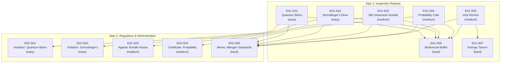

# Implementation Plan: Run 14 -- Interdimensional Restaurant Health Inspections

## Summary

This plan decomposes the approved design for Run 14 (Interdimensional Restaurant Health Inspections) into two epics with twelve stories. The primary workflow test objective is **fix cycle validation** -- four stories contain deliberately planted bugs that should trigger reviewer REQUEST_CHANGES verdicts, testing the orchestrator's re-dispatch, builder fix, re-review, and multi-cycle telemetry paths.

All stories produce markdown content files under `test-output/interdimensional-health-inspections/`. No code, no tests, no infrastructure changes.

## Structural Decisions

**Two epics matching the MFSA workflow.** E01 (Inspection Reports, 7 stories) handles the fieldwork -- actual inspection documents from various interdimensional restaurants. E02 (Regulatory and Administrative, 5 stories) handles the paperwork that follows -- violation notices, appeal rulings, compliance certificates, and regulatory memos. This mirrors a real regulatory workflow where inspections precede enforcement actions, creating natural cross-epic dependencies.

**Five-wave dispatch respecting `maxParallelBuilders: 3`.** The dependency graph has five natural layers:

- **Wave 1** (3 parallel): Three independent E01 easy/medium stories (E01-S01, E01-S02, E01-S03). The design doc suggests 4 stories in Wave 1, but `maxParallelBuilders: 3` caps at 3.
- **Wave 2** (3 parallel): E01-S04 (the Wave 1 overflow), plus E01-S05 (independent within E01), plus E02-S01 (depends on E01-S01 from Wave 1 by document number only).
- **Wave 3** (3 parallel): E02-S02 (depends on E01-S02), E02-S03 (depends on E01-S03), E02-S04 (depends on E01-S04).
- **Wave 4** (2 parallel): E01-S06 (cross-references 3+ E01 reports from Waves 1-2), E01-S07 (cross-references E01-S05 from Wave 2). Both are hard stories.
- **Wave 5** (1 sequential): E02-S05 (cross-references 3+ E01 reports with specific content details). Hard story, final wave.

**Why 5 waves instead of the design doc's 4:** The design doc's Wave 1 had 4 stories but `maxParallelBuilders: 3` requires splitting. Pushing E01-S04 to Wave 2 is better than creating a 1-story sub-wave. Additionally, separating E01-S07 from E02-S05 (the design doc's Wave 4) allows E01-S07 to run one wave earlier since it only depends on E01-S05 (Wave 2), not on all E01 stories. This gives the builders more time on the most complex story (E02-S05) without blocking the pipeline. The tradeoff is one additional wave, but since Wave 5 is a single story, it adds minimal wall-clock time.

**Cross-epic file dependencies.** E02 easy/medium stories (E02-S01 through E02-S04) reference E01 inspection reports by document number only -- the document numbers are specified deterministically in the design doc, so these stories do not need to read actual E01 files. However, the three hard stories (E01-S06, E01-S07, E02-S05) must read prior E01 files to pull specific content details for cross-references. These are scheduled in Waves 4-5 after all E01 dependencies are complete.

**Bug-planted stories.** Four stories (E01-S01, E01-S04, E02-S01, E02-S04) contain deliberately planted bugs in their acceptance criteria. The planner copies the story specs exactly as written in the design doc -- contradictions, missing sections, format mismatches, and wrong cross-references are intentional and must not be fixed. These bugs are designed to trigger reviewer REQUEST_CHANGES verdicts for fix cycle testing.

## Epic and Story Breakdown

### E01: Inspection Reports

Seven MFSA inspection reports from various interdimensional restaurants. The epic branch is `epic/e01-inspection-reports`, created from `backlog/83-interdimensional-health-inspections`.

---

#### E01-S01: Routine Inspection -- The Quantum Bistro (easy)

**File:** `test-output/interdimensional-health-inspections/inspection-quantum-bistro.md`
**Branch:** `e01-s01/quantum-bistro`
**Difficulty:** `difficulty/easy` (single file, straightforward inspection template, no dependencies)
**Model:** `builder-sonnet`
**Has planted bug:** Yes (contradictory acceptance criteria -- "exactly 3 violations" in description vs "at least 5" in AC)

**What the builder does:**
1. Create `test-output/interdimensional-health-inspections/` directory
2. Write `inspection-quantum-bistro.md` with MFSA document header
3. Document No.: MFSA-INS-2026-001
4. Dimension: Dimension 4-Alpha (where probability is a suggestion rather than a law)
5. Establishment: The Quantum Bistro, Classification: ROUTINE
6. Content: routine health inspection of a restaurant where dishes exist in superposition of states until observed. Sections: General Observations, Kitchen Assessment, Food Storage Compliance, Staff Hygiene, Overall Rating
7. Include Inspection Scorecard table with A-F ratings
8. Include exactly 3 violations noted during the inspection
9. Bureaucratic tone throughout
10. Word count: 150-250

**Acceptance criteria:**
- [ ] File exists at `test-output/interdimensional-health-inspections/inspection-quantum-bistro.md`
- [ ] Follows document header template
- [ ] Includes Inspection Scorecard table with A-F ratings
- [ ] Lists at least 5 violations found during inspection
- [ ] Bureaucratic tone maintained throughout
- [ ] Word count 150-250
- [ ] Document number is MFSA-INS-2026-001

---

#### E01-S02: Critical Violations -- Schrodinger's Diner (easy)

**File:** `test-output/interdimensional-health-inspections/inspection-schrodingers-diner.md`
**Branch:** `e01-s02/schrodingers-diner`
**Difficulty:** `difficulty/easy` (single file, simple report structure, no dependencies)
**Model:** `builder-sonnet`

**What the builder does:**
1. Write `inspection-schrodingers-diner.md` with MFSA document header
2. Document No.: MFSA-INS-2026-002
3. Dimension: Dimension 4-Alpha (same as The Quantum Bistro)
4. Establishment: Schrodinger's Diner, Classification: CRITICAL
5. Content: critical inspection report for a diner where opening the kitchen door changes the state of everything inside. Health code compliance can only be verified when no one is looking. The diner's signature dish -- "The Cat's Meow Casserole" -- was found to be both safe and unsafe for consumption until tasted. Note the philosophical implications for food safety regulation while maintaining strict bureaucratic objectivity
6. Include a "Violation Summary" section with violation codes and descriptions
7. Include an "Inspector's Recommendation" section
8. Word count: 150-250

**Acceptance criteria:**
- [ ] File exists at `test-output/interdimensional-health-inspections/inspection-schrodingers-diner.md`
- [ ] Follows document header template
- [ ] Includes Violation Summary section with codes and descriptions
- [ ] Includes Inspector's Recommendation section
- [ ] Bureaucratic tone maintained throughout
- [ ] Word count 150-250
- [ ] Document number is MFSA-INS-2026-002

---

#### E01-S03: Follow-Up Inspection -- The Nth Dimension Noodle House (medium)

**File:** `test-output/interdimensional-health-inspections/inspection-nth-dimension-noodle-house.md`
**Branch:** `e01-s03/nth-dimension-noodle-house`
**Difficulty:** `difficulty/medium` (follow-up format with prior violations table, dimensional stability assessment, multiple sections)
**Model:** `builder-sonnet`

**What the builder does:**
1. Write `inspection-nth-dimension-noodle-house.md` with MFSA document header
2. Document No.: MFSA-INS-2026-003
3. Dimension: Dimension N (where N is a variable that changes hourly)
4. Establishment: The Nth Dimension Noodle House, Classification: ROUTINE
5. Content: follow-up inspection of a noodle restaurant in a dimension where spatial dimensions are not fixed. Previously cited for violations including noodles extending into adjacent dimensions, a kitchen that periodically folds into itself, and portions that change size relative to the diner's dimensional state. Document which prior violations have been corrected and which persist
6. Include "Prior Violations Status" table showing each previous violation, its code, and current status (Corrected / Persistent / Worsened / Now In A Different Dimension)
7. Include "Dimensional Stability Assessment" section rating structural integrity across at least 3 adjacent dimensions
8. Include "Corrective Actions Required" section with deadlines
9. Word count: 250-400

**Acceptance criteria:**
- [ ] File exists at `test-output/interdimensional-health-inspections/inspection-nth-dimension-noodle-house.md`
- [ ] Follows document header template
- [ ] Includes Prior Violations Status table with at least 4 entries
- [ ] Includes Dimensional Stability Assessment section
- [ ] Includes Corrective Actions Required section with deadlines
- [ ] Bureaucratic tone maintained throughout
- [ ] Word count 250-400
- [ ] Document number is MFSA-INS-2026-003

---

#### E01-S04: Special Event Inspection -- The Probability Cafe (medium)

**File:** `test-output/interdimensional-health-inspections/inspection-probability-cafe.md`
**Branch:** `e01-s04/probability-cafe`
**Difficulty:** `difficulty/medium` (special event format, multiple structured sections)
**Model:** `builder-sonnet`
**Has planted bug:** Yes (missing required section -- AC references "Contamination Timeline table" but description never mentions it)

**What the builder does:**
1. Write `inspection-probability-cafe.md` with MFSA document header
2. Document No.: MFSA-INS-2026-004
3. Dimension: Dimension 7-Gamma (where cause and effect are only loosely correlated)
4. Establishment: The Probability Cafe, Classification: ROUTINE
5. Content: special event inspection during the cafe's annual "Infinite Improbability Brunch," where the menu is generated by a random probability field and diners receive whatever dish is most statistically unlikely given their order. Document food safety compliance for dishes that do not exist until served and may retroactively never have existed after being consumed. Special attention to the dessert course, which has a 12% chance of being a small neutron star
6. Include "Special Event Compliance Checklist" with at least 8 items
7. Include "Statistical Anomaly Log" documenting at least 3 improbable food safety events observed during the inspection
8. Word count: 250-400

**Acceptance criteria:**
- [ ] File exists at `test-output/interdimensional-health-inspections/inspection-probability-cafe.md`
- [ ] Follows document header template
- [ ] Includes Special Event Compliance Checklist with at least 8 items
- [ ] Includes Statistical Anomaly Log with at least 3 entries
- [ ] Includes Contamination Timeline table
- [ ] Bureaucratic tone maintained throughout
- [ ] Word count 250-400
- [ ] Document number is MFSA-INS-2026-004

---

#### E01-S05: Emergency Shutdown -- The Void Kitchen (medium)

**File:** `test-output/interdimensional-health-inspections/inspection-void-kitchen.md`
**Branch:** `e01-s05/void-kitchen`
**Difficulty:** `difficulty/medium` (emergency format with incident timeline, patron tracking, legal citations)
**Model:** `builder-sonnet`

**What the builder does:**
1. Write `inspection-void-kitchen.md` with MFSA document header
2. Document No.: MFSA-INS-2026-005
3. Dimension: Dimension 0-Null (the dimension between dimensions, where the concept of "space" is optional)
4. Establishment: The Void Kitchen, Classification: EMERGENCY
5. Content: emergency inspection and shutdown report for a restaurant operating in the interstitial void between dimensions. Three patrons ceased to exist mid-meal (subsequently recovered in Dimension 12-Beta, slightly older and missing dessert). The kitchen operates by extracting raw ingredients from the fabric of reality itself, provisionally classified as "probably a health code violation." Shutdown complicated by the restaurant's lack of a fixed physical location
6. Include "Incident Timeline" section documenting the sequence of events
7. Include "Patron Recovery Status" table tracking the three missing patrons
8. Include "Shutdown Order" section with legal citations from the Multiversal Food Safety Act
9. Word count: 250-400

**Acceptance criteria:**
- [ ] File exists at `test-output/interdimensional-health-inspections/inspection-void-kitchen.md`
- [ ] Follows document header template
- [ ] Includes Incident Timeline section
- [ ] Includes Patron Recovery Status table
- [ ] Includes Shutdown Order section with legal citations
- [ ] Bureaucratic tone maintained throughout
- [ ] Word count 250-400
- [ ] Document number is MFSA-INS-2026-005

---

#### E01-S06: Comprehensive Annual Review -- The Multiversal Buffet (hard)

**File:** `test-output/interdimensional-health-inspections/inspection-multiversal-buffet.md`
**Branch:** `e01-s06/multiversal-buffet`
**Difficulty:** `difficulty/hard` (cross-references 3+ E01 reports, compliance matrix, executive summary, comparative analysis)
**Model:** `builder-opus`
**Depends on:** E01-S01, E01-S02, E01-S03, E01-S04, E01-S05 (cross-references their content)

**What the builder does:**
1. Read prior E01 inspection files from the epic branch to ensure cross-references are accurate
2. Write `inspection-multiversal-buffet.md` with MFSA document header
3. Document No.: MFSA-INS-2026-006
4. Dimension: Dimension Prime (MFSA headquarters dimension)
5. Establishment: The Multiversal Buffet, Classification: ROUTINE
6. Content: comprehensive annual review of the only restaurant licensed to serve cuisine from every known dimension simultaneously. The Multiversal Buffet operates the largest interdimensional kitchen in existence, with food preparation stations spanning 47 dimensions and a dining room in a pocket dimension
7. Cross-reference at least 3 inspection reports from E01 (S01-S05) by document number, noting how issues found at other establishments inform the Buffet's compliance assessment
8. Include "Cross-Dimensional Compliance Matrix" table rating compliance in at least 5 regulatory categories across 3+ dimensions
9. Include "Executive Summary" section suitable for the MFSA Director's desk
10. Include "Comparative Analysis" section comparing the Buffet's performance to at least 2 other inspected establishments from E01
11. Word count: 400-600

**Acceptance criteria:**
- [ ] File exists at `test-output/interdimensional-health-inspections/inspection-multiversal-buffet.md`
- [ ] Follows document header template
- [ ] Cross-references at least 3 prior E01 inspection reports by document number
- [ ] Includes Cross-Dimensional Compliance Matrix table
- [ ] Includes Executive Summary section
- [ ] Includes Comparative Analysis section referencing at least 2 other establishments
- [ ] Bureaucratic tone maintained throughout
- [ ] Word count 400-600
- [ ] Document number is MFSA-INS-2026-006

---

#### E01-S07: Incident Investigation -- The Entropy Tavern (hard)

**File:** `test-output/interdimensional-health-inspections/inspection-entropy-tavern.md`
**Branch:** `e01-s07/entropy-tavern`
**Difficulty:** `difficulty/hard` (incident investigation, multiple structured sections, cross-reference, complex narrative)
**Model:** `builder-opus`
**Depends on:** E01-S05 (cross-references MFSA-INS-2026-005)

**What the builder does:**
1. Read E01-S05 (Void Kitchen) file from the epic branch for cross-reference accuracy
2. Write `inspection-entropy-tavern.md` with MFSA document header
3. Document No.: MFSA-INS-2026-007
4. Dimension: Dimension 13-Omega (where entropy runs in reverse in certain pockets)
5. Establishment: The Entropy Tavern, Classification: EMERGENCY
6. Content: incident investigation following a "thermodynamic event" where a dish served in a reverse-entropy pocket caused time to flow backward for three tables of diners, resulting in them un-eating their meals, which then un-cooked themselves and reverted to raw ingredients that walked out of the kitchen. Document the chain of events, assess whether existing regulations cover reverse-entropy food preparation, identify root cause, and recommend regulatory changes
7. Cross-reference the Void Kitchen shutdown (MFSA-INS-2026-005) as a precedent case for patron displacement incidents
8. Include "Evidence Log" table documenting physical evidence collected (noting items that have since ceased to exist or begun existing retroactively)
9. Include "Regulatory Gap Analysis" section identifying where current MFSA regulations fail to address reverse-entropy scenarios
10. Include "Witness Statements" section with at least 3 depositions
11. Include "Recommendations for Regulatory Amendment" with proposed new regulation text
12. Word count: 400-600

**Acceptance criteria:**
- [ ] File exists at `test-output/interdimensional-health-inspections/inspection-entropy-tavern.md`
- [ ] Follows document header template
- [ ] Cross-references MFSA-INS-2026-005 (Void Kitchen) as precedent
- [ ] Includes Evidence Log table
- [ ] Includes Regulatory Gap Analysis section
- [ ] Includes Witness Statements with at least 3 depositions
- [ ] Includes Recommendations for Regulatory Amendment
- [ ] Bureaucratic tone maintained throughout
- [ ] Word count 400-600
- [ ] Document number is MFSA-INS-2026-007

---

### E02: Regulatory and Administrative

Five regulatory documents that follow the E01 inspections. The epic branch is `epic/e02-regulatory-admin`, created from `backlog/83-interdimensional-health-inspections`.

---

#### E02-S01: Violation Notice -- The Quantum Bistro (easy)

**File:** `test-output/interdimensional-health-inspections/violation-quantum-bistro.md`
**Branch:** `e02-s01/violation-quantum-bistro`
**Difficulty:** `difficulty/easy` (simple violation notice format, single cross-reference)
**Model:** `builder-sonnet`
**Depends on:** E01-S01 (references MFSA-INS-2026-001 by document number)
**Has planted bug:** Yes (format contradiction -- description says "numbered list" but AC says "violations table")

**What the builder does:**
1. Write `violation-quantum-bistro.md` with MFSA document header
2. Document No.: MFSA-VIO-2026-001
3. Establishment: The Quantum Bistro, Classification: ADMINISTRATIVE
4. Content: formal violation notice issued following the routine inspection documented in MFSA-INS-2026-001. Present violations as a numbered list, specifying the regulation violated, the observed condition, and the required corrective action. Violations should mirror those noted in the inspection report. Tone should be stern but fair -- the MFSA acknowledges quantum physics makes compliance challenging but insists food safety laws transcend physics
5. Include "Penalties and Fines" section with a schedule of fines in Multiversal Credits
6. Include "Right to Appeal" notice with the appeal filing deadline and procedure
7. Reference inspection report MFSA-INS-2026-001 explicitly
8. Word count: 150-250

**Acceptance criteria:**
- [ ] File exists at `test-output/interdimensional-health-inspections/violation-quantum-bistro.md`
- [ ] Follows document header template
- [ ] References MFSA-INS-2026-001 explicitly
- [ ] Includes violations table with regulation codes, observed conditions, and corrective actions
- [ ] Includes Penalties and Fines section
- [ ] Includes Right to Appeal notice
- [ ] Bureaucratic tone maintained throughout
- [ ] Word count 150-250
- [ ] Document number is MFSA-VIO-2026-001

---

#### E02-S02: Cease and Desist -- Schrodinger's Diner (easy)

**File:** `test-output/interdimensional-health-inspections/violation-schrodingers-diner.md`
**Branch:** `e02-s02/violation-schrodingers-diner`
**Difficulty:** `difficulty/easy` (standard cease and desist format, single cross-reference)
**Model:** `builder-sonnet`
**Depends on:** E01-S02 (references MFSA-INS-2026-002 by document number)

**What the builder does:**
1. Write `violation-schrodingers-diner.md` with MFSA document header
2. Document No.: MFSA-VIO-2026-002
3. Establishment: Schrodinger's Diner, Classification: CRITICAL
4. Content: cease and desist order following the critical inspection documented in MFSA-INS-2026-002. More severe than a standard violation notice -- ordering the establishment to cease serving The Cat's Meow Casserole until compliance can be verified (acknowledging the philosophical difficulty of verification at this establishment). Include list of specific practices that must stop immediately and conditions for resuming operations
5. Include "Conditions for Resumption of Operations" section
6. Include "Legal Basis" section citing specific sections of the Multiversal Food Safety Act
7. Reference inspection report MFSA-INS-2026-002 explicitly
8. Word count: 150-250

**Acceptance criteria:**
- [ ] File exists at `test-output/interdimensional-health-inspections/violation-schrodingers-diner.md`
- [ ] Follows document header template
- [ ] References MFSA-INS-2026-002 explicitly
- [ ] Includes list of practices to cease immediately
- [ ] Includes Conditions for Resumption of Operations section
- [ ] Includes Legal Basis section
- [ ] Bureaucratic tone maintained throughout
- [ ] Word count 150-250
- [ ] Document number is MFSA-VIO-2026-002

---

#### E02-S03: Appeal Ruling -- The Nth Dimension Noodle House (medium)

**File:** `test-output/interdimensional-health-inspections/appeal-nth-dimension-noodle-house.md`
**Branch:** `e02-s03/appeal-noodle-house`
**Difficulty:** `difficulty/medium` (quasi-judicial format, multiple structured sections, different voice)
**Model:** `builder-sonnet`
**Depends on:** E01-S03 (references MFSA-INS-2026-003 by document number)

**What the builder does:**
1. Write `appeal-nth-dimension-noodle-house.md` with MFSA document header
2. Document No.: MFSA-APL-2026-001
3. Establishment: The Nth Dimension Noodle House, Classification: ADMINISTRATIVE
4. Content: administrative appeal ruling on the Noodle House's appeal of violations cited in the follow-up inspection. Structured as quasi-judicial document: case summary, appellant's arguments, MFSA's response, findings of fact, legal analysis, and ruling. The Noodle House argues regulations for fixed-dimension establishments cannot fairly apply to a variable-dimension restaurant. The MFSA panel acknowledges merit but rules food safety is a universal constant
5. Cross-reference inspection report MFSA-INS-2026-003 as basis for original citations
6. Include "Findings of Fact" section with at least 4 numbered findings
7. Include "Legal Analysis" section citing the Multiversal Food Safety Act
8. Include "Ruling and Order" section with specific directives
9. Word count: 250-400

**Acceptance criteria:**
- [ ] File exists at `test-output/interdimensional-health-inspections/appeal-nth-dimension-noodle-house.md`
- [ ] Follows document header template
- [ ] Cross-references MFSA-INS-2026-003 as basis for original citations
- [ ] Includes Findings of Fact section with at least 4 entries
- [ ] Includes Legal Analysis section
- [ ] Includes Ruling and Order section
- [ ] Quasi-judicial tone maintained throughout
- [ ] Word count 250-400
- [ ] Document number is MFSA-APL-2026-001

---

#### E02-S04: Compliance Certificate -- The Probability Cafe (medium)

**File:** `test-output/interdimensional-health-inspections/certificate-probability-cafe.md`
**Branch:** `e02-s04/certificate-probability-cafe`
**Difficulty:** `difficulty/medium` (certificate format with verification table, conditions, validity terms)
**Model:** `builder-sonnet`
**Depends on:** E01-S04 (references the Probability Cafe's inspection)
**Has planted bug:** Yes (wrong cross-reference -- description says MFSA-INS-2026-003 but AC says MFSA-INS-2026-004)

**What the builder does:**
1. Write `certificate-probability-cafe.md` with MFSA document header
2. Document No.: MFSA-CRT-2026-001
3. Establishment: The Probability Cafe, Classification: ADMINISTRATIVE
4. Content: compliance certificate issued following successful completion of corrective actions identified in the special event inspection. The most positive document in the collection -- the MFSA grudgingly acknowledges the cafe has met all requirements, with a remarkable number of caveats and conditions. Certified as "Conditionally Compliant (Probability-Adjusted)" -- a new compliance category created specifically for this establishment
5. Cross-reference inspection report MFSA-INS-2026-003 as the basis for required corrective actions
6. Include "Compliance Verification Results" table showing each corrective action item, status, and verification method
7. Include "Conditions and Limitations" section listing at least 5 ongoing compliance conditions
8. Include "Certificate Validity" section noting expiration date and renewal requirements
9. Word count: 250-400

**Acceptance criteria:**
- [ ] File exists at `test-output/interdimensional-health-inspections/certificate-probability-cafe.md`
- [ ] Follows document header template
- [ ] Cross-references MFSA-INS-2026-004
- [ ] Includes Compliance Verification Results table
- [ ] Includes Conditions and Limitations section with at least 5 conditions
- [ ] Includes Certificate Validity section
- [ ] Bureaucratic tone maintained throughout
- [ ] Word count 250-400
- [ ] Document number is MFSA-CRT-2026-001

---

#### E02-S05: Regulatory Memo -- Cross-Dimensional Allergen Standards (hard)

**File:** `test-output/interdimensional-health-inspections/memo-allergen-standards.md`
**Branch:** `e02-s05/memo-allergen-standards`
**Difficulty:** `difficulty/hard` (policy document, 5 distinct sections, cross-references 3+ E01 reports with specific content details)
**Model:** `builder-opus`
**Depends on:** E01-S01, E01-S02, E01-S03, E01-S04, E01-S05 (reads files for specific examples)

**What the builder does:**
1. Read prior E01 inspection files from the epic branch for cross-reference accuracy
2. Write `memo-allergen-standards.md` with MFSA document header
3. Document No.: MFSA-REG-2026-001
4. Classification: ADMINISTRATIVE
5. Content: internal regulatory memo from the MFSA's Department of Cross-Dimensional Standards proposing new allergen disclosure requirements for establishments serving cuisine that crosses dimensional boundaries. Prompted by recurring issues across multiple inspections -- difficulty of allergen labeling when ingredients change composition across dimensions, when diners' allergies vary by dimension, and when the concept of "allergy" does not translate consistently
6. Cross-reference at least 3 inspection reports from E01 by document number, drawing specific examples from the inspection findings
7. Include "Current Regulatory Framework" section summarizing existing allergen rules and shortcomings
8. Include "Proposed Amendments" section with at least 4 specific regulatory changes with rationales
9. Include "Impact Assessment" section analyzing effects on single-dimension, cross-dimensional, and void-based establishments
10. Include "Stakeholder Consultation Summary" noting feedback from at least 3 stakeholder groups
11. Include "Recommendation" section with recommendation and implementation timeline
12. Word count: 400-600

**Acceptance criteria:**
- [ ] File exists at `test-output/interdimensional-health-inspections/memo-allergen-standards.md`
- [ ] Follows document header template
- [ ] Cross-references at least 3 E01 inspection reports by document number with specific examples
- [ ] Includes Current Regulatory Framework section
- [ ] Includes Proposed Amendments section with at least 4 amendments and rationales
- [ ] Includes Impact Assessment section
- [ ] Includes Stakeholder Consultation Summary with at least 3 groups
- [ ] Includes Recommendation section with implementation timeline
- [ ] Bureaucratic/policy-memo tone maintained throughout
- [ ] Word count 400-600
- [ ] Document number is MFSA-REG-2026-001

---

## Dependency Graph

## Dispatch Plan

| Wave | Stories | Parallel | Epic | Models | Notes |
|------|---------|----------|------|--------|-------|
| **Wave 1** | E01-S01, E01-S02, E01-S03 | 3 | E01 | sonnet, sonnet, sonnet | 2 easy + 1 medium, all independent. Worktree isolation. |
| **Wave 2** | E01-S04, E01-S05, E02-S01 | 3 | E01 + E02 | sonnet, sonnet, sonnet | 2 medium + 1 easy. E02-S01 depends on E01-S01 (Wave 1). Cross-epic wave. |
| **Wave 3** | E02-S02, E02-S03, E02-S04 | 3 | E02 | sonnet, sonnet, sonnet | 1 easy + 2 medium. Each depends on one E01 story from Wave 1/2. |
| **Wave 4** | E01-S06, E01-S07 | 2 | E01 | opus, opus | 2 hard. E01-S06 cross-refs 3+ E01 reports. E01-S07 cross-refs E01-S05. |
| **Wave 5** | E02-S05 | 1 | E02 | opus | 1 hard. Cross-refs 3+ E01 reports with specific content. Final wave. |

### Wave Details

**Wave 1 (3 parallel, sonnet):** E01-S01 and E01-S02 are independent easy stories. E01-S03 is an independent medium story. No cross-references needed. All three stories create new files from scratch. Worktree isolation required. Expected fix cycle: E01-S01 has a planted bug (contradictory violation count).

**Wave 2 (3 parallel, sonnet, cross-epic):** E01-S04 is the Wave 1 overflow (independent within E01). E01-S05 has no E01 internal dependencies. E02-S01 references MFSA-INS-2026-001 by document number (deterministic from design doc, does not need to read the actual file). This is the first cross-epic wave -- E02-S01 is on the E02 epic branch while the other two are on E01. Worktree isolation required. Expected fix cycles: E01-S04 has a planted bug (missing Contamination Timeline), E02-S01 has a planted bug (format contradiction).

**Wave 3 (3 parallel, sonnet):** All E02 stories referencing E01 by document number only. E02-S02 references MFSA-INS-2026-002, E02-S03 references MFSA-INS-2026-003, E02-S04 references MFSA-INS-2026-004. None need to read actual E01 files. Worktree isolation required. Expected fix cycle: E02-S04 has a planted bug (wrong cross-reference number).

**Wave 4 (2 parallel, opus):** Both hard E01 stories. E01-S06 must read E01-S01 through E01-S05 files for cross-reference accuracy. E01-S07 must read E01-S05 for the Void Kitchen precedent. These stories are on the E01 epic branch and need prior stories merged first. Worktree isolation required.

**Wave 5 (1 sequential, opus):** E02-S05 must read all E01 inspection files for specific examples. This is the final and most complex story. Runs alone because it cross-references the widest range of prior content. No worktree isolation needed (single story).

### Epic Branch Merge Strategy

Since stories from both epics appear in the same wave (Wave 2), the orchestrator must manage two epic branches simultaneously:

1. Before Wave 1: Create `epic/e01-inspection-reports` from integration branch
2. After Wave 1: Merge E01-S01, E01-S02, E01-S03 into `epic/e01-inspection-reports`
3. Before Wave 2: Create `epic/e02-regulatory-admin` from integration branch. Create story branches from respective epic branches
4. After Wave 2: Merge E01-S04, E01-S05 into `epic/e01-inspection-reports`. Merge E02-S01 into `epic/e02-regulatory-admin`
5. After Wave 3: Merge E02-S02, E02-S03, E02-S04 into `epic/e02-regulatory-admin`
6. Before Wave 4: Merge `epic/e01-inspection-reports` into integration branch (so E01-S06 and E01-S07 can read all prior files). Recreate epic branch or create story branches from integration branch
7. After Wave 4: Merge E01-S06, E01-S07 into `epic/e01-inspection-reports` (or integration branch)
8. Before Wave 5: Merge `epic/e02-regulatory-admin` into integration branch (so E02-S05 can read all E01 files). Create story branch from integration branch
9. After Wave 5: Merge E02-S05 into integration branch

### Fix Cycle Expectations

| Story | Bug Type | Expected Reviewer Action | Fix Effort |
|-------|----------|--------------------------|------------|
| E01-S01 | Contradictory violation count (3 vs 5) | REQUEST_CHANGES -- resolve to 5 | Trivial -- add 2 violations |
| E01-S04 | Missing Contamination Timeline table | REQUEST_CHANGES -- add the section | Easy -- add one table |
| E02-S01 | Format contradiction (list vs table) | REQUEST_CHANGES -- use table | Easy -- reformat |
| E02-S04 | Wrong cross-reference (003 vs 004) | REQUEST_CHANGES -- use 004 | Trivial -- fix one number |

## Difficulty Summary

| Difficulty | Count | Stories | Model |
|------------|-------|---------|-------|
| Easy | 4 | E01-S01, E01-S02, E02-S01, E02-S02 | builder-sonnet |
| Medium | 5 | E01-S03, E01-S04, E01-S05, E02-S03, E02-S04 | builder-sonnet |
| Hard | 3 | E01-S06, E01-S07, E02-S05 | builder-opus |
| **Total** | **12** | | |

## Content Conventions

All stories must follow these conventions from the design doc:

- **Document header template:** Every document begins with the MFSA header (Document No., Document Type, Issuing Authority, Inspector/Author, Dimension, Establishment, Date, Classification)
- **Tone:** Dry, bureaucratic, deadpan. The MFSA takes its work with deadly seriousness
- **MFSA document numbering:** `MFSA-XXX-YYYY-NNN` format per the design doc's numbering table
- **Output directory:** `test-output/interdimensional-health-inspections/`
- **Inspector names:** Story-local. Different inspectors may author different reports
- **Legal citations:** The Multiversal Food Safety Act of Cycle 7,042. Section numbers can be invented but must be internally consistent within a story
