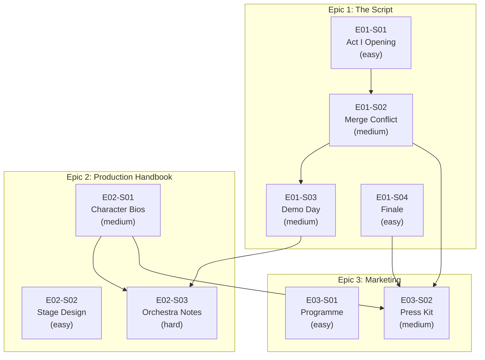

# Implementation Plan: Run 16 -- The Debugging: A Silicon Valley Musical

## Summary

This plan decomposes the approved design for Run 16 (The Debugging: A Silicon Valley Musical) into three epics with nine stories. The primary workflow test objectives are: **validate `state.sh` integration**, the **slimmed 503-line `orchestrator.md`**, the **`--overhead` flag**, and **`maxParallelBuilders` config enforcement** (Wave 1 has 5 stories but config caps at 3, requiring a split into sub-waves).

All stories produce markdown content files under `test-output/debugging-musical/`. No code, no tests, no infrastructure changes.

## Structural Decisions

**Three epics matching the musical production lifecycle.** E01 (The Script: Scenes and Songs, 4 stories) writes the musical's script -- dialogue, stage directions, and full song lyrics across two acts. E02 (Production Handbook, 3 stories) creates internal documentation for cast and crew -- character bios, stage design specs, and orchestra arrangement notes. E03 (Marketing and Audience Materials, 2 stories) produces customer-facing materials -- a programme guide and press kit. This mirrors a real theatrical production workflow where the script comes first, then production planning, then marketing.

**Four-wave dispatch with `maxParallelBuilders: 3` enforcement.** The dependency graph has four natural layers, but Wave 1 contains 5 independent stories while `maxParallelBuilders` in `.claude/agentic-sdlc-config.json` is set to 3. The orchestrator must split Wave 1 into two sub-waves (3 + 2). This is the primary test for config enforcement.

- **Wave 1a** (3 parallel): E01-S01, E01-S04, E02-S01 -- one easy, one easy, one medium. Selected to front-load the two E01 bookend scenes and the character bios (which E02-S03 and E03-S02 depend on).
- **Wave 1b** (2 parallel): E02-S02, E03-S01 -- one easy, one easy. The remaining Wave 1 stories with no dependencies.
- **Wave 2** (1 sequential): E01-S02 -- medium. Depends on E01-S01 (narrative continuity from Act I Scenes 1-2).
- **Wave 3** (2 parallel): E01-S03, E03-S02 -- medium, medium. E01-S03 depends on E01-S02 (Act II builds on Act I). E03-S02 depends on E01-S02, E01-S04, and E02-S01 (all complete by now).
- **Wave 4** (1 sequential): E02-S03 -- hard. Depends on all E01 scripts and E02-S01 character bios. Contains the planted bug for fix cycle validation.

**Why 3+2 split for Wave 1 (not 2+3).** Front-loading 3 stories maximizes parallelism in the first sub-wave. E01-S01 (Act I opening) is a critical-path dependency for E01-S02 (Wave 2), so starting it as early as possible minimizes total wall-clock time. E02-S01 (character bios) is needed by both E02-S03 (Wave 4) and E03-S02 (Wave 3), so including it in Wave 1a rather than 1b removes it from the critical path sooner.

**Soft vs. hard dependencies.** The design doc distinguishes between narrative dependencies (where the builder uses song titles and scene numbers from the design doc's Song Registry) and file dependencies (where the builder must read another story's output). Only E02-S03 and E03-S02 have true file dependencies. This plan schedules all narrative dependencies conservatively (E01-S02 after E01-S01, E01-S03 after E01-S02) to ensure builders can optionally read prior output for richer cross-references, even though the Song Registry provides all necessary data.

**Planted bug isolation.** The single planted bug lives in E02-S03 (hard, Wave 4), the final story. Running it last means the fix cycle does not cascade into other waves. The bug is a wrong scene number for "The Standup Ballad" (listed as Act I, Scene 4 instead of the correct Act I, Scene 2 per the Song Registry). The story description plants the error; the acceptance criteria correctly state "Each song has correct scene number matching the Song Registry."

**Cross-epic branch management.** Stories from E01, E02, and E03 appear in the same waves (Wave 1 has stories from all three epics). The orchestrator must manage three epic branches simultaneously:

1. Before Wave 1a: Create all three epic branches from the integration branch.
2. After each wave: Merge completed story branches into their respective epic branches.
3. Before Wave 4: Merge `epic/e01-script` and `epic/e02-handbook` into the integration branch so E02-S03 can read all prior files.
4. After Wave 4: Merge E02-S03 into `epic/e02-handbook`, then merge remaining epic branches into integration.

## Format Contract

All builders must follow these exact formats from the design doc. These contracts are reproduced here and included in each story issue body.

| Element | Exact Format | Example |
|---------|-------------|---------|
| Scene heading | `# Act [N], Scene [N]: [Scene Title]` | `# Act I, Scene 1: The Stand-Up (That Isn't Comedy)` |
| Stage direction | `*[text in italics]*` | `*Jordan leaps onto the conference table*` |
| Dialogue | `**CHARACTER NAME:** Dialogue text.` | `**MARCUS:** The main branch is broken.` |
| Song header | H3 `### Song: "[Title]"` + metadata lines | `### Song: "The Pitch"` / `**Performed by:** Jordan Chase` |
| Song structure | Bold section labels: `**[VERSE 1]**`, `**[CHORUS]**`, `**[BRIDGE]**`, `**[FINAL CHORUS / TAG]**` | `**[VERSE 1]**` / lyrics / `**[CHORUS]**` / lyrics |
| Character bio heading | `## [Character Name]` + Role/Vocal Range/Vocal Type metadata | `## Jordan Chase` / `**Role:** CEO / Founder` |
| Song assignment table | Columns: Song, Role in Number, Notes | `\| "The Pitch" \| Lead \| Full vocal range required \|` |
| Tech spec heading | `## [Design Element]` + Location/Scene(s) metadata | `## Main Stage: CtrlZ Open-Plan Office` |
| Cue sheet table | Columns: Cue, Trigger, Action, Duration | `\| L-201 \| Demo crash \| Red wash \| 3s \|` |
| Orchestra notes heading | `## [Song Title]` + Scene/Key/Tempo/Time Signature metadata | `## "The Pitch"` / `**Scene:** Act I, Scene 1` |
| Vocal requirements table | Columns: Character, Range Required, Notes | `\| Jordan Chase \| Tenor (C3-C5) \| Sustained high C in finale \|` |
| Glossary entry table | Columns: Tech Term, What It Actually Means, In the Show | `\| Merge conflict \| Two people editing the same file \| A dramatic tango \|` |
| Critic quote | `> "[Quote]" -- [Publication], [Reviewer]` / `> [Stars]` | `> "Finally..." -- The New York Times, Ben Brantley` |
| Date format | Not applicable (fictional production) | N/A |
| Word count | 300-500 per story | N/A |

## Character Roster (Deterministic Reference)

All stories share these characters. Builders must use these names and roles consistently.

| Character | Role | Vocal Range |
|-----------|------|-------------|
| Jordan Chase | CEO / Founder | Tenor |
| Priya Mehta | Product Manager | Mezzo-soprano |
| Marcus Chen | Senior Engineer | Baritone |
| Zoe Kim | Junior Engineer | Soprano |
| Aisha Okafor | QA Lead | Alto |
| Riley Park | The Intern | Tenor (high) |
| The Legacy Codebase | Personified Ensemble | Full range (ensemble) |

## Song Registry (Deterministic Reference)

All songs referenced across the musical. Cross-references must use these exact titles and scene numbers.

| Song Title | Act/Scene | Character(s) | Style/Tempo |
|------------|-----------|--------------|-------------|
| "The Pitch" | Act I, Scene 1 | Jordan (solo) | Up-tempo show opener, jazz hands energy |
| "The Standup Ballad" | Act I, Scene 2 | Full cast | Power ballad, 4/4 time, builds to ensemble |
| "The Merge Conflict" | Act I, Scene 3 | Marcus and Zoe (duet) | Tango, dramatic tension |
| "Rebase or Rewrite?" | Act I, Scene 3 | Full cast (ensemble) | Rock anthem, call-and-response |
| "The Intern's Lament" | Act I, Scene 4 | Riley (solo) | Slow ballad, acoustic guitar |
| "It Worked on My Machine" | Act II, Scene 1 | Priya (solo) | Blues number, spotlight |
| "The Rollback Waltz" | Act II, Scene 2 | Full cast | Waltz, 3/4 time, elegant |
| "Technical Debt (The Musical Number)" | Act II, Scene 3 | The Legacy Codebase (ensemble) | Modern dance / hip-hop fusion |
| "Ctrl+Z (The Reprise)" | Act II, Scene 3 (Finale) | Full cast | Reprise of "The Pitch", triumphant |

## Epic and Story Breakdown

### E01: The Script -- Scenes and Songs (4 stories)

The musical's script organized by act. Each story produces scenes with dialogue, stage directions, and complete song lyrics. The epic branch is `epic/e01-script`, created from `backlog/167-test-run-16-paranormal-pets`.

---

#### E01-S01: Act I, Scenes 1-2 -- "The Stand-Up (That Isn't Comedy)" (easy)

**File:** `test-output/debugging-musical/script/act1-scenes-1-2.md`
**Branch:** `e01-s01/act1-opening`
**Difficulty:** `difficulty/easy` (two scenes with clear structure, no dependencies)
**Model:** `builder-sonnet`
**Blocked by:** none

**What the builder does:**
1. Create `test-output/debugging-musical/script/` directory
2. Write `act1-scenes-1-2.md` following the Scene Format template
3. Scene 1: Jordan Chase pitches investors via interpretive dance, singing "The Pitch" -- up-tempo show opener about disrupting the "undo" market. Slide deck behind reads increasingly absurd claims.
4. Scene 2: Engineering team daily standup. Each member reports via "The Standup Ballad" -- power ballad where Jira updates become emotionally devastating confessions. Marcus: main branch broken. Zoe: rebasing for three days. Priya: PRD nobody read. Builds to full ensemble.
5. Full lyrics for "The Pitch" and "The Standup Ballad" with verse/chorus structure
6. Word count: 300-500

**Acceptance criteria:**
- [ ] File exists at `test-output/debugging-musical/script/act1-scenes-1-2.md`
- [ ] Follows Scene Format template (headings, dialogue format, song structure)
- [ ] Scene 1 with Jordan's pitch and "The Pitch" (verse/chorus/bridge)
- [ ] Scene 2 with standup and "The Standup Ballad" (multiple character verses, chorus)
- [ ] Characters use names from the Character Roster
- [ ] Stage directions in italics
- [ ] Word count 300-500

---

#### E01-S02: Act I, Scenes 3-4 -- "The Merge Conflict" (medium)

**File:** `test-output/debugging-musical/script/act1-scenes-3-4.md`
**Branch:** `e01-s02/act1-merge-conflict`
**Difficulty:** `difficulty/medium` (three songs with different styles, must reference E01-S01 events)
**Model:** `builder-sonnet`
**Blocked by:** E01-S01

**What the builder does:**
1. Write `act1-scenes-3-4.md` following the Scene Format template
2. Scene 3: Marcus and Zoe discover they edited the same file. "The Merge Conflict" -- tango duet with dramatic code changes. Escalates into "Rebase or Rewrite?" -- rock anthem, team picks sides (REBASE vs REWRITE), Aisha watches from QA.
3. Scene 4: Riley alone on stage. "The Intern's Lament" -- slow ballad about being asked to fix CI pipeline on day one, six months ago. Reference CI/CD pain points (flaky tests, env vars, Docker builds).
4. Must reference events from E01-S01 (broken main branch from standup, Jordan's pitch)
5. Full lyrics for "The Merge Conflict" (duet), "Rebase or Rewrite?" (ensemble), and "The Intern's Lament" (solo)
6. Word count: 300-500

**Acceptance criteria:**
- [ ] File exists at `test-output/debugging-musical/script/act1-scenes-3-4.md`
- [ ] Follows Scene Format template
- [ ] Scene 3 with "The Merge Conflict" (Marcus/Zoe duet) and "Rebase or Rewrite?" (ensemble, call-and-response)
- [ ] Scene 4 with "The Intern's Lament" (Riley solo)
- [ ] All three songs have verse/chorus structure
- [ ] References events from Act I Scenes 1-2 (broken main branch, the pitch)
- [ ] Word count 300-500

---

#### E01-S03: Act II, Scenes 1-2 -- "The Demo Day Disaster" (medium)

**File:** `test-output/debugging-musical/script/act2-scenes-1-2.md`
**Branch:** `e01-s03/act2-demo-day`
**Difficulty:** `difficulty/medium` (two songs with contrasting tones, must reference Act I events)
**Model:** `builder-sonnet`
**Blocked by:** E01-S02

**What the builder does:**
1. Write `act2-scenes-1-2.md` following the Scene Format template
2. Scene 1: Demo day. Investors return. Demo crashes. Priya sings "It Worked on My Machine" -- blues number defending the product while backend fails (red warnings, error messages on backdrop). Jordan tries to pivot.
3. Scene 2: Team regroups, rolls back. "The Rollback Waltz" -- 3/4 time waltz where each couple represents a service reverting. Bittersweet tone.
4. Must reference the merge conflict from Act I Scene 3 as contributing cause
5. Full lyrics for "It Worked on My Machine" and "The Rollback Waltz"
6. Word count: 300-500

**Acceptance criteria:**
- [ ] File exists at `test-output/debugging-musical/script/act2-scenes-1-2.md`
- [ ] Follows Scene Format template
- [ ] Scene 1 (Demo Day) with "It Worked on My Machine" (Priya blues solo)
- [ ] Scene 2 (Rollback) with "The Rollback Waltz" (3/4 time, waltz staging)
- [ ] References the merge conflict from Act I Scene 3
- [ ] Both songs have verse/chorus structure
- [ ] Word count 300-500

---

#### E01-S04: Act II, Scene 3 and Finale -- "The Ship It Showdown" (easy)

**File:** `test-output/debugging-musical/script/act2-scene-3-finale.md`
**Branch:** `e01-s04/act2-finale`
**Difficulty:** `difficulty/easy` (standard finale structure, reprise pattern)
**Model:** `builder-sonnet`
**Blocked by:** none

**What the builder does:**
1. Write `act2-scene-3-finale.md` following the Scene Format template
2. Scene 3: Ship or miss the deadline. "Technical Debt (The Musical Number)" -- ensemble piece where The Legacy Codebase comes alive as dancers representing legacy modules. Brittle choreography, chain reaction of failures.
3. Finale: "Ctrl+Z (The Reprise)" -- reprises the melody of "The Pitch" from Act I Scene 1, new lyrics about learning from mistakes. Full cast, Legacy Codebase dancers, investors return.
4. Must reference "The Pitch" from Act I Scene 1 explicitly (reprise reuses its melody)
5. Full lyrics for "Technical Debt (The Musical Number)" and "Ctrl+Z (The Reprise)"
6. Word count: 300-500

**Acceptance criteria:**
- [ ] File exists at `test-output/debugging-musical/script/act2-scene-3-finale.md`
- [ ] Follows Scene Format template
- [ ] Scene 3 with "Technical Debt (The Musical Number)" featuring The Legacy Codebase as dancers
- [ ] Finale with "Ctrl+Z (The Reprise)" reprising "The Pitch" melody with new lyrics
- [ ] References "The Pitch" from Act I Scene 1 explicitly
- [ ] Both numbers have full lyrics with verse/chorus structure
- [ ] Word count 300-500

---

### E02: Production Handbook (3 stories)

Internal documentation for the stage crew, technical team, and performers. The epic branch is `epic/e02-handbook`, created from `backlog/167-test-run-16-paranormal-pets`.

---

#### E02-S01: Character Bios and Vocal Casting Notes (medium)

**File:** `test-output/debugging-musical/handbook/character-bios.md`
**Branch:** `e02-s01/character-bios`
**Difficulty:** `difficulty/medium` (seven character profiles with structured sections, song assignment cross-references)
**Model:** `builder-sonnet`
**Blocked by:** none

**What the builder does:**
1. Create `test-output/debugging-musical/handbook/` directory
2. Write `character-bios.md` following the Character Bio Format template
3. Detailed profiles for all 7 characters from the Character Roster
4. Each profile: backstory (2-3 sentences), motivation, costume notes, song assignments table
5. Vocal range requirements with casting director notes (e.g., "Must sustain high C during finale")
6. Marcus: wears same hoodie every scene because he never goes home
7. The Legacy Codebase ensemble: personification concept, minimum 6 dancers, each representing a different legacy module
8. Song assignment tables must cross-reference Song Registry for accuracy
9. Word count: 300-500

**Acceptance criteria:**
- [ ] File exists at `test-output/debugging-musical/handbook/character-bios.md`
- [ ] Follows Character Bio Format template for each character
- [ ] All 7 characters from the Character Roster included
- [ ] Vocal range and type specified for each
- [ ] Costume notes for each character
- [ ] Song assignment table for each character with correct song titles from Song Registry
- [ ] The Legacy Codebase ensemble section describes personification concept
- [ ] Word count 300-500

---

#### E02-S02: Technical Stage Design and Effects Specs (easy)

**File:** `test-output/debugging-musical/handbook/stage-design.md`
**Branch:** `e02-s02/stage-design`
**Difficulty:** `difficulty/easy` (structured template, no cross-references to file content)
**Model:** `builder-sonnet`
**Blocked by:** none

**What the builder does:**
1. Write `stage-design.md` following the Technical Spec Format template
2. Main stage: CtrlZ open-plan office (desk layout, whiteboard with sprint boards, ominous server rack)
3. Upstage: "server room" -- darker mechanical space visible through glass wall (Legacy Codebase performs here)
4. Lighting cues: fire effect (Act II Scene 1, demo failure), blue wash ("The Rollback Waltz"), red (merge conflict tango)
5. Fog machine: "The Rollback Waltz" (rolling fog = rollback washing over the codebase)
6. Projection specs: slide deck (Act I Scene 1), error messages (Act II Scene 1)
7. At least one cue sheet table for the Act II fire effect sequence
8. Word count: 300-500

**Acceptance criteria:**
- [ ] File exists at `test-output/debugging-musical/handbook/stage-design.md`
- [ ] Follows Technical Spec Format template
- [ ] Main stage (open-plan office) set design described
- [ ] Upstage server room area described
- [ ] Lighting cues for at least 3 key moments
- [ ] Fog machine specifications for "The Rollback Waltz"
- [ ] Projection specifications
- [ ] At least one cue sheet table
- [ ] Word count 300-500

---

#### E02-S03: Orchestra Arrangement Notes and Song Index (hard)

**File:** `test-output/debugging-musical/handbook/orchestra-notes.md`
**Branch:** `e02-s03/orchestra-notes`
**Difficulty:** `difficulty/hard` (nine songs, cross-references all E01 scripts and E02-S01 bios, integration story)
**Model:** `builder-opus`
**Blocked by:** E01-S03, E02-S01

**What the builder does:**
1. Read all E01 script files and E02-S01 character bios for cross-reference accuracy
2. Write `orchestra-notes.md` following the Orchestra Notes Format template
3. Full song index listing all 9 songs with: title, scene number, character(s), key, tempo, time signature, orchestration notes
4. For each song, indicate full pit orchestra vs. acoustic-only (e.g., "The Intern's Lament" = acoustic guitar only; "Rebase or Rewrite?" = full band)
5. Transition timing between scenes (seconds of underscoring or silence)
6. Vocal requirements table for each song with character ranges
7. Cross-reference character vocal ranges from E02-S01 to validate casting requirements
8. **NOTE:** "The Standup Ballad" appears in Act I, Scene 4. Reference this scene number in the orchestra notes.
9. Word count: 300-500

**Acceptance criteria:**
- [ ] File exists at `test-output/debugging-musical/handbook/orchestra-notes.md`
- [ ] Follows Orchestra Notes Format template for each song
- [ ] All 9 songs from the Song Registry indexed
- [ ] Each song has correct scene number matching the Song Registry
- [ ] Each song has key, tempo, and time signature
- [ ] Full pit vs. acoustic-only indicated for each song
- [ ] Transition timing between all scenes
- [ ] Vocal requirements table for each song
- [ ] Cross-references character vocal ranges from E02-S01
- [ ] Word count 300-500

---

### E03: Marketing and Audience Materials (2 stories)

Customer-facing materials for the show's premiere. The epic branch is `epic/e03-marketing`, created from `backlog/167-test-run-16-paranormal-pets`.

---

#### E03-S01: "So You Think You Can Debug?" -- Programme Guide (easy)

**File:** `test-output/debugging-musical/marketing/programme-guide.md`
**Branch:** `e03-s01/programme-guide`
**Difficulty:** `difficulty/easy` (standalone document, creative writing with simple template)
**Model:** `builder-sonnet`
**Blocked by:** none

**What the builder does:**
1. Create `test-output/debugging-musical/marketing/` directory
2. Write `programme-guide.md` following the Programme Guide Format template
3. "Welcome" section from the fictional director (Jordan Chase doubles as director)
4. Tech glossary: at least 8 entries explaining tech terms for non-technical audience (e.g., "Merge conflict -- like two people editing the same Google Doc but with more crying")
5. "Meet the Cast" section with one-line descriptions of each character (audience-friendly)
6. "Song List" section listing all songs in performance order
7. Accessible, friendly tone for non-technical theatregoers
8. Word count: 300-500

**Acceptance criteria:**
- [ ] File exists at `test-output/debugging-musical/marketing/programme-guide.md`
- [ ] Follows Programme Guide Format template
- [ ] "Welcome" section from the director
- [ ] Tech glossary with at least 8 entries in table format
- [ ] "Meet the Cast" section with all 7 characters
- [ ] "Song List" in performance order
- [ ] Accessible tone for non-technical audience
- [ ] Word count 300-500

---

#### E03-S02: Press Kit with Critic Quotes and Show Synopsis (medium)

**File:** `test-output/debugging-musical/marketing/press-kit.md`
**Branch:** `e03-s02/press-kit`
**Difficulty:** `difficulty/medium` (cross-references songs, scenes, and characters from E01 and E02)
**Model:** `builder-sonnet`
**Blocked by:** E01-S02, E01-S04, E02-S01

**What the builder does:**
1. Read E01 script files and E02-S01 character bios for cross-reference accuracy
2. Write `press-kit.md` following the Press Kit Format template
3. Fictional critic reviews from at least 4 publications. Each references specific songs/scenes by name. Example tones: "Finally, a musical that captures the existential dread of a failed deployment" (NYT), "I laughed, I cried, I opened a pull request" (Wired).
4. Behind-the-scenes notes about the show's creation (fictional)
5. Full show synopsis (300+ words of synopsis text) referencing at least 3 songs by title with correct scene numbers
6. Characters referenced consistently with E02-S01 character bios
7. Word count: 300-500

**Acceptance criteria:**
- [ ] File exists at `test-output/debugging-musical/marketing/press-kit.md`
- [ ] Follows Press Kit Format template
- [ ] At least 4 fictional critic reviews with publication attribution
- [ ] Critic reviews reference specific songs or scenes by name
- [ ] Behind-the-scenes notes
- [ ] Full show synopsis referencing at least 3 songs by title
- [ ] Synopsis uses correct scene numbers from the Song Registry
- [ ] Characters referenced consistently with E02-S01
- [ ] Word count 300-500

---

## Dependency Graph

## Dispatch Plan

| Wave | Stories | Parallel | Models | Notes |
|------|---------|----------|--------|-------|
| **Wave 1a** | E01-S01, E01-S04, E02-S01 | 3 | sonnet, sonnet, sonnet | Config cap = 3. Front-loads critical-path items. |
| **Wave 1b** | E02-S02, E03-S01 | 2 | sonnet, sonnet | Remaining independent stories. |
| **Wave 2** | E01-S02 | 1 | sonnet | Depends on E01-S01. Sequential. |
| **Wave 3** | E01-S03, E03-S02 | 2 | sonnet, sonnet | S03 depends on S02. S09 depends on S02+S04+S05. |
| **Wave 4** | E02-S03 | 1 | opus | Hard story. Depends on E01-S03 + E02-S01. Planted bug. |

### Wave Details

**Wave 1a (3 parallel, sonnet):** E01-S01 (Act I opening) and E01-S04 (Act II finale) are the bookend scenes with no shared narrative between them. E02-S01 (character bios) is independent. All three create new files from scratch. Worktree isolation required. E01-S01 is critical-path -- E01-S02 (Wave 2) depends on it.

**Wave 1b (2 parallel, sonnet):** E02-S02 (stage design) and E03-S01 (programme guide) are both fully independent easy stories. Worktree isolation required. These are the Wave 1 overflow after the config cap splits 5 stories into 3+2.

**Wave 2 (1 sequential, sonnet):** E01-S02 (Act I Scenes 3-4) depends on E01-S01 (Act I Scenes 1-2) for narrative continuity. The builder should reference events from Act I Scenes 1-2 (broken main branch, the pitch). No worktree isolation needed (single story).

**Wave 3 (2 parallel, sonnet):** E01-S03 (Act II Scenes 1-2) depends on E01-S02 (Act I conflict escalation). E03-S02 (press kit) depends on E01-S02, E01-S04, and E02-S01 (all complete from Waves 1-2). Both stories should read prior output files for cross-reference accuracy. Worktree isolation required.

**Wave 4 (1 sequential, opus):** E02-S03 (orchestra notes) is the hard integration story. Must read all E01 scripts and E02-S01 character bios. Contains the planted bug: "The Standup Ballad" listed as Scene 4 instead of the correct Scene 2. The reviewer should catch this as a cross-reference error. No worktree isolation needed (single story).

### Epic Branch Merge Strategy

1. **Before Wave 1a:** Create `epic/e01-script`, `epic/e02-handbook`, `epic/e03-marketing` from the integration branch. Create all Wave 1a story branches from their respective epic branches.
2. **After Wave 1a:** Merge E01-S01 into `epic/e01-script`. Merge E01-S04 into `epic/e01-script`. Merge E02-S01 into `epic/e02-handbook`.
3. **Before Wave 1b:** Create Wave 1b story branches from their respective epic branches.
4. **After Wave 1b:** Merge E02-S02 into `epic/e02-handbook`. Merge E03-S01 into `epic/e03-marketing`.
5. **Before Wave 2:** Merge `epic/e01-script` into integration branch (so E01-S02 can read E01-S01 output if needed). Create E01-S02 story branch from `epic/e01-script`.
6. **After Wave 2:** Merge E01-S02 into `epic/e01-script`.
7. **Before Wave 3:** Merge `epic/e01-script` into integration branch. Create E01-S03 branch from `epic/e01-script`. Create E03-S02 branch from `epic/e03-marketing`.
8. **After Wave 3:** Merge E01-S03 into `epic/e01-script`. Merge E03-S02 into `epic/e03-marketing`.
9. **Before Wave 4:** Merge `epic/e01-script` and `epic/e02-handbook` into integration branch. Create E02-S03 branch from `epic/e02-handbook`.
10. **After Wave 4:** Merge E02-S03 into `epic/e02-handbook`. Merge all remaining epic branches into integration branch.

### Fix Cycle Expectations

| Story | Bug Type | Expected Reviewer Action | Fix Effort |
|-------|----------|--------------------------|------------|
| E02-S03 | Wrong scene number ("The Standup Ballad" as Scene 4 instead of Scene 2) | REQUEST_CHANGES -- fix cross-reference | Trivial -- fix one scene number |

## Difficulty Summary

| Difficulty | Count | Stories | Model |
|------------|-------|---------|-------|
| Easy | 4 | E01-S01, E01-S04, E02-S02, E03-S01 | builder-sonnet |
| Medium | 4 | E01-S02, E01-S03, E02-S01, E03-S02 | builder-sonnet |
| Hard | 1 | E02-S03 | builder-opus |
| **Total** | **9** | | |

## File Summary

| Story | Output File | Difficulty |
|-------|------------|------------|
| E01-S01 | `test-output/debugging-musical/script/act1-scenes-1-2.md` | easy |
| E01-S02 | `test-output/debugging-musical/script/act1-scenes-3-4.md` | medium |
| E01-S03 | `test-output/debugging-musical/script/act2-scenes-1-2.md` | medium |
| E01-S04 | `test-output/debugging-musical/script/act2-scene-3-finale.md` | easy |
| E02-S01 | `test-output/debugging-musical/handbook/character-bios.md` | medium |
| E02-S02 | `test-output/debugging-musical/handbook/stage-design.md` | easy |
| E02-S03 | `test-output/debugging-musical/handbook/orchestra-notes.md` | hard |
| E03-S01 | `test-output/debugging-musical/marketing/programme-guide.md` | easy |
| E03-S02 | `test-output/debugging-musical/marketing/press-kit.md` | medium |

## Content Conventions

All stories must follow these conventions from the design doc:

- **Scene Format template** for E01 stories (heading, setting, characters present, dialogue, song sections)
- **Character Bio Format template** for E02-S01 (name, role, vocal range, backstory, motivation, costume, song table)
- **Technical Spec Format template** for E02-S02 (element, location, scenes, description, requirements, cue sheet)
- **Orchestra Notes Format template** for E02-S03 (song title, scene, key, tempo, time sig, orchestration, vocals, transition)
- **Programme Guide Format template** for E03-S01 (section title, accessible prose, glossary table)
- **Press Kit Format template** for E03-S02 (section title, PR prose, critic quotes, synopsis)
- **Tone:** Comedy. Tech satire meets Broadway energy.
- **Character names:** From the Character Roster -- exact names only.
- **Song titles and scene numbers:** From the Song Registry -- exact titles and scene numbers only.
- **Word count:** 300-500 per story.
- **Output directory:** `test-output/debugging-musical/` with subdirectories `script/`, `handbook/`, `marketing/`.
