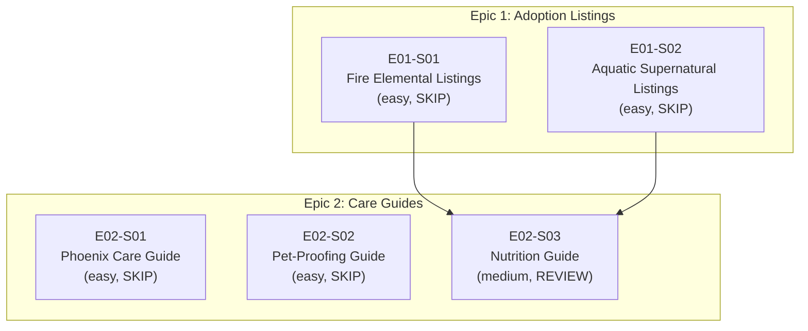

# Implementation Plan: Run 15 -- Supernatural Pet Adoption Agency

## Summary

This plan decomposes the approved design for Run 15 (Supernatural Pet Adoption Agency) into two epics with five stories. The primary workflow test objective is **validating v2 workflow changes from backlog 243** -- specifically the tiered review strategy (`review_tier = SKIP` for easy stories), agent tool inheritance, and agent attribution. This is the first run with `reviewStrategy.skipPerStoryReview.enabled: true` in production.

All stories produce markdown content files under `content/supernatural-pets/`. No code, no tests, no infrastructure changes.

## Issue Mapping

| Item | Issue | Type | Difficulty |
|------|-------|------|------------|
| Backlog | #290 | backlog | -- |
| Plan | #293 | docs | -- |
| E01: Adoption Listings | #292 | epic | -- |
| E01-S01: Fire-Elemental Adoption Listings | #295 | story | easy |
| E01-S02: Aquatic-Supernatural Adoption Listings | #296 | story | easy |
| E02: Care Guides | #294 | epic | -- |
| E02-S01: Phoenix Care Guide | #297 | story | easy |
| E02-S02: Interdimensional Pet-Proofing Guide | #298 | story | easy |
| E02-S03: Supernatural Pet Nutrition Guide | #299 | story | medium |

## Structural Decisions

**Two epics matching the design doc's domain split.** E01 (Adoption Listings, 2 stories) handles short-form adoption profiles for supernatural pets. E02 (Care Guides, 3 stories) handles longer-form reference documents for new owners. This maps directly to the design doc's proposed structure with no additional decomposition needed.

**Why 2 epics instead of 1:** Although all 5 stories could fit in a single epic, the design doc clearly distinguishes two content domains (profiles vs. guides) with different templates, word counts, and tones. Separate epics enable parallel dispatch of Wave 1 stories across both epics and clean epic-branch merges. Two epics also create a natural dependency boundary -- E02-S03 (nutrition guide) cross-references E01 pet names, which means it must wait for E01 completion.

**Two-wave dispatch.** The dependency graph has two natural layers:

- **Wave 1** (4 parallel): E01-S01, E01-S02, E02-S01, E02-S02 -- all independent, all `difficulty/easy`. The config `maxParallelBuilders: 3` means the orchestrator may split into 3+1 sub-waves at its discretion. All 4 stories are SKIP tier, so no per-story review is needed.
- **Wave 2** (1 sequential): E02-S03 -- depends on E01 completion (cross-references pet names). This is the only `difficulty/medium` story and the only REVIEW-tier story, so it gets a per-story reviewer dispatch.

**Soft dependency for E02-S03.** The nutrition guide cross-references pets from E01 by name. The design doc provides fallback names (Cinder, Flicker, Spark, Puddles, Marina, Abby) so the story is not hard-blocked on E01. However, scheduling E02-S03 in Wave 2 (after E01 merges into the epic branch) ensures the builder can read actual E01 files for name consistency. This is the better approach -- it costs minimal wall-clock time (Wave 2 is only 1 story) and produces a more consistent result.

**No planted bugs.** The design doc explicitly states no planted bugs -- this run focuses on clean workflow path validation, not fix cycle testing (already validated in Run 14).

## Format Contract

Since E01 stories produce adoption listings that share a common template, and E02-S03 cross-references E01 content, this format contract ensures consistency across parallel builders.

| Element | Exact Format | Example |
|---------|-------------|---------|
| Adoption listing header | H1 with "Meet [Name]!" | `# Meet Cinder!` |
| Species line | Bold label, common name, parenthetical classification | `**Species:** Phoenix (Ignis Renascens)` |
| Adoption ID | EYAA-YYYY-NNN format | `**ID:** EYAA-2026-001` |
| Warning/Tank section | H2 with exact title per story type | `## Fire Safety Warning` or `## Tank Requirements` |
| Adoption fee | Stated in standard currency | `**Adoption Fee:** $2,500` |
| Contact footer | Italicized, with email and address | `*Interested in adopting Cinder? Contact Eternally Yours at adopt@eternallyyours.org...*` |
| Care guide title | H1 with exact title from design doc | `# So You Adopted a Phoenix: A First-Time Owner's Guide` |
| Pro Tip callout | Blockquote with bold "Pro Tip:" prefix | `> **Pro Tip:** Always keep a fire extinguisher rated for supernatural fires...` |
| Meal plan table | Markdown table: Day, Pet Name, Morning Meal, Evening Meal, Supplements, Notes | `\| Monday \| Cinder \| Charcoal pellets (200C) \| Volcanic mineral mix \| Calcium \| Serve hot \|` |

## Dependency Graph



## Dispatch Plan

| Wave | Stories | Dispatch | Review Tier | Notes |
|------|---------|----------|-------------|-------|
| **Wave 1** | E01-S01, E01-S02, E02-S01, E02-S02 | Parallel (4 stories) | All SKIP | All easy, all independent. `maxParallelBuilders: 3` may require 3+1 split. No per-story review. |
| **Wave 2** | E02-S03 | Sequential (1 story) | REVIEW | Soft dependency on E01 (pet name cross-references). Gets per-story reviewer dispatch. |

**Estimated execution time:**

- Wave 1 (4 easy, parallel): ~2-3 min wall-clock
- Wave 2 (1 medium, build + review): ~3-4 min wall-clock
- Total: ~5-7 min wall-clock, ~12-15 min sequential agent time

## Epic and Story Breakdown

### E01: Adoption Listings

Two adoption listing files, each containing 3 supernatural pet profiles. The epic branch is `epic/e01-adoption-listings`, created from `backlog/290-supernatural-pet-adoption`.

---

#### E01-S01: Fire-Elemental Adoption Listings (easy)

**File:** `content/supernatural-pets/fire-elemental-adoptions.md`
**Branch:** `e01-s01/fire-elemental-adoptions`
**Difficulty:** `difficulty/easy` (single file, provided template, no dependencies)
**Model:** `builder-sonnet`
**Review tier:** SKIP

**What the builder does:**

1. Create `content/supernatural-pets/` directory (`mkdir -p`)
2. Write `fire-elemental-adoptions.md` with 3 adoption listings: phoenix, fire salamander, ember sprite
3. Follow the Adoption Listing Template from the design doc (Meet [Name]!, Species, Age, etc.)
4. Each listing: 300-500 words
5. Each listing includes a "Fire Safety Warning" section with creature-specific safety precautions
6. Suggested names: Cinder (phoenix), Flicker (salamander), Spark (ember sprite) -- builder may choose different names
7. All three listings use consistent formatting and agency conventions (EYAA IDs, fee structure, contact info)
8. Warm, professional, plays-it-straight tone throughout

**Format Contract:**

- Listing header: `# Meet [Name]!`
- Species line: `**Species:** Common Name (Latin/Magical Classification)`
- Adoption ID: `**ID:** EYAA-2026-NNN` (sequential within file: 001, 002, 003)
- Warning section: `## Fire Safety Warning`
- Contact footer: italicized, with `adopt@eternallyyours.org` and `42 Hearthstone Lane`

**Acceptance criteria:**

- [ ] File exists at `content/supernatural-pets/fire-elemental-adoptions.md`
- [ ] Contains exactly 3 adoption listings (phoenix, salamander, ember sprite)
- [ ] Each listing follows the Adoption Listing Template structure from the design doc
- [ ] Each listing includes a "Fire Safety Warning" section
- [ ] Each listing is 300-500 words
- [ ] Warm, professional tone maintained throughout (no irony, no breaking character)
- [ ] All three listings use consistent formatting and agency conventions
- [ ] Rating table uses markdown table format as specified in the Format Contract

---

#### E01-S02: Aquatic-Supernatural Adoption Listings (easy)

**File:** `content/supernatural-pets/aquatic-supernatural-adoptions.md`
**Branch:** `e01-s02/aquatic-supernatural-adoptions`
**Difficulty:** `difficulty/easy` (single file, provided template, no dependencies)
**Model:** `builder-sonnet`
**Review tier:** SKIP

**What the builder does:**

1. Create `content/supernatural-pets/` directory if not already present
2. Write `aquatic-supernatural-adoptions.md` with 3 adoption listings: kraken hatchling, selkie pup, deep-sea leviathan juvenile
3. Follow the Adoption Listing Template from the design doc
4. Each listing: 300-500 words
5. Each listing includes a "Tank Requirements" section with aquatic habitat specifications
6. Suggested names: Puddles (kraken), Marina (selkie), Abby (leviathan) -- builder may choose different names
7. All three listings use consistent formatting matching E01-S01 conventions
8. Warm, professional, plays-it-straight tone throughout

**Format Contract:**

- Listing header: `# Meet [Name]!`
- Species line: `**Species:** Common Name (Latin/Magical Classification)`
- Adoption ID: `**ID:** EYAA-2026-NNN` (sequential continuing from E01-S01: 004, 005, 006)
- Warning section: `## Tank Requirements`
- Contact footer: italicized, with `adopt@eternallyyours.org` and `42 Hearthstone Lane`

**Acceptance criteria:**

- [ ] File exists at `content/supernatural-pets/aquatic-supernatural-adoptions.md`
- [ ] Contains exactly 3 adoption listings (kraken hatchling, selkie pup, leviathan juvenile)
- [ ] Each listing follows the Adoption Listing Template structure from the design doc
- [ ] Each listing includes a "Tank Requirements" section
- [ ] Each listing is 300-500 words
- [ ] Warm, professional tone maintained throughout
- [ ] All three listings use consistent formatting and agency conventions
- [ ] EYAA IDs continue sequentially from E01-S01 (004, 005, 006)

---

### E02: Care Guides

Three standalone care guide documents for supernatural pet owners. The epic branch is `epic/e02-care-guides`, created from `backlog/290-supernatural-pet-adoption`.

---

#### E02-S01: Phoenix Care Guide (easy)

**File:** `content/supernatural-pets/phoenix-care-guide.md`
**Branch:** `e02-s01/phoenix-care-guide`
**Difficulty:** `difficulty/easy` (single file, clear topic, well-defined sections)
**Model:** `builder-sonnet`
**Review tier:** SKIP

**What the builder does:**

1. Create `content/supernatural-pets/` directory if not already present
2. Write `phoenix-care-guide.md` with title "So You Adopted a Phoenix: A First-Time Owner's Guide"
3. 600-800 words
4. Cover these required topics:
   - Understanding the rebirth cycle (signs, frequency, recovery)
   - Ash cleanup and home maintenance (products, furniture protection)
   - Emotional bonding during resurrection (disorientation, trust-building, emotional toll on owner)
   - Smoke alarm management (supernatural-rated detectors, fire department registration)
5. Include a first-week checklist as a numbered list
6. Include at least one "Pro Tip" callout box (blockquote with bold "Pro Tip:" prefix)
7. Reassuring, practical, empathetic tone

**Format Contract:**

- Title: `# So You Adopted a Phoenix: A First-Time Owner's Guide`
- Pro Tip callout: `> **Pro Tip:** [advice text]`
- First-week checklist: numbered markdown list under an H2 or H3 heading

**Acceptance criteria:**

- [ ] File exists at `content/supernatural-pets/phoenix-care-guide.md`
- [ ] Title is "So You Adopted a Phoenix: A First-Time Owner's Guide"
- [ ] Covers all 4 required topics (rebirth cycle, ash cleanup, emotional bonding, smoke alarms)
- [ ] Includes a first-week checklist as a numbered list
- [ ] Includes at least one "Pro Tip" callout box using the format contract format
- [ ] 600-800 words
- [ ] Reassuring, practical tone maintained throughout

---

#### E02-S02: Interdimensional Pet-Proofing Guide (easy)

**File:** `content/supernatural-pets/interdimensional-pet-proofing.md`
**Branch:** `e02-s02/interdimensional-pet-proofing`
**Difficulty:** `difficulty/easy` (single file, clear topic, well-defined sections)
**Model:** `builder-sonnet`
**Review tier:** SKIP

**What the builder does:**

1. Create `content/supernatural-pets/` directory if not already present
2. Write `interdimensional-pet-proofing.md` with title "Interdimensional Pet-Proofing Your Home"
3. 600-800 words
4. Cover these required topics:
   - Portal sealing (identification, products, insurance implications)
   - Void-pocket prevention (detection kits, sealing, dangers)
   - Temporal displacement alarms (warning signs, installation, emergency hotline)
   - Phase-through-walls protocol (dimensional anchoring, room prioritization)
5. Include a room-by-room checklist (kitchen, bathroom, bedroom, living room, outdoor)
6. Practical, safety-focused tone (non-optional precautions, not alarmist)

**Format Contract:**

- Title: `# Interdimensional Pet-Proofing Your Home`
- Room-by-room checklist: markdown checklist under an H2 or H3 heading, organized by room

**Acceptance criteria:**

- [ ] File exists at `content/supernatural-pets/interdimensional-pet-proofing.md`
- [ ] Title is "Interdimensional Pet-Proofing Your Home"
- [ ] Covers all 4 required topics (portal sealing, void pockets, temporal displacement, phase-through-walls)
- [ ] Includes a room-by-room checklist
- [ ] 600-800 words
- [ ] Practical, safety-focused tone maintained throughout

---

#### E02-S03: Supernatural Pet Nutrition Guide (medium)

**File:** `content/supernatural-pets/supernatural-nutrition-guide.md`
**Branch:** `e02-s03/supernatural-nutrition-guide`
**Difficulty:** `difficulty/medium` (longer word count, cross-references E01 pets, structured table, consistency requirements)
**Model:** `builder-sonnet`
**Review tier:** REVIEW

**What the builder does:**

1. Read E01 files from the epic branch to get actual pet names (if available). If not available, use design doc fallback names: Cinder, Flicker, Spark, Puddles, Marina, Abby
2. Write `supernatural-nutrition-guide.md` with title "The Comprehensive Supernatural Pet Nutrition Guide"
3. 800-1200 words
4. Cover these dietary categories:
   - Fire-elemental nutrition (volcanic minerals, charcoal, sulfur, temperature requirements). Reference E01-S01 pets by name.
   - Aquatic-supernatural nutrition (bioluminescent plankton, moonlight-infused water, raw fish standards). Reference E01-S02 pets by name.
   - Interdimensional pet nutrition (void essence, temporal crumbs, phase-stable treats)
5. Include a weekly meal plan table: 7 days, at least 3 pet types (one fire, one aquatic, one interdimensional). Columns: Day, Pet Name, Morning Meal, Evening Meal, Supplements, Notes.
6. Include a "Common Dietary Mistakes" section (DO NOT list)
7. Include allergen and sensitivity warnings (cross-dimensional considerations)
8. Dietary details must be consistent with E01 adoption listings
9. Professional, informative tone

**Format Contract:**

- Title: `# The Comprehensive Supernatural Pet Nutrition Guide`
- Meal plan table: markdown table with columns `| Day | Pet Name | Morning Meal | Evening Meal | Supplements | Notes |`
- Common mistakes: H2 heading, bullet list with bold "Do NOT" prefix per item

**Acceptance criteria:**

- [ ] File exists at `content/supernatural-pets/supernatural-nutrition-guide.md`
- [ ] Title is "The Comprehensive Supernatural Pet Nutrition Guide"
- [ ] Covers fire-elemental, aquatic-supernatural, and interdimensional nutrition categories
- [ ] Cross-references at least 4 pets from E01 by name
- [ ] Includes a weekly meal plan table with at least 3 pet types over 7 days
- [ ] Includes a "Common Dietary Mistakes" section
- [ ] Includes allergen and sensitivity warnings
- [ ] 800-1200 words
- [ ] Professional, informative tone maintained throughout
- [ ] Dietary details are consistent with the E01 adoption listings
- [ ] Meal plan table uses the exact column format from the Format Contract

---

## Branch Strategy

```
backlog/290-supernatural-pet-adoption          (integration branch)
├── epic/e01-adoption-listings                 (epic branch, from integration)
│   ├── e01-s01/fire-elemental-adoptions       (story branch, from epic)
│   └── e01-s02/aquatic-supernatural-adoptions (story branch, from epic)
└── epic/e02-care-guides                       (epic branch, from integration)
    ├── e02-s01/phoenix-care-guide             (story branch, from epic)
    ├── e02-s02/interdimensional-pet-proofing  (story branch, from epic)
    └── e02-s03/supernatural-nutrition-guide   (story branch, from epic)
```

**Merge order:**

1. Wave 1 builders complete: merge E01-S01 and E01-S02 into `epic/e01-adoption-listings`, merge E02-S01 and E02-S02 into `epic/e02-care-guides`
2. Merge `epic/e01-adoption-listings` into `backlog/290-supernatural-pet-adoption` (so E02-S03 can read E01 files)
3. Wave 2 builder: E02-S03 reads E01 files from integration branch, builds on `epic/e02-care-guides`
4. After E02-S03 review completes: merge E02-S03 into `epic/e02-care-guides`, merge epic into integration branch
5. Open backlog PR: `backlog/290-supernatural-pet-adoption` to `main`

## Workflow Validation Checklist

These are the specific v2 workflow behaviors this run should validate:

| Validation Point | Expected Behavior | How to Verify |
|-----------------|-------------------|---------------|
| SKIP tier for easy stories | E01-S01, E01-S02, E02-S01, E02-S02 skip per-story review | State file: `review_tier = "SKIP"` for these dispatches |
| REVIEW tier for medium story | E02-S03 gets per-story reviewer dispatch | State file: `review_tier = "REVIEW"` + reviewer dispatch entry |
| Board transitions (SKIP) | SKIP stories go directly to In Review after build | Board status = In Review without reviewer dispatch |
| Board transitions (REVIEW) | REVIEW story goes to In Review after reviewer approves | Board status follows In Progress -> In Review sequence |
| Agent tool inheritance | Builders can access WebSearch/WebFetch without explicit tools YAML | No errors about missing tools in builder output |
| Agent attribution | All issues show `Created by: <agent>` | Issue bodies contain `Created by:` metadata |
| Worktree isolation | All parallel dispatches use `isolation: "worktree"` | Agent tool calls include `isolation: "worktree"` |
| PR review (Phase 5) | PR-level review runs regardless of story-level SKIP | Reviewer dispatched for backlog PR |
| Telemetry | Per-story, per-epic, and backlog-level telemetry posted | Telemetry comments on all issues |
