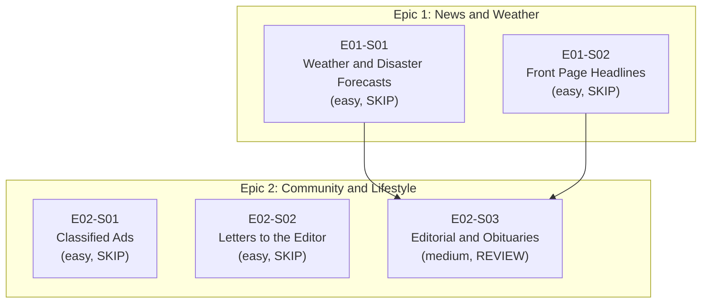

# Implementation Plan: Run 17 -- Three-Body Survival Gazette

## Summary

This plan decomposes the approved design for Run 17 (Three-Body Survival Gazette) into two epics with five stories. The primary workflow test objectives are: **full e2e pipeline with no skipped phases**, **tiered review strategy** (4 easy SKIP + 1 medium REVIEW), **parallel dispatch** (4 builders in Wave 1), **cross-reference validation** (E02-S03 reads E01 content), **planted bug detection** (2 deliberate errors for reviewers to catch), and **local PM item commits** (all agents commit `.workflow/items/`).

All stories produce markdown content files under `test-output/test-agentic-sdlc-three-body-gazette/`. No code, no tests, no infrastructure changes.

## Issue Mapping

| Item | Issue | Type | Difficulty |
|------|-------|------|------------|
| Backlog | #303 | backlog | -- |
| Design doc | #305 | docs | -- |
| Plan | #292 | docs | -- |
| E01: News and Weather | #306 | epic | -- |
| E01-S01: Weather and Disaster Forecasts | #308 | story | easy |
| E01-S02: Front Page Headlines and Breaking News | #309 | story | easy |
| E02: Community and Lifestyle | #307 | epic | -- |
| E02-S01: Classified Ads | #310 | story | easy |
| E02-S02: Letters to the Editor | #311 | story | easy |
| E02-S03: Guest Editorial and Obituaries | #312 | story | medium |

## Structural Decisions

**Two epics matching the design doc's domain split.** E01 (News and Weather, 2 stories) handles short-form newspaper content -- weather reports and breaking news articles. E02 (Community and Lifestyle, 3 stories) handles community-facing content -- classifieds, letters to the editor, and an editorial with obituaries. This maps directly to the design doc's proposed structure.

**Why 2 epics instead of 1:** The design doc clearly delineates two content domains with distinct newspaper section types. Separate epics enable parallel dispatch across both domains in Wave 1 and provide a clean boundary for the cross-reference dependency -- E02-S03's obituaries reference events from E01 stories. Two epics also make epic-level telemetry meaningful (E01 completes entirely in Wave 1; E02 spans both waves).

**Two-wave dispatch.** The dependency graph has two natural layers:

- **Wave 1** (4 parallel): E01-S01, E01-S02, E02-S01, E02-S02 -- all independent, all `difficulty/easy`. The config `maxParallelBuilders: 3` means the orchestrator may split into 3+1 sub-waves at its discretion. All 4 stories are SKIP tier (no per-story review).
- **Wave 2** (1 sequential): E02-S03 -- depends on E01-S01 and E01-S02 (cross-references specific events). This is the only `difficulty/medium` story and the only REVIEW-tier story, so it gets a per-story reviewer dispatch.

**Hard dependency for E02-S03.** The obituaries in E02-S03 must cross-reference specific details from E01-S01 (syzygy date, location, severity) and E01-S02 (Sophon deployment milestone, fleet departure). The builder must read the actual E01 output files. Scheduling E02-S03 in Wave 2 (after E01 stories merge into the epic branch and the integration branch) ensures these files are accessible. The E01 stories must be merged into the integration branch before the E02-S03 builder is dispatched so the builder can read the files from the integration branch.

**Between-wave merge sequence:** After Wave 1 completes, the orchestrator must: (1) merge E01-S01 and E01-S02 story branches into `epic/e01-news-weather`, (2) merge `epic/e01-news-weather` into `backlog/303-three-body-gazette`, (3) merge E02-S01 and E02-S02 story branches into `epic/e02-community-lifestyle`, (4) then dispatch E02-S03. This ensures the E01 content files exist on the integration branch when E02-S03's builder reads them. E02-S03's story branch is created from `epic/e02-community-lifestyle` (which already has E02-S01 and E02-S02 merged).

**Two planted bugs.** The design doc specifies 2 planted bugs:
1. **E02-S02 (Letters to the Editor):** One letter must reference "the Sun" (singular) instead of Sun-1/Sun-2/Sun-3. This is a world-building consistency violation. Since E02-S02 is SKIP tier, the bug can only be caught by the Phase 5 PR reviewer.
2. **E02-S03 (Obituaries):** One obituary must contain an incorrect cross-reference to E01 content (wrong date, wrong dimension count, etc.). Since E02-S03 is REVIEW tier, both the per-story reviewer and the Phase 5 PR reviewer have a chance to catch it.

## Format Contract

Since both epics produce newspaper-style content with shared Trisolaran elements, this format contract ensures consistency across parallel builders.

| Element | Exact Format | Example |
|---------|-------------|---------|
| File header | H1 with section name, H2 "Three-Body Survival Gazette" subtitle | `# Weather and Disaster Forecasts\n\n## Three-Body Survival Gazette` |
| Sun references | Always "Sun-1", "Sun-2", or "Sun-3" with hyphen and number | `Sun-2 entered periapsis at 0347 stellar time` |
| Time units | "stellar time" for clock time, "stellar cycles" for years | `0347 stellar time`, `3.2 million stellar cycles ago` |
| Currency | "credits" (lowercase) | `Price: 45,000 credits` |
| Advisory levels | WATCH, WARNING, EMERGENCY (caps) | `Advisory Level: EMERGENCY` |
| Dehydration Index | "LOW", "MODERATE", "HIGH", "CRITICAL" (caps) | `Dehydration Index: LOW` |
| Letter format | Opens with "Dear Editor,", closes with name and district | `Dear Editor,\n\n...\n\n— Zhi-Wen, District 7` |
| Obituary format | Name, age in stellar cycles, cause, survivors, service info | `Kai-Rong, 847 stellar cycles, lost during the tri-solar syzygy...` |
| Headline format | Title Case, newspaper-style | `Fleet Departure Ceremony Marks Historic Day for Trisolaran Civilization` |
| Item separator | Horizontal rule (`---`) between items within a file | `---` between each weather report, article, etc. |

## Review Tier Assignment

Config state (from `.claude/agentic-sdlc-config.json`):
- `skipPerStoryReview.enabled`: `true`
- `maxDifficulty`: `"easy"`
- `requireLabel`: `"test-agentic-sdlc"`
- Backlog issue 303 has label `test-agentic-sdlc`: **yes**

| Story | Difficulty | Meets maxDifficulty? | Backlog has label? | Review Tier |
|-------|-----------|---------------------|-------------------|-------------|
| E01-S01 | easy | yes (easy <= easy) | yes | SKIP |
| E01-S02 | easy | yes (easy <= easy) | yes | SKIP |
| E02-S01 | easy | yes (easy <= easy) | yes | SKIP |
| E02-S02 | easy | yes (easy <= easy) | yes | SKIP |
| E02-S03 | medium | no (medium > easy) | yes | REVIEW |

Phase 5 PR review always runs regardless of story-level tiers.

## Dependency Graph



## Dispatch Plan

| Wave | Stories | Dispatch | Review Tier | Notes |
|------|---------|----------|-------------|-------|
| **Wave 1** | E01-S01, E01-S02, E02-S01, E02-S02 | Parallel (4 builders, subject to maxParallelBuilders: 3) | All SKIP | All independent easy stories. No per-story review needed. |
| **Wave 2** | E02-S03 | Sequential (1 builder) | REVIEW | Depends on E01-S01 and E01-S02 content. Gets per-story reviewer dispatch. |

**Estimated execution time:**
- Wave 1 (4 easy, parallel): ~2-4 min wall-clock
- Between-wave merges: ~1-2 min
- Wave 2 (1 medium build + review): ~3-5 min wall-clock
- Overhead (orchestrator, telemetry, Phase 5 PR review, retro): ~5-8 min
- Total: ~11-19 min wall-clock

## Branch Strategy

```
backlog/303-three-body-gazette                    (integration branch)
├── epic/e01-news-weather                         (epic 1 branch)
│   ├── e01-s01/weather-forecasts                 (story branch)
│   └── e01-s02/breaking-news                     (story branch)
└── epic/e02-community-lifestyle                  (epic 2 branch)
    ├── e02-s01/classifieds                       (story branch)
    ├── e02-s02/letters-to-editor                 (story branch)
    └── e02-s03/editorial-obituaries              (story branch)
```

All branches created upfront in Phase 2 before any dispatch.

---

## Epic 1: News and Weather

Two easy stories producing short-form newspaper content -- weather reports and breaking news articles.

### E01-S01: Weather and Disaster Forecasts (easy, SKIP)

**File to create:** `test-output/test-agentic-sdlc-three-body-gazette/weather-forecasts.md`

**Branch:** `e01-s01/weather-forecasts` (from `epic/e01-news-weather`)

**Content:** 3 weather reports/advisories, 80-150 words each:
1. **Stable Era forecast** -- Sun-1 dominant, mild conditions, rehydration advisory (safe to rehydrate stored citizens), Dehydration Index: LOW, specific districts and coordinates
2. **Chaotic Era emergency alert** -- Sun-2 and Sun-3 entering unstable orbit, mandatory dehydration order, 4 stellar hour countdown, storage facility addresses, Class-1 survival violation warning
3. **Tri-solar syzygy warning** -- All three suns approaching alignment, predicted syzygy time, surface temperature at peak, deep-crust shelter evacuation, historical reference to Civilization 191, Dehydration Wind-Chill Equivalent

**Format Contract compliance:**
- Sun references use Sun-1/Sun-2/Sun-3 format
- Time uses "stellar time" and "stellar cycles"
- Advisory levels in caps (WATCH, WARNING, EMERGENCY)
- Items separated by `---`

**Acceptance criteria:**
- [ ] File exists at `test-output/test-agentic-sdlc-three-body-gazette/weather-forecasts.md`
- [ ] Contains exactly 3 weather reports/advisories
- [ ] Each report is 80-150 words
- [ ] Reports cover: Stable Era, Chaotic Era, tri-solar syzygy
- [ ] Suns always referred to as Sun-1, Sun-2, Sun-3 (never singular "the Sun")
- [ ] Includes specific coordinates, temperatures, and advisory levels
- [ ] Deadpan journalistic tone throughout
- [ ] Format Contract elements applied consistently

### E01-S02: Front Page Headlines and Breaking News (easy, SKIP)

**File to create:** `test-output/test-agentic-sdlc-three-body-gazette/breaking-news.md`

**Branch:** `e01-s02/breaking-news` (from `epic/e01-news-weather`)

**Content:** 3 breaking news articles, 80-150 words each, inverted pyramid style:
1. **Fleet departure ceremony** -- Ship count, Fleet Commander quotes, synchronized dehydration salutes, 450-stellar-cycle journey time
2. **Sophon deployment milestone** -- First successful 11-dimensional fold, failed attempts before success, lead Sophon Engineer quote, 2D unfolding visible from orbit
3. **Premature rehydration chaos** -- Chaotic Era ended 3 minutes after dehydration order, mass confusion, number of citizens affected, "fastest Chaotic Era in recorded history," fiber tearing injuries

**Format Contract compliance:**
- Newspaper-style headlines in Title Case
- Sun references use Sun-1/Sun-2/Sun-3 format
- Time uses "stellar time" and "stellar cycles"
- Items separated by `---`

**Acceptance criteria:**
- [ ] File exists at `test-output/test-agentic-sdlc-three-body-gazette/breaking-news.md`
- [ ] Contains exactly 3 breaking news articles
- [ ] Each article is 80-150 words
- [ ] Each article has a newspaper-style headline
- [ ] Articles cover: fleet departure, Sophon deployment, premature rehydration
- [ ] Inverted pyramid structure (most important info first)
- [ ] Suns always referred to by number (Sun-1, Sun-2, Sun-3)
- [ ] Deadpan journalistic tone throughout
- [ ] Format Contract elements applied consistently

---

## Epic 2: Community and Lifestyle

Three stories (2 easy + 1 medium) producing community newspaper content. E02-S01 and E02-S02 are independent and dispatch in Wave 1. E02-S03 depends on E01 content and dispatches in Wave 2.

### E02-S01: Classified Ads (easy, SKIP)

**File to create:** `test-output/test-agentic-sdlc-three-body-gazette/classifieds.md`

**Branch:** `e02-s01/classifieds` (from `epic/e02-community-lifestyle`)

**Content:** 3 classified ad sections, 80-150 words each:
1. **Real Estate** -- 3-4 property listings with location, size, price in credits, "survived X Chaotic Eras" selling points, deep-crust shelter listing, Trisolaran abbreviations (e.g., "3br/2ba, dehy-storage rm, reinf. foundation")
2. **Employment** -- 3-4 job postings: Sophon operator, Fleet maintenance technician, Rehydration facility technician. Standard format with qualifications and dehydration benefits
3. **Personals** -- 3-4 ads: seeking partner for mutual rehydration, lost dehydrated family member, seeking rehydration buddy. Brutally honest (Trisolaran transparency)

**Format Contract compliance:**
- Currency in "credits" (lowercase)
- Sun references use Sun-1/Sun-2/Sun-3 format
- Items separated by `---`
- Section headers for Real Estate, Employment, Personals

**Acceptance criteria:**
- [ ] File exists at `test-output/test-agentic-sdlc-three-body-gazette/classifieds.md`
- [ ] Contains 3 classified sections: Real Estate, Employment, Personals
- [ ] Each section is 80-150 words
- [ ] Uses abbreviated classified ad formatting style
- [ ] Suns always referred to by number (Sun-1, Sun-2, Sun-3)
- [ ] Trisolaran transparency reflected in personals (no euphemism)
- [ ] Deadpan tone throughout
- [ ] Format Contract elements applied consistently

### E02-S02: Letters to the Editor (easy, SKIP)

**File to create:** `test-output/test-agentic-sdlc-three-body-gazette/letters-to-editor.md`

**Branch:** `e02-s02/letters-to-editor` (from `epic/e02-community-lifestyle`)

**Content:** 3 reader complaint letters, 80-150 words each:
1. **Premature rehydration complaint** -- Physical discomfort of rapid dehydration-rehydration cycling, demands compensation from Bureau of Stellar Forecasting, formal complaint threat
2. **Children in the dehydration warehouse** -- Unsupervised children among stacked dehydrated citizens, specific incidents (using adults as sleds, accidentally rehydrating someone's leg), demands better security
3. **Noise complaint about gravitational tides** -- Structural groaning and furniture displacement during binary syzygy, demands "gravitational noise ordinances" and damper subsidies

**PLANTED BUG (E02-S02):** One letter MUST reference "the Sun" (singular, without a number) instead of the three-sun system. Embedded naturally, not flagged. Example: "when the Sun rose this morning" or "the Sun's position was directly overhead."

**Format Contract compliance:**
- Letters open with "Dear Editor," and close with name and district
- Sun references use Sun-1/Sun-2/Sun-3 format (except the planted bug)
- Items separated by `---`

**Acceptance criteria:**
- [ ] File exists at `test-output/test-agentic-sdlc-three-body-gazette/letters-to-editor.md`
- [ ] Contains exactly 3 letters to the editor
- [ ] Each letter is 80-150 words
- [ ] Each letter opens with "Dear Editor," and closes with a signature
- [ ] Topics: premature rehydration, warehouse children, gravitational noise
- [ ] Letters read as authentic reader complaints
- [ ] Deadpan tone throughout
- [ ] Planted bug present: one letter references "the Sun" (singular)
- [ ] Format Contract elements applied consistently

### E02-S03: Guest Editorial and Obituaries (medium, REVIEW)

**File to create:** `test-output/test-agentic-sdlc-three-body-gazette/editorial-obituaries.md`

**Branch:** `e02-s03/editorial-obituaries` (from `epic/e02-community-lifestyle`)

**Blocked by:** E01-S01 and E01-S02 (must read their output files for cross-references)

**Content:**
1. **Guest editorial (150-250 words):** A Trisolaran elder argues for the Earth invasion citing the Dark Forest theory. Must include:
   - Personal experience surviving multiple Chaotic Eras
   - Dark Forest argument (silent hunters, revealing location = suicide, strike first)
   - Moral acknowledgment of conquering Earth but survival outweighs ethics
   - Reference to fleet departure (connecting to E01-S02)
   - Reference to Sophon intelligence about Earth
   - Closing call to unity: "We have survived 203 civilizations..."
   - Signed: Elder name, Civilization Advisory Council, Civilization 203

2. **Obituary 1 (80-120 words):** Citizen lost during the tri-solar syzygy from E01-S01. Builder MUST read `test-output/test-agentic-sdlc-three-body-gazette/weather-forecasts.md` and reference specific details (syzygy date/time, location, severity).

3. **Obituary 2 (80-120 words):** Sophon operator who died during the deployment ceremony from E01-S02. Builder MUST read `test-output/test-agentic-sdlc-three-body-gazette/breaking-news.md` and reference specific event details.

**PLANTED BUG (E02-S03):** One obituary MUST contain an incorrect cross-reference to E01 content. Example: wrong syzygy date, wrong dimension count ("9-dimensional" instead of "11-dimensional"), wrong event detail. The error should be subtle, not an obvious blunder.

**Format Contract compliance:**
- Obituary format: name, age in stellar cycles, cause, survivors, service info
- Sun references use Sun-1/Sun-2/Sun-3 format
- Time uses "stellar time" and "stellar cycles"
- Items separated by `---`

**Acceptance criteria:**
- [ ] File exists at `test-output/test-agentic-sdlc-three-body-gazette/editorial-obituaries.md`
- [ ] Contains 1 guest editorial (150-250 words) and 2 obituaries (80-120 words each)
- [ ] Editorial argues for Earth invasion using Dark Forest theory
- [ ] Editorial references fleet departure from E01-S02
- [ ] Obituary 1 cross-references E01-S01 syzygy details (read from file)
- [ ] Obituary 2 cross-references E01-S02 Sophon deployment details (read from file)
- [ ] Planted bug present: one obituary has an incorrect cross-reference detail
- [ ] Obituaries follow standard newspaper obituary format
- [ ] Deadpan journalistic tone throughout
- [ ] Format Contract elements applied consistently

---

## Universe Reference (for builder context)

Each story issue body should include or reference the Three-Body universe reference section from the design doc. Key elements builders must use consistently:

- **Three suns:** Sun-1, Sun-2, Sun-3 (never "the Sun" singular, except in E02-S02's planted bug)
- **Eras:** Stable Era (brief peace), Chaotic Era (destruction), tri-solar syzygy (catastrophic alignment)
- **Dehydration/Rehydration:** Survival mechanism, government-ordered, stored in warehouses
- **Sophons:** 11-dimensional proton fold, deployed to Earth to disrupt particle accelerators
- **Fleet:** ~1,000 ships, ~450 stellar cycle journey to Earth
- **Dark Forest:** Universe is silent hunters, broadcasting location = suicide
- **Culture:** Transparent communication (no lying), collectivist survival, civilization cycles (203+)
- **Time units:** "stellar time" (hours/minutes), "stellar cycles" (years)
- **Currency:** "credits"

## Test Objectives Mapping

| Objective | How Validated | Stories |
|-----------|---------------|---------|
| Full e2e pipeline | All 6 phases execute (design, plan, build, review, retro, telemetry) | All |
| Tiered review strategy | 4 SKIP + 1 REVIEW per config | E01-S01..E02-S02 (SKIP), E02-S03 (REVIEW) |
| Parallel dispatch | Wave 1: 4 builders in parallel | E01-S01, E01-S02, E02-S01, E02-S02 |
| Cross-reference validation | E02-S03 reads E01 files and references details | E02-S03 |
| Planted bug detection | 2 bugs for reviewer to catch | E02-S02 (singular "the Sun"), E02-S03 (wrong cross-ref) |
| Local PM commits | All agents commit `.workflow/items/` | All |
| Test asset conventions | Docs in `test-agentic-sdlc/` subfolders | All |
